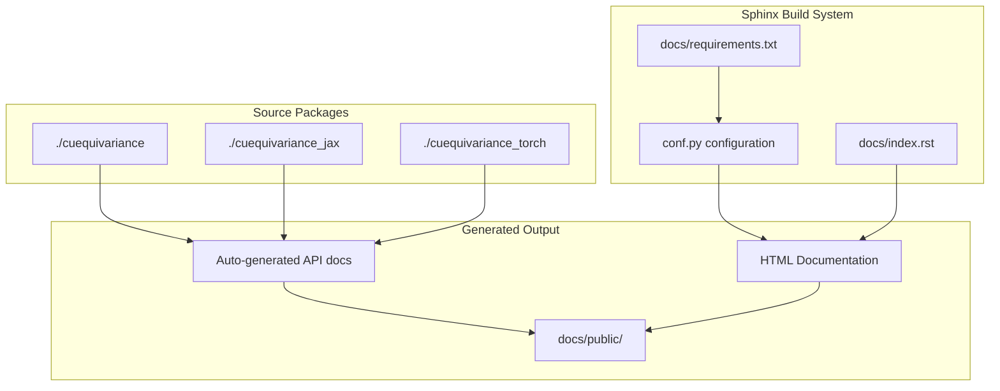
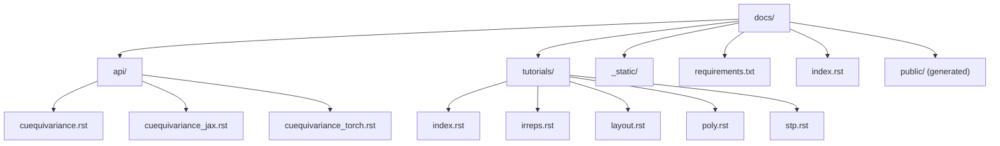
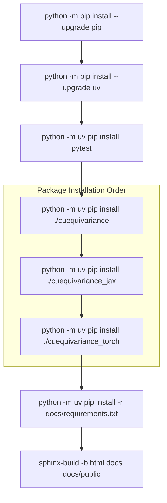
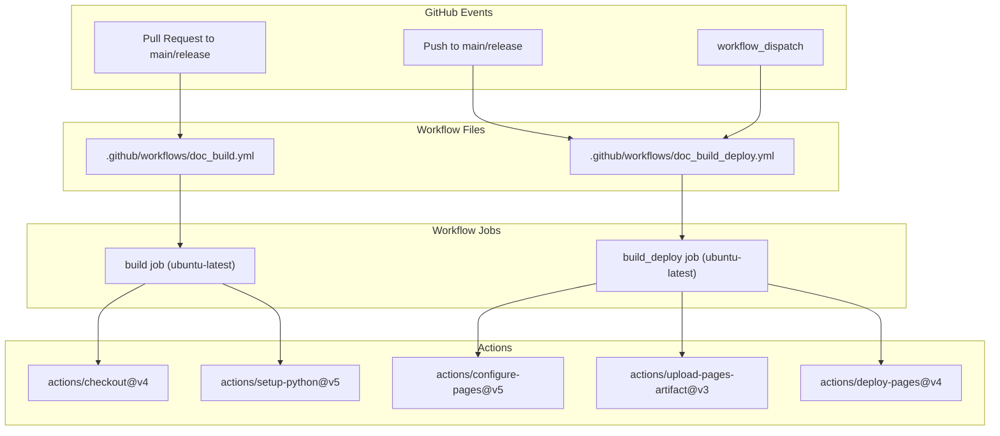
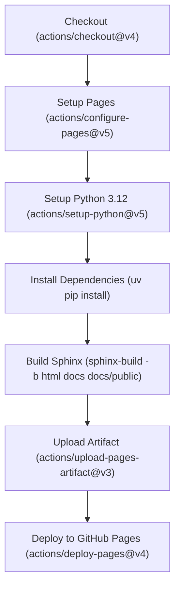

<!-- source: DeepWiki mcp.deepwiki.com · repo NVIDIA/cuEquivariance · page 6.2 Documentation · fetched 2026-10-26 -->

# Documentation

<details>
<summary>Relevant source files</summary>

The following files were used as context for generating this wiki page:

- [.github/workflows/doc_build.yml](.github/workflows/doc_build.yml)
- [.github/workflows/doc_build_deploy.yml](.github/workflows/doc_build_deploy.yml)
- [.github/workflows/publish.yml](.github/workflows/publish.yml)
- [.github/workflows/style.yml](.github/workflows/style.yml)

</details>


This page provides comprehensive information about the documentation system for cuEquivariance, including how to build, contribute to, and deploy documentation. For information about testing the code, see [Testing](#5.1).

## Sphinx Configuration and File Structure

### Documentation Build System Architecture

The cuEquivariance documentation uses Sphinx with a modular package structure that mirrors the repository organization:



### Documentation Directory Structure

The documentation follows this file organization pattern used by the build workflows:



Sources: [.github/workflows/doc_build.yml:22-28](), [.github/workflows/doc_build_deploy.yml:43-49]()

## Building Documentation

### Local Build Process

The documentation build follows the same process used in CI/CD workflows. The build requires installing all three cuEquivariance packages before generating documentation:

#### Dependencies Installation Sequence



#### Build Commands

The exact commands used in the CI workflows:

```bash
# Setup package manager
python -m pip install --upgrade pip
python -m pip install --upgrade uv

# Install testing framework
python -m uv pip install pytest

# Install cuEquivariance packages in order
python -m uv pip install ./cuequivariance
python -m uv pip install ./cuequivariance_jax  
python -m uv pip install ./cuequivariance_torch

# Install documentation dependencies
python -m uv pip install -r docs/requirements.txt

# Build documentation
sphinx-build -b html docs docs/public
```

The generated HTML files will be available in the `docs/public/` directory.

Sources: [.github/workflows/doc_build.yml:18-28](), [.github/workflows/doc_build_deploy.yml:39-49]()

## GitHub Actions Documentation Workflows

### Workflow Trigger System

The documentation system uses two distinct GitHub Actions workflows with specific trigger conditions:



### doc_build.yml Workflow (Pull Request Validation)

This workflow validates documentation builds for pull requests targeting `main` or `release` branches:

| Step | Action | Purpose |
|------|--------|---------|
| Checkout | `actions/checkout@v4` | Retrieve repository code |
| Setup Python | `actions/setup-python@v5` | Install Python 3.12 |
| Install Dependencies | uv package manager | Install cuEquivariance packages and docs requirements |
| Build Sphinx | `sphinx-build -b html docs docs/public` | Generate documentation and validate build |

### doc_build_deploy.yml Workflow (Production Deployment)

This workflow builds and deploys documentation to GitHub Pages with enhanced permissions:

#### Permissions Configuration
```yaml
permissions:
  contents: read
  pages: write  
  id-token: write
```

#### Concurrency Control
```yaml
concurrency:
  group: "pages"
  cancel-in-progress: false
```

#### Deployment Steps



The deployment uploads the `docs/public` directory as a GitHub Pages artifact and deploys it to the `github-pages` environment.

Sources: [.github/workflows/doc_build.yml:1-29](), [.github/workflows/doc_build_deploy.yml:1-57]()

## Contributing to Documentation

When contributing to the cuEquivariance documentation, follow these guidelines:

### Documentation Format

The documentation uses reStructuredText (RST) format with Sphinx extensions. Key components include:

| Component | Description | Example |
|-----------|-------------|---------|
| Section Headers | Define document structure | `Title\n=====` |
| Code Blocks | Display code samples | `` ```python\ncode\n``` `` |
| Cross-references | Link to other parts of docs | `:doc:\`tutorials/irreps\`` |
| Autodoc | Auto-generate API docs | `.. autoclass:: ClassName` |

### API Documentation

API documentation is automatically generated from docstrings. The main autodoc directives used are:

```rst
.. autosummary::
   :toctree: generated/
   :template: class_template.rst

   ClassName1
   ClassName2
```

Sources: [docs/api/cuequivariance.rst:25-85]()

### Adding New Content

To add new content to the documentation:

1. Create a new `.rst` file in the appropriate directory
2. Add it to the relevant `toctree` directive
3. Use consistent formatting with the existing documentation
4. Ensure proper cross-referencing

## Code Examples

Code examples are usually provided using the `jupyter-execute` directive, which allows running Python code within the documentation:

```rst
.. jupyter-execute::

   import cuequivariance as cue
   # Code example here
```

Sources: [docs/index.rst:58-67]()

## Screenshots and Diagrams

Static images and diagrams are stored in the `docs/_static/` directory and referenced in documentation files:

```rst
.. image:: _static/main_components.png
   :alt: Main components of cuEquivariance
   :align: center
```

Sources: [docs/index.rst:70-72]()

## Tutorials

Tutorials provide step-by-step guidance for users. Each tutorial is a separate RST file under the `docs/tutorials/` directory and is included in the documentation table of contents.

The main tutorials are:
- Irreps: Introduction to group representations
- Layout: Explaining tensor layouts
- Polynomial: Working with polynomials
- Segmented Tensor Product: Detailed explanation of tensor products

Sources: [docs/tutorials/index.rst:16-25](), [docs/index.rst:85-92]()

---

