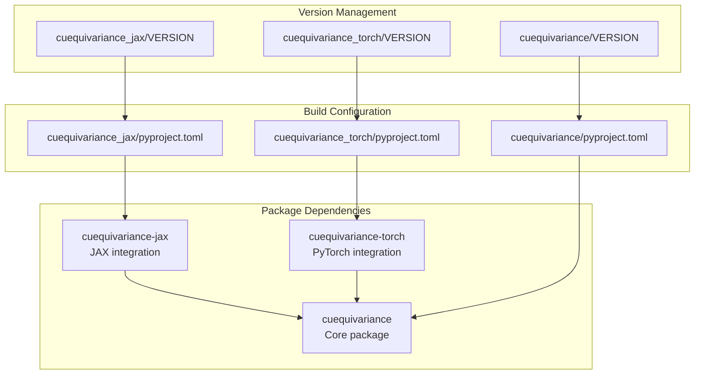
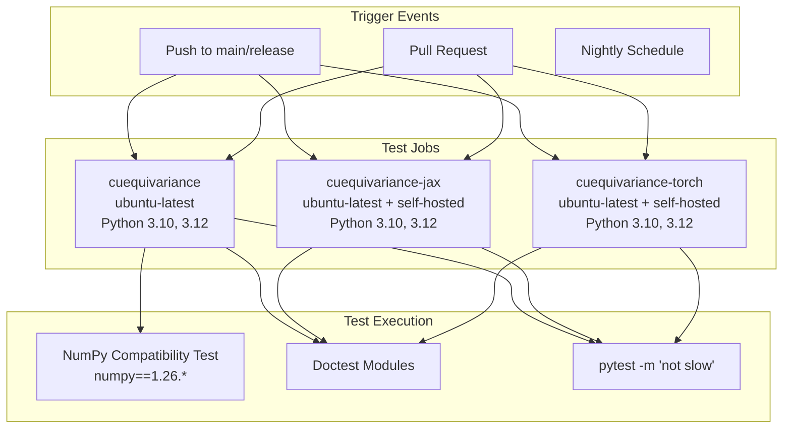
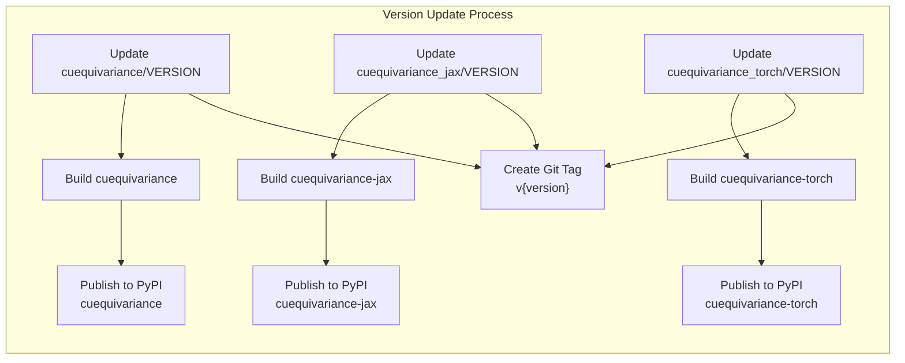
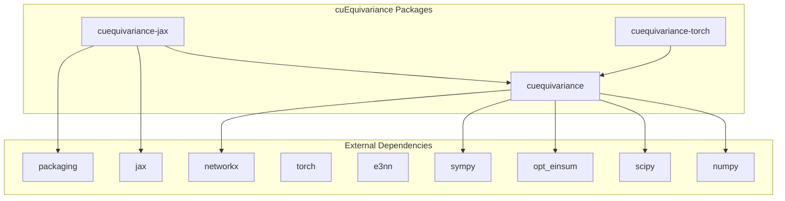

<!-- source: DeepWiki mcp.deepwiki.com · repo NVIDIA/cuEquivariance · page 6.3 Release Process · fetched 2026-10-26 -->

# Release Process

<details>
<summary>Relevant source files</summary>

The following files were used as context for generating this wiki page:

- [.github/workflows/tests.yml](.github/workflows/tests.yml)
- [cuequivariance/pyproject.toml](cuequivariance/pyproject.toml)
- [cuequivariance_jax/pyproject.toml](cuequivariance_jax/pyproject.toml)
- [cuequivariance_torch/pyproject.toml](cuequivariance_torch/pyproject.toml)

</details>


## Purpose and Scope

This document describes the release process for the cuEquivariance library, including package versioning, continuous integration pipelines, and PyPI publishing workflows. The release process manages three separate packages: `cuequivariance` (core mathematical components), `cuequivariance-jax` (JAX integration), and `cuequivariance-torch` (PyTorch integration).

For information about the testing infrastructure that supports the release process, see [Testing](#6.1). For documentation building and deployment, see [Documentation](#6.2).

## Package Structure and Versioning

The cuEquivariance project consists of three independently versioned packages, each with its own release cycle and dependency management.

### Package Configuration



Each package uses `hatchling` as the build backend and follows a consistent versioning pattern defined in their respective `pyproject.toml` files.

| Package | Dependencies | Version Source |
|---------|-------------|----------------|
| `cuequivariance` | numpy, scipy, opt_einsum, sympy, networkx | [cuequivariance/VERSION]() |
| `cuequivariance-jax` | cuequivariance, jax, packaging | [cuequivariance_jax/VERSION]() |
| `cuequivariance-torch` | cuequivariance | [cuequivariance_torch/VERSION]() |

**Sources:** [cuequivariance/pyproject.toml:20-49](), [cuequivariance_jax/pyproject.toml:20-47](), [cuequivariance_torch/pyproject.toml:20-45]()

### Version Pattern

All packages use the same version pattern defined in their `pyproject.toml` files:

```toml
[tool.hatch.version]
path = "package_name/VERSION"
pattern = "(?P<version>\\d+\\.\\d+\\.\\d+(?:[a-z]+\\d+)?)"
```

This pattern supports:
- Standard semantic versioning (e.g., `1.2.3`)
- Pre-release versions (e.g., `1.2.3a1`, `1.2.3b2`, `1.2.3rc1`)

**Sources:** [cuequivariance/pyproject.toml:43-45](), [cuequivariance_jax/pyproject.toml:41-43](), [cuequivariance_torch/pyproject.toml:39-41]()

## Continuous Integration Pipeline

The release process is supported by a comprehensive CI/CD pipeline that validates all packages across multiple Python versions and execution environments.

### Test Matrix and Execution



**Sources:** [.github/workflows/tests.yml:3-8](), [.github/workflows/tests.yml:10-108]()

### Package-Specific Test Configuration

#### Core Package Testing
The `cuequivariance` package testing includes compatibility validation with different NumPy versions:

```yaml
- name: Test with pytest
  run: |
    pytest --doctest-modules -x -m "not slow" cuequivariance
- name: Downgrade numpy
  run: |
    python -m uv pip install -U "numpy==1.26.*"
- name: Test with pytest (numpy 1.26)
  run: |
    pytest --doctest-modules -x -m "not slow" cuequivariance
```

**Sources:** [.github/workflows/tests.yml:31-39]()

#### JAX Package Testing
The `cuequivariance-jax` package includes CUDA-specific dependencies and environment configuration:

```yaml
- name: Install dependencies
  run: |
    python -m uv pip install -U pytest "jax[cuda12]"
    python -m uv pip install nvidia-cusolver-cu12==11.7.3.90
    python -m uv pip install jax-triton triton==3.3.1
```

**Sources:** [.github/workflows/tests.yml:62-67]()

#### PyTorch Package Testing
The `cuequivariance-torch` package includes PyTorch and e3nn dependencies:

```yaml
- name: Install dependencies
  run: |
    python -m uv pip install -U pytest torch e3nn
```

**Sources:** [.github/workflows/tests.yml:99]()

## Release Workflow

### Pre-Release Validation

Before initiating a release, the following validation steps must be completed:

1. **All CI tests pass** on the target release branch
2. **Version compatibility** across dependent packages is verified
3. **Documentation builds** successfully
4. **CUDA kernel tests** pass on self-hosted runners with GPU access

### Version Coordination



**Sources:** [cuequivariance/pyproject.toml:43-45](), [cuequivariance_jax/pyproject.toml:41-43](), [cuequivariance_torch/pyproject.toml:39-41]()

### Build System Configuration

Each package uses `hatchling` with specific build configuration:

```toml
[build-system]
requires = ["hatchling"]
build-backend = "hatchling.build"

[tool.hatch.build.targets.wheel]
packages = ["package_name"]
force-include = { "Third_party_attr.txt" = "Third_party_attr.txt" }
```

The `force-include` directive ensures that licensing and attribution files are included in all built wheels.

**Sources:** [cuequivariance/pyproject.toml:16-18, 47-49](), [cuequivariance_jax/pyproject.toml:16-18, 45-47](), [cuequivariance_torch/pyproject.toml:16-18, 43-45]()

## Package Distribution Strategy

### Dependency Management

The packages follow a layered dependency structure:



This structure allows users to install only the components they need:
- **Core only**: `pip install cuequivariance`
- **JAX integration**: `pip install cuequivariance-jax`
- **PyTorch integration**: `pip install cuequivariance-torch`

**Sources:** [cuequivariance/pyproject.toml:28-34](), [cuequivariance_jax/pyproject.toml:28-32](), [cuequivariance_torch/pyproject.toml:28-30]()

### Python Version Support

All packages require Python 3.10 or higher and are tested on Python 3.10 and 3.12:

```toml
requires-python = ">=3.10"
classifiers = [
    "Programming Language :: Python :: 3.10",
    "Programming Language :: Python :: 3.11", 
    "Programming Language :: Python :: 3.12",
]
```

**Sources:** [cuequivariance/pyproject.toml:27, 36-40](), [cuequivariance_jax/pyproject.toml:27, 36-38](), [cuequivariance_torch/pyproject.toml:27, 34-36]()