# Page: Overview

# Overview

<details>
<summary>Relevant source files</summary>

The following files were used as context for generating this wiki page:

- [CHANGELOG.md](CHANGELOG.md)
- [README.md](README.md)
- [VERSION](VERSION)
- [docs/changelog.md](docs/changelog.md)
- [docs/index.rst](docs/index.rst)

</details>


This document provides an overview of the cuEquivariance library, its architecture, and core concepts. cuEquivariance is an NVIDIA Python library for building high-performance geometric neural networks using segmented polynomials and optimized CUDA kernels.

For specific installation instructions, see [Installation](#1.1). For detailed version history and breaking changes, see [Version History](#1.2). For mathematical foundations, see [Core Concepts](#2).

## What is cuEquivariance

cuEquivariance enables the construction of equivariant neural networks that respect geometric symmetries. Equivariance is the mathematical formalization of "respecting symmetries" - robust physical models exhibit equivariance with respect to rotations and translations in three-dimensional space, making AI models more data-efficient.

The library provides:
- **Segmented Polynomials**: Flexible mathematical framework for describing equivariant operations
- **Triangular Operations**: Specialized operations for AlphaFold2-style architectures  
- **CUDA Optimization**: High-performance GPU kernels with automatic tuning
- **Dual Bindings**: Support for both PyTorch and JAX frameworks

**Sources**: [README.md:1-6](), [docs/index.rst:19-22]()

## Package Architecture

cuEquivariance is organized into three main packages that provide different levels of functionality:

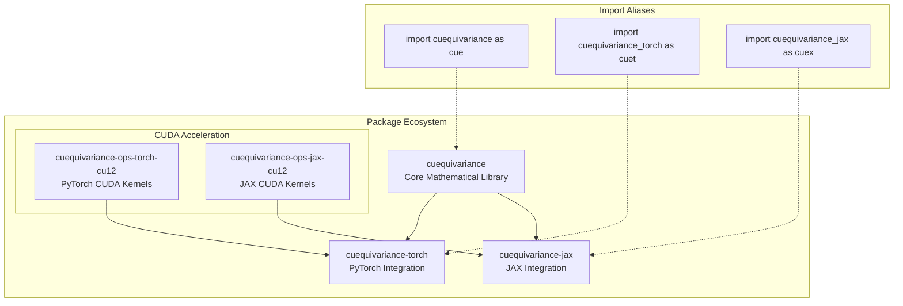

### Core Package (`cuequivariance`)

The core package contains framework-agnostic mathematical components:
- Group theory foundations (`cue.Rep`, `cue.Irreps`)
- Segmented tensor products (`cue.SegmentedTensorProduct`)
- Polynomial representations (`cue.SegmentedPolynomial`, `cue.EquivariantPolynomial`)
- Mathematical descriptors (`cue.descriptors`)

### Framework Bindings

| Package | Purpose | Key Components |
|---------|---------|----------------|
| `cuequivariance-torch` | PyTorch integration | `cuet.SegmentedPolynomial`, `cuet.TensorProduct`, triangle operations |
| `cuequivariance-jax` | JAX integration | `cuex.segmented_polynomial()`, `cuex.equivariant_polynomial()` |

### CUDA Acceleration

Optimized CUDA kernels provide significant performance improvements:
- **Triton Kernels**: Auto-tuned GPU implementations
- **Custom CUDA**: Specialized operations like `sigmoid_gated_dual_gemm`
- **Fallback Support**: Automatic fallback to framework implementations when needed

**Sources**: [docs/index.rst:57-69](), [README.md:13-22](), [CHANGELOG.md:18]()

## Core Mathematical Framework

The library uses a hierarchical structure to describe equivariant operations:

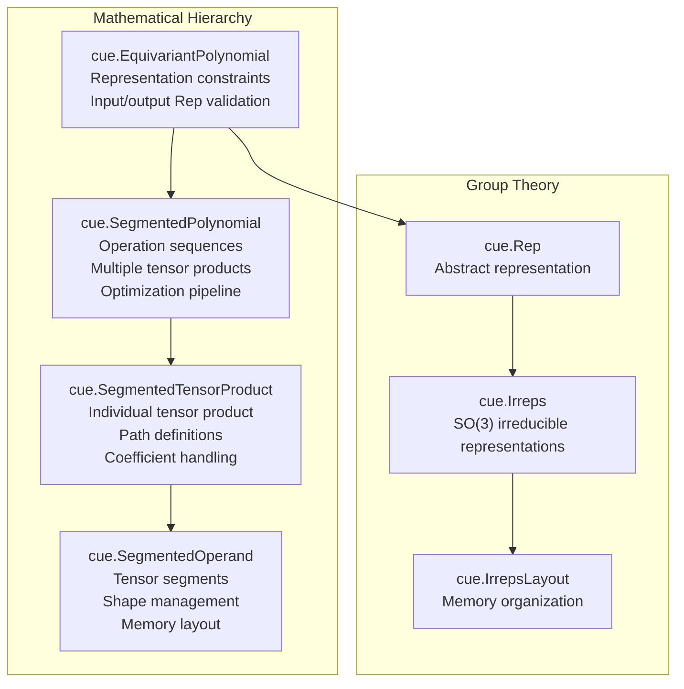

### Key Classes

- **`cue.EquivariantPolynomial`**: High-level interface ensuring equivariance constraints
- **`cue.SegmentedPolynomial`**: Manages sequences of tensor product operations  
- **`cue.SegmentedTensorProduct`**: Defines specific tensor product computations
- **`cue.SegmentedOperand`**: Handles tensor segmentation and memory layout

**Sources**: [docs/index.rst:75-80](), [CHANGELOG.md:92-94]()

## Execution Methods and Performance

cuEquivariance provides multiple execution backends optimized for different scenarios:

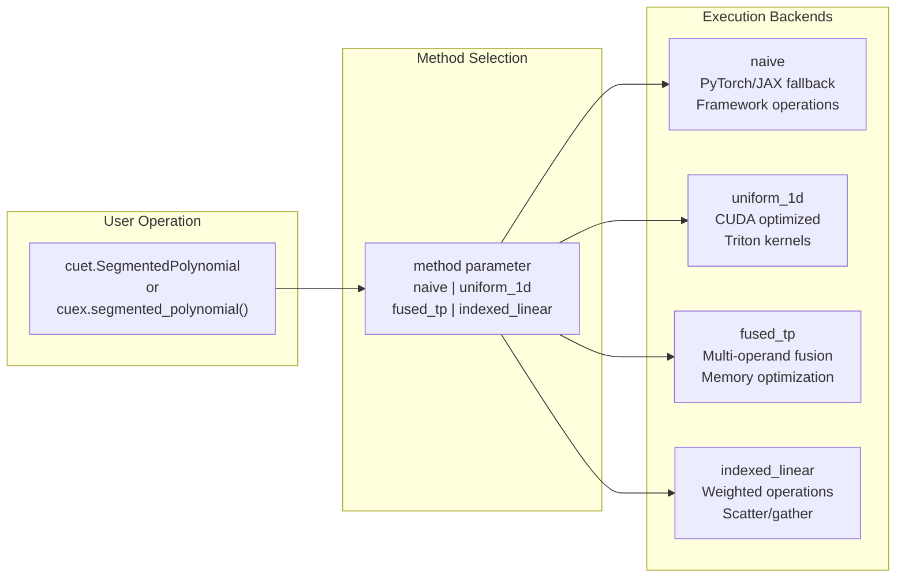

### Execution Methods

| Method | Description | Use Case |
|--------|-------------|----------|
| `naive` | Framework fallback implementation | Development, debugging, unsupported shapes |
| `uniform_1d` | CUDA-optimized for uniform operations | Standard tensor products, best general performance |
| `fused_tp` | Multi-operand tensor product fusion | Complex polynomials, memory-bound operations |
| `indexed_linear` | Scatter/gather with linear operations | Sparse operations, graph neural networks |

### Performance Features

- **Auto-tuning**: Kernel parameters optimized per hardware configuration
- **Precision Control**: TF32, IEEE-754, mixed precision support  
- **Memory Optimization**: Fused operations reduce memory bandwidth requirements
- **Fallback Logic**: Automatic selection based on input shapes and platform capabilities

**Sources**: [CHANGELOG.md:7](), [CHANGELOG.md:34-41](), [CHANGELOG.md:43-48]()

## Framework Integration Patterns

### PyTorch Integration

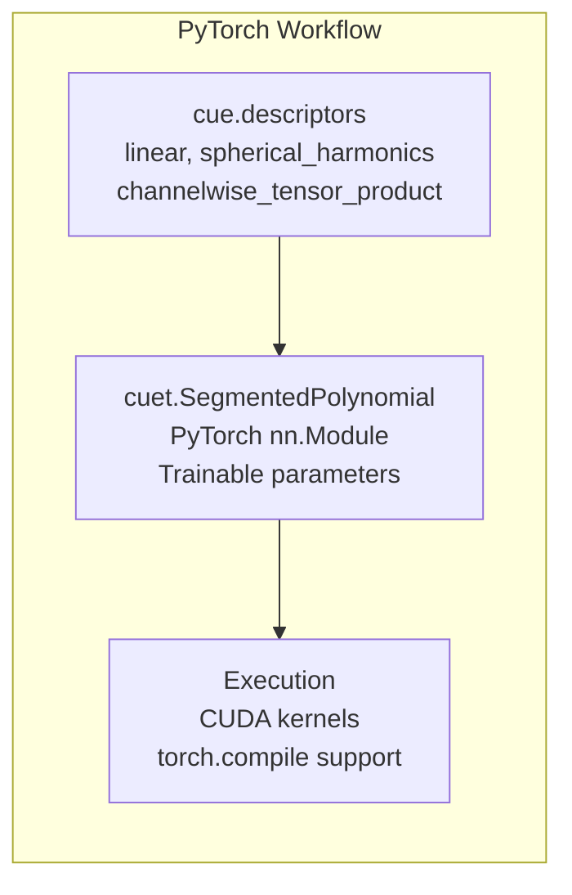

### JAX Integration  

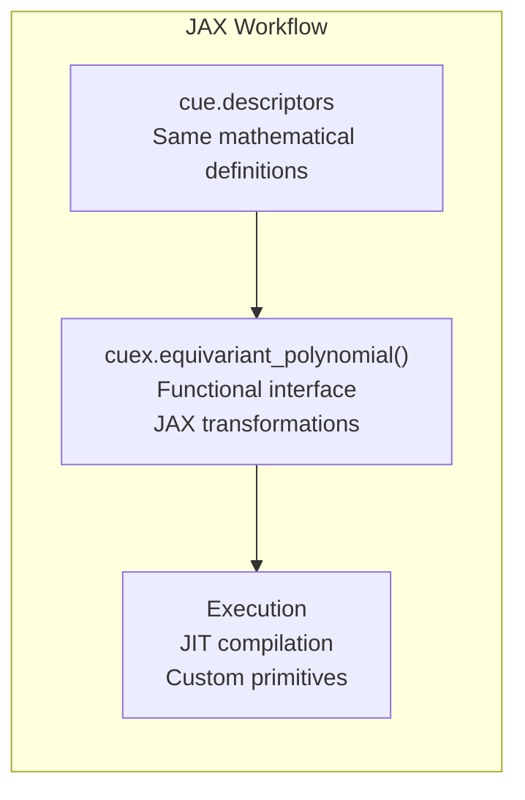

Both frameworks share the same mathematical descriptors from the core package but provide different execution interfaces optimized for their respective ecosystems.

**Sources**: [docs/index.rst:81-84](), [CHANGELOG.md:124-127](), [CHANGELOG.md:150-152]()

## Specialized Operations

Beyond general tensor products, cuEquivariance provides operations optimized for specific architectures:

### Triangle Operations
- **`cuet.triangle_attention`**: Attention mechanisms for triangular adjacency matrices
- **`cuet.triangle_multiplicative_update`**: AlphaFold2-style triangle multiplicative updates
- **`cuet.attention_pair_bias`**: Pair bias computation with caching support

### Symmetric Operations  
- **`cuet.SymmetricTensorProduct`**: Symmetric contractions and products
- **`cue.descriptors.symmetric_contraction`**: Mathematical descriptor for symmetric operations

**Sources**: [CHANGELOG.md:64-66](), [CHANGELOG.md:6]()

---

# Page: Installation

# Installation

<details>
<summary>Relevant source files</summary>

The following files were used as context for generating this wiki page:

- [.github/workflows/tests.yml](.github/workflows/tests.yml)
- [README.md](README.md)
- [cuequivariance/pyproject.toml](cuequivariance/pyproject.toml)
- [cuequivariance_jax/pyproject.toml](cuequivariance_jax/pyproject.toml)
- [cuequivariance_torch/pyproject.toml](cuequivariance_torch/pyproject.toml)
- [docs/changelog.md](docs/changelog.md)
- [docs/index.rst](docs/index.rst)

</details>


This document provides instructions for installing cuEquivariance and its components. For information about the underlying concepts and API details, see the [Core Concepts](#2) section.

## System Requirements

Before installing cuEquivariance, ensure your system meets the following requirements:

| Component | Requirement |
|-----------|-------------|
| Python | 3.10, 3.11, or 3.12 |
| Operating System | Linux x86_64/aarch64 |
| CUDA | 12.x (for GPU acceleration) |
| PyTorch | 2.4.0+ (for PyTorch frontend) |
| JAX | 0.5.0+ (for JAX frontend) |

Sources: [cuequivariance/pyproject.toml:27-41](), [cuequivariance_torch/pyproject.toml:27-37](), [cuequivariance_jax/pyproject.toml:27-38](), [docs/index.rst:46-52](), [.github/workflows/tests.yml:17]()

## Package Architecture

cuEquivariance is divided into multiple packages that serve different purposes and can be installed separately.

### Package Dependency Structure

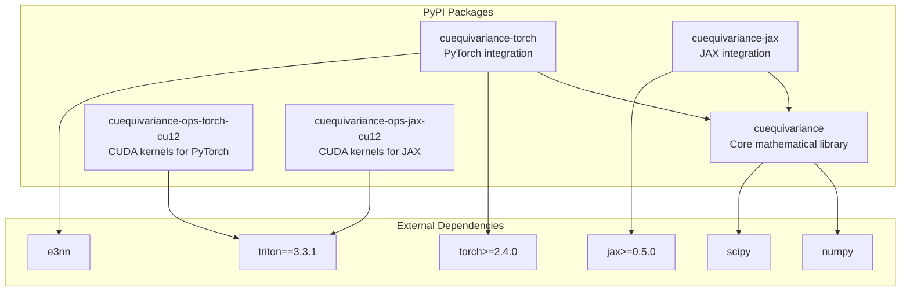

### Import Names and Code Modules

```mermaid
graph LR
    subgraph "Installation Commands"
        install_core["pip install cuequivariance"]
        install_torch["pip install cuequivariance-torch"]
        install_jax["pip install cuequivariance-jax"]
        install_torch_ops["pip install cuequivariance-ops-torch-cu12"]
        install_jax_ops["pip install cuequivariance-ops-jax-cu12"]
    end
    
    subgraph "Python Import Statements"
        import_core["import cuequivariance as cue"]
        import_torch["import cuequivariance_torch as cuet"]
        import_jax["import cuequivariance_jax as cuex"]
    end
    
    subgraph "Key Classes and Functions"
        core_classes["cue.SegmentedPolynomial<br/>cue.EquivariantPolynomial<br/>cue.Rep, cue.Irreps"]
        torch_classes["cuet.TensorProduct<br/>cuet.SegmentedPolynomial<br/>cuet.EquivariantTensorProduct"]
        jax_functions["cuex.segmented_polynomial<br/>cuex.equivariant_polynomial"]
    end
    
    install_core --> import_core
    install_torch --> import_torch
    install_jax --> import_jax
    import_core --> core_classes
    import_torch --> torch_classes
    import_jax --> jax_functions
```

Sources: [README.md:1-22]()

## Installation Methods

### Method 1: Using pip (Recommended)

Choose the packages based on your machine learning framework:

```bash
# For PyTorch users
pip install cuequivariance-torch
pip install cuequivariance-ops-torch-cu12  # CUDA 12 kernels (optional)

# For JAX users  
pip install cuequivariance-jax
pip install cuequivariance-ops-jax-cu12    # CUDA 12 kernels (optional)

# Core library only (no ML frameworks)
pip install cuequivariance
```

**Note**: The `cuequivariance-ops-*-cu12` packages provide optimized CUDA kernels for GPU acceleration. They are optional but recommended for performance.

Sources: [README.md:11-22](), [docs/index.rst:35-44]()

### Method 2: Installation from Source

For development or to access the latest features:

```bash
# Clone the repository
git clone https://github.com/NVIDIA/cuEquivariance.git
cd cuEquivariance

# Install core package in development mode
pip install -e ./cuequivariance

# Install PyTorch frontend (optional)
pip install -e ./cuequivariance_torch

# Install JAX frontend (optional) 
pip install -e ./cuequivariance_jax
```

This method is used in the CI testing pipeline and is recommended for contributors.

Sources: [.github/workflows/tests.yml:30](), [.github/workflows/tests.yml:69-70](), [.github/workflows/tests.yml:101-102]()

## Package Dependencies

The following table shows the dependencies for each package:

| Package | Required Dependencies | Python Requirement |
|---------|----------------------|-------------------|
| `cuequivariance` | `numpy`, `scipy`, `opt_einsum`, `sympy`, `networkx` | >=3.10 |
| `cuequivariance-torch` | `cuequivariance` | >=3.10 |
| `cuequivariance-jax` | `cuequivariance`, `jax`, `packaging` | >=3.10 |

### Additional Dependencies for Optimal Performance

| Framework | Additional Packages | Purpose |
|-----------|-------------------|---------|
| PyTorch | `torch>=2.4.0`, `e3nn` | Core PyTorch functionality and integration |
| JAX | `jax>=0.5.0`, `jax-triton`, `triton==3.3.1` | JAX functionality and CUDA kernel compilation |
| CUDA Ops | `nvidia-cusolver-cu12==11.7.3.90` | CUDA solver library for linear algebra |

Sources: [cuequivariance/pyproject.toml:28-34](), [cuequivariance_torch/pyproject.toml:28-30](), [cuequivariance_jax/pyproject.toml:28-32](), [.github/workflows/tests.yml:65-67](), [.github/workflows/tests.yml:99]()

## CUDA Version Compatibility

### CUDA Support Matrix

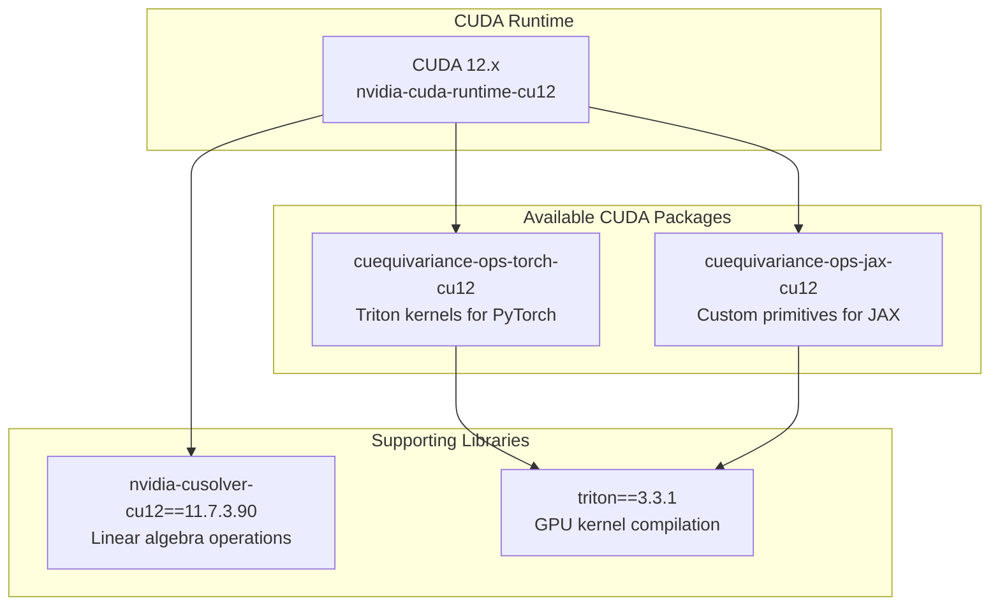

**Important**: Only CUDA 12.x is currently supported. The CUDA operations packages are available for Linux x86_64 and aarch64 architectures.

Sources: [docs/index.rst:42-44](), [docs/index.rst:49](), [.github/workflows/tests.yml:66-67]()

## Verifying Your Installation

To verify that cuEquivariance is installed correctly:

```python
# Core library
import cuequivariance as cue
print('cue', cue.__version__)

# PyTorch frontend (if installed)
import cuequivariance_torch as cuet
print('cuet', cuet.__version__)

# JAX frontend (if installed)
import cuequivariance_jax as cuex
print('cuex', cuex.__version__)

# Test basic functionality
rep = cue.Irreps("1e + 2o")  # Test core functionality
print(f"Irreps: {rep}")
```

This verification approach matches the CI testing pattern and uses the conventional import aliases.

Sources: [.github/workflows/tests.yml:71-72](), [.github/workflows/tests.yml:103-104](), [docs/index.rst:60-68]()

## Troubleshooting

If you encounter issues during installation:

1. **CUDA version mismatch**: Ensure you install packages matching your system's CUDA version
2. **Python version error**: Verify you're using Python 3.10 or higher
3. **Import errors**: Check that all required dependencies are installed

For more information about version history and changes, see [Version History](#1.2).

---

# Page: Version History

# Version History

<details>
<summary>Relevant source files</summary>

The following files were used as context for generating this wiki page:

- [CHANGELOG.md](CHANGELOG.md)
- [VERSION](VERSION)

</details>


This page documents the evolution of cuEquivariance across its released versions, highlighting key features, breaking changes, and improvements. This information is valuable for users migrating between versions or for understanding when specific capabilities were introduced. For installation instructions, see [Installation](#1.1).

## Version Timeline

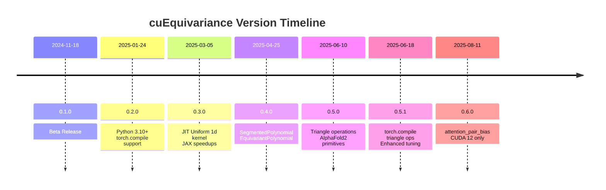

Sources: [CHANGELOG.md:183](), [CHANGELOG.md:156](), [CHANGELOG.md:115](), [CHANGELOG.md:84](), [CHANGELOG.md:58](), [CHANGELOG.md:28](), [CHANGELOG.md:3]()

## Current Version (0.6.0)

The current version of cuEquivariance is 0.6.0, released on August 11, 2025.

Sources: [VERSION:1](), [CHANGELOG.md:3]()

## Version Details

### Version 0.1.0 (2024-11-18)

This was the initial beta release of cuEquivariance.

Sources: [CHANGELOG.md:94-96]()

### Version 0.2.0 (2025-01-24)

Version 0.2.0 introduced several breaking changes and improvements, with a focus on better PyTorch integration.

#### Key Features

- Experimental support for `torch.compile`
- Added `cue.IrrepsAndLayout` class
- Added `cuex.RepArray` for representation arrays

#### Breaking Changes

- Increased minimum Python version to 3.10
- Input shape requirements changed for `cuet.TensorProduct` and `cuet.EquivariantTensorProduct`
- Replaced function `cuet.spherical_harmonics` with Torch Module `cuet.SphericalHarmonics`
- Various JAX API changes (`cuex.IrrepsArray` became an alias for `cuex.RepArray`)

```mermaid
classDiagram
    class "cue.Rep" {
        <<Abstract class>>
    }
    class "cue.IrrepsAndLayout" {
        Contains irreps and layout
    }
    class "cuex.RepArray" {
        Represents array of representations
    }
    class "cuex.IrrepsArray" {
        Now an alias for RepArray
    }
    
    "cue.Rep" <|-- "cue.IrrepsAndLayout"
    "cuex.RepArray" -- "cuex.IrrepsArray"
```

Sources: [CHANGELOG.md:67-93]()

### Version 0.3.0 (2025-03-05)

Version 0.3.0 brought significant performance improvements, particularly for JAX users, with new kernel implementations.

#### Key Features

- New JIT Uniform 1d kernel with JAX bindings
  - Supports computing any polynomial based on 1d uniform STPs
  - Enables arbitrary derivatives
  - Provides optional fused scatter/gather for inputs and outputs
- Full torch.compile support
- Beta torch bindings to the new JIT Uniform 1d kernel
- Approximately 3x speedup for MACE with cuEquivariance-JAX v0.3.0 compared to cuEquivariance-Torch v0.2.0

#### Breaking Changes

- Removed `cue.TensorProductExecution` and added more lightweight `cue.Operation`
- JAX API changes:
  - Renamed arguments in `cuex.equivariant_tensor_product`
  - Removed `cuex.symmetric_tensor_product`
  - Limited `jax.vmap` support
  - Changed interface of `cuex.tensor_product`
  - Removed `cuex.flax_linen.Linear`

Sources: [CHANGELOG.md:115-155]()

### Version 0.4.0 (2025-04-25)

Version 0.4.0 introduced the new polynomial system architecture with `SegmentedPolynomial` and `EquivariantPolynomial` classes.

#### Key Features

- `cuet.SegmentedPolynomial` module with indexing features
- Full support for float16 and bfloat16 data types
- New core classes: `cue.SegmentedOperand`, `cue.SegmentedPolynomial`, `cue.EquivariantPolynomial`
- Enhanced caching for `cue.descriptor.symmetric_contraction` and `cue.SegmentedTensorProduct.symmetrize_operands`
- JAX ARM configuration support
- `cuex.segmented_polynomial` and `cuex.equivariant_polynomial` functions
- Advanced batching capabilities in JAX with indexed input/output support
- Dead Code Elimination rule for `cuex.segmented_polynomial` primitive

#### Breaking Changes

- Renamed `SegmentedTensorProduct.flop_cost` to `flop` and `memory_cost` to `memory`
- Removed `IrrepsArray` in favor of `RepArray`
- Restructured folder organization with main subfolders `segmented_polynomials` and `group_theory`
- Deprecated `cue.EquivariantTensorProduct` in favor of `cue.EquivariantPolynomial`
- Changed behavior of `cue.SegmentedPolynomial.canonicalize_subscripts` for coefficient subscripts
- Removed support for fp32 math dtype with fp64 IO dtype in fully connected tensor products

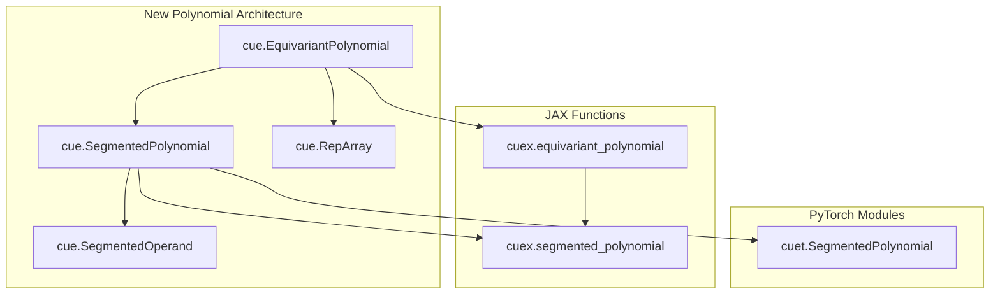

Sources: [CHANGELOG.md:84-114]()

### Version 0.5.0 (2025-06-10)

Version 0.5.0 introduced triangle operations for AlphaFold2-style architectures and marked the last release with CUDA 11 support.

#### Key Features

- `cuet.triangle_attention` for triangle attention operations
- `cuet.triangle_multiplicative_update` for triangle multiplicative updates
- `cuex.experimental.indexed_linear` (requires cuBLAS 12.5, not compatible with CUDA 11)
- Added `simplify_irreps3` argument to `cue.descriptors.channelwise_tensor_product`
- Added `permute_inputs` method to `SegmentedPolynomial`
- Performance improvements for uniform 1d segmented polynomials (up to 2x speedup in some cases)

#### Tuning Configuration

Full Ahead-of-Time (AOT) auto-tuning was enabled by default for `cuet.triangle_multiplicative_update`:
- Default: AOT tuning enabled (may take several hours)
- Quick testing: Set `CUEQ_DISABLE_AOT_TUNING = 1` and `CUEQ_DEFAULT_CONFIG = 1`
- On-Demand tuning: Set `CUEQ_DISABLE_AOT_TUNING = 1` only

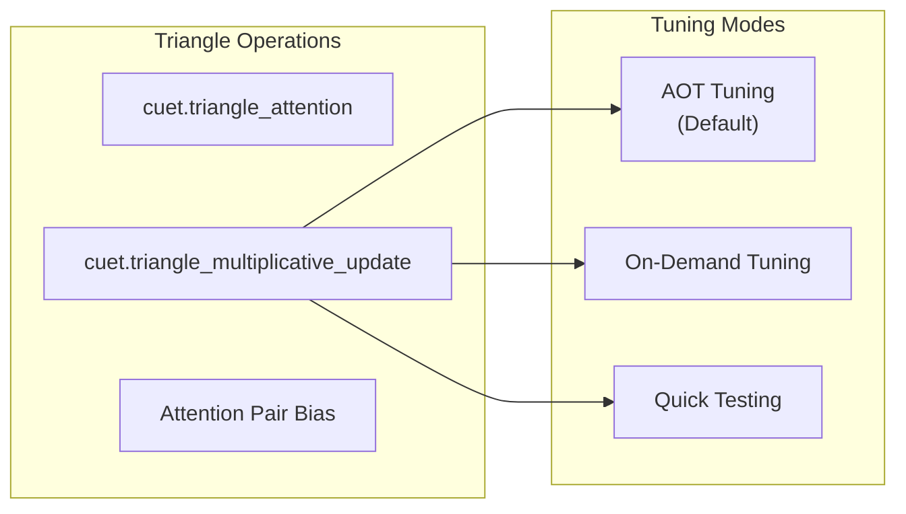

Sources: [CHANGELOG.md:58-83]()

### Version 0.5.1 (2025-06-18)

Version 0.5.1 focused on improving `torch.compile` support and enhancing tuning configuration options.

#### Key Features

- `torch.compile` support for `cuet.triangle_multiplicative_update`
- Optional precision argument for triangle multiplicative update:
  - `DEFAULT`: Use default precision of `triton.language.dot`
  - `TF32`: Use TensorFloat-32 precision
  - `TF32x3`: Use TensorFloat-32 with 3x accumulation
  - `IEEE`: Use IEEE 754 precision

#### Enhanced Tuning System

- Multi-process tuning support
- Improved cache management with environment variables:
  - `CUEQ_TRITON_TUNING_MODE`: Controls tuning mode (`ONDEMAND`, `AOT`)
  - `CUEQ_TRITON_IGNORE_EXISTING_CACHE`: Ignore cached settings
  - `CUEQ_TRITON_CACHE_DIR`: Specify cache directory location

Sources: [CHANGELOG.md:28-57]()

### Version 0.6.0 (2025-08-11)

Version 0.6.0 is the current release, introducing attention pair bias operations and dropping CUDA 11 support.

#### Key Features

- `cuet.attention_pair_bias` for pair bias tensor operations
- `method` argument for backend control in `cuet.SegmentedPolynomial` and `cuex.segmented_polynomial`
- Torch fallback options for triangle kernels based on sequence lengths
- Support for optional projection and gating biases in `cuex.triangle_multiplicative_update`
- JAX bindings for triangle operations: `cuex.triangle_attention` and `cuex.triangle_multiplicative_update`

#### Breaking Changes

- Dropped CUDA 11 support - only CUDA 12 packages are available (`cuequivariance-ops-torch-cu12`, `cuequivariance-ops-jax-cu12`)
- Simplified precision argument in triangle multiplicative update to None and IEEE-754 options
- Changed from round-towards-zero (RZ) to round-nearest (RN) implementation for better tf32 accuracy

#### Method Selection Architecture

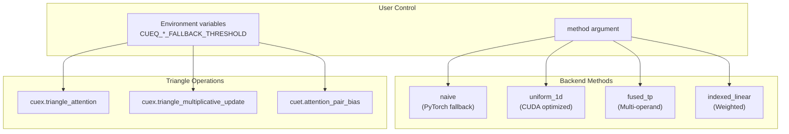

#### Known Issues

- `cuex.triangle_multiplicative_update` requires `triton<=3.3.1` (waiting for jax-triton update)
- `cuet.triangle_multiplicative_update` requires `triton>=3.4.0` on Blackwell GPUs
- `cuex.triangle_multiplicative_update` cannot run on Blackwell GPUs due to triton version constraints
- `cuet.attention_pair_bias` does not yet support caching of projected pairwise tensors

Sources: [CHANGELOG.md:3-27]()

## Evolution of Key Features

The following table summarizes the evolution of key features across versions:

| Feature | 0.1.0 (Beta) | 0.2.0 | 0.3.0 | Upcoming |
|---------|--------------|-------|-------|----------|
| PyTorch Support | ✓ | ✓ | ✓ | ✓ |
| JAX Support | ✓ | ✓ | ✓ | ✓ |
| torch.compile | ✗ | Experimental | ✓ | ✓ |
| Minimum Python | 3.9 | 3.10 | 3.10 | 3.10 |
| JIT Uniform 1d kernel | ✗ | ✗ | ✓ | ✓ |
| SegmentedPolynomial | ✗ | ✗ | ✗ | ✓ |
| EquivariantPolynomial | ✗ | ✗ | ✗ | ✓ |
| Advanced JAX Batching | ✗ | ✗ | Limited | ✓ |

Sources: [CHANGELOG.md:1-96]()

---

# Page: Core Concepts

# Core Concepts

<details>
<summary>Relevant source files</summary>

The following files were used as context for generating this wiki page:

- [cuequivariance/cuequivariance/group_theory/equivariant_polynomial.py](cuequivariance/cuequivariance/group_theory/equivariant_polynomial.py)
- [cuequivariance/cuequivariance/segmented_polynomials/segmented_polynomial.py](cuequivariance/cuequivariance/segmented_polynomials/segmented_polynomial.py)

</details>


This document covers the fundamental mathematical concepts and core data structures that form the foundation of the cuEquivariance library. These concepts enable the construction of equivariant neural networks through polynomial representations of tensor operations that respect group symmetries.

For framework-specific implementations, see [PyTorch Implementation](#3) and [JAX Implementation](#4). For performance optimization details, see [CUDA Kernels and Tuning](#5.2).

## Mathematical Foundations

The cuEquivariance library is built on mathematical concepts from group theory and representation theory that ensure neural network operations maintain equivariance properties under group transformations.

### Group Theory and Equivariance

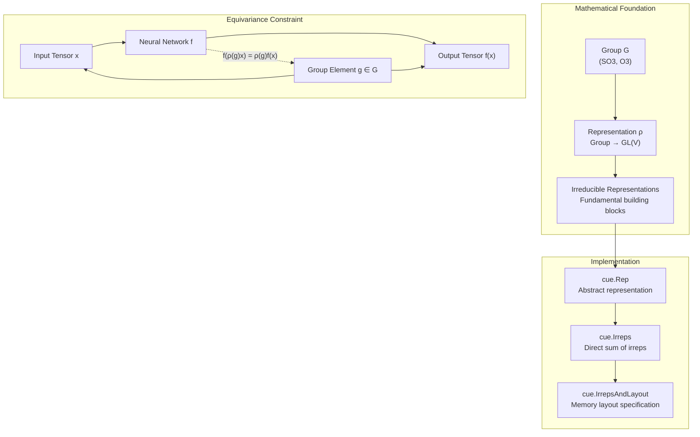

The core mathematical principle is that for any group element `g`, the function `f` must satisfy the equivariance constraint: `f(ρ(g)x) = ρ(g)f(x)`, where `ρ` is the group representation.

Sources: [cuequivariance/cuequivariance/group_theory/equivariant_polynomial.py:28-75]()

### Representation Theory Implementation

| Concept | Implementation | Purpose |
|---------|----------------|---------|
| Group | `cue.SO3`, `cue.O3` | Rotation and reflection groups |
| Representation | `cue.Rep` | Abstract group representation |
| Irreducible Representation | `cue.Irrep` | Fundamental representation building blocks |
| Direct Sum | `cue.Irreps` | Combination of multiple irreps |
| Memory Layout | `cue.IrrepsAndLayout` | Tensor layout with representation info |

Sources: [cuequivariance/cuequivariance/group_theory/equivariant_polynomial.py:42-75]()

## Core Data Structures

The library implements several key data structures that work together to represent and compute equivariant operations.

### Segmented Operands and Tensor Products

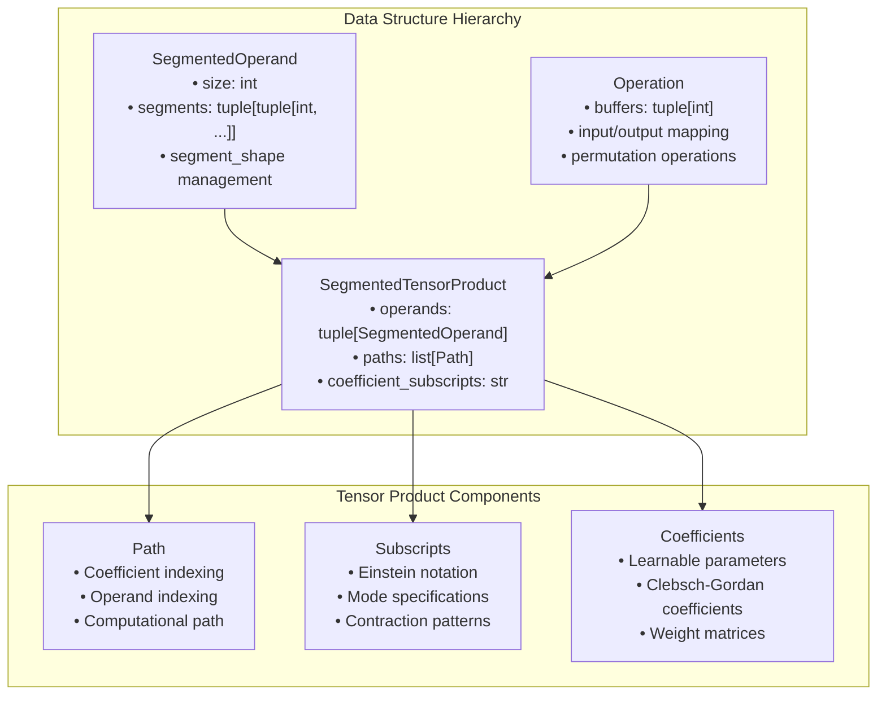

**SegmentedOperand** represents tensors divided into segments, each with potentially different shapes. This segmentation allows efficient handling of irreducible representations where different irreps may have different dimensions.

**SegmentedTensorProduct** defines how multiple operands are combined through tensor product operations. It contains the computational paths and indexing patterns needed to perform the operations.

**Operation** specifies which operands (identified by buffer indices) participate in a tensor product and how they map to inputs and outputs.

Sources: [cuequivariance/cuequivariance/segmented_polynomials/segmented_polynomial.py:49-51](), [cuequivariance/cuequivariance/segmented_polynomials/segmented_polynomial.py:70-85]()

### Polynomial Representations

The library uses polynomial representations to encode complex equivariant operations as sequences of tensor products.

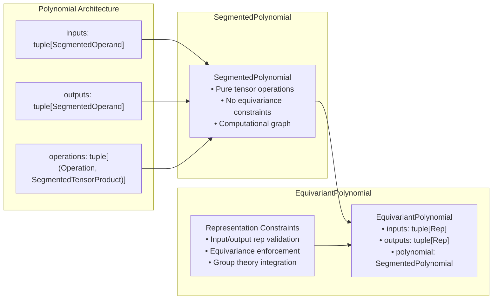

**SegmentedPolynomial** is the foundational computational representation that defines a sequence of tensor product operations without any group theory constraints. It manages the computational graph and provides core functionality for evaluation, transformation, and automatic differentiation.

**EquivariantPolynomial** extends `SegmentedPolynomial` by adding group representation information for inputs and outputs, ensuring that all operations respect equivariance constraints.

Sources: [cuequivariance/cuequivariance/segmented_polynomials/segmented_polynomial.py:34-51](), [cuequivariance/cuequivariance/group_theory/equivariant_polynomial.py:28-75]()

## Data Flow and Computational Graph

The computational flow proceeds from high-level equivariant specifications down to low-level tensor operations:

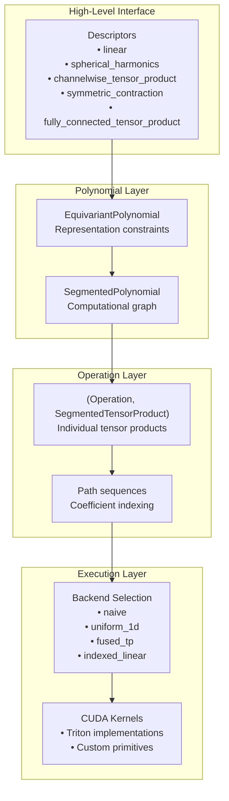

The flow starts with high-level descriptors that specify the mathematical operation, proceeds through polynomial representations that encode the computational graph, and ends with optimized kernel implementations.

Sources: [cuequivariance/cuequivariance/segmented_polynomials/segmented_polynomial.py:36-47](), [cuequivariance/cuequivariance/group_theory/equivariant_polynomial.py:28-45]()

## Key Methods and Operations

### SegmentedPolynomial Core Methods

| Method Category | Key Methods | Purpose |
|----------------|-------------|---------|
| Construction | `eval_last_operand()`, `stack()`, `concatenate()` | Building polynomial representations |
| Analysis | `flop()`, `memory()`, `used_inputs()` | Performance and dependency analysis |
| Transformation | `consolidate()`, `fuse_stps()`, `apply_fn()` | Optimization and manipulation |
| Filtering | `filter_keep_operands()`, `compute_only()` | Selective computation |
| Autodiff | `jvp()`, `transpose()`, `backward()` | Automatic differentiation support |

Sources: [cuequivariance/cuequivariance/segmented_polynomials/segmented_polynomial.py:149-1113]()

### EquivariantPolynomial Extensions

The `EquivariantPolynomial` class provides the same interface as `SegmentedPolynomial` but with added representation validation and group theory constraints. Key additional methods include:

- `split_operand_by_irrep()`: Splits operands along irreducible representation boundaries
- Representation-aware stacking and filtering operations
- Automatic validation of representation compatibility

Sources: [cuequivariance/cuequivariance/group_theory/equivariant_polynomial.py:422-474]()

## Memory Layout and Segmentation

The segmented approach allows efficient memory management and computation by grouping tensor elements according to their transformation properties:

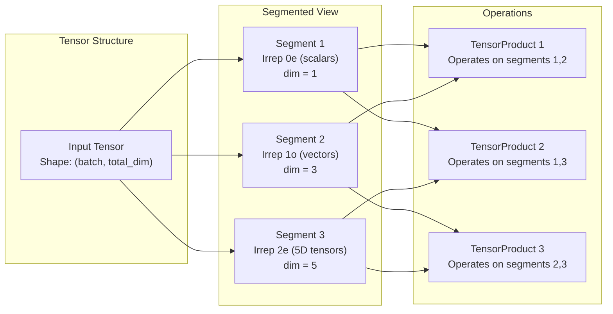

This segmentation enables the library to:
- Process only relevant portions of tensors for each operation
- Optimize memory access patterns
- Support heterogeneous irreducible representations efficiently

Sources: [cuequivariance/cuequivariance/segmented_polynomials/segmented_polynomial.py:109-144]()

---

# Page: SegmentedPolynomial

# SegmentedPolynomial

<details>
<summary>Relevant source files</summary>

The following files were used as context for generating this wiki page:

- [cuequivariance/cuequivariance/group_theory/equivariant_polynomial.py](cuequivariance/cuequivariance/group_theory/equivariant_polynomial.py)
- [cuequivariance/cuequivariance/segmented_polynomials/segmented_polynomial.py](cuequivariance/cuequivariance/segmented_polynomials/segmented_polynomial.py)

</details>


## Purpose and Overview

The `SegmentedPolynomial` class is a core data structure in cuEquivariance that represents a polynomial transformation using a collection of segmented tensor products. It provides an abstract representation for tensor operations that can be compiled into efficient CUDA kernels. This class sits between low-level tensor operations and higher-level equivariant neural network layers, serving as the computational backbone for operations like spherical harmonics, tensor products, and linear transformations.

For the equivariance-aware version of this class that includes group representation information, see [EquivariantPolynomial](#2.2).

Sources: [cuequivariance/segmented_polynomials/segmented_polynomial.py:30-108]()

## Structure and Components

A `SegmentedPolynomial` consists of three main components:

1. **Inputs**: A tuple of `SegmentedOperand` objects representing input tensors
2. **Outputs**: A tuple of `SegmentedOperand` objects representing output tensors
3. **Operations**: A tuple of pairs, each containing an `Operation` and a `SegmentedTensorProduct`

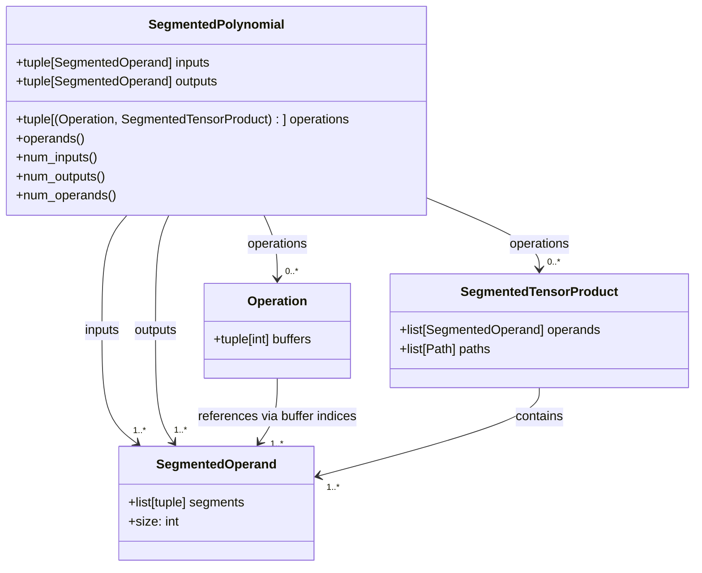

Sources: [cuequivariance/segmented_polynomials/segmented_polynomial.py:30-108]()

### Operands and Operations

The `SegmentedPolynomial` maps input tensors to output tensors through a series of operations, where each operation is defined by:

1. An `Operation` object that specifies which input and output operands are involved
2. A `SegmentedTensorProduct` that defines how these operands interact

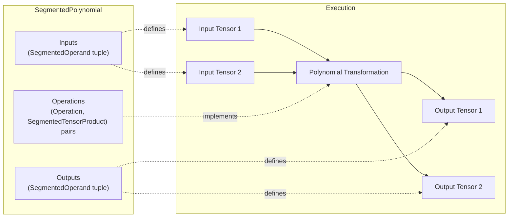

Sources: [cuequivariance/segmented_polynomials/segmented_polynomial.py:53-84](), [cuequivariance/segmented_polynomials/segmented_polynomial.py:377-404]()

## Construction Methods

The `SegmentedPolynomial` class provides several methods for constructing polynomials:

### Creating Basic Polynomials

The most basic way to create a `SegmentedPolynomial` is to evaluate the last operand of a `SegmentedTensorProduct`:

```mermaid
flowchart LR
    stp["SegmentedTensorProduct"] --> |"eval_last_operand"| poly["SegmentedPolynomial"]
    note["Takes inputs from all but last\noperand of STP, and output\nas the last operand"]
    note -.-> poly
```

Sources: [cuequivariance/segmented_polynomials/segmented_polynomial.py:144-158](), [cuequivariance/tests/segmented_polynomials/segmented_polynomial_test.py:36-44]()

### Combining Polynomials

`SegmentedPolynomial` provides methods to combine multiple polynomials:

1. **`stack`**: Combines polynomials by stacking their operands
2. **`stack_tensor_products`**: Creates a polynomial by stacking tensor products
3. **`concatenate`**: Creates a polynomial by concatenating multiple polynomials

```mermaid
flowchart TD
    subgraph "stack(polys, stacked)"
        s1["Polynomial 1"] --> |"shared operands"| sr["Stacked Result"]
        s2["Polynomial 2"] --> |"stacked operands"| sr
    end
    
    subgraph "concatenate(inputs, outputs, polys)"
        c1["Polynomial 1"] --> |"mapped operands"| cr["Concatenated Result"]
        c2["Polynomial 2"] --> |"mapped operands"| cr
    end
```

Sources: [cuequivariance/segmented_polynomials/segmented_polynomial.py:161-228](), [cuequivariance/segmented_polynomials/segmented_polynomial.py:258-302](), [cuequivariance/tests/segmented_polynomials/segmented_polynomial_test.py:139-165](), [cuequivariance/tests/segmented_polynomials/segmented_polynomial_test.py:323-355]()

## Core Operations

### Evaluation

The `__call__` method allows evaluating the polynomial on input tensors:

```python
def __call__(self, *inputs: np.ndarray) -> list[np.ndarray]:
    # Implementation evaluates the polynomial on input arrays
    # and returns a list of output arrays
```

This is a reference implementation using numpy and may not be optimized for performance. In practice, optimized CUDA kernels would be used in framework-specific implementations.

Sources: [cuequivariance/segmented_polynomials/segmented_polynomial.py:377-404](), [cuequivariance/tests/segmented_polynomials/segmented_polynomial_test.py:58-68]()

### String Representation

The `to_string` method provides a human-readable representation of the polynomial:

```
╭ a=[3:3⨯()] -> B=[8:8⨯()] C=[12:12⨯()]
│  []·a[]➜B[] ───────── num_paths=3
│  []·a[]·a[]➜B[] ───── num_paths=11
│  []·a[]·a[]➜C[] ───── num_paths=11
╰─ []·a[]·a[]·a[]➜C[] ─ num_paths=41
```

Each line represents an operation in the polynomial, showing the operands involved and the number of paths in the segmented tensor product.

Sources: [cuequivariance/segmented_polynomials/segmented_polynomial.py:307-375]()

## Analysis Methods

`SegmentedPolynomial` provides methods to analyze its properties:

| Method | Description | Return Type |
|--------|-------------|-------------|
| `all_same_segment_shape()` | Checks if all operands have the same segment shape | `bool` |
| `used_inputs()` | Gets a list indicating which inputs are used | `list[bool]` |
| `used_outputs()` | Gets a list indicating which outputs are used | `list[bool]` |
| `used_operands()` | Gets a list indicating which operands are used | `list[bool]` |
| `flop(batch_size=1)` | Computes the number of floating point operations | `int` |
| `memory(batch_sizes)` | Computes the memory usage | `int` |

These methods are useful for analyzing the polynomial's computational requirements and optimizing performance.

Sources: [cuequivariance/segmented_polynomials/segmented_polynomial.py:443-508](), [cuequivariance/tests/segmented_polynomials/segmented_polynomial_test.py:154-168]()

## Transformation Methods

`SegmentedPolynomial` provides methods to transform the polynomial:

```mermaid
flowchart TB
    subgraph "Transformation Methods"
        direction LR
        poly["Original\nSegmentedPolynomial"]
        
        poly --> apply["apply_fn(f)"]
        poly --> fuse["fuse_stps()"]
        poly --> cons["consolidate()"]
        poly --> flat["flatten_modes(modes)"]
        poly --> can["canonicalize_subscripts()"]
        poly --> squeeze["squeeze_modes(modes)"]
        poly --> coef["flatten_coefficient_modes()"]
        poly --> sym["symmetrize_for_identical_operands()"]
        poly --> unsym["unsymmetrize_for_identical_operands()"]
        
        apply --> new["Transformed\nSegmentedPolynomial"]
        fuse --> new
        cons --> new
        flat --> new
        can --> new
        squeeze --> new
        coef --> new
        sym --> new
        unsym --> new
    end
```

These methods allow transforming polynomials in various ways:

- `apply_fn`: Apply a function to each tensor product
- `fuse_stps`: Fuse tensor products with identical operations and operands
- `consolidate`: Remove empty segments and squeeze modes
- `flatten_modes`/`squeeze_modes`: Manipulate the mode dimensions
- `symmetrize_for_identical_operands`/`unsymmetrize_for_identical_operands`: Manage symmetries

Sources: [cuequivariance/segmented_polynomials/segmented_polynomial.py:514-680](), [cuequivariance/tests/segmented_polynomials/segmented_polynomial_test.py:273-302]()

## Filtering Methods

`SegmentedPolynomial` provides methods to filter and select parts of the polynomial:

| Method | Description |
|--------|-------------|
| `filter_keep_operands(keep)` | Select which operands to keep |
| `filter_keep_outputs(keep)` | Select which outputs to keep |
| `filter_drop_unsued_operands()` | Remove unused operands |
| `compute_only(keep)` | Only compute selected outputs |

These methods allow selecting subsets of the polynomial's functionality while preserving its structure.

```mermaid
flowchart LR
    subgraph "Filtering Example"
        full["Full Polynomial\n(3 inputs, 2 outputs)"]
        filtered["Filtered Polynomial\n(2 inputs, 1 output)"]
        
        full --> |"filter_keep_operands([T,T,F,T,F])"| filtered
        full --> |"filter_keep_outputs([T,F])"| filtered
    end
```

Sources: [cuequivariance/segmented_polynomials/segmented_polynomial.py:686-775](), [cuequivariance/tests/segmented_polynomials/segmented_polynomial_test.py:357-444]()

## Automatic Differentiation

`SegmentedPolynomial` supports automatic differentiation with three primary methods:

1. **`jvp`**: Computes Jacobian-vector products (forward-mode differentiation)
2. **`transpose`**: Transposes the polynomial for reverse-mode differentiation
3. **`backward`**: Computes gradients using reverse-mode differentiation

```mermaid
flowchart TB
    subgraph "Automatic Differentiation"
        direction LR
        poly["SegmentedPolynomial"]
        
        poly --> jvp["jvp(has_tangent)"]
        poly --> tr["transpose(is_undefined_primal, has_cotangent)"]
        poly --> back["backward(requires_gradient, has_cotangent)"]
        
        jvp --> jvp_poly["JVP Polynomial"]
        tr --> tr_poly["Transposed Polynomial"]
        back --> back_poly["Backward Polynomial"]
    end
```

These methods transform the polynomial to compute derivatives, supporting both forward and reverse-mode automatic differentiation.

Sources: [cuequivariance/segmented_polynomials/segmented_polynomial.py:781-896](), [cuequivariance/tests/segmented_polynomials/segmented_polynomial_test.py:171-270]()

## Usage Examples

### Creating and Evaluating a Simple Dot Product

```python
# Create a segmented tensor product for dot product
stp = cue.SegmentedTensorProduct.from_subscripts("i,j,k+ijk")
i0 = stp.add_segment(0, (3,))  # First vector (size 3)
i1 = stp.add_segment(1, (3,))  # Second vector (size 3)
i2 = stp.add_segment(2, (1,))  # Output scalar
stp.add_path(i0, i1, i2, c=np.eye(3).reshape(3, 3, 1))

# Create a polynomial from the tensor product
poly = cue.SegmentedPolynomial.eval_last_operand(stp)

# Evaluate the polynomial (computes dot product)
a = np.array([1.0, 2.0, 3.0])
b = np.array([4.0, 5.0, 6.0])
[result] = poly(a, b)  # result = a·b = 32.0
```

Sources: [cuequivariance/tests/segmented_polynomials/segmented_polynomial_test.py:20-67]()

### Combining Polynomials

```python
# Create two polynomials
poly1 = ...  # First polynomial
poly2 = ...  # Second polynomial

# Stack the polynomials (combining their outputs)
stacked = cue.SegmentedPolynomial.stack([poly1, poly2], [False, False, True])

# Concatenate the polynomials (keeping separate outputs)
[in_op] = poly1.inputs
[out1] = poly1.outputs
[out2] = poly2.outputs
concatenated = cue.SegmentedPolynomial.concatenate(
    [in_op],
    [out1, out2],
    [(poly1, [0, 1, None]), (poly2, [0, None, 1])]
)
```

Sources: [cuequivariance/tests/segmented_polynomials/segmented_polynomial_test.py:139-355]()

## Integration with Higher-Level Systems

In the cuEquivariance library, `SegmentedPolynomial` is typically used as a computational backend for `EquivariantPolynomial`, which adds group-theoretic equivariance constraints. Most user-facing classes will wrap `SegmentedPolynomial` rather than using it directly.

```mermaid
flowchart TD
    subgraph "Core Data Structure Hierarchy"
        SegmentedOperand --> SegmentedTensorProduct
        SegmentedTensorProduct --> SegmentedPolynomial
        SegmentedPolynomial --> EquivariantPolynomial
        Rep --> EquivariantPolynomial
    end
    
    subgraph "Framework Implementations"
        EquivariantPolynomial --> PyTorch["PyTorch Implementation"]
        EquivariantPolynomial --> JAX["JAX Implementation"]
        
        PyTorch --> TensorProduct
        PyTorch --> EquivariantTensorProduct
        
        JAX --> segmented_polynomial
        JAX --> equivariant_polynomial
    end
```

Sources: [cuequivariance/group_theory/equivariant_polynomial.py:25-208]()

## Performance Considerations

When working with `SegmentedPolynomial`, consider:

1. **Memory Usage**: Use the `memory` method to estimate memory requirements
2. **Computational Cost**: Use the `flop` method to estimate the number of operations
3. **Tensor Products**: Fuse tensor products with `fuse_stps` to reduce overhead
4. **Consolidation**: Use `consolidate` to remove empty segments and compress the representation
5. **Unused Operands**: Remove unused operands with `filter_drop_unsued_operands`

Sources: [cuequivariance/segmented_polynomials/segmented_polynomial.py:443-508](), [cuequivariance/segmented_polynomials/segmented_polynomial.py:570-588]()

---

# Page: EquivariantPolynomial

# EquivariantPolynomial

<details>
<summary>Relevant source files</summary>

The following files were used as context for generating this wiki page:

- [cuequivariance/cuequivariance/group_theory/equivariant_polynomial.py](cuequivariance/cuequivariance/group_theory/equivariant_polynomial.py)
- [cuequivariance/cuequivariance/segmented_polynomials/segmented_polynomial.py](cuequivariance/cuequivariance/segmented_polynomials/segmented_polynomial.py)

</details>


The `EquivariantPolynomial` class adds equivariance constraints to polynomial representations by wrapping a `SegmentedPolynomial` with group representation information. Located in [cuequivariance/cuequivariance/group_theory/equivariant_polynomial.py](), it ensures that tensor operations respect symmetry constraints defined by `Rep` objects, making it the primary interface for building equivariant neural networks.

For the underlying computational machinery, see [SegmentedPolynomial](#2.1).

## Relationship to Other Components

`EquivariantPolynomial` sits at a high level in the cuEquivariance architecture, connecting the mathematical foundations of group theory with the computational machinery for tensor operations.

Core Components and Framework Integration

```mermaid
graph TD
    subgraph "Core Data Structures"
        EP["EquivariantPolynomial"]
        SP["SegmentedPolynomial"]
        STP["SegmentedTensorProduct"]
        Rep["Rep / IrrepsAndLayout"]
        SO["SegmentedOperand"]
        
        EP -->|"contains polynomial"| SP
        EP -->|"constrains with"| Rep
        SP -->|"contains operations"| STP
        SP -->|"operates on"| SO
    end

    subgraph "Framework Execution"
        PyTorchETP["cuet.EquivariantTensorProduct"]
        JaxFunc["cuex.equivariant_polynomial"]
        Descriptors["cue.descriptors.*"]
        
        EP -->|"executed by"| PyTorchETP
        EP -->|"executed by"| JaxFunc
        EP -->|"created by"| Descriptors
    end

    subgraph "Generated Operations"
        SphHarm["spherical_harmonics"]
        SymContr["symmetric_contraction"]
        FCTensorProd["fully_connected_tensor_product"]
        ChanwiseTensorProd["channelwise_tensor_product"]
        
        Descriptors --> SphHarm
        Descriptors --> SymContr
        Descriptors --> FCTensorProd
        Descriptors --> ChanwiseTensorProd
    end
```

Sources: 
- [cuequivariance/cuequivariance/group_theory/equivariant_polynomial.py:28-75]()
- [cuequivariance/cuequivariance/segmented_polynomials/segmented_polynomial.py:34-51]()

## Core Structure

At its core, an `EquivariantPolynomial` consists of three main components:

EquivariantPolynomial Class Structure

```mermaid
classDiagram
    class EquivariantPolynomial {
        +tuple[Rep] inputs
        +tuple[Rep] outputs  
        +SegmentedPolynomial polynomial
        +__init__(inputs, outputs, polynomial)
        +num_inputs() int
        +num_outputs() int
        +operands() tuple[Rep]
        +split_operand_by_irrep(operand_id) EquivariantPolynomial
        +stack(polys, stacked) EquivariantPolynomial
        +consolidate() EquivariantPolynomial
    }
    
    class SegmentedPolynomial {
        +tuple[SegmentedOperand] inputs
        +tuple[SegmentedOperand] outputs
        +tuple[(Operation, SegmentedTensorProduct)] operations
        +__call__(*inputs) list[ndarray]
        +flop(batch_size) int
        +memory(batch_sizes) int
    }
    
    class Rep {
        <<interface>>
        +dim int
    }
    
    class IrrepsAndLayout {
        +Irreps irreps
        +Layout layout
        +dim int
    }
    
    EquivariantPolynomial "1" --> "1" SegmentedPolynomial: polynomial
    EquivariantPolynomial "1" --> "*" Rep: inputs/outputs
    Rep <|-- IrrepsAndLayout
```

Sources:
- [cuequivariance/cuequivariance/group_theory/equivariant_polynomial.py:28-110]()
- [cuequivariance/cuequivariance/segmented_polynomials/segmented_polynomial.py:49-143]()

### Initialization and Validation

The `__init__` method performs strict validation to ensure equivariance constraints are satisfied:

| Validation | Check | Error Condition |
|------------|-------|-----------------|
| Input count | `len(inputs) == polynomial.num_inputs` | Number mismatch raises `ValueError` |
| Output count | `len(outputs) == polynomial.num_outputs` | Number mismatch raises `ValueError` |
| Dimension compatibility | `rep.dim == operand.size` | Size mismatch raises `AssertionError` |

The validation loop at [cuequivariance/cuequivariance/group_theory/equivariant_polynomial.py:71-74]() ensures each `Rep` dimension matches the corresponding `SegmentedOperand` size.

Sources:
- [cuequivariance/cuequivariance/group_theory/equivariant_polynomial.py:51-74]()

## Class Construction Methods

### Stack Method

The `stack` class method combines multiple `EquivariantPolynomial` instances by stacking their operands. The method uses `cue.concatenate` for `IrrepsAndLayout` operands where stacking is indicated:

```python
# Stack polynomials - operands marked True will be concatenated
stacked_poly = EquivariantPolynomial.stack([poly1, poly2], [False, True])
```

The method validates that:
- All polynomials have the same number of operands
- Non-stacked operands are identical across polynomials  
- Stacked operands are `IrrepsAndLayout` instances

Sources:
- [cuequivariance/cuequivariance/group_theory/equivariant_polynomial.py:118-171]()

## Analysis Methods

`EquivariantPolynomial` provides several methods to analyze its structure:

| Method | Purpose |
|--------|---------|
| `used_inputs()` | Returns a list of boolean values indicating which inputs are used |
| `used_outputs()` | Returns a list of boolean values indicating which outputs are used |
| `used_operands()` | Returns a list of boolean values indicating which operands are used |
| `flop(batch_size=1)` | Computes the number of floating point operations |
| `memory(batch_sizes)` | Computes the memory usage with given batch sizes |
| `all_same_segment_shape()` | Checks if all operands have the same segment shape |

Sources:
- [cuequivariance/cuequivariance/group_theory/equivariant_polynomial.py:232-287]()

## Transformation Methods

These methods delegate to the underlying `SegmentedPolynomial` and return new `EquivariantPolynomial` instances:

### Structure Modifications

| Method | Purpose | Underlying Call |
|--------|---------|-----------------|
| `apply_fn(f)` | Apply function to each `(Operation, SegmentedTensorProduct)` pair | `polynomial.apply_fn(f)` |
| `fuse_stps()` | Fuse identical operations and operands | `polynomial.fuse_stps()` |
| `consolidate()` | Remove empty segments, squeeze modes | `polynomial.consolidate()` |
| `flatten_modes(modes)` | Flatten specified mode subscripts | `polynomial.flatten_modes(modes)` |
| `canonicalize_subscripts()` | Standardize subscript ordering | `polynomial.canonicalize_subscripts()` |
| `squeeze_modes(modes=None)` | Remove size-1 modes | `polynomial.squeeze_modes(modes)` |
| `split_mode(mode, size)` | Split mode into multiple modes | `polynomial.split_mode(mode, size)` |
| `flatten_coefficient_modes()` | Flatten coefficient subscripts | `polynomial.flatten_coefficient_modes()` |

### Symmetrization Operations

| Method | Purpose | Effect on Paths |
|--------|---------|-----------------|
| `symmetrize_for_identical_operands()` | Add symmetric paths for identical operands | Increases `num_paths` |
| `unsymmetrize_for_identical_operands()` | Optimize paths for identical operands | Decreases `num_paths` |

### EquivariantPolynomial-Specific Methods

The `split_operand_by_irrep` method is unique to `EquivariantPolynomial` and splits an `IrrepsAndLayout` operand into separate operands for each `(mul, ir)` pair:

```python
# Split output operand by irreducible representations
split_poly = poly.split_operand_by_irrep(-1)  # Split last operand
```

Sources:
- [cuequivariance/cuequivariance/group_theory/equivariant_polynomial.py:296-474]()
- [cuequivariance/cuequivariance/group_theory/equivariant_polynomial.py:422-474]()

## Filtering Methods

These methods create filtered versions of the polynomial:

| Method | Purpose | Effect |
|--------|---------|--------|
| `filter_keep_operands(keep)` | Select operands to retain | Validates dependencies, updates rep lists |
| `filter_keep_outputs(keep)` | Select outputs to retain | Keeps all inputs, filters outputs |
| `filter_drop_unsued_operands()` | Remove unused operands | Calls `polynomial.used_operands()` |
| `compute_only(keep)` | Compute subset of outputs | Keeps all operands, filters operations |

The `filter_keep_operands` method validates that operations writing to kept operands don't require dropped operands, raising `ValueError` if dependencies are violated.

Sources:
- [cuequivariance/cuequivariance/group_theory/equivariant_polynomial.py:480-560]()

## Automatic Differentiation Support

Automatic Differentiation Method Delegation

```mermaid
graph TD
    EP["EquivariantPolynomial"]
    SP["SegmentedPolynomial"]
    
    subgraph "AD Methods"
        EPjvp["jvp(has_tangent)"]
        EPtranspose["transpose(is_undefined_primal, has_cotangent)"] 
        EPbackward["backward(requires_gradient, has_cotangent)"]
    end
    
    subgraph "Underlying AD"
        SPjvp["polynomial.jvp()"]
        SPtranspose["polynomial.transpose()"]
        SPbackward["polynomial.backward()"]
    end
    
    EP --> EPjvp
    EP --> EPtranspose  
    EP --> EPbackward
    
    EPjvp --> SPjvp
    EPtranspose --> SPtranspose
    EPbackward --> SPbackward
    
    SPjvp -->|"tuple"| JVPResult["(SegmentedPolynomial, mapping_fn)"]
    SPtranspose -->|"tuple"| TransResult["(SegmentedPolynomial, mapping_fn)"]
    SPbackward -->|"tuple"| BackResult["(SegmentedPolynomial, mapping_fn)"]
```

Each method delegates to the underlying `SegmentedPolynomial`, then wraps the result with appropriate `Rep` information using the mapping function.

Sources:
- [cuequivariance/cuequivariance/group_theory/equivariant_polynomial.py:566-622]()

## Implementation across Frameworks

The `EquivariantPolynomial` class is used by both PyTorch and JAX implementations:

### Framework Integration

#### JAX Implementation

The `cuex.equivariant_polynomial` function executes an `EquivariantPolynomial` instance:

```python
# Execute EquivariantPolynomial in JAX
outputs = cuex.equivariant_polynomial(
    poly,                    # EquivariantPolynomial instance
    inputs,                  # List of JAX arrays
    outputs_shape_dtype=None, # Optional output specifications
    indices=None,            # Operand indexing
    impl="auto"              # "auto", "cuda", or "jax"
)
```

#### PyTorch Integration

PyTorch uses `EquivariantPolynomial` instances in `cuet.EquivariantTensorProduct` modules, which wrap the polynomial evaluation in PyTorch's autograd system.

Sources:
- [cuequivariance_jax/cuequivariance_jax/equivariant_polynomial.py:16-22]()

## Descriptor Integration

`EquivariantPolynomial` instances are created by descriptor functions in `cue.descriptors`:

### Generated by Descriptors

| Descriptor | Creates | Purpose |
|------------|---------|---------|
| `spherical_harmonics` | Spherical harmonic operations | Compute Y_l^m from 3D vectors |
| `symmetric_contraction` | Weighted tensor products | Sum over symmetric combinations |
| `channelwise_tensor_product` | Element-wise products | Channel-wise equivariant operations |
| `fully_connected_tensor_product` | Linear combinations | Dense equivariant layers |

### Example: Spherical Harmonics

```python
# Create spherical harmonics EquivariantPolynomial
sh_poly = cue.descriptors.spherical_harmonics(cue.SO3(1), [0, 1, 2])
# sh_poly.inputs: [vector_rep] 
# sh_poly.outputs: [scalar_rep, vector_rep, l2_rep]
```

### Example: Split by Irrep

```python
# Split output by irreducible representations
e = cue.descriptors.channelwise_tensor_product(
    cue.Irreps(cue.SO3, "64x0 + 32x1"), 
    cue.Irreps(cue.SO3, "0 + 1")
)
split_e = e.split_operand_by_irrep(-1)  # Split output operand
# Creates separate outputs for each (multiplicity, irrep) pair
```

Sources:
- [cuequivariance/cuequivariance/group_theory/equivariant_polynomial.py:435-443]()

## Comparison with SegmentedPolynomial

While `SegmentedPolynomial` deals with the abstract structure of tensor operations, `EquivariantPolynomial` adds the crucial representation information that ensures operations satisfy equivariance constraints:

| Aspect | SegmentedPolynomial | EquivariantPolynomial |
|--------|---------------------|------------------------|
| Focus | General tensor operations | Equivariant operations |
| Operands | `SegmentedOperand` instances | `Rep` instances |
| Primary use | Computational machinery | Building equivariant networks |
| Key concept | Tensor products | Group representations |

This difference makes `EquivariantPolynomial` the preferred interface for building equivariant neural networks, while `SegmentedPolynomial` handles the lower-level computational details.

Sources:
- [cuequivariance/cuequivariance/group_theory/equivariant_polynomial.py:25-35]()
- [cuequivariance/cuequivariance/segmented_polynomials/segmented_polynomial.py:30-36]()

---

# Page: SegmentedTensorProduct

# SegmentedTensorProduct

<details>
<summary>Relevant source files</summary>

The following files were used as context for generating this wiki page:

- [.pre-commit-config.yaml](.pre-commit-config.yaml)
- [cuequivariance/cuequivariance/segmented_polynomials/segmented_operand.py](cuequivariance/cuequivariance/segmented_polynomials/segmented_operand.py)
- [cuequivariance/cuequivariance/segmented_polynomials/segmented_tensor_product.py](cuequivariance/cuequivariance/segmented_polynomials/segmented_tensor_product.py)
- [cuequivariance/tests/segmented_polynomials/segmented_polynomial_test.py](cuequivariance/tests/segmented_polynomials/segmented_polynomial_test.py)
- [cuequivariance/tests/segmented_polynomials/segmented_tensor_product_test.py](cuequivariance/tests/segmented_polynomials/segmented_tensor_product_test.py)
- [docs/tutorials/poly.rst](docs/tutorials/poly.rst)
- [docs/tutorials/stp.rst](docs/tutorials/stp.rst)

</details>


`SegmentedTensorProduct` is a core data structure in cuEquivariance that describes segmented tensor product operations. It defines operands with their associated subscripts, segment shapes, and paths that connect segments between operands with scaling coefficients. This class serves as the foundation for building [SegmentedPolynomial](#2.1) and [EquivariantPolynomial](#2.2) objects.

## Data Structure

### Class Definition

`SegmentedTensorProduct` is a frozen dataclass with three core attributes:

**Class Structure Diagram**

```mermaid
classDiagram
    class SegmentedTensorProduct {
        +operands_and_subscripts: tuple[tuple[SegmentedOperand, str], ...]
        +coefficient_subscripts: str
        +paths: tuple[Path, ...]
        +from_subscripts(subscripts) SegmentedTensorProduct
        +empty_segments(num_segments) SegmentedTensorProduct
        +add_segment(operand, segment) int
        +add_path(*segments, c) int
        +flop(operand, batch_size) int
        +memory(batch_sizes) int
        +canonicalize_subscripts() SegmentedTensorProduct
        +squeeze_modes(modes) SegmentedTensorProduct
        +flatten_modes(modes) SegmentedTensorProduct
    }
    
    class SegmentedOperand {
        +ndim: int
        +segments: tuple[tuple[int, ...]]
        +size: int
        +num_segments: int
    }
    
    class Path {
        +indices: tuple[int, ...]
        +coefficients: ndarray
    }
    
    SegmentedTensorProduct --> SegmentedOperand : contains
    SegmentedTensorProduct --> Path : contains
```

Sources: [cuequivariance/cuequivariance/segmented_polynomials/segmented_tensor_product.py:46-66]()

### Core Attributes

| Attribute | Type | Description |
|-----------|------|-------------|
| `operands_and_subscripts` | `tuple[tuple[SegmentedOperand, str], ...]` | Operands paired with their subscripts |
| `coefficient_subscripts` | `str` | Subscripts describing coefficient tensor dimensions |
| `paths` | `tuple[Path, ...]` | Connections between segments with scaling coefficients |

Each operand contains segments that define tensor block shapes, while paths specify which segments interact and with what coefficients.

Sources: [cuequivariance/cuequivariance/segmented_polynomials/segmented_tensor_product.py:63-65]()

### Subscripts and Einstein Notation

Subscripts follow Einstein notation where repeated indices are summed. The `Subscripts` class parses and validates subscript strings.

**Subscripts Format**
```
operand1_subscripts,operand2_subscripts,...+coefficient_subscripts
```

Examples:
- `"ui,vj,uvk+ijk"` - 3 operands with coefficient subscripts `ijk`
- `"a,ia,ja+ij"` - Linear layer pattern
- `"i,j+ij"` - Outer product

**Subscripts Processing Pipeline**

```mermaid
flowchart LR
    Input["from_subscripts('ui,vj+ij')"] --> Parse["Subscripts.parse()"]
    Parse --> Validate["is_valid()"]
    Validate --> Create["SegmentedTensorProduct()"]
    Create --> AddSegs["add_segment()"]
    AddSegs --> AddPaths["add_path()"]
```

Sources: [cuequivariance/cuequivariance/segmented_polynomials/segmented_tensor_product.py:155-178]()

### Segments

Each `SegmentedOperand` contains segments that define tensor block shapes. Segments specify dimensions for each subscript mode.

**Segment Data Structure**

```mermaid
graph TD
    subgraph "SegmentedOperand Structure"
        SO["SegmentedOperand"] --> ndim["ndim: int"]
        SO --> segments["segments: tuple[tuple[int, ...]]"]
        SO --> dims["_dims: dict[int, set[int]]"]
        
        segments --> seg0["Segment 0: (dim0, dim1, ...)"]
        segments --> seg1["Segment 1: (dim0, dim1, ...)"]
        segments --> segN["Segment N: (dim0, dim1, ...)"]
        
        dims --> dim0_set["Dimension 0: {possible sizes}"]
        dims --> dim1_set["Dimension 1: {possible sizes}"]
    end
```

**Key Methods**
- `add_segment(operand_id, dimensions_tuple)` - Add segment to operand
- `segment_slices()` - Get slice objects for each segment  
- `get_dimensions_dict()` - Get all possible dimensions per mode

Sources: [cuequivariance/cuequivariance/segmented_polynomials/segmented_operand.py:23-55](), [cuequivariance/cuequivariance/segmented_polynomials/segmented_tensor_product.py:812-826]()

### Paths

`Path` objects connect segments across operands with scaling coefficients. Each path specifies which segments to contract and the coefficients to apply.

**Path Structure and Operations**

```mermaid
graph TD
    subgraph "Path Definition"
        Path["Path object"] --> indices["indices: tuple[int, ...]"]
        Path --> coeffs["coefficients: np.ndarray"]
        
        indices --> seg0["Operand 0: segment index"]
        indices --> seg1["Operand 1: segment index"]
        indices --> segN["Operand N: segment index"]
        
        coeffs --> shape["Shape matches coefficient_subscripts"]
    end
    
    subgraph "Path Operations"
        AddPath["add_path(*segments, c=coeffs)"] --> ValidatePath["Validate dimensions"]
        ValidatePath --> StorePath["Store in paths tuple"]
        
        GetPath["get_path_dimensions_dict(path)"] --> PathDims["Extract dimensions"]
        ConsolidatePaths["consolidate_paths()"] --> FusePaths["Fuse same indices"]
    end
```

**Path Methods**
- `add_path(*segments, c=coefficients)` - Add path with coefficients
- `get_path_dimensions_dict(path)` - Get dimensions for specific path
- `consolidate_paths()` - Combine paths with identical segment indices

Sources: [cuequivariance/cuequivariance/segmented_polynomials/segmented_tensor_product.py:39](), [cuequivariance/cuequivariance/segmented_polynomials/segmented_tensor_product.py:742-783]()

## Construction

### Factory Methods

**Creation Methods**

| Method | Purpose | Example |
|--------|---------|---------|
| `from_subscripts(subscripts)` | Create from Einstein notation | `from_subscripts("uv,ui,vj+ij")` |
| `empty_segments(num_segments)` | Create with empty operands | `empty_segments([2, 3, 4])` |
| `from_dict(data)` | Deserialize from dictionary | `from_dict(json_data)` |
| `from_base64(data)` | Deserialize from compressed string | `from_base64(encoded_data)` |

**Construction Workflow**

```mermaid
flowchart TD
    Create["from_subscripts('uv,ui,vj+ij')"] --> Empty["Empty SegmentedTensorProduct"]
    Empty --> AddSegs["add_segment(operand_id, (dim1, dim2))"]
    AddSegs --> AddPaths["add_path(seg1, seg2, seg3, c=coeffs)"]
    AddPaths --> Validate["assert_valid()"]
    Validate --> Ready["Ready for use"]
    
    AddSegs --> AddSegs
    AddPaths --> AddPaths
```

Sources: [cuequivariance/cuequivariance/segmented_polynomials/segmented_tensor_product.py:154-223]()

### Building Process

**Step-by-step Construction**

1. **Add Segments**: Define tensor block shapes for each operand
   ```python
   # Add segment to operand 0 with dimensions (u_dim, v_dim)
   descriptor.add_segment(0, (2, 3))
   
   # Add multiple segments to operand 1  
   descriptor.add_segments(1, [(3, 100), (5, 200)])
   ```

2. **Add Paths**: Connect segments with coefficients
   ```python
   # Connect segment 0 from operands 0,1,2 with scaling coefficients
   descriptor.add_path(0, 1, 0, c=np.array([1.0, 2.0, 0.0]))
   
   # Use None to auto-create segments on-the-fly
   descriptor.add_path(None, None, None, c=coeffs, dims={"u": 4, "v": 5})
   ```

3. **Validate**: Check consistency
   ```python
   descriptor.assert_valid()  # Validates dimensions and paths
   ```

Sources: [docs/tutorials/stp.rst:56-77](), [cuequivariance/cuequivariance/segmented_polynomials/segmented_tensor_product.py:742-783](), [cuequivariance/cuequivariance/segmented_polynomials/segmented_tensor_product.py:121-153]()

## Operations

### Transformation Methods

**Mode Operations**

| Method | Purpose | Effect |
|--------|---------|---------|
| `flatten_modes(modes)` | Remove modes from subscripts | Flattens specified dimensions |
| `squeeze_modes(modes)` | Remove size-1 dimensions | Removes singleton modes |
| `split_mode(mode, size)` | Split mode into chunks | Divides mode into smaller blocks |
| `canonicalize_subscripts()` | Standardize subscript names | Converts to canonical form |

**Path Operations**

| Method | Purpose | Effect |
|--------|---------|---------|
| `consolidate_paths()` | Combine identical paths | Merges paths with same indices |
| `fuse_paths_with_same_indices()` | Sum coefficients | Combines coefficient arrays |
| `normalize_paths_for_operand(op)` | Scale for unit variance | Normalizes output variance |
| `remove_zero_paths()` | Clean up | Removes paths with zero coefficients |

**Transformation Pipeline**

```mermaid
flowchart LR
    Original["Original STP"] --> Squeeze["squeeze_modes('j')"]
    Squeeze --> Flatten["flatten_modes('i')"]  
    Flatten --> Consolidate["consolidate_paths()"]
    Consolidate --> Normalize["normalize_paths_for_operand(-1)"]
    Normalize --> Final["Optimized STP"]
```

Sources: [cuequivariance/cuequivariance/segmented_polynomials/segmented_tensor_product.py:1088-1143](), [cuequivariance/cuequivariance/segmented_polynomials/segmented_tensor_product.py:1283-1337](), [cuequivariance/cuequivariance/segmented_polynomials/segmented_tensor_product.py:1233-1275]()

### Inspection and Analysis

**Query Methods**

| Method | Return Type | Description |
|--------|-------------|-------------|
| `get_dimensions_dict()` | `dict[str, set[int]]` | All possible dimensions per mode |
| `get_dims(mode)` | `set[int]` | Dimensions for specific mode |
| `flop(operand, batch_size)` | `int` | Computational cost in FLOPs |
| `memory(batch_sizes)` | `int` | Memory usage estimate |
| `coefficients_are_stackable` | `bool` | Whether coefficients have uniform shape |
| `all_segments_are_used()` | `bool` | Whether all segments appear in paths |

**Analysis Workflow**

```mermaid
flowchart TD
    STP["SegmentedTensorProduct"] --> GetDims["get_dimensions_dict()"]
    STP --> CalcFlop["flop(operand=0, batch_size=1000)"]
    STP --> CalcMem["memory([1000, 1000, 1000])"]
    STP --> ToText["to_text()"]
    
    GetDims --> DimDict["{mode: {dimensions}}"]
    CalcFlop --> FlopCount["FLOP count estimate"]
    CalcMem --> MemUsage["Memory usage bytes"]
    ToText --> HumanReadable["Human readable representation"]
```

**Performance Metrics**
- FLOP counting uses `opt_einsum` for optimal contraction order
- Memory calculation accounts for all operand sizes
- Cost estimation helps choose efficient execution methods

Sources: [cuequivariance/cuequivariance/segmented_polynomials/segmented_tensor_product.py:459-467](), [cuequivariance/cuequivariance/segmented_polynomials/segmented_tensor_product.py:605-653](), [cuequivariance/cuequivariance/segmented_polynomials/segmented_tensor_product.py:649-653]()

## Framework Integration

### Execution Pipeline

`SegmentedTensorProduct` serves as the foundation for both PyTorch and JAX implementations through different execution paths:

**Framework Integration Architecture**

```mermaid
flowchart TD
    STP["SegmentedTensorProduct"] --> SegPoly["SegmentedPolynomial.eval_last_operand()"]
    
    SegPoly --> PyTorchPath["PyTorch Path"]
    SegPoly --> JAXPath["JAX Path"]
    
    PyTorchPath --> TensorProduct["cuet.TensorProduct(stp)"]
    PyTorchPath --> SegPolyTorch["cuet.SegmentedPolynomial(segpoly)"]
    
    JAXPath --> SegPolyJAX["cuex.segmented_polynomial(segpoly, inputs)"]
    
    TensorProduct --> TorchExec["torch tensor operations"]
    SegPolyTorch --> TorchExec
    SegPolyJAX --> JAXExec["jax.numpy operations"]
```

### PyTorch Implementation

PyTorch uses `SegmentedTensorProduct` through wrapper classes:

```python
# Direct tensor product execution
tensor_product = cuet.TensorProduct(descriptor)
output = tensor_product(weight, input)

# Through SegmentedPolynomial for complex operations  
polynomial = cuet.SegmentedPolynomial(segmented_polynomial)
output = polynomial([weight, input])
```

### JAX Implementation  

JAX executes through functional interfaces:

```python
# Functional execution with shape specifications
output = cuex.segmented_polynomial(
    segmented_polynomial, 
    [weight, input],
    [jax.ShapeDtypeStruct(output_shape, dtype)]
)
```

Sources: [docs/tutorials/stp.rst:150-192]()

## Example: Equivariant Linear Layer

### Construction Pattern

The most common `SegmentedTensorProduct` usage is implementing equivariant linear layers with the pattern `"uv,iu,iv"`:

**Linear Layer Architecture**

```mermaid
flowchart TD
    subgraph "Linear Layer Components"
        W["Weights\nOperand 0: uv\nShape: (weight_dim,)"] 
        X["Input\nOperand 1: iu\nShape: (irrep_dim, multiplicity)"]
        Y["Output\nOperand 2: iv\nShape: (irrep_dim, multiplicity)"]
    end
    
    subgraph "SegmentedTensorProduct Structure"
        STP["from_subscripts('uv,iu,iv')"] --> AddInputSegs["Add input segments\nfor each irrep type"]
        AddInputSegs --> AddOutputSegs["Add output segments\nfor each irrep type"]  
        AddOutputSegs --> AddPaths["Add paths between\ncompatible irreps"]
        AddPaths --> Normalize["normalize_paths_for_operand(-1)"]
    end
    
    W --> STP
    X --> STP  
    STP --> Y
```

### Implementation Steps

**Step 1: Define irreps**
```python
irreps_in = cue.Irreps("O3", "32x0e + 32x1o")   # Input: 32 scalars + 32 vectors
irreps_out = cue.Irreps("O3", "16x0e + 48x1o")  # Output: 16 scalars + 48 vectors
```

**Step 2: Create descriptor**
```python
d = cue.SegmentedTensorProduct.from_subscripts("uv,iu,iv")
```

**Step 3: Add segments for each irrep**
```python
# Input segments: (irrep_dimension, multiplicity)
for mul, ir in irreps_in:
    d.add_segment(1, (ir.dim, mul))

# Output segments: (irrep_dimension, multiplicity)  
for mul, ir in irreps_out:
    d.add_segment(2, (ir.dim, mul))
```

**Step 4: Connect compatible irreps**
```python
# Only connect irreps of the same type (0e with 0e, 1o with 1o)
for (i1, (mul1, ir1)), (i2, (mul2, ir2)) in itertools.product(
    enumerate(irreps_in), enumerate(irreps_out)
):
    if ir1 == ir2:  # Same irrep type
        d.add_path(None, i1, i2, c=1.0)  # Auto-create weight segment
```

**Step 5: Normalize for unit variance**
```python
d = d.normalize_paths_for_operand(-1)  # Normalize output variance
```

This creates a `SegmentedTensorProduct` with `32*16 + 32*48 = 2048` weight parameters connecting compatible irrep types.

Sources: [docs/tutorials/stp.rst:96-148]()

## Serialization

### Serialization Methods

`SegmentedTensorProduct` supports multiple serialization formats for persistence and transfer:

| Method | Format | Use Case |
|--------|---------|----------|
| `to_dict(extended=False)` | Python dict | In-memory transfer |
| `to_json(extended=False)` | JSON string | Human-readable storage |
| `to_bytes(extended=False)` | Compressed binary | Efficient storage |
| `to_base64(extended=False)` | Base64 string | Text-safe binary |

**Serialization Pipeline**

```mermaid
flowchart LR
    STP["SegmentedTensorProduct"] --> Dict["to_dict()"]
    Dict --> JSON["to_json()"]
    JSON --> Compress["zlib.compress()"]
    Compress --> Base64["to_base64()"]
    
    Base64 --> Decode["from_base64()"]
    Decode --> Decompress["zlib.decompress()"]
    Decompress --> ParseJSON["from_json()"]
    ParseJSON --> RestoreSTP["SegmentedTensorProduct"]
```

**Extended Format**

The `extended=True` option includes additional metadata:
- Segment offsets and sizes
- FLOP counts per operand  
- Memory usage estimates
- Performance metrics

```python
# Basic serialization
data = descriptor.to_base64()
restored = cue.SegmentedTensorProduct.from_base64(data)

# Extended with performance data
extended_data = descriptor.to_dict(extended=True)
print(extended_data['operands'][0]['flops'])  # FLOP count for operand 0
```

Sources: [cuequivariance/cuequivariance/segmented_polynomials/segmented_tensor_product.py:399-458]()

## Architecture Position

### Hierarchy in cuEquivariance

`SegmentedTensorProduct` occupies a foundational position in the library's type hierarchy:

**Data Structure Hierarchy**

```mermaid
flowchart TD
    subgraph "Foundation Layer"
        SegOp["SegmentedOperand\n(tensor block definitions)"]
        Path["Path\n(segment connections)"]
        Subscripts["Subscripts\n(Einstein notation)"]
    end
    
    subgraph "Core Layer"  
        SegTP["SegmentedTensorProduct\n(tensor product descriptor)"]
        Operation["Operation\n(input/output mapping)"]
    end
    
    subgraph "Polynomial Layer"
        SegPoly["SegmentedPolynomial\n(operation sequences)"]
        EquiPoly["EquivariantPolynomial\n(+ irrep constraints)"]
    end
    
    subgraph "Framework Layer"
        PyTorchImpl["cuet.TensorProduct\ncuet.SegmentedPolynomial"]
        JAXImpl["cuex.segmented_polynomial\ncuex.equivariant_polynomial"]
    end
    
    SegOp --> SegTP
    Path --> SegTP
    Subscripts --> SegTP
    
    SegTP --> Operation
    Operation --> SegPoly
    SegTP --> SegPoly
    SegPoly --> EquiPoly
    
    SegPoly --> PyTorchImpl
    SegPoly --> JAXImpl
    EquiPoly --> PyTorchImpl  
    EquiPoly --> JAXImpl
```

**Key Relationships**
- Contains `SegmentedOperand` instances that define tensor block shapes
- Used by `SegmentedPolynomial` to build operation sequences
- Serves as foundation for both PyTorch and JAX implementations
- Provides core tensor product logic independent of framework details

Sources: [cuequivariance/cuequivariance/segmented_polynomials/segmented_tensor_product.py:46-66]()

## Performance Considerations

When using `SegmentedTensorProduct`, consider:

1. **Flop count**: Use the `flop` method to estimate computational cost
2. **Memory usage**: Use the `memory` method to estimate memory consumption
3. **Consolidation**: Use `consolidate_paths` to potentially improve performance by combining similar paths

Sources: [cuequivariance/cuequivariance/segmented_polynomials/segmented_tensor_product.py:605-653]()

## Summary

The `SegmentedTensorProduct` class provides a flexible foundation for implementing equivariant neural network operations in cuEquivariance. It supports:

- Describing tensor product operations with Einstein notation
- Defining segments with different dimensions for each operand
- Connecting segments through paths with associated coefficients
- Manipulating tensor products through various transformation methods
- Integration with both PyTorch and JAX frameworks

This foundation enables the implementation of complex equivariant neural network architectures while maintaining computational efficiency.

---

# Page: PyTorch Implementation

# PyTorch Implementation

<details>
<summary>Relevant source files</summary>

The following files were used as context for generating this wiki page:

- [cuequivariance_torch/cuequivariance_torch/primitives/equivariant_tensor_product.py](cuequivariance_torch/cuequivariance_torch/primitives/equivariant_tensor_product.py)
- [cuequivariance_torch/cuequivariance_torch/primitives/symmetric_tensor_product.py](cuequivariance_torch/cuequivariance_torch/primitives/symmetric_tensor_product.py)
- [cuequivariance_torch/cuequivariance_torch/primitives/tensor_product.py](cuequivariance_torch/cuequivariance_torch/primitives/tensor_product.py)

</details>


This document covers the PyTorch-specific implementation of cuEquivariance, which provides high-performance equivariant neural network operations through the `cuequivariance_torch` package. This implementation serves as the primary interface for integrating equivariant operations into PyTorch models and training pipelines.

For JAX-specific implementations, see [JAX Implementation](#4). For core mathematical foundations, see [Core Concepts](#2). For detailed coverage of specific PyTorch components, see [TensorProduct Primitives](#3.1), [SymmetricTensorProduct](#3.2), and [High-Level Operations](#3.4).

## Architecture Overview

The PyTorch implementation is structured around several key modules that provide different levels of abstraction and optimization strategies:

```mermaid
graph TD
    subgraph "cuequivariance_torch Package Architecture"
        subgraph "High-Level Interface"
            ETP["EquivariantTensorProduct<br/>• Layout management<br/>• Irreps validation<br/>• Input/output transposition"]
        end
        
        subgraph "Core Primitives"
            TP["TensorProduct<br/>• Basic tensor product operations<br/>• Backend dispatch logic<br/>• CUDA kernel integration"]
            
            STP["SymmetricTensorProduct<br/>• Symmetric contractions<br/>• Multi-operand support<br/>• Correlation functions"]
            
            ISTP["IWeightedSymmetricTensorProduct<br/>• Indexed operations<br/>• Weight tensor support<br/>• Batch processing"]
        end
        
        subgraph "Backend Implementations"
            CUDA_KERNELS["CUDA Kernels<br/>• FusedTensorProductOp3/4<br/>• TensorProductUniform1d<br/>• SymmetricTensorContraction"]
            
            FX_FALLBACK["PyTorch FX Fallback<br/>• torch.fx graphs<br/>• einsum operations<br/>• CPU/GPU compatibility"]
        end
        
        subgraph "Utility Components"
            TRANSPOSE["TransposeIrrepsLayout<br/>• Layout conversions<br/>• Memory optimization"]
            
            DISPATCHERS["Call Dispatchers<br/>• Argument handling<br/>• JIT compatibility"]
        end
    end
    
    ETP --> TP
    ETP --> STP
    ETP --> ISTP
    TP --> CUDA_KERNELS
    TP --> FX_FALLBACK
    STP --> CUDA_KERNELS
    STP --> FX_FALLBACK
    ISTP --> CUDA_KERNELS
    ISTP --> FX_FALLBACK
    ETP --> TRANSPOSE
    TP --> DISPATCHERS
```

Sources: [cuequivariance_torch/cuequivariance_torch/primitives/tensor_product.py:42-179](), [cuequivariance_torch/cuequivariance_torch/primitives/equivariant_tensor_product.py:111-311](), [cuequivariance_torch/cuequivariance_torch/primitives/symmetric_tensor_product.py:28-98]()

## Core Module Relationships

The PyTorch implementation follows a hierarchical design where high-level modules delegate to specialized implementations based on operation characteristics and backend availability:

```mermaid
graph TD
    subgraph "Module Dispatch Flow"
        USER_REQUEST["User Request<br/>• EquivariantTensorProduct<br/>• TensorProduct<br/>• SymmetricTensorProduct"]
        
        BACKEND_SELECTION{"Backend Selection<br/>use_fallback parameter"}
        
        CUDA_AVAILABLE{"CUDA Available?<br/>torch.cuda.is_available()"}
        
        OPERATION_TYPE{"Operation Type<br/>Analysis"}
        
        subgraph "CUDA Kernels"
            FUSED_TP["FusedTensorProductOp3<br/>FusedTensorProductOp4<br/>• Specific subscript patterns<br/>• 3-4 operand support"]
            
            UNIFORM_TP["TensorProductUniform1d<br/>• Single mode operations<br/>• Uniform segment shapes"]
            
            SYMMETRIC_CUDA["SymmetricTensorContraction<br/>• Correlation operations<br/>• Multi-degree support"]
        end
        
        subgraph "Fallback Implementations"
            FX_GRAPH["torch.fx GraphModule<br/>• Dynamic graph construction<br/>• einsum optimization"]
            
            FALLBACK_IMPL["FallbackImpl<br/>• Multiple TensorProduct calls<br/>• Stack and sum results"]
        end
    end
    
    USER_REQUEST --> BACKEND_SELECTION
    BACKEND_SELECTION -->|use_fallback=False| CUDA_AVAILABLE
    BACKEND_SELECTION -->|use_fallback=True| FX_GRAPH
    BACKEND_SELECTION -->|use_fallback=None| CUDA_AVAILABLE
    
    CUDA_AVAILABLE -->|True| OPERATION_TYPE
    CUDA_AVAILABLE -->|False| FX_GRAPH
    
    OPERATION_TYPE -->|"Supported patterns"| FUSED_TP
    OPERATION_TYPE -->|"Uniform 1D"| UNIFORM_TP
    OPERATION_TYPE -->|"Symmetric"| SYMMETRIC_CUDA
    OPERATION_TYPE -->|"Unsupported"| FX_GRAPH
    
    FUSED_TP -.->|"NotImplementedError"| FX_GRAPH
    UNIFORM_TP -.->|"NotImplementedError"| FX_GRAPH
    SYMMETRIC_CUDA -.->|"NotImplementedError"| FALLBACK_IMPL
```

Sources: [cuequivariance_torch/cuequivariance_torch/primitives/tensor_product.py:74-92](), [cuequivariance_torch/cuequivariance_torch/primitives/symmetric_tensor_product.py:135-152]()

## Backend Selection Logic

The PyTorch implementation uses a sophisticated backend selection strategy that prioritizes CUDA kernels for performance while maintaining fallback compatibility:

| Backend Type | Implementation | Use Cases | Performance |
|--------------|----------------|-----------|-------------|
| `FusedTensorProductOp3/4` | CUDA Triton kernels | 3-4 operand tensor products with supported patterns | High |
| `TensorProductUniform1d` | CUDA kernels | Single mode, uniform segment operations | High |
| `SymmetricTensorContraction` | CUDA kernels | Symmetric tensor products, correlations | High |
| `torch.fx` graphs | PyTorch fallback | Complex patterns, unsupported operations | Medium |
| `FallbackImpl` | Pure PyTorch | Development, debugging, CPU-only | Low |

The selection process follows this hierarchy:

1. **CUDA Kernel Attempt**: Try specialized CUDA implementations based on operation characteristics
2. **Pattern Matching**: Check if the `SegmentedTensorProduct` matches supported kernel patterns
3. **Fallback Decision**: Use PyTorch implementations if CUDA kernels are unavailable or unsupported

Sources: [cuequivariance_torch/cuequivariance_torch/primitives/tensor_product.py:421-499](), [cuequivariance_torch/cuequivariance_torch/primitives/symmetric_tensor_product.py:222-307]()

## Integration with Core Library

The PyTorch implementation integrates seamlessly with the core `cuequivariance` library through well-defined interfaces:

```mermaid
graph LR
    subgraph "Core cuequivariance"
        STP_CORE["SegmentedTensorProduct<br/>• Mathematical definition<br/>• Path specifications<br/>• Coefficient handling"]
        
        ETP_CORE["EquivariantTensorProduct<br/>• Irreps constraints<br/>• Layout specifications<br/>• Validation logic"]
        
        IRREPS["Irreps and IrrepsLayout<br/>• Group theory<br/>• Representation theory<br/>• Memory layouts"]
    end
    
    subgraph "PyTorch Modules"
        TP_TORCH["TensorProduct<br/>torch.nn.Module"]
        
        ETP_TORCH["EquivariantTensorProduct<br/>torch.nn.Module"]
        
        TRANSPOSE_TORCH["TransposeIrrepsLayout<br/>torch.nn.Module"]
    end
    
    STP_CORE --> TP_TORCH
    ETP_CORE --> ETP_TORCH
    IRREPS --> TRANSPOSE_TORCH
    ETP_TORCH --> TP_TORCH
    ETP_TORCH --> TRANSPOSE_TORCH
```

Key integration points include:

- **Descriptor Consumption**: PyTorch modules accept `SegmentedTensorProduct` descriptors from the core library
- **Layout Management**: `TransposeIrrepsLayout` handles conversions between different irreps memory layouts
- **Validation**: Input shapes and irreps are validated against mathematical constraints
- **Device Management**: Automatic handling of CPU/GPU device placement and data type conversions

Sources: [cuequivariance_torch/cuequivariance_torch/primitives/tensor_product.py:57-66](), [cuequivariance_torch/cuequivariance_torch/primitives/equivariant_tensor_product.py:145-175]()

## Key Implementation Features

### JIT and Compilation Support

The PyTorch implementation is designed to work with PyTorch's compilation and scripting systems:

- **TorchScript Compatibility**: All modules support `torch.jit.script()` compilation
- **Torch Compile Integration**: Compatible with `torch.compile()` for additional optimization
- **Graph Mode Support**: Modules work in both eager and graph execution modes

### Memory and Performance Optimization

- **In-Place Operations**: Where possible, operations are performed in-place to reduce memory allocation
- **Batch Processing**: All operations support batched inputs with automatic broadcasting
- **Type Conversion Prevention**: Coefficient tensors are protected from unwanted dtype conversions using `disable_type_conv`

### Error Handling and Logging

The implementation includes comprehensive error handling and debugging support:

- **Shape Validation**: Runtime assertions for input tensor shapes and dimensions
- **Backend Availability Logging**: Informative messages when CUDA kernels are unavailable
- **Debug Information**: Detailed logging of kernel selection and execution parameters

Sources: [cuequivariance_torch/cuequivariance_torch/primitives/tensor_product.py:181-196](), [cuequivariance_torch/cuequivariance_torch/primitives/tensor_product.py:160-177]()

---

# Page: TensorProduct Primitives

# TensorProduct Primitives

<details>
<summary>Relevant source files</summary>

The following files were used as context for generating this wiki page:

- [cuequivariance_torch/cuequivariance_torch/primitives/equivariant_tensor_product.py](cuequivariance_torch/cuequivariance_torch/primitives/equivariant_tensor_product.py)
- [cuequivariance_torch/cuequivariance_torch/primitives/symmetric_tensor_product.py](cuequivariance_torch/cuequivariance_torch/primitives/symmetric_tensor_product.py)
- [cuequivariance_torch/cuequivariance_torch/primitives/tensor_product.py](cuequivariance_torch/cuequivariance_torch/primitives/tensor_product.py)
- [cuequivariance_torch/tests/layers/tp_conv_fully_connected_test.py](cuequivariance_torch/tests/layers/tp_conv_fully_connected_test.py)
- [cuequivariance_torch/tests/operations/fully_connected_test.py](cuequivariance_torch/tests/operations/fully_connected_test.py)
- [cuequivariance_torch/tests/operations/spherical_harmonics_test.py](cuequivariance_torch/tests/operations/spherical_harmonics_test.py)
- [cuequivariance_torch/tests/primitives/equivariant_tensor_product_test.py](cuequivariance_torch/tests/primitives/equivariant_tensor_product_test.py)
- [cuequivariance_torch/tests/primitives/symmetric_tensor_product_test.py](cuequivariance_torch/tests/primitives/symmetric_tensor_product_test.py)
- [cuequivariance_torch/tests/primitives/tensor_product_test.py](cuequivariance_torch/tests/primitives/tensor_product_test.py)

</details>


## Purpose and Scope

This document describes the TensorProduct primitives in the PyTorch implementation of cuEquivariance. These primitives form the foundational building blocks for creating efficient, equivariant neural network operations. The primitives detailed here include `TensorProduct` and `EquivariantTensorProduct`, which handle tensor product computation while maintaining equivariance properties.

For information about the core SegmentedTensorProduct data structure that these primitives build upon, see [SegmentedTensorProduct](#2.3). For details on symmetric tensor products, see [SymmetricTensorProduct](#3.2).

Sources: [cuequivariance_torch/cuequivariance_torch/primitives/tensor_product.py](), [cuequivariance_torch/cuequivariance_torch/primitives/equivariant_tensor_product.py]()

## Architecture Overview

The TensorProduct primitives bridge abstract mathematical descriptions of tensor products (defined by descriptors) and concrete, efficient implementations in PyTorch. They offer both CUDA-accelerated kernels and PyTorch fallback implementations.

### Relationship Between Primitives

```mermaid
graph TD
    SegTP["cue.SegmentedTensorProduct"] --> TP["cuet.TensorProduct"]
    EquivTP["cue.EquivariantTensorProduct"] --> ETP["cuet.EquivariantTensorProduct"]
    TP --> |"used by"| ETP
    
    subgraph "CUDA Implementations"
        FusedTPOp3["FusedTensorProductOp3"]
        FusedTPOp4["FusedTensorProductOp4"]
        TPUniform3["TensorProductUniform3x1d"]
        TPUniform4["TensorProductUniform4x1d"]
    end
    
    TP --> |"dispatches to"| FusedTPOp3
    TP --> |"dispatches to"| FusedTPOp4
    TP --> |"dispatches to"| TPUniform3
    TP --> |"dispatches to"| TPUniform4
    TP --> |"fallback to"| TensorProductFX["PyTorch FX Implementation"]
```

Sources: [cuequivariance_torch/cuequivariance_torch/primitives/tensor_product.py:42-180](), [cuequivariance_torch/cuequivariance_torch/primitives/equivariant_tensor_product.py:111-312]()

## TensorProduct Class

The `TensorProduct` class implements the computation of tensor products defined by a `SegmentedTensorProduct` descriptor.

### Key Features

- Takes a `SegmentedTensorProduct` descriptor that defines the tensor operation
- Supports automatic fallback from CUDA to PyTorch implementation
- Handles input tensors of various batch shapes
- Efficiently computes the output tensor according to the descriptor

### Implementation Details

The implementation intelligently dispatches to specialized CUDA kernels based on the descriptor:

1. `TensorProductUniform3x1d`/`TensorProductUniform4x1d`: For uniform 1D tensor products
2. `FusedTensorProductOp3`/`FusedTensorProductOp4`: For general 3- or 4-operand tensor products
3. PyTorch FX fallback implementation when CUDA is not available or suitable

### TensorProduct Construction and Dispatch Flow

```mermaid
flowchart TD
    id1["TensorProduct.__init__"] --> id2["Check use_fallback parameter"]
    id2 -->|"use_fallback=False"| id3["Try CUDA implementation only"]
    id2 -->|"use_fallback=True"| id6["Use PyTorch implementation"]
    id2 -->|"use_fallback=None"| id4["Try CUDA, fall back to PyTorch"]
    id3 -->|"Success"| id5["Store CUDA implementation"]
    id3 -->|"Failure"| id7["Raise error"]
    id4 -->|"CUDA available"| id5
    id4 -->|"CUDA unavailable"| id6
    id5 --> id8["Wrap with _Wrapper"]
    id6 --> id8
```

Sources: [cuequivariance_torch/cuequivariance_torch/primitives/tensor_product.py:42-180](), [cuequivariance_torch/cuequivariance_torch/primitives/tensor_product.py:420-498]()

### CUDA Implementation Selection

When dispatching to a CUDA kernel, the implementation follows this strategy:

1. For uniform 1D tensor products with compatible dimensions:
   - Use `TensorProductUniform3x1d` or `TensorProductUniform4x1d`
2. For other supported subscript patterns:
   - Use `FusedTensorProductOp3` or `FusedTensorProductOp4`
3. If no suitable CUDA kernel is found:
   - Fall back to `_tensor_product_fx` (PyTorch implementation)

The supported subscript patterns for CUDA kernels include:
- `u__uw_w`, `_v_vw_w`, `u_v_uv_u`, `u_v_uv_v`, `u_u_uw_w`
- `u_v_uvw_w`, `u_u_u`, `u_v_uv`, `u_uv_v`, `u__u`, `_v_v`

Sources: [cuequivariance_torch/cuequivariance_torch/primitives/tensor_product.py:465-492]()

## EquivariantTensorProduct Class

The `EquivariantTensorProduct` class extends tensor products with equivariance properties, ensuring that outputs transform correctly under group actions.

### Key Features

- Takes an `EquivariantTensorProduct` descriptor that defines both the tensor product and its equivariance properties
- Handles input and output layouts (representations of group-equivariant operations)
- Supports indexed access to the first input tensor
- Transposes inputs and outputs to maintain equivariance

### Implementation Details

The implementation includes specialized handling for different types of operations:

1. For symmetric operations (like SphericalHarmonics), it uses `SymmetricTensorProduct`
2. For indexed operations with two inputs, it uses `IWeightedSymmetricTensorProduct`
3. For general cases, it uses the standard `TensorProduct` primitive

### Computation Flow

```mermaid
sequenceDiagram
    participant User
    participant ETP as "EquivariantTensorProduct"
    participant TransIn as "transpose_in"
    participant TP as "TensorProduct/SymmetricTP"
    participant TransOut as "transpose_out"
    
    User->>ETP: forward(x0, x1, ...)
    ETP->>TransIn: Transform inputs to correct layout
    TransIn->>ETP: Return transformed inputs
    ETP->>TP: Forward tensors to appropriate TP
    TP->>ETP: Return computed tensor
    ETP->>TransOut: Transform output to desired layout
    TransOut->>ETP: Return transformed output
    ETP->>User: Return final tensor
```

Sources: [cuequivariance_torch/cuequivariance_torch/primitives/equivariant_tensor_product.py:262-311]()

## Performance Considerations

The TensorProduct primitives are designed with performance in mind:

- CUDA kernels provide significantly faster execution when available
- Specialized implementations are selected based on tensor product structure
- Batch processing is efficiently handled

Test results show that the CUDA implementations consistently outperform the PyTorch fallback implementations:

```python
# From test file: Performance comparison shows CUDA is faster
t0 = timeit.Timer(lambda: torch.sum(m_custom(*inputs))).timeit(number=10)
t1 = timeit.Timer(lambda: torch.sum(m_fallback(*inputs))).timeit(number=10)
assert t0 < t1  # CUDA implementation must be faster
```

Sources: [cuequivariance_torch/tests/primitives/equivariant_tensor_product_test.py:114-116]()

## Data Type Support

Both primitives support various data types for computation:

| Input dtype | Math computation dtype | Notes |
|-------------|------------------------|-------|
| float32     | float32 or float64     | Standard precision |
| float64     | float64                | High precision |
| float16     | float32                | On hardware with Tensor Cores (NVIDIA GPUs) |
| bfloat16    | float32                | On hardware with Tensor Cores (NVIDIA GPUs) |

The `math_dtype` parameter controls the precision of internal calculations, which can be higher than the input/output precision to maintain numerical stability.

Sources: [cuequivariance_torch/tests/primitives/equivariant_tensor_product_test.py:76-85](), [cuequivariance_torch/tests/primitives/tensor_product_test.py:79-89]()

## Practical Usage Examples

### Basic TensorProduct

```python
# Create a tensor product descriptor
descriptor = cue.SegmentedTensorProduct.from_subscripts("u,v,uv")

# Create the TensorProduct module
tp = cuet.TensorProduct(
    descriptor, 
    device=device, 
    math_dtype=torch.float32
)

# Apply to input tensors
x0 = torch.randn(batch_size, descriptor.operands[0].size)
x1 = torch.randn(batch_size, descriptor.operands[1].size)
output = tp(x0, x1)
```

### EquivariantTensorProduct

```python
# Create an equivariant tensor product descriptor
e = cue.descriptors.fully_connected_tensor_product(
    cue.Irreps("O3", "32x0e + 32x1o"),
    cue.Irreps("O3", "0e + 1o + 2e"),
    cue.Irreps("O3", "32x0e + 32x1o")
)

# Create the EquivariantTensorProduct module
etp = cuet.EquivariantTensorProduct(
    e, 
    layout=cue.ir_mul, 
    device=device
)

# Apply to input tensors
x0 = torch.randn(batch_size, e.inputs[0].dim)
x1 = torch.randn(batch_size, e.inputs[1].dim)
output = etp(x0, x1)
```

### Indexed Operations

EquivariantTensorProduct supports operations where the first input tensor is a weight tensor that should be indexed:

```python
# Create weight tensor with multiple rows
w = torch.randn(num_weights, e.inputs[0].dim)

# Create data tensor
x1 = torch.randn(batch_size, e.inputs[1].dim)

# Create indices tensor for batch
indices = torch.randint(num_weights, (batch_size,))

# Apply with indexed first input
output = etp(w, x1, indices=indices)
```

Sources: [cuequivariance_torch/cuequivariance_torch/primitives/equivariant_tensor_product.py:111-143](), [cuequivariance_torch/cuequivariance_torch/primitives/equivariant_tensor_product.py:262-311]()

## Integration with Higher-Level Operations

The TensorProduct primitives form the foundation for higher-level operations in cuEquivariance:

```mermaid
graph TD
    subgraph "Core Components"
        SegTP["SegmentedTensorProduct"]
        EquivTP["EquivariantTensorProduct<br>Descriptor"]
        Irreps["Irreps"]
        IrrepsLayout["IrrepsLayout"]
    end
    
    subgraph "PyTorch Primitives"
        TP["TensorProduct"]
        ETP["EquivariantTensorProduct"]
        STP["SymmetricTensorProduct"]
    end
    
    subgraph "Higher-Level Operations"
        FC["FullyConnectedTensorProduct"]
        SC["SymmetricContraction"]
        SH["SphericalHarmonics"]
        Lin["Linear"]
        Rot["Rotation"]
        CWTP["ChannelWiseTensorProduct"]
    end
    
    SegTP --> TP
    EquivTP --> ETP
    Irreps --> EquivTP
    IrrepsLayout --> ETP
    
    TP --> ETP
    TP --> STP
    
    ETP --> FC
    ETP --> SC
    ETP --> SH
    ETP --> Lin
    ETP --> Rot
    ETP --> CWTP
```

Sources: [cuequivariance_torch/tests/primitives/equivariant_tensor_product_test.py:28-73]()

## Conclusions

The TensorProduct primitives in cuEquivariance provide:

1. Efficient computation of tensor products with cuDNN-accelerated backends
2. Preservation of equivariance properties critical for equivariant neural networks
3. Support for various data types and computational precision
4. A foundation for building more complex equivariant operations

These primitives are designed to be both performant and flexible, allowing for the creation of sophisticated equivariant neural networks while maintaining compatibility with the PyTorch ecosystem.

---

# Page: SymmetricTensorProduct

# SymmetricTensorProduct

<details>
<summary>Relevant source files</summary>

The following files were used as context for generating this wiki page:

- [cuequivariance_torch/cuequivariance_torch/operations/linear.py](cuequivariance_torch/cuequivariance_torch/operations/linear.py)
- [cuequivariance_torch/cuequivariance_torch/operations/symmetric_contraction.py](cuequivariance_torch/cuequivariance_torch/operations/symmetric_contraction.py)
- [cuequivariance_torch/tests/operations/channel_wise_test.py](cuequivariance_torch/tests/operations/channel_wise_test.py)
- [cuequivariance_torch/tests/operations/linear_test.py](cuequivariance_torch/tests/operations/linear_test.py)
- [cuequivariance_torch/tests/operations/rotation_test.py](cuequivariance_torch/tests/operations/rotation_test.py)
- [cuequivariance_torch/tests/operations/symmetric_contraction_test.py](cuequivariance_torch/tests/operations/symmetric_contraction_test.py)

</details>


This document covers symmetric tensor products and symmetric contractions in the PyTorch implementation of cuEquivariance. The primary focus is on the `SymmetricContraction` class, which provides an accelerated implementation of symmetric contraction operations for equivariant neural networks.

For general tensor product operations, see [TensorProduct Primitives](#3.1). For segmented polynomial execution details, see [SegmentedPolynomial](#3.3).

## Core Components

The symmetric tensor product functionality is primarily implemented through the `SymmetricContraction` class, which performs symmetric contraction operations as introduced in the MACE (Multi-Atomic Cluster Expansion) paper.

### SymmetricContraction Class

The `SymmetricContraction` class extends `torch.nn.Module` and provides an optimized implementation of symmetric contractions with support for multiple execution methods and MACE compatibility.

```mermaid
graph TD
    subgraph "SymmetricContraction Components"
        SC["SymmetricContraction<br/>torch.nn.Module"]
        ETP["EquivariantPolynomial<br/>self.etp"]
        WEIGHT["Weight Tensor<br/>self.weight"]
        PROJ["Projection Matrix<br/>self.projection"]
        SEGPOLY["SegmentedPolynomial<br/>self.f"]
    end
    
    subgraph "Layout Management"
        TRANS_IN["TransposeIrrepsLayout<br/>self.transpose_in"]
        TRANS_OUT["TransposeIrrepsLayout<br/>self.transpose_out"]
    end
    
    subgraph "Configuration"
        DEGREE["contraction_degree<br/>int"]
        ELEMENTS["num_elements<br/>int"]
        METHOD["method<br/>str"]
        MACE["original_mace<br/>bool"]
    end
    
    SC --> ETP
    SC --> WEIGHT
    SC --> PROJ
    SC --> SEGPOLY
    SC --> TRANS_IN
    SC --> TRANS_OUT
    SC --> DEGREE
    SC --> ELEMENTS
    SC --> METHOD
    SC --> MACE
```

**Sources:** [cuequivariance_torch/cuequivariance_torch/operations/symmetric_contraction.py:32-104]()

### Key Parameters

The `SymmetricContraction` class accepts several critical parameters that define its behavior:

| Parameter | Type | Description |
|-----------|------|-------------|
| `irreps_in` | `cue.Irreps` | Input irreducible representations (all muls must be identical) |
| `irreps_out` | `cue.Irreps` | Output irreducible representations (all muls must be identical) |
| `contraction_degree` | `int` | Maximum degree of polynomial in symmetric contraction |
| `num_elements` | `int` | Number of elements for weight tensor |
| `original_mace` | `bool` | Whether to use original MACE implementation format |
| `method` | `str` | Execution method ("naive", "uniform_1d", etc.) |

**Sources:** [cuequivariance_torch/cuequivariance_torch/operations/symmetric_contraction.py:105-121]()

## Mathematical Foundation

Symmetric contractions operate on irreducible representations with specific multiplicity constraints and perform polynomial operations of specified degrees.

### Irreps Constraints

The symmetric contraction requires that all input and output irreducible representations have identical multiplicities:

```mermaid
graph LR
    subgraph "Input Validation"
        IRREPS_IN["irreps_in<br/>All muls identical"]
        IRREPS_OUT["irreps_out<br/>All muls identical"]
        MUL_CHECK["Multiplicity Check<br/>len(set(muls)) == 1"]
    end
    
    subgraph "Example Valid Irreps"
        EX1["32x0e + 32x1o + 32x2e<br/>mul = 32"]
        EX2["64x0e + 64x1o<br/>mul = 64"]
    end
    
    IRREPS_IN --> MUL_CHECK
    IRREPS_OUT --> MUL_CHECK
    MUL_CHECK --> EX1
    MUL_CHECK --> EX2
```

**Sources:** [cuequivariance_torch/cuequivariance_torch/operations/symmetric_contraction.py:128-131]()

### Contraction Degree and Polynomial Generation

The symmetric contraction generates an `EquivariantPolynomial` based on the contraction degree:

```mermaid
graph TD
    subgraph "Polynomial Generation"
        DEGREE["contraction_degree<br/>Maximum polynomial degree"]
        RANGE["range(1, degree + 1)<br/>Degree sequence"]
        FUNC["symmetric_contraction()<br/>from MACE module"]
        ETP["EquivariantPolynomial<br/>self.etp"]
        PROJ["Projection Matrix<br/>p"]
    end
    
    DEGREE --> RANGE
    RANGE --> FUNC
    FUNC --> ETP
    FUNC --> PROJ
```

**Sources:** [cuequivariance_torch/cuequivariance_torch/operations/symmetric_contraction.py:136-139]()

## Implementation Details

### Weight Tensor Management

The class manages weight tensors differently based on the `original_mace` parameter:

```mermaid
graph TD
    subgraph "Weight Configuration"
        MACE_FLAG{original_mace}
        MACE_TRUE["Projection-based Weights<br/>weight_shape = (p.shape[0], mul)"]
        MACE_FALSE["Direct Weights<br/>weight_shape = (inputs[0].dim // mul, mul)"]
        WEIGHT_TENSOR["Weight Parameter<br/>(num_elements, *weight_shape)"]
    end
    
    MACE_FLAG -->|True| MACE_TRUE
    MACE_FLAG -->|False| MACE_FALSE
    MACE_TRUE --> WEIGHT_TENSOR
    MACE_FALSE --> WEIGHT_TENSOR
```

**Sources:** [cuequivariance_torch/cuequivariance_torch/operations/symmetric_contraction.py:141-155]()

### Execution Method Selection

The class supports multiple execution methods with automatic fallback logic:

```mermaid
graph TD
    subgraph "Method Selection Logic"
        UNIFORM_CHECK{All segments<br/>same shape?}
        FALLBACK_PARAM{use_fallback<br/>parameter}
        METHOD_PARAM{method<br/>parameter}
        
        UNIFORM_1D["uniform_1d method<br/>CUDA optimized"]
        NAIVE["naive method<br/>PyTorch fallback"]
        WARNING["Emit warning<br/>about non-uniform segments"]
    end
    
    UNIFORM_CHECK -->|Yes| UNIFORM_1D
    UNIFORM_CHECK -->|No| WARNING
    WARNING --> NAIVE
    FALLBACK_PARAM -->|True| NAIVE
    FALLBACK_PARAM -->|False| UNIFORM_1D
    METHOD_PARAM --> UNIFORM_1D
    METHOD_PARAM --> NAIVE
```

**Sources:** [cuequivariance_torch/cuequivariance_torch/operations/symmetric_contraction.py:175-203]()

### Forward Pass Implementation

The forward pass involves weight processing, polynomial evaluation, and layout transformations:

```mermaid
graph LR
    subgraph "Forward Pass Flow"
        INPUT["Input Tensors<br/>x, indices"]
        WEIGHT_PROC["Weight Processing<br/>Projection if needed"]
        TRANSPOSE_IN["Input Layout<br/>self.transpose_in(x)"]
        SEGPOLY["Polynomial Evaluation<br/>self.f([weight, x_transposed])"]
        TRANSPOSE_OUT["Output Layout<br/>self.transpose_out(output)"]
        OUTPUT["Final Output"]
    end
    
    INPUT --> WEIGHT_PROC
    INPUT --> TRANSPOSE_IN
    WEIGHT_PROC --> SEGPOLY
    TRANSPOSE_IN --> SEGPOLY
    SEGPOLY --> TRANSPOSE_OUT
    TRANSPOSE_OUT --> OUTPUT
```

**Sources:** [cuequivariance_torch/cuequivariance_torch/operations/symmetric_contraction.py:217-241]()

## Usage Patterns

### Basic Usage

The typical usage pattern involves creating a `SymmetricContraction` instance with appropriate irreps and calling it with input tensors and element indices:

```python
# Example configuration
irreps_in = cue.Irreps("O3", "32x0e + 32x1o")
irreps_out = cue.Irreps("O3", "32x0e")
layer = SymmetricContraction(
    irreps_in, irreps_out, 
    contraction_degree=3, 
    num_elements=5,
    layout=cue.ir_mul
)

# Forward pass
output = layer(input_features, element_indices)
```

**Sources:** [cuequivariance_torch/cuequivariance_torch/operations/symmetric_contraction.py:56-61]()

### MACE Compatibility Mode

For compatibility with the original MACE implementation, specific configurations are required:

```mermaid
graph TD
    subgraph "MACE Configuration"
        OLD_CONFIG["Original MACE Setup<br/>• layout_in=cue.ir_mul<br/>• layout_out=cue.mul_ir<br/>• original_mace=True<br/>• dtype=torch.float64"]
        
        DATA_TRANSFORM["Data Transformation<br/>• node_feats.transpose(1,2)<br/>• .flatten(1)<br/>• node_attrs -> indices"]
        
        WEIGHT_PROJ["Weight Projection<br/>torch.einsum('zau,ab->zbu')"]
    end
    
    OLD_CONFIG --> DATA_TRANSFORM
    OLD_CONFIG --> WEIGHT_PROJ
```

**Sources:** [cuequivariance_torch/cuequivariance_torch/operations/symmetric_contraction.py:74-96]()

## Integration with Other Components

### Relationship to SegmentedPolynomial

The `SymmetricContraction` relies heavily on the `SegmentedPolynomial` execution engine:

```mermaid
graph TD
    subgraph "Component Integration"
        SC["SymmetricContraction"]
        SP["SegmentedPolynomial<br/>self.f"]
        ETP["EquivariantPolynomial<br/>self.etp"]
        METHODS["Execution Methods<br/>• naive<br/>• uniform_1d<br/>• fused_tp"]
    end
    
    subgraph "Data Flow"
        WEIGHTS["Weight Tensors"]
        INPUT["Input Features"]
        INDICES["Element Indices"]
        OUTPUT["Contracted Output"]
    end
    
    SC --> SP
    ETP --> SP
    SP --> METHODS
    WEIGHTS --> SP
    INPUT --> SP
    INDICES --> SP
    SP --> OUTPUT
```

**Sources:** [cuequivariance_torch/cuequivariance_torch/operations/symmetric_contraction.py:205-209]()

### Testing and Validation

The implementation includes comprehensive testing for various configurations:

```mermaid
graph TD
    subgraph "Test Coverage"
        BASIC["Basic Functionality<br/>test_symmetric_contraction()"]
        MACE["MACE Compatibility<br/>test_mace_compatibility()"]
        EXPORT["Export Modes<br/>test_export()"]
        DTYPES["Data Types<br/>float32, float64"]
        LAYOUTS["Layout Options<br/>ir_mul, mul_ir"]
        BATCHES["Batch Sizes<br/>1, 32"]
    end
    
    BASIC --> DTYPES
    BASIC --> LAYOUTS
    BASIC --> BATCHES
    MACE --> EXPORT
```

**Sources:** [cuequivariance_torch/tests/operations/symmetric_contraction_test.py:35-184]()

---

# Page: SegmentedPolynomial

# SegmentedPolynomial

<details>
<summary>Relevant source files</summary>

The following files were used as context for generating this wiki page:

- [cuequivariance_torch/cuequivariance_torch/primitives/segmented_polynomial.py](cuequivariance_torch/cuequivariance_torch/primitives/segmented_polynomial.py)
- [cuequivariance_torch/cuequivariance_torch/primitives/segmented_polynomial_fused_tp.py](cuequivariance_torch/cuequivariance_torch/primitives/segmented_polynomial_fused_tp.py)
- [cuequivariance_torch/cuequivariance_torch/primitives/segmented_polynomial_indexed_linear.py](cuequivariance_torch/cuequivariance_torch/primitives/segmented_polynomial_indexed_linear.py)
- [cuequivariance_torch/cuequivariance_torch/primitives/segmented_polynomial_naive.py](cuequivariance_torch/cuequivariance_torch/primitives/segmented_polynomial_naive.py)
- [cuequivariance_torch/cuequivariance_torch/primitives/segmented_polynomial_uniform_1d.py](cuequivariance_torch/cuequivariance_torch/primitives/segmented_polynomial_uniform_1d.py)
- [cuequivariance_torch/tests/primitives/segmented_polynomial_test.py](cuequivariance_torch/tests/primitives/segmented_polynomial_test.py)
- [docs/api/cuequivariance_torch.rst](docs/api/cuequivariance_torch.rst)

</details>


The PyTorch `SegmentedPolynomial` module provides high-performance computation of segmented polynomials with multiple execution backends. This module serves as the primary interface for executing `cue.SegmentedPolynomial` operations in PyTorch, offering automatic method selection and fallback strategies for optimal performance across different hardware configurations.

For core mathematical concepts and the underlying data structure, see [SegmentedPolynomial](#2.1). For JAX implementation, see [segmented_polynomial](#4.1).

## Architecture Overview

The PyTorch `SegmentedPolynomial` follows a dispatcher pattern that selects the optimal execution method based on the polynomial structure, hardware availability, and user preferences.

**Class Hierarchy and Dispatch Logic**

```mermaid
graph TB
    subgraph "Public Interface"
        SP["SegmentedPolynomial<br/>cuequivariance_torch/primitives/segmented_polynomial.py"]
    end
    
    subgraph "Execution Methods"
        NAIVE["SegmentedPolynomialNaive<br/>segmented_polynomial_naive.py"]
        UNIFORM["SegmentedPolynomialFromUniform1dJit<br/>segmented_polynomial_uniform_1d.py"]
        FUSED["SegmentedPolynomialFusedTP<br/>segmented_polynomial_fused_tp.py"]
        INDEXED["SegmentedPolynomialIndexedLinear<br/>segmented_polynomial_indexed_linear.py"]
    end
    
    subgraph "Backend Dependencies"
        CUDA_OPS["cuequivariance_ops_torch<br/>CUDA Kernels"]
        TORCH_FX["torch.fx<br/>Graph Optimization"]
    end
    
    SP -->|"method='naive'"| NAIVE
    SP -->|"method='uniform_1d'"| UNIFORM
    SP -->|"method='fused_tp'"| FUSED
    SP -->|"method='indexed_linear'"| INDEXED
    
    NAIVE --> TORCH_FX
    UNIFORM --> CUDA_OPS
    FUSED --> CUDA_OPS
    INDEXED --> CUDA_OPS
    
    SP -.->|"fallback when<br/>CUDA unavailable"| NAIVE
```

Sources: [cuequivariance_torch/cuequivariance_torch/primitives/segmented_polynomial.py:44-190]()

## Execution Method Selection

The module automatically selects execution methods based on polynomial characteristics and hardware capabilities, with explicit user control through the `method` parameter.

**Method Selection Decision Tree**

```mermaid
graph TD
    START["SegmentedPolynomial<br/>__init__()"]
    
    METHOD_CHECK{"method parameter<br/>specified?"}
    WARN_LEGACY["Issue deprecation warning<br/>Default to 'uniform_1d'"]
    
    CUDA_CHECK{"cuequivariance_ops_torch<br/>available?"}
    FALLBACK_WARN["Warn: Falling back to naive<br/>CUDA ops unavailable"]
    
    METHOD_DISPATCH{"Dispatch by method"}
    
    NAIVE_INIT["SegmentedPolynomialNaive<br/>Pure PyTorch implementation"]
    UNIFORM_INIT["SegmentedPolynomialFromUniform1dJit<br/>Single uniform mode CUDA"]
    FUSED_INIT["SegmentedPolynomialFusedTP<br/>3/4-operand CUDA kernels"]
    INDEXED_INIT["SegmentedPolynomialIndexedLinear<br/>Indexed linear CUDA"]
    
    RUNTIME_CHECK["Runtime checks in forward():<br/>CPU device → fallback to naive"]
    
    START --> METHOD_CHECK
    METHOD_CHECK -->|"No"| WARN_LEGACY
    METHOD_CHECK -->|"Yes"| CUDA_CHECK
    WARN_LEGACY --> CUDA_CHECK
    
    CUDA_CHECK -->|"No"| FALLBACK_WARN
    CUDA_CHECK -->|"Yes"| METHOD_DISPATCH
    FALLBACK_WARN --> NAIVE_INIT
    
    METHOD_DISPATCH -->|"naive"| NAIVE_INIT
    METHOD_DISPATCH -->|"uniform_1d"| UNIFORM_INIT
    METHOD_DISPATCH -->|"fused_tp"| FUSED_INIT
    METHOD_DISPATCH -->|"indexed_linear"| INDEXED_INIT
    
    UNIFORM_INIT --> RUNTIME_CHECK
    FUSED_INIT --> RUNTIME_CHECK
    INDEXED_INIT --> RUNTIME_CHECK
    NAIVE_INIT --> RUNTIME_CHECK
```

Sources: [cuequivariance_torch/cuequivariance_torch/primitives/segmented_polynomial.py:146-189](), [cuequivariance_torch/cuequivariance_torch/primitives/segmented_polynomial.py:268-275]()

## Forward Method Interface

All execution methods implement a common interface that handles tensor batching, indexing, and shape management.

| Parameter | Type | Description |
|-----------|------|-------------|
| `inputs` | `List[torch.Tensor]` | Input tensors with shape `(batch, operand_size)` |
| `input_indices` | `Optional[Dict[int, torch.Tensor]]` | Index tensors for input operands |
| `output_shapes` | `Optional[Dict[int, torch.Tensor]]` | Target shapes for output tensors |
| `output_indices` | `Optional[Dict[int, torch.Tensor]]` | Index tensors for output operands |

**Data Flow Through Forward Method**

```mermaid
graph TB
    subgraph "Input Processing"
        INPUTS["inputs: List[torch.Tensor]<br/>(batch, operand_size)"]
        INPUT_IDX["input_indices: Dict[int, torch.Tensor]<br/>Optional indexing"]
        VALIDATION["Input Validation<br/>• Shape checking<br/>• Index bounds<br/>• Device compatibility"]
    end
    
    subgraph "Method Dispatch"
        RUNTIME_CHECKS["Runtime Checks<br/>• CPU fallback detection<br/>• Dtype compatibility<br/>• Method constraints"]
        EXECUTION["Execute Selected Method<br/>self.m() or self.fallback()"]
    end
    
    subgraph "Output Processing"
        OUTPUT_SHAPES["output_shapes: Dict[int, torch.Tensor]<br/>Target batch dimensions"]
        OUTPUT_IDX["output_indices: Dict[int, torch.Tensor]<br/>Output indexing"]
        OUTPUTS["outputs: List[torch.Tensor]<br/>(batch, operand_size)"]
    end
    
    INPUTS --> VALIDATION
    INPUT_IDX --> VALIDATION
    VALIDATION --> RUNTIME_CHECKS
    RUNTIME_CHECKS --> EXECUTION
    EXECUTION --> OUTPUT_SHAPES
    OUTPUT_SHAPES --> OUTPUT_IDX
    OUTPUT_IDX --> OUTPUTS
```

Sources: [cuequivariance_torch/cuequivariance_torch/primitives/segmented_polynomial.py:200-275]()

## Execution Methods

### Naive Method

The naive method provides a pure PyTorch reference implementation using `torch.fx` graph compilation for optimization.

**Key Features:**
- Universal compatibility (CPU/GPU)
- `torch.fx` graph optimization with `opt_einsum_fx` support
- Einstein summation-based tensor contractions
- Automatic differentiation support

**Implementation Details:**
- Converts `SegmentedTensorProduct` operations to `torch.fx` graphs
- Uses `torch.einsum` for coefficient-operand contractions
- Supports variable number of inputs through templated classes (`graph_inputs0` to `graph_inputs6`)
- Optional `math_dtype` conversion for numerical precision control

Sources: [cuequivariance_torch/cuequivariance_torch/primitives/segmented_polynomial_naive.py:298-342](), [cuequivariance_torch/cuequivariance_torch/primitives/segmented_polynomial_naive.py:61-236]()

### Uniform 1D Method

Optimized CUDA implementation for polynomials with single uniform mode segments.

**Constraints:**
- Operands must be 0D or 1D with uniform segment shapes
- All 1D operands must have the same extent
- Scalar coefficients only (`coefficient_subscripts == ""`)
- Requires `cuequivariance_ops_torch` with `tensor_product_uniform_1d_jit`

**Performance Optimizations:**
- Direct CUDA kernel execution
- Batch dimension inference and optimization
- Indexed tensor support with automatic memory layout

Sources: [cuequivariance_torch/cuequivariance_torch/primitives/segmented_polynomial_uniform_1d.py:89-269]()

### Fused Tensor Product Method

CUDA implementation for 3- and 4-operand tensor product contractions with automatic pattern matching.

**Supported Patterns:**
```python
supported_subscripts = [
    "u__uw_w", "_v_vw_w", "u_v_uv_u", "u_v_uv_v", 
    "u_u_uw_w", "u_v_uvw_w", "u_u_u", "u_v_uv", 
    "u_uv_v", "u__u", "_v_v"
]
```

**Key Features:**
- Automatic pattern dispatching with operand permutation
- `FusedTensorProductOp3` and `FusedTensorProductOp4` backend kernels
- Mixed precision support (FP32/FP64)
- Batch processing with scatter-gather operations

Sources: [cuequivariance_torch/cuequivariance_torch/primitives/segmented_polynomial_fused_tp.py:75-159](), [cuequivariance_torch/cuequivariance_torch/primitives/segmented_polynomial_fused_tp.py:105-120]()

### Indexed Linear Method

Specialized CUDA implementation for linear transformations with indexed weight selection.

**Use Cases:**
- Element-specific weight matrices in molecular systems
- Graph neural networks with per-edge weights
- Attention mechanisms with indexed parameters

**Implementation:**
- `indexed_linear` CUDA kernel for efficient weight selection
- Automatic subscript canonicalization and pattern matching
- Sorted index requirement for optimal memory access
- Support for different indexing patterns through `SUBDICT` lookup

Sources: [cuequivariance_torch/cuequivariance_torch/primitives/segmented_polynomial_indexed_linear.py:146-210](), [cuequivariance_torch/cuequivariance_torch/primitives/segmented_polynomial_indexed_linear.py:310-379]()

## Testing Infrastructure

The module includes comprehensive testing across execution methods, data types, and indexing patterns.

**Test Matrix Coverage:**

| Test Category | Coverage |
|---------------|----------|
| **Methods** | `naive`, `uniform_1d`, `fused_tp`, `indexed_linear` |
| **Data Types** | FP16, BF16, FP32, FP64 with mixed precision |
| **Export Modes** | `eager`, `compile`, `script`, `jit`, `export` |
| **Indexing** | Batch, shared, indexed for inputs/outputs |
| **Gradients** | Forward, backward, double backward |

**Key Test Functions:**
- `test_segmented_polynomial_indexing`: Comprehensive indexing pattern validation
- `test_segmented_polynomial_dytpes`: Data type and precision testing
- `test_segmented_polynomial_export`: TorchScript/export compatibility
- `test_segmented_polynomial_indexed_linear`: Specialized linear layer testing

Sources: [cuequivariance_torch/tests/primitives/segmented_polynomial_test.py:322-413](), [cuequivariance_torch/tests/primitives/segmented_polynomial_test.py:464-506]()

## Usage Examples

**Basic Spherical Harmonics:**
```python
import cuequivariance as cue
from cuequivariance_torch import SegmentedPolynomial

poly = cue.descriptors.spherical_harmonics(cue.SO3(1), [0, 1, 2]).polynomial
sp = SegmentedPolynomial(poly, method="uniform_1d")
x = torch.tensor([[0.0, 1.0, 0.0]])
result = sp([x])
```

**Indexed Linear Layer:**
```python
poly = cue.descriptors.linear(input_irreps, output_irreps).polynomial
linear = SegmentedPolynomial(poly, method="indexed_linear")

weights = torch.randn(3, poly.inputs[0].size)  # 3 weight sets
x = torch.randn(5, poly.inputs[1].size)
indices = torch.tensor([0, 1, 0, 2, 1])  # Weight selection

result = linear([weights, x], input_indices={0: indices})
```

Sources: [cuequivariance_torch/cuequivariance_torch/primitives/segmented_polynomial.py:81-128]()

---

# Page: High-Level Operations

# High-Level Operations

<details>
<summary>Relevant source files</summary>

The following files were used as context for generating this wiki page:

- [cuequivariance_torch/cuequivariance_torch/operations/rotation.py](cuequivariance_torch/cuequivariance_torch/operations/rotation.py)
- [cuequivariance_torch/cuequivariance_torch/operations/spherical_harmonics.py](cuequivariance_torch/cuequivariance_torch/operations/spherical_harmonics.py)
- [cuequivariance_torch/cuequivariance_torch/operations/tp_channel_wise.py](cuequivariance_torch/cuequivariance_torch/operations/tp_channel_wise.py)
- [cuequivariance_torch/cuequivariance_torch/operations/tp_fully_connected.py](cuequivariance_torch/cuequivariance_torch/operations/tp_fully_connected.py)
- [cuequivariance_torch/tests/operations/channel_wise_test.py](cuequivariance_torch/tests/operations/channel_wise_test.py)
- [cuequivariance_torch/tests/operations/linear_test.py](cuequivariance_torch/tests/operations/linear_test.py)
- [cuequivariance_torch/tests/operations/rotation_test.py](cuequivariance_torch/tests/operations/rotation_test.py)
- [cuequivariance_torch/tests/operations/symmetric_contraction_test.py](cuequivariance_torch/tests/operations/symmetric_contraction_test.py)

</details>


This document covers the high-level PyTorch operations provided by `cuequivariance_torch` that build upon the core tensor product primitives. These operations provide convenient, specialized interfaces for common equivariant neural network components such as fully connected layers, channel-wise operations, spherical harmonics computation, and geometric transformations.

For information about the underlying tensor product primitives, see [TensorProduct Primitives](#3.1). For details about the core execution engine, see [SegmentedPolynomial](#3.3).

## Overview

The high-level operations in `cuequivariance_torch` are designed to provide user-friendly interfaces for common equivariant neural network patterns. Each operation internally uses the core `SegmentedPolynomial` execution engine but abstracts away the complexity of descriptor construction and layout management.

**High-Level Operation Architecture**

```mermaid
graph TD
    subgraph "High-Level Operations (cuequivariance_torch.operations)"
        FCTP["FullyConnectedTensorProduct<br/>tp_fully_connected.py"]
        CWTP["ChannelWiseTensorProduct<br/>tp_channel_wise.py"] 
        SH["SphericalHarmonics<br/>spherical_harmonics.py"]
        ROT["Rotation / Inversion<br/>rotation.py"]
        LIN["Linear<br/>(referenced in tests)"]
        SC["SymmetricContraction<br/>(referenced in tests)"]
    end
    
    subgraph "Core Components"
        DESC["descriptors.*<br/>• fully_connected_tensor_product<br/>• channelwise_tensor_product<br/>• spherical_harmonics<br/>• yxy_rotation<br/>• inversion"]
        SEGPOLY["SegmentedPolynomial<br/>Execution Engine"]
        TRANSPOSE["TransposeIrrepsLayout<br/>Layout Management"]
    end
    
    subgraph "Execution Methods"
        NAIVE["naive<br/>(PyTorch fallback)"]
        UNIFORM["uniform_1d<br/>(CUDA optimized)"]
        FUSED["fused_tp<br/>(Multi-operand)"]
    end
    
    FCTP --> DESC
    CWTP --> DESC
    SH --> DESC
    ROT --> DESC
    LIN --> DESC
    SC --> DESC
    
    DESC --> SEGPOLY
    FCTP --> TRANSPOSE
    CWTP --> TRANSPOSE
    ROT --> TRANSPOSE
    
    SEGPOLY --> NAIVE
    SEGPOLY --> UNIFORM
    SEGPOLY --> FUSED
```

Sources: [cuequivariance_torch/cuequivariance_torch/operations/tp_fully_connected.py:1-205](), [cuequivariance_torch/cuequivariance_torch/operations/tp_channel_wise.py:1-257](), [cuequivariance_torch/cuequivariance_torch/operations/spherical_harmonics.py:1-93](), [cuequivariance_torch/cuequivariance_torch/operations/rotation.py:1-310]()

## Fully Connected Tensor Product

The `FullyConnectedTensorProduct` class provides a fully connected tensor product layer that computes tensor products between all possible irrep combinations.

### Key Features

| Feature | Description |
|---------|-------------|
| **Weight Management** | Supports shared weights across batch, internal parameter storage |
| **Layout Flexibility** | Independent layouts for each input and output |
| **Execution Methods** | `fused_tp` (default), `naive` fallback |
| **Descriptor** | Uses `descriptors.fully_connected_tensor_product` |

### Implementation Details

The class constructor [cuequivariance_torch/cuequivariance_torch/operations/tp_fully_connected.py:57-154]() handles:

- Descriptor creation using `descriptors.fully_connected_tensor_product(irreps_in1, irreps_in2, irreps_out)`
- Weight tensor initialization with shape `(1, weight_numel)` for shared weights
- Layout transpose modules for input/output format conversion
- Method selection with deprecation handling for `use_fallback` parameter

The forward pass [cuequivariance_torch/cuequivariance_torch/operations/tp_fully_connected.py:163-204]() performs:

1. Input layout transposition
2. Weight validation and selection
3. `SegmentedPolynomial` execution
4. Output layout transposition

Sources: [cuequivariance_torch/cuequivariance_torch/operations/tp_fully_connected.py:30-205]()

## Channel-wise Tensor Product

The `ChannelWiseTensorProduct` class implements channel-wise tensor products with advanced indexing capabilities for sparse operations.

### Advanced Indexing

The channel-wise operation supports sophisticated indexing patterns:

**Indexing Flow Diagram**

```mermaid
graph LR
    subgraph "Input Tensors"
        X1["x1<br/>[batch1, irreps_in1.dim]"]
        X2["x2<br/>[batch2, irreps_in2.dim]"]
        W["weight<br/>[1, weight_numel]"]
    end
    
    subgraph "Index Tensors"
        IDX1["indices_1<br/>Gather from x1"]
        IDX2["indices_2<br/>Gather from x2"] 
        IDXOUT["indices_out<br/>Scatter to output"]
    end
    
    subgraph "Operation"
        GATHER1["x1[indices_1]"]
        GATHER2["x2[indices_2]"]
        TP["ChannelWise<br/>TensorProduct"]
        SCATTER["scatter_add"]
    end
    
    subgraph "Output"
        OUT["output<br/>[size_out, irreps_out.dim]"]
    end
    
    X1 --> GATHER1
    X2 --> GATHER2
    IDX1 --> GATHER1
    IDX2 --> GATHER2
    
    GATHER1 --> TP
    GATHER2 --> TP
    W --> TP
    
    TP --> SCATTER
    IDXOUT --> SCATTER
    SCATTER --> OUT
```

### Method Selection Logic

The implementation [cuequivariance_torch/cuequivariance_torch/operations/tp_channel_wise.py:141-169]() automatically selects execution methods:

- **uniform_1d**: Used when `e2.all_same_segment_shape()` returns `True`
- **naive**: Fallback when segments have different shapes
- Warnings are issued for suboptimal method selection

Sources: [cuequivariance_torch/cuequivariance_torch/operations/tp_channel_wise.py:30-257](), [cuequivariance_torch/tests/operations/channel_wise_test.py:225-300]()

## Spherical Harmonics

The `SphericalHarmonics` class computes spherical harmonics from 3D input vectors.

### Mathematical Foundation

The operation transforms 3D vectors into spherical harmonic basis functions:

| Parameter | Description |
|-----------|-------------|
| **ls** | List of spherical harmonic degrees `[0, 1, 2, ...]` |
| **normalize** | Whether to normalize input vectors to unit length |
| **Output Shape** | `(batch, sum(2*l+1 for l in ls))` |

### Implementation

The class [cuequivariance_torch/cuequivariance_torch/operations/spherical_harmonics.py:29-73]() uses:

- `descriptors.spherical_harmonics(cue.SO3(1), self.ls)` for descriptor creation
- `uniform_1d` method by default for CUDA optimization
- Input normalization via `torch.nn.functional.normalize` when enabled

The forward pass [cuequivariance_torch/cuequivariance_torch/operations/spherical_harmonics.py:75-92]() validates input shape and applies optional normalization before computation.

Sources: [cuequivariance_torch/cuequivariance_torch/operations/spherical_harmonics.py:26-93]()

## Rotation and Inversion Operations

The rotation module provides geometric transformation operations for SO3 and O3 representations.

### Rotation Class

The `Rotation` class [cuequivariance_torch/cuequivariance_torch/operations/rotation.py:29-158]() applies rotations using Euler angles:

**Rotation Parameter Encoding**

```mermaid
graph TD
    subgraph "Euler Angles"
        GAMMA["gamma<br/>First Y rotation"]
        BETA["beta<br/>X rotation"] 
        ALPHA["alpha<br/>Second Y rotation"]
    end
    
    subgraph "Angle Encoding"
        ENC["encode_rotation_angle<br/>cos/sin expansion"]
        PATTERN["[cos(l*θ), ..., cos(θ), 1, sin(θ), ..., sin(l*θ)]"]
    end
    
    subgraph "Execution"
        POLY["SegmentedPolynomial<br/>yxy_rotation descriptor"]
        OUT["Rotated Tensor"]
    end
    
    GAMMA --> ENC
    BETA --> ENC
    ALPHA --> ENC
    ENC --> PATTERN
    PATTERN --> POLY
    POLY --> OUT
```

The angle encoding function [cuequivariance_torch/cuequivariance_torch/operations/rotation.py:160-176]() creates the specific cosine/sine pattern required by the rotation descriptor.

### Inversion Class

The `Inversion` class [cuequivariance_torch/cuequivariance_torch/operations/rotation.py:211-310]() applies parity inversion to O3 representations, flipping the sign of odd-parity irreps while preserving even-parity irreps.

### Utility Functions

The module includes helper functions:

- `vector_to_euler_angles` [cuequivariance_torch/cuequivariance_torch/operations/rotation.py:179-208](): Converts 3D vectors to Euler angles
- `encode_rotation_angle` [cuequivariance_torch/cuequivariance_torch/operations/rotation.py:160-176](): Encodes angles for rotation descriptors

Sources: [cuequivariance_torch/cuequivariance_torch/operations/rotation.py:1-310](), [cuequivariance_torch/tests/operations/rotation_test.py:27-41]()

## Linear Operations

The `Linear` operation provides equivariant linear layers with advanced weight indexing capabilities.

### Weight Indexing Features

Based on test implementations [cuequivariance_torch/tests/operations/linear_test.py:273-321](), the Linear class supports:

| Feature | Description |
|---------|-------------|
| **weight_classes** | Number of distinct weight sets |
| **indices** | Index tensor selecting weights per batch element |
| **shared_weights** | Whether weights are shared across batch |
| **internal_weights** | Whether to create module parameters |

### Execution Methods

The Linear operation supports multiple execution methods:

- **naive**: PyTorch fallback implementation
- **fused_tp**: CUDA-optimized tensor product execution
- **indexed_linear**: Specialized indexed weight access (planned)

Sources: [cuequivariance_torch/tests/operations/linear_test.py:273-322]()

## Symmetric Contractions

The `SymmetricContraction` operation implements MACE-style symmetric contractions for many-body equivariant networks.

### MACE Compatibility

The implementation provides compatibility with the original MACE framework:

| Parameter | Description |
|-----------|-------------|
| **contraction_degree** | Number of bodies in the contraction (e.g., 3 for three-body) |
| **num_elements** | Number of chemical element types |
| **original_mace** | Enable MACE-compatible behavior |

### Test Infrastructure

The symmetric contraction tests [cuequivariance_torch/tests/operations/symmetric_contraction_test.py:75-123]() include:

- Base64-encoded reference data for exact MACE compatibility verification
- Gradient testing for automatic differentiation correctness
- Export testing for JIT compilation and scripting

**Symmetric Contraction Data Flow**

```mermaid
graph LR
    subgraph "Inputs"
        X["x<br/>[batch, irreps_in.dim]"]
        IDX["indices<br/>[batch] element types"]
        W["weight<br/>[num_elements, weight_shape]"]
    end
    
    subgraph "Processing"
        LOOKUP["Weight Lookup<br/>weight[indices]"]
        CONTRACT["Symmetric<br/>Contraction"]
    end
    
    subgraph "Output"
        Y["y<br/>[batch, irreps_out.dim]"]
    end
    
    X --> CONTRACT
    IDX --> LOOKUP
    W --> LOOKUP
    LOOKUP --> CONTRACT
    CONTRACT --> Y
```

Sources: [cuequivariance_torch/tests/operations/symmetric_contraction_test.py:39-68](), [cuequivariance_torch/tests/operations/symmetric_contraction_test.py:75-123]()

## Common Patterns

All high-level operations share several common implementation patterns:

### Method Selection and Deprecation Handling

Each operation implements consistent method selection logic [cuequivariance_torch/cuequivariance_torch/operations/tp_fully_connected.py:137-148]():

```python
if method is None:
    if use_fallback is None:
        self.method = "default_method"  # e.g., "fused_tp", "uniform_1d"
    else:
        warnings.warn("`use_fallback` is deprecated, please use `method` instead")
        self.method = "naive" if use_fallback else "optimized_method"
else:
    self.method = method
```

### Layout Management

Operations use `TransposeIrrepsLayout` modules for input/output format conversion, allowing flexible irreps layouts while maintaining internal optimization.

### Weight Management

Operations support flexible weight management with `shared_weights` and `internal_weights` parameters for different usage patterns in neural network architectures.

Sources: [cuequivariance_torch/cuequivariance_torch/operations/tp_fully_connected.py:137-154](), [cuequivariance_torch/cuequivariance_torch/operations/tp_channel_wise.py:141-175](), [cuequivariance_torch/cuequivariance_torch/operations/rotation.py:91-125]()

---

# Page: Triangle Operations

# Triangle Operations

<details>
<summary>Relevant source files</summary>

The following files were used as context for generating this wiki page:

- [cuequivariance_torch/cuequivariance_torch/__init__.py](cuequivariance_torch/cuequivariance_torch/__init__.py)
- [cuequivariance_torch/cuequivariance_torch/primitives/triangle.py](cuequivariance_torch/cuequivariance_torch/primitives/triangle.py)
- [cuequivariance_torch/tests/primitives/triangle_test.py](cuequivariance_torch/tests/primitives/triangle_test.py)

</details>


This page documents the triangle operations provided by the cuEquivariance PyTorch implementation. These operations implement key components from AlphaFold2-style architectures, including triangle attention, triangle multiplicative update, and attention with pairwise bias. These operations are optimized with CUDA kernels and provide automatic fallback to PyTorch implementations.

## Overview of Triangle Operations

cuEquivariance provides three specialized triangle operations that are commonly used in protein folding and diffusion models:

```mermaid
graph TD
    subgraph "Triangle Operations API"
        triangle_attention["triangle_attention<br>Triangle attention with bias and masking"]
        triangle_multiplicative_update["triangle_multiplicative_update<br>Triangle multiplicative update (AlphaFold2)"]
        attention_pair_bias["attention_pair_bias<br>Attention with pairwise bias (diffusion models)"]
    end
    
    subgraph "CUDA Backend"
        cuequivariance_ops_torch["cuequivariance_ops_torch<br>Triton kernels and custom CUDA implementations"]
    end
    
    subgraph "Fallback"
        pytorch_fallback["PyTorch fallback<br>Reference implementations"]
    end
    
    triangle_attention --> cuequivariance_ops_torch
    triangle_multiplicative_update --> cuequivariance_ops_torch
    attention_pair_bias --> cuequivariance_ops_torch
    
    triangle_attention -.-> pytorch_fallback
    triangle_multiplicative_update -.-> pytorch_fallback
    attention_pair_bias -.-> pytorch_fallback
```

Sources:
- [cuequivariance_torch/primitives/triangle.py:1-409]()
- [cuequivariance_torch/__init__.py:41-46]()

## Triangle Attention

The `triangle_attention` function implements triangle attention with bias and masking. This operation computes attention weights using query-key dot products, applies bias terms, handles masking, and returns the weighted sum of values.

### Mathematical Formulation

The triangle attention operation is defined as:

```math
\text{Attention}_q(Q, K, V, B, M) = \sum_k\left[\text{softmax}_k\left(\begin{cases} 
s\, Q_q \cdot K_k + B_{qk} & \text{if } M_k = 1 \\
-10^9 & \text{otherwise}
\end{cases}\right) V_k \right]
```

Where `s` is the scale factor, `B` is the bias tensor, and `M` is the mask tensor.

### Function Signature and Parameters

```mermaid
flowchart TD
    q["q: Query tensor<br>(B, N, H, Q, D)"] --> triangle_attention_func["triangle_attention()"]
    k["k: Key tensor<br>(B, N, H, K, D)"] --> triangle_attention_func
    v["v: Value tensor<br>(B, N, H, K, D)"] --> triangle_attention_func
    bias["bias: Bias tensor<br>(B, 1, H, Q, K)"] --> triangle_attention_func
    mask["mask: Optional mask<br>(B, N, 1, 1, K)"] --> triangle_attention_func
    scale["scale: Optional float"] --> triangle_attention_func
    return_aux["return_aux: bool"] --> triangle_attention_func
    
    triangle_attention_func --> output["output: (B, N, H, Q, D)"]
    triangle_attention_func --> lse["lse: Auxiliary (float32)"]
    triangle_attention_func --> max_val["max: Auxiliary (float32)"]
```

| Parameter | Type | Shape | Description |
|-----------|------|-------|-------------|
| q | torch.Tensor | (B, N, H, Q, D) | Query tensor |
| k | torch.Tensor | (B, N, H, K, D) | Key tensor |
| v | torch.Tensor | (B, N, H, K, D) | Value tensor |
| bias | torch.Tensor | (B, 1, H, Q, K) | Bias tensor (cast to float32 internally) |
| mask | torch.Tensor | (B, N, 1, 1, K) | Optional mask tensor (cast to bool internally) |
| scale | float | - | Scale factor (default: 1/sqrt(D)) |
| return_aux | bool | - | Whether to return auxiliary tensors |

### Implementation Notes

- Context is saved automatically for backward pass
- Kernel precision is based on input dtypes; use `torch.backends.cuda.matmul.allow_tf32=True` for TF32
- Full FP32 backward pass is not supported
- For B=1, tensors can omit the batch dimension

Sources:
- [cuequivariance_torch/primitives/triangle.py:25-123]()
- [cuequivariance_torch/tests/primitives/triangle_test.py:22-95]()

## Triangle Multiplicative Update

The `triangle_multiplicative_update` function implements the triangle multiplicative update operation from AlphaFold2. This operation performs triangular projections with normalization and gating, supporting both "outgoing" and "incoming" directions.

### Operation Components

The triangle multiplicative update consists of three main stages:

```mermaid
flowchart TD
    x["Input tensor<br>(B, N, N, D)"] --> input_norm["Input Normalization<br>norm_in_weight, norm_in_bias"]
    input_norm --> input_proj["Input Projection & Gating<br>p_in_weight, g_in_weight"]
    input_proj --> triangular["Triangular Projection<br>direction: outgoing/incoming"]
    triangular --> output_norm["Output Normalization<br>norm_out_weight, norm_out_bias"]
    output_norm --> output_proj["Output Projection & Gating<br>p_out_weight, g_out_weight"]
    output_proj --> result["Output tensor<br>(B, N, N, D)"]
```

### Function Signature and Parameters

| Parameter | Type | Shape | Description |
|-----------|------|-------|-------------|
| x | torch.Tensor | (B, N, N, D) | Input tensor |
| direction | str | - | "outgoing" or "incoming" triangular projection |
| mask | torch.Tensor | (B, N, N) | Optional mask tensor |
| norm_in_weight | torch.Tensor | (D,) | Input normalization weight |
| norm_in_bias | torch.Tensor | (D,) | Input normalization bias |
| p_in_weight | torch.Tensor | (2D, D) | Input projection weight |
| p_in_bias | torch.Tensor | (2D,) | Input projection bias |
| g_in_weight | torch.Tensor | (2D, D) | Input gating weight |
| g_in_bias | torch.Tensor | (2D,) | Input gating bias |
| norm_out_weight | torch.Tensor | (D,) | Output normalization weight |
| norm_out_bias | torch.Tensor | (D,) | Output normalization bias |
| p_out_weight | torch.Tensor | (D, D) | Output projection weight |
| p_out_bias | torch.Tensor | (D,) | Output projection bias |
| g_out_weight | torch.Tensor | (D, D) | Output gating weight |
| g_out_bias | torch.Tensor | (D,) | Output gating bias |
| eps | float | - | Numerical stability constant (default: 1e-5) |
| precision | TriMulPrecision | - | Matrix multiplication precision mode |

### Precision Control

The `precision` parameter controls matrix multiplication precision:

| Precision Mode | Description |
|----------------|-------------|
| None | Default behavior based on input dtype and torch.backends.cuda.matmul.allow_tf32 |
| IEEE | Use IEEE 754 precision |

Sources:
- [cuequivariance_torch/primitives/triangle.py:126-249]()
- [cuequivariance_torch/tests/primitives/triangle_test.py:97-119]()

## Attention Pair Bias

The `attention_pair_bias` function implements attention with pairwise bias for diffusion models. This operation automatically chooses between optimized Triton kernels for long sequences and PyTorch fallback for short sequences.

### Operation Overview

```mermaid
flowchart TD
    subgraph "Inputs"
        s["s: Sequence tensor<br>(B*M, S, D)"]
        qkv["q, k, v: Attention tensors<br>(B*M, H, U/V, DH)"]
        z["z: Pairwise tensor<br>(B, U, V, z_dim)"]
        mask["mask: Attention mask<br>(B, V) or (B*M, V)"]
    end
    
    subgraph "Processing"
        ln_z["Layer Norm Z<br>w_ln_z, b_ln_z"]
        proj_z["Project Z<br>w_proj_z, b_proj_z"]
        attention["Attention with Bias"]
        gate_out["Gating & Projection<br>w_proj_g, w_proj_o"]
    end
    
    subgraph "Outputs"
        output["output: (B*M, S, D)"]
        proj_z_out["proj_z: (B, H, U, V)"]
    end
    
    z --> ln_z
    ln_z --> proj_z
    proj_z --> attention
    qkv --> attention
    s --> gate_out
    attention --> gate_out
    gate_out --> output
    proj_z --> proj_z_out
```

### Function Signature and Key Parameters

| Parameter | Type | Shape | Description |
|-----------|------|-------|-------------|
| s | torch.Tensor | (B*M, S, D) | Input sequence tensor |
| q | torch.Tensor | (B*M, H, U, DH) | Query tensor |
| k | torch.Tensor | (B*M, H, V, DH) | Key tensor |
| v | torch.Tensor | (B*M, H, V, DH) | Value tensor |
| z | torch.Tensor | (B, U, V, z_dim) | Pairwise tensor for bias computation |
| mask | torch.Tensor | (B, V) or (B*M, V) | Attention mask |
| num_heads | int | - | Number of attention heads |
| multiplicity | int | - | Diffusion steps multiplicity (default: 1) |
| compute_pair_bias | bool | - | Whether to compute pairwise bias (default: True) |

### Backend Selection

The operation automatically selects between implementations based on sequence length:

| Sequence Length | Backend | Description |
|----------------|---------|-------------|
| ≤ FALLBACK_THRESHOLD | PyTorch | Standard PyTorch operations |
| > FALLBACK_THRESHOLD | Triton Kernels | Optimized CUDA kernels with backend selection |

The Triton backend automatically chooses between CUDNN, Flash Attention, and Efficient Attention based on hardware and input characteristics.

Sources:
- [cuequivariance_torch/primitives/triangle.py:252-408]()
- [cuequivariance_torch/tests/primitives/triangle_test.py:121-184]()

## Integration with PyTorch Framework

These special operations integrate into the PyTorch implementation of cuEquivariance as high-level building blocks for constructing equivariant neural networks.

```mermaid
graph TD
    subgraph "PyTorch Implementation Hierarchy"
        TensorProduct["TensorProduct<br>Basic tensor product primitive"]
        ETP["EquivariantTensorProduct<br>Equivariant tensor products"]
        STP["SymmetricTensorProduct<br>Symmetric tensor products"]
        
        SphericalHarmonics["SphericalHarmonics"]
        Rotation["Rotation"]
        SymContraction["SymmetricContraction"]
        Linear["Linear"]
        ChannelWiseTP["ChannelWiseTensorProduct"]
        FullyConnectedTP["FullyConnectedTensorProduct"]
        
        TensorProduct --> ETP
        ETP --> |uses| SphericalHarmonics
        ETP --> |uses| Rotation
        ETP --> |uses| ChannelWiseTP
        ETP --> |uses| FullyConnectedTP
        
        STP --> |uses| SymContraction
        
        ETP --> |uses| Linear
    end
```

All of these operations use the `EquivariantTensorProduct` primitive internally and can be exported to various PyTorch deployment formats (JIT, script, compile).

Sources:
- [cuequivariance_torch/tests/operations/spherical_harmonics_test.py:77-99]()
- [cuequivariance_torch/tests/operations/rotation_test.py:70-92]()

## Common Parameters Across Special Operations

Most special operations share these common parameters:

| Parameter | Description |
|-----------|-------------|
| layout | Determines memory layout of tensors, either `cue.ir_mul` or `cue.mul_ir` |
| use_fallback | Controls whether to use CUDA kernel or PyTorch fallback |
| device | Device to place the operation on |
| math_dtype | Data type for internal calculations |

Understanding these parameters is important for optimizing performance and ensuring compatibility with your model architecture.

Sources:
- [cuequivariance_torch/operations/spherical_harmonics.py:28-56]()
- [cuequivariance_torch/operations/rotation.py:34-44]()
- [cuequivariance_torch/operations/tp_channel_wise.py:48-63]()
- [cuequivariance_torch/operations/tp_fully_connected.py:48-63]()

---

# Page: JAX Implementation

# JAX Implementation

<details>
<summary>Relevant source files</summary>

The following files were used as context for generating this wiki page:

- [cuequivariance_jax/cuequivariance_jax/segmented_polynomials/segmented_polynomial.py](cuequivariance_jax/cuequivariance_jax/segmented_polynomials/segmented_polynomial.py)
- [cuequivariance_jax/tests/spherical_harmonics_test.py](cuequivariance_jax/tests/spherical_harmonics_test.py)

</details>


The JAX implementation provides a functional API for cuEquivariance operations optimized for JAX's ecosystem. This includes support for JAX transformations (`jit`, `grad`, `vmap`), automatic differentiation, and CUDA acceleration through custom primitives. The implementation centers around the `segmented_polynomial` function and related JAX-specific extensions.

For PyTorch-specific modules and operations, see [PyTorch Implementation](#3). For core mathematical concepts, see [Core Concepts](#2).

## Architecture Overview

The JAX implementation follows a functional programming paradigm with custom JAX primitives for performance-critical operations:

```mermaid
graph TB
    subgraph "cuequivariance_jax Package"
        API["cuex.segmented_polynomial()"]
        REPARRAY["cuex.RepArray"]
        SPHERICAL["cuex.spherical_harmonics()"]
        NORM["cuex.norm()"]
        TRIANGLE["cuex.triangle_*()"]
    end
    
    subgraph "Core JAX Primitive"
        PRIM["segmented_polynomial_p"]
        ABSTRACT["segmented_polynomial_abstract_eval()"]
        IMPL["segmented_polynomial_impl()"]
    end
    
    subgraph "Execution Methods"
        NAIVE["execute_naive()"]
        UNIFORM["execute_uniform_1d()"]
        INDEXED["execute_indexed_linear()"]
    end
    
    subgraph "JAX Transformations"
        JVP["segmented_polynomial_jvp()"]
        TRANSPOSE["segmented_polynomial_transpose()"]
        BATCH["segmented_polynomial_batching()"]
        DCE["segmented_polynomial_dce()"]
    end
    
    subgraph "CUDA Backends"
        CUDA_OPS["cuequivariance-ops-jax-cu12"]
        TRITON["Triton Kernels"]
    end
    
    API --> PRIM
    REPARRAY --> API
    SPHERICAL --> API
    NORM --> API
    TRIANGLE --> API
    
    PRIM --> ABSTRACT
    PRIM --> IMPL
    
    IMPL --> NAIVE
    IMPL --> UNIFORM
    IMPL --> INDEXED
    
    PRIM --> JVP
    PRIM --> TRANSPOSE
    PRIM --> BATCH
    PRIM --> DCE
    
    UNIFORM --> CUDA_OPS
    INDEXED --> CUDA_OPS
    CUDA_OPS --> TRITON
```

Sources: [cuequivariance_jax/cuequivariance_jax/segmented_polynomials/segmented_polynomial.py:1-783](), [cuequivariance_jax/tests/spherical_harmonics_test.py:1-64]()

## Core API Functions

The JAX implementation provides several key functions accessible through the `cuequivariance_jax` package:

| Function | Purpose | Key Features |
|----------|---------|--------------|
| `cuex.segmented_polynomial()` | Main computation function | Multiple execution methods, indexing support |
| `cuex.RepArray` | Representation-aware arrays | Integration with irreps and multiplication |
| `cuex.spherical_harmonics()` | Spherical harmonics computation | Direct JAX array support |
| `cuex.norm()` | Vector norm calculation | Squared/unsquared options |
| `cuex.triangle_*()` | Triangle operations | AlphaFold2-style attention |

The central function `segmented_polynomial` accepts a `cue.SegmentedPolynomial`, input arrays, output specifications, and optional indices:

```python
def segmented_polynomial(
    polynomial: cue.SegmentedPolynomial,
    inputs: list[jax.Array],
    outputs_shape_dtype: list[jax.ShapeDtypeStruct], 
    indices: None | list[None | jax.Array | tuple[jax.Array | slice]] = None,
    *,
    method: str = "",
    math_dtype: jnp.dtype | None = None,
    name: str | None = None,
    precision: jax.lax.Precision = jax.lax.Precision.HIGHEST,
) -> list[jax.Array]
```

Sources: [cuequivariance_jax/cuequivariance_jax/segmented_polynomials/segmented_polynomial.py:50-145](), [cuequivariance_jax/tests/spherical_harmonics_test.py:28-31]()

## JAX Primitive Implementation

The implementation uses a custom JAX primitive `segmented_polynomial_p` that integrates with JAX's transformation system:

```mermaid
graph TD
    subgraph "JAX Primitive Registration"
        PRIMITIVE["segmented_polynomial_p"]
        MULTIPLE["multiple_results = True"]
    end
    
    subgraph "Core Functions"
        ABSTRACT_EVAL["def_abstract_eval()"]
        IMPL_CPU["def_impl() - CPU"]
        LOWER_CUDA["mlir.register_lowering() - CUDA"]
        LOWER_CPU["mlir.register_lowering() - CPU"]
    end
    
    subgraph "Transformation Rules"
        JVP_RULE["ad.primitive_jvps"]
        TRANSPOSE_RULE["ad.primitive_transposes"] 
        BATCH_RULE["batching.primitive_batchers"]
        DCE_RULE["partial_eval.dce_rules"]
    end
    
    subgraph "Method Dispatch"
        METHOD_CHECK{"method parameter"}
        PLATFORM_CHECK{"CUDA available?"}
        NAIVE_EXEC["execute_naive()"]
        UNIFORM_EXEC["execute_uniform_1d()"]
        INDEXED_EXEC["execute_indexed_linear()"]
    end
    
    PRIMITIVE --> ABSTRACT_EVAL
    PRIMITIVE --> IMPL_CPU
    PRIMITIVE --> LOWER_CUDA
    PRIMITIVE --> LOWER_CPU
    
    PRIMITIVE --> JVP_RULE
    PRIMITIVE --> TRANSPOSE_RULE
    PRIMITIVE --> BATCH_RULE
    PRIMITIVE --> DCE_RULE
    
    IMPL_CPU --> METHOD_CHECK
    METHOD_CHECK --> PLATFORM_CHECK
    PLATFORM_CHECK --> NAIVE_EXEC
    PLATFORM_CHECK --> UNIFORM_EXEC
    PLATFORM_CHECK --> INDEXED_EXEC
```

Sources: [cuequivariance_jax/cuequivariance_jax/segmented_polynomials/segmented_polynomial.py:297-298](), [cuequivariance_jax/cuequivariance_jax/segmented_polynomials/segmented_polynomial.py:761-782]()

## Execution Methods

The JAX implementation supports three execution methods with different performance characteristics:

| Method | Description | Platform Support | Indexing Support |
|--------|-------------|-------------------|------------------|
| `"naive"` | Pure JAX implementation | CPU/GPU | Full support |
| `"uniform_1d"` | CUDA-optimized for uniform polynomials | CUDA only | Limited support |
| `"indexed_linear"` | CUDA-optimized for linear layers | CUDA only | Repeats support |

Method selection occurs in `segmented_polynomial_impl()` with automatic fallback to `"naive"` when CUDA is unavailable:

```python
if platform != "cuda" and method != "naive":
    warnings.warn(f"Method '{method}' requires CUDA, but platform is '{platform}'. "
                  "Falling back to 'naive' implementation.")
    method = "naive"
```

The method dispatch routes to specialized execution functions:
- `execute_naive()` for fallback JAX implementation
- `execute_uniform_1d()` for CUDA uniform polynomials  
- `execute_indexed_linear()` for CUDA indexed linear operations

Sources: [cuequivariance_jax/cuequivariance_jax/segmented_polynomials/segmented_polynomial.py:485-524](), [cuequivariance_jax/cuequivariance_jax/segmented_polynomials/segmented_polynomial.py:35-40]()

## JAX Transformations Support

The implementation provides complete support for JAX transformations through dedicated rule functions:

### Forward-Mode Differentiation (JVP)
The `segmented_polynomial_jvp()` function handles forward-mode automatic differentiation by computing the JVP polynomial and remapping indices:

```python
jvp_poly, _ = polynomial.jvp([not isinstance(t, ad.Zero) for t in tangents])
jvp_indices, jvp_index_configuration, jvp_index_mode = _remap_indices_and_config(...)
```

### Reverse-Mode Differentiation (Transpose)
The `segmented_polynomial_transpose()` function implements the transpose rule for reverse-mode differentiation, swapping inputs and outputs according to the cotangent structure.

### Batching (vmap)
The `segmented_polynomial_batching()` function adds batch dimensions and adjusts index configurations to support `jax.vmap` transformations.

### Dead Code Elimination
The `segmented_polynomial_dce()` function optimizes computations by eliminating unused inputs and outputs during compilation.

Sources: [cuequivariance_jax/cuequivariance_jax/segmented_polynomials/segmented_polynomial.py:526-588](), [cuequivariance_jax/cuequivariance_jax/segmented_polynomials/segmented_polynomial.py:590-653](), [cuequivariance_jax/cuequivariance_jax/segmented_polynomials/segmented_polynomial.py:655-709](), [cuequivariance_jax/cuequivariance_jax/segmented_polynomials/segmented_polynomial.py:712-758]()

## Index Handling and Batching

The JAX implementation includes sophisticated index handling through the `IndexingMode` enumeration and configuration system:

```mermaid
graph LR
    subgraph "Index Processing Pipeline"
        INPUT_INDICES["Raw indices input"]
        SANITIZE["sanitize_multi_index()"]
        UNIQUE["Extract unique_indices"]
        CONFIG["Build index_configuration"]
        MODE["Determine index_mode"]
    end
    
    subgraph "IndexingMode Types"
        BATCHED["BATCHED_OR_SHARED"]
        INDEXED["INDEXED"] 
        REPEATED["REPEATED"]
    end
    
    subgraph "Batch Handling"
        EXPAND["Expand dimensions"]
        RESHAPE["reshape() utility"]
        BATCH_SIZE["batch_size() calculation"]
    end
    
    INPUT_INDICES --> SANITIZE
    SANITIZE --> UNIQUE
    UNIQUE --> CONFIG
    CONFIG --> MODE
    
    MODE --> BATCHED
    MODE --> INDEXED
    MODE --> REPEATED
    
    SANITIZE --> EXPAND
    EXPAND --> RESHAPE
    RESHAPE --> BATCH_SIZE
```

The system supports complex indexing patterns including:
- Shared indices across batch dimensions (`slice(None)`)
- Direct array indexing (`jax.Array`)
- Repeated indexing with `cuex.Repeats` for weight sharing

Sources: [cuequivariance_jax/cuequivariance_jax/segmented_polynomials/segmented_polynomial.py:210-269](), [cuequivariance_jax/cuequivariance_jax/segmented_polynomials/indexing_mode.py](), [cuequivariance_jax/cuequivariance_jax/segmented_polynomials/utils.py:42-45]()

## Performance and Optimization

The JAX implementation includes several performance optimization features:

### Automatic Platform Detection
The system automatically detects CUDA availability and falls back to CPU implementations when necessary.

### Polynomial Consolidation
Before execution, polynomials undergo optimization through `polynomial.consolidate()` which:
- Fuses tensor products
- Removes empty segments
- Sorts paths for optimal execution

### Memory Layout Optimization
The implementation uses utilities like `batch_size()` and `reshape()` to optimize memory access patterns for different execution methods.

### Performance Monitoring
When `CUE_PRINT_STATS` environment variable is set, the system reports FLOP counts, memory usage, and arithmetic intensity for performance analysis.

Sources: [cuequivariance_jax/cuequivariance_jax/segmented_polynomials/segmented_polynomial.py:362-363](), [cuequivariance_jax/cuequivariance_jax/segmented_polynomials/segmented_polynomial.py:472-483](), [cuequivariance_jax/cuequivariance_jax/segmented_polynomials/utils.py:42-45]()

---

# Page: segmented_polynomial

# segmented_polynomial

<details>
<summary>Relevant source files</summary>

The following files were used as context for generating this wiki page:

- [cuequivariance_jax/cuequivariance_jax/segmented_polynomials/segmented_polynomial.py](cuequivariance_jax/cuequivariance_jax/segmented_polynomials/segmented_polynomial.py)
- [cuequivariance_jax/tests/segmented_polynomial_test.py](cuequivariance_jax/tests/segmented_polynomial_test.py)
- [cuequivariance_jax/tests/spherical_harmonics_test.py](cuequivariance_jax/tests/spherical_harmonics_test.py)

</details>


The `segmented_polynomial` function is the primary JAX interface for evaluating segmented polynomial operations in cuEquivariance. It provides a high-level API that automatically selects optimal execution strategies based on the polynomial structure and available hardware, while supporting all JAX transformations including differentiation and vectorization.

This page covers the JAX-specific implementation. For the core mathematical concepts, see [SegmentedPolynomial](#2.1). For the PyTorch equivalent, see [SegmentedPolynomial](#3.3).

## Function Overview

The `segmented_polynomial` function evaluates mathematical operations composed of tensor products, with support for multiple execution backends and comprehensive JAX integration.

```mermaid
graph TD
    USER["segmented_polynomial()"] --> VALIDATE["Input Validation<br/>• Shape checking<br/>• Index sanitization<br/>• Batch axis determination"]
    VALIDATE --> PRIMITIVE["segmented_polynomial_prim()<br/>• Dead code elimination<br/>• Operand filtering<br/>• JAX primitive binding"]
    PRIMITIVE --> BACKEND["Backend Selection<br/>• Platform detection<br/>• Method validation<br/>• Fallback logic"]
    BACKEND --> NAIVE["execute_naive()<br/>• Pure JAX implementation<br/>• Always available<br/>• Precision control"]
    BACKEND --> UNIFORM["execute_uniform_1d()<br/>• CUDA optimized<br/>• Single uniform mode<br/>• High performance"]
    BACKEND --> INDEXED["execute_indexed_linear()<br/>• CUDA optimized<br/>• Indexed weights<br/>• Repeated indexing"]
```

The main function signature accepts a `cue.SegmentedPolynomial`, input arrays, output shape specifications, optional indices, and execution parameters:

[cuequivariance_jax/cuequivariance_jax/segmented_polynomials/segmented_polynomial.py:50-60]()

**Sources:** [cuequivariance_jax/cuequivariance_jax/segmented_polynomials/segmented_polynomial.py:50-145]()

## Execution Methods

The function supports three execution methods, each optimized for different polynomial structures and hardware configurations:

| Method | Platform | Use Case | Index Support | Precision Control |
|--------|----------|----------|---------------|-------------------|
| `naive` | Any | General purpose, testing | Full | Yes |
| `uniform_1d` | CUDA | Single uniform mode polynomials | Limited | No |
| `indexed_linear` | CUDA | Linear layers with indexed weights | Repeated only | No |

```mermaid
graph TD
    METHOD_CHECK{"method parameter"} --> EMPTY_CHECK{"method == ''"} 
    EMPTY_CHECK -->|Yes| ERROR["ValueError:<br/>Method required since v0.6.0"]
    EMPTY_CHECK -->|No| PLATFORM_CHECK{"Platform == 'cuda'?"}
    
    PLATFORM_CHECK -->|No| NAIVE_ONLY["Force method = 'naive'<br/>Issue warning"]
    PLATFORM_CHECK -->|Yes| METHOD_DISPATCH{"Dispatch by method"}
    
    METHOD_DISPATCH --> NAIVE_EXEC["execute_naive()<br/>• JAX implementation<br/>• torch.fx graphs<br/>• CPU/GPU compatible"]
    METHOD_DISPATCH --> UNIFORM_EXEC["execute_uniform_1d()<br/>• CUDA kernels<br/>• Triton optimization<br/>• Single mode only"]
    METHOD_DISPATCH --> INDEXED_EXEC["execute_indexed_linear()<br/>• CUDA kernels<br/>• Indexed weights<br/>• Repeated indexing"]
    
    NAIVE_ONLY --> NAIVE_EXEC
```

The method selection includes automatic fallback logic when CUDA methods are requested on non-CUDA platforms:

[cuequivariance_jax/cuequivariance_jax/segmented_polynomials/segmented_polynomial.py:485-493]()

**Sources:** [cuequivariance_jax/cuequivariance_jax/segmented_polynomials/segmented_polynomial.py:74-81](), [cuequivariance_jax/cuequivariance_jax/segmented_polynomials/segmented_polynomial.py:515-524]()

## JAX Primitive Integration

The function implements a complete JAX primitive (`segmented_polynomial_p`) with support for all major JAX transformations:

```mermaid
graph TD
    SP_PRIM["segmented_polynomial_p<br/>JAX Primitive"] --> ABSTRACT["Abstract Evaluation<br/>segmented_polynomial_abstract_eval()"]
    SP_PRIM --> IMPL["Implementation<br/>segmented_polynomial_impl()"]
    SP_PRIM --> JVP["Forward-mode AD<br/>segmented_polynomial_jvp()"]
    SP_PRIM --> TRANSPOSE["Reverse-mode AD<br/>segmented_polynomial_transpose()"]
    SP_PRIM --> BATCH["Vectorization<br/>segmented_polynomial_batching()"]
    SP_PRIM --> DCE["Dead Code Elimination<br/>segmented_polynomial_dce()"]
    
    ABSTRACT --> SHAPES["Output shape inference"]
    IMPL --> CUDA_LOWER["CUDA lowering"]
    IMPL --> CPU_LOWER["CPU lowering"]
    JVP --> JVP_POLY["polynomial.jvp()"]
    TRANSPOSE --> TR_POLY["polynomial.transpose()"]
    BATCH --> BATCH_DIM["Add batch dimension"]
    DCE --> FILTER_OPS["Filter unused operands"]
```

The primitive registration enables automatic compilation and optimization through JAX's infrastructure:

[cuequivariance_jax/cuequivariance_jax/segmented_polynomials/segmented_polynomial.py:761-782]()

**Automatic Differentiation Support:**
- Forward-mode differentiation through JVP rules
- Reverse-mode differentiation through transpose rules  
- Infinite-order derivatives supported
- Efficient cotangent handling

**Sources:** [cuequivariance_jax/cuequivariance_jax/segmented_polynomials/segmented_polynomial.py:297-298](), [cuequivariance_jax/cuequivariance_jax/segmented_polynomials/segmented_polynomial.py:526-587](), [cuequivariance_jax/cuequivariance_jax/segmented_polynomials/segmented_polynomial.py:590-653]()

## Indexing and Batching

The function supports sophisticated indexing patterns through the `IndexingMode` enumeration and batch axis management:

```mermaid
graph TD
    INDICES["indices parameter"] --> SANITIZE["sanitize_multi_index()<br/>• Convert to jax.Array<br/>• Handle slices<br/>• Process Repeats"]
    SANITIZE --> MODES["IndexingMode classification"]
    
    MODES --> BATCHED["BATCHED_OR_SHARED<br/>• No indexing<br/>• Broadcast compatible"]
    MODES --> INDEXED["INDEXED<br/>• Array-based indexing<br/>• Advanced indexing"]
    MODES --> REPEATED["REPEATED<br/>• cuex.Repeats object<br/>• Weight repetition"]
    
    BATCHED --> CONFIG["index_configuration"]
    INDEXED --> CONFIG
    REPEATED --> CONFIG
    
    CONFIG --> UNIQUE["unique_indices<br/>Deduplicated index arrays"]
    CONFIG --> BATCH_AXES["Batch axis alignment<br/>Automatic broadcasting"]
```

**Indexing Modes:**
- `BATCHED_OR_SHARED`: Standard broadcasting behavior
- `INDEXED`: Advanced indexing with integer arrays
- `REPEATED`: Weight repetition using `cuex.Repeats`

The batching rule automatically handles vectorization across batch dimensions:

[cuequivariance_jax/cuequivariance_jax/segmented_polynomials/segmented_polynomial.py:655-709]()

**Sources:** [cuequivariance_jax/cuequivariance_jax/segmented_polynomials/segmented_polynomial.py:227-270](), [cuequivariance_jax/cuequivariance_jax/segmented_polynomials/segmented_polynomial.py:655-709]()

## Dead Code Elimination

The implementation includes sophisticated dead code elimination that removes unused operands and optimizes the computation graph:

```mermaid
graph TD
    DCE_INPUT["used_outputs: list[bool]"] --> POLY_FILTER["polynomial.compute_only()<br/>Filter to used outputs"]
    POLY_FILTER --> USED_INPUTS["polynomial.used_inputs()<br/>Determine required inputs"]
    USED_INPUTS --> INDEX_DCE["_dce_helper()<br/>• Remove unused indices<br/>• Remap configurations<br/>• Update index modes"]
    INDEX_DCE --> NEW_EQN["Create new JaxprEqn<br/>• Filtered operands<br/>• Updated polynomial<br/>• Remapped indices"]
    
    NEW_EQN --> OPTIMIZED["Optimized computation"]
```

This optimization is particularly important for large polynomials where only a subset of outputs are needed:

[cuequivariance_jax/cuequivariance_jax/segmented_polynomials/segmented_polynomial.py:712-758]()

**Sources:** [cuequivariance_jax/cuequivariance_jax/segmented_polynomials/segmented_polynomial.py:301-337](), [cuequivariance_jax/cuequivariance_jax/segmented_polynomials/segmented_polynomial.py:712-758]()

## Performance Considerations

The function includes several performance optimizations and monitoring capabilities:

**Math Dtype Handling:**
- Automatic dtype promotion from inputs
- Explicit `math_dtype` parameter for computational precision
- Default to `float32` unless `float64` inputs present

**Statistics and Monitoring:**
When `CUE_PRINT_STATS` environment variable is set, the function reports performance metrics:

[cuequivariance_jax/cuequivariance_jax/segmented_polynomials/segmented_polynomial.py:472-483]()

**Polynomial Optimization:**
- Automatic consolidation of operations
- Operand symmetry handling  
- Path sorting and consolidation

**Sources:** [cuequivariance_jax/cuequivariance_jax/segmented_polynomials/segmented_polynomial.py:271-274](), [cuequivariance_jax/cuequivariance_jax/segmented_polynomials/segmented_polynomial.py:362-363](), [cuequivariance_jax/cuequivariance_jax/segmented_polynomials/segmented_polynomial.py:467-471]()

---

# Page: equivariant_polynomial

# equivariant_polynomial

<details>
<summary>Relevant source files</summary>

The following files were used as context for generating this wiki page:

- [cuequivariance_jax/tests/equivariant_polynomial_test.py](cuequivariance_jax/tests/equivariant_polynomial_test.py)
- [cuequivariance_jax/tests/indexed_linear_test.py](cuequivariance_jax/tests/indexed_linear_test.py)

</details>


## Purpose and Scope

This document details the `equivariant_polynomial` function in the JAX implementation of cuEquivariance. This function serves as a high-level wrapper that evaluates equivariant polynomials - mathematical operations that respect group symmetries - while providing type checking and handling for representation-aware arrays. For information about the underlying segmented polynomial implementation, see [segmented_polynomial](#4.1).

Sources: [cuequivariance_jax/cuequivariance_jax/equivariant_polynomial.py:23-62]()

## Position in System Architecture

`equivariant_polynomial` is a key component of the JAX implementation of cuEquivariance, serving as the interface between the core mathematical foundation of equivariant polynomials and JAX-specific implementation details.

```mermaid
graph TD
    subgraph "cuEquivariance Core"
        EquivPoly["EquivariantPolynomial"]
        SegPoly["SegmentedPolynomial"]
        Rep["Rep"]
    end

    subgraph "JAX Implementation"
        EquivPolyFn["equivariant_polynomial()"]
        SegPolyFn["segmented_polynomial()"]
        RepArray["RepArray"]
    end

    EquivPoly -->|"used by"| EquivPolyFn
    SegPoly -->|"used by"| SegPolyFn
    Rep -->|"wrapped by"| RepArray
    EquivPolyFn -->|"calls"| SegPolyFn
    RepArray -->|"input/output"| EquivPolyFn
```

Sources: [cuequivariance_jax/cuequivariance_jax/equivariant_polynomial.py:23-183]()

## Function Signature

```python
def equivariant_polynomial(
    poly: cue.EquivariantPolynomial,
    inputs: list[cuex.RepArray | jax.Array],
    outputs_shape_dtype: list[jax.ShapeDtypeStruct] | jax.ShapeDtypeStruct | None = None,
    indices: None | list[None | jax.Array | tuple[jax.Array | slice]] = None,
    math_dtype: jnp.dtype | None = None,
    name: str | None = None,
    impl: str = "auto",
) -> list[cuex.RepArray] | cuex.RepArray:
```

### Parameters

| Parameter | Type | Description |
|-----------|------|-------------|
| `poly` | `cue.EquivariantPolynomial` | The equivariant polynomial descriptor |
| `inputs` | `list[cuex.RepArray \| jax.Array]` | List of input representation-aware arrays |
| `outputs_shape_dtype` | `list[jax.ShapeDtypeStruct] \| jax.ShapeDtypeStruct \| None` | Shape and dtype specifications for outputs |
| `indices` | `None \| list[None \| jax.Array \| tuple[jax.Array \| slice]]` | Optional indices for inputs and outputs |
| `math_dtype` | `jnp.dtype \| None` | Data type for computational operations |
| `name` | `str \| None` | Optional name for the operation |
| `impl` | `str` | Implementation to use: "auto", "cuda", "jax", or "naive_jax" |

### Return Value

The function returns either a single `RepArray` or a list of `RepArray` objects, depending on the polynomial's output structure.

Sources: [cuequivariance_jax/cuequivariance_jax/equivariant_polynomial.py:23-33]()

## Function Workflow

The workflow of `equivariant_polynomial` involves several steps to ensure proper evaluation of equivariant polynomials:

```mermaid
flowchart TD
    A["Input: poly, inputs, etc."]
    B["Validate input count and representations"]
    C["Extract arrays from RepArray objects"]
    D["Process indices"]
    E["Determine return type (single/list)"]
    F["Infer output shapes/dtypes if needed"]
    G["Call segmented_polynomial"]
    H["Wrap outputs in RepArray objects"]
    I["Return result"]

    A --> B
    B --> C
    C --> D
    D --> E
    E --> F
    F --> G
    G --> H
    H --> I
```

Sources: [cuequivariance_jax/cuequivariance_jax/equivariant_polynomial.py:101-183]()

## Implementation Details

### Input Validation

`equivariant_polynomial` performs thorough validation of inputs:

1. Checks that the number of inputs matches the expected number in the polynomial
2. Validates that each input has the correct representation
3. Ensures that non-RepArray inputs are only used for scalar representations

```python
# Validation code excerpt
if len(inputs) != poly.num_inputs:
    raise ValueError(f"Unexpected number of inputs. Expected {poly.num_inputs}, got {len(inputs)}.")

for i, (x, rep) in enumerate(zip(inputs, poly.inputs)):
    if isinstance(x, cuex.RepArray):
        assert x.rep(-1) == rep
    else:
        assert x.ndim >= 1
        assert x.shape[-1] == rep.dim
        if not rep.is_scalar():
            raise ValueError(f"Input {i} should be a RepArray unless the input is scalar.")
```

Sources: [cuequivariance_jax/cuequivariance_jax/equivariant_polynomial.py:104-124]()

### Output Shape and Dtype Inference

When not explicitly provided, the function infers output shapes and dtypes:

1. If output indices are provided, `outputs_shape_dtype` must also be provided
2. For standard cases, shapes are inferred by broadcasting input shapes
3. The output data type is determined based on input types

Sources: [cuequivariance_jax/cuequivariance_jax/equivariant_polynomial.py:138-168]()

### Delegation to segmented_polynomial

After processing inputs and determining output specifications, `equivariant_polynomial` delegates the actual computation to `segmented_polynomial`:

```python
outputs = cuex.segmented_polynomial(
    poly.polynomial,
    inputs,
    outputs_shape_dtype,
    indices,
    math_dtype=math_dtype,
    name=name,
    impl=impl,
)
```

After computation, the results are wrapped in `RepArray` objects to maintain representation awareness.

Sources: [cuequivariance_jax/cuequivariance_jax/equivariant_polynomial.py:170-182]()

## Usage Examples

### Basic Example

Computing spherical harmonics of degrees 0, 1, and 2:

```python
# Create spherical harmonics descriptor
e = cue.descriptors.spherical_harmonics(cue.SO3(1), [0, 1, 2])

# Create input vector
with cue.assume(cue.SO3, cue.ir_mul):
    x = cuex.RepArray("1", jnp.array([0.0, 1.0, 0.0]))

# Compute spherical harmonics
result = cuex.equivariant_polynomial(e, [x])
```

### Using Indices

Processing multiple inputs with specific output indices:

```python
# Create indices for outputs
i_out = jnp.array([0, 1, 1], dtype=jnp.int32)

# Create input vectors
with cue.assume(cue.SO3, cue.ir_mul):
    x = cuex.RepArray("1", jnp.array([
        [0.0, 1.0, 0.0],
        [0.0, 0.0, 1.0],
        [1.0, 0.0, 0.0],
    ]))

# Compute with indices
result = cuex.equivariant_polynomial(
  e,
  [x],
  jax.ShapeDtypeStruct((2, e.outputs[0].dim), jnp.float32),
  indices=[None, i_out],
)
```

Sources: [cuequivariance_jax/cuequivariance_jax/equivariant_polynomial.py:64-99]()

## Application in Symmetric Contractions

One important application of `equivariant_polynomial` is in implementing symmetric contractions, which are weighted sums of inputs contracted with themselves a specified number of times.

```mermaid
graph TD
    SC["symmetric_contraction()"]
    EP["EquivariantPolynomial"]
    EPS["equivariant_polynomial()"]
    
    SC -->|"creates"| EP
    EP -->|"evaluated by"| EPS
    
    subgraph "Symmetric Contraction Components"
        W["weights[u]"]
        X["inputs[u]"]
        Y["outputs[u]"]
    end
    
    EP -->|"contains"| W
    EP -->|"contains"| X
    EP -->|"produces"| Y
```

The symmetric contraction pattern is represented as `weights[u],input[u],output[u]` in terms of subscripts, showing how inputs are combined with weights to produce outputs, all while preserving equivariance properties.

Sources: [cuequivariance/cuequivariance/group_theory/descriptors/symmetric_contractions.py:20-132](),
[cuequivariance/cuequivariance/group_theory/experimental/mace/symmetric_contractions.py:24-73]()

## Summary

The `equivariant_polynomial` function provides a high-level interface for evaluating equivariant polynomials in JAX, handling type checking, representation awareness, and interfacing with the lower-level `segmented_polynomial` implementation. It serves as a bridge between the mathematical foundations of equivariance and efficient JAX-specific implementations.

---

# Page: JAX Extensions

# JAX Extensions

<details>
<summary>Relevant source files</summary>

The following files were used as context for generating this wiki page:

- [cuequivariance_jax/cuequivariance_jax/__init__.py](cuequivariance_jax/cuequivariance_jax/__init__.py)
- [cuequivariance_jax/cuequivariance_jax/experimental/indexed_linear.py](cuequivariance_jax/cuequivariance_jax/experimental/indexed_linear.py)
- [cuequivariance_jax/cuequivariance_jax/segmented_polynomials/segmented_polynomial_indexed_linear.py](cuequivariance_jax/cuequivariance_jax/segmented_polynomials/segmented_polynomial_indexed_linear.py)
- [cuequivariance_jax/cuequivariance_jax/segmented_polynomials/segmented_polynomial_naive.py](cuequivariance_jax/cuequivariance_jax/segmented_polynomials/segmented_polynomial_naive.py)
- [cuequivariance_jax/cuequivariance_jax/segmented_polynomials/segmented_polynomial_uniform_1d.py](cuequivariance_jax/cuequivariance_jax/segmented_polynomials/segmented_polynomial_uniform_1d.py)
- [cuequivariance_jax/cuequivariance_jax/spherical_harmonics.py](cuequivariance_jax/cuequivariance_jax/spherical_harmonics.py)
- [cuequivariance_jax/cuequivariance_jax/triangle/_triangle_attention.py](cuequivariance_jax/cuequivariance_jax/triangle/_triangle_attention.py)
- [cuequivariance_jax/cuequivariance_jax/triangle/_triangle_multiplicative_update.py](cuequivariance_jax/cuequivariance_jax/triangle/_triangle_multiplicative_update.py)
- [cuequivariance_jax/cuequivariance_jax/triangle/_utils.py](cuequivariance_jax/cuequivariance_jax/triangle/_utils.py)
- [cuequivariance_jax/tests/layer_norm_transpose_test.py](cuequivariance_jax/tests/layer_norm_transpose_test.py)
- [cuequivariance_jax/tests/triangle_attention_test.py](cuequivariance_jax/tests/triangle_attention_test.py)
- [cuequivariance_jax/tests/triangle_multiplicative_update_test.py](cuequivariance_jax/tests/triangle_multiplicative_update_test.py)
- [docs/api/cuequivariance_jax.rst](docs/api/cuequivariance_jax.rst)

</details>


## Introduction

This page documents the additional utilities and extensions provided for the JAX implementation of cuEquivariance. These extensions build upon the core JAX implementation covered in [segmented_polynomial](#4.1) and [equivariant_polynomial](#4.2), providing higher-level abstractions and utilities for building equivariant neural networks with JAX.

## Flax Integration

cuEquivariance provides integration with Flax, JAX's neural network library, through modules in the `cuequivariance_jax.flax_linen` package. These modules make it easy to incorporate equivariant operations into Flax-based neural networks.

### LayerNorm

The `LayerNorm` module provides layer normalization for equivariant tensors. It's implemented as a Flax Linen module that can be directly used in Flax models.

Sources: [cuequivariance_jax/flax_linen/__init__.py:16-20]()

## Experimental Utilities

cuEquivariance for JAX includes experimental utilities in the `cuequivariance_jax.experimental.utils` module. These utilities provide additional functionality for working with equivariant operations and representations.

### MultiLayerPerceptron

A simple MLP implementation for scalar data that can be used as a Flax module. It doesn't provide equivariance itself but can be used alongside equivariant layers in neural network architectures.

The implementation includes:
- Configurable hidden layer sizes via the `list_neurons` parameter
- Customizable activation functions
- Optional bias terms
- Special initialization for better training dynamics

Sources: [cuequivariance_jax/experimental/utils.py:35-92]()

### Mathematical Utilities

Several mathematical utility functions are provided for use in equivariant networks:

| Function | Description | Source |
|----------|-------------|--------|
| `bessel()` | Implements Bessel functions for use in radial basis functions | [cuequivariance_jax/experimental/utils.py:95-101]() |
| `sus()` | Smooth Unit Step function that transitions from 0 to 1 | [cuequivariance_jax/experimental/utils.py:104-109]() |
| `soft_envelope()` | A smooth C∞ envelope function | [cuequivariance_jax/experimental/utils.py:112-121]() |
| `smooth_bump()` | A non-zero positive function between -1 and 1 | [cuequivariance_jax/experimental/utils.py:124-126]() |

Sources: [cuequivariance_jax/experimental/utils.py:95-126]()

### RepArray Utilities

Utilities for manipulating `RepArray` objects, which are the core data structure for equivariant data in cuEquivariance:

- `gather()`: Gathers data from a `RepArray` based on indices, useful for operations that need to collect or redistribute equivariant features

Sources: [cuequivariance_jax/experimental/utils.py:129-135]()

## JAX Extensions Architecture

The following diagram illustrates how the JAX Extensions fit into the overall cuEquivariance JAX implementation:

```mermaid
graph TD
    CUEX["cuequivariance_jax"]
    SegPolyFunc["segmented_polynomial()"]
    EquivPolyFunc["equivariant_polynomial()"]
    FlaxLinenPkg["cuequivariance_jax.flax_linen"]
    ExpUtilsPkg["cuequivariance_jax.experimental.utils"]
    LayerNormCls["LayerNorm class"]
    MLPCls["MultiLayerPerceptron class"]
    MathFuncs["Mathematical Functions"]
    GatherFunc["gather() function"]

    CUEX --> SegPolyFunc
    CUEX --> EquivPolyFunc
    SegPolyFunc --> EquivPolyFunc
    
    subgraph "JAX Extensions"
        FlaxLinenPkg
        ExpUtilsPkg
    end
    
    CUEX -.-> FlaxLinenPkg
    CUEX -.-> ExpUtilsPkg
    FlaxLinenPkg --> LayerNormCls
    ExpUtilsPkg --> MLPCls
    ExpUtilsPkg --> MathFuncs
    ExpUtilsPkg --> GatherFunc
    
    MathFuncs --> BesselFunc["bessel()"]
    MathFuncs --> SusFunc["sus()"]
    MathFuncs --> EnvelopeFunc["soft_envelope()"]
    MathFuncs --> BumpFunc["smooth_bump()"]
```

Sources: [docs/index.rst:63-67](), [cuequivariance_jax/flax_linen/__init__.py](), [cuequivariance_jax/experimental/utils.py]()

## Integration Flow

The following diagram illustrates how the JAX Extensions are used in a typical application:

```mermaid
graph LR
    UserCode["User Code"]
    FlaxModule["nn.Module subclass"]
    LayerNormMod["LayerNorm module"]
    MLPMod["MultiLayerPerceptron module"]
    EquivOps["cuex.equivariant_polynomial()"]
    RepArray["cuex.RepArray"]
    
    UserCode --> FlaxModule
    FlaxModule --> LayerNormMod
    FlaxModule --> MLPMod
    FlaxModule --> EquivOps
    LayerNormMod --> RepArray
    MLPMod --> RepArray
    EquivOps --> RepArray
```

Sources: [cuequivariance_jax/experimental/utils.py:35-92](), [cuequivariance_jax/flax_linen/__init__.py:16](), [docs/index.rst:63-67]()

---

# Page: Performance and Optimization

# Performance and Optimization

<details>
<summary>Relevant source files</summary>

The following files were used as context for generating this wiki page:

- [cuequivariance_jax/cuequivariance_jax/benchmarking.py](cuequivariance_jax/cuequivariance_jax/benchmarking.py)
- [cuequivariance_jax/tests/benchmarking_test.py](cuequivariance_jax/tests/benchmarking_test.py)
- [cuequivariance_jax/tests/sigmoid_gated_dual_gemm_test.py](cuequivariance_jax/tests/sigmoid_gated_dual_gemm_test.py)
- [cuequivariance_torch/cuequivariance_torch/benchmarking.py](cuequivariance_torch/cuequivariance_torch/benchmarking.py)
- [cuequivariance_torch/tests/benchmarking_test.py](cuequivariance_torch/tests/benchmarking_test.py)

</details>


This document covers performance measurement, benchmarking utilities, CUDA kernel optimization, and tuning strategies in the cuEquivariance library. It focuses on the technical implementation of performance-critical components and optimization techniques used across both JAX and PyTorch backends.

For general architecture and backend selection, see [Overview](#1). For specific CUDA kernel implementations, see [CUDA Kernels and Tuning](#5.2). For benchmarking methodology and tools, see [Benchmarking](#5.1).

## Performance Measurement Architecture

The cuEquivariance library implements sophisticated performance measurement infrastructure that handles GPU clock rate calibration, adaptive iteration counting, and proper synchronization across both JAX and PyTorch backends.

```mermaid
graph TD
    subgraph "Performance Measurement Workflow"
        START["measure_clock_ticks()"]
        WARMUP["Warmup Phase<br/>• JIT compilation<br/>• GPU clock stabilization<br/>• Library loading"]
        CALIBRATE["Clock Rate Calibration<br/>• sleep() operations<br/>• Tick rate measurement<br/>• Rate validation"]
        MEASURE["Main Measurement<br/>• Timed execution<br/>• Event recording<br/>• Iteration control"]
        VALIDATE["Result Validation<br/>• Clock rate consistency<br/>• Measurement duration<br/>• Synchronization timing"]
        ADAPTIVE["Adaptive Tuning<br/>• Iteration adjustment<br/>• Fill time optimization<br/>• Rejection handling"]
    end
    
    subgraph "Backend-Specific Implementation"
        JAX_IMPL["JAX Implementation<br/>• _event_record<br/>• _event_elapsed<br/>• noop operations"]
        TORCH_IMPL["PyTorch Implementation<br/>• torch.cuda.Event<br/>• elapsed_time()<br/>• synchronize()"]
    end
    
    subgraph "CUDA Operations"
        SLEEP["sleep(time, state)"]
        SYNC["synchronize(state)"]
        NOOP["noop(data)"]
        EVENTS["GPU Events<br/>• Start/end timing<br/>• Elapsed calculation"]
    end
    
    START --> WARMUP
    WARMUP --> CALIBRATE
    CALIBRATE --> MEASURE
    MEASURE --> VALIDATE
    VALIDATE --> ADAPTIVE
    ADAPTIVE --> VALIDATE
    
    JAX_IMPL --> SLEEP
    JAX_IMPL --> EVENTS
    TORCH_IMPL --> EVENTS
    TORCH_IMPL --> SYNC
    
    SLEEP --> CALIBRATE
    EVENTS --> MEASURE
    SYNC --> VALIDATE
    NOOP --> JAX_IMPL
```

Sources: [cuequivariance_jax/cuequivariance_jax/benchmarking.py:25-182](), [cuequivariance_torch/cuequivariance_torch/benchmarking.py:24-158]()

## CUDA Optimization Pipeline

The library employs a multi-layered CUDA optimization strategy with Triton kernel tuning, precision control, and intelligent fallback mechanisms.

```mermaid
graph TD
    subgraph "Optimization Request Flow"
        USER_CALL["User Function Call"]
        BACKEND_CHECK["Backend Detection<br/>• CUDA availability<br/>• Device placement<br/>• Fallback flags"]
        TUNING_MODE["Tuning Mode Selection<br/>• CUEQ_TRITON_TUNING<br/>• AOT vs ONDEMAND<br/>• Cache policies"]
        PRECISION_SELECT["Precision Selection<br/>• Precision.DEFAULT<br/>• Precision.TF32<br/>• Precision.IEEE"]
    end
    
    subgraph "Triton Kernel Optimization"
        AOT_TUNING["AOT Tuning<br/>• Pre-compilation<br/>• Optimal config search<br/>• Cache generation"]
        ONDEMAND_TUNING["On-Demand Tuning<br/>• Runtime optimization<br/>• Dynamic adaptation<br/>• JIT compilation"]
        CACHE_MGMT["Cache Management<br/>• CUEQ_TRITON_IGNORE_EXISTING_CACHE<br/>• Config persistence<br/>• Invalidation policies"]
    end
    
    subgraph "Execution Paths"
        TRITON_KERNELS["Triton CUDA Kernels<br/>• sigmoid_gated_dual_gemm<br/>• triangle_attention<br/>• tensor_product_uniform"]
        CUSTOM_KERNELS["Custom CUDA Kernels<br/>• indexed_linear<br/>• attention_pair_bias<br/>• triangle_multiplicative_update"]
        FALLBACK_PATH["Fallback Implementation<br/>• Pure JAX/PyTorch<br/>• CPU compatibility<br/>• Reference implementation"]
    end
    
    USER_CALL --> BACKEND_CHECK
    BACKEND_CHECK --> TUNING_MODE
    TUNING_MODE --> PRECISION_SELECT
    
    PRECISION_SELECT --> AOT_TUNING
    PRECISION_SELECT --> ONDEMAND_TUNING
    
    AOT_TUNING --> CACHE_MGMT
    ONDEMAND_TUNING --> CACHE_MGMT
    
    CACHE_MGMT --> TRITON_KERNELS
    CACHE_MGMT --> CUSTOM_KERNELS
    BACKEND_CHECK --> FALLBACK_PATH
```

Sources: [cuequivariance_jax/tests/sigmoid_gated_dual_gemm_test.py:430-477](), [cuequivariance_jax/tests/sigmoid_gated_dual_gemm_test.py:32-35]()

## Benchmarking Implementation Details

### JAX Benchmarking Architecture

The JAX benchmarking implementation uses sophisticated GPU event timing with clock rate calibration and adaptive measurement strategies.

| Component | Function | Purpose |
|-----------|----------|---------|
| `measure_clock_ticks` | Main benchmark function | Measures execution time in clock ticks |
| `run_bench` | JIT-compiled measurement | Core timing loop with warmup and iteration |
| `sleep` | CUDA sleep operation | Clock rate calibration and stream filling |
| `noop` | No-operation function | Prevents compiler optimizations |
| `_event_record` | GPU event recording | Precise timing measurement |
| `synchronize` | CPU-GPU synchronization | Lag detection and validation |

The measurement process implements multiple validation checks:

- **Clock Rate Consistency**: Validates that before/after clock rates match within 2% tolerance
- **Measurement Duration**: Ensures minimum 20μs total measurement time for accuracy
- **CPU-GPU Synchronization**: Detects and compensates for CPU lag behind GPU
- **Adaptive Iteration**: Automatically adjusts iteration count and warmup based on performance

```mermaid
graph LR
    subgraph "JAX Benchmarking Flow"
        INIT["measure_clock_ticks(f, *args, **kwargs)"]
        ADAPTIVE["Adaptive Loop<br/>• 20 attempts max<br/>• n_warm adjustment<br/>• n_iter scaling"]
        RUN_BENCH["run_bench(n_warm, n_iter, fill_time, state)"]
        VALIDATION["Validation Checks<br/>• Clock rate variation<br/>• Sync time threshold<br/>• Measurement duration"]
        RESULT["Return (avg_rate, avg_time)"]
    end
    
    subgraph "CUDA Operations"
        SLEEP_FILL["sleep(fill_time)"]
        WARMUP_LOOP["Warmup Iterations"]
        SLEEP_BEFORE["sleep(tick_time)"]
        MAIN_LOOP["Main Measurement Loop"]
        SLEEP_AFTER["sleep(tick_time)"]
        SYNC_CHECK["synchronize()"]
    end
    
    INIT --> ADAPTIVE
    ADAPTIVE --> RUN_BENCH
    RUN_BENCH --> SLEEP_FILL
    SLEEP_FILL --> WARMUP_LOOP
    WARMUP_LOOP --> SLEEP_BEFORE
    SLEEP_BEFORE --> MAIN_LOOP
    MAIN_LOOP --> SLEEP_AFTER
    SLEEP_AFTER --> SYNC_CHECK
    SYNC_CHECK --> VALIDATION
    VALIDATION --> ADAPTIVE
    VALIDATION --> RESULT
```

Sources: [cuequivariance_jax/cuequivariance_jax/benchmarking.py:62-98](), [cuequivariance_jax/cuequivariance_jax/benchmarking.py:108-182]()

### PyTorch Benchmarking Architecture

The PyTorch implementation provides similar functionality with framework-specific optimizations and event handling.

| Component | Implementation | Key Differences from JAX |
|-----------|----------------|-------------------------|
| Event Timing | `torch.cuda.Event(enable_timing=True)` | Direct PyTorch CUDA events |
| Synchronization | `torch.cuda.synchronize()` | Explicit CUDA synchronization |
| Clock Measurement | `sleep(tick_time, x)` | Tensor-based state passing |
| Time Calculation | `start_event.elapsed_time(end_event)` | Native PyTorch timing API |
| Device Handling | `torch.tensor(0, device="cuda")` | Explicit device placement |

The PyTorch benchmarking includes additional safeguards:

- **First Iteration Skip**: Always skips first iteration to allow JIT compilation
- **Increased Fill Time**: Uses longer base fill time (200μs vs 50μs) for stability
- **Stream Filling**: More aggressive stream filling to ensure proper GPU utilization

Sources: [cuequivariance_torch/cuequivariance_torch/benchmarking.py:45-146]()

## Performance Testing and Validation

### Triton Tuning Modes

The library supports multiple Triton tuning strategies controlled by the `CUEQ_TRITON_TUNING` environment variable:

| Mode | Description | Use Case |
|------|-------------|----------|
| `AOT` | Ahead-of-Time tuning | Production deployment with pre-optimized kernels |
| `ONDEMAND` | On-demand tuning | Development and dynamic workloads |
| `None` | Default behavior | Standard operation without explicit tuning |

Cache management is controlled by `CUEQ_TRITON_IGNORE_EXISTING_CACHE` for development and testing scenarios.

```mermaid
graph TD
    subgraph "Tuning Mode Selection"
        ENV_CHECK["Environment Variable Check<br/>CUEQ_TRITON_TUNING"]
        AOT_MODE["AOT Mode<br/>• Pre-compile all configs<br/>• Exhaustive search<br/>• Cache persistence"]
        ONDEMAND_MODE["On-Demand Mode<br/>• JIT optimization<br/>• Runtime adaptation<br/>• Dynamic caching"]
        DEFAULT_MODE["Default Mode<br/>• Standard behavior<br/>• Minimal overhead<br/>• Basic optimization"]
    end
    
    subgraph "Cache Management"
        CACHE_CHECK["Cache Policy Check<br/>CUEQ_TRITON_IGNORE_EXISTING_CACHE"]
        CACHE_HIT["Cache Hit<br/>• Load existing config<br/>• Skip optimization<br/>• Fast execution"]
        CACHE_MISS["Cache Miss<br/>• Run optimization<br/>• Store result<br/>• Update cache"]
        CACHE_IGNORE["Ignore Cache<br/>• Force re-optimization<br/>• Testing mode<br/>• Development"]
    end
    
    ENV_CHECK --> AOT_MODE
    ENV_CHECK --> ONDEMAND_MODE
    ENV_CHECK --> DEFAULT_MODE
    
    AOT_MODE --> CACHE_CHECK
    ONDEMAND_MODE --> CACHE_CHECK
    
    CACHE_CHECK --> CACHE_HIT
    CACHE_CHECK --> CACHE_MISS
    CACHE_CHECK --> CACHE_IGNORE
```

Sources: [cuequivariance_jax/tests/sigmoid_gated_dual_gemm_test.py:430-440](), [cuequivariance_jax/tests/sigmoid_gated_dual_gemm_test.py:33-35]()

### Precision Control

Performance is balanced with numerical accuracy through precision mode selection:

| Precision Mode | Matrix Operations | Use Case |
|----------------|------------------|----------|
| `Precision.DEFAULT` | Hardware default (typically TF32) | Balanced performance/accuracy |
| `Precision.TF32` | TensorFloat-32 format | High performance training |
| `Precision.IEEE` | IEEE 754 compliance | Maximum numerical precision |

The precision modes affect GEMM operations in CUDA kernels and can significantly impact performance characteristics.

Sources: [cuequivariance_jax/tests/sigmoid_gated_dual_gemm_test.py:398-427](), [cuequivariance_jax/tests/sigmoid_gated_dual_gemm_test.py:231-280]()

### Fallback and Compatibility

The library implements comprehensive fallback mechanisms for performance and compatibility:

- **CPU Execution**: Automatic fallback to CPU-based reference implementations
- **Dimension Compatibility**: Shape validation and automatic method selection
- **Device Placement**: Proper handling of CPU vs GPU tensor placement
- **Framework Compatibility**: Consistent behavior across JAX and PyTorch

Sources: [cuequivariance_jax/tests/sigmoid_gated_dual_gemm_test.py:536-590](), [cuequivariance_jax/tests/sigmoid_gated_dual_gemm_test.py:608-643]()

---

# Page: Benchmarking

# Benchmarking

<details>
<summary>Relevant source files</summary>

The following files were used as context for generating this wiki page:

- [cuequivariance_jax/cuequivariance_jax/benchmarking.py](cuequivariance_jax/cuequivariance_jax/benchmarking.py)
- [cuequivariance_jax/tests/benchmarking_test.py](cuequivariance_jax/tests/benchmarking_test.py)
- [cuequivariance_jax/tests/sigmoid_gated_dual_gemm_test.py](cuequivariance_jax/tests/sigmoid_gated_dual_gemm_test.py)
- [cuequivariance_torch/cuequivariance_torch/benchmarking.py](cuequivariance_torch/cuequivariance_torch/benchmarking.py)
- [cuequivariance_torch/tests/benchmarking_test.py](cuequivariance_torch/tests/benchmarking_test.py)

</details>


This document covers the benchmarking utilities provided by cuEquivariance for measuring execution time and performance across JAX and PyTorch implementations. The benchmarking system provides precise timing measurements using GPU clock ticks and handles the complexities of GPU timing calibration, warmup cycles, and measurement validation.

For information about CUDA kernel optimization and tuning strategies, see [CUDA Kernels and Tuning](#5.2).

## Overview

The cuEquivariance library provides benchmarking utilities in both JAX and PyTorch packages to measure function execution performance. These utilities focus on GPU timing accuracy and provide clock tick measurements that are essential for performance analysis of equivariant operations.

```mermaid
graph TB
    subgraph "Benchmarking Architecture"
        USER["User Function"]
        
        subgraph "JAX Implementation"
            JAX_BENCH["measure_clock_ticks()"]
            JAX_PROF["GPU Profiler Events"]
            JAX_CALIB["Clock Calibration"]
            JAX_OPS["cuequivariance_ops_jax"]
        end
        
        subgraph "PyTorch Implementation"
            TORCH_BENCH["measure_clock_ticks()"]
            TORCH_EVENTS["CUDA Events"]
            TORCH_SYNC["torch.cuda.synchronize()"]
            TORCH_OPS["cuequivariance_ops_torch"]
        end
        
        subgraph "Timing Methodology"
            WARMUP["Warmup Phase"]
            MEASURE["Measurement Phase"]
            VALIDATE["Validation Logic"]
            ADAPTIVE["Adaptive Iteration Counting"]
        end
    end
    
    USER --> JAX_BENCH
    USER --> TORCH_BENCH
    
    JAX_BENCH --> JAX_PROF
    JAX_BENCH --> JAX_CALIB
    JAX_PROF --> JAX_OPS
    
    TORCH_BENCH --> TORCH_EVENTS
    TORCH_BENCH --> TORCH_SYNC
    TORCH_EVENTS --> TORCH_OPS
    
    JAX_BENCH --> WARMUP
    TORCH_BENCH --> WARMUP
    WARMUP --> MEASURE
    MEASURE --> VALIDATE
    VALIDATE --> ADAPTIVE
```

**Sources:** [cuequivariance_jax/cuequivariance_jax/benchmarking.py:1-183](), [cuequivariance_torch/cuequivariance_torch/benchmarking.py:1-159]()

## Core Benchmarking API

Both JAX and PyTorch implementations provide a consistent `measure_clock_ticks` function that returns clock rate and execution time measurements.

### Function Signature

```python
def measure_clock_ticks(f, *args, **kwargs) -> tuple[float, float]:
    """
    Returns:
        tuple: (average_clock_rate_hz, average_time_per_call_seconds)
    """
```

### Usage Pattern

| Framework | Import Path | CUDA Dependency |
|-----------|-------------|-----------------|
| JAX | `cuequivariance_jax.benchmarking.measure_clock_ticks` | `cuequivariance_ops_jax` |
| PyTorch | `cuequivariance_torch.benchmarking.measure_clock_ticks` | `cuequivariance_ops_torch` |

**Sources:** [cuequivariance_jax/cuequivariance_jax/benchmarking.py:25-49](), [cuequivariance_torch/cuequivariance_torch/benchmarking.py:24-42]()

## JAX Implementation Details

The JAX benchmarking implementation uses sophisticated timing calibration and GPU profiler integration for high-precision measurements.

```mermaid
graph LR
    subgraph "JAX Timing Flow"
        SETUP["Setup Phase"]
        FILL1["sleep(fill_time)"]
        WARMUP["Warmup Iterations"]
        TICK1["sleep(tick_time)"]
        MEASURE["Measurement Iterations"]
        TICK2["sleep(tick_time)"]
        SYNC["synchronize()"]
        CALC["Calculate Results"]
    end
    
    SETUP --> FILL1
    FILL1 --> WARMUP
    WARMUP --> TICK1
    TICK1 --> MEASURE
    MEASURE --> TICK2
    TICK2 --> SYNC
    SYNC --> CALC
    
    subgraph "GPU Profiler Events"
        EVENT_START["_event_record(start)"]
        EVENT_END["_event_record(end)"]
        EVENT_ELAPSED["_event_elapsed()"]
    end
    
    MEASURE --> EVENT_START
    MEASURE --> EVENT_END
    CALC --> EVENT_ELAPSED
    
    subgraph "CUDA Operations"
        NOOP["noop()"]
        SLEEP["sleep()"]
        SYNCHRONIZE["synchronize()"]
    end
    
    TICK1 --> SLEEP
    TICK2 --> SLEEP
    SYNC --> SYNCHRONIZE
    CALC --> NOOP
```

### Key Components

The JAX implementation relies on several CUDA operations from `cuequivariance_ops_jax`:

- **`sleep(duration, state)`**: Precise GPU sleep for timing calibration
- **`noop(data)`**: Prevents compiler optimizations while maintaining data flow
- **`synchronize(state)`**: CPU-GPU synchronization with timing measurement
- **`_event_record()`** and **`_event_elapsed()`**: GPU profiler event timing

**Sources:** [cuequivariance_jax/cuequivariance_jax/benchmarking.py:50-91](), [cuequivariance_jax/cuequivariance_jax/benchmarking.py:22]()

### Adaptive Measurement Algorithm

The JAX implementation includes sophisticated adaptive logic to ensure measurement reliability:

| Validation Check | Threshold | Action |
|------------------|-----------|--------|
| CPU lag detection | `sync_time < target_sync_time` | Increase `fill_base` |
| Minimum duration | `n_iter * avg_time < 20μs` | Increase `n_iter` |
| Clock rate stability | `abs(rate_before - rate_after) > 2%` | Increase `n_warm` |

**Sources:** [cuequivariance_jax/cuequivariance_jax/benchmarking.py:108-182]()

## PyTorch Implementation Details

The PyTorch benchmarking implementation uses CUDA events and torch synchronization for timing measurements.

```mermaid
graph LR
    subgraph "PyTorch Timing Flow"
        INIT["Initialize CUDA Events"]
        FILL["sleep(fill_time)"]
        WARMUP["Warmup Iterations"]
        TICK1["sleep(tick_time)"]
        RECORD1["start_event.record()"]
        MEASURE["Measurement Iterations"]
        RECORD2["end_event.record()"]
        TICK2["sleep(tick_time)"]
        SYNC["torch.cuda.synchronize()"]
        ELAPSED["start_event.elapsed_time()"]
    end
    
    INIT --> FILL
    FILL --> WARMUP
    WARMUP --> TICK1
    TICK1 --> RECORD1
    RECORD1 --> MEASURE
    MEASURE --> RECORD2
    RECORD2 --> TICK2
    TICK2 --> SYNC
    SYNC --> ELAPSED
    
    subgraph "CUDA Operations"
        TORCH_SLEEP["sleep() from cuequivariance_ops_torch"]
        CUDA_EVENTS["torch.cuda.Event(enable_timing=True)"]
        CUDA_SYNC["torch.cuda.synchronize()"]
    end
    
    FILL --> TORCH_SLEEP
    TICK1 --> TORCH_SLEEP
    TICK2 --> TORCH_SLEEP
    RECORD1 --> CUDA_EVENTS
    RECORD2 --> CUDA_EVENTS
    SYNC --> CUDA_SYNC
```

### Key Differences from JAX

The PyTorch implementation is simpler but follows similar validation principles:

- Uses `torch.cuda.Event` instead of GPU profiler events
- Always skips the first iteration for JIT compilation
- Simpler clock rate validation (2% tolerance)
- Direct CUDA synchronization timing

**Sources:** [cuequivariance_torch/cuequivariance_torch/benchmarking.py:50-147]()

## Measurement Validation Logic

Both implementations include robust validation to ensure measurement reliability:

```mermaid
graph TD
    START["Start Measurement Attempt"]
    
    CPU_LAG{"CPU Lagging Behind GPU?"}
    SHORT_TIME{"Measurement Too Short?"}
    CLOCK_VAR{"Clock Rate Variation Too High?"}
    SUCCESS["Return Measurement"]
    RETRY["Adjust Parameters & Retry"]
    FALLBACK["Return Best Measurement with Warning"]
    
    START --> CPU_LAG
    CPU_LAG -->|Yes| RETRY
    CPU_LAG -->|No| SHORT_TIME
    SHORT_TIME -->|Yes| RETRY
    SHORT_TIME -->|No| CLOCK_VAR
    CLOCK_VAR -->|Yes| RETRY
    CLOCK_VAR -->|No| SUCCESS
    
    RETRY --> START
    START -->|Max Attempts Reached| FALLBACK
    
    subgraph "Parameter Adjustments"
        ADJ_FILL["Increase fill_base"]
        ADJ_ITER["Increase n_iter"]
        ADJ_WARM["Increase n_warm"]
    end
    
    RETRY --> ADJ_FILL
    RETRY --> ADJ_ITER
    RETRY --> ADJ_WARM
```

### Validation Criteria

| Framework | CPU Lag Threshold | Min Duration | Clock Stability |
|-----------|-------------------|--------------|-----------------|
| JAX | `sync_time < tick_time + 20μs` | `n_iter * avg_time < 20μs` | `rate_variation < 2%` |
| PyTorch | `sync_time < 50μs` | `n_iter * avg_time < 20μs` | `rate_variation < 2%` |

**Sources:** [cuequivariance_jax/cuequivariance_jax/benchmarking.py:127-169](), [cuequivariance_torch/cuequivariance_torch/benchmarking.py:108-144]()

## Testing and Validation

Both packages include comprehensive test suites that validate benchmarking functionality:

### Test Coverage

| Test File | Purpose | Key Tests |
|-----------|---------|-----------|
| `cuequivariance_jax/tests/benchmarking_test.py` | JAX validation | Size parametrization, rate/time validation |
| `cuequivariance_torch/tests/benchmarking_test.py` | PyTorch validation | CUDA availability, basic functionality |

The tests validate that:
- Clock rates are positive and reasonable
- Execution times are positive
- Functions work across different input sizes
- CUDA dependencies are properly handled

**Sources:** [cuequivariance_jax/tests/benchmarking_test.py:1-39](), [cuequivariance_torch/tests/benchmarking_test.py:1-37]()

## Integration with Performance Testing

The benchmarking utilities are used throughout the codebase for performance validation, particularly in complex operations like `sigmoid_gated_dual_gemm` which includes extensive benchmarking test cases for different tuning modes and precision settings.

**Sources:** [cuequivariance_jax/tests/sigmoid_gated_dual_gemm_test.py:429-477]()

---

# Page: CUDA Kernels and Tuning

# CUDA Kernels and Tuning

<details>
<summary>Relevant source files</summary>

The following files were used as context for generating this wiki page:

- [CHANGELOG.md](CHANGELOG.md)
- [VERSION](VERSION)

</details>


This document covers the CUDA kernel implementations and performance tuning strategies in cuEquivariance. It explains the different types of kernels, auto-tuning mechanisms, cache management, and precision control options available for optimal performance across different hardware configurations.

For general performance measurement and benchmarking approaches, see [Benchmarking](#5.1).

## CUDA Kernel Architecture

cuEquivariance implements high-performance CUDA kernels using two main approaches: Triton-based kernels for complex mathematical operations and custom CUDA kernels for specialized computations.

### Kernel Types and Implementation

```mermaid
graph TD
    subgraph "CUDA Kernel Ecosystem"
        subgraph "Triton Kernels"
            TRI_ATTN["triangle_attention<br/>• Attention mechanisms<br/>• Sequence-based operations"]
            TRI_MUL["triangle_multiplicative_update<br/>• AlphaFold2-style updates<br/>• Matrix multiplications"]
            TP_UNIFORM["tensor_product_uniform*<br/>• Uniform tensor products<br/>• 1D segmented operations"]
            FUSED_TP["fused_tensor_product*<br/>• Multi-operand fusion<br/>• Memory optimization"]
        end
        
        subgraph "Custom CUDA Kernels"
            SIGMOID_DUAL["sigmoid_gated_dual_gemm<br/>• Gated linear units<br/>• Dual matrix operations"]
            INDEXED_LINEAR["indexed_linear<br/>• Indexed operations<br/>• Scatter/gather patterns"]
            ATTN_BIAS["attention_pair_bias<br/>• Pair bias computation<br/>• Attention mechanisms"]
        end
        
        subgraph "Tuning Infrastructure"
            AOT_TUNING["AOT Tuning<br/>• Ahead-of-time optimization<br/>• Hours of pre-computation"]
            ONDEMAND_TUNING["On-Demand Tuning<br/>• Runtime optimization<br/>• First-run overhead"]
            CACHE_MGMT["Cache Management<br/>• Persistent storage<br/>• Configuration lookup"]
        end
    end
    
    TRI_ATTN --> AOT_TUNING
    TRI_MUL --> AOT_TUNING
    TP_UNIFORM --> ONDEMAND_TUNING
    FUSED_TP --> ONDEMAND_TUNING
    
    AOT_TUNING --> CACHE_MGMT
    ONDEMAND_TUNING --> CACHE_MGMT
```

Sources: [CHANGELOG.md:1-185]()

### Backend Selection and Fallback Logic

The system automatically selects the most appropriate kernel implementation based on input characteristics and system capabilities:

```mermaid
graph TD
    USER_REQUEST["User Operation Request"]
    
    subgraph "Selection Criteria"
        CUDA_AVAIL{{"CUDA Available?"}}
        SHAPE_COMPAT{{"Shape Compatible?"}}
        FALLBACK_THRESH{{"Below Fallback<br/>Threshold?"}}
        FORCE_FALLBACK{{"use_fallback<br/>Parameter?"}}
    end
    
    subgraph "Execution Paths"
        TRITON_KERNEL["Triton CUDA Kernel<br/>• triangle_attention<br/>• triangle_multiplicative_update<br/>• tensor_product_uniform"]
        CUSTOM_KERNEL["Custom CUDA Kernel<br/>• sigmoid_gated_dual_gemm<br/>• indexed_linear<br/>• attention_pair_bias"]
        TORCH_FALLBACK["PyTorch Fallback<br/>• torch.fx graphs<br/>• CPU/GPU compatible"]
    end
    
    subgraph "Environment Controls"
        ENV_TRIMUL["CUEQ_TRIMUL_FALLBACK_THRESHOLD"]
        ENV_TRIATTN["CUEQ_TRIATTN_FALLBACK_THRESHOLD"]
        ENV_ATTN_BIAS["CUEQ_ATTENTION_PAIR_BIAS_FALLBACK_THRESHOLD"]
    end
    
    USER_REQUEST --> CUDA_AVAIL
    CUDA_AVAIL -->|Yes| SHAPE_COMPAT
    CUDA_AVAIL -->|No| TORCH_FALLBACK
    
    SHAPE_COMPAT -->|Yes| FALLBACK_THRESH
    SHAPE_COMPAT -->|No| TORCH_FALLBACK
    
    FALLBACK_THRESH -->|Above| FORCE_FALLBACK
    FALLBACK_THRESH -->|Below| TORCH_FALLBACK
    
    FORCE_FALLBACK -->|No| TRITON_KERNEL
    FORCE_FALLBACK -->|No| CUSTOM_KERNEL
    FORCE_FALLBACK -->|Yes| TORCH_FALLBACK
    
    ENV_TRIMUL -.-> FALLBACK_THRESH
    ENV_TRIATTN -.-> FALLBACK_THRESH
    ENV_ATTN_BIAS -.-> FALLBACK_THRESH
```

Sources: [CHANGELOG.md:8]()

## Tuning Modes and Configuration

cuEquivariance provides three distinct tuning modes to balance performance optimization with setup time and computational resources.

### Tuning Mode Overview

| Mode | Environment Variable | Description | Setup Time | Performance |
|------|---------------------|-------------|------------|-------------|
| **Quick Testing** | Default | Uses cached configs, fallback to defaults | Immediate | Good |
| **On-Demand** | `CUEQ_TRITON_TUNING_MODE=ONDEMAND` | Auto-tune on first encounter | Minutes per shape | Better |
| **AOT** | `CUEQ_TRITON_TUNING_MODE=AOT` | Full ahead-of-time tuning | Hours | Optimal |

### Tuning Configuration Flow

```mermaid
graph TD
    KERNEL_CALL["Kernel Invocation<br/>triangle_multiplicative_update<br/>triangle_attention"]
    
    subgraph "Configuration Resolution"
        CHECK_MODE{{"CUEQ_TRITON_TUNING_MODE"}}
        CHECK_CACHE{{"Cache Exists?"}}
        CHECK_IGNORE{{"CUEQ_TRITON_IGNORE_EXISTING_CACHE"}}
        SHAPE_SEEN{{"Shape Previously<br/>Encountered?"}}
    end
    
    subgraph "Execution Paths"
        USE_CACHED["Use Cached Config<br/>• Fast execution<br/>• Known parameters"]
        USE_DEFAULT["Use Default Config<br/>• Fallback parameters<br/>• May be suboptimal"]
        TUNE_ONDEMAND["On-Demand Tuning<br/>• Auto-tune for shape<br/>• Cache result"]
        TUNE_AOT["AOT Tuning<br/>• Comprehensive search<br/>• All parameter combinations"]
    end
    
    subgraph "Cache Management"
        CACHE_DIR["CUEQ_TRITON_CACHE_DIR<br/>Default: ~/.cache/cuequivariance-triton"]
        PERSISTENT_STORAGE["Persistent Storage<br/>• Configuration files<br/>• Shape-specific params"]
    end
    
    KERNEL_CALL --> CHECK_MODE
    
    CHECK_MODE -->|"Default"| CHECK_CACHE
    CHECK_MODE -->|"ONDEMAND"| CHECK_IGNORE
    CHECK_MODE -->|"AOT"| TUNE_AOT
    
    CHECK_CACHE -->|"Yes"| USE_CACHED
    CHECK_CACHE -->|"No"| USE_DEFAULT
    
    CHECK_IGNORE -->|"True"| SHAPE_SEEN
    CHECK_IGNORE -->|"False"| CHECK_CACHE
    
    SHAPE_SEEN -->|"Yes"| USE_CACHED
    SHAPE_SEEN -->|"No"| TUNE_ONDEMAND
    
    USE_CACHED --> CACHE_DIR
    TUNE_ONDEMAND --> CACHE_DIR
    TUNE_AOT --> CACHE_DIR
    CACHE_DIR --> PERSISTENT_STORAGE
```

Sources: [CHANGELOG.md:43-48](), [CHANGELOG.md:77-82]()

### Environment Variable Configuration

The tuning system is controlled through several environment variables:

| Variable | Purpose | Default | Example Values |
|----------|---------|---------|----------------|
| `CUEQ_TRITON_TUNING_MODE` | Sets tuning strategy | Quick testing | `AOT`, `ONDEMAND` |
| `CUEQ_TRITON_IGNORE_EXISTING_CACHE` | Bypass existing cache | `False` | `1`, `True` |
| `CUEQ_TRITON_CACHE_DIR` | Cache directory location | `~/.cache/cuequivariance-triton` | `/custom/path` |
| `CUEQ_TRIMUL_FALLBACK_THRESHOLD` | Triangle mul fallback limit | `100` | `200`, `50` |
| `CUEQ_TRIATTN_FALLBACK_THRESHOLD` | Triangle attention fallback | `100` | `150`, `75` |
| `CUEQ_ATTENTION_PAIR_BIAS_FALLBACK_THRESHOLD` | Pair bias fallback | `100` | `120`, `80` |

Sources: [CHANGELOG.md:8](), [CHANGELOG.md:48]()

## Precision Control

cuEquivariance supports multiple precision modes for matrix operations, allowing users to balance computational speed with numerical accuracy.

### Precision Modes

```mermaid
graph LR
    subgraph "Precision Options"
        TF32_MODE["TF32<br/>• TensorFloat-32<br/>• Faster on Ampere+<br/>• Reduced precision"]
        TF32X3_MODE["TF32x3<br/>• TF32 with 3x accumulation<br/>• Better accuracy<br/>• Moderate speed"]
        IEEE_MODE["IEEE-754<br/>• Full precision<br/>• Standards compliant<br/>• Slower execution"]
        DEFAULT_MODE["DEFAULT<br/>• triton.language.dot default<br/>• Context dependent"]
    end
    
    subgraph "Selection Logic"
        PRECISION_ARG{{"precision argument<br/>provided?"}}
        TF32_ENABLED{{"torch.backends.cuda<br/>.matmul.allow_tf32?"}}
        INPUT_TYPE{{"Input dtype<br/>32-bit?"}}
    end
    
    subgraph "Runtime Behavior"
        AUTO_TF32["Automatic TF32<br/>• When enabled globally<br/>• For 32-bit inputs"]
        AUTO_DEFAULT["Automatic DEFAULT<br/>• When TF32 disabled<br/>• For non-32-bit inputs"]
        EXPLICIT_PREC["Explicit Precision<br/>• User-specified mode<br/>• Overrides defaults"]
    end
    
    PRECISION_ARG -->|"None"| TF32_ENABLED
    PRECISION_ARG -->|"Specified"| EXPLICIT_PREC
    
    TF32_ENABLED -->|"True"| INPUT_TYPE
    TF32_ENABLED -->|"False"| AUTO_DEFAULT
    
    INPUT_TYPE -->|"32-bit"| AUTO_TF32
    INPUT_TYPE -->|"Other"| AUTO_DEFAULT
    
    EXPLICIT_PREC --> TF32_MODE
    EXPLICIT_PREC --> TF32X3_MODE
    EXPLICIT_PREC --> IEEE_MODE
    EXPLICIT_PREC --> DEFAULT_MODE
```

Sources: [CHANGELOG.md:19](), [CHANGELOG.md:34-40]()

## Cache Management and Persistence

The caching system ensures that tuning results persist across sessions and processes, with special considerations for containerized environments.

### Cache Architecture

```mermaid
graph TD
    subgraph "Cache Structure"
        CACHE_ROOT["Cache Root Directory<br/>~/.cache/cuequivariance-triton"]
        KERNEL_CONFIGS["Kernel Configurations<br/>• Shape-specific parameters<br/>• Optimization results"]
        DEFAULT_CONFIGS["Default Configurations<br/>• Package-bundled settings<br/>• Fallback parameters"]
        USER_CONFIGS["User Configurations<br/>• AOT tuning results<br/>• On-demand results"]
    end
    
    subgraph "Environment Scenarios"
        LOCAL_DEV["Local Development<br/>• Persistent home directory<br/>• Cache survives restarts"]
        CONTAINER_EPHEMERAL["Ephemeral Container<br/>• Cache lost on restart<br/>• Re-tuning required"]
        CONTAINER_PERSISTENT["Persistent Container<br/>• Mounted cache directory<br/>• Cache survives restarts"]
    end
    
    subgraph "Cache Operations"
        LOOKUP["Configuration Lookup<br/>• Shape-based key<br/>• Hierarchy fallback"]
        STORE["Store New Config<br/>• Write to cache<br/>• Update metadata"]
        INVALIDATE["Cache Invalidation<br/>• IGNORE_EXISTING_CACHE<br/>• Force regeneration"]
    end
    
    CACHE_ROOT --> KERNEL_CONFIGS
    CACHE_ROOT --> DEFAULT_CONFIGS
    CACHE_ROOT --> USER_CONFIGS
    
    LOCAL_DEV --> CACHE_ROOT
    CONTAINER_EPHEMERAL -.->|"Cache Lost"| CACHE_ROOT
    CONTAINER_PERSISTENT --> CACHE_ROOT
    
    LOOKUP --> KERNEL_CONFIGS
    STORE --> USER_CONFIGS
    INVALIDATE --> CACHE_ROOT
```

Sources: [CHANGELOG.md:48](), [CHANGELOG.md:81]()

### Container Considerations

When running in containerized environments, cache persistence requires special attention:

- **Default Container Behavior**: Cache stored in container's `/root/.cache` is lost on restart
- **Persistence Solutions**: 
  - Commit container after tuning
  - Mount external cache directory with `CUEQ_TRITON_CACHE_DIR`
  - Use persistent volumes for cache directory

Sources: [CHANGELOG.md:48](), [CHANGELOG.md:81]()

## Performance Considerations

### Multi-GPU Environments

The tuning system has specific behaviors in multi-GPU setups:

- **Tuning Target**: Always performed for GPU-0
- **Heterogeneous GPUs**: May not be optimal for all devices
- **Recommended Configuration**: Use quick testing mode (`CUEQ_DISABLE_AOT_TUNING=1`)

Sources: [CHANGELOG.md:56](), [CHANGELOG.md:82]()

### Hardware-Specific Limitations

| Hardware | Limitation | Workaround |
|----------|------------|------------|
| **Blackwell GPUs** | Requires `triton>=3.4.0` for PyTorch | Install latest Triton from source |
| **JAX on Blackwell** | Requires `triton<=3.3.1` | Currently incompatible |
| **CUDA 11** | No longer supported | Upgrade to CUDA 12 |

Sources: [CHANGELOG.md:18](), [CHANGELOG.md:23-25](), [CHANGELOG.md:55]()

### Fallback Thresholds

The system automatically switches to PyTorch fallback for small sequence lengths to optimize performance:

- **Default Threshold**: 100 for all triangle operations
- **Customization**: Override with environment variables
- **Performance Impact**: PyTorch may be faster for small inputs due to kernel launch overhead

Sources: [CHANGELOG.md:8]()

---

# Page: Development

# Development

<details>
<summary>Relevant source files</summary>

The following files were used as context for generating this wiki page:

- [.github/workflows/tests.yml](.github/workflows/tests.yml)
- [cuequivariance/pyproject.toml](cuequivariance/pyproject.toml)
- [cuequivariance_jax/pyproject.toml](cuequivariance_jax/pyproject.toml)
- [cuequivariance_torch/pyproject.toml](cuequivariance_torch/pyproject.toml)

</details>


This document covers the development workflows, testing infrastructure, and contribution guidelines for the cuEquivariance library. It provides an overview of the multi-package repository structure, continuous integration pipelines, and development best practices.

For detailed information about specific development processes, see:
- Testing infrastructure and CI/CD pipelines: [Testing](#6.1)
- Documentation build process: [Documentation](#6.2)  
- Package publishing and release workflow: [Release Process](#6.3)

## Repository Architecture

The cuEquivariance library is organized as a multi-package repository with distinct components for core functionality and framework-specific implementations.

### Package Structure

```mermaid
graph TD
    subgraph "Repository Root"
        ROOT["."]
        
        subgraph "Core Package"
            CORE_DIR["cuequivariance/"]
            CORE_PROJ["cuequivariance/pyproject.toml"]
            CORE_VER["cuequivariance/VERSION"]
        end
        
        subgraph "JAX Integration"
            JAX_DIR["cuequivariance_jax/"]
            JAX_PROJ["cuequivariance_jax/pyproject.toml"]
            JAX_VER["cuequivariance_jax/VERSION"]
        end
        
        subgraph "PyTorch Integration"
            TORCH_DIR["cuequivariance_torch/"]
            TORCH_PROJ["cuequivariance_torch/pyproject.toml"]
            TORCH_VER["cuequivariance_torch/VERSION"]
        end
        
        subgraph "CI/CD Infrastructure"
            WORKFLOWS[".github/workflows/"]
            TESTS_YML[".github/workflows/tests.yml"]
        end
    end
    
    ROOT --> CORE_DIR
    ROOT --> JAX_DIR
    ROOT --> TORCH_DIR
    ROOT --> WORKFLOWS
    
    CORE_DIR --> CORE_PROJ
    CORE_DIR --> CORE_VER
    JAX_DIR --> JAX_PROJ
    JAX_DIR --> JAX_VER
    TORCH_DIR --> TORCH_PROJ
    TORCH_DIR --> TORCH_VER
    WORKFLOWS --> TESTS_YML
```

Sources: [cuequivariance/pyproject.toml](), [cuequivariance_jax/pyproject.toml](), [cuequivariance_torch/pyproject.toml](), [.github/workflows/tests.yml]()

### Build System Configuration

Each package uses `hatchling` as the build backend and follows a consistent structure:

| Package | Name | Dependencies | Python Support |
|---------|------|--------------|----------------|
| `cuequivariance` | Core mathematical library | `numpy`, `scipy`, `opt_einsum`, `sympy`, `networkx` | 3.10+ |
| `cuequivariance-jax` | JAX integration | `cuequivariance`, `jax`, `packaging` | 3.10+ |
| `cuequivariance-torch` | PyTorch integration | `cuequivariance` | 3.10+ |

The build configuration is defined in [cuequivariance/pyproject.toml:16-18](), [cuequivariance_jax/pyproject.toml:16-18](), and [cuequivariance_torch/pyproject.toml:16-18]().

Sources: [cuequivariance/pyproject.toml:20-41](), [cuequivariance_jax/pyproject.toml:20-39](), [cuequivariance_torch/pyproject.toml:20-37]()

## Continuous Integration Pipeline

The CI system runs comprehensive tests across multiple Python versions and execution environments using GitHub Actions.

### CI Workflow Structure

```mermaid
graph TD
    subgraph "GitHub Actions Triggers"
        PUSH["push: main, release"]
        PR["pull_request: main, release"]
    end
    
    subgraph "Test Jobs"
        JOB_CORE["cuequivariance"]
        JOB_JAX["cuequivariance-jax"]
        JOB_TORCH["cuequivariance-torch"]
    end
    
    subgraph "Test Matrix"
        UBUNTU["ubuntu-latest"]
        SELF_HOSTED["self-hosted"]
        PY310["Python 3.10"]
        PY312["Python 3.12"]
    end
    
    subgraph "Test Execution"
        INSTALL["Install Dependencies"]
        PYTEST["pytest --doctest-modules -x -m \"not slow\""]
        NUMPY_COMPAT["Test numpy 1.26 compatibility"]
    end
    
    PUSH --> JOB_CORE
    PUSH --> JOB_JAX
    PUSH --> JOB_TORCH
    PR --> JOB_CORE
    PR --> JOB_JAX
    PR --> JOB_TORCH
    
    JOB_CORE --> UBUNTU
    JOB_CORE --> PY310
    JOB_CORE --> PY312
    
    JOB_JAX --> UBUNTU
    JOB_JAX --> SELF_HOSTED
    JOB_TORCH --> UBUNTU
    JOB_TORCH --> SELF_HOSTED
    
    JOB_CORE --> INSTALL
    JOB_JAX --> INSTALL
    JOB_TORCH --> INSTALL
    
    INSTALL --> PYTEST
    PYTEST --> NUMPY_COMPAT
```

Sources: [.github/workflows/tests.yml:1-8](), [.github/workflows/tests.yml:10-17]()

### Package-Specific Testing

#### Core Package Testing
The `cuequivariance` job tests the core mathematical library on Ubuntu with Python 3.10 and 3.12:

```bash
# Install process from CI
python -m uv pip install -e ./cuequivariance 
pytest --doctest-modules -x -m "not slow" cuequivariance
```

The workflow also includes compatibility testing with older numpy versions [.github/workflows/tests.yml:34-39]().

Sources: [.github/workflows/tests.yml:11-40]()

#### JAX Package Testing  
The `cuequivariance-jax` job includes CUDA dependencies and GPU testing capabilities:

```bash
# JAX-specific dependencies
python -m uv pip install -U pytest "jax[cuda12]"
python -m uv pip install nvidia-cusolver-cu12==11.7.3.90
python -m uv pip install jax-triton triton==3.3.1
```

Testing runs with memory preallocation disabled: `XLA_PYTHON_CLIENT_PREALLOCATE=false`.

Sources: [.github/workflows/tests.yml:43-76]()

#### PyTorch Package Testing
The `cuequivariance-torch` job installs PyTorch and e3nn dependencies:

```bash
# PyTorch-specific dependencies  
python -m uv pip install -U pytest torch e3nn
```

Sources: [.github/workflows/tests.yml:77-108]()

## Development Environment Setup

### Local Development Installation

For local development, install packages in editable mode:

```bash
# Install core package
python -m pip install -e ./cuequivariance

# Install framework packages  
python -m pip install -e ./cuequivariance_jax
python -m pip install -e ./cuequivariance_torch
```

### Test Configuration

All packages use pytest with consistent configuration defined in `pyproject.toml`:

```toml
[tool.pytest.ini_options]
markers = [
    "slow: marks tests as slow (deselect with '-m \"not slow\"')",
]
```

The `slow` marker allows excluding computationally expensive tests during development.

Sources: [cuequivariance/pyproject.toml:49-52](), [cuequivariance_jax/pyproject.toml:49-52](), [cuequivariance_torch/pyproject.toml:47-50]()

## Version Management

### Version Synchronization

```mermaid
graph LR
    subgraph "Version Files"
        CORE_V["cuequivariance/VERSION"]
        JAX_V["cuequivariance_jax/VERSION"]  
        TORCH_V["cuequivariance_torch/VERSION"]
    end
    
    subgraph "Package Metadata"
        CORE_META["cuequivariance package"]
        JAX_META["cuequivariance-jax package"]
        TORCH_META["cuequivariance-torch package"]
    end
    
    CORE_V --> CORE_META
    JAX_V --> JAX_META
    TORCH_V --> TORCH_META
    
    CORE_META -.-> JAX_META
    CORE_META -.-> TORCH_META
```

Each package maintains its version in a dedicated `VERSION` file, referenced by the hatch build system via the pattern `(?P<version>\\d+\\.\\d+\\.\\d+(?:[a-z]+\\d+)?)`.

Sources: [cuequivariance/pyproject.toml:43-44](), [cuequivariance_jax/pyproject.toml:41-43](), [cuequivariance_torch/pyproject.toml:39-41]()

## Development Best Practices

### Code Quality Standards
- All tests must pass before merging
- Doctests are executed as part of the test suite
- Both framework packages depend on the core package for consistency
- Python 3.10+ compatibility is maintained across all packages

### Testing Strategy
- Fast tests run on every push/PR
- Slow tests are marked and can be excluded during development
- GPU tests run on self-hosted runners for JAX and PyTorch packages
- Compatibility testing includes multiple numpy versions

### Dependency Management
The dependency chain ensures proper separation of concerns:
- Core package contains mathematical primitives
- Framework packages add integration layers
- Optional CUDA packages provide performance optimizations

Sources: [.github/workflows/tests.yml](), [cuequivariance/pyproject.toml](), [cuequivariance_jax/pyproject.toml](), [cuequivariance_torch/pyproject.toml]()

---

# Page: Testing

# Testing

<details>
<summary>Relevant source files</summary>

The following files were used as context for generating this wiki page:

- [.github/workflows/nightly-tests.yml](.github/workflows/nightly-tests.yml)
- [.github/workflows/tests.yml](.github/workflows/tests.yml)
- [cuequivariance/pyproject.toml](cuequivariance/pyproject.toml)
- [cuequivariance_jax/pyproject.toml](cuequivariance_jax/pyproject.toml)
- [cuequivariance_jax/tests/conftest.py](cuequivariance_jax/tests/conftest.py)
- [cuequivariance_torch/pyproject.toml](cuequivariance_torch/pyproject.toml)
- [cuequivariance_torch/tests/conftest.py](cuequivariance_torch/tests/conftest.py)

</details>


This page documents the testing framework and practices for the cuEquivariance library. It covers how tests are organized, executed, and how to write new tests for the library components. The testing infrastructure ensures that both core functionality and framework-specific implementations (PyTorch and JAX) maintain correctness and performance.

## Testing Structure Overview

cuEquivariance employs a comprehensive testing approach that spans across its core library and framework-specific implementations. Tests are primarily implemented using the pytest framework and are organized by package and functionality.

```mermaid
graph TD
    subgraph "Testing Framework"
        pytest["pytest"]
        doctest["doctest"]
    end
    
    subgraph "Test Categories"
        correctness["Correctness Tests"]
        performance["Performance Tests"]
        precision["Precision Tests"]
        export["Export Compatibility Tests"]
    end
    
    subgraph "Test Organization"
        core["cuequivariance Tests"]
        torch["cuequivariance_torch Tests"]
        jax["cuequivariance_jax Tests"]
        
        torch --> primitives["Primitives Tests"]
        torch --> layers["Layers Tests"]
        
        primitives --> tp_test["tensor_product_test.py"]
        primitives --> etp_test["equivariant_tensor_product_test.py"]
    end
    
    pytest --> core
    pytest --> torch
    pytest --> jax
    
    doctest --> core
    doctest --> torch
    doctest --> jax
    
    correctness --> tp_test
    correctness --> etp_test
    performance --> tp_test
    performance --> etp_test
    precision --> tp_test
    precision --> etp_test
    export --> tp_test
    export --> etp_test
```

Sources: [.github/workflows/tests.yml:11-105](), [cuequivariance_torch/tests/primitives/equivariant_tensor_product_test.py:17-23](), [cuequivariance_torch/tests/primitives/tensor_product_test.py:16-26]()

## Test Categories

Tests in cuEquivariance serve various purposes, focusing on different aspects of functionality validation.

### Correctness Tests

Correctness tests verify that operations produce expected outputs and maintain equivariance properties. They typically compare CUDA implementations with reference implementations (PyTorch or JAX fallbacks).

```python
@pytest.mark.parametrize("batch_size", [0, 5])
@pytest.mark.parametrize("dtype, math_dtype, atol, rtol", settings2)
@pytest.mark.parametrize("e, shared_op0", make_descriptors(True))
def test_precision_cuda_vs_fx(...):
    # Test compares CUDA kernel output with PyTorch fallback implementation
    # to ensure numerical accuracy within specified tolerances
```

Sources: [cuequivariance_torch/tests/primitives/equivariant_tensor_product_test.py:131-166]()

### Performance Tests

Performance tests ensure that CUDA implementations are faster than fallback implementations. These tests are crucial for validating the performance benefits of specialized CUDA kernels.

```python
@pytest.mark.parametrize("e", make_descriptors())
@pytest.mark.parametrize("dtype, math_dtype", settings1)
def test_performance_cuda_vs_fx(...):
    # Test measures execution time for CUDA kernel vs PyTorch fallback
    # and verifies performance advantage
```

Sources: [cuequivariance_torch/tests/primitives/equivariant_tensor_product_test.py:88-116]()

### Precision Tests

Precision tests validate numerical accuracy across different data types (float32, float64, float16, bfloat16) and math precision settings, ensuring operations maintain acceptable error margins.

```mermaid
flowchart LR
    input["Input Tensor\n(Low Precision)"] --> cuda["CUDA Implementation"]
    input --> fx["FX Fallback\n(High Precision)"]
    
    cuda --> cuda_out["CUDA Output\n(Low Precision)"]
    fx --> fx_out["FX Output\n(High Precision)"]
    
    fx_out --> converted["Converted Output\n(Low Precision)"]
    
    cuda_out --> compare["assert_close()"]
    converted --> compare
    
    compare --> result["Test Result"]
```

Sources: [cuequivariance_torch/tests/primitives/equivariant_tensor_product_test.py:119-128](), [cuequivariance_torch/tests/primitives/tensor_product_test.py:79-89]()

### Export Compatibility Tests

These tests verify that operations can be properly exported using various PyTorch methods (compile, script, jit) and continue to function correctly afterward.

```python
@pytest.mark.parametrize("e", make_descriptors())
@pytest.mark.parametrize("dtype, math_dtype, atol, rtol", settings2)
@pytest.mark.parametrize("use_fallback", [True, False])
@pytest.mark.parametrize("mode", export_modes)
def test_export(...):
    # Test exports models using different methods and verifies functionality
```

Sources: [cuequivariance_torch/tests/primitives/equivariant_tensor_product_test.py:176-206](), [cuequivariance_torch/tests/primitives/tensor_product_test.py:151-180]()

## Test Parametrization

Tests in cuEquivariance make extensive use of pytest's parametrization feature to test combinations of:

1. **Descriptors**: Different tensor product configurations are generated via helper functions
2. **Data Types**: Tests cover various combinations of input dtypes and computation dtypes
3. **Batch Sizes**: Tests with both batched (batch_size > 0) and unbatched (batch_size = 0) inputs
4. **Implementation Types**: Tests compare CUDA kernels vs fallback implementations
5. **Export Modes**: Various PyTorch export strategies (compile, script, jit)

```python
# Parametrization example for input/math dtypes
settings1 = [
    (torch.float32, torch.float64),  # Input in fp32, compute in fp64
    (torch.float32, torch.float32),  # Input and compute in fp32
    (torch.float64, torch.float64),  # Input and compute in fp64
]
if torch.cuda.is_available() and torch.cuda.get_device_capability()[0] >= 8:
    settings1 += [
        (torch.float16, torch.float32),  # Input in fp16, compute in fp32
        (torch.bfloat16, torch.float32),  # Input in bf16, compute in fp32
    ]
```

Sources: [cuequivariance_torch/tests/primitives/equivariant_tensor_product_test.py:76-85](), [cuequivariance_torch/tests/primitives/tensor_product_test.py:79-89]()

## Continuous Integration

cuEquivariance uses GitHub Actions for comprehensive continuous integration testing with both regular and nightly test workflows.

### CI/CD Workflow Structure

```mermaid
flowchart TD
    subgraph "CI Triggers"
        push["Push to main/release"]
        pr["Pull Request"]
        schedule["Nightly Schedule (2 AM UTC)"]
        manual["Manual Dispatch"]
    end
    
    subgraph "Regular Tests (.github/workflows/tests.yml)"
        tests_workflow["Run Tests Workflow"]
        tests_workflow --> cuequivariance_job["cuequivariance"]
        tests_workflow --> cuequivariance_jax_job["cuequivariance-jax"] 
        tests_workflow --> cuequivariance_torch_job["cuequivariance-torch"]
    end
    
    subgraph "Nightly Tests (.github/workflows/nightly-tests.yml)"
        nightly_workflow["Nightly Full Tests"]
        check_changes["check-changes"]
        nightly_workflow --> check_changes
        check_changes --> cuequivariance_full["cuequivariance-full"]
        check_changes --> cuequivariance_jax_full["cuequivariance-jax-full"]
        check_changes --> cuequivariance_torch_full["cuequivariance-torch-full"]
        cuequivariance_full --> notify["notify-on-failure"]
        cuequivariance_jax_full --> notify
        cuequivariance_torch_full --> notify
        notify --> close_issues["close-failure-issues"]
    end
    
    push --> tests_workflow
    pr --> tests_workflow
    schedule --> nightly_workflow
    manual --> nightly_workflow
```

Sources: [.github/workflows/tests.yml:3-8](), [.github/workflows/nightly-tests.yml:3-7](), [.github/workflows/nightly-tests.yml:10-31]()

### Test Matrix

The CI workflows use matrix strategies to test various configurations:

| Workflow | Package | Python Version | Runner | CUDA Support | Test Scope |
|----------|---------|---------------|--------|-------------|------------|
| Regular | cuequivariance | 3.10, 3.12 | ubuntu-latest | No | Fast tests only |
| Regular | cuequivariance_jax | 3.10 | ubuntu-latest | No | Fast tests only |
| Regular | cuequivariance_jax | 3.12 | self-hosted | Yes | Fast tests only |
| Regular | cuequivariance_torch | 3.10 | ubuntu-latest | No | Fast tests only |
| Regular | cuequivariance_torch | 3.12 | self-hosted | Yes | Fast tests only |
| Nightly | cuequivariance | 3.10, 3.12 | ubuntu-latest | No | All tests |
| Nightly | cuequivariance_jax | 3.10 | ubuntu-latest | No | All tests |
| Nightly | cuequivariance_jax | 3.12 | self-hosted | Yes | All tests |
| Nightly | cuequivariance_torch | 3.10 | ubuntu-latest | No | All tests |
| Nightly | cuequivariance_torch | 3.12 | self-hosted | Yes | All tests |

### Test Execution Commands

Regular tests exclude slow-marked tests using pytest markers:
```bash
pytest --doctest-modules -x -m "not slow" cuequivariance
```

Nightly tests include all tests:
```bash
pytest --doctest-modules -x cuequivariance
```

Sources: [.github/workflows/tests.yml:14-17](), [.github/workflows/tests.yml:33](), [.github/workflows/tests.yml:75](), [.github/workflows/nightly-tests.yml:56](), [.github/workflows/nightly-tests.yml:97]()

### Nightly Test Management

The nightly workflow includes intelligent change detection and automated issue management:

- **Change Detection**: Only runs if commits were made in the last 24 hours
- **Failure Tracking**: Automatically creates GitHub issues when tests fail
- **Success Handling**: Automatically closes failure issues when tests pass again

Sources: [.github/workflows/nightly-tests.yml:18-31](), [.github/workflows/nightly-tests.yml:134-182](), [.github/workflows/nightly-tests.yml:183-215]()

## Writing New Tests

When writing new tests for cuEquivariance components, follow these guidelines:

### Test Structure

1. **Test Naming**: Use descriptive names prefixed with `test_` to be automatically discovered by pytest
2. **Parametrization**: Use `@pytest.mark.parametrize` for testing multiple configurations
3. **CUDA Availability**: Check for CUDA availability with `if torch.cuda.is_available():`
4. **Comparison**: For precision tests, use `torch.testing.assert_close()` with appropriate tolerances

### Common Test Pattern

```python
# Example test structure
@pytest.mark.parametrize("descriptor_param", descriptor_options)
@pytest.mark.parametrize("dtype_param", dtype_options)
def test_something(descriptor_param, dtype_param):
    # Skip if CUDA required but not available
    if requires_cuda and not torch.cuda.is_available():
        pytest.skip("CUDA is not available")
    
    # Create model with desired implementation
    model_cuda = Module(use_fallback=False)
    model_fallback = Module(use_fallback=True)
    
    # Generate inputs
    inputs = [create_input(...) for _ in range(n)]
    
    # Get outputs from both implementations
    output_cuda = model_cuda(*inputs)
    output_fallback = model_fallback(*inputs)
    
    # Compare results
    torch.testing.assert_close(output_cuda, output_fallback, atol=atol, rtol=rtol)
```

Sources: [cuequivariance_torch/tests/primitives/equivariant_tensor_product_test.py:134-165](), [cuequivariance_torch/tests/primitives/tensor_product_test.py:96-145]()

### Test Utilities

The repository includes utility functions to help with testing, particularly for different PyTorch export modes:

```python
module_with_mode(mode, module, inputs, math_dtype, tmp_path)
```

This utility helps transform modules using different PyTorch export methods (compile, script, jit) for testing export compatibility.

Sources: [cuequivariance_torch/tests/primitives/equivariant_tensor_product_test.py:204](), [cuequivariance_torch/tests/primitives/tensor_product_test.py:176]()

## Memory Monitoring

cuEquivariance includes automated memory monitoring to prevent excessive GPU memory usage during testing.

### Memory Monitoring Infrastructure

```mermaid
flowchart LR
    subgraph "JAX Memory Monitoring"
        jax_test["JAX Test Execution"]
        jax_fixture["check_jax_memory fixture"]
        jax_gpu["jax.local_devices(backend='gpu')"]
        jax_stats["gpu.memory_stats()"]
    end
    
    subgraph "PyTorch Memory Monitoring"
        torch_test["PyTorch Test Execution"]
        torch_fixture["check_torch_memory fixture"]
        torch_cuda["torch.cuda.is_available()"]
        torch_stats["torch.cuda.max_memory_allocated()"]
    end
    
    jax_test --> jax_fixture
    jax_fixture --> jax_gpu
    jax_gpu --> jax_stats
    jax_stats --> memory_check_jax["Assert < 2.0 GiB"]
    
    torch_test --> torch_fixture
    torch_fixture --> torch_cuda
    torch_cuda --> torch_stats
    torch_stats --> memory_check_torch["Assert < 2.0 GiB"]
```

### Memory Limits

Both JAX and PyTorch test suites enforce a 2.0 GiB peak memory usage limit:

- **JAX**: Monitors `peak_bytes_in_use` from GPU memory stats
- **PyTorch**: Monitors `torch.cuda.max_memory_allocated()`

The memory monitoring fixtures are automatically applied to all tests using `autouse=True`.

Sources: [cuequivariance_jax/tests/conftest.py:19-30](), [cuequivariance_torch/tests/conftest.py:19-30]()

## Pytest Configuration

### Test Markers

All packages define the `slow` marker in their `pyproject.toml` files to categorize computationally expensive tests:

```toml
[tool.pytest.ini_options]
markers = [
    "slow: marks tests as slow (deselect with '-m \"not slow\"')",
]
```

This marker system enables:
- **Regular CI**: Runs only fast tests with `-m "not slow"`
- **Nightly CI**: Runs all tests including slow ones
- **Local Development**: Developers can choose test scope

Sources: [cuequivariance/pyproject.toml:49-53](), [cuequivariance_jax/pyproject.toml:49-52](), [cuequivariance_torch/pyproject.toml:47-50]()

## Running Tests Locally

### Basic Test Commands

```bash
# Run fast tests only (excludes slow tests)
pytest --doctest-modules -x -m "not slow" cuequivariance

# Run all tests including slow ones
pytest --doctest-modules -x cuequivariance

# Run with memory debugging
CUDA_LAUNCH_BLOCKING=1 pytest --doctest-modules -x cuequivariance_torch 

# Run specific test file
pytest cuequivariance_torch/tests/primitives/tensor_product_test.py

# Run with JAX memory preallocation disabled
XLA_PYTHON_CLIENT_PREALLOCATE=false pytest --doctest-modules -x cuequivariance_jax
```

### Test Flags

- `-x`: Stop at first failure (useful for debugging)
- `--doctest-modules`: Run doctests in addition to regular tests
- `-m "not slow"`: Skip slow-marked tests

Sources: [.github/workflows/tests.yml:33](), [.github/workflows/tests.yml:75](), [.github/workflows/tests.yml:107](), [.github/workflows/nightly-tests.yml:56](), [.github/workflows/nightly-tests.yml:97]()

## Summary

The testing framework in cuEquivariance provides comprehensive coverage of the library's functionality, ensuring correctness, precision, and performance. By using a combination of correctness tests, performance tests, precision tests, and export compatibility tests, the framework maintains high quality across different configurations and usage patterns.

---

# Page: Documentation

# Documentation

<details>
<summary>Relevant source files</summary>

The following files were used as context for generating this wiki page:

- [.github/workflows/doc_build.yml](.github/workflows/doc_build.yml)
- [.github/workflows/doc_build_deploy.yml](.github/workflows/doc_build_deploy.yml)
- [.github/workflows/publish.yml](.github/workflows/publish.yml)
- [.github/workflows/style.yml](.github/workflows/style.yml)

</details>


This page provides comprehensive information about the documentation system for cuEquivariance, including how to build, contribute to, and deploy documentation. For information about testing the code, see [Testing](#5.1).

## Sphinx Configuration and File Structure

### Documentation Build System Architecture

The cuEquivariance documentation uses Sphinx with a modular package structure that mirrors the repository organization:

```mermaid
graph TD
    subgraph "Sphinx Build System"
        conf_py["conf.py configuration"]
        index_rst["docs/index.rst"]
        requirements_txt["docs/requirements.txt"]
    end
    
    subgraph "Source Packages"
        cuequivariance_pkg["./cuequivariance"]
        cuequivariance_jax_pkg["./cuequivariance_jax"] 
        cuequivariance_torch_pkg["./cuequivariance_torch"]
    end
    
    subgraph "Generated Output"
        docs_public["docs/public/"]
        html_files["HTML Documentation"]
        api_docs["Auto-generated API docs"]
    end
    
    conf_py --> html_files
    index_rst --> html_files
    requirements_txt --> conf_py
    cuequivariance_pkg --> api_docs
    cuequivariance_jax_pkg --> api_docs
    cuequivariance_torch_pkg --> api_docs
    api_docs --> docs_public
    html_files --> docs_public
```

### Documentation Directory Structure

The documentation follows this file organization pattern used by the build workflows:

```mermaid
graph TD
    docs_root["docs/"]
    docs_root --> api_dir["api/"]
    docs_root --> tutorials_dir["tutorials/"]
    docs_root --> static_dir["_static/"]
    docs_root --> requirements_txt["requirements.txt"]
    docs_root --> index_rst["index.rst"]
    docs_root --> public_dir["public/ (generated)"]
    
    api_dir --> cuequivariance_rst["cuequivariance.rst"]
    api_dir --> cuequivariance_jax_rst["cuequivariance_jax.rst"]
    api_dir --> cuequivariance_torch_rst["cuequivariance_torch.rst"]
    
    tutorials_dir --> tutorials_index["index.rst"]
    tutorials_dir --> irreps_rst["irreps.rst"]
    tutorials_dir --> layout_rst["layout.rst"]
    tutorials_dir --> poly_rst["poly.rst"]
    tutorials_dir --> stp_rst["stp.rst"]
```

Sources: [.github/workflows/doc_build.yml:22-28](), [.github/workflows/doc_build_deploy.yml:43-49]()

## Building Documentation

### Local Build Process

The documentation build follows the same process used in CI/CD workflows. The build requires installing all three cuEquivariance packages before generating documentation:

#### Dependencies Installation Sequence

```mermaid
graph TD
    pip_upgrade["python -m pip install --upgrade pip"]
    uv_install["python -m pip install --upgrade uv"]
    pytest_install["python -m uv pip install pytest"]
    
    subgraph "Package Installation Order"
        cuequivariance_install["python -m uv pip install ./cuequivariance"]
        cuequivariance_jax_install["python -m uv pip install ./cuequivariance_jax"]
        cuequivariance_torch_install["python -m uv pip install ./cuequivariance_torch"]
    end
    
    docs_requirements["python -m uv pip install -r docs/requirements.txt"]
    sphinx_build["sphinx-build -b html docs docs/public"]
    
    pip_upgrade --> uv_install
    uv_install --> pytest_install
    pytest_install --> cuequivariance_install
    cuequivariance_install --> cuequivariance_jax_install
    cuequivariance_jax_install --> cuequivariance_torch_install
    cuequivariance_torch_install --> docs_requirements
    docs_requirements --> sphinx_build
```

#### Build Commands

The exact commands used in the CI workflows:

```bash
# Setup package manager
python -m pip install --upgrade pip
python -m pip install --upgrade uv

# Install testing framework
python -m uv pip install pytest

# Install cuEquivariance packages in order
python -m uv pip install ./cuequivariance
python -m uv pip install ./cuequivariance_jax  
python -m uv pip install ./cuequivariance_torch

# Install documentation dependencies
python -m uv pip install -r docs/requirements.txt

# Build documentation
sphinx-build -b html docs docs/public
```

The generated HTML files will be available in the `docs/public/` directory.

Sources: [.github/workflows/doc_build.yml:18-28](), [.github/workflows/doc_build_deploy.yml:39-49]()

## GitHub Actions Documentation Workflows

### Workflow Trigger System

The documentation system uses two distinct GitHub Actions workflows with specific trigger conditions:

```mermaid
flowchart TD
    subgraph "GitHub Events"
        pr_event["Pull Request to main/release"]
        push_event["Push to main/release"]
        manual_dispatch["workflow_dispatch"]
    end
    
    subgraph "Workflow Files"
        doc_build_yml[".github/workflows/doc_build.yml"]
        doc_build_deploy_yml[".github/workflows/doc_build_deploy.yml"]
    end
    
    subgraph "Workflow Jobs"
        build_job["build job (ubuntu-latest)"]
        build_deploy_job["build_deploy job (ubuntu-latest)"]
    end
    
    subgraph "Actions"
        checkout_v4["actions/checkout@v4"]
        setup_python_v5["actions/setup-python@v5"]
        configure_pages_v5["actions/configure-pages@v5"]
        upload_pages_artifact_v3["actions/upload-pages-artifact@v3"]
        deploy_pages_v4["actions/deploy-pages@v4"]
    end
    
    pr_event --> doc_build_yml
    push_event --> doc_build_deploy_yml
    manual_dispatch --> doc_build_deploy_yml
    
    doc_build_yml --> build_job
    doc_build_deploy_yml --> build_deploy_job
    
    build_job --> checkout_v4
    build_job --> setup_python_v5
    build_deploy_job --> configure_pages_v5
    build_deploy_job --> upload_pages_artifact_v3
    build_deploy_job --> deploy_pages_v4
```

### doc_build.yml Workflow (Pull Request Validation)

This workflow validates documentation builds for pull requests targeting `main` or `release` branches:

| Step | Action | Purpose |
|------|--------|---------|
| Checkout | `actions/checkout@v4` | Retrieve repository code |
| Setup Python | `actions/setup-python@v5` | Install Python 3.12 |
| Install Dependencies | uv package manager | Install cuEquivariance packages and docs requirements |
| Build Sphinx | `sphinx-build -b html docs docs/public` | Generate documentation and validate build |

### doc_build_deploy.yml Workflow (Production Deployment)

This workflow builds and deploys documentation to GitHub Pages with enhanced permissions:

#### Permissions Configuration
```yaml
permissions:
  contents: read
  pages: write  
  id-token: write
```

#### Concurrency Control
```yaml
concurrency:
  group: "pages"
  cancel-in-progress: false
```

#### Deployment Steps

```mermaid
graph TD
    checkout["Checkout (actions/checkout@v4)"]
    setup_pages["Setup Pages (actions/configure-pages@v5)"]
    setup_python["Setup Python 3.12 (actions/setup-python@v5)"]
    install_deps["Install Dependencies (uv pip install)"]
    build_sphinx["Build Sphinx (sphinx-build -b html docs docs/public)"]
    upload_artifact["Upload Artifact (actions/upload-pages-artifact@v3)"]
    deploy_pages["Deploy to GitHub Pages (actions/deploy-pages@v4)"]
    
    checkout --> setup_pages
    setup_pages --> setup_python
    setup_python --> install_deps
    install_deps --> build_sphinx
    build_sphinx --> upload_artifact
    upload_artifact --> deploy_pages
```

The deployment uploads the `docs/public` directory as a GitHub Pages artifact and deploys it to the `github-pages` environment.

Sources: [.github/workflows/doc_build.yml:1-29](), [.github/workflows/doc_build_deploy.yml:1-57]()

## Contributing to Documentation

When contributing to the cuEquivariance documentation, follow these guidelines:

### Documentation Format

The documentation uses reStructuredText (RST) format with Sphinx extensions. Key components include:

| Component | Description | Example |
|-----------|-------------|---------|
| Section Headers | Define document structure | `Title\n=====` |
| Code Blocks | Display code samples | `` ```python\ncode\n``` `` |
| Cross-references | Link to other parts of docs | `:doc:\`tutorials/irreps\`` |
| Autodoc | Auto-generate API docs | `.. autoclass:: ClassName` |

### API Documentation

API documentation is automatically generated from docstrings. The main autodoc directives used are:

```rst
.. autosummary::
   :toctree: generated/
   :template: class_template.rst

   ClassName1
   ClassName2
```

Sources: [docs/api/cuequivariance.rst:25-85]()

### Adding New Content

To add new content to the documentation:

1. Create a new `.rst` file in the appropriate directory
2. Add it to the relevant `toctree` directive
3. Use consistent formatting with the existing documentation
4. Ensure proper cross-referencing

## Code Examples

Code examples are usually provided using the `jupyter-execute` directive, which allows running Python code within the documentation:

```rst
.. jupyter-execute::

   import cuequivariance as cue
   # Code example here
```

Sources: [docs/index.rst:58-67]()

## Screenshots and Diagrams

Static images and diagrams are stored in the `docs/_static/` directory and referenced in documentation files:

```rst
.. image:: _static/main_components.png
   :alt: Main components of cuEquivariance
   :align: center
```

Sources: [docs/index.rst:70-72]()

## Tutorials

Tutorials provide step-by-step guidance for users. Each tutorial is a separate RST file under the `docs/tutorials/` directory and is included in the documentation table of contents.

The main tutorials are:
- Irreps: Introduction to group representations
- Layout: Explaining tensor layouts
- Polynomial: Working with polynomials
- Segmented Tensor Product: Detailed explanation of tensor products

Sources: [docs/tutorials/index.rst:16-25](), [docs/index.rst:85-92]()

---

# Page: Release Process

# Release Process

<details>
<summary>Relevant source files</summary>

The following files were used as context for generating this wiki page:

- [.github/workflows/tests.yml](.github/workflows/tests.yml)
- [cuequivariance/pyproject.toml](cuequivariance/pyproject.toml)
- [cuequivariance_jax/pyproject.toml](cuequivariance_jax/pyproject.toml)
- [cuequivariance_torch/pyproject.toml](cuequivariance_torch/pyproject.toml)

</details>


## Purpose and Scope

This document describes the release process for the cuEquivariance library, including package versioning, continuous integration pipelines, and PyPI publishing workflows. The release process manages three separate packages: `cuequivariance` (core mathematical components), `cuequivariance-jax` (JAX integration), and `cuequivariance-torch` (PyTorch integration).

For information about the testing infrastructure that supports the release process, see [Testing](#6.1). For documentation building and deployment, see [Documentation](#6.2).

## Package Structure and Versioning

The cuEquivariance project consists of three independently versioned packages, each with its own release cycle and dependency management.

### Package Configuration

```mermaid
graph TD
    subgraph "Package Dependencies"
        CORE["cuequivariance<br/>Core package"]
        JAX["cuequivariance-jax<br/>JAX integration"]
        TORCH["cuequivariance-torch<br/>PyTorch integration"]
    end
    
    subgraph "Version Management"
        CORE_VERSION["cuequivariance/VERSION"]
        JAX_VERSION["cuequivariance_jax/VERSION"]
        TORCH_VERSION["cuequivariance_torch/VERSION"]
    end
    
    subgraph "Build Configuration"
        CORE_PYP["cuequivariance/pyproject.toml"]
        JAX_PYP["cuequivariance_jax/pyproject.toml"]
        TORCH_PYP["cuequivariance_torch/pyproject.toml"]
    end
    
    JAX --> CORE
    TORCH --> CORE
    
    CORE_VERSION --> CORE_PYP
    JAX_VERSION --> JAX_PYP
    TORCH_VERSION --> TORCH_PYP
    
    CORE_PYP --> CORE
    JAX_PYP --> JAX
    TORCH_PYP --> TORCH
```

Each package uses `hatchling` as the build backend and follows a consistent versioning pattern defined in their respective `pyproject.toml` files.

| Package | Dependencies | Version Source |
|---------|-------------|----------------|
| `cuequivariance` | numpy, scipy, opt_einsum, sympy, networkx | [cuequivariance/VERSION]() |
| `cuequivariance-jax` | cuequivariance, jax, packaging | [cuequivariance_jax/VERSION]() |
| `cuequivariance-torch` | cuequivariance | [cuequivariance_torch/VERSION]() |

**Sources:** [cuequivariance/pyproject.toml:20-49](), [cuequivariance_jax/pyproject.toml:20-47](), [cuequivariance_torch/pyproject.toml:20-45]()

### Version Pattern

All packages use the same version pattern defined in their `pyproject.toml` files:

```toml
[tool.hatch.version]
path = "package_name/VERSION"
pattern = "(?P<version>\\d+\\.\\d+\\.\\d+(?:[a-z]+\\d+)?)"
```

This pattern supports:
- Standard semantic versioning (e.g., `1.2.3`)
- Pre-release versions (e.g., `1.2.3a1`, `1.2.3b2`, `1.2.3rc1`)

**Sources:** [cuequivariance/pyproject.toml:43-45](), [cuequivariance_jax/pyproject.toml:41-43](), [cuequivariance_torch/pyproject.toml:39-41]()

## Continuous Integration Pipeline

The release process is supported by a comprehensive CI/CD pipeline that validates all packages across multiple Python versions and execution environments.

### Test Matrix and Execution

```mermaid
graph TB
    subgraph "Trigger Events"
        PUSH["Push to main/release"]
        PR["Pull Request"]
        SCHEDULE["Nightly Schedule"]
    end
    
    subgraph "Test Jobs"
        CORE_TEST["cuequivariance<br/>ubuntu-latest<br/>Python 3.10, 3.12"]
        JAX_TEST["cuequivariance-jax<br/>ubuntu-latest + self-hosted<br/>Python 3.10, 3.12"]
        TORCH_TEST["cuequivariance-torch<br/>ubuntu-latest + self-hosted<br/>Python 3.10, 3.12"]
    end
    
    subgraph "Test Execution"
        NUMPY_COMPAT["NumPy Compatibility Test<br/>numpy==1.26.*"]
        DOCTEST["Doctest Modules"]
        PYTEST["pytest -m 'not slow'"]
    end
    
    PUSH --> CORE_TEST
    PUSH --> JAX_TEST 
    PUSH --> TORCH_TEST
    
    PR --> CORE_TEST
    PR --> JAX_TEST
    PR --> TORCH_TEST
    
    CORE_TEST --> PYTEST
    CORE_TEST --> DOCTEST
    CORE_TEST --> NUMPY_COMPAT
    
    JAX_TEST --> PYTEST
    JAX_TEST --> DOCTEST
    
    TORCH_TEST --> PYTEST
    TORCH_TEST --> DOCTEST
```

**Sources:** [.github/workflows/tests.yml:3-8](), [.github/workflows/tests.yml:10-108]()

### Package-Specific Test Configuration

#### Core Package Testing
The `cuequivariance` package testing includes compatibility validation with different NumPy versions:

```yaml
- name: Test with pytest
  run: |
    pytest --doctest-modules -x -m "not slow" cuequivariance
- name: Downgrade numpy
  run: |
    python -m uv pip install -U "numpy==1.26.*"
- name: Test with pytest (numpy 1.26)
  run: |
    pytest --doctest-modules -x -m "not slow" cuequivariance
```

**Sources:** [.github/workflows/tests.yml:31-39]()

#### JAX Package Testing
The `cuequivariance-jax` package includes CUDA-specific dependencies and environment configuration:

```yaml
- name: Install dependencies
  run: |
    python -m uv pip install -U pytest "jax[cuda12]"
    python -m uv pip install nvidia-cusolver-cu12==11.7.3.90
    python -m uv pip install jax-triton triton==3.3.1
```

**Sources:** [.github/workflows/tests.yml:62-67]()

#### PyTorch Package Testing
The `cuequivariance-torch` package includes PyTorch and e3nn dependencies:

```yaml
- name: Install dependencies
  run: |
    python -m uv pip install -U pytest torch e3nn
```

**Sources:** [.github/workflows/tests.yml:99]()

## Release Workflow

### Pre-Release Validation

Before initiating a release, the following validation steps must be completed:

1. **All CI tests pass** on the target release branch
2. **Version compatibility** across dependent packages is verified
3. **Documentation builds** successfully
4. **CUDA kernel tests** pass on self-hosted runners with GPU access

### Version Coordination

```mermaid
graph LR
    subgraph "Version Update Process"
        UPDATE_CORE["Update cuequivariance/VERSION"]
        UPDATE_JAX["Update cuequivariance_jax/VERSION"]
        UPDATE_TORCH["Update cuequivariance_torch/VERSION"]
        
        TAG_RELEASE["Create Git Tag<br/>v{version}"]
        
        BUILD_CORE["Build cuequivariance"]
        BUILD_JAX["Build cuequivariance-jax"]
        BUILD_TORCH["Build cuequivariance-torch"]
        
        PUBLISH_CORE["Publish to PyPI<br/>cuequivariance"]
        PUBLISH_JAX["Publish to PyPI<br/>cuequivariance-jax"]
        PUBLISH_TORCH["Publish to PyPI<br/>cuequivariance-torch"]
    end
    
    UPDATE_CORE --> BUILD_CORE
    UPDATE_JAX --> BUILD_JAX
    UPDATE_TORCH --> BUILD_TORCH
    
    BUILD_CORE --> PUBLISH_CORE
    BUILD_JAX --> PUBLISH_JAX
    BUILD_TORCH --> PUBLISH_TORCH
    
    UPDATE_CORE --> TAG_RELEASE
    UPDATE_JAX --> TAG_RELEASE
    UPDATE_TORCH --> TAG_RELEASE
```

**Sources:** [cuequivariance/pyproject.toml:43-45](), [cuequivariance_jax/pyproject.toml:41-43](), [cuequivariance_torch/pyproject.toml:39-41]()

### Build System Configuration

Each package uses `hatchling` with specific build configuration:

```toml
[build-system]
requires = ["hatchling"]
build-backend = "hatchling.build"

[tool.hatch.build.targets.wheel]
packages = ["package_name"]
force-include = { "Third_party_attr.txt" = "Third_party_attr.txt" }
```

The `force-include` directive ensures that licensing and attribution files are included in all built wheels.

**Sources:** [cuequivariance/pyproject.toml:16-18, 47-49](), [cuequivariance_jax/pyproject.toml:16-18, 45-47](), [cuequivariance_torch/pyproject.toml:16-18, 43-45]()

## Package Distribution Strategy

### Dependency Management

The packages follow a layered dependency structure:

```mermaid
graph TB
    subgraph "External Dependencies"
        NUMPY["numpy"]
        SCIPY["scipy"]
        JAX_LIB["jax"]
        TORCH_LIB["torch"]
        E3NN["e3nn"]
        PACKAGING["packaging"]
        OPT_EINSUM["opt_einsum"]
        SYMPY["sympy"]
        NETWORKX["networkx"]
    end
    
    subgraph "cuEquivariance Packages"
        CORE["cuequivariance"]
        JAX_PKG["cuequivariance-jax"]
        TORCH_PKG["cuequivariance-torch"]
    end
    
    CORE --> NUMPY
    CORE --> SCIPY
    CORE --> OPT_EINSUM
    CORE --> SYMPY
    CORE --> NETWORKX
    
    JAX_PKG --> CORE
    JAX_PKG --> JAX_LIB
    JAX_PKG --> PACKAGING
    
    TORCH_PKG --> CORE
```

This structure allows users to install only the components they need:
- **Core only**: `pip install cuequivariance`
- **JAX integration**: `pip install cuequivariance-jax`
- **PyTorch integration**: `pip install cuequivariance-torch`

**Sources:** [cuequivariance/pyproject.toml:28-34](), [cuequivariance_jax/pyproject.toml:28-32](), [cuequivariance_torch/pyproject.toml:28-30]()

### Python Version Support

All packages require Python 3.10 or higher and are tested on Python 3.10 and 3.12:

```toml
requires-python = ">=3.10"
classifiers = [
    "Programming Language :: Python :: 3.10",
    "Programming Language :: Python :: 3.11", 
    "Programming Language :: Python :: 3.12",
]
```

**Sources:** [cuequivariance/pyproject.toml:27, 36-40](), [cuequivariance_jax/pyproject.toml:27, 36-38](), [cuequivariance_torch/pyproject.toml:27, 34-36]()