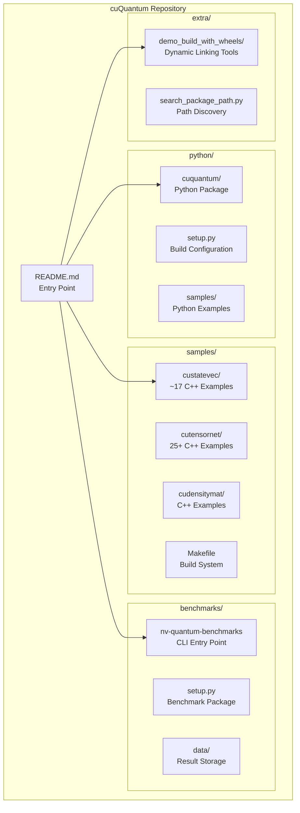
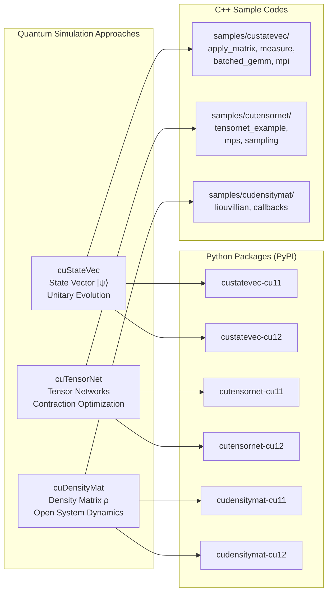
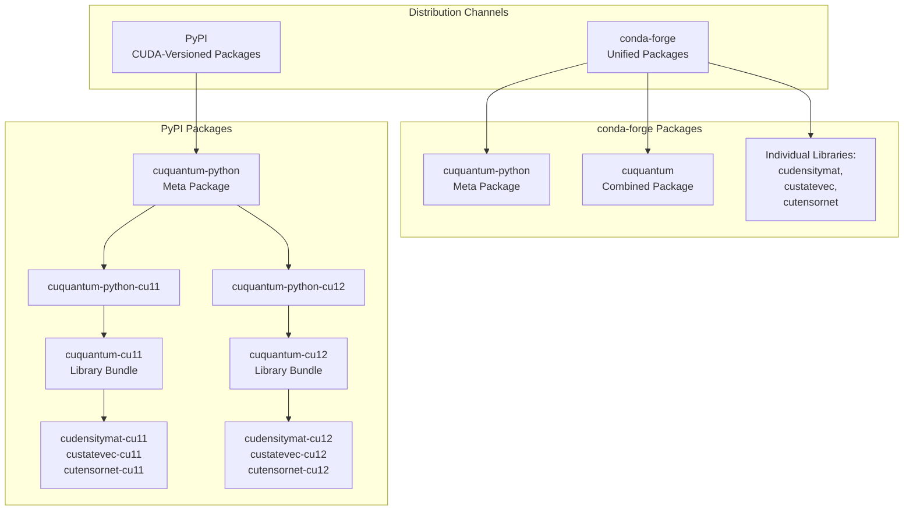

<!-- source: DeepWiki mcp.deepwiki.com · repo NVIDIA/cuQuantum · page 1 Overview · fetched 2026-10-26 -->

# Overview

<details>
<summary>Relevant source files</summary>

The following files were used as context for generating this wiki page:

- [CITATION.cff](CITATION.cff)
- [LICENSE](LICENSE)
- [README.md](README.md)
- [python/LICENSE](python/LICENSE)

</details>


## Purpose and Scope

This document provides an overview of the cuQuantum SDK repository, NVIDIA's open-source quantum computing acceleration library. The cuQuantum SDK accelerates quantum circuit simulation using NVIDIA GPUs through three specialized libraries: `cuStateVec` for state vector simulation, `cuTensorNet` for tensor network methods, and `cuDensityMat` for open quantum systems using density matrices.

This overview covers the repository structure, distribution channels, and the purpose of each core library. For detailed installation instructions, see [Getting Started](#1.1). For in-depth documentation of individual libraries, see [cuTensorNet Library](#3), [cuStateVec Library](#4), and [cuDensityMat Library](#5).

**Sources:** [README.md:1-46]()

## Repository Structure

The cuQuantum repository is organized into four primary directories:

| Directory | Purpose | Related Documentation |
|-----------|---------|----------------------|
| `python/` | Python bindings and high-level APIs for all three libraries | [Python Interface](#2) |
| `samples/` | C/C++ sample code demonstrating library usage | [Building C++ Samples](#7.1) |
| `benchmarks/` | Performance evaluation suite with pluggable frontends and backends | [Benchmarking Suite](#6) |
| `extra/` | Utilities for dynamic linking, wheel integration, and container support | [Dynamic Linking with Wheels](#7.4) |



**Diagram: Repository Directory Structure**

The repository follows a clear separation between Python interfaces (`python/`), native C++ examples (`samples/`), performance evaluation (`benchmarks/`), and build utilities (`extra/`).

**Sources:** [README.md:7-32]()

## Three Core Libraries

The cuQuantum SDK consists of three specialized libraries, each targeting different quantum simulation approaches:

| Library | Representation | Primary Use Cases | Python Package | C++ Headers |
|---------|----------------|-------------------|----------------|-------------|
| **cuStateVec** | Pure state vectors \|ψ⟩ | Gate-based simulation, measurement, expectation values | `custatevec-cu11`/`cu12` | `custatevec.h` |
| **cuTensorNet** | Tensor networks | Large-scale circuits, MPS/DMRG, path optimization | `cutensornet-cu11`/`cu12` | `cutensornet.h` |
| **cuDensityMat** | Density matrices ρ | Open systems, dissipation, time-dependent Hamiltonians | `cudensitymat-cu11`/`cu12` | `cudensitymat.h` |



**Diagram: Three Core Libraries and Their Distributions**

### cuStateVec

`cuStateVec` performs traditional state vector quantum simulation, representing quantum states as complex vectors in Hilbert space. It supports single-GPU and multi-GPU configurations with MPI for distributed memory systems. See [cuStateVec Library](#4) for details on state vector operations and [MPI Integration](#4.3) for multi-node scaling.

### cuTensorNet

`cuTensorNet` uses tensor network representations to simulate quantum circuits efficiently, particularly for circuits with specific structures. It includes contraction path optimization, autotuning, MPS/DMRG methods, and distributed execution via MPI. See [cuTensorNet Library](#3) for comprehensive coverage of tensor network methods.

### cuDensityMat

`cuDensityMat` simulates open quantum systems using density matrix formalism, supporting dissipative evolution, time-dependent Hamiltonians, and Liouvillian dynamics. It features unique JAX integration for automatic differentiation. See [cuDensityMat Library](#5) for density matrix operations and [JAX Integration and Autodiff](#2.4) for gradient computation.

**Sources:** [README.md:12-31]()

## Distribution Channels

cuQuantum is distributed through two primary channels, each targeting different user needs:



**Diagram: Package Distribution Architecture**

### conda-forge

The `conda-forge` channel provides unified packages that automatically handle CUDA version compatibility. Installation is simplified through conda's dependency resolution:

```bash
conda install -c conda-forge cuquantum
```

This approach is recommended for users who prefer integrated environment management.

### PyPI

PyPI packages are split by CUDA major version (`cu11` and `cu12`), allowing explicit control over CUDA compatibility:

```bash
pip install cuquantum-python-cu12  # For CUDA 12.x
pip install cuquantum-python-cu11  # For CUDA 11.x
```

Each CUDA variant includes all three libraries (`cudensitymat`, `custatevec`, `cutensornet`) with matching CUDA dependencies. See [Installation and Setup](#2.1) for detailed installation instructions and [CUDA Version Compatibility](#7.5) for version selection guidance.

**Sources:** [README.md:12-31]()

## CUDA Version Support

cuQuantum supports multiple CUDA toolkit versions through separate package variants:

| CUDA Version | Package Suffix | Supported Hardware | Driver Requirement |
|--------------|----------------|--------------------|--------------------|
| CUDA 11.x | `-cu11` | Compute Capability ≥ 7.0 (Volta+) | R450+ |
| CUDA 12.x | `-cu12` | Compute Capability ≥ 7.5 (Turing+) | R525+ |
| CUDA 13.x | `-cu13` (future) | TBD | TBD |

CUDA maintains minor version forward compatibility, meaning applications built with CUDA 12.0 will run on systems with CUDA 12.5 drivers. This design enables the CUDA-versioned packaging strategy. See [CUDA Version Compatibility](#7.5) for comprehensive version compatibility information.

**Sources:** [README.md:20-28]()

## Build Options

The repository supports multiple build approaches:

### Pre-built Packages

Install from `conda-forge` or `PyPI` for immediate use without compilation. See [Getting Started](#1.1).

### Building from Source

Build Python packages from source using `setup.py` with Cython compilation. See [Building Python from Source](#7.2).

### C++ Sample Compilation

Compile C++ samples using the provided `Makefile` with environment variable configuration (`CUDA_PATH`, `CUTENSORNET_ROOT`, etc.). See [Building C++ Samples](#7.1).

### Dynamic Linking

Link against installed wheel packages to reduce build times and enable custom MPI integration. See [Dynamic Linking with Wheels](#7.4).

**Sources:** [README.md:34-37]()

## License and Citation

### License

All code in this repository is distributed under the **BSD-3-Clause** license, permitting redistribution and modification with attribution. The license text is available at [LICENSE:1-29]() and [python/LICENSE:1-29]().

### Citation

When using cuQuantum in research or publications, cite the following paper:

**H. Bayraktar et al., "cuQuantum SDK: A High-Performance Library for Accelerating Quantum Science", 2023 IEEE International Conference on Quantum Computing and Engineering (QCE), Bellevue, WA, USA, 2023, pp. 1050-1061, doi: [10.1109/QCE57702.2023.00119](https://doi.org/10.1109/QCE57702.2023.00119)**

The structured citation metadata is maintained in [CITATION.cff:1-13]() following the Citation File Format standard (version 1.3.0). The current SDK version documented is `v24.11.0`.

**Sources:** [README.md:39-45](), [CITATION.cff:1-13](), [LICENSE:1-29]()

## Documentation and Resources

| Resource | Location | Purpose |
|----------|----------|---------|
| Official Documentation | https://docs.nvidia.com/cuda/cuquantum/latest/index.html | Complete API reference and guides |
| This Wiki | Current repository | Developer-focused technical documentation |
| Benchmark Results | [benchmarks/data/]() | Performance data organized by configuration hash |
| Python Examples | [python/samples/]() | High-level usage patterns |
| C++ Examples | [samples/]() | Low-level API demonstrations |

For quick start instructions, proceed to [Getting Started](#1.1). For detailed documentation of specific components, navigate to the appropriate section using the table of contents.

**Sources:** [README.md:34-37]()

---

