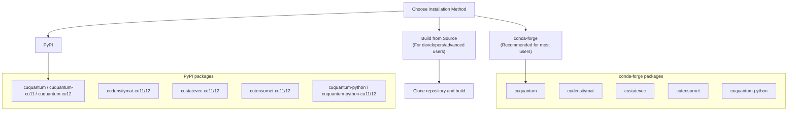
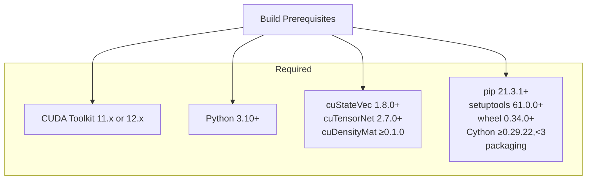
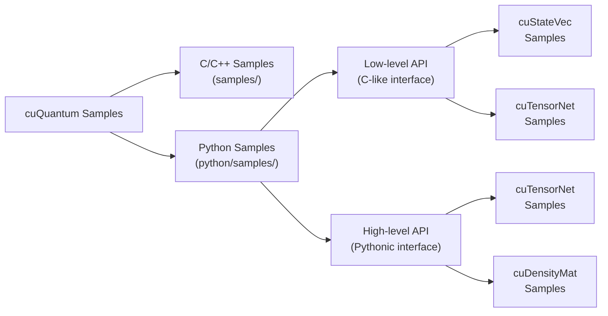

<!-- source: DeepWiki mcp.deepwiki.com · repo NVIDIA/cuQuantum · page 1.1 Getting Started · fetched 2026-10-26 -->

# Getting Started

<details>
<summary>Relevant source files</summary>

The following files were used as context for generating this wiki page:

- [LICENSE](LICENSE)
- [README.md](README.md)
- [python/LICENSE](python/LICENSE)
- [python/README.md](python/README.md)
- [python/setup.py](python/setup.py)

</details>


This guide provides instructions on how to install and set up the NVIDIA cuQuantum SDK on your system. cuQuantum is a collection of libraries and tools designed to accelerate quantum circuit simulations on NVIDIA GPUs. For information about the core components of cuQuantum, see [Core Components](#1.2).

## System Requirements

Before installing cuQuantum, ensure your system meets the following requirements:

| Component | Requirement |
|-----------|-------------|
| GPU | NVIDIA GPU with compute capability 7.0 or higher |
| Driver | Linux: 450.80.02+ for CUDA 11.x, 525.60.13+ for CUDA 12.x |
| CUDA | CUDA Toolkit 11.x or 12.x |
| Operating System | Linux |
| Python (for Python interface) | 3.10 or higher |

Sources: [python/README.md:54-58]()

## Installation Options

cuQuantum can be installed in several ways, depending on your needs and environment.



Sources: [README.md:12-31](), [python/README.md:10-48]()

## Installation from conda-forge (Recommended)

conda-forge is the recommended installation method for most users as it handles all dependencies automatically.

### Full Installation

To install the complete cuQuantum suite:

```
conda install -c conda-forge cuquantum
```

### Individual Components

You can also install specific components:

```
conda install -c conda-forge cudensitymat custatevec cutensornet
```

For just the Python bindings without the core libraries:

```
conda install -c conda-forge cuquantum-python
```

Sources: [README.md:12-18]()

## Installation from PyPI

PyPI packages are available with CUDA 11 and CUDA 12 support.

### Full Installation

```
pip install cuquantum          # Latest CUDA version
pip install cuquantum-cu11     # CUDA 11.x
pip install cuquantum-cu12     # CUDA 12.x
```

### Individual Components

For specific components:

```
# For CUDA 11.x
pip install cudensitymat-cu11 custatevec-cu11 cutensornet-cu11

# For CUDA 12.x
pip install cudensitymat-cu12 custatevec-cu12 cutensornet-cu12
```

For just the Python bindings:

```
pip install cuquantum-python          # Latest CUDA version
pip install cuquantum-python-cu11     # CUDA 11.x
pip install cuquantum-python-cu12     # CUDA 12.x
```

Sources: [README.md:19-31]()

## Installation from Source

For developers or those who need custom builds, building from source is an option.

### Prerequisites



Sources: [python/README.md:12-26]()

### Build Steps

1. Clone the repository:
   ```
   git clone https://github.com/NVIDIA/cuQuantum
   ```

2. Set up environment variables:
   ```
   export CUDA_PATH=/path/to/cuda
   export CUQUANTUM_ROOT=/path/to/cuquantum      # Optional
   export CUTENSOR_ROOT=/path/to/cutensor        # Optional
   ```

3. Navigate to the Python directory:
   ```
   cd cuQuantum/python
   ```

4. Build and install:
   ```
   pip install .                                # Basic install
   pip install -v --no-deps --no-build-isolation .  # Advanced install
   ```

   For development/testing use:
   ```
   pip install -e .                             # Editable install
   ```

Sources: [python/README.md:28-47]()

## Runtime Dependencies

If you're using the Python interface, you'll need these additional dependencies:

| Dependency | Required Version | Purpose |
|------------|------------------|---------|
| NumPy | 1.21+ | Numerical computing |
| CuPy | 13.0.0+ | GPU-accelerated NumPy-compatible array library |
| PyTorch | 1.10+ | Optional - Deep learning framework |
| Qiskit | 0.24.0+ | Optional - Quantum computing framework |
| Cirq | 0.6.0+ | Optional - Quantum computing framework |
| mpi4py | 3.1.0+ | Optional - MPI support |

Both conda-forge and PyPI installations will handle the required dependencies automatically.

Sources: [python/README.md:59-70]()

## Verifying Your Installation

To verify that cuQuantum is installed correctly, you can run this simple Python script:

```python
import cuquantum
print(cuquantum.__version__)

# Verify the core libraries are accessible
import cuquantum.cutensornet
import cuquantum.custatevec
try:
    import cuquantum.cudensitymat
    print("All components successfully loaded")
except ImportError:
    print("cudensitymat not available")
```

You can also run the provided test suite:

```
cd cuQuantum/python  # Navigate to the Python source directory
pytest tests          # Run all tests
```

Sources: [python/README.md:90-94]()

## Sample Codes

cuQuantum provides sample codes to help you get started:



The sample codes demonstrate practical usage of the libraries and can serve as templates for your own applications.

Sources: [README.md:32](), [python/README.md:83-89]()

## Next Steps

Now that you have cuQuantum installed, you can:

1. Explore the [Python Interface](#2) to learn how to use cuQuantum in Python
2. Dive into the [cuTensorNet Library](#3) for tensor network simulations
3. Learn about the [cuStateVec Library](#4) for state vector simulations
4. Check out the [Benchmarking Suite](#5) to evaluate performance

## Known Issues

- If there are multiple copies of cuTENSOR installed, version mismatches may occur. Ensure only one version is in your system paths.
- In certain environments, if PyTorch is installed, importing cuquantum might fail. Try importing torch before cuquantum.
- Always use consistent CUDA versions (either all 11.x or all 12.x) for all components. Mixing versions will cause undefined behavior.

Sources: [python/README.md:78-81]()

---

