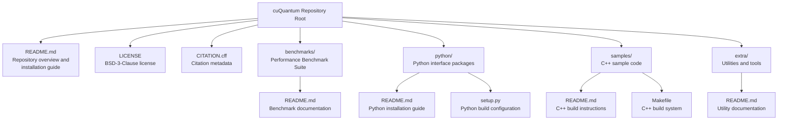
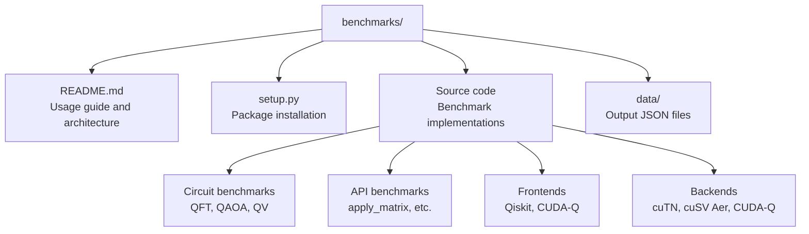
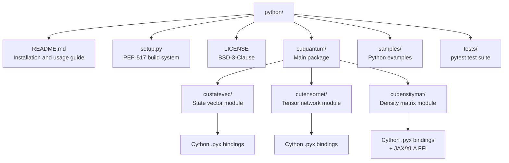
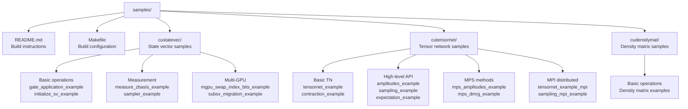
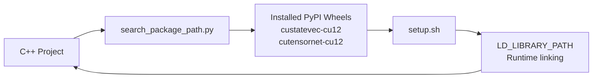
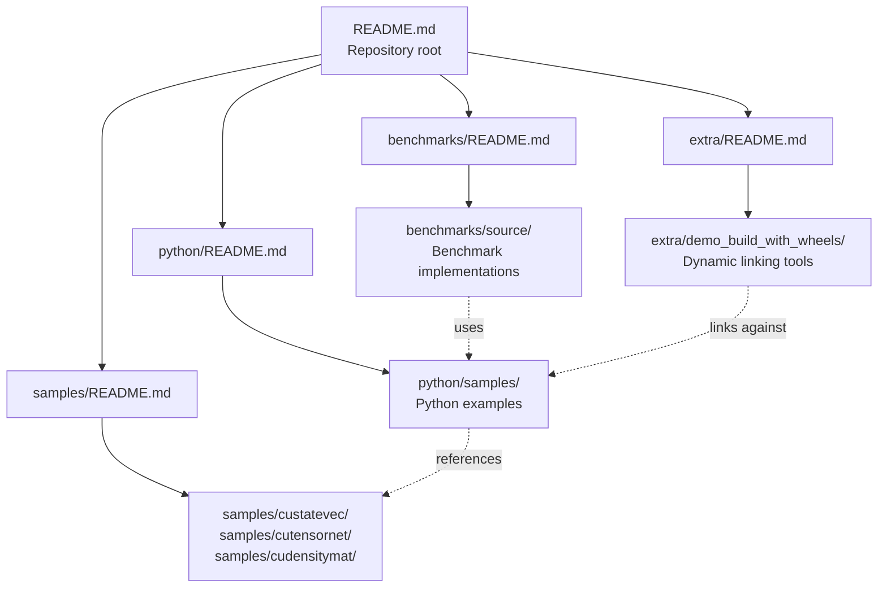

<!-- source: DeepWiki mcp.deepwiki.com · repo NVIDIA/cuQuantum · page 1.2 Repository Structure · fetched 2026-10-26 -->

# Repository Structure

Relevant source files

The following files were used as context for generating this wiki page:

- [LICENSE](LICENSE)
- [README.md](README.md)
- [python/LICENSE](python/LICENSE)

This page explains the organization of the cuQuantum repository, detailing the purpose and contents of each major directory. The repository is structured to separate Python interfaces, C++ sample code, performance benchmarks, and utility tools into distinct directories. For an overview of the three core simulation libraries, see [Three Core Libraries](#1.3).

## High-Level Repository Organization

The cuQuantum repository follows a modular structure with four primary directories, each serving a distinct purpose:

**Repository Organization Diagram**

Sources: [README.md:1-46]()

## Top-Level Files

The repository root contains several important files that provide context and metadata:

| File | Purpose | Key Contents |
|------|---------|--------------|
| `README.md` | Repository entry point | Overview of directories, installation links, PyPI/conda-forge package listings |
| `LICENSE` | Legal terms | BSD-3-Clause license for all repository contents |
| `CITATION.cff` | Academic citation | Citation metadata for the cuQuantum SDK paper (DOI: 10.1109/QCE57702.2023.00119) |

Sources: [README.md:1-46](), [LICENSE:1-29]()

## Directory: `benchmarks/`

The `benchmarks/` directory contains the NVIDIA cuQuantum Performance Benchmark Suite (version 0.3.0), which provides a framework for evaluating quantum circuit simulation performance across different backends and configurations.

**Purpose:** Performance evaluation and comparison of cuQuantum libraries against other quantum simulation frameworks.

**Key Components:**

| Component | Description |
|-----------|-------------|
| CLI Interface | `nv-quantum-benchmarks` command-line tool for running benchmarks |
| Circuit Benchmarks | QFT, QAOA, Quantum Volume circuits with configurable parameters |
| API Benchmarks | Direct API call benchmarks (e.g., `apply_matrix`) |
| Frontend Support | Qiskit and CUDA-Q frontends for circuit specification |
| Backend Support | cuTensorNet, cuStateVec Aer, and CUDA-Q MGPU backends |
| Output Format | JSON results organized by `sim_config_hash` |

**Directory Structure:**

For detailed documentation on running benchmarks, see page [6](#6).

Sources: [README.md:9]()

## Directory: `python/`

The `python/` directory contains the open-source cuQuantum Python project, which provides Python bindings and high-level interfaces to the cuQuantum C++ libraries.

**Purpose:** Python interface to cuQuantum, enabling integration with quantum computing frameworks like Qiskit, Cirq, and PennyLane.

**Key Components:**

| Component | Description |
|-----------|-------------|
| Package Root | `cuquantum/` - Main Python package directory |
| Cython Bindings | `.pyx` files providing low-level C++ bindings |
| High-Level APIs | Python modules wrapping Cython bindings |
| Sample Code | `samples/` - Python usage examples |
| Tests | `tests/` - pytest-based test suite |
| Build System | `setup.py` - PEP-517 build configuration with CUDA version detection |

**Package Distribution:**

The Python code is distributed through multiple channels:

| Distribution | Package Name | Description |
|--------------|--------------|-------------|
| conda-forge | `cuquantum` | Unified package for all libraries |
| PyPI (CUDA 11) | `cuquantum-python-cu11` | Meta-package for CUDA 11.x |
| PyPI (CUDA 12) | `cuquantum-python-cu12` | Meta-package for CUDA 12.x |
| Individual (CUDA 11) | `custatevec-cu11`, `cutensornet-cu11`, `cudensitymat-cu11` | Per-library packages |
| Individual (CUDA 12) | `custatevec-cu12`, `cutensornet-cu12`, `cudensitymat-cu12` | Per-library packages |

**Python Directory Structure:**

For detailed Python interface documentation, see page [2](#2).

Sources: [README.md:11-31](), [python/LICENSE:1-29]()

## Directory: `samples/`

The `samples/` directory contains all C/C++ sample code demonstrating how to use the cuQuantum SDK libraries directly from C++ applications.

**Purpose:** Provide reference implementations and usage examples for C++ developers integrating cuQuantum libraries into high-performance applications.

**Key Components:**

| Component | Description |
|-----------|-------------|
| `custatevec/` | State vector simulation examples (~17 C++ samples) |
| `cutensornet/` | Tensor network examples (25+ C++ samples including MPS/MPI) |
| `cudensitymat/` | Density matrix simulation examples |
| Build System | Makefiles and CMakeLists.txt for compiling samples |
| MPI Examples | Distributed computing examples using MPI |

**Sample Categories:**

**Build Requirements:**

The C++ samples require the following environment variables:

| Variable | Purpose |
|----------|---------|
| `CUDA_PATH` | Path to CUDA Toolkit installation |
| `CUTENSORNET_ROOT` | Path to cuTensorNet library (if not in system path) |
| `CUSTATEVEC_ROOT` | Path to cuStateVec library (if not in system path) |
| `MPI_PATH` | Path to MPI installation (for MPI examples) |

For detailed build instructions, see page [7.1](#7.1).

Sources: [README.md:32]()

## Directory: `extra/`

The `extra/` directory contains utilities and helper tools that assist in using the cuQuantum SDK and building projects against cuQuantum libraries.

**Purpose:** Provide auxiliary tools for advanced use cases such as dynamic linking against PyPI wheels and container-based workflows.

**Key Components:**

| Component | Description |
|-----------|-------------|
| `demo_build_with_wheels/` | Tools for dynamically linking C++ projects against cuQuantum Python wheels |
| `search_package_path.py` | Python script to locate installed wheel libraries |
| `setup.sh` | Shell script to configure environment for wheel-based builds |
| Container utilities | Files for working with cuQuantum Appliance container |

**Use Cases:**

The `extra/` directory is particularly useful for:

1. **Reducing Wheel Size:** Instead of bundling full libraries in Python wheels, applications can dynamically link against installed wheels
2. **Custom MPI Integration:** Enable projects to use their preferred MPI library by linking against cuQuantum wheels
3. **Container Workflows:** Utilities for working with NVIDIA cuQuantum Appliance container

**Dynamic Linking Workflow:**

For more information on dynamic linking with wheels, see page [7.4](#7.4).

Sources: [README.md:10]()

## Navigating the Repository

The repository is organized to support multiple user personas and workflows:

**Navigation by Use Case:**

| Use Case | Entry Point | Relevant Directories |
|----------|-------------|----------------------|
| Python Development | [python/README.md]() | `python/`, `python/samples/` |
| C++ Development | [samples/README.md]() | `samples/`, with `Makefile` |
| Performance Evaluation | [benchmarks/README.md]() | `benchmarks/` |
| Dynamic Linking | [extra/README.md]() | `extra/demo_build_with_wheels/` |

**Cross-References Between Directories:**

Sources: [README.md:1-46]()

## Supported Platform Requirements

The core libraries of NVIDIA cuQuantum have the following platform requirements:

| Requirement | Details |
|-------------|---------|
| CUDA Architectures | SM 7.0, SM 7.5, SM 8.0, SM 8.6, SM 9.0, SM 10.0, SM 12.0 |
| Operating Systems | Linux |
| CPU Architectures | x86_64, aarch64-sbsa |
| Language Support | C++11 or later |
| CUDA Version | CUDA 11.x or later with compatible driver (r450+) |

For full details on specific library requirements, refer to the library-specific documentation.

Sources: [samples/cutensornet/README.md:60-72](), [samples/cutensornet/CMakeLists.txt:77-88]()

---

