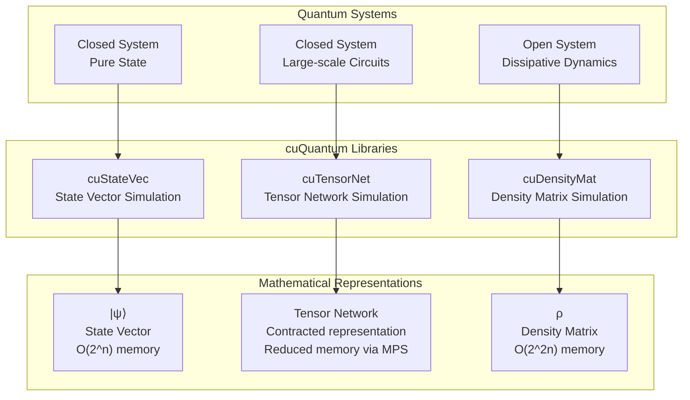
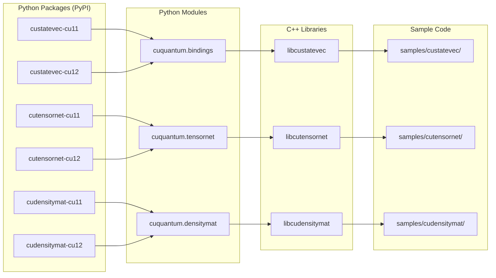
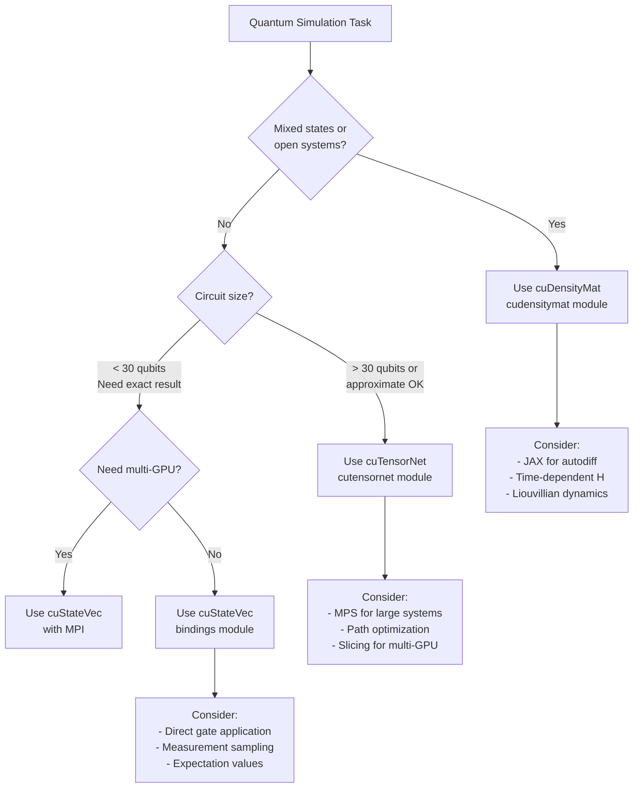

<!-- source: DeepWiki mcp.deepwiki.com · repo NVIDIA/cuQuantum · page 1.3 Three Core Libraries · fetched 2026-10-26 -->

# Three Core Libraries

<details>
<summary>Relevant source files</summary>

The following files were used as context for generating this wiki page:

- [LICENSE](LICENSE)
- [README.md](README.md)
- [python/LICENSE](python/LICENSE)
- [python/cuquantum/__init__.py](python/cuquantum/__init__.py)

</details>


## Purpose and Scope

This page provides an overview of the three specialized quantum simulation libraries that comprise the cuQuantum SDK: **cuStateVec**, **cuTensorNet**, and **cuDensityMat**. Each library targets a distinct quantum simulation approach and use case. This page explains the fundamental differences between these libraries, their respective quantum mechanical representations, and guidance on selecting the appropriate library for specific simulation requirements.

For installation instructions and package structure, see [Installation and Setup](#2.1). For detailed usage of each library, see [cuTensorNet Library](#3), [cuStateVec Library](#4), and [cuDensityMat Library](#5).

---

## Library Architecture and Quantum Representations

The three core libraries implement different quantum mechanical formalisms, each optimized for specific simulation scenarios:

### High-Level Library Overview



**Sources:** [README.md:7-32]()

---

## Code Entity Mapping

The three libraries are exposed through both C++ and Python interfaces with consistent naming conventions:

### Library to Code Module Mapping



**Sources:** [README.md:13-31](), [python/cuquantum/__init__.py:5-7]()

The Python module `cuquantum` provides unified access to all three libraries through its submodules:
- `cuquantum.bindings` - Low-level bindings to cuStateVec C API
- `cuquantum.tensornet` - High-level Python interface for cuTensorNet
- `cuquantum.densitymat` - High-level Python interface for cuDensityMat

---

## Library Comparison

The following table summarizes the key characteristics and capabilities of each library:

| Feature | cuStateVec | cuTensorNet | cuDensityMat |
|---------|-----------|-------------|--------------|
| **Representation** | State vector \|ψ⟩ | Tensor network | Density matrix ρ |
| **Memory Scaling** | O(2^n) | O(2^n) with optimization | O(2^(2n)) |
| **System Type** | Pure states only | Pure states | Mixed states, open systems |
| **Primary Use Cases** | Exact simulation of small-medium circuits | Large-scale circuit simulation, MPS methods | Noisy simulation, dissipative dynamics |
| **Multi-GPU** | Yes (MPI) | Yes (slicing, MPI) | Limited |
| **Special Features** | Fast gate application | Path optimization, autotuning, MPS/DMRG | Time-dependent Hamiltonians, JAX autodiff |
| **Python Packages** | `custatevec-cu11/cu12` | `cutensornet-cu11/cu12` | `cudensitymat-cu11/cu12` |
| **Sample Count** | ~17 C++ examples | 25+ C++ examples | Multiple C++ examples |
| **Conda Package** | `custatevec` | `cutensornet` | `cudensitymat` |

**Sources:** [README.md:13-28](), High-level system diagrams

---

## cuStateVec: State Vector Simulation

### Overview

cuStateVec implements traditional quantum state vector simulation using the \|ψ⟩ representation. This library is optimized for exact simulation of quantum circuits where the quantum state remains pure throughout the computation.

### Key Characteristics

- **Mathematical Representation**: State vector \|ψ⟩ ∈ ℂ^(2^n) for n qubits
- **Memory Requirement**: 2^n complex numbers (16 bytes per amplitude for double precision)
- **Typical Range**: Up to ~30-35 qubits on single GPU, larger with multi-GPU
- **Operation Model**: Direct gate matrix application to state vector

### Core Capabilities

1. **Gate Application**: Efficient application of single-qubit, two-qubit, and multi-qubit gates
2. **Measurement**: Sampling and collapse operations on computational basis
3. **Expectation Values**: Computation of observable expectation values ⟨ψ|O|ψ⟩
4. **Multi-GPU Scaling**: MPI-based distribution across multiple GPUs/nodes

### Distribution Channels

- **PyPI**: `custatevec-cu11`, `custatevec-cu12`
- **Conda**: `custatevec`
- **C++ Samples**: Located in `samples/custatevec/`

**Sources:** [README.md:16-17,23-24](), High-level system diagrams

---

## cuTensorNet: Tensor Network Simulation

### Overview

cuTensorNet provides tensor network-based quantum circuit simulation, representing quantum circuits as networks of tensors that can be contracted efficiently. This approach enables simulation of larger circuits than state vector methods through optimized contraction paths and approximation techniques.

### Key Characteristics

- **Mathematical Representation**: Quantum circuits as tensor networks with optimized contraction
- **Memory Requirement**: Varies based on contraction path; can be significantly less than 2^n
- **Typical Range**: Circuits with hundreds of qubits using MPS approximations
- **Operation Model**: Tensor contraction with path optimization

### Core Capabilities

1. **Path Optimization**: Automatic optimization of tensor contraction order to minimize computational cost
2. **Autotuning**: Runtime optimization of contraction operations
3. **MPS/MPO Methods**: Matrix Product State representations for efficient approximate simulation
4. **DMRG**: Density Matrix Renormalization Group optimization
5. **High-Level Operations**: Amplitude computation, sampling, expectation values, reduced density matrices
6. **Slicing and Distribution**: Automatic parallelization across multiple GPUs using slicing strategies

### Distribution Channels

- **PyPI**: `cutensornet-cu11`, `cutensornet-cu12`
- **Conda**: `cutensornet`
- **C++ Samples**: Located in `samples/cutensornet/` (25+ examples)

**Sources:** [README.md:17,24,27-28](), High-level system diagrams

---

## cuDensityMat: Density Matrix Simulation

### Overview

cuDensityMat implements density matrix formalism for simulating open quantum systems and mixed states. This library uses the density matrix ρ representation, enabling simulation of decoherence, noise, and dissipative dynamics that cannot be represented by pure state vectors.

### Key Characteristics

- **Mathematical Representation**: Density matrix ρ ∈ ℂ^(2^n × 2^n)
- **Memory Requirement**: 2^(2n) complex numbers (significantly larger than state vector)
- **Typical Range**: Smaller systems (~15-20 qubits) due to memory constraints
- **Operation Model**: Superoperator formalism with Liouvillian dynamics

### Core Capabilities

1. **Open System Dynamics**: Simulation of quantum systems coupled to environments
2. **Liouvillian Evolution**: Time evolution under Liouvillian superoperators
3. **Time-Dependent Hamiltonians**: User-defined time-varying Hamiltonians via callback functions
4. **JAX Integration**: XLA FFI integration enabling automatic differentiation for variational algorithms
5. **Gradient Computation**: Native support for gradient-based optimization through JAX

### Unique Features

cuDensityMat is the only library in the cuQuantum SDK that provides:
- Native support for mixed quantum states
- JAX/XLA integration for autodifferentiation
- Time-dependent Hamiltonian callbacks

### Distribution Channels

- **PyPI**: `cudensitymat-cu11`, `cudensitymat-cu12`
- **Conda**: `cudensitymat`
- **C++ Samples**: Located in `samples/cudensitymat/`

**Sources:** [README.md:15,22,26](), [python/cuquantum/__init__.py:6](), High-level system diagrams

---

## Choosing the Right Library

The following decision tree guides library selection based on simulation requirements:



**Sources:** High-level system diagrams, [README.md:13-28]()

### Selection Guidelines

| Choose cuStateVec when: | Choose cuTensorNet when: | Choose cuDensityMat when: |
|-------------------------|--------------------------|---------------------------|
| System is pure state | Circuit has > 30 qubits | Modeling noise/decoherence |
| Need exact simulation | Approximate result acceptable | System is open/mixed |
| Circuit depth is moderate | Need MPS/DMRG methods | Need gradient computation |
| Have multi-GPU/MPI resources | Circuit has structure for optimization | Time-dependent Hamiltonians |
| Standard gate operations | Large-scale sampling needed | Variational optimization with JAX |

---

## Package Installation

All three libraries are available through both conda-forge and PyPI. The PyPI packages are versioned by CUDA version (`cu11` or `cu12`):

```
# Install individual libraries via PyPI
pip install custatevec-cu12
pip install cutensornet-cu12  
pip install cudensitymat-cu12

# Or install via conda-forge (unified CUDA version)
conda install -c conda-forge custatevec cutensornet cudensitymat
```

For detailed installation instructions and dependency requirements, see [Installation and Setup](#2.1).

**Sources:** [README.md:13-31]()

---

## Accessing Libraries from Python

All three libraries are accessible through the unified `cuquantum` Python package:

```python
# Import bindings for cuStateVec
from cuquantum import bindings

# Import high-level interface for cuTensorNet
from cuquantum import tensornet

# Import high-level interface for cuDensityMat
from cuquantum import densitymat
```

The `cuquantum.bindings` module provides low-level access to the cuStateVec C API, while `tensornet` and `densitymat` provide high-level Pythonic interfaces to their respective libraries.

**Sources:** [python/cuquantum/__init__.py:5-7]()

---

## Sample Code Organization

Each library includes extensive C++ sample code demonstrating usage patterns:

| Library | Sample Directory | Description |
|---------|-----------------|-------------|
| cuStateVec | `samples/custatevec/` | ~17 C++ examples covering gate application, measurement, multi-GPU |
| cuTensorNet | `samples/cutensornet/` | 25+ C++ examples including MPS, path optimization, slicing |
| cuDensityMat | `samples/cudensitymat/` | C++ examples for Liouvillian evolution, time-dependent Hamiltonians |

For information on building and running C++ samples, see [Building C++ Samples](#7.1).

**Sources:** [README.md:32](), High-level system diagrams

---

