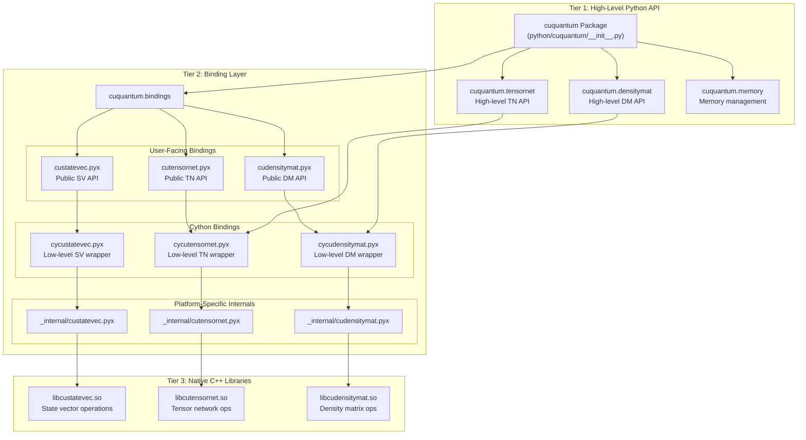
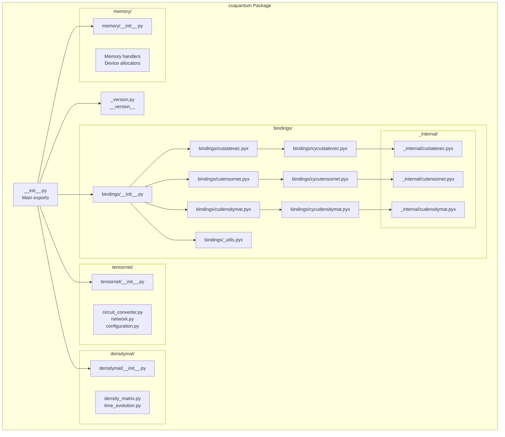
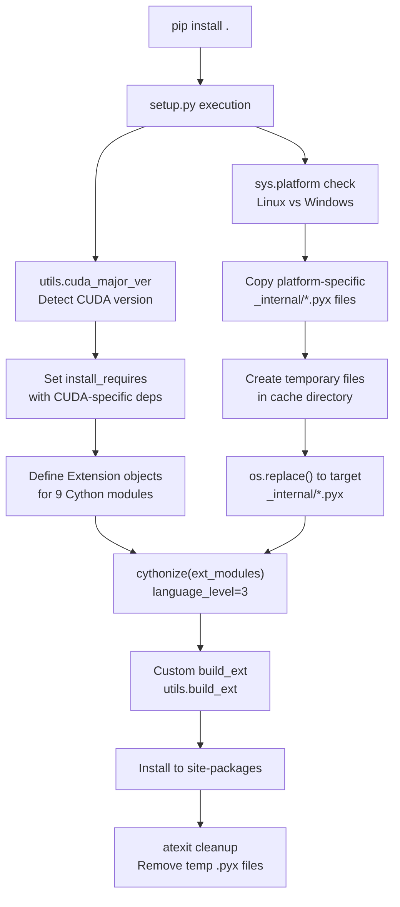

<!-- source: DeepWiki mcp.deepwiki.com · repo NVIDIA/cuQuantum · page 2 Python Interface · fetched 2026-10-26 -->

# Python Interface

<details>
<summary>Relevant source files</summary>

The following files were used as context for generating this wiki page:

- [python/README.md](python/README.md)
- [python/cuquantum/__init__.py](python/cuquantum/__init__.py)
- [python/setup.py](python/setup.py)

</details>


## Purpose and Scope

This document provides comprehensive documentation for the cuQuantum Python interface, which exposes the three core C++ libraries (cuStateVec, cuTensorNet, cuDensityMat) through Python APIs. The Python interface is implemented in the `python/` directory and distributed as the `cuquantum-python` package.

This page covers:
- Overall Python package architecture and organization
- The binding layer connecting Python to native C++ libraries
- CUDA version-specific package variants
- Core dependencies and runtime requirements
- High-level vs. low-level API patterns

For detailed installation instructions, see [Installation and Setup](#2.1). For framework integration (Qiskit, Cirq), see [Integration with Quantum Frameworks](#2.3). For JAX/XLA integration, see [JAX Integration and Autodiff](#2.4). For C++ usage, see the samples documentation (page 3-5 subsections).

**Sources:** [python/README.md:1-96]()

## Architecture Overview

The cuQuantum Python interface implements a three-tier architecture that bridges high-level Python APIs to GPU-accelerated C++ libraries:

### Three-Tier Architecture



**Tier 1** provides Pythonic high-level abstractions in `cuquantum.tensornet` and `cuquantum.densitymat` modules. These offer simplified interfaces for common quantum computing tasks like circuit simulation, sampling, and expectation value computation.

**Tier 2** consists of Cython-generated bindings that expose the C++ APIs to Python. This layer is divided into:
- **User-facing bindings** (`custatevec.pyx`, `cutensornet.pyx`, `cudensitymat.pyx`) that provide the public API
- **Low-level wrappers** (`cycustatevec.pyx`, `cycutensornet.pyx`, `cycudensitymat.pyx`) with minimal abstraction over C++ functions
- **Platform-specific internals** (`_internal/*.pyx`) that handle OS-specific function loading

**Tier 3** represents the native C++ shared libraries that perform GPU-accelerated quantum simulations via CUDA.

**Sources:** [python/setup.py:84-136](), [python/cuquantum/__init__.py:1-11]()

## Package Organization

The `cuquantum` Python package is organized into several sub-modules, each serving a distinct purpose:

### Module Hierarchy



**Key modules:**
- `cuquantum.bindings`: Low-level Cython bindings exposing C++ APIs directly
- `cuquantum.tensornet`: High-level Python API for tensor network operations
- `cuquantum.densitymat`: High-level Python API for density matrix operations  
- `cuquantum.memory`: Memory management utilities for device allocators
- `cuquantum.bindings._utils`: Shared utilities including `ComputeType`, `cudaDataType`, and `libraryPropertyType` enumerations

The `_internal/` subdirectory contains platform-specific implementations that are selected at build time based on the target OS (Linux vs. Windows), as shown in [python/setup.py:52-68]().

**Sources:** [python/cuquantum/__init__.py:5-10](), [python/setup.py:84-136](), [python/setup.py:183-186]()

## CUDA Version-Specific Packages

The cuQuantum Python interface is distributed in CUDA-version-specific variants to ensure binary compatibility and optimal performance:

### PyPI Package Structure

```mermaid
graph TB
    subgraph "PyPI Packages"
        BASE11["cuquantum-python-cu11"]
        BASE12["cuquantum-python-cu12"]
        BASE13["cuquantum-python-cu13"]
    end
    
    subgraph "Component Packages (CUDA 11)"
        SV11["custatevec-cu11 ~=1.10"]
        TN11["cutensornet-cu11 ~=2.9"]
        DM11["cudensitymat-cu11 ~=0.3.0"]
    end
    
    subgraph "Component Packages (CUDA 12)"
        SV12["custatevec-cu12 ~=1.10"]
        TN12["cutensornet-cu12 ~=2.9"]
        DM12["cudensitymat-cu12 ~=0.3.0"]
    end
    
    subgraph "Component Packages (CUDA 13)"
        SV13["custatevec-cu13 ~=1.10"]
        TN13["cutensornet-cu13 ~=2.9"]
        DM13["cudensitymat-cu13 ~=0.3.0"]
    end
    
    subgraph "Common Dependencies"
        NUMPY["numpy >=1.21, <3.0"]
        NVMATH["nvmath-python ==0.6.0"]
    end
    
    subgraph "CUDA 12 Dependencies"
        CUPY12["cupy-cuda12x >=13.0"]
        BINDINGS12["cuda-bindings >=12.9.2, <13.0.0"]
    end
    
    subgraph "CUDA 13 Dependencies"
        CUPY13["cupy-cuda13x >=13.6.0"]
        BINDINGS13["cuda-bindings >=13.0.1, <14.0.0"]
    end
    
    BASE11 --> SV11
    BASE11 --> TN11
    BASE11 --> DM11
    
    BASE12 --> SV12
    BASE12 --> TN12
    BASE12 --> DM12
    BASE12 --> CUPY12
    BASE12 --> BINDINGS12
    
    BASE13 --> SV13
    BASE13 --> TN13
    BASE13 --> DM13
    BASE13 --> CUPY13
    BASE13 --> BINDINGS13
    
    SV11 --> NUMPY
    SV12 --> NUMPY
    SV13 --> NUMPY
    
    CUPY12 --> NVMATH
    CUPY13 --> NVMATH
```



The package naming convention follows the pattern `cuquantum-python-cu{MAJOR_VERSION}` where `MAJOR_VERSION` is 11, 12, or 13. This is determined at build time in [python/setup.py:152]() using `utils.cuda_major_ver`.

**Version constraints:**
- Component libraries use compatible version ranges: `~=1.10` means `>=1.10.0, <2.0.0`
- `nvmath-python` is strictly pinned to `==0.6.0` until the internal module is stabilized
- CuPy and cuda-bindings are CUDA-version-specific with different constraints for CUDA 12 vs. 13

**Important:** Users must ensure consistency across all packages. Mixing CUDA 11 and CUDA 12 packages results in undefined behavior, as noted in [python/README.md:44-45]() and [python/README.md:78]().

**Sources:** [python/setup.py:35-49](), [python/setup.py:144-148](), [python/README.md:70-71]()

## Runtime Dependencies and Requirements

The cuQuantum Python interface requires specific runtime dependencies for proper operation:

### Hardware Requirements

| Component | Requirement |
|-----------|-------------|
| GPU | NVIDIA GPU with compute capability 7.5+ |
| Driver | Linux 525.60.13+ (CUDA 12) or 580.65.06+ (CUDA 13) |
| CUDA Toolkit | 12.x or 13.x |

### Core Dependencies

| Package | Version Constraint | Purpose |
|---------|-------------------|---------|
| `cuStateVec` | 1.10.0+ | State vector simulation library |
| `cuTensorNet` | 2.9.0+ | Tensor network operations library |
| `cuDensityMat` | >=0.3.0, <0.4.0 | Density matrix simulation library |
| `numpy` | >=1.21, <3.0 | Array operations |
| `nvmath-python` | ==0.6.0 | NVIDIA math library bindings |
| `cuda-bindings` | 12.9.2+/13.0.1+ | CUDA runtime bindings |
| `CuPy` | 13.0.0+ (CUDA 12), 13.6.0+ (CUDA 13) | GPU-accelerated NumPy |

### Optional Dependencies

| Package | Version | Use Case |
|---------|---------|----------|
| `PyTorch` | 1.10+ | Tensor interoperability |
| `Qiskit` | 1.4.2+ | Quantum circuit integration |
| `Cirq` | 0.6.0+ | Google Cirq framework support |
| `mpi4py` | 3.1.0+ | Multi-node/multi-GPU execution |

**Library path configuration:** When installing via pip wheels, cuTENSOR and cuQuantum libraries must be visible through the `LD_LIBRARY_PATH` environment variable. When building from source, `CUDA_PATH`, cuQuantum library paths, and cuTENSOR paths must all be added to `LD_LIBRARY_PATH` as described in [python/README.md:70-74]().

**Known Issue:** Systems with multiple cuTENSOR installations may experience version mismatch errors if a system-path copy is loaded instead of the intended version. The solution is to remove cuTENSOR from system paths, **not** to use `LD_PRELOAD` which can cause difficult-to-debug behavior, as warned in [python/README.md:76-78]().

**Sources:** [python/README.md:50-79]()

## Build System and Cythonization

The Python interface uses a PEP-517 compliant build system with custom Cython compilation:

### Build Process Flow



**Extension modules compiled** ([python/setup.py:84-136]()):
1. `cuquantum.bindings.custatevec` - Public state vector API
2. `cuquantum.bindings.cycustatevec` - Low-level state vector wrapper
3. `cuquantum.bindings._internal.custatevec` - Platform-specific internals
4. `cuquantum.bindings.cutensornet` - Public tensor network API
5. `cuquantum.bindings.cycutensornet` - Low-level tensor network wrapper
6. `cuquantum.bindings._internal.cutensornet` - Platform-specific internals
7. `cuquantum.bindings.cudensitymat` - Public density matrix API
8. `cuquantum.bindings.cycudensitymat` - Low-level density matrix wrapper
9. `cuquantum.bindings._internal.cudensitymat` - Platform-specific internals
10. `cuquantum.bindings._utils` - Utility functions with CUDA headers

**Platform-specific compilation:** The build system copies either `*_linux.pyx` or `*_windows.pyx` files to the target `*.pyx` names using atomic filesystem operations ([python/setup.py:52-78]()), ensuring thread-safe builds. These temporary files are cleaned up via an `atexit` handler.

**Recursion limit workaround:** Cython compilation sets `sys.setrecursionlimit(50000)` ([python/setup.py:81]()) to handle deep template instantiation in C++ bindings.

**Custom build commands:**
- `utils.build_ext`: Custom extension builder that handles CUDA paths and library linking
- `utils.bdist_wheel`: Custom wheel builder for CUDA-version-specific distribution

**Sources:** [python/setup.py:1-196](), [python/setup.py:52-78](), [python/setup.py:84-136]()

## API Usage Patterns

The Python interface exposes both low-level and high-level APIs for different use cases:

### Low-Level API Pattern

The low-level APIs in `cuquantum.bindings.custatevec`, `cuquantum.bindings.cutensornet`, and `cuquantum.bindings.cudensitymat` provide 1:1 mappings to C++ functions. These are typically used when:
- Maximum control over GPU operations is needed
- Performance-critical paths require minimal overhead
- Users are porting existing C++ code to Python

Sample code demonstrating low-level API usage is available in the `samples/` directory. These samples are 1:1 Python translations of the corresponding C++ examples ([python/README.md:82-85]()).

### High-Level API Pattern

The high-level APIs in `cuquantum.tensornet` and `cuquantum.densitymat` provide Pythonic abstractions that:
- Handle resource management automatically
- Integrate with NumPy/CuPy array interfaces
- Provide framework-agnostic quantum circuit representations
- Support quantum computing frameworks (Qiskit, Cirq) via converters

High-level API samples demonstrate pythonic usage patterns and are also located in the `samples/` directory ([python/README.md:84-85]()).

### Testing and Development

The test suite can be executed using pytest from the Python source root directory:

```bash
pytest tests
```

Some tests require optional dependencies:
- Tests requiring `cffi` are skipped if not installed
- Tests requiring C++ library development headers are skipped if `CUDA_PATH` is not set

The test suite uses `pytest-xdist` for parallel execution when available ([python/README.md:88-91]()).

**Development mode installation:** For local development, use the editable installation mode with additional flags:

```bash
pip install -v -e --no-deps --no-build-isolation .
```

Where:
- `-e`: Editable mode (in-place installation)
- `-v`: Verbose output
- `--no-deps`: Skip runtime dependency installation
- `--no-build-isolation`: Reuse current environment instead of creating isolated build environment

This avoids reinstalling dependencies and allows immediate testing of code changes ([python/README.md:38-43]()).

**Sources:** [python/README.md:80-91](), [python/README.md:38-43]()

## Exported Symbols and Public API

The main `cuquantum` package exports key symbols for common use:

**Core exports** ([python/cuquantum/__init__.py:5-10]()):
- `cuquantum.bindings` - Low-level binding modules
- `cuquantum.densitymat` - High-level density matrix API
- `cuquantum.tensornet` - High-level tensor network API  
- `cuquantum.memory.*` - Memory management (imported via wildcard)
- `cuquantum.ComputeType` - Computation precision enumeration
- `cuquantum.cudaDataType` - CUDA data type enumeration
- `cuquantum.libraryPropertyType` - Library property query enumeration
- `cuquantum.__version__` - Package version string

These enumerations (`ComputeType`, `cudaDataType`, `libraryPropertyType`) are defined in `cuquantum.bindings._utils` and re-exported at the top level for convenient access.

**Sources:** [python/cuquantum/__init__.py:1-11]()

---

