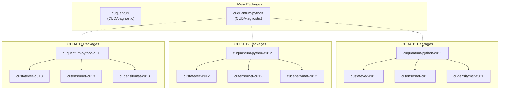
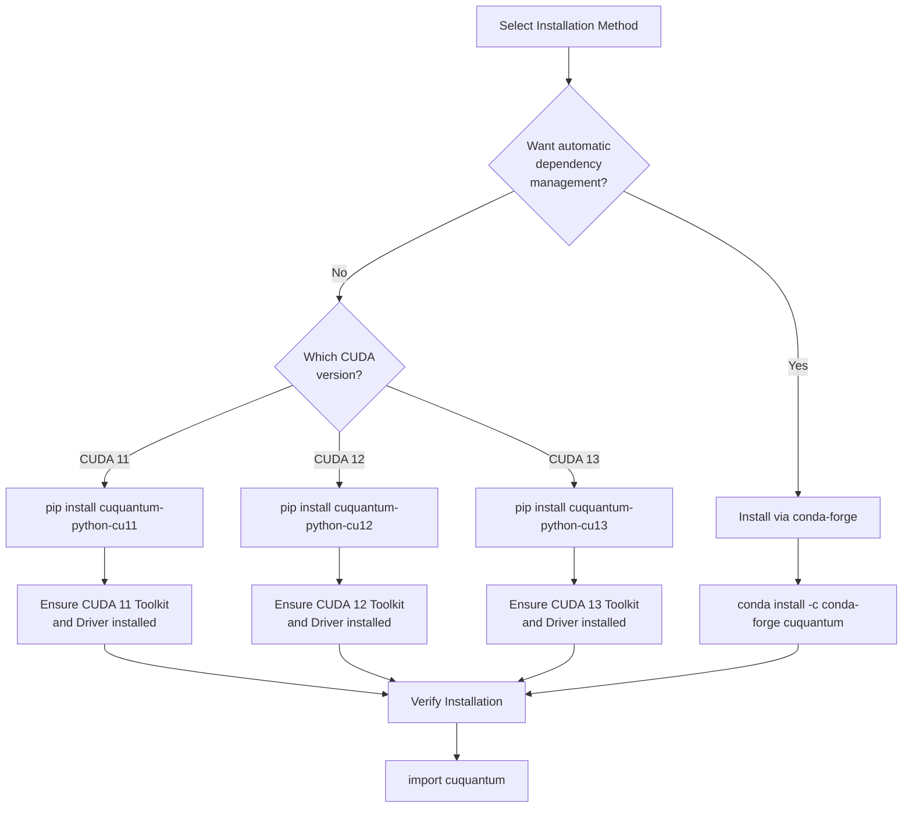

<!-- source: DeepWiki mcp.deepwiki.com · repo NVIDIA/cuQuantum · page 2.1 Installation and Setup · fetched 2026-10-26 -->

# Installation and Setup

<details>
<summary>Relevant source files</summary>

The following files were used as context for generating this wiki page:

- [LICENSE](LICENSE)
- [README.md](README.md)
- [python/LICENSE](python/LICENSE)
- [python/README.md](python/README.md)
- [python/setup.py](python/setup.py)

</details>


This page provides detailed instructions for installing the cuQuantum Python interface, including dependency requirements, CUDA version compatibility, and environment configuration. For building from source, see section 7.

## Overview

NVIDIA cuQuantum Python provides Python bindings for the cuQuantum SDK's three core libraries: cuStateVec, cuTensorNet, and cuDensityMat. The package supports multiple installation methods (conda-forge and PyPI) with CUDA-version-specific variants.

**Package Distribution Structure on PyPI**



Sources: [README.md:19-31](), [python/setup.py:152]()

## System Requirements

### Hardware Requirements

* NVIDIA GPU with compute capability 7.5 or higher
* Sufficient GPU memory for quantum simulation workloads

### Software Requirements

| Component | Requirement |
|-----------|-------------|
| **Operating System** | Linux (primary supported platform; Windows support limited) |
| **NVIDIA Driver** | Linux: 525.60.13+ (CUDA 12) or 580.65.06+ (CUDA 13) |
| **CUDA Toolkit** | 12.x or 13.x |
| **Python** | >=3.11, <3.14 |

**Note**: As of cuQuantum Python v25.06, the cuQuantum C libraries (cuDensityMat, cuStateVec, cuTensorNet) are no longer build-time dependencies but are still required at runtime.

Sources: [python/README.md:50-58](), [python/README.md:24]()

## Runtime Dependencies

### Core Runtime Dependencies

The following dependencies are installed automatically via conda-forge or PyPI:

| Component | Version Requirement | Notes |
|-----------|---------------------|-------|
| **cuStateVec** | >=1.10.0, <2.0 | State vector simulation library |
| **cuTensorNet** | >=2.9.0, <3.0 | Tensor network simulation library |
| **cuDensityMat** | >=0.3.0, <0.4.0 | Density matrix simulation library |
| **NumPy** | >=1.21, <3.0 | Array operations |
| **nvmath-python** | ==0.6.0 | Strictly pinned version (internal module stability) |
| **CuPy** | >=13.0.0 (CUDA 12), >=13.6.0 (CUDA 13) | GPU-accelerated array library |
| **cuda-bindings** | >=12.9.2, <13.0.0 (CUDA 12)<br/>>=13.0.1, <14.0.0 (CUDA 13) | CUDA runtime bindings |

**Important**: The `nvmath-python` package is strictly pinned to version 0.6.0 until the `nvmath.internal` module becomes stable.

### Optional Dependencies

Optional packages enable integration with quantum computing frameworks and distributed computing:

| Component | Version Requirement | Purpose |
|-----------|---------------------|---------|
| **PyTorch** | >=1.10 | Tensor operations and quantum ML |
| **Qiskit** | >=1.4.2, <3.0 | Qiskit framework integration |
| **Cirq** | >=0.6.0 | Cirq framework integration |
| **mpi4py** | >=3.1.0 | Multi-node distributed computing via MPI |

Sources: [python/README.md:50-67](), [python/setup.py:35-48]()

## Installation Methods

**Installation Decision Flow**



### Method 1: Installation via conda-forge (Recommended)

The conda-forge distribution handles all dependencies automatically, including CUDA libraries:

```bash
conda install -c conda-forge cuquantum
```

**What gets installed:**
- cuQuantum Python bindings (`cuquantum-python`)
- All three core libraries: `custatevec`, `cutensornet`, `cudensitymat`
- Dependencies: CuPy, NumPy, nvmath-python, cuda-bindings
- CUDA runtime libraries (excluding the NVIDIA driver)

The conda-forge packages are unified and do not require CUDA version specification.

Sources: [python/README.md:68-69](), [README.md:13-18]()

### Method 2: Installation via PyPI

PyPI provides CUDA-version-specific packages. You must select the package matching your CUDA installation:

**For CUDA 11.x:**
```bash
pip install cuquantum-python-cu11
```

**For CUDA 12.x:**
```bash
pip install cuquantum-python-cu12
```

**For CUDA 13.x:**
```bash
pip install cuquantum-python-cu13
```

**What gets installed:**
- `cuquantum-python-cuXX` meta-package
- CUDA-specific variants: `custatevec-cuXX`, `cutensornet-cuXX`, `cudensitymat-cuXX`
- Dependencies: CuPy (CUDA-specific), nvmath-python ==0.6.0, cuda-bindings, NumPy

**Prerequisites for PyPI installation:**
- CUDA Toolkit (matching version) must be installed
- NVIDIA driver must be installed
- CUDA libraries must be visible via `LD_LIBRARY_PATH` (see Environment Setup section)

Sources: [README.md:19-31](), [python/README.md:70-72](), [python/setup.py:39-48]()

### Method 3: Installation from Source

For development or accessing unreleased features, build from source:

```bash
# 1. Clone repository
git clone https://github.com/NVIDIA/cuQuantum
cd cuQuantum/python

# 2. Set environment variables
export CUDA_PATH=/usr/local/cuda

# 3. Install
pip install .
```

**For editable/development installation:**
```bash
pip install -e .
```

**Advanced installation (skip dependency resolution):**
```bash
pip install -v --no-deps --no-build-isolation .
```

**Build-time dependencies:**
- CUDA Toolkit 12.x or 13.x
- Python >=3.11, <3.14
- Cython >=3.0.4, !=3.1.0, !=3.1.1
- pip 21.3.1+
- setuptools 77.0.3+
- wheel 0.34.0+
- packaging

These dependencies are handled automatically by the PEP-517 build system unless using `--no-build-isolation`.

Sources: [python/README.md:10-44](), [python/README.md:14-26]()


## Cython Bindings Architecture

The cuQuantum Python package uses Cython to create bindings between Python and the native C++ libraries. The `setup.py` script defines multiple Extension modules:

**Extension Modules Built by setup.py**

```mermaid
graph TB
    subgraph "Python Package: cuquantum"
        subgraph "cuquantum.bindings"
            custatevec_pyx["custatevec.pyx"]
            cycustatevec_pyx["cycustatevec.pyx"]
            custatevec_internal["_internal/custatevec.pyx"]
            
            cutensornet_pyx["cutensornet.pyx"]
            cycutensornet_pyx["cycutensornet.pyx"]
            cutensornet_internal["_internal/cutensornet.pyx"]
            
            cudensitymat_pyx["cudensitymat.pyx"]
            cycudensitymat_pyx["cycudensitymat.pyx"]
            cudensitymat_internal["_internal/cudensitymat.pyx"]
            
            utils_pyx["_utils.pyx"]
        end
    end
    
    subgraph "Native C++ Libraries"
        libcustatevec["libcustatevec.so"]
        libcutensornet["libcutensornet.so"]
        libcudensitymat["libcudensitymat.so"]
    end
    
    custatevec_pyx --> libcustatevec
    cycustatevec_pyx --> libcustatevec
    custatevec_internal --> libcustatevec
    
    cutensornet_pyx --> libcutensornet
    cycutensornet_pyx --> libcutensornet
    cutensornet_internal --> libcutensornet
    
    cudensitymat_pyx --> libcudensitymat
    cycudensitymat_pyx --> libcudensitymat
    cudensitymat_internal --> libcudensitymat
    
    utils_pyx --> libcuda["CUDA Runtime API"]
```



The `setup.py` script defines 10 Extension modules (lines 84-136) that are cythonized during the build process. The `builder.utils` module (imported at line 19) handles CUDA version detection and sets the appropriate compiler flags.

Sources: [python/setup.py:84-136](), [python/setup.py:12-19](), [python/setup.py:180-182]()

## CUDA Version Compatibility

Maintaining CUDA version consistency across all components is critical. Mixing CUDA major versions will result in undefined behavior.

| Component | CUDA 11.x | CUDA 12.x | CUDA 13.x |
|-----------|-----------|-----------|-----------|
| **Meta-package name** | `cuquantum-python-cu11` | `cuquantum-python-cu12` | `cuquantum-python-cu13` |
| **CuPy requirement** | `cupy-cuda11x>=13.0` | `cupy-cuda12x>=13.0` | `cupy-cuda13x>=13.6.0` |
| **cuda-bindings** | N/A | `>=12.9.2, <13.0.0` | `>=13.0.1, <14.0.0` |
| **Driver requirement (Linux)** | 450.80.02+ | 525.60.13+ | 580.65.06+ |
| **CUDA Toolkit** | 11.x | 12.x | 13.x |

**Compatibility Notes:**
- CUDA 11.x support includes backward compatibility with packages built for earlier CUDA 11 minor versions
- CUDA 12.x introduced minor version forward compatibility guarantees
- CUDA 13.x continues the forward compatibility model
- **Do not mix CUDA major versions** (e.g., CUDA 12 Toolkit with cuquantum-python-cu13)

The `setup.py` script dynamically detects the CUDA version and sets the package name accordingly at line 152: `name=f"cuquantum-python-cu{utils.cuda_major_ver}"`.

Sources: [python/README.md:44](), [python/README.md:78](), [python/setup.py:43-48](), [python/setup.py:152](), [python/README.md:53]()

## Environment Setup

### LD_LIBRARY_PATH Configuration

When building from source or using custom library installations, ensure CUDA libraries are visible to the Python runtime:

```bash
# Add CUDA Toolkit libraries
export LD_LIBRARY_PATH=/usr/local/cuda/lib64:$LD_LIBRARY_PATH

# Add cuQuantum SDK libraries (if installed separately)
export LD_LIBRARY_PATH=/path/to/cuquantum/lib:$LD_LIBRARY_PATH

# Add cuTENSOR libraries (if installed separately)
export LD_LIBRARY_PATH=/path/to/cutensor/lib:$LD_LIBRARY_PATH
```

**Note**: If you install via conda-forge or pip wheels, this is typically not necessary as libraries are bundled with the packages.

### CUDA_PATH Configuration

The `CUDA_PATH` environment variable is required for:
- Building cuQuantum Python from source
- Running certain tests that require CUDA development headers

```bash
export CUDA_PATH=/usr/local/cuda
# or specify a specific version
export CUDA_PATH=/usr/local/cuda-12.6
```

The `setup.py` build script uses this variable to locate CUDA include directories (line 133).

### Optional Library Path Variables

For advanced configurations, you can specify individual library locations:

```bash
# Point to specific cuQuantum SDK installation
export CUQUANTUM_ROOT=/path/to/cuquantum

# Or specify individual library paths
export CUSTATEVEC_ROOT=/path/to/custatevec
export CUTENSORNET_ROOT=/path/to/cutensornet
export CUDENSITYMAT_ROOT=/path/to/cudensitymat

# cuTENSOR location
export CUTENSOR_ROOT=/path/to/cutensor
```

Sources: [python/README.md:32-33](), [python/README.md:73-75](), [python/setup.py:133]()

## Verifying Installation

After installation, verify that cuQuantum Python is working correctly:

```python
import cuquantum
print(cuquantum.__version__)

# Verify individual libraries can be imported
from cuquantum import custatevec
from cuquantum import cutensornet
from cuquantum import cudensitymat

print("cuQuantum Python installation successful")
```

**Expected output:**
- Version string (e.g., "25.06.0")
- No import errors

## Known Issues and Troubleshooting

### Multiple cuTENSOR Installations

If multiple copies of cuTENSOR are installed, with one in a default system path, version mismatch errors may occur. 

**Solution**: Remove cuTENSOR from system paths (e.g., `/usr/lib`, `/usr/local/lib`) to ensure visibility of the correct copy bundled with cuQuantum.

**Do not use `LD_PRELOAD`** to override library loading, as this can cause difficult-to-debug behavior.

### CUDA Version Mixing

Mixing CUDA major versions (e.g., CUDA 12 Toolkit with cuquantum-python-cu13) will result in undefined behavior.

**Solution**: Ensure all components use the same CUDA major version:
- CUDA Toolkit
- cuQuantum Python package (`cuXX` suffix)
- CuPy variant (`cupy-cudaXXx`)
- cuda-bindings version

### Import Verification

Some tests may be skipped if:
- `cffi` package is not installed
- `CUDA_PATH` environment variable is not set

**Solution**: Install `cffi` and set `CUDA_PATH` before running tests.

Sources: [python/README.md:76-79](), [python/README.md:90-91]()

## Testing the Installation

If you want to run the test suite to verify your installation:

```bash
cd cuQuantum/python
pytest tests
```

Note that some tests may be skipped if `cffi` is not installed or if the `CUDA_PATH` environment variable is not set.

Test dependencies include:
- pytest 6.2+
- pytest-xdist
- opt_einsum
- cffi 1.0.0+
- Various quantum framework dependencies (Cirq, Qiskit, etc.)

Sources: [python/README.md:90-94](), [python/tests/requirements.txt:1-12]()

## Next Steps

After successful installation, you can:

1. Explore the Python API as detailed in [API Reference](#2.2)
2. Learn about integration with quantum frameworks at [Integration with Quantum Frameworks](#2.3)
3. Try the sample code available in the `samples` directory

Sources: [python/README.md:83-88]()

---

