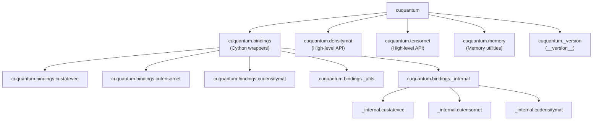
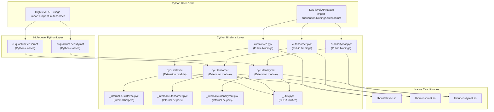
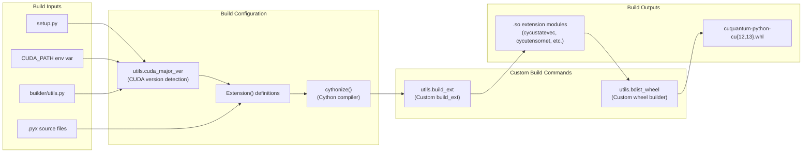
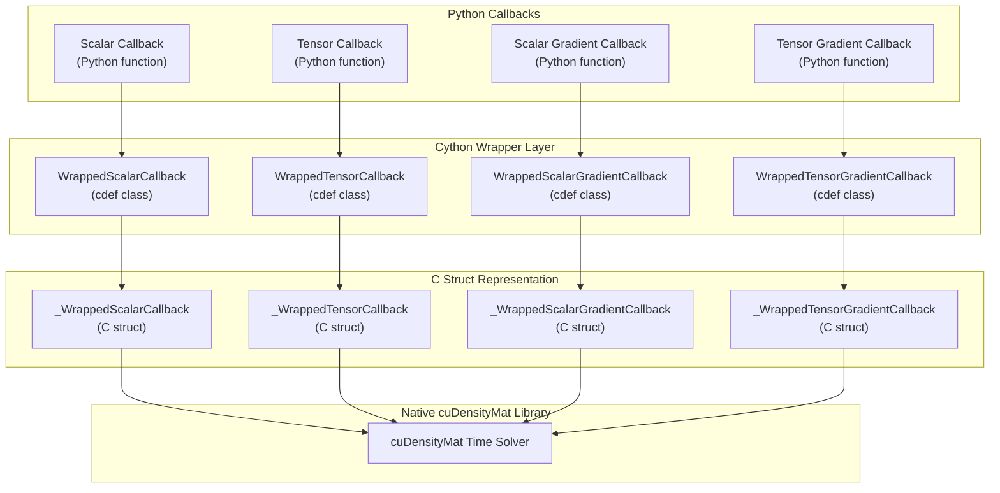

<!-- source: DeepWiki mcp.deepwiki.com · repo NVIDIA/cuQuantum · page 2.2 Package Structure and Bindings · fetched 2026-10-26 -->

# Package Structure and Bindings

<details>
<summary>Relevant source files</summary>

The following files were used as context for generating this wiki page:

- [python/README.md](python/README.md)
- [python/cuquantum/__init__.py](python/cuquantum/__init__.py)
- [python/cuquantum/bindings/cudensitymat.pxi](python/cuquantum/bindings/cudensitymat.pxi)
- [python/samples/bindings/cutensornet/state/proj_mps_circuit_dmrg_example.py](python/samples/bindings/cutensornet/state/proj_mps_circuit_dmrg_example.py)
- [python/setup.py](python/setup.py)

</details>


## Purpose and Scope

This document explains the internal architecture of the cuQuantum Python package, covering the package hierarchy, the Cython bindings layer that interfaces with native CUDA libraries, and the distinction between low-level and high-level Python APIs. 

For installation instructions and dependency management, see [Installation and Setup](#2.1). For integration with frameworks like Qiskit and Cirq, see [Integration with Quantum Frameworks](#2.3). For JAX-specific bindings and autodiff capabilities, see [JAX Integration and Autodiff](#2.4).

## Package Hierarchy

The cuQuantum Python package is distributed as `cuquantum-python-cu{11,12,13}` and provides a unified interface to three CUDA libraries: cuStateVec, cuTensorNet, and cuDensityMat.

### Top-Level Package Structure

The main `cuquantum` package exposes several submodules:



**Sources:** [python/cuquantum/__init__.py:1-11]()

The top-level `__init__.py` imports expose:
- `bindings`: Low-level Cython bindings to C APIs
- `densitymat`: High-level Pythonic interface to cuDensityMat
- `tensornet`: High-level Pythonic interface to cuTensorNet
- `memory`: Memory management utilities
- Helper types: `ComputeType`, `cudaDataType`, `libraryPropertyType`

### CUDA Version-Specific Packaging

The package name includes the CUDA major version to enforce compatibility:

| Package Name | CUDA Version | Runtime Dependencies |
|-------------|--------------|---------------------|
| `cuquantum-python-cu12` | CUDA 12.x | `custatevec-cu12`, `cutensornet-cu12`, `cudensitymat-cu12`, `cupy-cuda12x`, `cuda-bindings>=12.9.2,<13` |
| `cuquantum-python-cu13` | CUDA 13.x | `custatevec-cu13`, `cutensornet-cu13`, `cudensitymat-cu13`, `cupy-cuda13x`, `cuda-bindings>=13.0.1,<14` |

**Sources:** [python/setup.py:39-48](), [python/setup.py:152]()

The CUDA version detection is handled by `builder.utils.cuda_major_ver` during the build process, which determines the appropriate package name and dependencies.

## Binding Layers Architecture

The Python interface to cuQuantum's native CUDA libraries operates through three distinct layers:



**Sources:** [python/setup.py:84-136](), [python/cuquantum/__init__.py:1-11]()

### Layer 1: Public Bindings (`cuquantum.bindings.*`)

These modules provide direct 1:1 mappings to the C API functions:

- `cuquantum.bindings.custatevec` - State vector operations
- `cuquantum.bindings.cutensornet` - Tensor network operations  
- `cuquantum.bindings.cudensitymat` - Density matrix operations

Each binding module is generated from a `.pyx` Cython source file that declares C function signatures and wraps them in Python-callable forms.

**Sources:** [python/setup.py:85-103](), [python/setup.py:115-128]()

### Layer 2: Cython Implementation (`cycustatevec`, `cycutensornet`, `cycudensitymat`)

These extension modules contain the actual Cython implementation code:

- `cycustatevec` - Built from `cuquantum/bindings/cycustatevec.pyx`
- `cycutensornet` - Built from `cuquantum/bindings/cycutensornet.pyx`
- `cycudensitymat` - Built from `cuquantum/bindings/cycudensitymat.pyx`

These modules handle:
- C struct declarations (`cdef struct`)
- Memory management and pointer conversion
- Error handling and exception translation
- Type conversions between Python and C types

**Sources:** [python/setup.py:90-109]()

### Layer 3: Internal Helpers (`cuquantum.bindings._internal.*`)

These modules provide implementation-specific utilities not exposed in the public API:

- `_internal.custatevec` - Internal state vector helpers
- `_internal.cutensornet` - Internal tensor network helpers  
- `_internal.cudensitymat` - Internal density matrix helpers

**Sources:** [python/setup.py:95-114]()

### Utilities Module (`cuquantum.bindings._utils`)

The `_utils` extension provides CUDA-specific utilities shared across all bindings:

```python
from cuquantum.bindings._utils import ComputeType, cudaDataType, libraryPropertyType
```

This module includes CUDA header declarations and is built with the CUDA include path.

**Sources:** [python/setup.py:130-135](), [python/cuquantum/__init__.py:9]()

## Extension Module Build Process

The build process converts Cython source files (`.pyx`) into C++ extensions that link against CUDA libraries.

### Build System Components



**Sources:** [python/setup.py:1-196]()

### Extension Definitions

Each Cython module is defined as a `setuptools.Extension` object:

```python
Extension(
    "cuquantum.bindings.custatevec",        # Module name
    sources=["cuquantum/bindings/custatevec.pyx"],  # Source file
    language="c++",                          # Language mode
)
```

**Sources:** [python/setup.py:84-136]()

The setup script defines 9 extension modules total:
1. `cuquantum.bindings.custatevec`
2. `cuquantum.bindings.cycustatevec`
3. `cuquantum.bindings._internal.custatevec`
4. `cuquantum.bindings.cutensornet`
5. `cuquantum.bindings.cycutensornet`
6. `cuquantum.bindings._internal.cutensornet`
7. `cuquantum.bindings.cudensitymat`
8. `cuquantum.bindings.cycudensitymat`
9. `cuquantum.bindings._internal.cudensitymat`
10. `cuquantum.bindings._utils`

### Cythonization Process

The `cythonize()` function converts `.pyx` files to C++ source:

```python
ext_modules=cythonize(ext_modules,
    verbose=True, 
    language_level=3,
    compiler_directives={'embedsignature': True}
)
```

**Sources:** [python/setup.py:180-182]()

The `embedsignature=True` directive ensures that function signatures are embedded in docstrings for introspection.

### Platform-Specific Handling

The build process handles platform-specific variants:

```python
if sys.platform == 'linux':
    src_files = glob.glob('**/**/_internal/*_linux.pyx')
elif sys.platform == 'win32':
    src_files = glob.glob('**/**/_internal/*_windows.pyx')
```

Platform-specific `.pyx` files are temporarily renamed during the build to their platform-agnostic names.

**Sources:** [python/setup.py:52-68]()

### Custom Build Commands

The build system uses custom command classes:

```python
cmdclass = {
    'build_ext': utils.build_ext,
    'bdist_wheel': utils.bdist_wheel,
}
```

These custom classes (defined in `builder/utils.py`) handle:
- CUDA version detection and validation
- Library path configuration
- Compiler flag injection
- Wheel metadata customization

**Sources:** [python/setup.py:139-142]()

## Callback Mechanisms in Bindings

The cuDensityMat bindings include sophisticated callback mechanisms for time-dependent Hamiltonians. These callbacks allow Python functions to be invoked from C++ code during time evolution.

### Callback Types



**Sources:** [python/cuquantum/bindings/cudensitymat.pxi:1-160]()

### Memory Reconstruction Helpers

The bindings provide helper functions to reconstruct Python arrays from C pointers passed in callbacks:

#### CPU Memory Reconstruction

```python
def _reconstruct_cpu_params(int64_t batch_size, int32_t num_params, 
                           const double * _params_, int flag):
    """Reconstruct NumPy array for params/params_grad from pointer and size."""
    params_size = sizeof(double) * num_params * batch_size
    params_buffer = PyMemoryView_FromMemory(<char *>_params_, params_size, flag)
    params = np.ndarray((num_params, batch_size), dtype=np.float64, 
                       buffer=params_buffer, order='F')
    return params
```

**Sources:** [python/cuquantum/bindings/cudensitymat.pxi:18-25]()

This function creates a NumPy array view over C-allocated memory without copying data. It's used in callbacks to pass parameter values to Python functions.

#### GPU Memory Reconstruction

```python
def _reconstruct_gpu_params(int64_t batch_size, int32_t num_params, 
                           const double * _params_):
    """Reconstruct CuPy array for params/params_grad from pointer and size."""
    params_size = sizeof(double) * num_params * batch_size
    params_memory = cp.cuda.UnownedMemory(<intptr_t>_params_, params_size, None)
    params_memory_ptr = cp.cuda.MemoryPointer(params_memory, 0)
    params = cp.ndarray((num_params, batch_size), dtype=cp.float64, 
                       memptr=params_memory_ptr, order='F')
    return params
```

**Sources:** [python/cuquantum/bindings/cudensitymat.pxi:38-50]()

For GPU callbacks, CuPy's `UnownedMemory` is used to create array views over device memory without triggering deallocation.

### Callback Reference Management

The bindings maintain references to Python callback objects to prevent garbage collection:

```python
def _hold_scalar_callback_reference(intptr_t obj, scalar_callback):
    """Hold reference to a scalar callback."""
    if scalar_callback is not None:
        _callback_holders[obj].add((<WrappedScalarCallback>scalar_callback).callback)
```

**Sources:** [python/cuquantum/bindings/cudensitymat.pxi:64-69]()

The `_callback_holders` dictionary (indexed by object address) ensures Python callbacks remain alive for the duration of C++ object lifetimes.

### Callback Conversion Functions

Conversion functions transform wrapped callbacks into C structs:

```python
def _convert_scalar_callback(scalar_callback):
    """Convert a wrapped scalar callback from a cdef class to a C struct."""
    cdef _WrappedScalarCallback _scalar_callback_
    if scalar_callback is not None:
        _scalar_callback_ = (<WrappedScalarCallback>scalar_callback)._struct
    else:
        _scalar_callback_.callback = NULL
        _scalar_callback_.device = CUDENSITYMAT_CALLBACK_DEVICE_CPU
        _scalar_callback_.wrapper = NULL
    return _scalar_callback_
```

**Sources:** [python/cuquantum/bindings/cudensitymat.pxi:104-115]()

This pattern is repeated for tensor callbacks, scalar gradient callbacks, and tensor gradient callbacks.

## Runtime Dependency Management

At runtime, the Python bindings require the native CUDA libraries to be visible in the library search path.

### Library Dependencies

The runtime dependencies include:

| Component | Version Requirement | Purpose |
|-----------|-------------------|---------|
| `custatevec` | 1.10.0+ | State vector simulation backend |
| `cutensornet` | 2.9.0+ | Tensor network simulation backend |
| `cudensitymat` | >=0.3.0, <0.4.0 | Density matrix simulation backend |
| `nvmath-python` | ==0.6.0 (pinned) | Math utilities |
| `cuda-bindings` | CUDA version-specific | CUDA runtime bindings |
| `cupy` | 13.0.0+ | GPU array operations |

**Sources:** [python/README.md:50-62](), [python/setup.py:35-48]()

### Library Search Configuration

The native libraries must be visible via `LD_LIBRARY_PATH`:

```bash
export LD_LIBRARY_PATH=/path/to/cuquantum/lib:$LD_LIBRARY_PATH
```

When installing from PyPI wheels, CuPy and the cuQuantum libraries are bundled, but CUDA Toolkit libraries must still be available.

**Sources:** [python/README.md:70-74]()

### Build vs Runtime Dependencies

As of cuQuantum Python v25.06, there is an important distinction:

- **Build-time**: CUDA Toolkit 12.x or 13.x, Cython >=3.0.4, setuptools, wheel
- **Runtime**: cuQuantum C libraries are no longer build dependencies but remain runtime dependencies

This change allows building wheels without the cuQuantum C libraries present, reducing build complexity.

**Sources:** [python/README.md:14-26]()

## Package Data and Type Stubs

The package includes Cython source files as package data for debugging and development:

```python
package_data=dict.fromkeys(
    find_packages(include=["cuquantum.*"]),
    ["*.pxd", "*.pyx", "*.py"],
)
```

**Sources:** [python/setup.py:184-187]()

This ensures that `.pxd` (Cython declaration files), `.pyx` (Cython implementation files), and `.py` (Python files) are included in the distribution, enabling:
- Source-level debugging
- Type hint availability
- Development mode (`pip install -e .`)

The `zip_safe=False` setting prevents the package from being installed as a zipped egg, which is necessary for extension modules.

**Sources:** [python/setup.py:188]()

---

