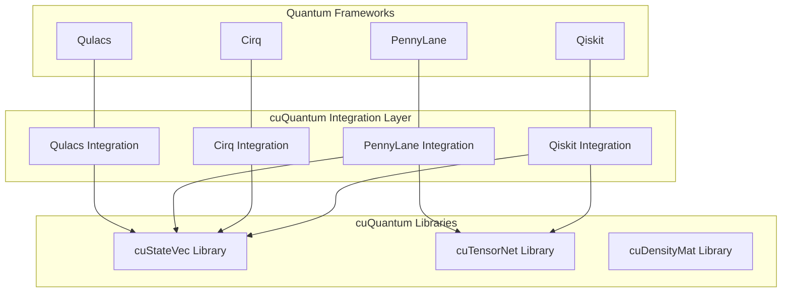
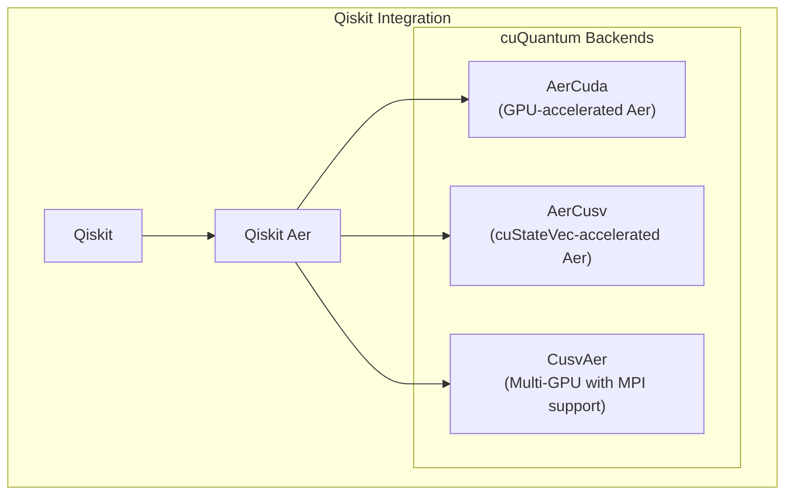
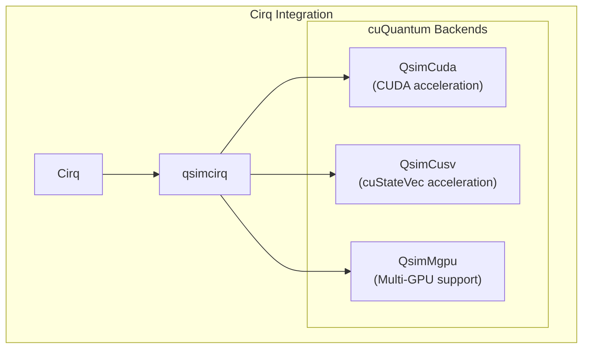
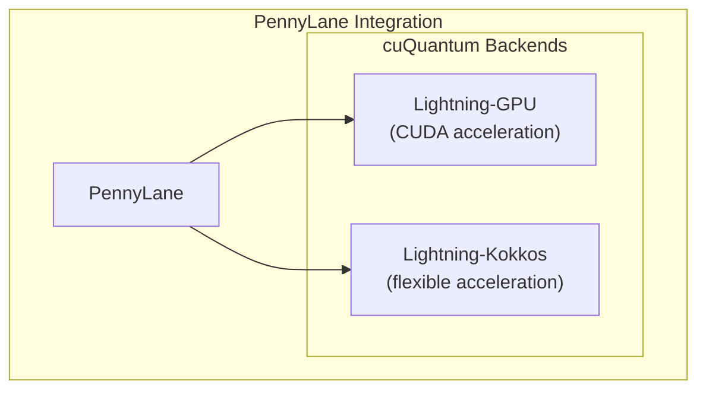
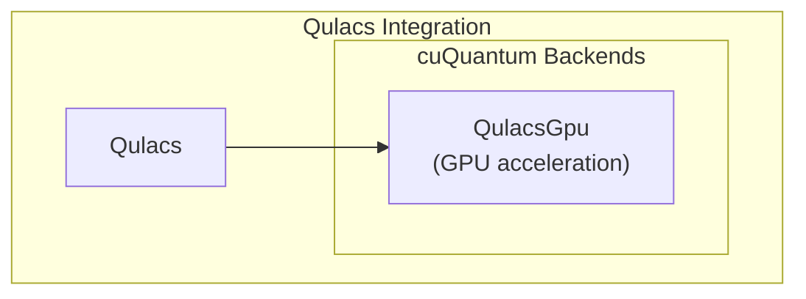
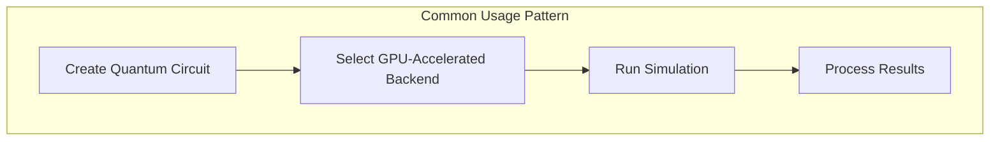
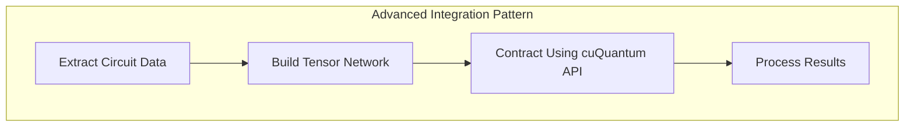
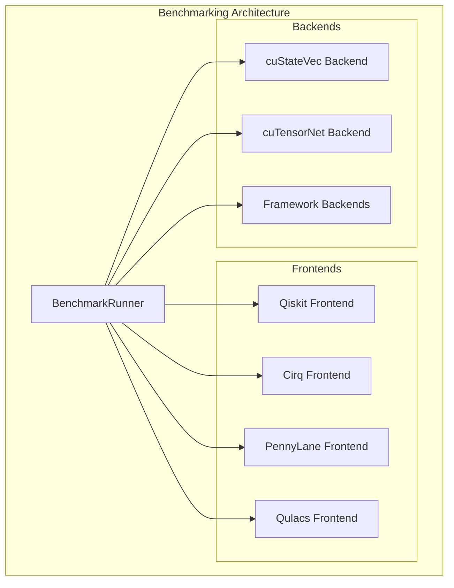

<!-- source: DeepWiki mcp.deepwiki.com · repo NVIDIA/cuQuantum · page 2.3 Integration with Quantum Frameworks · fetched 2026-10-26 -->

# Integration with Quantum Frameworks

Relevant source files

The following files were used as context for generating this wiki page:

- [python/cuquantum/_version.py](python/cuquantum/_version.py)
- [python/tests/requirements.txt](python/tests/requirements.txt)

This wiki page describes how cuQuantum SDK integrates with popular quantum computing frameworks like Qiskit, Cirq, PennyLane, and Qulacs. It covers the integration architecture, framework-specific implementations, and usage patterns. For information about the cuQuantum Python interface itself, see [Python Interface](#2).

## Integration Architecture Overview

cuQuantum integrates with quantum computing frameworks through two main approaches:

1. **Framework Simulators** - Native GPU-accelerated simulators for specific frameworks 
2. **Python API Integration** - Direct use of cuQuantum's tensor network and state vector operations within framework code

The integration is designed to be seamless, allowing quantum developers to leverage their existing knowledge of these frameworks while benefiting from GPU acceleration.

### Integration Diagram

Sources: [benchmarks/cuquantum_benchmarks/backends/__init__.py:1-35](), [benchmarks/cuquantum_benchmarks/frontends/__init__.py:1-21]()

## Framework-Specific Integrations

### Qiskit Integration

cuQuantum integrates with Qiskit through multiple backends:

The Qiskit integration includes:

1. **AerCuda** - Uses CUDA for GPU acceleration within Qiskit Aer
2. **AerCusv** - Leverages cuStateVec for optimized state vector operations
3. **CusvAer** - Provides multi-GPU support with MPI capabilities for distributed computing

Qiskit circuits are automatically transpiled to run on these backends, with optimization options for:
- Fusion of operations (`fusion_max_qubit`)
- Precision control (single or double precision)
- Multi-GPU blocking strategies for large simulations

Sources: [benchmarks/cuquantum_benchmarks/backends/backend_qiskit.py:32-226]()

### Cirq Integration

cuQuantum integrates with Cirq and qsimcirq (Google's quantum simulator for Cirq):

The Cirq integration includes:

1. **QsimCuda** - Uses CUDA for GPU acceleration
2. **QsimCusv** - Leverages cuStateVec library for optimized state vector operations
3. **QsimMgpu** - Provides multi-GPU support for larger simulations

All qsim backends currently only support single precision simulations.

Sources: [benchmarks/cuquantum_benchmarks/backends/backend_qsim.py:16-93](), [benchmarks/cuquantum_benchmarks/backends/backend_cirq.py:20-52]()

### PennyLane Integration

cuQuantum integrates with PennyLane through multiple lightning-based backends:

The integration provides:

1. **PennyLane-Lightning-GPU** - GPU-accelerated simulations
2. **PennyLane-Lightning-Kokkos** - Flexible acceleration with Kokkos

PennyLane circuits can be directly run on these backends for quantum simulation and optimization tasks.

Sources: [benchmarks/cuquantum_benchmarks/backends/__init__.py:7-29](), [benchmarks/cuquantum_benchmarks/frontends/frontend_pny.py:16-75]()

### Qulacs Integration

cuQuantum also integrates with Qulacs:

The Qulacs integration provides GPU acceleration for Qulacs simulations.

Sources: [benchmarks/cuquantum_benchmarks/backends/__init__.py:10-29]()

## Integration Usage Patterns

### Using Framework-Specific Backends

The most common integration pattern is using cuQuantum-accelerated backends:

Each framework follows a similar pattern:

| Framework | Backend Creation Example |
|-----------|--------------------------|
| Qiskit | `simulator = AerSimulator(method='statevector', device='GPU', cuStateVec_enable=True)` |
| Cirq | `simulator = qsimcirq.QSimSimulator(qsim_options=qsimcirq.QSimOptions(gpu_mode=0))` |
| PennyLane | `dev = qml.device('lightning.gpu')` |
| Qulacs | `simulator = QuantumCircuitSimulator(n_qubits, gpu=True)` |

### Using cuQuantum Python APIs Directly

For more advanced use cases, the cuQuantum Python APIs can be used directly:

The deprecated `cutensornet` module and the recommended `tensornet` module provide APIs for tensor network contraction that can be used directly with circuit data extracted from any framework.

Sources: [python/cuquantum/cutensornet/__init__.py:1-40]()

## Performance Considerations

When using cuQuantum with quantum frameworks, consider:

1. **Multi-GPU Distribution** - For large circuits (>30 qubits), use multi-GPU options
2. **Memory Management** - State vectors grow exponentially (2^n complex numbers for n qubits)
3. **Gate Fusion** - Fusing multiple gates improves performance by reducing kernel launches
4. **Framework Overhead** - Some frameworks add overhead; direct cuQuantum API usage may be faster for critical applications

Sources: [benchmarks/cuquantum_benchmarks/backends/backend_qiskit.py:83-194](), [benchmarks/cuquantum_benchmarks/backends/backend_qsim.py:46-87]()

## Benchmarking Framework Integrations

cuQuantum includes a benchmarking suite for comparing performance across frameworks:

The benchmarking suite can measure:
- Circuit simulation performance across frameworks
- Speedup from GPU acceleration compared to CPU implementations
- Performance scaling with circuit size and complexity

Sources: [benchmarks/cuquantum_benchmarks/backends/__init__.py:13-34](), [benchmarks/cuquantum_benchmarks/frontends/__init__.py:11-20]()

---

