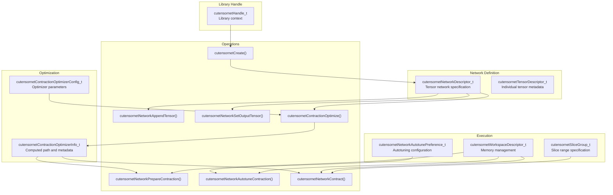
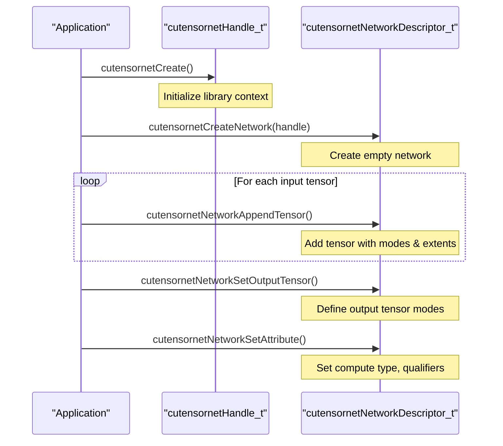
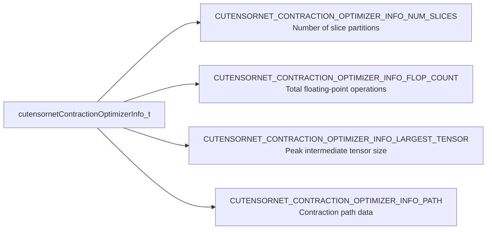
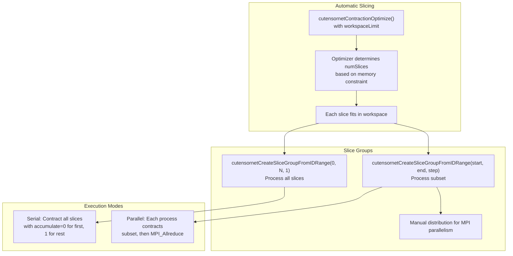
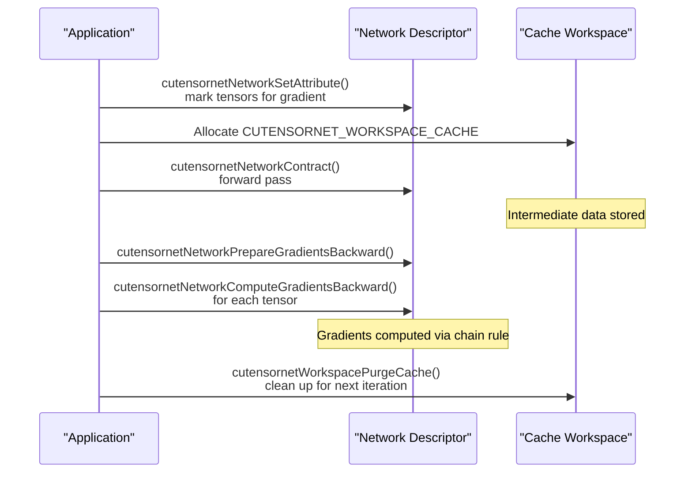
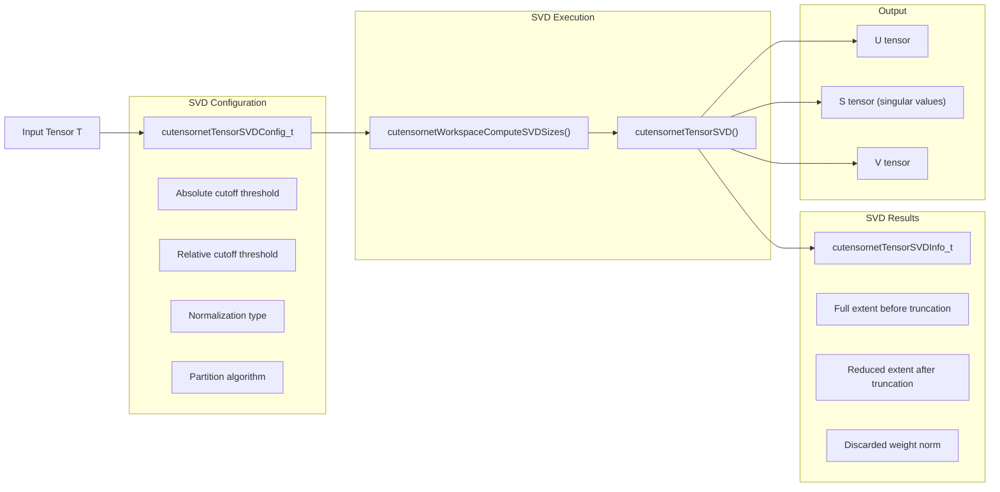
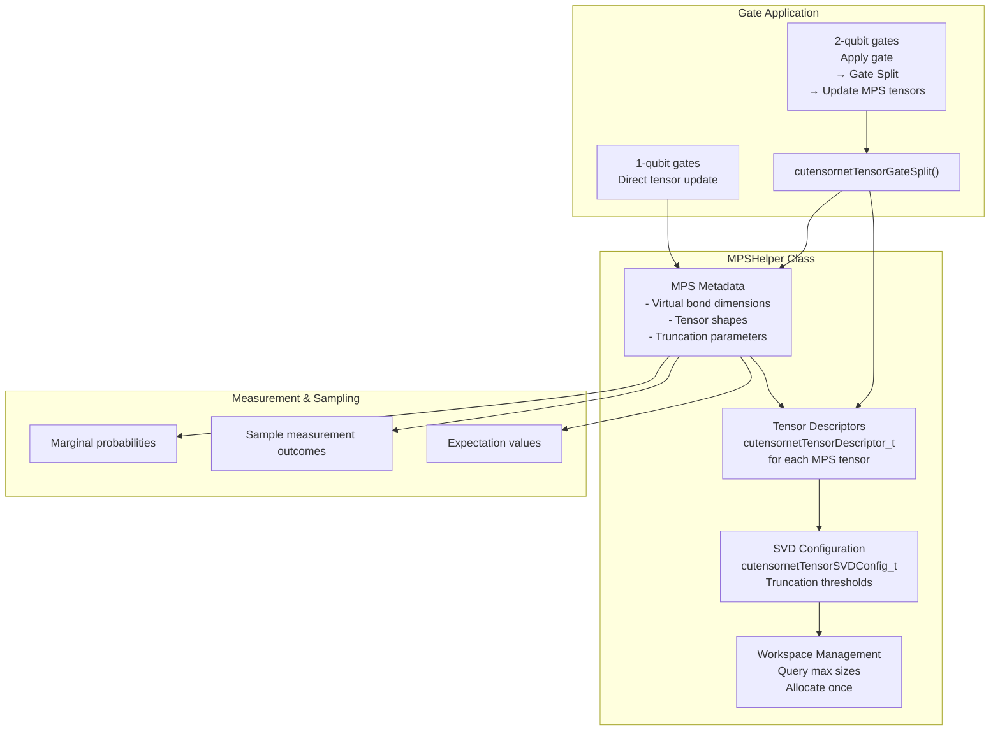
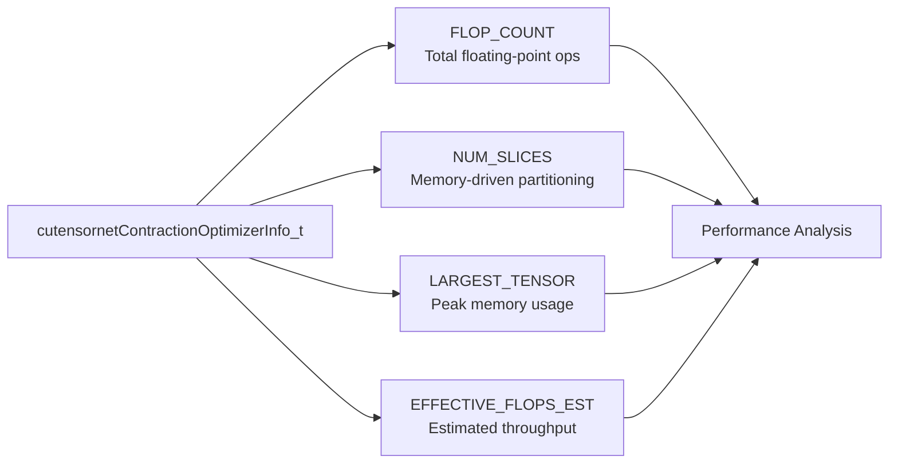

<!-- source: DeepWiki mcp.deepwiki.com · repo NVIDIA/cuQuantum · page 3 cuTensorNet Library · fetched 2026-10-26 -->

# cuTensorNet Library

<details>
<summary>Relevant source files</summary>

The following files were used as context for generating this wiki page:

- [LICENSE](LICENSE)
- [README.md](README.md)
- [python/LICENSE](python/LICENSE)
- [samples/cutensornet/README.md](samples/cutensornet/README.md)
- [samples/cutensornet/tensornet_example.cu](samples/cutensornet/tensornet_example.cu)

</details>


This document provides complete documentation of the cuTensorNet library, one of the three core components of the cuQuantum SDK. cuTensorNet enables efficient quantum circuit simulation through tensor network contraction methods, offering both low-level control and high-level abstractions for various simulation tasks.

**Scope**: This page covers the architecture, API design, and core workflows of cuTensorNet. For state vector simulation, see [cuStateVec Library](#4). For density matrix simulation, see [cuDensityMat Library](#5). For installation and Python bindings, see [Python Interface](#2). For distributed computing details, see [Distributed Computing with MPI](#3.5).

## Overview

cuTensorNet represents quantum circuits as tensor networks and performs efficient contractions to compute quantum amplitudes, expectation values, and other observables. The library provides a flexible two-tier API design: a low-level API for fine-grained control over contraction strategies, and high-level APIs for common quantum computing tasks.

### Core Architecture

The library's architecture consists of several interconnected descriptor types that manage the tensor network lifecycle:



**Sources**: [samples/cutensornet/tensornet_example.cu:1-476](), [samples/cutensornet/README.md:1-184]()

### Library Initialization

The cuTensorNet library requires initialization of a handle that maintains library state throughout the application lifecycle. This handle is used in all subsequent API calls.



The handle is created via `cutensornetCreate()` and destroyed via `cutensornetDestroy()`. All descriptor objects created with this handle must be destroyed before destroying the handle itself.

**Sources**: [samples/cutensornet/tensornet_example.cu:215-219](), [samples/cutensornet/tensornet_example.cu:461]()

### Tensor Network Specification

A tensor network in cuTensorNet is defined by:
1. **Tensor modes**: Character or integer identifiers for each dimension of each tensor
2. **Tensor extents**: Dimension sizes for each mode
3. **Tensor data type**: CUDA data type (e.g., `CUDA_R_32F`, `CUDA_C_64F`)
4. **Output tensor**: The resulting tensor after contraction

| Component | API Type | Purpose |
|-----------|----------|---------|
| Network container | `cutensornetNetworkDescriptor_t` | Holds the complete tensor network specification |
| Input tensor | Appended via `cutensornetNetworkAppendTensor()` | Adds tensor with modes, extents, and strides |
| Output tensor | Set via `cutensornetNetworkSetOutputTensor()` | Defines the contraction result structure |
| Tensor ID | `int64_t` | Unique identifier returned for each appended tensor |

**Example tensor network specification** from [samples/cutensornet/tensornet_example.cu:116-151]():
```
Computing: R_{k,l} = A_{a,b,c,d,e,f} B_{b,g,h,e,i,j} C_{m,a,g,f,i,k} D_{l,c,h,d,j,m}

Input tensors:
- A: modes ['a','b','c','d','e','f'], each mode has extent 16
- B: modes ['b','g','h','e','i','j']
- C: modes ['m','a','g','f','i','k']
- D: modes ['l','c','h','d','j','m']

Output tensor:
- R: modes ['k','l']

Shared modes (contracted): a,b,c,d,e,f,g,h,i,j,m
Free modes (output): k,l
```

Modes that appear in input tensors but not in the output tensor are contracted (summed over). Modes appearing in the output tensor remain as free indices.

**Sources**: [samples/cutensornet/tensornet_example.cu:116-256](), [samples/cutensornet/README.md:75-86]()

## API Workflow

### Basic Contraction Workflow

The standard workflow for performing a tensor network contraction consists of several distinct phases, each using specific API objects:

```mermaid
graph TB
    subgraph "Phase 1: Network Definition"
        A1["cutensornetCreate()"]
        A2["cutensornetCreateNetwork()"]
        A3["cutensornetNetworkAppendTensor()<br/>for each input"]
        A4["cutensornetNetworkSetOutputTensor()"]
        A5["cutensornetNetworkSetAttribute()<br/>set compute type"]
    end
    
    subgraph "Phase 2: Path Optimization"
        B1["cutensornetCreateContractionOptimizerConfig()"]
        B2["cutensornetContractionOptimizerConfigSetAttribute()<br/>set hyper-samples, etc"]
        B3["cutensornetCreateContractionOptimizerInfo()"]
        B4["cutensornetContractionOptimize()<br/>find optimal path"]
        B5["cutensornetContractionOptimizerInfoGetAttribute()<br/>query num_slices, flops"]
    end
    
    subgraph "Phase 3: Workspace Allocation"
        C1["cutensornetCreateWorkspaceDescriptor()"]
        C2["cutensornetWorkspaceComputeContractionSizes()"]
        C3["cutensornetWorkspaceGetMemorySize()"]
        C4["cudaMalloc() workspace"]
        C5["cutensornetWorkspaceSetMemory()"]
    end
    
    subgraph "Phase 4: Execution Preparation"
        D1["cutensornetNetworkPrepareContraction()"]
        D2["cutensornetNetworkSetInputTensorMemory()<br/>for each input"]
        D3["cutensornetNetworkSetOutputTensorMemory()"]
        D4["cutensornetNetworkAutotuneContraction()<br/>optional"]
    end
    
    subgraph "Phase 5: Contraction Execution"
        E1["cutensornetCreateSliceGroupFromIDRange()"]
        E2["cutensornetNetworkContract()"]
        E3["cudaStreamSynchronize()"]
    end
    
    subgraph "Phase 6: Cleanup"
        F1["cutensornetDestroySliceGroup()"]
        F2["cutensornetDestroyWorkspaceDescriptor()"]
        F3["cutensornetDestroyContractionOptimizerInfo()"]
        F4["cutensornetDestroyContractionOptimizerConfig()"]
        F5["cutensornetDestroyNetwork()"]
        F6["cutensornetDestroy()"]
    end
    
    A1 --> A2 --> A3 --> A4 --> A5
    A5 --> B1 --> B2 --> B3 --> B4 --> B5
    B5 --> C1 --> C2 --> C3 --> C4 --> C5
    C5 --> D1 --> D2 --> D3 --> D4
    D4 --> E1 --> E2 --> E3
    E3 --> F1 --> F2 --> F3 --> F4 --> F5 --> F6
```



This workflow is demonstrated in the primary example at [samples/cutensornet/tensornet_example.cu:78-476]().

**Sources**: [samples/cutensornet/tensornet_example.cu:208-476](), [samples/cutensornet/README.md:75-86]()

### Path Optimization Phase

The path optimization phase determines the order in which pairwise tensor contractions are performed. This phase is critical for performance, as different contraction orders can result in vastly different computational costs.

**Key configuration parameters**:

| Attribute | Enum Constant | Purpose |
|-----------|---------------|---------|
| Hyper-samples | `CUTENSORNET_CONTRACTION_OPTIMIZER_CONFIG_HYPER_NUM_SAMPLES` | Number of random trials for path search |
| Random seed | `CUTENSORNET_CONTRACTION_OPTIMIZER_CONFIG_SEED` | Seed for reproducibility |
| Workspace limit | Passed to `cutensornetContractionOptimize()` | Maximum GPU memory for intermediate tensors |

The optimizer may introduce **slicing** when the workspace limit is insufficient for direct contraction. Slicing partitions the contraction into multiple smaller contractions that fit in memory.

**Querying optimization results**:



**Sources**: [samples/cutensornet/tensornet_example.cu:268-302](), [samples/cutensornet/README.md:80-81]()

### Workspace Management

cuTensorNet uses a workspace descriptor to manage GPU memory required for contractions. Different memory regions serve distinct purposes:

| Memory Space | Workspace Kind | Purpose |
|--------------|----------------|---------|
| `CUTENSORNET_MEMSPACE_DEVICE` | `CUTENSORNET_WORKSPACE_SCRATCH` | Temporary storage for intermediate tensors |
| `CUTENSORNET_MEMSPACE_DEVICE` | `CUTENSORNET_WORKSPACE_CACHE` | Reusable intermediate results (for repeated contractions) |
| `CUTENSORNET_MEMSPACE_HOST` | `CUTENSORNET_WORKSPACE_SCRATCH` | Host-side temporary storage |

The workspace size preference can be:
- `CUTENSORNET_WORKSIZE_PREF_MIN`: Minimum memory required
- `CUTENSORNET_WORKSIZE_PREF_RECOMMENDED`: Recommended for good performance
- `CUTENSORNET_WORKSIZE_PREF_MAX`: Maximum beneficial memory

**Workspace allocation example** from [samples/cutensornet/tensornet_example.cu:304-335]():

```
1. Create workspace descriptor: cutensornetCreateWorkspaceDescriptor()
2. Compute sizes: cutensornetWorkspaceComputeContractionSizes()
3. Query size: cutensornetWorkspaceGetMemorySize() with preference and kind
4. Allocate GPU memory: cudaMalloc()
5. Set workspace: cutensornetWorkspaceSetMemory()
```

**Sources**: [samples/cutensornet/tensornet_example.cu:304-335](), [samples/cutensornet/README.md:171-172]()

### Execution and Autotuning

After optimization and workspace allocation, the contraction must be prepared and optionally autotuned before execution.

**Preparation phase** ([samples/cutensornet/tensornet_example.cu:337-358]()):
1. `cutensornetNetworkPrepareContraction()` - Prepares the contraction plan
2. `cutensornetNetworkSetInputTensorMemory()` - Associates device memory with each input tensor
3. `cutensornetNetworkSetOutputTensorMemory()` - Associates device memory with output tensor

**Autotuning phase** ([samples/cutensornet/tensornet_example.cu:359-383]()):
- Creates `cutensornetNetworkAutotunePreference_t` to configure autotuning
- `CUTENSORNET_NETWORK_AUTOTUNE_MAX_ITERATIONS` controls the number of kernel trials
- `cutensornetNetworkAutotuneContraction()` benchmarks different CUDA kernels
- Autotuning is beneficial when the same network is contracted multiple times

**Contraction execution** ([samples/cutensornet/tensornet_example.cu:385-419]()):
```
1. Create slice group: cutensornetCreateSliceGroupFromIDRange(0, numSlices, 1)
   - Specifies which slices to contract (start, end, step)
2. Execute: cutensornetNetworkContract(handle, networkDesc, accumulate, workDesc, sliceGroup, stream)
   - accumulate=0: overwrite output
   - accumulate=1: add to existing output
3. Synchronize: cudaStreamSynchronize()
```

**Sources**: [samples/cutensornet/tensornet_example.cu:337-419](), [samples/cutensornet/README.md:83-84]()

### Slicing and Parallelism

Slicing divides the contraction into multiple independent sub-contractions, enabling:
1. Execution within memory constraints
2. Parallelization across multiple GPUs or processes
3. Asynchronous execution of slices



For distributed execution, see [Distributed Computing with MPI](#3.5).

**Sources**: [samples/cutensornet/tensornet_example.cu:294-300](), [samples/cutensornet/tensornet_example.cu:390-414](), [samples/cutensornet/README.md:102-115]()

## Advanced Features

### Constant Tensors and Intermediate Reuse

For networks with constant input tensors (tensors whose data does not change across multiple contractions), cuTensorNet can cache intermediate results to accelerate subsequent contractions.

**Workflow** from [samples/cutensornet/README.md:164-173]():
1. Mark input tensors as constant using `cutensornetTensorQualifiers_t` when calling `cutensornetNetworkAppendTensor()`
2. Allocate cache workspace via `CUTENSORNET_WORKSPACE_CACHE` workspace kind
3. Query cache size: `cutensornetWorkspaceGetMemorySize()` with `CUTENSORNET_WORKSPACE_CACHE`
4. Provide cache memory: `cutensornetWorkspaceSetMemory()` with `CUTENSORNET_WORKSPACE_CACHE`
5. First contraction: Intermediate results stored in cache
6. Subsequent contractions: Cached intermediates reused, avoiding recomputation

This feature is demonstrated in [samples/cutensornet/tensornet_example_reuse.cu]().

**Sources**: [samples/cutensornet/README.md:164-173]()

### Gradient Computation via Backpropagation

cuTensorNet supports automatic gradient computation through backpropagation, enabling gradient-based optimization of tensor network parameters.

**Workflow** from [samples/cutensornet/README.md:174-184]():



Key APIs:
- `cutensornetNetworkSetAttribute()` with attribute to mark tensors for gradient computation
- `cutensornetNetworkPrepareGradientsBackward()` prepares the backward pass
- `cutensornetNetworkComputeGradientsBackward()` computes gradients for specified tensors
- `cutensornetWorkspacePurgeCache()` clears cached data between iterations

**Sources**: [samples/cutensornet/README.md:174-184]()

### User-Defined Contraction Paths

While cuTensorNet's optimizer finds near-optimal contraction paths, users can provide custom paths using `cutensornetContractionOptimizerInfoSetAttribute()` with `CUTENSORNET_CONTRACTION_OPTIMIZER_INFO_PATH` attribute.

This is useful when:
- Domain-specific knowledge suggests a better path
- Reproducing results from another tensor network library
- Comparing performance of different path-finding algorithms

**Sources**: [samples/cutensornet/README.md:81](), [samples/cutensornet/README.md:172]()

## Tensor Decomposition Operations

Beyond tensor network contraction, cuTensorNet provides tensor decomposition operations essential for approximate tensor network methods.

### Tensor QR Decomposition

Decomposes a tensor T into orthogonal tensor Q and upper-triangular tensor R.

**API workflow** from [samples/cutensornet/README.md:116-125]():
1. Create tensor descriptors: `cutensornetCreateTensorDescriptor()` for input and outputs
2. Query workspace: `cutensornetWorkspaceComputeQRSizes()`
3. Execute: `cutensornetTensorQR()`
4. Cleanup: `cutensornetDestroyTensorDescriptor()`

**Sources**: [samples/cutensornet/README.md:116-125]()

### Tensor SVD Decomposition

Decomposes a tensor into U, S, V components with truncation support.



**Truncation options** set via `cutensornetTensorSVDConfigSetAttribute()`:
- Fixed extent truncation: Specify reduced extent in output tensor descriptor
- Absolute cutoff: Discard singular values below threshold
- Relative cutoff: Discard singular values below fraction of maximum
- Discarded weight: Discard singular values until cumulative discarded weight exceeds threshold

**Sources**: [samples/cutensornet/README.md:126-137]()

### Gate Split Operation

The gate split operation decomposes a quantum gate into a product of lower-rank tensors, essential for MPS-based quantum circuit simulation.

**API workflow** from [samples/cutensornet/README.md:138-149]():
1. Create tensor descriptors for gate tensor and MPS tensors
2. Configure SVD truncation: `cutensornetTensorSVDConfigSetAttribute()`
3. Query workspace: `cutensornetWorkspaceComputeGateSplitSizes()` with `cutensornetGateSplitAlgo_t` algorithm
4. Execute: `cutensornetTensorGateSplit()`
5. Optionally query SVD info: `cutensornetTensorSVDInfoGetAttribute()`

**Supported algorithms** (`cutensornetGateSplitAlgo_t`):
- Different strategies for decomposing gates into MPS-compatible form
- Choice affects accuracy-efficiency tradeoff

**Sources**: [samples/cutensornet/README.md:138-149]()

## MPS Integration

Matrix Product State (MPS) methods are a specialized tensor network representation particularly suited for simulating 1D quantum systems and quantum circuits with limited entanglement.

### MPS Simulation Architecture

The MPS sample demonstrates a complete simulation framework built on cuTensorNet's tensor decomposition APIs.



**Key responsibilities of MPSHelper** from [samples/cutensornet/README.md:150-163]():
1. **Dynamic tensor descriptor management**: Update descriptors as bond dimensions change
2. **Memory allocation**: Query maximum tensor sizes and allocate buffers
3. **SVD configuration**: Set and maintain truncation parameters
4. **Workspace sizing**: Compute workspace for largest gate split operation
5. **Gate application**: Execute `cutensornetTensorGateSplit()` for each 2-qubit gate
6. **Resource lifecycle**: Proper creation and destruction of cuTensorNet objects

**Sources**: [samples/cutensornet/README.md:150-163]()

## API Design Patterns

### Descriptor-Based API

cuTensorNet follows a descriptor-based design pattern where opaque descriptor types encapsulate internal state and configuration:

| Descriptor Type | Purpose | Lifecycle |
|-----------------|---------|-----------|
| `cutensornetHandle_t` | Library context | Create once, use throughout application |
| `cutensornetNetworkDescriptor_t` | Tensor network specification | One per network, reusable for multiple contractions |
| `cutensornetContractionOptimizerConfig_t` | Optimizer parameters | Configure before optimization |
| `cutensornetContractionOptimizerInfo_t` | Computed path and metadata | Holds optimization results |
| `cutensornetWorkspaceDescriptor_t` | Memory management | One per execution context |
| `cutensornetTensorDescriptor_t` | Individual tensor metadata | For decomposition operations |
| `cutensornetTensorSVDConfig_t` | SVD truncation parameters | Configure before decomposition |
| `cutensornetTensorSVDInfo_t` | SVD runtime information | Query after SVD execution |

All descriptors must be destroyed with their corresponding `Destroy` function before destroying the library handle.

**Sources**: [samples/cutensornet/tensornet_example.cu:216-461]()

### Attribute-Based Configuration

Most cuTensorNet objects support attribute-based configuration via `SetAttribute` and `GetAttribute` functions:

```
cutensornetContractionOptimizerConfigSetAttribute(
    handle,
    optimizerConfig,
    CUTENSORNET_CONTRACTION_OPTIMIZER_CONFIG_HYPER_NUM_SAMPLES,
    &value,
    sizeof(value)
)
```

This pattern provides:
- Forward compatibility: New attributes added without breaking existing code
- Type safety: Size parameter enables validation
- Extensibility: Easy addition of new configuration options

**Sources**: [samples/cutensornet/tensornet_example.cu:275-281]()

### Error Handling

All cuTensorNet functions return `cutensornetStatus_t`. Applications should check return values and use `cutensornetGetErrorString()` to obtain human-readable error messages.

**Common error handling pattern** from [samples/cutensornet/tensornet_example.cu:19-28]():
```
#define HANDLE_ERROR(x)
    do {
        const auto err = x;
        if (err != CUTENSORNET_STATUS_SUCCESS) {
            printf("Error: %s in line %d\n", cutensornetGetErrorString(err), __LINE__);
            exit(EXIT_FAILURE);
        }
    } while (0)
```

**Sources**: [samples/cutensornet/tensornet_example.cu:19-28]()

### Stream-Based Execution

All cuTensorNet operations that launch GPU kernels accept a `cudaStream_t` parameter, enabling:
- Asynchronous execution
- Overlap of computation with data transfer
- Integration with application stream management

Operations launched on a stream must be synchronized before accessing results:
```
cutensornetNetworkContract(..., stream);
cudaStreamSynchronize(stream);
// Now safe to access output tensor
```

**Sources**: [samples/cutensornet/tensornet_example.cu:213-214](), [samples/cutensornet/tensornet_example.cu:414](), [samples/cutensornet/tensornet_example.cu:424]()

## Performance Considerations

### Memory Management Best Practices

1. **Workspace limit selection**: Set to ~90% of free GPU memory to leave room for cuTensorNet internal allocations ([samples/cutensornet/tensornet_example.cu:263-266]())
2. **Workspace reuse**: Reuse workspace descriptor across multiple contractions of the same network
3. **Tensor memory layout**: Default column-major strides are optimal; row-major requires stride specification

### Optimization Strategies

1. **Hyper-sample tuning**: Increase `HYPER_NUM_SAMPLES` for larger networks where optimization time is acceptable
2. **Autotuning**: Enable for networks contracted multiple times; skip for one-off contractions
3. **Path caching**: Save and reuse optimal paths for identical network topologies
4. **Slicing**: Accept more slices to reduce memory usage, balance against increased execution time

### Performance Monitoring

Query performance metrics from optimizer info:



Actual execution time can be measured using CUDA events (see `GPUTimer` in [samples/cutensornet/tensornet_example.cu:48-76]()).

**Sources**: [samples/cutensornet/tensornet_example.cu:263-266](), [samples/cutensornet/tensornet_example.cu:435-442](), [samples/cutensornet/tensornet_example.cu:48-76]()

## Summary

cuTensorNet provides a comprehensive tensor network contraction library with:

- **Flexible API layers**: Low-level control for custom workflows, high-level abstractions for common tasks
- **Automatic optimization**: Path optimization with configurable search strategies
- **Memory management**: Workspace descriptors with slicing for large networks
- **Performance features**: Autotuning, intermediate caching, gradient computation
- **Decomposition operations**: QR, SVD, and gate split for approximate methods
- **Scalability**: MPI support for distributed execution (see [Distributed Computing with MPI](#3.5))

For detailed examples of each feature, refer to the samples in [samples/cutensornet/]() directory. For Python bindings and high-level APIs, see [Python Interface](#2).

**Sources**: [samples/cutensornet/tensornet_example.cu:1-476](), [samples/cutensornet/README.md:1-184](), [README.md:1-46]()

---

