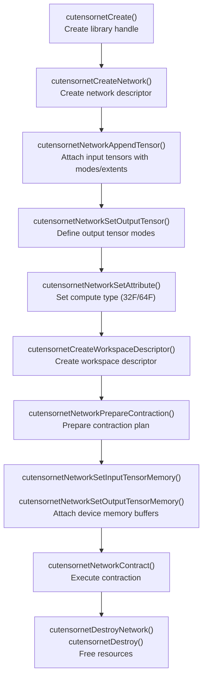
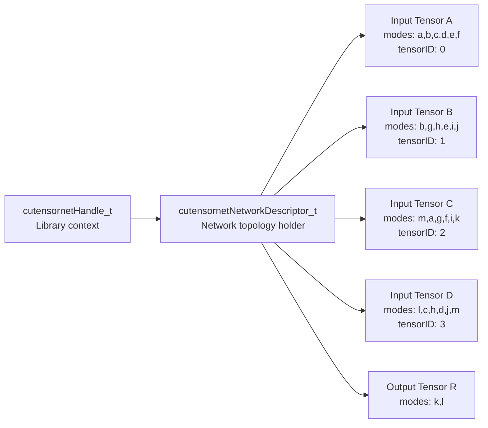
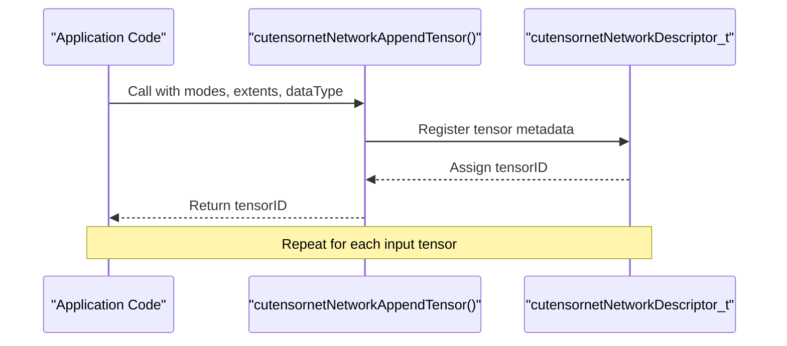
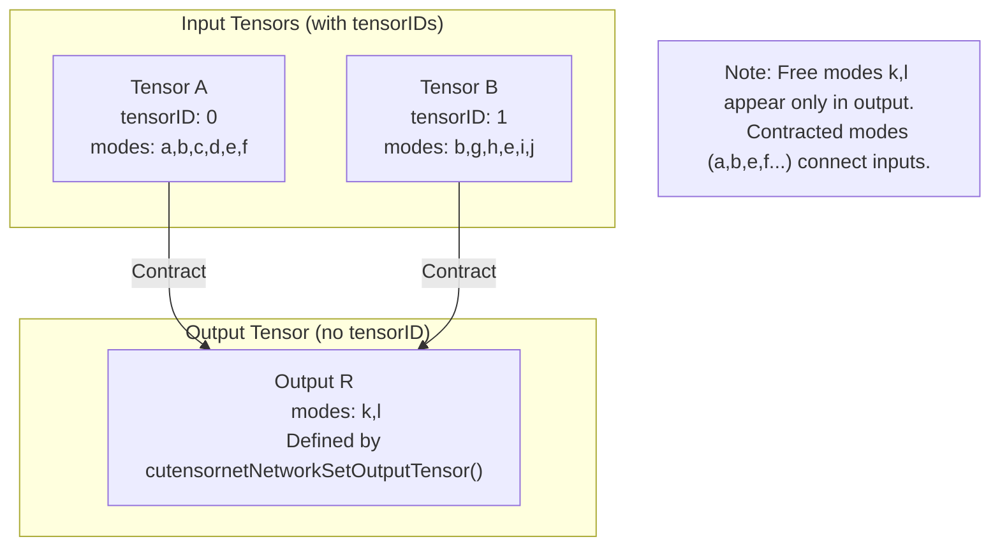
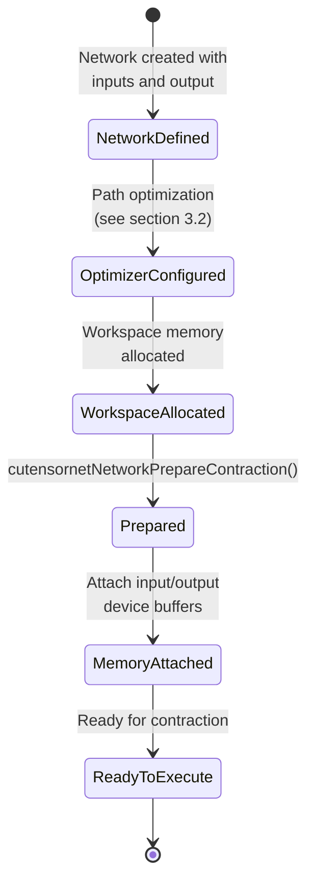
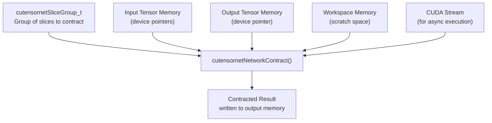
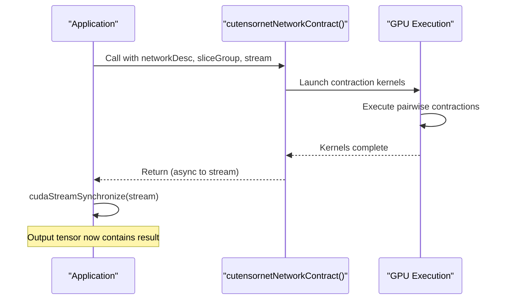

<!-- source: DeepWiki mcp.deepwiki.com · repo NVIDIA/cuQuantum · page 3.1 Basic Tensor Network Operations · fetched 2026-10-26 -->

# Basic Tensor Network Operations

<details>
<summary>Relevant source files</summary>

The following files were used as context for generating this wiki page:

- [samples/cutensornet/README.md](samples/cutensornet/README.md)
- [samples/cutensornet/tensornet_example.cu](samples/cutensornet/tensornet_example.cu)

</details>


## Purpose and Scope

This page documents the fundamental operations for tensor network contraction using the cuTensorNet library. It covers the core workflow: initializing the library, defining tensor networks with their modes and extents, attaching input tensors, setting output tensors, and executing contractions. These operations form the foundation for all tensor network computations in cuTensorNet.

For advanced optimization techniques including path finding and autotuning, see [Path Optimization and Performance](#3.2). For high-level abstractions that simplify common quantum circuit operations, see [High-Level API](#3.3). For multi-GPU and multi-node execution, see [Distributed Computing with MPI](#3.5).

**Sources:** [samples/cutensornet/README.md:1-86](), [samples/cutensornet/tensornet_example.cu:1-476]()

## Tensor Network Contraction Workflow

The basic workflow for contracting a tensor network with cuTensorNet follows a structured sequence of API calls. The workflow begins with library initialization, proceeds through network definition and workspace setup, and concludes with contraction execution and resource cleanup.



**Sources:** [samples/cutensornet/tensornet_example.cu:213-476]()

## Library Initialization

### Creating the cuTensorNet Handle

All cuTensorNet operations require a library handle of type `cutensornetHandle_t`. This handle encapsulates the library context and must be created before any other cuTensorNet API calls.

| Function | Purpose | Key Parameters |
|----------|---------|----------------|
| `cutensornetCreate()` | Creates library handle | `handle` (output) |
| `cutensornetDestroy()` | Destroys library handle | `handle` |

The handle is typically created once at program initialization and destroyed before exit. Multiple handles can exist simultaneously if needed for different contexts.

**Code Example Location:** [samples/cutensornet/tensornet_example.cu:216-217]()

**Sources:** [samples/cutensornet/tensornet_example.cu:216-217]()

## Defining a Tensor Network

### Network Descriptor Creation

A tensor network is represented by a `cutensornetNetworkDescriptor_t` object. This descriptor manages the network topology, including all input tensors, their connectivity patterns, and the output tensor specification.



**Sources:** [samples/cutensornet/tensornet_example.cu:116-131](), [samples/cutensornet/tensornet_example.cu:225-227]()

### Tensor Modes and Extents

Each tensor in the network is defined by:
- **Modes**: Array of `int32_t` values representing tensor dimensions (e.g., `{'a', 'b', 'c'}`)
- **Extents**: Array of `int64_t` values specifying the size of each mode
- **Data Type**: CUDA data type (e.g., `CUDA_R_32F`, `CUDA_R_64F`)

Modes with the same identifier across different tensors represent contracted indices. Modes appearing only in the output tensor are free indices.

**Example Network Definition:**

Computing `R[k,l] = A[a,b,c,d,e,f] * B[b,g,h,e,i,j] * C[m,a,g,f,i,k] * D[l,c,h,d,j,m]`

| Tensor | Modes | Role |
|--------|-------|------|
| A | a, b, c, d, e, f | Input |
| B | b, g, h, e, i, j | Input |
| C | m, a, g, f, i, k | Input |
| D | l, c, h, d, j, m | Input |
| R | k, l | Output |

Contracted modes: `a, b, c, d, e, f, g, h, i, j, m` (appear in inputs but not output)
Free modes: `k, l` (appear in output)

**Sources:** [samples/cutensornet/tensornet_example.cu:116-152]()

## Attaching Tensors to the Network

### Appending Input Tensors

Input tensors are attached to the network using `cutensornetNetworkAppendTensor()`. Each call returns a unique `tensorID` that identifies the tensor within the network.



**Function Signature Pattern:**
```
cutensornetNetworkAppendTensor(
    handle,           // Library handle
    networkDesc,      // Network descriptor
    numModes,         // Number of tensor dimensions
    extents,          // Array of mode sizes
    modes,            // Array of mode identifiers
    strides,          // Tensor strides (NULL for default)
    dataType,         // CUDA data type
    tensorID          // Output: unique tensor identifier
)
```

**Important Notes:**
- Tensors are identified by their `tensorID` values, not by their position in the append order
- The `strides` parameter can be `NULL` to use default column-major layout
- Actual device memory is NOT attached at this stage; only metadata is registered

**Code Example Location:** [samples/cutensornet/tensornet_example.cu:229-241]()

**Sources:** [samples/cutensornet/tensornet_example.cu:229-241]()

## Setting the Output Tensor

### Output Tensor Specification

The output tensor defines the result of the contraction. Unlike input tensors, the output is specified by its modes only; it does not receive a `tensorID` since it is the result rather than an input.



**Function Pattern:**
```
cutensornetNetworkSetOutputTensor(
    handle,           // Library handle
    networkDesc,      // Network descriptor
    numModes,         // Number of output dimensions
    modes,            // Array of output mode identifiers
    dataType          // CUDA data type for output
)
```

The output modes determine which indices remain after contraction. Any mode appearing in input tensors but not in the output will be summed over (contracted).

**Code Example Location:** [samples/cutensornet/tensornet_example.cu:243-248]()

**Sources:** [samples/cutensornet/tensornet_example.cu:243-248]()

## Setting Network Attributes

### Compute Type Configuration

The network compute type controls the precision used during contraction operations. This is set using `cutensornetNetworkSetAttribute()` with the `CUTENSORNET_NETWORK_COMPUTE_TYPE` attribute.

| Compute Type | Enum Value | Description |
|-------------|------------|-------------|
| 32-bit float | `CUTENSORNET_COMPUTE_32F` | Single precision |
| 64-bit float | `CUTENSORNET_COMPUTE_64F` | Double precision |
| 16-bit float | `CUTENSORNET_COMPUTE_16F` | Half precision |
| TF32 | `CUTENSORNET_COMPUTE_TF32` | TensorFloat-32 |

**Important:** The compute type can differ from the data type. For example, 32-bit input data can use TF32 compute for improved performance on newer GPUs.

**Code Example Location:** [samples/cutensornet/tensornet_example.cu:250-255]()

**Sources:** [samples/cutensornet/tensornet_example.cu:109-111](), [samples/cutensornet/tensornet_example.cu:250-255]()

## Workspace Management

### Workspace Descriptor and Allocation

Tensor network contractions require GPU workspace memory for intermediate results. The workspace is managed through a `cutensornetWorkspaceDescriptor_t` object.

```mermaid
flowchart LR
    CreateWS["cutensornetCreateWorkspaceDescriptor()
    Create workspace descriptor"]
    
    ComputeSize["cutensornetWorkspaceComputeContractionSizes()
    Query required workspace size"]
    
    QuerySize["cutensornetWorkspaceGetMemorySize()
    Get minimum workspace size"]
    
    Alloc["cudaMalloc()
    Allocate GPU memory"]
    
    SetWS["cutensornetWorkspaceSetMemory()
    Attach memory to descriptor"]
    
    CreateWS --> ComputeSize
    ComputeSize --> QuerySize
    QuerySize --> Alloc
    Alloc --> SetWS
```



### Workspace Types

| Workspace Kind | Enum Value | Purpose |
|---------------|------------|---------|
| Scratch | `CUTENSORNET_WORKSPACE_SCRATCH` | Temporary computation space |
| Cache | `CUTENSORNET_WORKSPACE_CACHE` | Intermediate tensor reuse (see [#3.2](#3.2)) |

### Memory Space Options

| Memory Space | Enum Value | Location |
|-------------|------------|----------|
| Device | `CUTENSORNET_MEMSPACE_DEVICE` | GPU memory |
| Host | `CUTENSORNET_MEMSPACE_HOST` | CPU memory |

For basic contractions, `CUTENSORNET_WORKSPACE_SCRATCH` in `CUTENSORNET_MEMSPACE_DEVICE` is required. The size preference can be:
- `CUTENSORNET_WORKSIZE_PREF_MIN`: Minimum required workspace
- `CUTENSORNET_WORKSIZE_PREF_RECOMMENDED`: Recommended for best performance
- `CUTENSORNET_WORKSIZE_PREF_MAX`: Maximum that would provide benefit

**Code Example Location:** [samples/cutensornet/tensornet_example.cu:309-335]()

**Sources:** [samples/cutensornet/tensornet_example.cu:309-335]()

## Preparing the Contraction

### Contraction Preparation Phase

Before execution, the contraction must be prepared using `cutensornetNetworkPrepareContraction()`. This function:
- Analyzes the contraction path (provided by optimizer or default)
- Allocates internal data structures
- Prepares CUDA kernels for execution



**Code Example Location:** [samples/cutensornet/tensornet_example.cu:342-344]()

**Sources:** [samples/cutensornet/tensornet_example.cu:337-383]()

### Attaching Device Memory

After preparation, the actual device memory buffers for input and output tensors must be attached using:
- `cutensornetNetworkSetInputTensorMemory()`: Attach input tensor data
- `cutensornetNetworkSetOutputTensorMemory()`: Attach output tensor data

**Function Pattern for Input Tensors:**
```
cutensornetNetworkSetInputTensorMemory(
    handle,           // Library handle
    networkDesc,      // Network descriptor
    tensorID,         // Tensor identifier from append call
    tensorData_d,     // Device pointer to tensor data
    strides           // Tensor strides (NULL for default)
)
```

**Function Pattern for Output Tensor:**
```
cutensornetNetworkSetOutputTensorMemory(
    handle,           // Library handle
    networkDesc,      // Network descriptor
    tensorData_d,     // Device pointer to output buffer
    strides           // Tensor strides (NULL for default)
)
```

The strides parameter can be `NULL` to use default column-major layout, matching the strides specified during tensor definition.

**Code Example Location:** [samples/cutensornet/tensornet_example.cu:346-358]()

**Sources:** [samples/cutensornet/tensornet_example.cu:346-358]()

## Executing the Contraction

### Network Contraction Execution

The contraction is executed using `cutensornetNetworkContract()`. This function performs the actual tensor network contraction computation on the GPU.



### Slice Groups

Large tensor networks may be split into multiple "slices" to fit within GPU memory constraints. A `cutensornetSliceGroup_t` object specifies which slices to contract in a single call.

**Creating a Slice Group:**
```
cutensornetCreateSliceGroupFromIDRange(
    handle,           // Library handle
    sliceIdStart,     // First slice ID
    sliceIdStop,      // Last slice ID (exclusive)
    sliceIdStep,      // Step between slice IDs
    sliceGroup        // Output: slice group object
)
```

To contract all slices at once:
```c
cutensornetCreateSliceGroupFromIDRange(handle, 0, numSlices, 1, &sliceGroup);
```

Alternatively, pass `NULL` for the `sliceGroup` parameter in `cutensornetNetworkContract()` to automatically contract all slices.

### Accumulation Mode

The `accumulateOutput` parameter in `cutensornetNetworkContract()` controls how results are written:
- `0`: Overwrite output tensor (use for first contraction)
- `1`: Accumulate into output tensor (use when contracting slices separately)

**Code Example Location:** [samples/cutensornet/tensornet_example.cu:390-419]()

**Sources:** [samples/cutensornet/tensornet_example.cu:385-421]()

### Execution Pattern



The contraction executes asynchronously with respect to the CPU. Use `cudaStreamSynchronize()` or `cudaDeviceSynchronize()` to ensure completion before accessing results.

**Sources:** [samples/cutensornet/tensornet_example.cu:406-419]()

## Resource Cleanup

### Freeing cuTensorNet Resources

All cuTensorNet objects must be explicitly destroyed to prevent memory leaks. The cleanup order is generally the reverse of creation order.

| Resource Type | Descriptor | Destroy Function |
|--------------|-----------|------------------|
| Slice group | `cutensornetSliceGroup_t` | `cutensornetDestroySliceGroup()` |
| Workspace | `cutensornetWorkspaceDescriptor_t` | `cutensornetDestroyWorkspaceDescriptor()` |
| Optimizer info | `cutensornetContractionOptimizerInfo_t` | `cutensornetDestroyContractionOptimizerInfo()` |
| Optimizer config | `cutensornetContractionOptimizerConfig_t` | `cutensornetDestroyContractionOptimizerConfig()` |
| Network | `cutensornetNetworkDescriptor_t` | `cutensornetDestroyNetwork()` |
| Handle | `cutensornetHandle_t` | `cutensornetDestroy()` |

Additionally, CUDA resources (streams, device memory) must be freed using standard CUDA APIs:
- `cudaStreamDestroy()` for streams
- `cudaFree()` for device memory
- `free()` for host memory

**Code Example Location:** [samples/cutensornet/tensornet_example.cu:450-472]()

**Sources:** [samples/cutensornet/tensornet_example.cu:450-476]()

## Complete Workflow Summary

The following table summarizes the complete basic workflow with API calls:

| Step | API Function | Purpose |
|------|-------------|---------|
| 1 | `cutensornetCreate()` | Initialize library |
| 2 | `cutensornetCreateNetwork()` | Create network descriptor |
| 3 | `cutensornetNetworkAppendTensor()` | Add each input tensor (loop) |
| 4 | `cutensornetNetworkSetOutputTensor()` | Define output tensor |
| 5 | `cutensornetNetworkSetAttribute()` | Set compute type |
| 6 | `cutensornetCreateWorkspaceDescriptor()` | Create workspace descriptor |
| 7 | `cutensornetWorkspaceComputeContractionSizes()` | Compute workspace requirements |
| 8 | `cutensornetWorkspaceGetMemorySize()` | Query workspace size |
| 9 | `cudaMalloc()` | Allocate workspace memory |
| 10 | `cutensornetWorkspaceSetMemory()` | Attach workspace to descriptor |
| 11 | `cutensornetNetworkPrepareContraction()` | Prepare for execution |
| 12 | `cutensornetNetworkSetInputTensorMemory()` | Attach input data buffers (loop) |
| 13 | `cutensornetNetworkSetOutputTensorMemory()` | Attach output data buffer |
| 14 | `cutensornetCreateSliceGroupFromIDRange()` | Create slice group |
| 15 | `cutensornetNetworkContract()` | Execute contraction |
| 16 | Destroy functions | Clean up resources |

**Note:** Path optimization steps (using `cutensornetContractionOptimize()`) are omitted here for simplicity but are essential for good performance. See [Path Optimization and Performance](#3.2) for details.

**Sources:** [samples/cutensornet/tensornet_example.cu:78-476](), [samples/cutensornet/README.md:75-86]()

---

