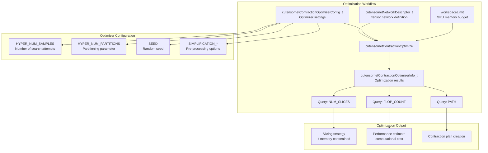
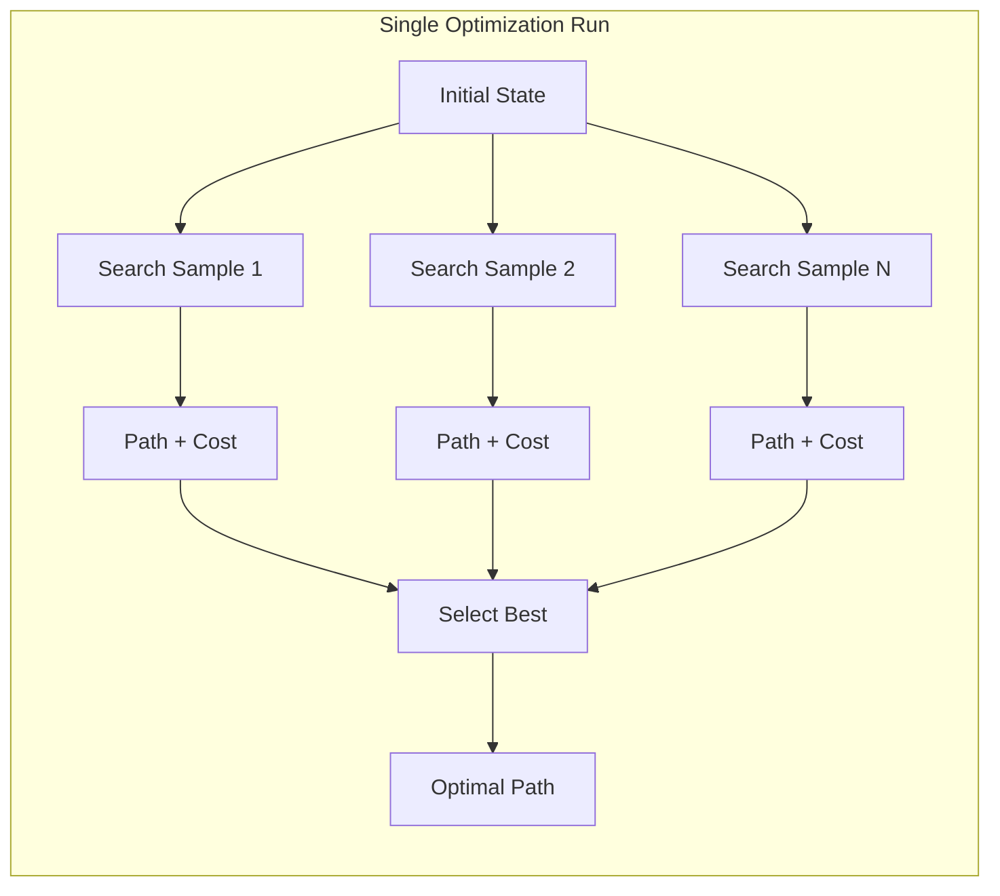
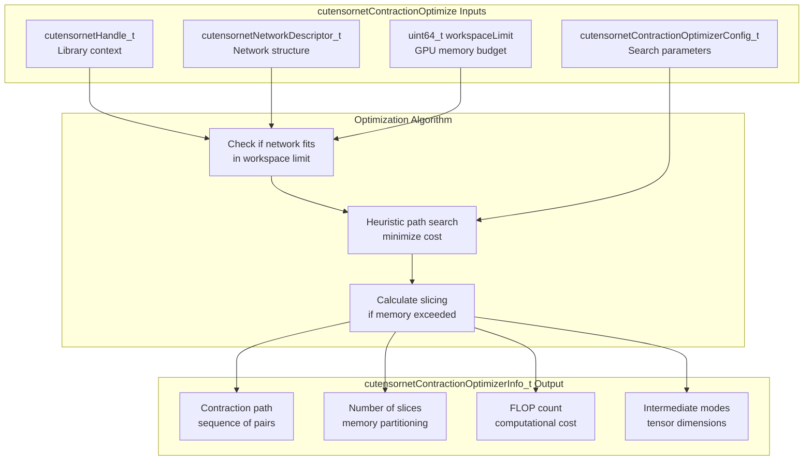
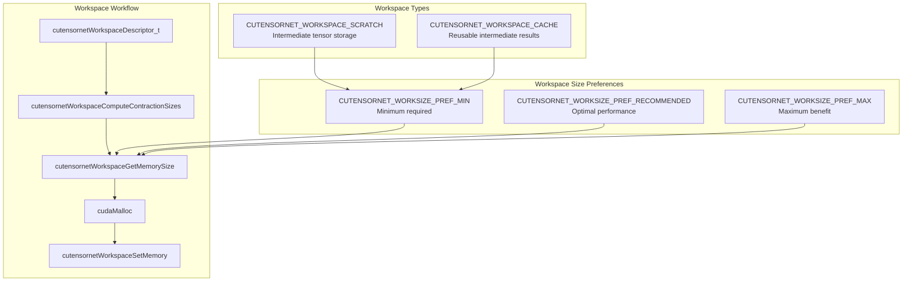
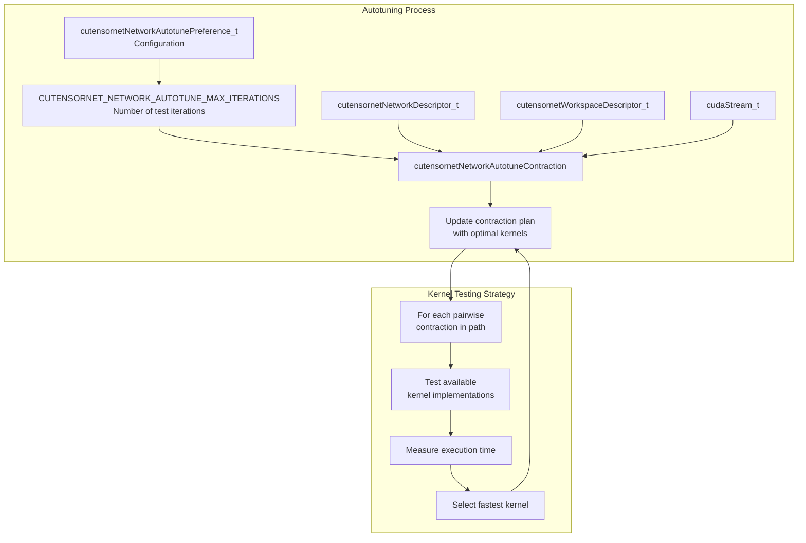
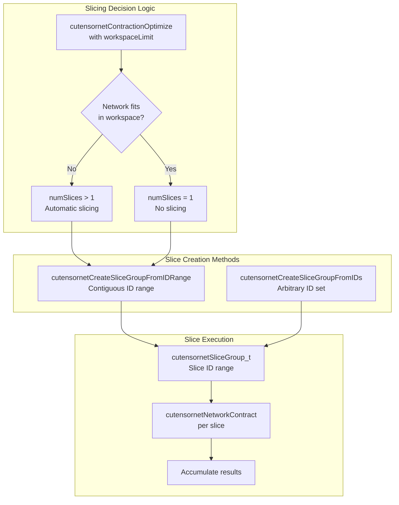
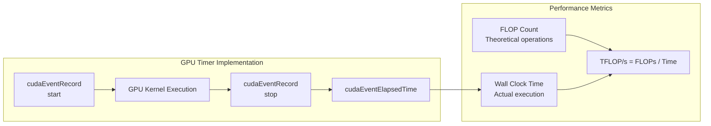
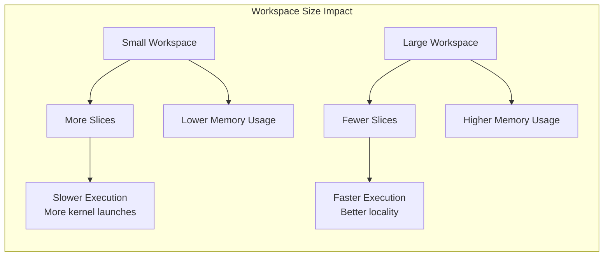

<!-- source: DeepWiki mcp.deepwiki.com · repo NVIDIA/cuQuantum · page 3.2 Path Optimization and Performance · fetched 2026-10-26 -->

# Path Optimization and Performance

<details>
<summary>Relevant source files</summary>

The following files were used as context for generating this wiki page:

- [samples/cutensornet/README.md](samples/cutensornet/README.md)
- [samples/cutensornet/tensornet_example.cu](samples/cutensornet/tensornet_example.cu)

</details>


## Purpose and Scope

This document explains the path optimization and performance tuning capabilities in cuTensorNet. It covers how the library finds efficient contraction orders for tensor networks, manages GPU memory through workspace allocation, and optimizes kernel selection through autotuning. This page focuses on the optimization phase that occurs before actual tensor network contraction.

For basic tensor network operations and contraction execution, see [Basic Tensor Network Operations](#3.1). For high-level abstractions like amplitude computation and sampling, see [High-Level API](#3.3).

## Overview of Path Optimization

Tensor network contraction performance critically depends on the order in which individual tensor pairs are contracted. cuTensorNet provides an automated optimizer that searches for near-optimal contraction paths while respecting memory constraints. The optimizer uses a combination of heuristic search algorithms and can explore multiple "hyper-samples" to find better solutions.



**Diagram: Path Optimization Process Flow**

Sources: [samples/cutensornet/tensornet_example.cu:272-302]()

## Contraction Optimizer Configuration

The `cutensornetContractionOptimizerConfig_t` object controls the behavior of the path optimizer. Users configure this object before calling the optimization routine.

### Key Configuration Attributes

| Attribute | Type | Purpose |
|-----------|------|---------|
| `CUTENSORNET_CONTRACTION_OPTIMIZER_CONFIG_HYPER_NUM_SAMPLES` | `int32_t` | Number of independent optimization attempts (default: 0) |
| `CUTENSORNET_CONTRACTION_OPTIMIZER_CONFIG_HYPER_NUM_PARTITIONS` | `int32_t` | Number of partitions for hyper-optimization |
| `CUTENSORNET_CONTRACTION_OPTIMIZER_CONFIG_SEED` | `int32_t` | Random seed for reproducibility |
| `CUTENSORNET_CONTRACTION_OPTIMIZER_CONFIG_SIMPLIFICATION_*` | Various | Pre-processing and simplification options |

### Hyper-Sample Configuration

Hyper-sampling is the primary mechanism for improving path quality. The optimizer runs multiple independent searches and selects the best result:



**Diagram: Hyper-Sample Exploration Strategy**

The example code demonstrates setting 8 hyper-samples:

```c++
// From samples/cutensornet/tensornet_example.cu:276-281
int32_t num_hypersamples = 8;
HANDLE_ERROR(cutensornetContractionOptimizerConfigSetAttribute(
    handle,
    optimizerConfig,
    CUTENSORNET_CONTRACTION_OPTIMIZER_CONFIG_HYPER_NUM_SAMPLES,
    &num_hypersamples,
    sizeof(num_hypersamples)));
```

**Configuration Pattern**: Higher hyper-sample counts increase optimization time but often find better paths, especially for complex networks. Values between 4-32 are common.

Sources: [samples/cutensornet/tensornet_example.cu:275-281]()

## Finding Optimal Contraction Paths

The core optimization routine `cutensornetContractionOptimize` takes a workspace memory limit and produces an optimized contraction strategy.



**Diagram: cutensornetContractionOptimize Function Flow**

### Workspace Limit Strategy

The workspace limit controls the maximum GPU memory available for intermediate tensors during contraction. A typical pattern uses 90% of free GPU memory:

```c++
// From samples/cutensornet/tensornet_example.cu:263-266
size_t freeMem, totalMem;
HANDLE_CUDA_ERROR(cudaMemGetInfo(&freeMem, &totalMem));
uint64_t workspaceLimit = (uint64_t)((double)freeMem * 0.9);
```

**Memory Management**: If the network cannot be contracted within the workspace limit, the optimizer automatically introduces slicing to partition the computation.

Sources: [samples/cutensornet/tensornet_example.cu:263-266](), [samples/cutensornet/tensornet_example.cu:287-291]()

## Querying Optimization Results

After optimization, the `cutensornetContractionOptimizerInfo_t` object contains detailed information about the computed contraction strategy.

### Retrieving Slice Count

Slicing information indicates whether the computation was partitioned:

```c++
// From samples/cutensornet/tensornet_example.cu:294-299
int64_t numSlices = 0;
HANDLE_ERROR(cutensornetContractionOptimizerInfoGetAttribute(
    handle,
    optimizerInfo,
    CUTENSORNET_CONTRACTION_OPTIMIZER_INFO_NUM_SLICES,
    &numSlices,
    sizeof(numSlices)));
```

**Interpretation**: 
- `numSlices = 1`: Network fits entirely in workspace, no slicing needed
- `numSlices > 1`: Network partitioned into multiple slices for sequential execution

### FLOP Count Analysis

The total floating-point operation count provides a theoretical performance metric:

```c++
// From samples/cutensornet/tensornet_example.cu:437-442
double flops{0.0};
HANDLE_ERROR(cutensornetContractionOptimizerInfoGetAttribute(
    handle,
    optimizerInfo,
    CUTENSORNET_CONTRACTION_OPTIMIZER_INFO_FLOP_COUNT,
    &flops,
    sizeof(flops)));
```

**Performance Metric**: FLOP count enables theoretical peak performance calculation and comparison between different contraction strategies.

### Optimizer Info Attributes

| Attribute | Type | Description |
|-----------|------|-------------|
| `CUTENSORNET_CONTRACTION_OPTIMIZER_INFO_NUM_SLICES` | `int64_t` | Number of slices |
| `CUTENSORNET_CONTRACTION_OPTIMIZER_INFO_NUM_SLICED_MODES` | `int32_t` | Number of modes that are sliced |
| `CUTENSORNET_CONTRACTION_OPTIMIZER_INFO_SLICED_MODE` | `int32_t` | Specific sliced mode index |
| `CUTENSORNET_CONTRACTION_OPTIMIZER_INFO_SLICED_EXTENT` | `int64_t` | Extent of sliced mode |
| `CUTENSORNET_CONTRACTION_OPTIMIZER_INFO_FLOP_COUNT` | `double` | Total FLOPs for contraction |
| `CUTENSORNET_CONTRACTION_OPTIMIZER_INFO_LARGEST_TENSOR` | `double` | Largest intermediate tensor size |
| `CUTENSORNET_CONTRACTION_OPTIMIZER_INFO_PATH` | Binary data | Serialized contraction path |

Sources: [samples/cutensornet/tensornet_example.cu:294-299](), [samples/cutensornet/tensornet_example.cu:437-442]()

## Workspace Management

Workspace memory is required for intermediate tensors during contraction. cuTensorNet distinguishes between scratch workspace (temporary) and cache workspace (persistent).



**Diagram: Workspace Management Architecture**

### Workspace Allocation Pattern

The standard pattern for workspace setup:

```c++
// From samples/cutensornet/tensornet_example.cu:309-333
cutensornetWorkspaceDescriptor_t workDesc;
HANDLE_ERROR(cutensornetCreateWorkspaceDescriptor(handle, &workDesc));

// Compute required sizes based on network and optimizer info
HANDLE_ERROR(cutensornetWorkspaceComputeContractionSizes(
    handle,
    networkDesc,
    optimizerInfo,
    workDesc));

// Query minimum required scratch memory
int64_t requiredWorkspaceSize = 0;
HANDLE_ERROR(cutensornetWorkspaceGetMemorySize(
    handle,
    workDesc,
    CUTENSORNET_WORKSIZE_PREF_MIN,
    CUTENSORNET_MEMSPACE_DEVICE,
    CUTENSORNET_WORKSPACE_SCRATCH,
    &requiredWorkspaceSize));

// Allocate and set workspace
void* work = nullptr;
HANDLE_CUDA_ERROR(cudaMalloc(&work, requiredWorkspaceSize));
HANDLE_ERROR(cutensornetWorkspaceSetMemory(
    handle,
    workDesc,
    CUTENSORNET_MEMSPACE_DEVICE,
    CUTENSORNET_WORKSPACE_SCRATCH,
    work,
    requiredWorkspaceSize));
```

**Design Pattern**: Always query required workspace sizes after optimization, as the size depends on the computed contraction path.

Sources: [samples/cutensornet/tensornet_example.cu:309-333]()

## Autotuning for Kernel Selection

Autotuning optimizes the execution plan by testing different CUDA kernels for each pairwise contraction and selecting the fastest option.



**Diagram: Autotuning Workflow and Kernel Selection**

### Autotuning Configuration

```c++
// From samples/cutensornet/tensornet_example.cu:363-382
cutensornetNetworkAutotunePreference_t autotunePref;
HANDLE_ERROR(cutensornetCreateNetworkAutotunePreference(handle, &autotunePref));

const int numAutotuningIterations = 5; // may be 0
HANDLE_ERROR(cutensornetNetworkAutotunePreferenceSetAttribute(
    handle,
    autotunePref,
    CUTENSORNET_NETWORK_AUTOTUNE_MAX_ITERATIONS,
    &numAutotuningIterations,
    sizeof(numAutotuningIterations)));

// Perform autotuning
HANDLE_ERROR(cutensornetNetworkAutotuneContraction(
    handle,
    networkDesc,
    workDesc,
    autotunePref,
    stream));

HANDLE_ERROR(cutensornetDestroyNetworkAutotunePreference(autotunePref));
```

**Performance Trade-off**: Autotuning adds upfront cost but significantly improves performance when the same network is contracted multiple times. Setting `numAutotuningIterations = 0` disables autotuning.

### When to Use Autotuning

| Scenario | Recommendation |
|----------|----------------|
| Single contraction execution | Skip autotuning (overhead not amortized) |
| Repeated contractions with same path | Enable autotuning (5-10 iterations typical) |
| Parameter sweep (same structure, different values) | Autotune once, reuse plan |
| Dynamic networks (changing structure) | Consider autotuning cost vs. benefit |

Sources: [samples/cutensornet/tensornet_example.cu:363-382](), [samples/cutensornet/README.md:83]()

## Slicing Strategies

When a tensor network cannot fit within the available workspace, cuTensorNet automatically introduces slicing. Slicing partitions one or more tensor modes and contracts slices sequentially.



**Diagram: Slicing Architecture and Execution**

### Slice Group Management

The example creates a slice group covering all slices:

```c++
// From samples/cutensornet/tensornet_example.cu:391-392
cutensornetSliceGroup_t sliceGroup{};
HANDLE_ERROR(cutensornetCreateSliceGroupFromIDRange(handle, 0, numSlices, 1, &sliceGroup));
```

**Slice Group Parameters**:
- Start ID: 0 (first slice)
- End ID: numSlices (exclusive upper bound)
- Step: 1 (every slice)

### Distributed Slicing

For multi-GPU or multi-node execution, slices can be distributed across processes. Each process handles a subset of slices:

**Process Slice Distribution**:
```
Process 0: slices [0, N/P)
Process 1: slices [N/P, 2N/P)
...
Process P-1: slices [(P-1)N/P, N)
```

This pattern enables slice-based parallelism where each process independently contracts its assigned slices and results are reduced via MPI. See [Distributed Computing with MPI](#3.5) for details.

Sources: [samples/cutensornet/tensornet_example.cu:391-392](), [samples/cutensornet/README.md:114]()

## Performance Measurement and Profiling

cuTensorNet provides metrics to analyze and validate contraction performance.



**Diagram: Performance Measurement Components**

### GPU Timing Pattern

The sample uses CUDA events for accurate GPU timing:

```c++
// From samples/cutensornet/tensornet_example.cu:48-76
struct GPUTimer {
    GPUTimer(cudaStream_t stream) : stream_(stream) {
        HANDLE_CUDA_ERROR(cudaEventCreate(&start_));
        HANDLE_CUDA_ERROR(cudaEventCreate(&stop_));
    }

    void start() { 
        HANDLE_CUDA_ERROR(cudaEventRecord(start_, stream_)); 
    }

    float seconds() {
        HANDLE_CUDA_ERROR(cudaEventRecord(stop_, stream_));
        HANDLE_CUDA_ERROR(cudaEventSynchronize(stop_));
        float time;
        HANDLE_CUDA_ERROR(cudaEventElapsedTime(&time, start_, stop_));
        return time * 1e-3;
    }
};
```

### Measuring Contraction Performance

```c++
// From samples/cutensornet/tensornet_example.cu:394-419
GPUTimer timer{stream};
double minTimeCUTENSORNET = 1e100;
const int numRuns = 3;

for (int i = 0; i < numRuns; ++i) {
    // Reset output tensor
    HANDLE_CUDA_ERROR(cudaMemcpy(tensorData_d[numInputs], 
                                 tensorData_h[numInputs], 
                                 tensorSizes[numInputs], 
                                 cudaMemcpyHostToDevice));
    HANDLE_CUDA_ERROR(cudaDeviceSynchronize());

    timer.start();
    
    HANDLE_ERROR(cutensornetNetworkContract(
        handle, networkDesc, accumulateOutput,
        workDesc, sliceGroup, stream));
    
    auto time = timer.seconds();
    minTimeCUTENSORNET = (time > minTimeCUTENSORNET) ? minTimeCUTENSORNET : time;
}
```

**Benchmarking Practice**: Multiple runs with minimum time selection reduces noise from GPU frequency scaling and system interference.

Sources: [samples/cutensornet/tensornet_example.cu:48-76](), [samples/cutensornet/tensornet_example.cu:394-419](), [samples/cutensornet/tensornet_example.cu:437-448]()

## Optimization Best Practices

### Recommended Configuration Values

| Parameter | Conservative | Balanced | Aggressive |
|-----------|--------------|----------|------------|
| Hyper-samples | 4 | 8-16 | 32-64 |
| Autotune iterations | 0 | 3-5 | 10+ |
| Workspace limit | 50% free GPU memory | 80-90% | 95% |

### Optimization Strategy by Use Case

**One-Time Contraction**:
- Use default hyper-samples (0) or small value (2-4)
- Skip autotuning
- Conservative workspace limit

**Repeated Contractions (Same Structure)**:
- Moderate hyper-samples (8-16)
- Enable autotuning (5-10 iterations)
- Aggressive workspace limit
- Cache the `cutensornetContractionOptimizerInfo_t` via serialization

**Production Deployment**:
- Extensive offline optimization (32+ hyper-samples)
- Full autotuning
- Serialize and store optimal path for runtime reuse
- Monitor FLOP count as a correctness check

### Memory vs. Performance Trade-offs



**Diagram: Workspace Size vs. Slicing Trade-off**

**Tuning Guidance**: Start with 80-90% of free GPU memory as workspace limit. If slicing occurs (`numSlices > 1`), consider:
1. Reducing tensor sizes if possible
2. Accepting the slicing overhead
3. Using multi-GPU execution to increase total memory (see [Distributed Computing with MPI](#3.5))

Sources: [samples/cutensornet/tensornet_example.cu:263-266](), [samples/cutensornet/tensornet_example.cu:275-281](), [samples/cutensornet/README.md:81-83]()

---

