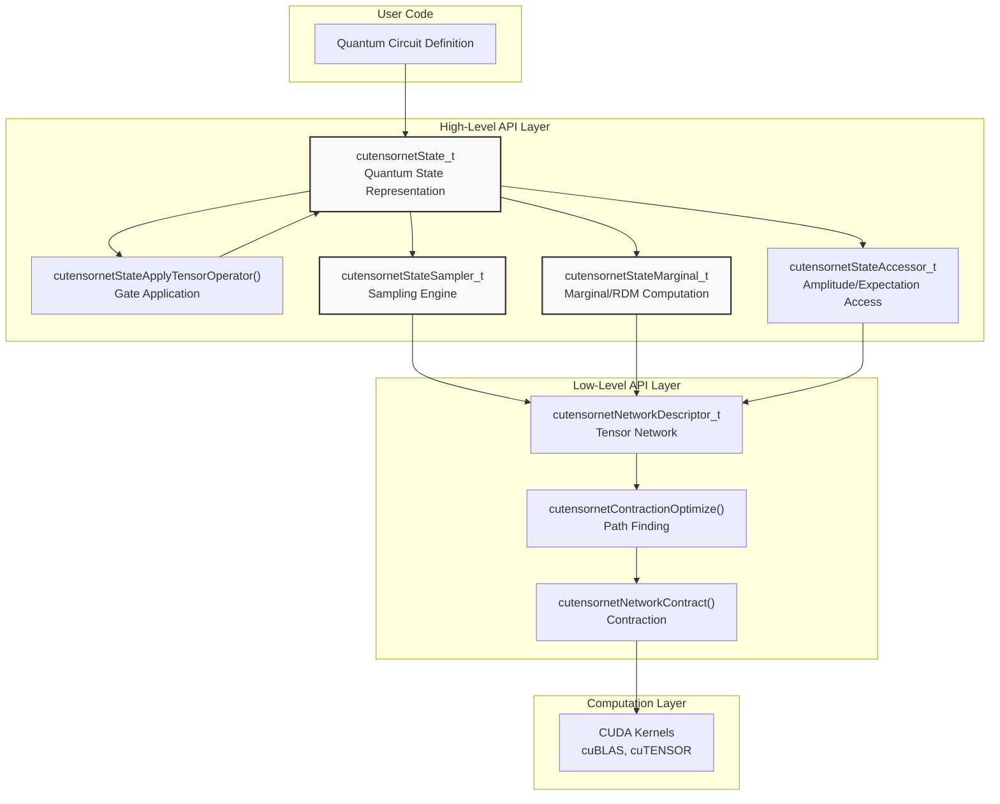
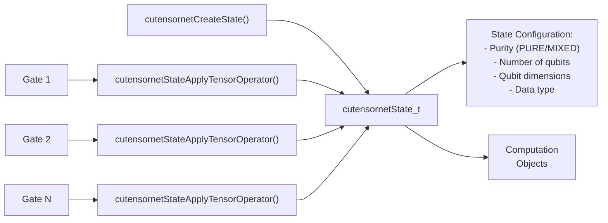
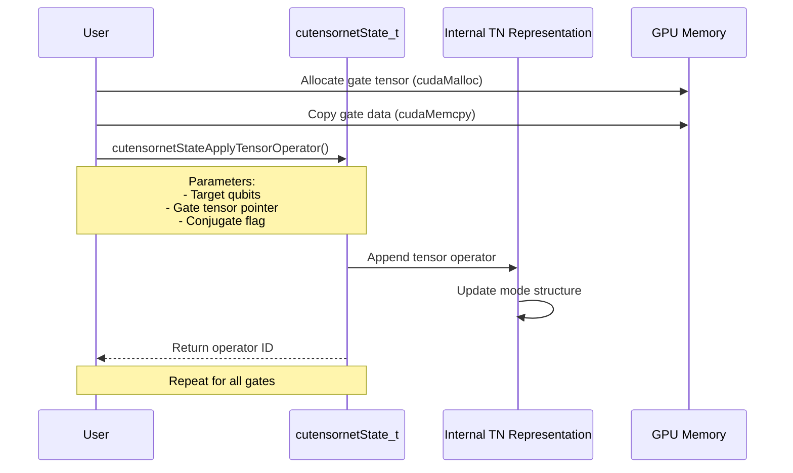
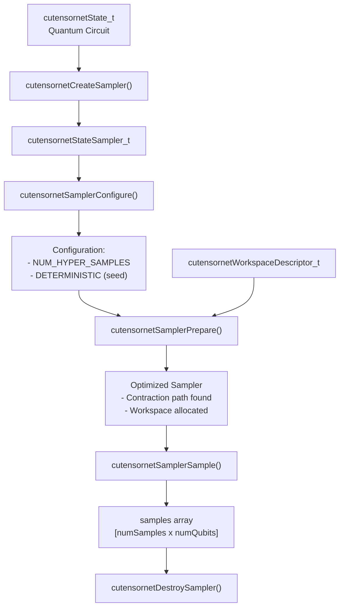
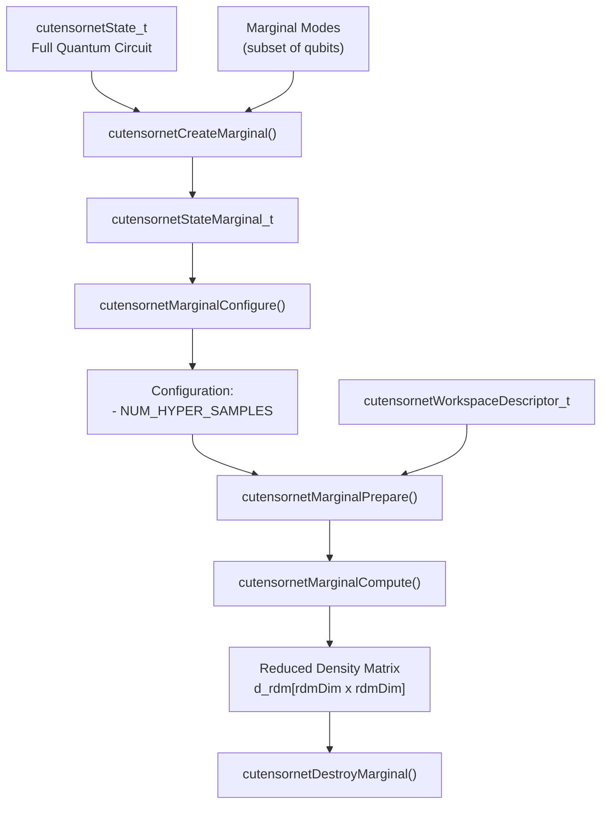
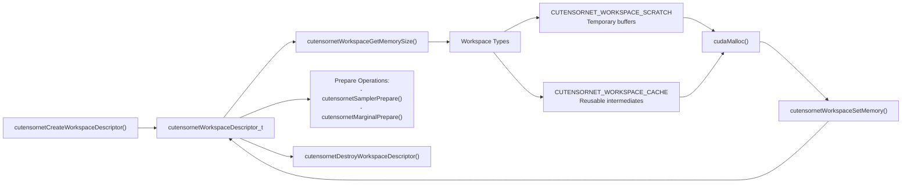

<!-- source: DeepWiki mcp.deepwiki.com · repo NVIDIA/cuQuantum · page 3.3 High-Level API · fetched 2026-10-26 -->

# High-Level API

<details>
<summary>Relevant source files</summary>

The following files were used as context for generating this wiki page:

- [samples/cutensornet/README.md](samples/cutensornet/README.md)
- [samples/cutensornet/high_level/marginal_example.cu](samples/cutensornet/high_level/marginal_example.cu)
- [samples/cutensornet/high_level/sampling_example.cu](samples/cutensornet/high_level/sampling_example.cu)
- [samples/cutensornet/tensornet_example.cu](samples/cutensornet/tensornet_example.cu)

</details>


## Purpose and Scope

This document covers the high-level API provided by cuTensorNet for quantum circuit simulation. The high-level API provides quantum computing abstractions (`cutensornetState_t`, gate application, sampling, marginals) built on top of the low-level tensor network contraction primitives. This API is designed specifically for quantum computing applications and abstracts away explicit tensor network construction.

For low-level tensor network operations (explicit tensor attachment, contraction path specification, manual network construction), see [Basic Tensor Network Operations](#3.1). For distributed execution of high-level quantum circuits, see [Distributed Computing with MPI](#3.5).

**Sources:** [samples/cutensornet/README.md:73-184](), [samples/cutensornet/high_level/sampling_example.cu:1-217](), [samples/cutensornet/high_level/marginal_example.cu:1-207]()

---

## High-Level API Architecture

The high-level API provides a layered abstraction for quantum circuit simulation:



**High-Level API Architecture**

The high-level API automatically handles tensor network construction, mode management, and contraction orchestration. Users work with quantum states and gates rather than explicit tensors and indices.

**Sources:** [samples/cutensornet/high_level/sampling_example.cu:78-217](), [samples/cutensornet/high_level/marginal_example.cu:100-207]()

---

## Quantum State Representation

### cutensornetState_t

The `cutensornetState_t` object represents a quantum state as an implicit tensor network. It encapsulates the circuit structure and gate sequence without requiring explicit tensor network specification.

| Function | Purpose |
|----------|---------|
| `cutensornetCreateState()` | Initialize quantum state with specified purity, number of qubits, and qubit dimensions |
| `cutensornetStateApplyTensorOperator()` | Apply quantum gate (tensor operator) to specified qubits |
| `cutensornetDestroyState()` | Free quantum state resources |

**State Creation:**



**Quantum State Lifecycle**

**State Initialization Example from Code:**

[samples/cutensornet/high_level/sampling_example.cu:78-83]() shows state creation:
```cpp
cutensornetState_t quantumState;
HANDLE_CUTN_ERROR(cutensornetCreateState(
    cutnHandle, 
    CUTENSORNET_STATE_PURITY_PURE,  // Pure state |ψ⟩
    numQubits, 
    qubitDims.data(),
    CUDA_C_64F,  // Complex double precision
    &quantumState
));
```

**Sources:** [samples/cutensornet/high_level/sampling_example.cu:78-83](), [samples/cutensornet/high_level/marginal_example.cu:100-105]()

---

## Gate Application

### cutensornetStateApplyTensorOperator()

Gates are applied to the quantum state by specifying target qubits and gate tensor data. The API automatically constructs the underlying tensor network representation.

**Gate Application Workflow:**



**Gate Application Sequence**

**Key Parameters:**

| Parameter | Description |
|-----------|-------------|
| `numTargets` | Number of qubits the gate acts on (1 for single-qubit, 2 for two-qubit, etc.) |
| `stateModesIn` | Array of target qubit indices |
| `tensorOperatorData` | Device pointer to gate tensor data in row-major layout |
| `tensorOperatorStrides` | Optional custom strides (NULL for default) |
| `immutable` | Whether tensor data is constant (enables optimizations) |
| `adjoint` | Apply conjugate transpose of the gate |
| `unitary` | Whether the operator is unitary (enables optimizations) |
| `operatorId` | Output: unique identifier for this gate |

**Example Gate Sequences:**

[samples/cutensornet/high_level/sampling_example.cu:86-95]() demonstrates building a GHZ state circuit:

```cpp
// Apply H gate to qubit 0
int64_t id;
HANDLE_CUTN_ERROR(cutensornetStateApplyTensorOperator(
    cutnHandle, quantumState, 
    1,  // Single-qubit gate
    std::vector<int32_t>{{0}}.data(),  // Target qubit 0
    d_gateH, nullptr, 1, 0, 1, &id
));

// Apply CX gates sequentially
for(int32_t i = 1; i < numQubits; ++i) {
    HANDLE_CUTN_ERROR(cutensornetStateApplyTensorOperator(
        cutnHandle, quantumState,
        2,  // Two-qubit gate
        std::vector<int32_t>{{i-1,i}}.data(),  // Control and target
        d_gateCX, nullptr, 1, 0, 1, &id
    ));
}
```

**Sources:** [samples/cutensornet/high_level/sampling_example.cu:86-95](), [samples/cutensornet/high_level/marginal_example.cu:108-117]()

---

## Sampling

### cutensornetStateSampler_t

The sampling API computes bitstring samples from the quantum state's probability distribution without constructing the full state vector.



**Sampling Workflow**

### Configuration Options

| Attribute | Purpose | Default |
|-----------|---------|---------|
| `CUTENSORNET_SAMPLER_CONFIG_NUM_HYPER_SAMPLES` | Number of contraction path candidates to evaluate | 0 |
| `CUTENSORNET_SAMPLER_CONFIG_DETERMINISTIC` | Random seed for reproducible results | Non-deterministic |

### Workspace Requirements

The sampler requires two workspace types:

1. **Scratch workspace** (`CUTENSORNET_WORKSPACE_SCRATCH`): Temporary storage for contraction operations
2. **Cache workspace** (`CUTENSORNET_WORKSPACE_CACHE`): Stores intermediate tensors for accelerated sampling

[samples/cutensornet/high_level/sampling_example.cu:131-178]() shows workspace allocation:

```cpp
// Query scratch workspace size
int64_t worksize {0};
HANDLE_CUTN_ERROR(cutensornetWorkspaceGetMemorySize(
    cutnHandle, workDesc,
    CUTENSORNET_WORKSIZE_PREF_RECOMMENDED,
    CUTENSORNET_MEMSPACE_DEVICE,
    CUTENSORNET_WORKSPACE_SCRATCH,
    &worksize
));

// Allocate and set scratch workspace
void *d_scratch {nullptr};
HANDLE_CUDA_ERROR(cudaMalloc(&d_scratch, worksize));
HANDLE_CUTN_ERROR(cutensornetWorkspaceSetMemory(
    cutnHandle, workDesc, 
    CUTENSORNET_MEMSPACE_DEVICE,
    CUTENSORNET_WORKSPACE_SCRATCH, 
    d_scratch, worksize
));

// Query and allocate cache workspace for multi-sample acceleration
int64_t reqCacheSize {0};
HANDLE_CUTN_ERROR(cutensornetWorkspaceGetMemorySize(
    cutnHandle, workDesc,
    CUTENSORNET_WORKSIZE_PREF_RECOMMENDED,
    CUTENSORNET_MEMSPACE_DEVICE,
    CUTENSORNET_WORKSPACE_CACHE,
    &reqCacheSize
));
```

### Sample Generation

[samples/cutensornet/high_level/sampling_example.cu:181-190]() shows the sampling call:

```cpp
std::vector<int64_t> samples(numQubits * numSamples);
HANDLE_CUTN_ERROR(cutensornetSamplerSample(
    cutnHandle, sampler, 
    numSamples, 
    workDesc, 
    samples.data(),  // Output: [sample_id * numQubits + qubit_id]
    0  // CUDA stream
));
```

The output `samples` array has layout `samples[sampleId * numQubits + qubitId]` containing measurement outcomes (0 or 1 for qubits).

**Sources:** [samples/cutensornet/high_level/sampling_example.cu:98-190]()

---

## Marginals and Reduced Density Matrices

### cutensornetStateMarginal_t

Marginals compute the reduced density matrix for a subset of qubits by tracing out all other qubits. This operation is essential for computing partial quantum state information.



**Marginal Computation Workflow**

### Marginal Specification

[samples/cutensornet/high_level/marginal_example.cu:120-125]() shows marginal creation:

```cpp
const std::vector<int32_t> marginalModes({0,1});  // Qubits for RDM
cutensornetStateMarginal_t marginal;
HANDLE_CUTN_ERROR(cutensornetCreateMarginal(
    cutnHandle, quantumState,
    numMarginalModes,  // Number of qubits in marginal
    marginalModes.data(),  // Must be in ascending order
    0, nullptr,  // No amplitudes specified
    std::vector<int64_t>{{1,2,4,8}}.data(),  // Explicit strides
    &marginal
));
```

**Key Requirements:**

- Marginal modes must be in **ascending order**
- Output RDM has dimensions `[prod(qubitDims[modes]) x prod(qubitDims[modes])]`
- Strides can be specified explicitly or use default (NULL for row-major)

### Computation and Output

[samples/cutensornet/high_level/marginal_example.cu:167-180]() shows computation:

```cpp
// Allocate output buffer
void *d_rdm{nullptr};
std::size_t rdmDim = 1;
for(const auto & mode: marginalModes) rdmDim *= qubitDims[mode];
const std::size_t rdmSize = rdmDim * rdmDim;
HANDLE_CUDA_ERROR(cudaMalloc(&d_rdm, rdmSize * (2 * fp64size)));

// Compute the reduced density matrix
HANDLE_CUTN_ERROR(cutensornetMarginalCompute(
    cutnHandle, marginal,
    nullptr,  // No amplitude projections
    workDesc,
    d_rdm,  // Output buffer on device
    0x0  // CUDA stream
));
```

The output is a complex-valued density matrix ρ where:
- `ρ[i,j]` represents the matrix element between basis states `|i⟩` and `⟨j|`
- The matrix is Hermitian: `ρ† = ρ`
- Trace equals 1: `Tr(ρ) = 1`

**Sources:** [samples/cutensornet/high_level/marginal_example.cu:80-180]()

---

## Amplitude Computation

The high-level API supports computing amplitudes for specific basis states through the `cutensornetStateAccessor_t` interface (not shown in provided samples but inferred from page purpose).

### Use Cases

| Operation | Description |
|-----------|-------------|
| Single amplitude | Compute `⟨bitstring\|ψ⟩` for a specific computational basis state |
| Batch amplitudes | Compute multiple amplitudes efficiently with shared contraction path |
| Probability computation | Compute `\|⟨bitstring\|ψ⟩\|²` for measurement probabilities |

Amplitude computation uses the same optimization and workspace management infrastructure as sampling and marginals.

**Sources:** Inferred from page purpose specification

---

## Expectation Values

Expectation value computation evaluates `⟨ψ|Ô|ψ⟩` for a given observable operator Ô. This is typically implemented through:

1. Create accessor for the quantum state
2. Specify the observable operator (Pauli strings, custom Hermitian operators)
3. Configure contraction strategy
4. Compute expectation value using workspace

The high-level API automatically handles the tensor network construction for computing the "sandwich" `⟨ψ|Ô|ψ⟩`.

**Sources:** Inferred from page purpose specification

---

## Workspace Management

All high-level API computations use the `cutensornetWorkspaceDescriptor_t` interface for memory management.



**Workspace Management Flow**

### Workspace Size Preferences

| Preference | Description |
|------------|-------------|
| `CUTENSORNET_WORKSIZE_PREF_MIN` | Minimum required memory (may be slower) |
| `CUTENSORNET_WORKSIZE_PREF_RECOMMENDED` | Optimal performance/memory tradeoff |
| `CUTENSORNET_WORKSIZE_PREF_MAX` | Maximum performance (requires most memory) |

### Memory Spaces

| Memory Space | Description |
|--------------|-------------|
| `CUTENSORNET_MEMSPACE_DEVICE` | GPU memory (most common) |
| `CUTENSORNET_MEMSPACE_HOST` | Pinned host memory |

**Sources:** [samples/cutensornet/high_level/sampling_example.cu:121-178](), [samples/cutensornet/high_level/marginal_example.cu:136-165]()

---

## Comparison: High-Level vs Low-Level API

The following table contrasts the two API layers:

| Aspect | Low-Level API | High-Level API |
|--------|---------------|----------------|
| **Abstraction** | Explicit tensor network construction | Quantum circuit abstraction |
| **Entry Point** | `cutensornetNetworkDescriptor_t` | `cutensornetState_t` |
| **Tensor Specification** | Manual mode and extent specification | Automatic from gate application |
| **Target Use Case** | Generic tensor contractions | Quantum circuit simulation |
| **Path Optimization** | Explicit `cutensornetContractionOptimize()` | Implicit during prepare phase |
| **Contraction** | Manual `cutensornetNetworkContract()` calls | Automatic in compute methods |
| **Code Complexity** | Higher (more control) | Lower (more convenience) |

**API Call Comparison:**

```mermaid
graph TB
    subgraph "Low-Level API Flow"
        L1["cutensornetCreateNetwork()"]
        L2["cutensornetNetworkAppendTensor()"]
        L3["cutensornetNetworkSetOutputTensor()"]
        L4["cutensornetContractionOptimize()"]
        L5["cutensornetNetworkPrepareContraction()"]
        L6["cutensornetNetworkContract()"]
        
        L1 --> L2
        L2 --> L3
        L3 --> L4
        L4 --> L5
        L5 --> L6
    end
    
    subgraph "High-Level API Flow"
        H1["cutensornetCreateState()"]
        H2["cutensornetStateApplyTensorOperator()"]
        H3["cutensornetCreateSampler()/<br/>cutensornetCreateMarginal()"]
        H4["cutensornetSamplerPrepare()/<br/>cutensornetMarginalPrepare()"]
        H5["cutensornetSamplerSample()/<br/>cutensornetMarginalCompute()"]
        
        H1 --> H2
        H2 --> H3
        H3 --> H4
        H4 --> H5
    end
```



**API Workflow Comparison**

### When to Use Each API

**Use Low-Level API when:**
- Computing generic tensor contractions (non-quantum)
- Requiring fine-grained control over tensor network structure
- Implementing custom contraction strategies
- Optimizing specific tensor network patterns

**Use High-Level API when:**
- Simulating quantum circuits
- Computing quantum measurements (sampling, expectation values)
- Working with quantum states and gates conceptually
- Prioritizing development speed over low-level control

**Sources:** [samples/cutensornet/tensornet_example.cu:79-476](), [samples/cutensornet/high_level/sampling_example.cu:31-217](), [samples/cutensornet/README.md:73-89]()

---

## Performance Considerations

### Path Optimization

All high-level computation objects support hyper-sampling for contraction path optimization:

```cpp
const int32_t numHyperSamples = 8;
HANDLE_CUTN_ERROR(cutensornetSamplerConfigure(
    cutnHandle, sampler,
    CUTENSORNET_SAMPLER_CONFIG_NUM_HYPER_SAMPLES,
    &numHyperSamples, sizeof(numHyperSamples)
));
```

Higher values explore more path candidates but increase prepare time. For large circuits (>30 qubits), path quality significantly impacts performance.

### FLOP Count Reporting

Both samplers and marginals report the floating-point operation count:

[samples/cutensornet/high_level/sampling_example.cu:126-129]():
```cpp
double flops {0.0};
HANDLE_CUTN_ERROR(cutensornetSamplerGetInfo(
    cutnHandle, sampler,
    CUTENSORNET_SAMPLER_INFO_FLOPS,
    &flops, sizeof(flops)
));
```

Use this for estimating computational cost and comparing different circuit representations.

### Cache Workspace Benefits

For operations requiring multiple executions (e.g., generating many samples), the cache workspace stores intermediate tensors:

- **First execution**: Builds and caches intermediate contractions
- **Subsequent executions**: Reuses cached intermediates, significantly faster
- **Memory tradeoff**: Larger cache enables more reuse but consumes more GPU memory

**Sources:** [samples/cutensornet/high_level/sampling_example.cu:106-178](), [samples/cutensornet/high_level/marginal_example.cu:128-145]()

---

