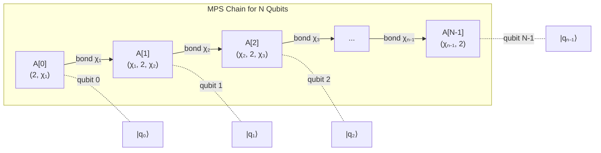
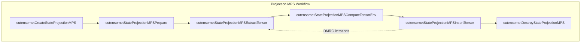
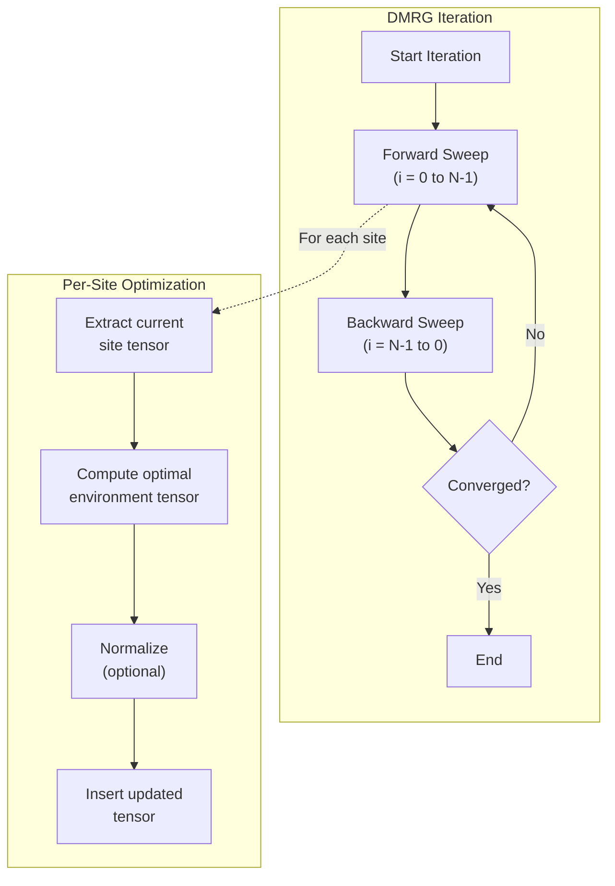
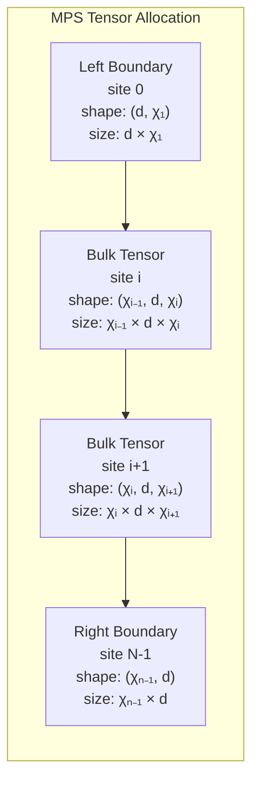

<!-- source: DeepWiki mcp.deepwiki.com · repo NVIDIA/cuQuantum · page 3.4 MPS and DMRG Methods · fetched 2026-10-26 -->

# MPS and DMRG Methods

<details>
<summary>Relevant source files</summary>

The following files were used as context for generating this wiki page:

- [python/cuquantum/bindings/cudensitymat.pxi](python/cuquantum/bindings/cudensitymat.pxi)
- [python/samples/bindings/cutensornet/state/proj_mps_circuit_dmrg_example.py](python/samples/bindings/cutensornet/state/proj_mps_circuit_dmrg_example.py)
- [samples/cudensitymat/transverse_ising_full_fused_noisy_grad.h](samples/cudensitymat/transverse_ising_full_fused_noisy_grad.h)
- [samples/cutensornet/high_level/proj_mps_circuit_dmrg_example.cu](samples/cutensornet/high_level/proj_mps_circuit_dmrg_example.cu)

</details>


## Purpose and Scope

This page documents Matrix Product State (MPS) representations and Density Matrix Renormalization Group (DMRG) optimization methods available in cuTensorNet. These techniques enable efficient approximate simulation of quantum circuits by representing quantum states in compressed MPS form and optimizing the representation using variational algorithms.

For general tensor network operations and contraction, see [Basic Tensor Network Operations](#3.1). For high-level circuit simulation APIs, see [High-Level API](#3.3).

**Sources:** [samples/cutensornet/high_level/proj_mps_circuit_dmrg_example.cu:1-446](), [python/samples/bindings/cutensornet/state/proj_mps_circuit_dmrg_example.py:1-281]()

---

## Matrix Product State Representation

### MPS Structure

An MPS represents a quantum state as a chain of tensors, where each tensor corresponds to a site (qubit) in the system. For a system of N qubits with local dimension d, the MPS consists of N tensors:

- **Left boundary tensor**: shape `(d, χ₁)`
- **Bulk tensors**: shape `(χᵢ₋₁, d, χᵢ)` for sites 1 ≤ i < N-1
- **Right boundary tensor**: shape `(χₙ₋₁, d)`

where χᵢ are the bond dimensions that control the approximation accuracy.



**Diagram: MPS Tensor Chain Structure**

### Maximum Bond Dimensions

The bond dimensions are constrained by the entanglement structure of the quantum state. The maximum possible bond dimension between sites i and i+1 is:

χₘₐₓ(i) = min(d^(i+1), d^(N-i-1))

For qubits (d=2) in a chain of N qubits, this grows exponentially from the boundaries and peaks in the middle. Users can impose a maximum bond dimension `maxExtent` to control memory usage and computation time.

**Sources:** [samples/cutensornet/high_level/proj_mps_circuit_dmrg_example.cu:54-81](), [python/samples/bindings/cutensornet/state/proj_mps_circuit_dmrg_example.py:95-114]()

---

## Projection MPS for Circuit Approximation

### Overview

Projection MPS provides a variational method to approximate a quantum circuit state (or linear combination of states) using an MPS representation. The method finds the MPS that maximizes the overlap with the target state subject to bond dimension constraints.

Given a target state |ψ_target⟩ (represented as a tensor network from a quantum circuit), the projection finds the MPS |ψ_MPS⟩ that minimizes:

||ψ_target⟩ - |ψ_MPS⟩|²

subject to the MPS bond dimension constraints.

### Key API Functions



**Diagram: Projection MPS API Call Sequence**

#### cutensornetCreateStateProjectionMPS

Creates a projection MPS object for approximating one or more quantum circuit states.

**Parameters:**
- `handle`: cuTensorNet library handle
- `numStates`: Number of quantum states to approximate (typically 1)
- `quantumStates`: Array of `cutensornetState_t` objects
- `coefficients`: Complex coefficients for linear combination
- `isConjugate`: Whether to conjugate the states
- `numEnvBounds`: Number of environment bound specifications
- `envBounds`: Array of `cutensornetMPSEnvBounds_t` defining environments
- `boundaryCondition`: `CUTENSORNET_BOUNDARY_CONDITION_OPEN` for open boundaries
- `numMPSTensors`: Number of MPS site tensors (typically numQubits)
- `numMPSTensorStrides`: Number of stride specifications (0 for default)
- `mpsTensorExtents`: Array of extent arrays for each MPS tensor
- `mpsTensorStrides`: Array of stride arrays (NULL for default)
- `mpsTensors`: Array of device pointers to MPS tensor buffers
- `initialOrthoSpec`: Initial orthogonality center specification
- `projectionMps`: Output pointer to created projection MPS object

**Sources:** [samples/cutensornet/high_level/proj_mps_circuit_dmrg_example.cu:269-275](), [python/samples/bindings/cutensornet/state/proj_mps_circuit_dmrg_example.py:175-189]()

#### cutensornetStateProjectionMPSPrepare

Prepares the projection MPS computation by analyzing the tensor network structure and allocating workspace.

**Parameters:**
- `handle`: cuTensorNet library handle
- `projectionMps`: Projection MPS object
- `maxWorkspaceSize`: Maximum available scratch memory
- `workDesc`: Workspace descriptor to populate
- `stream`: CUDA stream (0x0 for default)

**Sources:** [samples/cutensornet/high_level/proj_mps_circuit_dmrg_example.cu:280](), [python/samples/bindings/cutensornet/state/proj_mps_circuit_dmrg_example.py:194]()

#### cutensornetStateProjectionMPSExtractTensor

Extracts the current MPS site tensor at a specified position.

**Parameters:**
- `handle`: cuTensorNet library handle
- `projectionMps`: Projection MPS object
- `envBounds`: Environment bounds specifying which tensor to extract
- `tensorStrides`: Stride specification (NULL for default)
- `tensorData`: Device pointer to output buffer
- `workDesc`: Workspace descriptor
- `stream`: CUDA stream

**Sources:** [samples/cutensornet/high_level/proj_mps_circuit_dmrg_example.cu:339-340](), [python/samples/bindings/cutensornet/state/proj_mps_circuit_dmrg_example.py:227-234]()

#### cutensornetStateProjectionMPSComputeTensorEnv

Computes the environment tensor that optimally represents the target state at a given site.

**Parameters:**
- `handle`: cuTensorNet library handle
- `projectionMps`: Projection MPS object
- `envBounds`: Environment bounds specifying the site
- `numTensorStrides`: Number of stride specifications
- `tensorStrides`: Stride specification arrays
- `numTensorData`: Number of output buffers
- `tensorData`: Device pointer to output buffer
- `numTensorScales`: Number of scaling factors
- `tensorScales`: Scaling factors (NULL for no scaling)
- `workDesc`: Workspace descriptor
- `stream`: CUDA stream

**Sources:** [samples/cutensornet/high_level/proj_mps_circuit_dmrg_example.cu:343-345](), [python/samples/bindings/cutensornet/state/proj_mps_circuit_dmrg_example.py:237-239]()

#### cutensornetStateProjectionMPSInsertTensor

Inserts an updated MPS site tensor and specifies the new orthogonality center.

**Parameters:**
- `handle`: cuTensorNet library handle
- `projectionMps`: Projection MPS object
- `envBounds`: Environment bounds specifying which tensor to insert
- `orthoSpec`: Orthogonality center specification after insertion
- `tensorStrides`: Stride specification (NULL for default)
- `tensorData`: Device pointer to input tensor
- `workDesc`: Workspace descriptor
- `stream`: CUDA stream

**Sources:** [samples/cutensornet/high_level/proj_mps_circuit_dmrg_example.cu:366-369](), [python/samples/bindings/cutensornet/state/proj_mps_circuit_dmrg_example.py:242-243]()

---

## Environment Bounds Specification

### cutensornetMPSEnvBounds_t Structure

The `cutensornetMPSEnvBounds_t` structure specifies ranges of MPS tensors:

```c
typedef struct {
    int32_t lowerBound;  // Lower bound index (inclusive, -1 for left boundary)
    int32_t upperBound;  // Upper bound index (exclusive, numQubits for right boundary)
} cutensornetMPSEnvBounds_t;
```

**Common Usage Patterns:**

| Purpose | lowerBound | upperBound | Description |
|---------|-----------|-----------|-------------|
| Site i environment | i-1 | i+1 | Environment around site i |
| Initial full system | -1 | numQubits | Entire MPS chain |
| Left environment of site i | -1 | i | Everything to the left of site i |
| Right environment of site i | i+1 | numQubits | Everything to the right of site i |

**Python Example:**
```python
# Environment specifications for DMRG sweeps
env_specs = [(i-1, i+1) for i in range(num_qubits)]
env_bounds = np.asarray(env_specs, dtype=cutn.mps_env_bounds_dtype)

# Initial orthogonality specification
initial_ortho_spec = np.asarray([(-1, num_qubits)], dtype=cutn.mps_env_bounds_dtype)
```

**Sources:** [python/samples/bindings/cutensornet/state/proj_mps_circuit_dmrg_example.py:84-86](), [samples/cutensornet/high_level/proj_mps_circuit_dmrg_example.cu:254-265]()

---

## DMRG Optimization Algorithm

### Algorithm Overview

DMRG iteratively optimizes each MPS site tensor by computing the optimal tensor given the current state of all other tensors. The algorithm performs sweeps through the MPS chain:

1. **Forward sweep** (left to right): Optimize sites 0, 1, 2, ..., N-1
2. **Backward sweep** (right to left): Optimize sites N-1, N-2, ..., 1, 0
3. Repeat until convergence



**Diagram: DMRG Iteration Structure**

### Implementation in C++

The C++ example demonstrates the DMRG algorithm with partial-fidelity normalization:

```c++
// DMRG iterations
const int32_t numIterations = 5;
for (int32_t iter = 0; iter < numIterations; ++iter) {
    // Forward sweep
    for (int32_t i = 0; i < numQubits; ++i) {
        cutensornetMPSEnvBounds_t envBounds;
        envBounds.lowerBound = i - 1;
        envBounds.upperBound = i + 1;
        
        // Extract current site tensor
        cutensornetStateProjectionMPSExtractTensor(
            cutnHandle, projectionMps, &envBounds, 
            nullptr, d_envTensorsExtract[i], workDesc, 0x0);
        
        // Compute optimal environment tensor
        cutensornetStateProjectionMPSComputeTensorEnv(
            cutnHandle, projectionMps, &envBounds, 
            0, 0, 0, d_envTensorsInsert[i], 0, 0, workDesc, 0x0);
        
        // Normalize by partial fidelity
        double f_tau_sqrt;
        cublasDznrm2(cublasHandle, numElements[i], 
            d_envTensorsInsert[i], 1, &f_tau_sqrt);
        cuDoubleComplex scaling = {1.0 / f_tau_sqrt, 0.0};
        cublasZscal(cublasHandle, numElements[i], 
            &scaling, d_envTensorsInsert[i], 1);
        
        // Insert updated tensor
        cutensornetStateProjectionMPSInsertTensor(
            cutnHandle, projectionMps, &envBounds, 
            &envBounds, 0, d_envTensorsInsert[i], workDesc, 0x0);
    }
    
    // Backward sweep (similar structure, reversed order)
    // ...
}
```

**Sources:** [samples/cutensornet/high_level/proj_mps_circuit_dmrg_example.cu:322-415]()

### Implementation in Python

The Python example computes fidelity between sweeps to monitor convergence:

```python
num_iterations = 5
for iter_idx in range(num_iterations):    
    # Copy previous iteration's tensors
    previous_mps_tensors = [tensor.copy() for tensor in proj_mps_tensors]
    
    # Right sweep
    for i in np.arange(num_qubits):
        env_bounds = np.asarray([(i-1, i+1)], dtype=cutn.mps_env_bounds_dtype)
        
        # Extract site tensor
        cutn.state_projection_mps_extract_tensor(
            handle, projection_mps, env_bounds.ctypes.data,
            site_tensor_strides, site_tensor.data.ptr, work_desc, stream.ptr)
        
        # Compute environment tensor
        cutn.state_projection_mps_compute_tensor_env(
            handle, projection_mps, env_bounds.ctypes.data, 
            0, 0, env_tensor_strides, env_tensor.data.ptr, 
            0, 0, work_desc, stream.ptr)
        
        # Insert updated tensor
        ortho_spec = env_bounds
        cutn.state_projection_mps_insert_tensor(
            handle, projection_mps, env_bounds.ctypes.data,
            ortho_spec.ctypes.data, env_tensor_strides, 
            env_tensor.data.ptr, work_desc, stream.ptr)
    
    # Left sweep (similar structure)
    # ...
    
    # Compute fidelity for convergence check
    fidelity = compute_fidelity(previous_mps_tensors, proj_mps_tensors)
    print(f"Estimated fidelity: {fidelity} at iteration {iter_idx + 1}")
```

**Sources:** [python/samples/bindings/cutensornet/state/proj_mps_circuit_dmrg_example.py:213-272]()

---

## MPS Tensor Memory Management

### Allocation Pattern

MPS tensors must be allocated in GPU memory before creating the projection MPS. The allocation pattern depends on the tensor position:



**Diagram: MPS Tensor Shapes and Sizes**

### C++ Allocation Example

```c++
std::vector<std::vector<int64_t>> projMPSTensorExtents;
std::vector<void*> d_projMPSTensors(numQubits, nullptr);

for (int32_t i = 0; i < numQubits; ++i) {
    if (i == 0) {
        // Left boundary: (2, χ₁)
        auto extent2 = std::min(maxBondExtents[i], maxExtent);
        projMPSTensorExtents.push_back({2, extent2});
        numElements[i] = 2 * extent2;
        cudaMalloc(&d_projMPSTensors[i], numElements[i] * (2 * fp64size));
    } else if (i == numQubits - 1) {
        // Right boundary: (χₙ₋₁, 2)
        auto extent1 = std::min(maxBondExtents[i - 1], maxExtent);
        projMPSTensorExtents.push_back({extent1, 2});
        numElements[i] = extent1 * 2;
        cudaMalloc(&d_projMPSTensors[i], numElements[i] * (2 * fp64size));
    } else {
        // Bulk: (χᵢ₋₁, 2, χᵢ)
        auto extent1 = std::min(maxBondExtents[i - 1], maxExtent);
        auto extent3 = std::min(maxBondExtents[i], maxExtent);
        projMPSTensorExtents.push_back({extent1, 2, extent3});
        numElements[i] = extent1 * 2 * extent3;
        cudaMalloc(&d_projMPSTensors[i], numElements[i] * (2 * fp64size));
    }
}
```

**Sources:** [samples/cutensornet/high_level/proj_mps_circuit_dmrg_example.cu:199-231]()

### Python Allocation Example

```python
max_bond_extents = get_max_bond_extents(qubits_dims, max_extent)
proj_mps_tensors = []

for i in range(num_qubits):
    if i == 0:
        extents = (2, min(max_bond_extents[i], max_extent))
    elif i == num_qubits - 1:
        extents = (min(max_bond_extents[i-1], max_extent), 2)
    else:
        extents = (min(max_bond_extents[i-1], max_extent), 2, 
                   min(max_bond_extents[i], max_extent))
    
    tensor = cp.zeros(extents, dtype='complex128')
    tensor.reshape(-1)[0] = 1.0  # Initialize to vacuum state
    proj_mps_tensors.append(tensor)
```

**Sources:** [python/samples/bindings/cutensornet/state/proj_mps_circuit_dmrg_example.py:118-130]()

---

## Complete Example Workflow

### C++ Example: QFT Circuit DMRG

The C++ example [samples/cutensornet/high_level/proj_mps_circuit_dmrg_example.cu:1-446]() demonstrates the complete workflow:

1. **Initialize cuTensorNet and cuBLAS** ([lines 99-105]())
2. **Define quantum gates** (Hadamard, controlled rotations) ([lines 110-149]())
3. **Allocate scratch memory** ([lines 154-159]())
4. **Create quantum circuit state** by applying gates ([lines 162-180]())
5. **Allocate MPS tensor buffers** with vacuum state initialization ([lines 186-245]())
6. **Create projection MPS** with environment specifications ([lines 250-274]())
7. **Prepare computation** and allocate workspace ([lines 278-318]())
8. **Execute DMRG iterations** with forward and backward sweeps ([lines 322-415]())
9. **Cleanup** resources ([lines 421-442]())

### Python Example: QFT Circuit DMRG

The Python example [python/samples/bindings/cutensornet/state/proj_mps_circuit_dmrg_example.py:1-281]() follows a similar workflow:

1. **Initialize cuTensorNet** ([lines 40-43]())
2. **Define quantum gates** ([lines 46-56]())
3. **Allocate scratch memory** ([lines 58-61]())
4. **Create quantum circuit state** ([lines 64-76]())
5. **Prepare MPS tensor buffers** ([lines 89-130]())
6. **Define helper functions** for overlap and fidelity computation ([lines 132-172]())
7. **Create projection MPS** ([lines 174-189]())
8. **Prepare workspace** ([lines 192-211]())
9. **Execute DMRG iterations** with fidelity monitoring ([lines 213-272]())
10. **Cleanup** ([lines 274-280]()

---

## Convergence Monitoring

### Fidelity Computation

The fidelity between two MPS representations provides a measure of convergence. The Python example includes helper functions to compute overlap and fidelity:

```python
def compute_overlap(mps_tensors_1, mps_tensors_2):
    """Compute <mps_tensors_2 | mps_tensors_1>"""
    overlap = cp.einsum('xi,xj->ij', 
                        mps_tensors_2[0].conj(), 
                        mps_tensors_1[0])
    
    for i in range(1, len(mps_tensors_1)-1):
        overlap = cp.einsum('axi,ab,bxj->ij', 
                           mps_tensors_2[i].conj(), 
                           overlap, 
                           mps_tensors_1[i])
    
    overlap = cp.einsum('ax,ab,bx->', 
                       mps_tensors_2[-1].conj(), 
                       overlap, 
                       mps_tensors_1[-1])
    return overlap[()]

def compute_fidelity(mps_tensors_1, mps_tensors_2):
    """Compute F = |<mps_2 | mps_1>| / sqrt(<mps_1|mps_1> <mps_2|mps_2>)"""
    overlap = compute_overlap(mps_tensors_1, mps_tensors_2)
    norm1 = compute_overlap(mps_tensors_1, mps_tensors_1)
    norm2 = compute_overlap(mps_tensors_2, mps_tensors_2)
    return cp.abs(overlap / cp.sqrt(norm1 * norm2))
```

**Sources:** [python/samples/bindings/cutensornet/state/proj_mps_circuit_dmrg_example.py:132-172]()

### Partial Fidelity Normalization

The C++ example uses cuBLAS to normalize environment tensors by their partial fidelity, which helps numerical stability:

```c++
// Compute norm (partial fidelity sqrt)
double f_tau_sqrt;
cublasDznrm2(cublasHandle, numElements[i], 
    static_cast<const cuDoubleComplex*>(d_envTensorsInsert[i]), 
    1, &f_tau_sqrt);
cudaStreamSynchronize(0);

// Check for numerical issues
if (f_tau_sqrt < sqrt(numeric_limits<double>::epsilon())) {
    cout << "ERROR: Scaling factor is zero!\n";
    abort();
}

// Scale tensor
cuDoubleComplex scaling_factor = {1.0 / f_tau_sqrt, 0.0};
cublasZscal(cublasHandle, numElements[i], 
    &scaling_factor,
    static_cast<cuDoubleComplex*>(d_envTensorsInsert[i]), 1);
```

**Sources:** [samples/cutensornet/high_level/proj_mps_circuit_dmrg_example.cu:348-363]()

---

## Key Considerations

### Memory Requirements

MPS memory scales as O(N × d × χ²) where:
- N = number of qubits
- d = local dimension (2 for qubits)
- χ = maximum bond dimension

For N=16 qubits with χ=8: ~2 × 16 × 8² × 16 bytes = 32 KB per tensor (minimal)

### Workspace Requirements

DMRG requires scratch workspace for tensor contractions. Query workspace size using:
```c++
int64_t worksize;
cutensornetWorkspaceGetMemorySize(handle, workDesc, 
    CUTENSORNET_WORKSIZE_PREF_RECOMMENDED,
    CUTENSORNET_MEMSPACE_DEVICE, 
    CUTENSORNET_WORKSPACE_SCRATCH, &worksize);
```

**Sources:** [samples/cutensornet/high_level/proj_mps_circuit_dmrg_example.cu:282-286]()

### Convergence Criteria

Typical convergence criteria include:
- **Fidelity threshold**: Stop when fidelity > 1 - ε (e.g., ε = 10⁻⁶)
- **Fixed iterations**: Run a predetermined number of sweeps
- **Energy/variance convergence**: For ground state search (not shown in circuit DMRG)

### Orthogonality Centers

The orthogonality specification controls gauge freedom in the MPS representation:
- `orthoSpec = (i-1, i+1)` places the orthogonality center at site i
- Proper orthogonality management is crucial for numerical stability

**Sources:** [samples/cutensornet/high_level/proj_mps_circuit_dmrg_example.cu:366-369](), [python/samples/bindings/cutensornet/state/proj_mps_circuit_dmrg_example.py:242-243]()

---

## Related Functionality

For additional MPS-related features:
- **Gate splitting**: Decompose multi-qubit gates into MPO form for efficient application
- **Sampling from MPS**: Generate measurement samples from the MPS representation
- **Expectation values**: Compute ⟨O⟩ for observables O in MPS form
- **Time evolution**: Apply time-evolution operators in MPS/MPO form

These features are available through the broader cuTensorNet state API documented in [High-Level API](#3.3).

**Sources:** [samples/cutensornet/high_level/proj_mps_circuit_dmrg_example.cu:1-446](), [python/samples/bindings/cutensornet/state/proj_mps_circuit_dmrg_example.py:1-281]()

---

