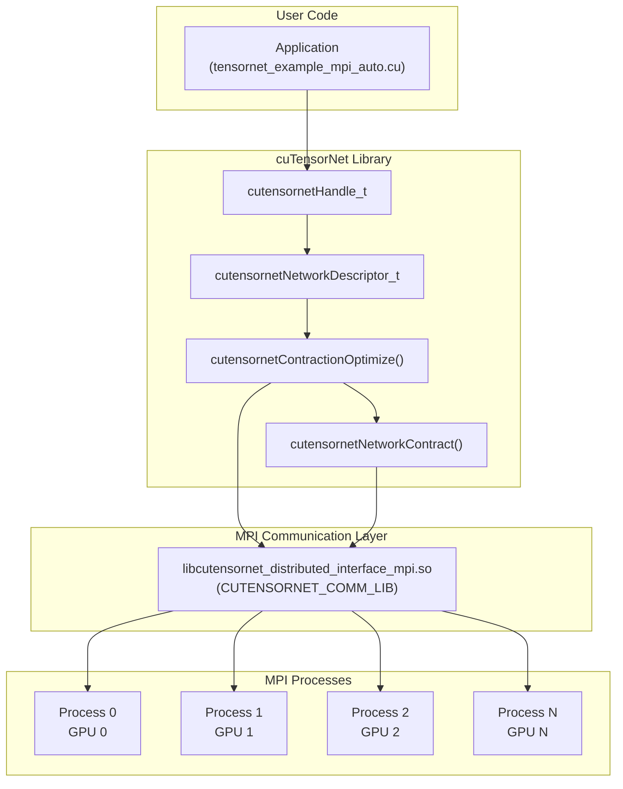
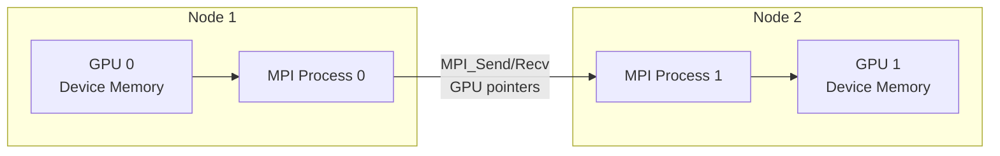

<!-- source: DeepWiki mcp.deepwiki.com · repo NVIDIA/cuQuantum · page 3.5 Distributed Computing with MPI · fetched 2026-10-26 -->

# Distributed Computing with MPI

<details>
<summary>Relevant source files</summary>

The following files were used as context for generating this wiki page:

- [samples/cutensornet/Makefile](samples/cutensornet/Makefile)
- [samples/cutensornet/README.md](samples/cutensornet/README.md)
- [samples/cutensornet/tensornet_example.cu](samples/cutensornet/tensornet_example.cu)

</details>


## Purpose and Scope

This document covers multi-GPU and multi-node parallel execution of tensor network contractions using MPI (Message Passing Interface) in cuTensorNet. It explains both automatic and explicit MPI parallelization strategies, environment setup, and communication patterns.

For multi-GPU state vector simulation using MPI, see [MPI Integration](#4.3). For general cuTensorNet operations without distributed computing, see [Basic Tensor Network Operations](#3.1).

---

## Overview

cuTensorNet provides two approaches for distributed tensor network contraction across multiple GPUs and nodes:

| Approach | Sample File | Complexity | Use Case |
|----------|-------------|------------|----------|
| **Automatic Parallelization** | `tensornet_example_mpi_auto.cu` | Low - minimal code changes | Production deployments, rapid prototyping |
| **Explicit Parallelization** | `tensornet_example_mpi.cu` | High - manual MPI calls | Custom load balancing, fine-grained control |

Both approaches leverage **slice-based parallelism**, where the tensor network contraction is decomposed into independent slices that can be computed in parallel and then reduced to produce the final result.

**Key Concept**: The contraction optimizer (see [Path Optimization and Performance](#3.2)) may determine that a tensor network requires slicing when workspace memory is limited. Each slice represents an independent contraction problem that produces a partial result. MPI parallelization distributes these slices across processes.

Sources: [samples/cutensornet/README.md:87-115]()

---

## Environment Setup and Requirements

### CUTENSORNET_COMM_LIB Environment Variable

The automatic parallelization approach requires setting the `CUTENSORNET_COMM_LIB` environment variable to specify the MPI communication library:

```bash
export CUTENSORNET_COMM_LIB=/path/to/libcutensornet_distributed_interface_mpi.so
```

This variable points to the cuTensorNet MPI communication plugin that enables automatic distributed execution. The library is typically included with cuTensorNet installations.

### CUDA-Aware MPI

Currently, cuTensorNet requires a **CUDA-aware MPI** implementation. CUDA-aware MPI allows passing GPU device pointers directly to MPI functions without explicit host-device memory transfers, significantly improving performance.

Common CUDA-aware MPI implementations:
- OpenMPI with UCX
- MVAPICH2-GDR
- Spectrum MPI (IBM systems)
- Cray MPICH

### One GPU Per Process Model

Both MPI parallelization approaches follow a **one GPU per MPI process** model. Each MPI process is assigned to a single GPU device, simplifying memory management and avoiding intra-process GPU coordination complexity.

Sources: [samples/cutensornet/README.md:37-45]()

---

## Building MPI-Enabled Examples

### Makefile Configuration

The cuTensorNet samples use a Makefile-based build system that conditionally compiles MPI examples when `MPI_ROOT` is defined:

```bash
export CUDA_PATH=/path/to/cuda
export CUTENSORNET_ROOT=/path/to/cutensornet
export MPI_ROOT=/path/to/mpi
make -j
```

The Makefile contains the following MPI-specific build rules:

[samples/cutensornet/Makefile:53-59]()

These rules:
1. Check for `MPI_ROOT` environment variable
2. Add MPI include paths: `-I${MPI_ROOT}/include`
3. Add MPI library paths: `-L${MPI_ROOT}/lib`
4. Set runtime library path: `-Xlinker -rpath,${MPI_ROOT}/lib`
5. Link against MPI library: `-lmpi`

### Build Verification

After building, verify the MPI examples are created:

```bash
ls -l tensornet_example_mpi tensornet_example_mpi_auto
```

Sources: [samples/cutensornet/Makefile:1-107](), [samples/cutensornet/README.md:6-24]()

---

## Running MPI Examples

### Basic Execution

Execute MPI examples using `mpiexec` or `mpirun`:

```bash
# Automatic parallelization
mpiexec -n 4 ./tensornet_example_mpi_auto

# Explicit parallelization
mpiexec -n 4 ./tensornet_example_mpi
```

Where `-n 4` specifies 4 MPI processes.

### Process Count Considerations

**Automatic Parallelization**:
- Typically run with one process per GPU
- Number of processes should match available GPUs in the system
- Example: `mpiexec -n 2 ./tensornet_example_mpi_auto` on a 2-GPU system

**Explicit Parallelization**:
- Can run with more processes than GPUs
- Multiple processes can share the same GPU
- Useful for oversubscription or when slice count exceeds GPU count
- Example: `mpiexec -n 8 ./tensornet_example_mpi` with 4 GPUs

### Multi-Node Execution

For multi-node execution, use MPI hostfile configuration:

```bash
# Create hostfile
cat > hostfile << EOF
node1 slots=4
node2 slots=4
EOF

# Run across nodes
mpiexec -n 8 -hostfile hostfile ./tensornet_example_mpi_auto
```

Sources: [samples/cutensornet/README.md:29-45]()

---

## Automatic MPI Parallelization

### Architecture

The automatic parallelization approach provides distributed execution **without modifying the original serial code**. The cuTensorNet library internally distributes work across MPI processes when `CUTENSORNET_COMM_LIB` is set.



### Code Pattern

The automatic parallelization follows the same API sequence as serial execution. The library detects MPI configuration and automatically distributes work:

**Key Operations That Become Distributed**:
1. `cutensornetContractionOptimize()` - Path finding runs in parallel across processes
2. `cutensornetNetworkContract()` - Slices are distributed automatically across processes

The library handles:
- Slice distribution and load balancing
- Inter-process communication
- Result aggregation
- Error handling across processes

### Sample Structure

[samples/cutensornet/README.md:87-101]() describes the automatic sample structure:

1. **MPI Initialization**: Basic MPI+CUDA setup with one GPU per process
2. **Activation Call**: Internal activation of distributed parallelization (handled by library when `CUTENSORNET_COMM_LIB` is set)
3. **Parallel Path Finding**: `cutensornetContractionOptimize()` executes in parallel
4. **Parallel Contraction**: `cutensornetNetworkContract()` distributes slices automatically

Sources: [samples/cutensornet/README.md:87-101]()

---

## Explicit MPI Parallelization

### Architecture

The explicit approach provides full control over MPI communication patterns, enabling custom load balancing and advanced optimization strategies.


### Parallel Path Optimization

Each MPI process independently runs `cutensornetContractionOptimize()` with a different random seed, potentially discovering different contraction paths with varying quality (measured by FLOP count).

**Process**:
1. All processes find their best contraction path
2. `MPI_Allreduce` with `MPI_MINLOC` operator identifies the process with the lowest FLOP count
3. Winner's `cutensornetContractionOptimizerInfo_t` is serialized and broadcast to all processes

**Optimizer Info Serialization**:

The optimizer info object must be serialized for transmission:

```c++
// On winner process: serialize optimizerInfo
int64_t packedSize;
cutensornetContractionOptimizerInfoGetPackedSize(handle, optimizerInfo, &packedSize);

void* packedData = malloc(packedSize);
cutensornetContractionOptimizerInfoPackData(handle, optimizerInfo, packedData, packedSize);

// Broadcast serialized data
MPI_Bcast(packedData, packedSize, MPI_BYTE, winnerRank, MPI_COMM_WORLD);

// On other processes: deserialize
cutensornetUpdateContractionOptimizerInfoFromPackedData(handle, 
                                                        packedData, 
                                                        packedSize,
                                                        optimizerInfo);
```

### Slice Distribution and Load Balancing

After all processes have the optimal contraction path, they query the total number of slices:

```c++
int64_t numSlices = 0;
cutensornetContractionOptimizerInfoGetAttribute(handle,
                                                optimizerInfo,
                                                CUTENSORNET_CONTRACTION_OPTIMIZER_INFO_NUM_SLICES,
                                                &numSlices,
                                                sizeof(numSlices));
```

Each process computes its slice subset:

```c++
int64_t mySliceStart = (numSlices * myRank) / numProcs;
int64_t mySliceEnd = (numSlices * (myRank + 1)) / numProcs;
int64_t myNumSlices = mySliceEnd - mySliceStart;

// Create slice group for this process
cutensornetSliceGroup_t sliceGroup;
cutensornetCreateSliceGroupFromIDRange(handle, mySliceStart, mySliceEnd, 1, &sliceGroup);
```

This distribution strategy provides relatively balanced load across processes.

### Slice-Based Contraction and Reduction

Each process contracts its assigned slices:

```c++
int32_t accumulateOutput = 0;
cutensornetNetworkContract(handle,
                           networkDesc,
                           accumulateOutput,
                           workDesc,
                           sliceGroup,
                           stream);
```

After local contraction, processes perform a global sum reduction to aggregate results:

```c++
// Reduce partial results to root process
MPI_Reduce(localOutput, globalOutput, outputSize, MPI_FLOAT, MPI_SUM, 0, MPI_COMM_WORLD);
```

The root process (rank 0) receives the final tensor network contraction result.

Sources: [samples/cutensornet/README.md:103-115]()

---

## Communication Patterns and Synchronization

### GPU-to-GPU Communication

With CUDA-aware MPI, tensor data can be transferred directly between GPU memories:



### Workspace Management

Each MPI process manages its own workspace:

```c++
// Each process queries workspace requirements
int64_t requiredWorkspaceSize = 0;
cutensornetWorkspaceComputeContractionSizes(handle, networkDesc, optimizerInfo, workDesc);
cutensornetWorkspaceGetMemorySize(handle, workDesc, 
                                  CUTENSORNET_WORKSIZE_PREF_MIN,
                                  CUTENSORNET_MEMSPACE_DEVICE,
                                  CUTENSORNET_WORKSPACE_SCRATCH,
                                  &requiredWorkspaceSize);

// Allocate workspace on local GPU
void* workspace;
cudaMalloc(&workspace, requiredWorkspaceSize);
cutensornetWorkspaceSetMemory(handle, workDesc, 
                              CUTENSORNET_MEMSPACE_DEVICE,
                              CUTENSORNET_WORKSPACE_SCRATCH,
                              workspace, 
                              requiredWorkspaceSize);
```

**Important**: In explicit parallelization, all processes should use the same `workspaceLimit` when calling `cutensornetContractionOptimize()` to ensure consistent slicing decisions.

### Synchronization Points

Key synchronization points in distributed execution:

| Operation | Synchronization Type | Purpose |
|-----------|---------------------|---------|
| `MPI_Allreduce` (path finding) | Global barrier | Select best contraction path |
| `MPI_Bcast` (optimizer info) | One-to-all | Distribute winning path |
| `cutensornetNetworkContract()` | Local (per-process) | Independent slice computation |
| `MPI_Reduce` (results) | Many-to-one | Aggregate partial results |

Sources: [samples/cutensornet/README.md:103-115]()

---

## Advanced Topics

### Custom MPI Library Integration

Beyond the standard `libcutensornet_distributed_interface_mpi.so`, users can implement custom MPI communication backends by:

1. Implementing the cuTensorNet distributed interface API
2. Building a custom communication plugin
3. Setting `CUTENSORNET_COMM_LIB` to point to the custom library

This enables integration with:
- Custom high-performance interconnects
- Vendor-specific MPI implementations
- Hybrid MPI+X communication patterns (e.g., MPI+NCCL)

For details on the MPI Comm Plugin architecture, see [MPI Integration](#4.3).

### Load Balancing Strategies

The simple slice distribution strategy (`numSlices * rank / numProcs`) assumes uniform slice costs. For heterogeneous systems or non-uniform slice complexity:

**Dynamic Load Balancing**:
- Root process maintains a work queue of slice IDs
- Worker processes request new slice IDs upon completion
- Requires additional MPI communication but improves balance

**Cost-Based Distribution**:
- Query per-slice FLOP counts if available
- Distribute slices to equalize total FLOP count per process
- Reduces stragglers in heterogeneous environments

### Multi-GPU Single Process

While cuTensorNet samples demonstrate one GPU per process, advanced users may implement:
- Multi-threaded contraction with thread-per-GPU
- CUDA streams for concurrent GPU operations
- Hybrid MPI+threads (e.g., MPI+OpenMP) models

These approaches require careful synchronization and are not covered in the standard samples.

Sources: [samples/cutensornet/README.md:1-184](), [samples/cutensornet/Makefile:1-107]()

---

## Summary Table: MPI Approaches Comparison

| Feature | Automatic | Explicit |
|---------|-----------|----------|
| **Code Complexity** | Minimal - same as serial | High - manual MPI calls |
| **Setup Required** | `CUTENSORNET_COMM_LIB` environment variable | MPI initialization and coordination |
| **Path Optimization** | Automatic parallel | Manual parallel + broadcast |
| **Slice Distribution** | Automatic by library | Manual computation required |
| **Result Reduction** | Automatic by library | Manual `MPI_Reduce` required |
| **Load Balancing** | Library-managed | User-controlled |
| **Customization** | Limited | Full control |
| **Recommended For** | Production, quick scaling | Research, custom algorithms |
| **Process Count** | One per GPU (typical) | Flexible (can exceed GPU count) |

Sources: [samples/cutensornet/README.md:87-115]()

---

