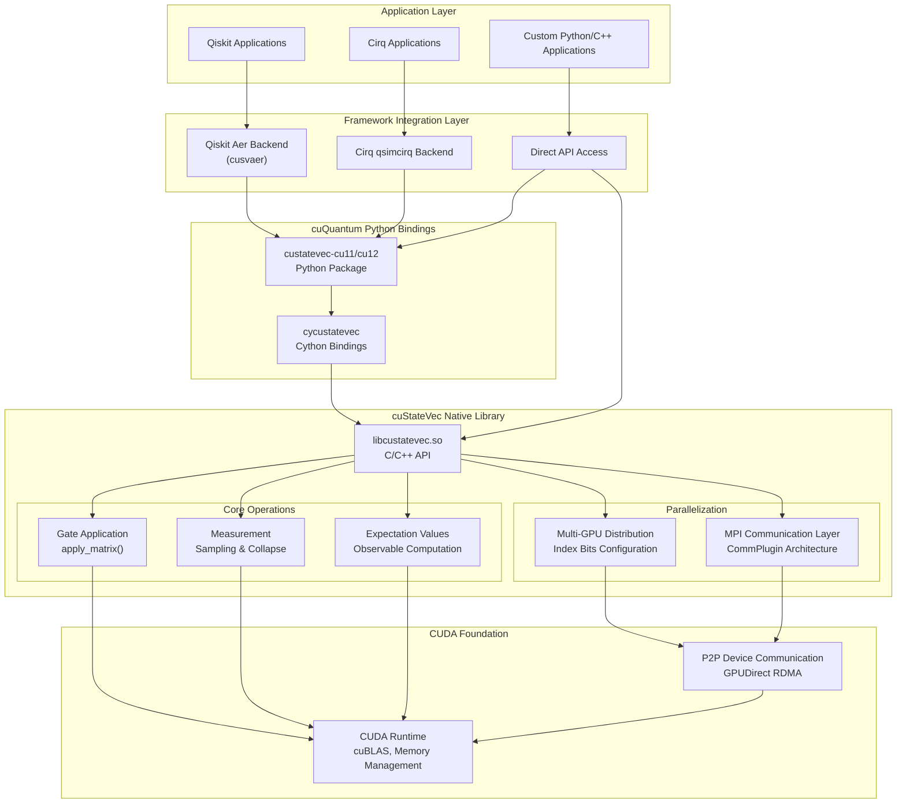
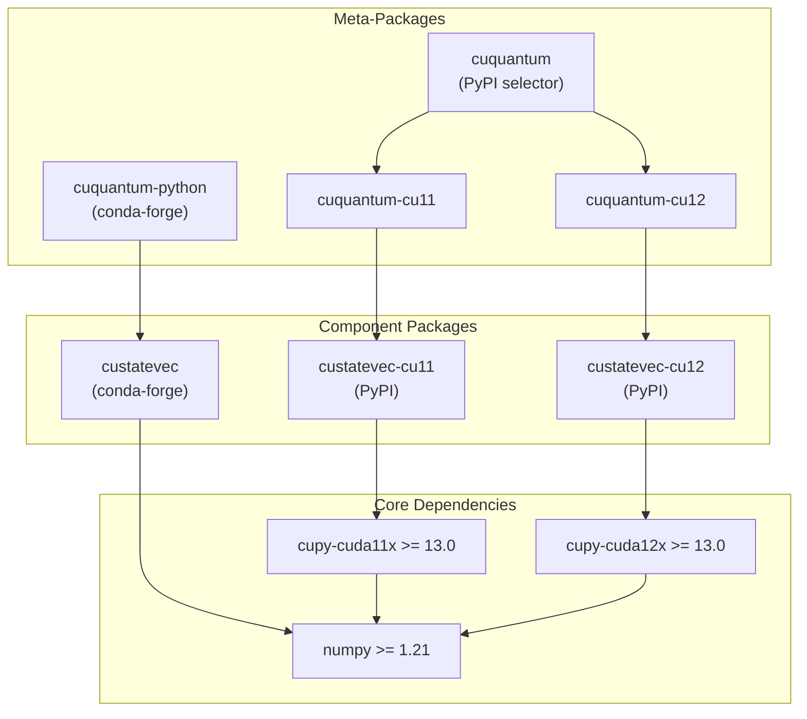
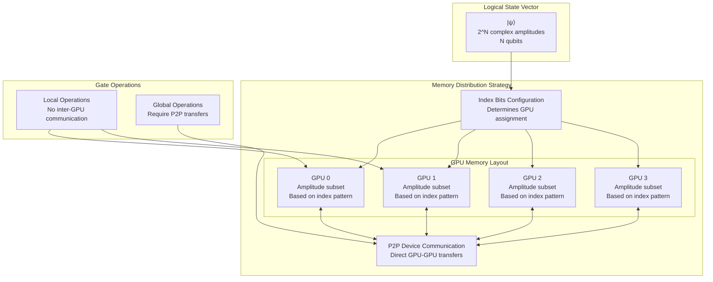
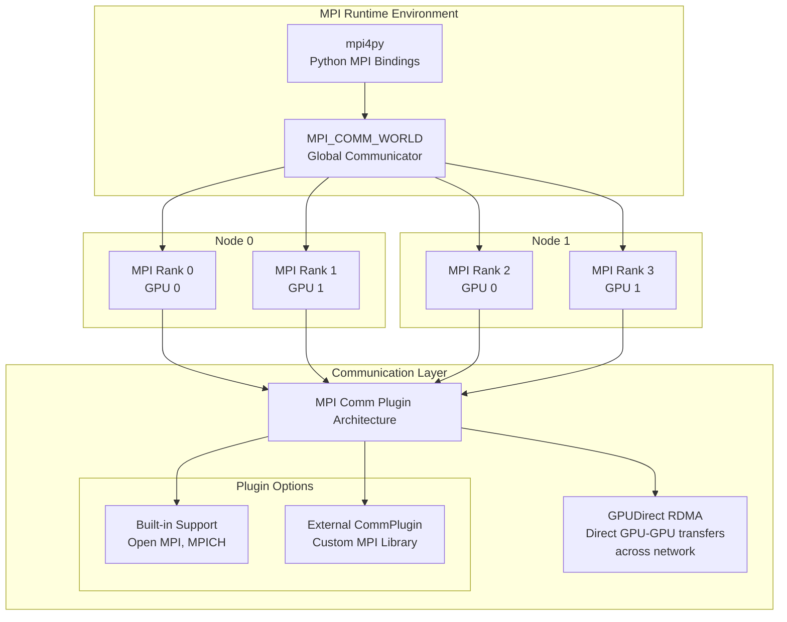
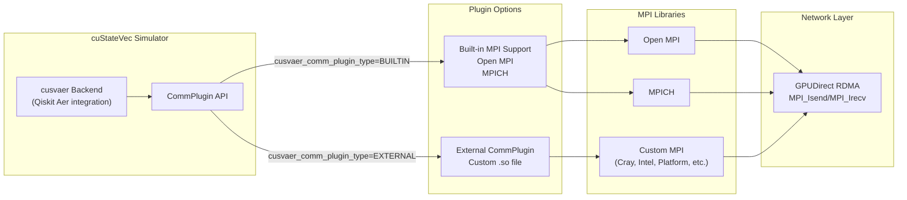
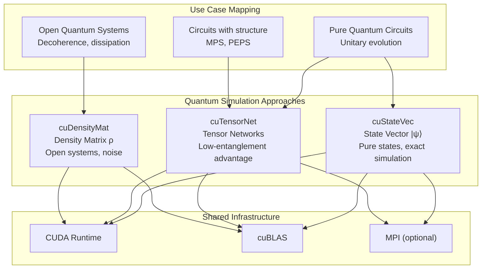

<!-- source: DeepWiki mcp.deepwiki.com · repo NVIDIA/cuQuantum · page 4 cuStateVec Library · fetched 2026-10-26 -->

# cuStateVec Library

<details>
<summary>Relevant source files</summary>

The following files were used as context for generating this wiki page:

- [LICENSE](LICENSE)
- [README.md](README.md)
- [benchmarks/README.md](benchmarks/README.md)
- [extra/custatevec/README.md](extra/custatevec/README.md)
- [python/LICENSE](python/LICENSE)

</details>


## Purpose and Scope

This document provides comprehensive documentation for the cuStateVec library, one of the three core components of the NVIDIA cuQuantum SDK. cuStateVec is designed for high-performance state vector simulation of quantum circuits using the |ψ⟩ representation on NVIDIA GPUs.

cuStateVec enables simulation of pure quantum states through:
- Single-GPU state vector operations (gate application, measurement, expectation values)
- Multi-GPU memory distribution for large-scale simulations
- Multi-node parallelization using MPI for systems beyond single-node capacity

For tensor network-based simulation approaches, see [cuTensorNet Library](#3). For open quantum system simulation using density matrices, see [cuDensityMat Library](#5). For installation and Python interface details, see [Python Interface](#2).

---

## Architecture Overview

cuStateVec operates as a native CUDA library with both C++ and Python interfaces, providing GPU-accelerated quantum state vector operations that form the foundation for circuit simulation.

### Library Position in cuQuantum Stack



**Sources:** [README.md:1-46](), [benchmarks/README.md:52-52](), [extra/custatevec/README.md:1-48]()

---

## Package Distribution

cuStateVec is distributed through multiple channels with CUDA-version-specific variants to ensure compatibility with the host system's CUDA installation.

### Available Packages

| Distribution Channel | Package Name | CUDA Version | Description |
|---------------------|--------------|--------------|-------------|
| conda-forge | `custatevec` | Runtime-detected | Unified package for all CUDA versions |
| PyPI | `custatevec-cu11` | CUDA 11.x | State vector library for CUDA 11 |
| PyPI | `custatevec-cu12` | CUDA 12.x | State vector library for CUDA 12 |
| Native C++ | `libcustatevec.so` | System CUDA | Shared library included in cuQuantum SDK |

### Package Relationships



**Sources:** [README.md:12-31]()

---

## Core Functionality

### State Vector Operations

cuStateVec provides fundamental operations for quantum state manipulation:

| Operation Category | API Functions | Description |
|-------------------|---------------|-------------|
| **Initialization** | State creation, basis state preparation | Initialize quantum states in computational basis or custom superpositions |
| **Gate Application** | `apply_matrix()` | Apply arbitrary unitary matrices to target qubits with optional control qubits |
| **Measurement** | Sampling, collapse operations | Perform projective measurements with state collapse or sample from probability distributions |
| **Expectation Values** | Observable computation | Calculate expectation values of Hermitian operators |
| **State Queries** | Amplitude extraction, norm computation | Retrieve state vector amplitudes and compute inner products |

The `apply_matrix()` function is a core API that appears in benchmarking contexts, demonstrating its importance for performance-critical applications:

```
nv-quantum-benchmarks api --benchmark apply_matrix --targets 4,5 --controls 2,3 --nqubits 16
```

This benchmark tests applying a gate matrix controlled by qubits 2 & 3 to target qubits 4 & 5 in a 16-qubit state vector.

**Sources:** [benchmarks/README.md:52-52]()

### Sample Code Organization

cuStateVec C++ samples are located in the `samples/custatevec/` directory (referenced as having "~17 C++ examples" in the system overview), providing hands-on demonstrations of:

- Basic gate operations and state manipulation
- Multi-qubit gate application patterns
- Performance optimization techniques
- Integration with custom simulation pipelines

**Sources:** System architecture diagrams (Diagram 3)

---

## Scalability Architecture

### Multi-GPU Memory Distribution

For quantum systems exceeding single-GPU memory capacity, cuStateVec distributes the state vector across multiple GPUs using configurable index bit schemes.



Key configuration parameters:
- **Index bits**: Determines which qubits control the GPU assignment for each amplitude
- **P2P device bits**: Configures peer-to-peer communication topology between GPUs
- **Global index bits**: Controls multi-node distribution in MPI configurations

For detailed multi-GPU configuration options, see [Multi-GPU Support](#4.2).

**Sources:** System architecture diagrams (Diagram 3), [benchmarks/README.md:55-55]()

### Multi-Node MPI Integration

cuStateVec extends beyond single-node capacity through MPI (Message Passing Interface) parallelization, enabling state vector simulation across multiple compute nodes.



**Example MPI Execution:**
```
mpiexec -n 4 nv-quantum-benchmarks circuit --frontend qiskit --backend cusvaer \
  --benchmark quantum_volume --nqubits 32 --ngpus 1 \
  --cusvaer-global-index-bits 1,1 --cusvaer-p2p-device-bits 1
```

This launches a 32-qubit Quantum Volume simulation across 2 nodes with 2 MPI processes per node (4 total), each controlling 1 GPU.

**Sources:** [benchmarks/README.md:49-55]()

---

## MPI Communication Plugin Architecture

The CommPlugin system provides flexibility for integrating cuStateVec with diverse MPI implementations and network configurations.

### Plugin Types and Configuration



### External CommPlugin Build Process

The External CommPlugin mechanism allows integration with MPI libraries not natively supported by the cuQuantum Appliance. The process involves:

1. **Source File**: `extra/custatevec/mpiCommPlugin.c` - Wrapper functions for MPI operations
2. **Compilation**: Link against custom MPI library to create shared object
3. **Configuration**: Specify plugin via simulator options

**Build Command Structure:**
```bash
gcc -I <path to CUDA include> \
    -I <path to MPI include> \
    -L <path to MPI library> \
    -fPIC -shared mpiCommPlugin.c \
    -lmpi -o <custom_plugin_name>.so
```

**Simulator Configuration (Python):**
```python
from qiskit import Aer
from cusvaer import CommPluginType

sim = Aer.get_backend('aer_simulator')
sim.set_options(
    cusvaer_comm_plugin_type=CommPluginType.EXTERNAL,
    cusvaer_comm_plugin_soname='mpiCommPlugin.so'
)
```

### Requirements for Custom MPI Libraries

| Requirement | Description |
|-------------|-------------|
| **GPUDirect RDMA** | MPI library must support GPUDirect RDMA for `MPI_Isend()` and `MPI_Irecv()` |
| **CUDA-aware** | MPI implementation must handle device pointers directly |
| **Dynamic loading** | Shared object must be accessible via `LD_LIBRARY_PATH` at runtime |

For detailed build instructions and examples, see [MPI Integration](#4.3).

**Sources:** [extra/custatevec/README.md:1-48]()

---

## Backend Integration

cuStateVec serves as the computational backend for multiple quantum computing frameworks, most notably through the `cusvaer` backend in the benchmarking suite.

### cusvaer Backend

The `cusvaer` backend provides Qiskit integration with multi-GPU and multi-node capabilities:

**Configuration Parameters:**
- `--backend cusvaer`: Select cuStateVec-based Aer backend
- `--cusvaer-global-index-bits`: Configure multi-node distribution (e.g., `1,1` for 4 MPI ranks)
- `--cusvaer-p2p-device-bits`: Configure P2P communication topology (e.g., `1` for direct GPU-GPU)
- `--ngpus`: Number of GPUs per MPI rank

**Example Usage:**
```
mpiexec -n 4 nv-quantum-benchmarks circuit \
  --frontend qiskit \
  --backend cusvaer \
  --benchmark quantum_volume \
  --nqubits 32 \
  --ngpus 1 \
  --cusvaer-global-index-bits 1,1 \
  --cusvaer-p2p-device-bits 1
```

This configuration:
- Uses 4 MPI processes (2 nodes × 2 processes/node)
- Each process controls 1 GPU
- Global index bits `1,1` distributes state across 2 dimensions
- P2P device bits enable direct GPU-to-GPU communication

**Sources:** [benchmarks/README.md:55-55]()

---

## Integration with Quantum Frameworks

cuStateVec integrates with major quantum computing frameworks through backend plugins and direct API access:

| Framework | Integration Method | Backend Name | Notes |
|-----------|-------------------|--------------|-------|
| **Qiskit** | Aer backend plugin | `cusvaer` | Multi-GPU/MPI support, requires cuQuantum Appliance |
| **Cirq** | qsimcirq backend | GPU-accelerated qsim | Uses cuStateVec for acceleration |
| **Direct API** | C++/Python bindings | N/A | Full control over state vector operations |
| **Custom** | custatevec Python package | N/A | Build custom simulators on top of cuStateVec |

### Performance Considerations

When choosing cuStateVec versus other cuQuantum libraries:

**Use cuStateVec when:**
- Simulating pure quantum states (no noise/decoherence)
- Need exact amplitudes or expectation values
- Circuit depth is manageable (no exponential tensor network advantage)
- Have sufficient GPU memory (single-GPU) or MPI infrastructure (multi-node)
- Require compatibility with existing Qiskit/Cirq workflows

**Consider alternatives:**
- **cuTensorNet** ([see page 3](#3)): When tensor network methods provide exponential advantage (low-entanglement circuits, MPS representations)
- **cuDensityMat** ([see page 5](#5)): For open quantum systems with decoherence, mixed states, or when autodiff is needed

**Sources:** System architecture diagrams (Diagrams 2, 3)

---

## Development and Samples

### C++ Samples Location

C++ example code demonstrating cuStateVec usage is organized in:
- `samples/custatevec/` directory
- Approximately 17 C++ examples covering various use cases
- Makefile-based build system with CUDA architecture flags (SM75-SM120)
- Environment variables: `CUDA_PATH`, `CUSTATEVEC_ROOT`

For build instructions, see [Building C++ Samples](#7.1).

### Python API Access

The Python interface provides two access levels:

1. **High-level API**: `custatevec` Python package with NumPy-like interface
2. **Low-level API**: `cycustatevec` Cython bindings for direct C API access

Python installation options:
```bash
# PyPI (CUDA-version-specific)
pip install custatevec-cu11  # For CUDA 11.x
pip install custatevec-cu12  # For CUDA 12.x

# conda-forge (unified)
conda install -c conda-forge custatevec
```

For Python installation details, see [Installation and Setup](#2.1).

**Sources:** [README.md:12-31](), System architecture diagrams

---

## Performance Benchmarking

cuStateVec performance can be evaluated using the `nv-quantum-benchmarks` suite with both circuit-level and API-level benchmarks.

### API-Level Benchmarks

Test specific cuStateVec operations:

```bash
nv-quantum-benchmarks api \
  --benchmark apply_matrix \
  --targets 4,5 \
  --controls 2,3 \
  --nqubits 16
```

This benchmarks the `apply_matrix()` API applying a random gate matrix controlled by qubits 2 & 3 to target qubits 4 & 5 in a 16-qubit state vector.

### Circuit-Level Benchmarks

Evaluate full circuit simulation performance:

```bash
nv-quantum-benchmarks circuit \
  --frontend qiskit \
  --backend cusvaer \
  --compute-mode statevector \
  --benchmark qft \
  --nqubits 8 \
  --ngpus 1
```

Available compute modes for state vector simulation:
- `statevector`: Compute full state vector
- `amplitude`: Extract specific amplitudes
- `sampling`: Sample from probability distribution
- `expectation`: Compute expectation values of observables

Results are stored in `data/benchmark/` directory as JSON files, organized by `sim_config_hash` (determined by frontend, backend, and environment configuration).

For complete benchmarking documentation, see [Benchmarking Suite](#6).

**Sources:** [benchmarks/README.md:27-65]()

---

## Relationship to Other cuQuantum Components



cuStateVec occupies a specific niche in the cuQuantum ecosystem:
- **Exact simulation**: No approximations, full state vector maintained
- **Pure states only**: Cannot represent mixed states or decoherence
- **Exponential memory**: Requires 2^N complex amplitudes for N qubits
- **Scalable**: MPI support enables multi-node simulation for large qubit counts
- **Fast gate application**: Optimized for controlled gate operations via `apply_matrix()`

**Sources:** System architecture diagrams (Diagrams 2, 3)

---

## Summary

cuStateVec provides GPU-accelerated state vector simulation with:

- **Single-GPU operations**: Efficient gate application, measurement, and expectation values
- **Multi-GPU scaling**: P2P communication for beyond-single-GPU capacity
- **Multi-node parallelization**: MPI integration with flexible CommPlugin architecture
- **Framework integration**: Qiskit, Cirq, and direct API access
- **Performance tools**: API and circuit-level benchmarking capabilities

For specific operational details:
- State vector operations and API usage: [State Vector Operations](#4.1)
- Multi-GPU configuration: [Multi-GPU Support](#4.2)
- MPI setup and custom plugins: [MPI Integration](#4.3)

**Sources:** [README.md:1-46](), [benchmarks/README.md:1-113](), [extra/custatevec/README.md:1-48]()

---

