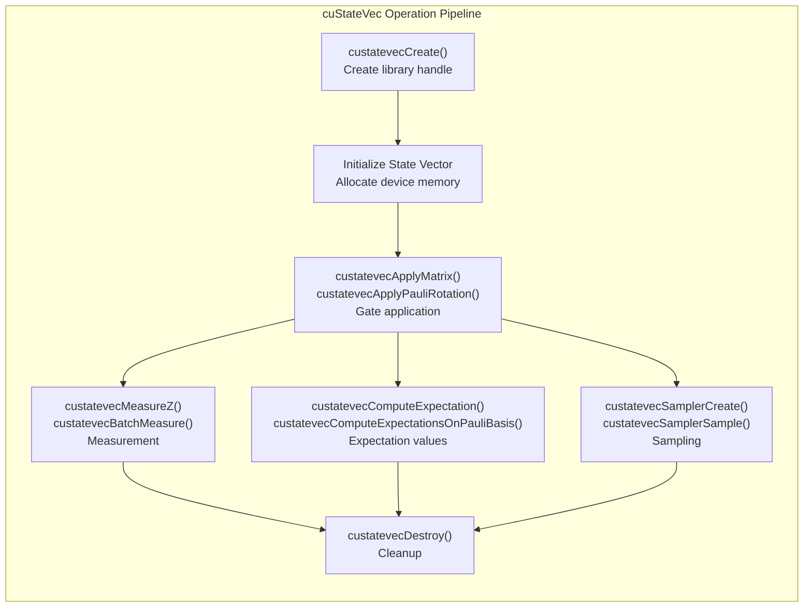
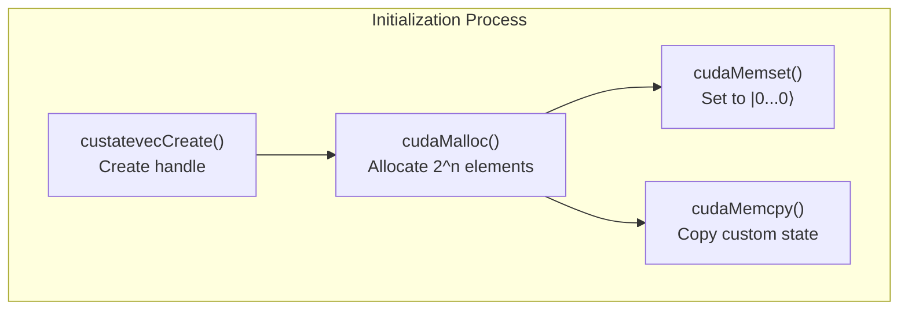
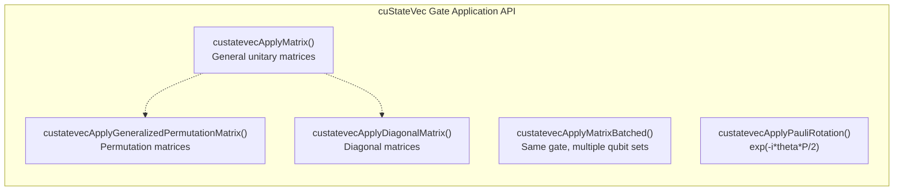
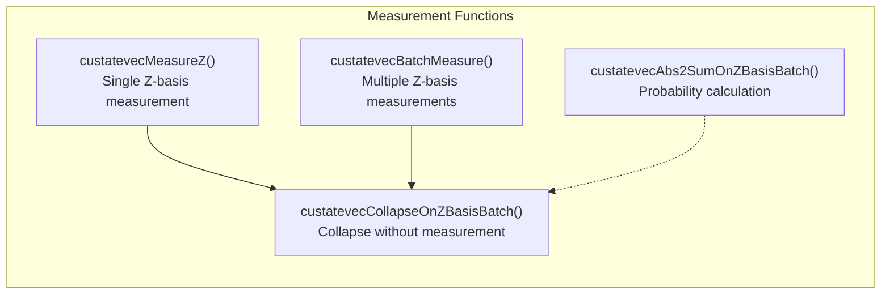
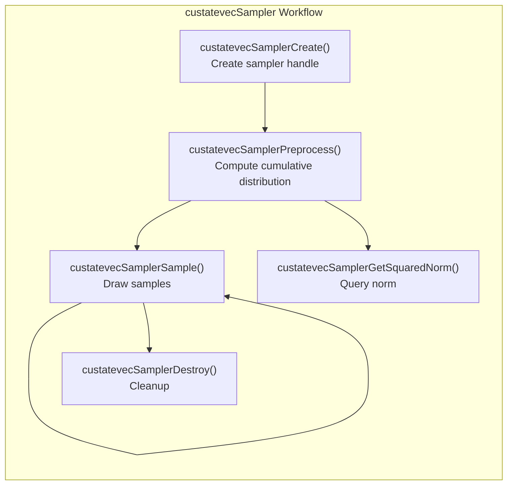
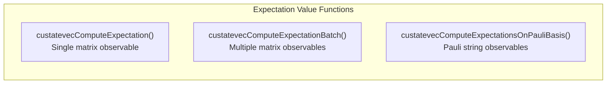
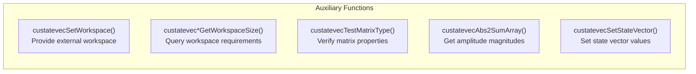
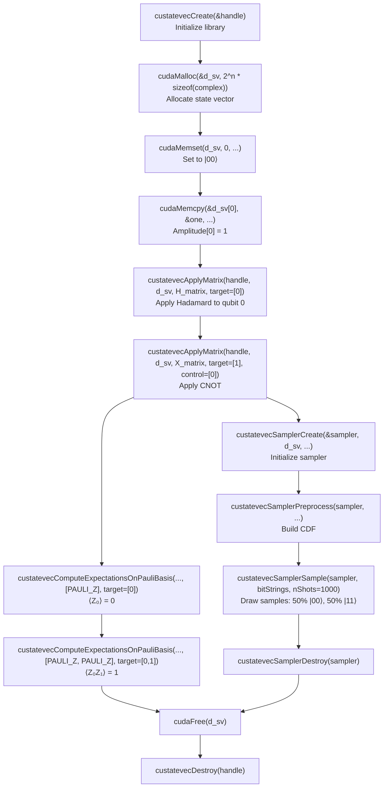

<!-- source: DeepWiki mcp.deepwiki.com · repo NVIDIA/cuQuantum · page 4.1 State Vector Operations · fetched 2026-10-26 -->

# State Vector Operations

<details>
<summary>Relevant source files</summary>

The following files were used as context for generating this wiki page:

- [LICENSE](LICENSE)
- [README.md](README.md)
- [python/LICENSE](python/LICENSE)
- [python/tests/samples_tests/custatevec_tests/test_custatevec_samples.py](python/tests/samples_tests/custatevec_tests/test_custatevec_samples.py)

</details>


This page documents the core state vector operations provided by the cuStateVec library in the cuQuantum SDK. cuStateVec enables GPU-accelerated quantum circuit simulation using the state vector representation |ψ⟩. For multi-GPU functionality, see [Multi-GPU Support](#4.2), and for MPI-based distributed computing, see [MPI Integration](#4.3).

## Overview

The cuStateVec library provides GPU-accelerated implementations of fundamental quantum operations. The library exposes both C and Python APIs through Cython bindings.

### Core Operations Flow



Sources: [samples/custatevec/Makefile:29-46](), [python/tests/samples_tests/custatevec_tests/test_custatevec_samples.py:14-16]()

## State Vector Initialization

State vector initialization prepares the quantum state |ψ⟩ in device memory before circuit execution.

### Initialization Workflow



### Common Initialization Patterns

| State Type | Description | Implementation |
|------------|-------------|----------------|
| Computational basis | \|0...0⟩ state (all qubits in \|0⟩) | `cudaMemset()` to zero, set amplitude[0] = 1 |
| Uniform superposition | Equal amplitude across all basis states | Set all amplitudes to 1/√(2^n) |
| Custom initial state | User-defined amplitudes | `cudaMemcpy()` from host array |

The initialization workflow involves:
1. Creating a `custatevecHandle_t` via `custatevecCreate()`
2. Allocating device memory for 2^n complex amplitudes
3. Initializing amplitudes to the desired quantum state

Sources: [samples/custatevec/Makefile:30]()

## Gate Application

Gate application transforms the state vector |ψ⟩ by applying unitary matrices. cuStateVec provides specialized functions optimized for different matrix types.

### Gate Application Functions



### custatevecApplyMatrix()

The primary gate application function applies a matrix to target qubits with optional control qubits:

```
custatevecApplyMatrix(
    handle,           // custatevecHandle_t
    stateVec,         // void* to state vector on device
    dataType,         // CUDA_C_32F or CUDA_C_64F
    nIndexBits,       // number of qubits
    matrix,           // gate matrix on device
    matrixType,       // CUSTATEVEC_MATRIX_TYPE_GENERAL, _UNITARY, etc.
    adjoint,          // int: 0 for U, 1 for U†
    targetIndices,    // int32_t array of target qubit indices
    nTargets,         // number of target qubits
    controlMask,      // int32_t array of control qubit indices
    controlValues,    // int32_t array of control values (0 or 1)
    nControls         // number of control qubits
)
```

### Specialized Matrix Functions

| Function | Matrix Type | Use Case | Performance Benefit |
|----------|-------------|----------|---------------------|
| `custatevecApplyDiagonalMatrix()` | Diagonal | Phase gates, controlled-Z | O(2^n) vs O(2^(n+k)) for k target qubits |
| `custatevecApplyGeneralizedPermutationMatrix()` | Permutation | SWAP, X gates | Reduced memory bandwidth |
| `custatevecApplyPauliRotation()` | exp(-iθP/2) | Parameterized circuits (VQE, QAOA) | Direct Pauli string evaluation |

### custatevecApplyMatrixBatched()

Applies the same gate matrix to multiple non-overlapping qubit sets in a single call:

```
custatevecApplyMatrixBatched(
    handle, stateVec, dataType, nIndexBits,
    matrix, matrixType, adjoint,
    bitStringArray,   // int32_t array: [nBitStrings][nTargets]
    nBitStrings,      // number of gate applications
    controlMask, controlValues, nControls
)
```

This is more efficient than sequential `custatevecApplyMatrix()` calls when applying identical gates to different qubits.

### custatevecApplyPauliRotation()

Applies exp(-iθP/2) where P is a Pauli string (tensor product of I, X, Y, Z):

```
custatevecApplyPauliRotation(
    handle, stateVec, dataType, nIndexBits,
    pauliOperators,   // custatevecPauli_t array (CUSTATEVEC_PAULI_I/X/Y/Z)
    targetIndices,    // qubit indices
    nTargets,
    theta,            // rotation angle
    controlMask, controlValues, nControls
)
```

This function is optimized for variational quantum algorithms where parameterized rotations are applied repeatedly with different angles.

Sources: [samples/custatevec/Makefile:31-36]()

## Measurement Operations

cuStateVec provides functions for Z-basis measurements, state collapse, and probability calculations.

### Measurement API Functions



### custatevecMeasureZ()

Performs Z-basis measurement on specified qubits and collapses the state:

```
custatevecMeasureZ(
    handle, stateVec, dataType, nIndexBits,
    bitString,        // int32_t* output: measured bit values
    bitOrdering,      // int32_t* array: qubit indices to measure
    bitsToMeasure,    // number of qubits to measure
    randnum,          // double: random number in [0, 1) for sampling
    parity,           // custatevecCollapseOp_t: NONE, NORMALIZE_AND_ZERO
    norm              // double* output: normalization factor
)
```

This function:
1. Samples measurement outcomes based on Born rule probabilities
2. Collapses the state vector to the measured subspace
3. Returns the measurement outcome in `bitString` and norm in `norm`

### custatevecBatchMeasure()

Efficiently measures multiple non-overlapping qubit sets:

```
custatevecBatchMeasure(
    handle, stateVec, dataType, nIndexBits,
    bitStrings,       // int32_t* output: [nBitStrings][bitStringLen]
    bitOrdering,      // int32_t* array of measured qubit indices
    bitStringLen,     // number of qubits per measurement
    randnums,         // double* array: random numbers for each measurement
    collapses,        // custatevecCollapseOp_t* array
    normsArray        // double* output: normalization factors
)
```

### custatevecAbs2SumOnZBasisBatch()

Calculates probabilities for specific measurement outcomes without collapsing the state:

```
custatevecAbs2SumOnZBasisBatch(
    handle, stateVec, dataType, nIndexBits,
    bitStringsArray,  // int32_t* array: [nBitStrings][bitStringLen]
    bitStringLen,     // number of bits in each bitstring
    nBitStrings,      // number of probability queries
    abs2Sums          // double* output: probabilities
)
```

For a bitstring b, `abs2Sums[i]` returns Σ |⟨x|ψ⟩|² where x matches b on the specified qubits.

### custatevecCollapseOnZBasisBatch()

Collapses the state to specific measurement outcomes without computing probabilities:

```
custatevecCollapseOnZBasisBatch(
    handle, stateVec, dataType, nIndexBits,
    bitStrings,       // int32_t* array: desired measurement outcomes
    bitStringLen,     // number of qubits
    nBitStrings       // number of collapse operations
)
```

This is useful when measurement outcomes are predetermined (e.g., mid-circuit measurements with known classical results).

Sources: [samples/custatevec/Makefile:37-44]()

## Quantum Sampling

The cuStateVec sampler enables efficient generation of multiple measurement samples from a quantum state.

### Sampler Workflow



### Sampler API

| Function | Purpose | Performance Note |
|----------|---------|------------------|
| `custatevecSamplerCreate()` | Allocate sampler object | One-time setup |
| `custatevecSamplerPreprocess()` | Build cumulative distribution function (CDF) | O(2^n) preprocessing |
| `custatevecSamplerSample()` | Draw k samples using binary search on CDF | O(k log 2^n) per batch |
| `custatevecSamplerGetSquaredNorm()` | Retrieve ⟨ψ\|ψ⟩ | Computed during preprocessing |
| `custatevecSamplerDestroy()` | Release resources | - |

### Usage Pattern

The sampler is designed for scenarios requiring many samples from the same state:

```
1. custatevecSamplerCreate(handle, stateVec, dataType, nIndexBits, &sampler)
2. custatevecSamplerPreprocess(sampler, workspace, workspaceSize)
3. for each batch:
       custatevecSamplerSample(sampler, bitStrings, bitOrdering, bitStringLen, randnums, nShots, order)
4. custatevecSamplerDestroy(sampler)
```

The preprocessing step computes a cumulative distribution function over all 2^n basis states. Subsequent sampling calls use binary search on this CDF, making repeated sampling significantly faster than repeated measurements.

Sources: [samples/custatevec/Makefile:39]()

## Expectation Value Calculation

cuStateVec provides functions to compute expectation values ⟨ψ|O|ψ⟩ for observables O.

### Expectation Value API



### custatevecComputeExpectation()

Computes ⟨ψ|O|ψ⟩ for a single matrix observable:

```
custatevecComputeExpectation(
    handle, stateVec, dataType, nIndexBits,
    expectationValue, // void* output: complex or real result
    matrix,           // observable matrix on device
    matrixType,       // CUSTATEVEC_MATRIX_TYPE_UNITARY, _HERMITIAN, etc.
    targetIndices,    // int32_t array of target qubits
    nTargets,         // number of target qubits
    computeType       // CUSTATEVEC_COMPUTE_DEFAULT or _32F/_64F
)
```

The function computes ⟨ψ|O⊗I|ψ⟩ where O acts on the target qubits and I is the identity on remaining qubits.

### custatevecComputeExpectationsOnPauliBasis()

Efficiently computes expectations of multiple Pauli string observables:

```
custatevecComputeExpectationsOnPauliBasis(
    handle, stateVec, dataType, nIndexBits,
    expectationValues,      // double* output: array of real expectations
    pauliOperatorsArray,    // custatevecPauli_t* array of Pauli strings
    targetIndicesArray,     // int32_t* array of qubit indices for each Pauli
    nTargetsArray,          // int32_t* array of target counts
    nPauliOperators         // number of Pauli operators
)
```

For Pauli observables (tensor products of I, X, Y, Z), this function is optimized compared to general matrix expectations. Common use cases:
- Computing Hamiltonian energy for VQE: ⟨ψ|H|ψ⟩ where H = Σ c_i P_i
- Measuring qubit magnetization: ⟨Z_i⟩ for each qubit i

### custatevecComputeExpectationBatch()

Computes expectations for multiple matrix observables acting on different qubit sets:

```
custatevecComputeExpectationBatch(
    handle, stateVec, dataType, nIndexBits,
    expectationValues,   // void* output array
    matrices,            // array of observable matrices
    matrixType, layout, adjoint,
    bitStringArray,      // int32_t* array: [nBitStrings][nTargets]
    nBitStrings,         // number of observables
    computeType
)
```

This batched interface amortizes kernel launch overhead when computing multiple expectations.

Sources: [samples/custatevec/Makefile:37-38]()

## Auxiliary Functions

cuStateVec provides utility functions for workspace management, state vector access, and matrix type testing.

### Workspace and Memory Management



### Workspace Functions

| Function | Purpose |
|----------|---------|
| `custatevecSetWorkspace()` | Set external device memory for temporary workspace |
| `custatevecApplyMatrixGetWorkspaceSize()` | Query workspace size for `custatevecApplyMatrix()` |
| `custatevecSamplerGetWorkspaceSize()` | Query workspace size for sampler preprocessing |

Example pattern:
```
size_t workspaceSize;
custatevecApplyMatrixGetWorkspaceSize(..., &workspaceSize);
cudaMalloc(&workspace, workspaceSize);
custatevecSetWorkspace(handle, workspace, workspaceSize);
custatevecApplyMatrix(...);
```

This allows reusing workspace memory across multiple operations, reducing allocation overhead.

### State Vector Accessors

| Function | Purpose |
|----------|---------|
| `custatevecAbs2SumArray()` | Compute \|⟨i\|ψ⟩\|² for specified basis states |
| `custatevecSetStateVector()` | Set state vector amplitudes from host array |

### custatevecTestMatrixType()

Verifies whether a matrix satisfies properties of a specific matrix type:

```
custatevecTestMatrixType(
    matrix,           // matrix to test
    dataType,         // CUDA_C_32F or CUDA_C_64F
    layout,           // row-major or column-major
    nTargets,         // log2(matrix dimension)
    matrixType,       // custatevecMatrixType_t to test against
    tolerance,        // numerical tolerance
    result            // int32_t* output: 1 if matrix matches type, 0 otherwise
)
```

Supported matrix types:
- `CUSTATEVEC_MATRIX_TYPE_UNITARY`: U†U = I
- `CUSTATEVEC_MATRIX_TYPE_HERMITIAN`: O† = O
- `CUSTATEVEC_MATRIX_TYPE_DIAGONAL`: Only diagonal elements non-zero

This function helps select the optimal `custatevecApply*()` function based on matrix structure.

Sources: [samples/custatevec/Makefile:45-47]()

## Example Workflow

A typical cuStateVec workflow for simulating a simple quantum circuit:

### Bell State Preparation and Measurement



This workflow creates the Bell state (|00⟩ + |11⟩)/√2, computes expectation values, and draws measurement samples. The resulting state has ⟨Z₀⟩ = ⟨Z₁⟩ = 0 (each qubit is maximally mixed) and ⟨Z₀Z₁⟩ = 1 (qubits are perfectly correlated).

Sources: [samples/custatevec/Makefile:30-47](), [python/tests/samples_tests/custatevec_tests/test_custatevec_samples.py:1-30]()

## Related Operations

For more advanced operations beyond the basics covered here:

- Multi-GPU operations (see [Multi-GPU Support](#4.2))
- MPI-based distributed computing (see [MPI Integration](#4.3))
- Integration with quantum frameworks (see [Integration with Quantum Frameworks](#2.3))

---

