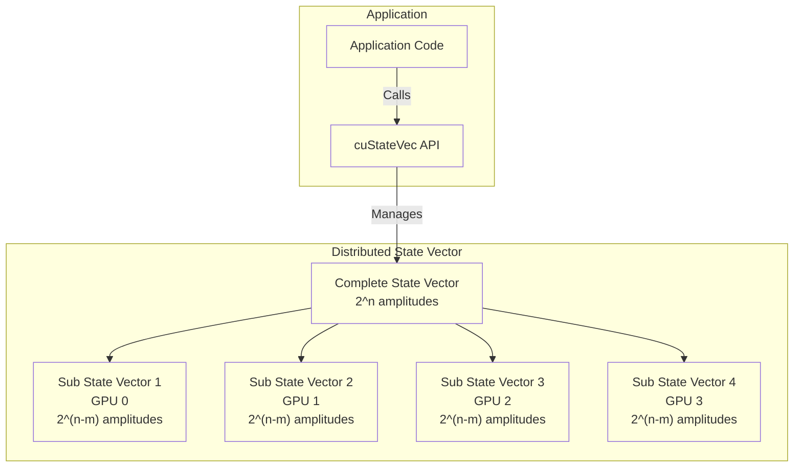
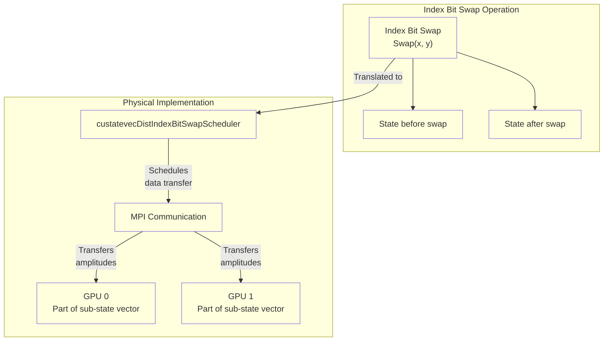
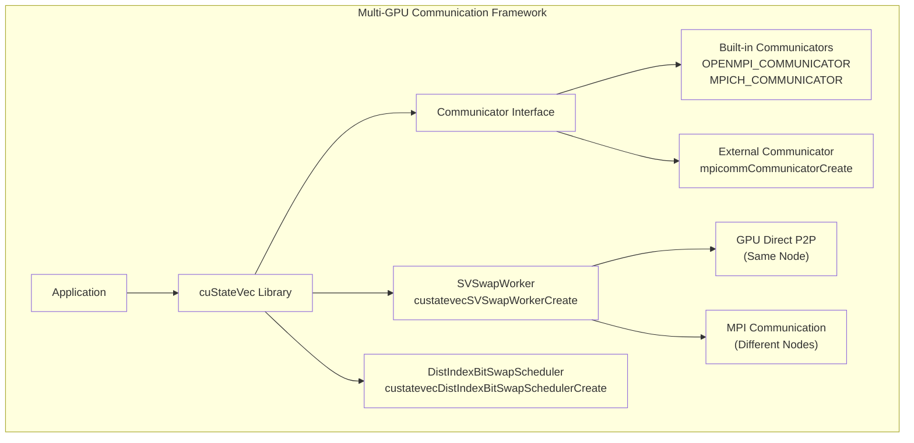
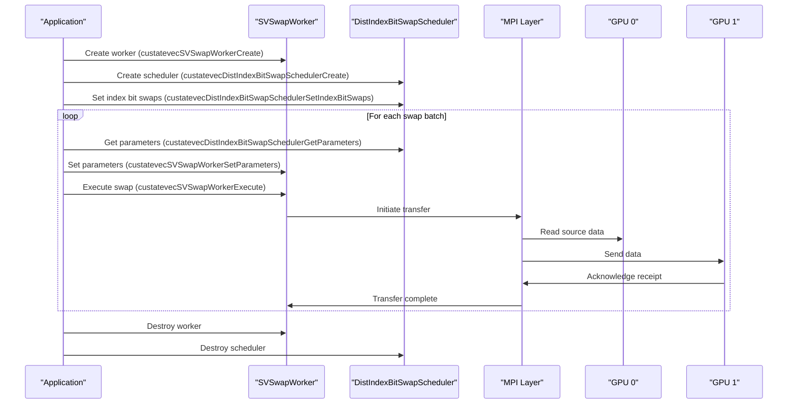
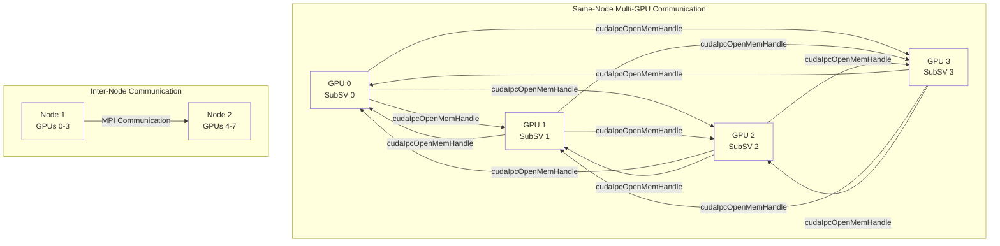
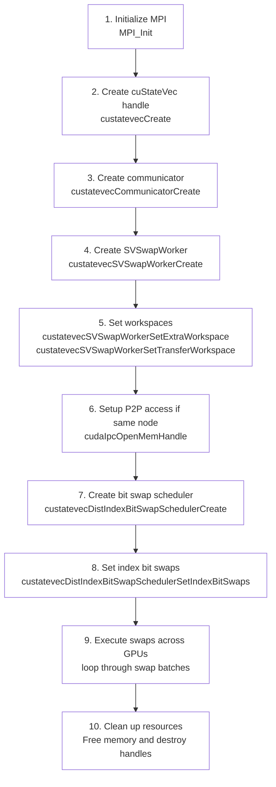

<!-- source: DeepWiki mcp.deepwiki.com · repo NVIDIA/cuQuantum · page 4.2 Multi-GPU Support · fetched 2026-10-26 -->

# Multi-GPU Support

Relevant source files

The following files were used as context for generating this wiki page:

- [LICENSE](LICENSE)
- [README.md](README.md)
- [benchmarks/README.md](benchmarks/README.md)
- [extra/custatevec/README.md](extra/custatevec/README.md)
- [python/LICENSE](python/LICENSE)

## Purpose and Scope

This document describes how to leverage multiple GPUs to perform state vector simulations in cuQuantum's cuStateVec library. As quantum state vectors grow exponentially with qubit count, single GPU memory becomes insufficient for larger simulations. The multi-GPU capabilities in cuStateVec allow distributing computation and memory across multiple GPUs, enabling simulation of larger quantum systems.

For information about MPI integration specifically, see [MPI Integration](#4.3).

Sources: [samples/custatevec/samples_mpi/README.md:1-31](), [samples/custatevec/samples_mpi/distributedIndexBitSwap.cpp:31-98]()

## Key Concepts

### Distributed State Vector Representation

The exponential growth of quantum state vectors makes multi-GPU distribution essential for large-scale simulations. In cuStateVec, a full state vector is divided into multiple sub-state vectors distributed across different GPUs. Each GPU holds a portion of the complete state vector, with operations coordinated across all participating devices.

Sources: [samples/custatevec/samples_mpi/distributedIndexBitSwap.cpp:99-171]()

### Index Bit Swaps

A fundamental operation in distributed state vector manipulation is the index bit swap. This operation swaps bits between different positions in the quantum state indices, which may require data transfer between sub-state vectors residing on different GPUs. The API provides efficient methods to perform these swaps across distributed memory.

Sources: [samples/custatevec/samples_mpi/distributedIndexBitSwap.cpp:370-405]()

## Architecture

### Multi-GPU Communication Framework

The cuStateVec library utilizes MPI (Message Passing Interface) for communication between multiple GPUs that may reside on different compute nodes. For GPUs within the same node, CUDA IPC (Inter-Process Communication) and GPUDirect P2P (Peer-to-Peer) can be used for more efficient data transfer.

Sources: [samples/custatevec/samples_mpi/distributedIndexBitSwap.cpp:186-233](), [samples/custatevec/samples_mpi/mpicomm.c:43-229]()

### SVSwapWorker and Communication Methods

The `SVSwapWorker` is the core component that handles data transfers between sub-state vectors. It supports two synchronization methods:

1. CUDA IPC Events: Uses CUDA events for synchronization between processes
2. Semaphores: Uses memory-based semaphores for synchronization

Sources: [samples/custatevec/samples_mpi/distributedIndexBitSwap.cpp:234-269](), [samples/custatevec/samples_mpi/distributedIndexBitSwap.cpp:367-421]()

## Implementation Details

### GPU Memory and Workspace Management

Efficient multi-GPU simulations require careful memory management, including:

1. **Sub-state vector allocation**: Each GPU allocates memory for its portion of the state vector
2. **Extra workspace**: Additional memory for algorithms and temporary data
3. **Transfer workspace**: Buffer space for data transfers between GPUs
4. **P2P memory handling**: For GPUs that can directly access each other's memory

The following table outlines the key memory components and their purposes:

| Memory Component | Purpose | API Function |
|------------------|---------|--------------|
| Sub-state vector | Stores part of the quantum state | `cudaMalloc` |
| Extra workspace | Algorithm-specific temporary storage | `custatevecSVSwapWorkerSetExtraWorkspace` |
| Transfer workspace | Buffer for data transfers between GPUs | `custatevecSVSwapWorkerSetTransferWorkspace` |
| P2P memory | Direct access to other GPU's memory (same node) | `cudaIpcOpenMemHandle` |
| Synchronization | Events or semaphores for GPU coordination | `cudaEventCreateWithFlags` / `cudaMalloc` |

Sources: [samples/custatevec/samples_mpi/distributedIndexBitSwap.cpp:142-173](), [samples/custatevec/samples_mpi/distributedIndexBitSwap.cpp:262-274]()

### P2P Communication for Same-Node GPUs

When multiple GPUs reside on the same physical node, CUDA IPC and GPUDirect P2P can be used for efficient data transfer:

Sources: [samples/custatevec/samples_mpi/distributedIndexBitSwap.cpp:280-365]()

### Distributed Index Bit Swap

The distributed index bit swap operation is crucial for many quantum algorithms. The implementation involves:

1. Creating a scheduler (`custatevecDistIndexBitSwapSchedulerCreate`)
2. Setting up the bit swaps to be performed (`custatevecDistIndexBitSwapSchedulerSetIndexBitSwaps`)
3. Getting the parameters for each batch of swaps (`custatevecDistIndexBitSwapSchedulerGetParameters`)
4. Executing the swaps using the SVSwapWorker (`custatevecSVSwapWorkerExecute`)

This process optimizes communication between GPUs by batching related swap operations together.

Sources: [samples/custatevec/samples_mpi/distributedIndexBitSwap.cpp:370-405]()

## Usage Example

Below is a simplified flow for implementing multi-GPU state vector operations:

Sources: [samples/custatevec/samples_mpi/distributedIndexBitSwap.cpp:451-486]()

### Performance Considerations

When using multiple GPUs for state vector simulations, consider the following performance factors:

1. **Communication overhead**: Data transfers between GPUs can be a bottleneck
2. **P2P vs. MPI**: Use P2P for GPUs on the same node when possible
3. **Transfer workspace size**: Larger transfer workspaces can improve performance
4. **Bit swap scheduling**: Optimize the order of bit swaps to minimize data movement
5. **GPU topology**: Consider the physical arrangement of GPUs when planning distribution

Sources: [samples/custatevec/samples_mpi/distributedIndexBitSwap.cpp:268-271](), [samples/custatevec/samples_mpi/distributedIndexBitSwap.cpp:385-421]()

## Summary

Multi-GPU support in cuStateVec enables simulation of larger quantum systems by distributing state vectors across multiple GPUs. The library provides mechanisms for efficient communication between GPUs, including specialized operations like distributed index bit swaps. By leveraging MPI for inter-node communication and CUDA IPC/P2P for intra-node communication, cuStateVec can scale to utilize many GPUs while maintaining high performance.

Sources: [samples/custatevec/samples_mpi/README.md:1-31](), [samples/custatevec/samples_mpi/distributedIndexBitSwap.cpp:31-486]()

---

