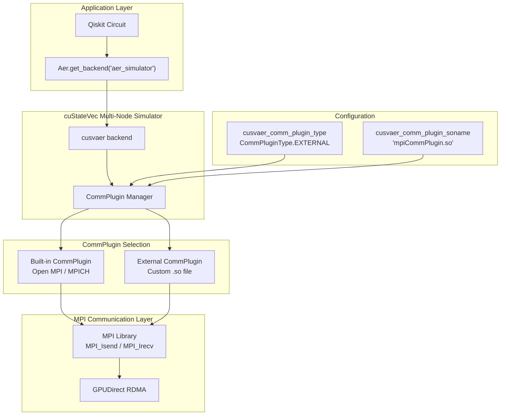
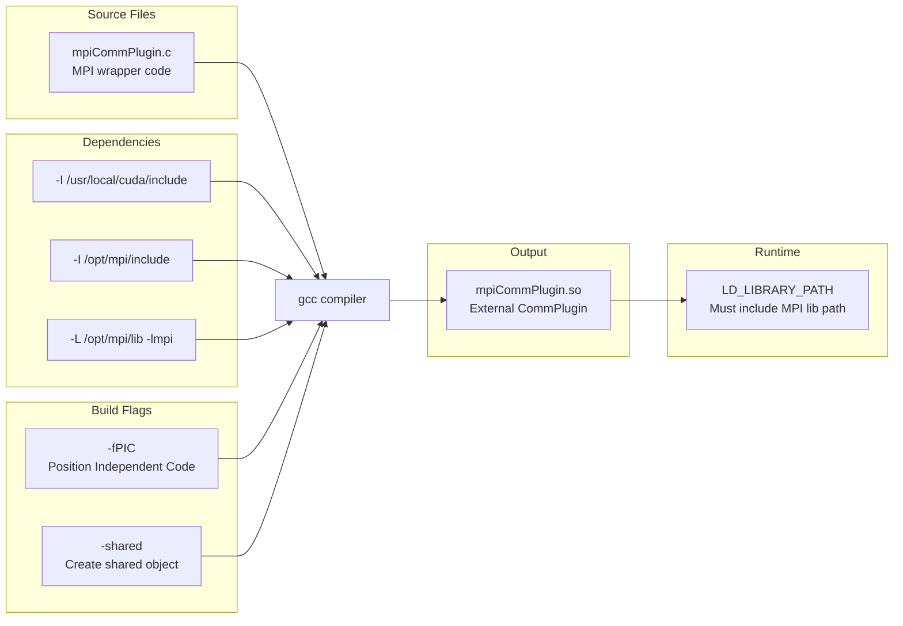
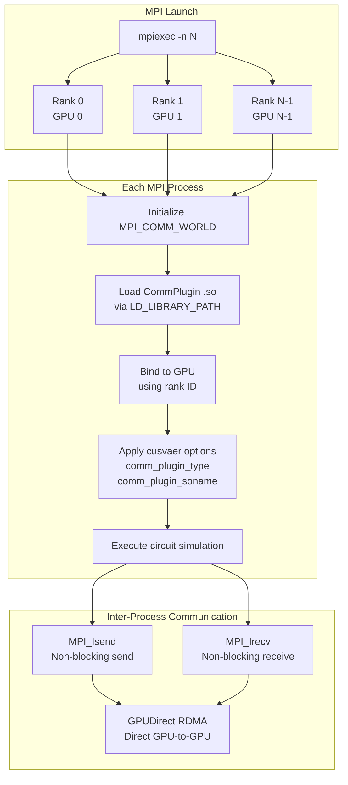

<!-- source: DeepWiki mcp.deepwiki.com · repo NVIDIA/cuQuantum · page 4.3 MPI Integration · fetched 2026-10-26 -->

# MPI Integration

<details>
<summary>Relevant source files</summary>

The following files were used as context for generating this wiki page:

- [benchmarks/README.md](benchmarks/README.md)
- [extra/custatevec/README.md](extra/custatevec/README.md)
- [samples/cutensornet/Makefile](samples/cutensornet/Makefile)

</details>


## Purpose and Scope

This document describes multi-node state vector simulation using MPI (Message Passing Interface) in cuStateVec. The MPI integration enables distributed quantum circuit simulation across multiple nodes, each potentially containing multiple GPUs, allowing for larger quantum systems than can fit on a single node.

For single-node multi-GPU configuration, see [Multi-GPU Support](#4.2). For MPI integration in cuTensorNet, see [Distributed Computing with MPI](#3.5).

**Sources:** [extra/custatevec/README.md:1-48]()

---

## Overview

The cuStateVec multi-node state vector simulator was first released in cuQuantum Appliance 22.11. It provides MPI-based distributed simulation capabilities through a plugin architecture called **MPI Comm Plugin**, which abstracts MPI communication operations to support different MPI implementations.

The system supports two modes:
1. **Built-in Support**: Pre-integrated support for specific versions of Open MPI and MPICH
2. **External CommPlugin**: User-provided shared object for custom MPI libraries

**Sources:** [extra/custatevec/README.md:3-4]()

---

## MPI Comm Plugin Architecture



**MPI Comm Plugin Architecture**

The plugin architecture separates the MPI communication interface from the specific MPI implementation. The simulator uses the plugin to perform inter-process communication, while the plugin wraps MPI function calls to the underlying MPI library.

**Sources:** [extra/custatevec/README.md:1-4](), [extra/custatevec/README.md:26-31]()

---

## Built-in MPI Support

The cuStateVec multi-node simulator includes built-in support for specific versions of:
- **Open MPI**: Limited set of versions
- **MPICH**: Limited set of versions

When using these supported MPI implementations, no additional configuration is required beyond standard MPI environment setup.

**Sources:** [extra/custatevec/README.md:3]()

---

## External CommPlugin for Custom MPI Libraries

For MPI libraries not included in the built-in support, users must create an External CommPlugin—a shared object that wraps MPI function calls.

### Purpose

The External CommPlugin is a small shared object that:
1. Wraps MPI communication functions (`MPI_Isend`, `MPI_Irecv`, etc.)
2. Links to a custom MPI library
3. Provides a standardized interface for the simulator

**Sources:** [extra/custatevec/README.md:3-4]()

---

## Building External CommPlugin

### Prerequisites

The target MPI library must support **GPUDirect RDMA** for `MPI_Isend()` and `MPI_Irecv()` operations. This enables direct GPU-to-GPU communication across nodes without CPU involvement.

**Sources:** [extra/custatevec/README.md:6-8]()

### Build Command

```bash
gcc -I <path to CUDA include> \
    -I <path to MPI include> \
    -L <path to MPI library> \
    -fPIC -shared \
    mpiCommPlugin.c \
    -lmpi \
    -o <custom plugin name>.so
```

### Build Example

Assuming an MPI library is installed at `/opt/mpi`:

```bash
gcc -I /usr/local/cuda/include \
    -I /opt/mpi/include \
    -L /opt/mpi/lib \
    -fPIC -shared \
    mpiCommPlugin.c \
    -lmpi \
    -o mpiCommPlugin.so
```

This produces a shared object `mpiCommPlugin.so` that can be dynamically loaded by the simulator.

**Sources:** [extra/custatevec/README.md:10-24]()

---

## Build Process Diagram



**External CommPlugin Build Process**

**Sources:** [extra/custatevec/README.md:10-24]()

---

## Configuration and Usage

### Simulator Options

The External CommPlugin is configured using two simulator options that must be set via the `set_options()` method before executing simulation:

| Option | Type | Description |
|--------|------|-------------|
| `cusvaer_comm_plugin_type` | `cusvaer.CommPluginType` | Set to `cusvaer.CommPluginType.EXTERNAL` |
| `cusvaer_comm_plugin_soname` | `str` | Filename of the external CommPlugin shared object |

**Sources:** [extra/custatevec/README.md:26-31]()

### Environment Setup

The `LD_LIBRARY_PATH` environment variable must include:
1. Path to the custom MPI library
2. Path to the External CommPlugin shared object (if not in standard locations)

**Sources:** [extra/custatevec/README.md:35]()

### Usage Example

```python
from qiskit import Aer
from cusvaer import CommPluginType

# Get the cuStateVec Aer backend
sim = Aer.get_backend('aer_simulator')

# Configure External CommPlugin
sim.set_options(
    cusvaer_comm_plugin_type=CommPluginType.EXTERNAL,
    cusvaer_comm_plugin_soname='mpiCommPlugin.so'
)

# Run simulation
job = sim.run(circuit)
```

**Sources:** [extra/custatevec/README.md:37-48]()

---

## MPI Execution Flow



**MPI Execution Flow with External CommPlugin**

**Sources:** [extra/custatevec/README.md:35-48](), [benchmarks/README.md:49]()

---

## GPUDirect RDMA Requirements

GPUDirect RDMA (Remote Direct Memory Access) is a critical requirement for efficient multi-node state vector simulation. It enables:

1. **Direct GPU-to-GPU Communication**: Data transfer between GPUs on different nodes without CPU involvement
2. **Non-blocking Operations**: `MPI_Isend()` and `MPI_Irecv()` can access GPU memory directly
3. **Reduced Latency**: Eliminates CPU-GPU-CPU copy overhead in inter-node communication

### Technical Requirements

- MPI library must be compiled with CUDA-aware MPI support
- Network hardware must support RDMA (e.g., InfiniBand, RoCE)
- CUDA driver must support GPUDirect RDMA
- Proper kernel modules and drivers installed (e.g., `nv_peer_mem` for InfiniBand)

**Sources:** [extra/custatevec/README.md:6-8]()

---

## Integration with Benchmark Suite

The cuStateVec MPI integration is used in the benchmark suite through the `cusvaer` backend.

### MPI Benchmark Execution

MPI benchmarks assume:
- `MPI_COMM_WORLD` as the communicator
- `mpi4py` is installed
- Launch via standard MPI tools: `mpiexec`, `mpirun`, or vendor-specific launchers

**Sources:** [benchmarks/README.md:49]()

### Example Benchmark Command

```bash
mpiexec -n 4 nv-quantum-benchmarks circuit \
    --frontend qiskit \
    --backend cusvaer \
    --benchmark quantum_volume \
    --nqubits 32 \
    --ngpus 1 \
    --cusvaer-global-index-bits 1,1 \
    --cusvaer-p2p-device-bits 1
```

This command:
- Launches 4 MPI processes (2 nodes × 2 processes per node)
- Each process controls 1 GPU
- Simulates a 32-qubit Quantum Volume circuit
- Uses cuStateVec Aer (cusvaer) backend with MPI

**Sources:** [benchmarks/README.md:55]()

---

## Configuration Parameters

The benchmark suite exposes additional cusvaer-specific configuration parameters for multi-GPU and multi-node execution:

| Parameter | Description |
|-----------|-------------|
| `--cusvaer-global-index-bits` | Distribution of state vector across processes (e.g., `1,1` for 2×2 grid) |
| `--cusvaer-p2p-device-bits` | P2P communication configuration between GPUs |
| `--ngpus` | Number of GPUs per MPI process |

**Sources:** [benchmarks/README.md:55]()

---

## MPI Build Configuration

While cuStateVec samples do not include MPI examples (unlike cuTensorNet), the build pattern for MPI-enabled executables follows standard practices:

```makefile
# MPI compilation flags (from cuTensorNet Makefile for reference)
MPI_ROOT := ${MPI_ROOT}
INCLUDE_DIRS := -I${MPI_ROOT}/include
LIBRARY_DIRS := -L${MPI_ROOT}/lib

# Compilation with MPI
${CUDA_PATH}/bin/nvcc example_mpi.cu \
    -Xlinker -rpath,${MPI_ROOT}/lib \
    -L${MPI_ROOT}/lib \
    -o example_mpi \
    ${CXX_FLAGS} \
    -lmpi
```

**Sources:** [samples/cutensornet/Makefile:8-11](), [samples/cutensornet/Makefile:53-59]()

---

## Summary

The MPI integration in cuStateVec provides:

1. **Plugin Architecture**: Flexible CommPlugin system supporting multiple MPI implementations
2. **Built-in Support**: Pre-integrated Open MPI and MPICH
3. **Extensibility**: External CommPlugin for custom MPI libraries
4. **Performance**: GPUDirect RDMA for efficient inter-node GPU communication
5. **Integration**: Seamless integration with Qiskit Aer and benchmark suite

The system is designed for large-scale quantum circuit simulation across clusters, with emphasis on performance and flexibility in MPI library selection.

**Sources:** [extra/custatevec/README.md:1-48](), [benchmarks/README.md:49-55]()

---

