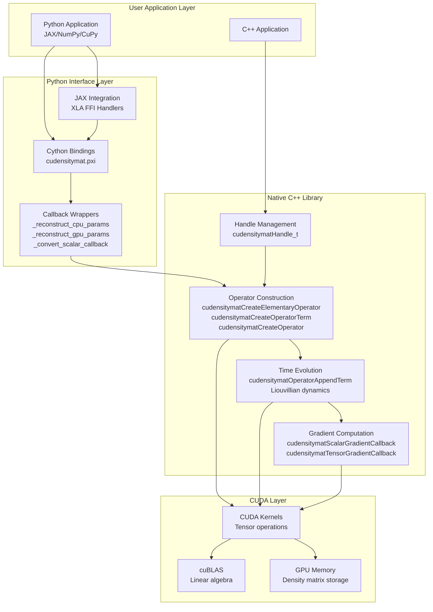
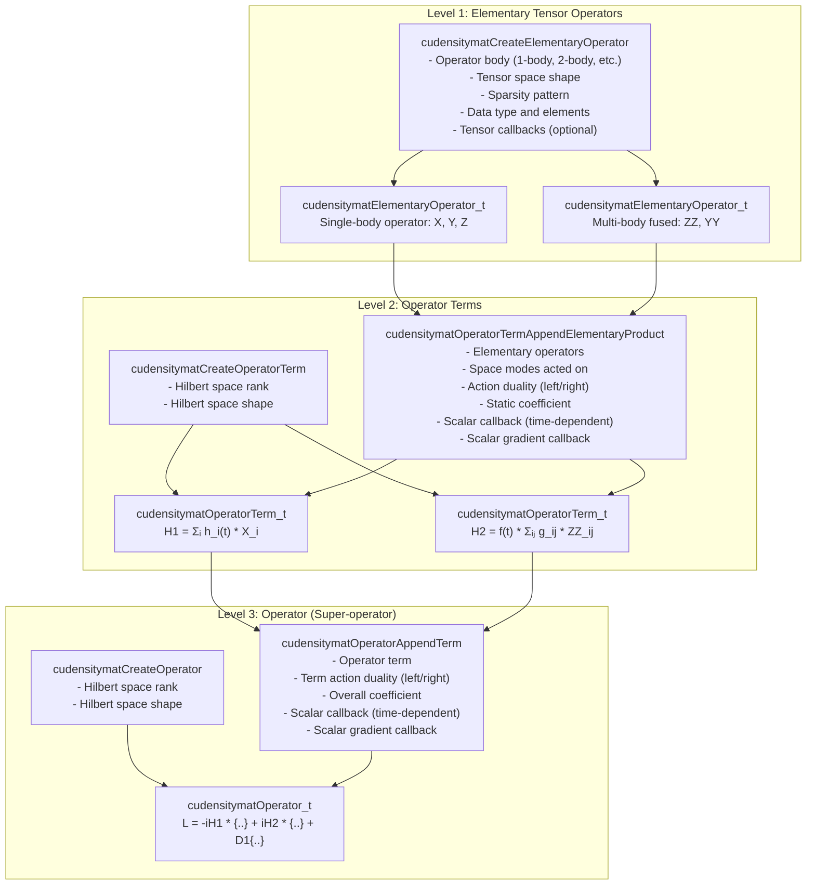
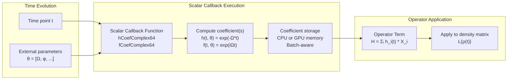
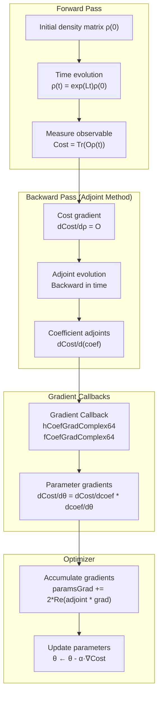
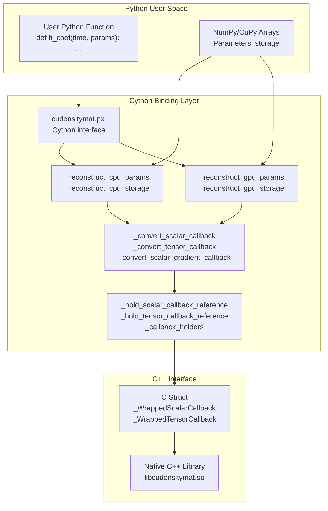
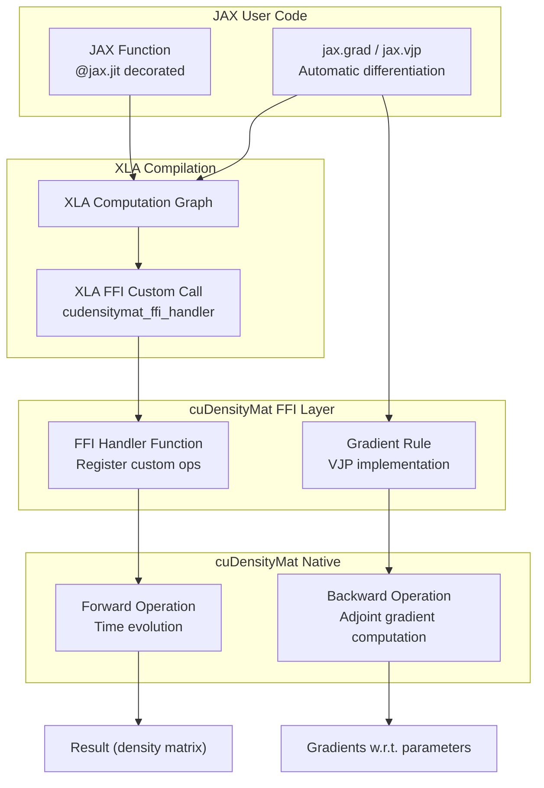
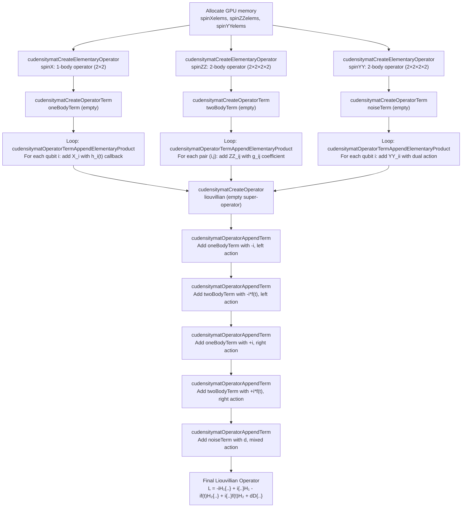

<!-- source: DeepWiki mcp.deepwiki.com · repo NVIDIA/cuQuantum · page 5 cuDensityMat Library · fetched 2026-10-26 -->

# cuDensityMat Library

<details>
<summary>Relevant source files</summary>

The following files were used as context for generating this wiki page:

- [python/cuquantum/bindings/cudensitymat.pxi](python/cuquantum/bindings/cudensitymat.pxi)
- [python/samples/bindings/cutensornet/state/proj_mps_circuit_dmrg_example.py](python/samples/bindings/cutensornet/state/proj_mps_circuit_dmrg_example.py)
- [samples/cudensitymat/transverse_ising_full_fused_noisy_grad.h](samples/cudensitymat/transverse_ising_full_fused_noisy_grad.h)
- [samples/cutensornet/high_level/proj_mps_circuit_dmrg_example.cu](samples/cutensornet/high_level/proj_mps_circuit_dmrg_example.cu)

</details>


## Purpose and Scope

This page documents the **cuDensityMat** library, one of the three core simulation libraries in the cuQuantum SDK. cuDensityMat specializes in **density matrix-based simulation of open quantum systems**, where decoherence, dissipation, and environmental interactions are essential. Unlike state vector simulation (see page [4](#4)) which represents pure quantum states as |ψ⟩, cuDensityMat uses the density matrix formalism (ρ representation) to handle mixed states and non-unitary evolution.

**Key capabilities:**
- Simulation of open quantum systems with Lindblad master equations
- Time-dependent Hamiltonians with user-defined callback functions
- Automatic differentiation support via JAX/XLA FFI integration
- Gradient-based optimization for variational quantum algorithms
- Batch processing for multiple parameter configurations

For tensor network-based circuit simulation, see page [3](#3). For pure state vector simulation, see page [4](#4). For Python interface details, see sections [5.1](#5.1) through [5.3](#5.3).

---

## Density Matrix Formalism

cuDensityMat operates on **density matrices** ρ, which are positive semi-definite Hermitian operators that describe the statistical state of a quantum system. The density matrix formalism is essential for:

- **Mixed states**: Statistical ensembles of pure states
- **Open systems**: Systems coupled to an environment
- **Partial trace operations**: Reduced density matrices of subsystems
- **Decoherence and dissipation**: Non-unitary evolution

The time evolution of a density matrix under a Hamiltonian H and dissipation terms is governed by the **Lindblad master equation**:

```
dρ/dt = -i[H, ρ] + Σₖ (LₖρLₖ† - ½{Lₖ†Lₖ, ρ})
```

where Lₖ are Lindblad operators describing dissipation channels.

**Sources:** [samples/cudensitymat/transverse_ising_full_fused_noisy_grad.h:18-25]()

---

## Liouvillian Operators

In cuDensityMat, the master equation is expressed in terms of a **Liouvillian super-operator** L acting on the density matrix:

```
dρ/dt = L{ρ}
```

The Liouvillian is decomposed as:

```
L{ρ} = -i H ρ + i ρ H + Σₖ (LₖρLₖ† - ½Lₖ†Lₖρ - ½ρLₖ†Lₖ)
```

This representation explicitly captures the **action duality**: operators can act from the left or right on the density matrix, which is crucial for modeling dissipation and non-unitary processes.

**Sources:** [samples/cudensitymat/transverse_ising_full_fused_noisy_grad.h:156-177]()

---

## Architecture and Components

The cuDensityMat library follows a three-layer architecture that enables both high-performance C++ usage and convenient Python integration with automatic differentiation support.

### Architecture Diagram: cuDensityMat Library Layers



**Sources:** [python/cuquantum/bindings/cudensitymat.pxi:1-160](), [samples/cudensitymat/transverse_ising_full_fused_noisy_grad.h:156-390]()

---

## Operator Construction Hierarchy

cuDensityMat uses a hierarchical operator construction model with three levels: **Elementary Operators** → **Operator Terms** → **Operators (Super-operators)**. This design enables flexible composition of complex Hamiltonians and dissipation terms.

### Operator Hierarchy Diagram



**Sources:** [samples/cudensitymat/transverse_ising_full_fused_noisy_grad.h:204-347]()

### Construction Steps

| Level | API Function | Purpose | Key Parameters |
|-------|--------------|---------|----------------|
| **Elementary Operator** | `cudensitymatCreateElementaryOperator` | Define base tensor operators (X, Y, Z, ZZ, etc.) | Operator body, tensor shape, data type, elements, callbacks |
| **Operator Term** | `cudensitymatCreateOperatorTerm` | Create empty operator term container | Hilbert space rank and shape |
| | `cudensitymatOperatorTermAppendElementaryProduct` | Add products of elementary operators | Elementary ops, space modes, action duality, coefficients, callbacks |
| **Super-operator** | `cudensitymatCreateOperator` | Create empty Liouvillian operator | Hilbert space rank and shape |
| | `cudensitymatOperatorAppendTerm` | Add operator terms with action duality | Operator term, left/right action, coefficients, callbacks |

**Sources:** [samples/cudensitymat/transverse_ising_full_fused_noisy_grad.h:204-347]()

---

## Time-Dependent Hamiltonians

cuDensityMat supports **time-dependent Hamiltonians** through user-defined callback functions. These callbacks compute coefficient values at each time step, enabling simulation of driven quantum systems, adiabatic evolution, and time-varying control fields.

### Callback Mechanism Flow



**Sources:** [samples/cudensitymat/transverse_ising_full_fused_noisy_grad.h:32-56](), [samples/cudensitymat/transverse_ising_full_fused_noisy_grad.h:97-117]()

### Scalar Callback Function Signature

User-defined scalar callback functions must conform to the following C function signature:

```c
extern "C"
int32_t callbackName(
    double time,             // Current time point
    int64_t batchSize,       // Number of instances in batch
    int32_t numParams,       // Number of external parameters
    const double * params,   // Parameters array [numParams][batchSize] (F-order)
    cudaDataType_t dataType, // Data type (e.g., CUDA_C_64F)
    void * scalarStorage,    // Output: coefficient value(s)
    cudaStream_t stream      // CUDA stream (0x0 for CPU callbacks)
)
```

**Example:** Time-dependent coefficient h(t) = exp(-Ω·t)

```c
extern "C"
int32_t hCoefComplex64(double time, int64_t batchSize, int32_t numParams,
                       const double * params, cudaDataType_t dataType,
                       void * scalarStorage, cudaStream_t stream)
{
    auto * tdCoef = static_cast<cuDoubleComplex *>(scalarStorage);
    for (int64_t i = 0; i < batchSize; ++i) {
        const auto omega = params[i * numParams + 0];
        tdCoef[i] = make_cuDoubleComplex(std::exp(-omega * time), 0.0);
    }
    return 0; // Success
}
```

**Sources:** [samples/cudensitymat/transverse_ising_full_fused_noisy_grad.h:36-56]()

### Callback Wrapper Types

| Callback Type | C Struct | Python Wrapper | Purpose |
|---------------|----------|----------------|---------|
| Scalar Callback | `cudensitymatScalarCallback_t` | `WrappedScalarCallback` | Time-dependent scalar coefficients |
| Tensor Callback | `cudensitymatTensorCallback_t` | `WrappedTensorCallback` | Time-dependent tensor operators |
| Scalar Gradient | `cudensitymatScalarGradientCallback_t` | `WrappedScalarGradientCallback` | Gradient of scalar w.r.t. parameters |
| Tensor Gradient | `cudensitymatTensorGradientCallback_t` | `WrappedTensorGradientCallback` | Gradient of tensor w.r.t. parameters |

**Sources:** [python/cuquantum/bindings/cudensitymat.pxi:104-159]()

---

## Gradient Computation for Optimization

A unique feature of cuDensityMat is its support for **automatic gradient computation** with respect to external Hamiltonian parameters. This enables gradient-based optimization algorithms like Adam, L-BFGS, or gradient descent for variational quantum algorithms.

### Gradient Computation Flow



**Sources:** [samples/cudensitymat/transverse_ising_full_fused_noisy_grad.h:59-90](), [samples/cudensitymat/transverse_ising_full_fused_noisy_grad.h:119-153]()

### Gradient Callback Function Signature

Gradient callbacks compute partial derivatives of the cost function with respect to external parameters:

```c
extern "C"
int32_t gradientCallbackName(
    double time,             // Current time point
    int64_t batchSize,       // Number of instances in batch
    int32_t numParams,       // Number of external parameters
    const double * params,   // Parameters array [numParams][batchSize] (F-order)
    cudaDataType_t dataType, // Data type
    void * scalarGrad,       // Input: adjoint of coefficient (dCost/dcoef)
    double * paramsGrad,     // Output: accumulated gradient (dCost/dθ)
    cudaStream_t stream      // CUDA stream
)
```

**Example:** Gradient of h(t) = exp(-Ω·t) with respect to Ω

```c
extern "C"
int32_t hCoefGradComplex64(double time, int64_t batchSize, int32_t numParams,
                           const double * params, cudaDataType_t dataType,
                           void * scalarGrad, double * paramsGrad,
                           cudaStream_t stream)
{
    const auto * tdCoefAdjoint = static_cast<const cuDoubleComplex *>(scalarGrad);
    for (int64_t i = 0; i < batchSize; ++i) {
        const auto omega = params[i * numParams + 0];
        // Accumulate: dCost/dΩ += 2*Re(adjoint * dh/dΩ)
        // where dh/dΩ = -t * exp(-Ω*t)
        paramsGrad[i * numParams + 0] += 
            2.0 * cuCreal(cuCmul(tdCoefAdjoint[i], 
                  make_cuDoubleComplex(std::exp(-omega * time) * (-time), 0.0)));
    }
    return 0;
}
```

**Important:** Gradient callbacks must **accumulate** (+=) partial derivatives, not overwrite them, as multiple operator terms may depend on the same parameter.

**Sources:** [samples/cudensitymat/transverse_ising_full_fused_noisy_grad.h:68-90]()

---

## Python Bindings Architecture

The Python interface to cuDensityMat is implemented through **Cython bindings** that wrap the C++ native library. This layer handles memory management, type conversions, and callback bridging between Python and C++.

### Python Binding Components



**Sources:** [python/cuquantum/bindings/cudensitymat.pxi:18-159]()

### Memory Reconstruction Functions

The Cython bindings provide helper functions to reconstruct NumPy/CuPy arrays from raw pointers passed by the C++ library:

| Function | Purpose | Output Type |
|----------|---------|-------------|
| `_reconstruct_cpu_params` | Reconstruct parameter array on CPU | NumPy array, shape `(numParams, batchSize)`, F-order |
| `_reconstruct_cpu_storage` | Reconstruct storage tensor on CPU | NumPy array, shape `(*modeExtents, batchSize)`, F-order |
| `_reconstruct_gpu_params` | Reconstruct parameter array on GPU | CuPy array, shape `(numParams, batchSize)`, F-order |
| `_reconstruct_gpu_storage` | Reconstruct storage tensor on GPU | CuPy array, shape `(*modeExtents, batchSize)`, F-order |

**Example usage in callback context:**

```python
# Inside a Python callback wrapper
params = _reconstruct_cpu_params(batch_size, num_params, params_ptr, PyBUF_READ)
storage = _reconstruct_cpu_storage(mode_extents, batch_size, data_type, storage_ptr)
# Now params and storage are NumPy arrays that can be manipulated
```

**Sources:** [python/cuquantum/bindings/cudensitymat.pxi:18-61]()

### Callback Reference Management

To prevent premature garbage collection of Python callback functions, the bindings maintain strong references using a `_callback_holders` dictionary:

```python
_callback_holders[obj].add(callback_function)
```

Functions that manage callback references:
- `_hold_scalar_callback_reference`
- `_hold_tensor_callback_reference`
- `_hold_scalar_gradient_callback_reference`
- `_hold_tensor_gradient_callback_reference`

**Sources:** [python/cuquantum/bindings/cudensitymat.pxi:64-102]()

---

## JAX Integration and Automatic Differentiation

cuDensityMat integrates with **JAX** via the **XLA FFI (Foreign Function Interface)**, enabling seamless interoperability with JAX's automatic differentiation system. This allows users to incorporate cuDensityMat operators into JAX-based variational quantum algorithms and leverage JAX's powerful `jax.grad` and `jax.vjp` transformations.

### JAX Integration Architecture



### JAX Usage Pattern

When using cuDensityMat through JAX, users can write code like:

```python
import jax
import jax.numpy as jnp
from cuquantum import cudensitymat

@jax.jit
def time_evolution_cost(params):
    # params: JAX array of Hamiltonian parameters
    # cuDensityMat performs time evolution with these parameters
    final_state = cudensitymat.evolve(initial_state, hamiltonian, params, time)
    # Compute cost as expectation value
    cost = jnp.real(jnp.trace(observable @ final_state))
    return cost

# Automatic differentiation works seamlessly
grad_fn = jax.grad(time_evolution_cost)
gradients = grad_fn(params)  # Gradients computed via adjoint method
```

The FFI layer handles the conversion between JAX arrays and cuDensityMat's internal representation, and the gradient callbacks automatically integrate with JAX's autodiff system.

**Sources:** Referenced in high-level architecture diagrams

---

## Batch Processing

cuDensityMat supports **batch processing** for efficiently simulating multiple parameter configurations in parallel. This is crucial for:

- Parameter sweeps (scanning over different Hamiltonian parameters)
- Ensemble averaging (statistical sampling)
- Parallel optimization trials
- Noisy quantum system simulation with random noise realizations

### Batch Parameter Layout

Parameters are stored in **Fortran-order (column-major)** arrays with shape `(numParams, batchSize)`:

```
params[param_idx, batch_idx] = value
```

This layout enables efficient vectorized operations and GPU memory coalescing.

**Example:** For 3 parameters and batch size of 100:

| Dimension | Size | Interpretation |
|-----------|------|----------------|
| `numParams` | 3 | Number of external parameters (e.g., Ω, φ, δ) |
| `batchSize` | 100 | Number of independent simulation instances |
| Total elements | 300 | Memory: 300 × 8 bytes = 2.4 KB for double precision |

Callback functions receive batched parameters and must compute batched coefficient values:

```c
for (int64_t i = 0; i < batchSize; ++i) {
    const auto omega = params[i * numParams + 0];  // Ω for instance i
    const auto phi   = params[i * numParams + 1];  // φ for instance i
    tdCoef[i] = compute_coefficient(omega, phi, time);
}
```

**Sources:** [samples/cudensitymat/transverse_ising_full_fused_noisy_grad.h:37-56]()

---

## UserDefinedLiouvillian Example

The `UserDefinedLiouvillian` class in the C++ samples demonstrates a complete workflow for constructing a complex open quantum system Hamiltonian with:

- **One-body terms**: H₁ = Σᵢ hᵢ(t) Xᵢ (transverse field with time-dependent coefficients)
- **Two-body terms**: H₂ = f(t) Σᵢ<ⱼ gᵢⱼ ZZᵢⱼ (modulated ZZ interactions)
- **Dissipation terms**: D = d Σᵢ Yᵢ{...}Yᵢ (Lindblad dissipation with Y operators acting from both sides)
- **Time-dependent coefficients**: hᵢ(t) = exp(-Ωt), f(t) = exp(iΩt)
- **Gradient callbacks**: For parameter Ω optimization

### Complete Construction Flow



**Sources:** [samples/cudensitymat/transverse_ising_full_fused_noisy_grad.h:181-348]()

### Key Implementation Details

| Aspect | Implementation |
|--------|----------------|
| **Operator fusion** | ZZ and YY are fused 2-body operators stored as 4×4 matrices, avoiding intermediate tensor products |
| **Action duality** | H acts from left (-i) and right (+i) to form the commutator [-iH, ρ] = -iHρ + iρH |
| **Dissipation** | YY operator acts with mixed duality {0, 1} on the same mode i, representing Yᵢρ Yᵢ |
| **Time-dependence** | h_i(t) and f(t) callbacks are attached at the appropriate levels (elementary products or operator terms) |
| **Gradient support** | Each time-dependent coefficient has a corresponding gradient callback for parameter optimization |

**Sources:** [samples/cudensitymat/transverse_ising_full_fused_noisy_grad.h:248-297](), [samples/cudensitymat/transverse_ising_full_fused_noisy_grad.h:305-347]()

---

## Summary Table: API Functions

| Category | Function | Purpose |
|----------|----------|---------|
| **Handle Management** | `cudensitymatCreate` | Initialize library context |
| | `cudensitymatDestroy` | Finalize library context |
| **Elementary Operators** | `cudensitymatCreateElementaryOperator` | Create base tensor operator (X, Y, Z, ZZ, etc.) |
| | `cudensitymatDestroyElementaryOperator` | Release elementary operator |
| **Operator Terms** | `cudensitymatCreateOperatorTerm` | Create empty operator term |
| | `cudensitymatOperatorTermAppendElementaryProduct` | Add elementary operator product to term |
| | `cudensitymatDestroyOperatorTerm` | Release operator term |
| **Operators** | `cudensitymatCreateOperator` | Create empty Liouvillian super-operator |
| | `cudensitymatOperatorAppendTerm` | Add operator term with action duality |
| | `cudensitymatDestroyOperator` | Release operator |
| **Callbacks** | `cudensitymatScalarCallbackNone` | Null scalar callback (no time-dependence) |
| | `cudensitymatTensorCallbackNone` | Null tensor callback |
| | `cudensitymatScalarGradientCallbackNone` | Null gradient callback |
| | `cudensitymatTensorGradientCallbackNone` | Null tensor gradient callback |

**Sources:** [samples/cudensitymat/transverse_ising_full_fused_noisy_grad.h:204-347]()

---

