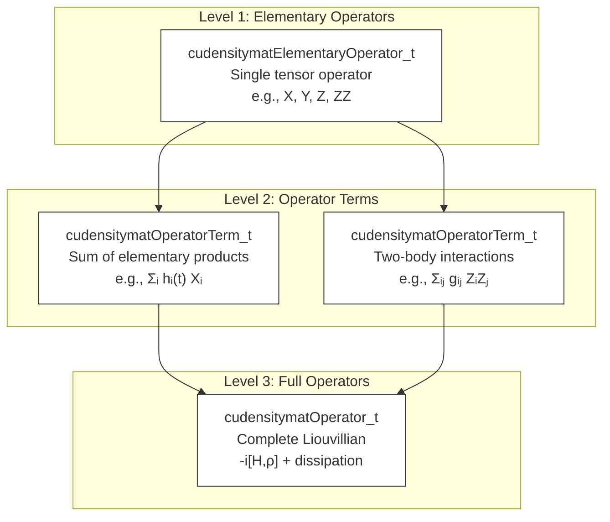
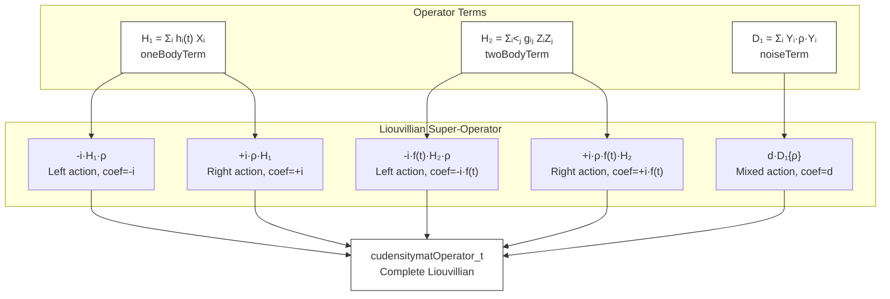
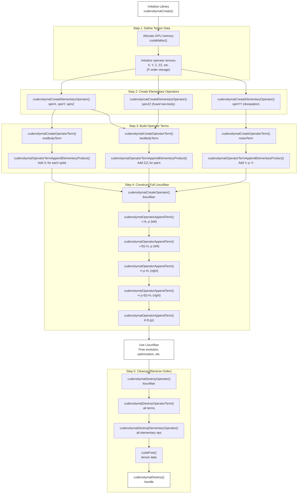

<!-- source: DeepWiki mcp.deepwiki.com · repo NVIDIA/cuQuantum · page 5.1 Density Matrix Operations · fetched 2026-10-26 -->

# Density Matrix Operations

<details>
<summary>Relevant source files</summary>

The following files were used as context for generating this wiki page:

- [python/cuquantum/bindings/cudensitymat.pxi](python/cuquantum/bindings/cudensitymat.pxi)
- [python/samples/bindings/cutensornet/state/proj_mps_circuit_dmrg_example.py](python/samples/bindings/cutensornet/state/proj_mps_circuit_dmrg_example.py)
- [samples/cudensitymat/transverse_ising_full_fused_noisy_grad.h](samples/cudensitymat/transverse_ising_full_fused_noisy_grad.h)
- [samples/cutensornet/high_level/proj_mps_circuit_dmrg_example.cu](samples/cutensornet/high_level/proj_mps_circuit_dmrg_example.cu)

</details>


## Purpose and Scope

This page documents the fundamental density matrix operations provided by the cuDensityMat library. It covers the core data structures, API patterns, and workflow for constructing and manipulating Liouvillian operators for open quantum system simulation. 

For information about time-dependent Hamiltonians and callback functions, see [Time-Dependent Hamiltonians](#5.2). For Python bindings and JAX integration details, see [Python Bindings and JAX](#5.3).

## Core Concepts

### Density Matrix Formalism

cuDensityMat uses the **density matrix** representation ρ to describe quantum states, including mixed states and open quantum systems. Unlike state vector simulation (covered in [cuStateVec Library](#4)), density matrices can represent:

- **Pure states**: ρ = |ψ⟩⟨ψ|
- **Mixed states**: ρ = Σᵢ pᵢ |ψᵢ⟩⟨ψᵢ|
- **Open systems**: Systems coupled to an environment with dissipation

The time evolution of a density matrix is governed by the **Liouvillian super-operator** L:

```
dρ/dt = L{ρ}
```

where:
- **Unitary evolution**: L{ρ} = -i[H, ρ] = -iH·ρ + iρ·H
- **Dissipative evolution**: L{ρ} includes Lindblad terms for decoherence and noise

Sources: [samples/cudensitymat/transverse_ising_full_fused_noisy_grad.h:18-25]()

### Hierarchical Operator Structure

cuDensityMat uses a three-level hierarchy to construct complex Liouvillian operators:



**Hierarchical Operator Construction Pattern**

Sources: [samples/cudensitymat/transverse_ising_full_fused_noisy_grad.h:156-390]()

## Core Data Structures

The cuDensityMat library defines several opaque handle types representing different operator objects:

| Type | Description | Created By | Destroyed By |
|------|-------------|------------|--------------|
| `cudensitymatHandle_t` | Library context handle | `cudensitymatCreate()` | `cudensitymatDestroy()` |
| `cudensitymatElementaryOperator_t` | Single tensor operator | `cudensitymatCreateElementaryOperator()` | `cudensitymatDestroyElementaryOperator()` |
| `cudensitymatOperatorTerm_t` | Sum of elementary products | `cudensitymatCreateOperatorTerm()` | `cudensitymatDestroyOperatorTerm()` |
| `cudensitymatOperator_t` | Full Liouvillian super-operator | `cudensitymatCreateOperator()` | `cudensitymatDestroyOperator()` |

All operator objects are associated with a `cudensitymatHandle_t` context and must be created and destroyed in the proper order (reverse order of creation).

Sources: [samples/cudensitymat/transverse_ising_full_fused_noisy_grad.h:163-177]()

## Elementary Operators

Elementary operators (`cudensitymatElementaryOperator_t`) represent individual tensor operators that act on one or more modes of the Hilbert space.

### Creating Elementary Operators

Elementary operators are created using `cudensitymatCreateElementaryOperator()`:

```c
cudensitymatStatus_t cudensitymatCreateElementaryOperator(
    cudensitymatHandle_t handle,
    int32_t numModes,                           // Number of modes the operator acts on
    const int64_t* modeExtents,                 // Shape of each mode [numModes]
    cudensitymatOperatorSparsity_t sparsity,    // Sparsity pattern
    int64_t numNonZeros,                        // Number of non-zeros (0 for dense)
    const int64_t* nonZeroIndices,              // Sparse indices (nullptr for dense)
    cudaDataType_t dataType,                    // Data type (e.g., CUDA_C_64F)
    void* tensorElements,                       // Pointer to tensor data in GPU memory
    cudensitymatTensorCallback_t tensorCallback, // Optional time-dependent tensor
    cudensitymatTensorGradientCallback_t tensorGradCallback, // Optional gradient
    cudensitymatElementaryOperator_t* elemOp);  // Output: created operator
```

### Example: Pauli Operators

**One-body operator (Pauli X)**:

```c
// X matrix in F-order (column-major) storage
// X = [[0, 1],
//      [1, 0]]
std::complex<double> spinX_data[] = {
    {0.0, 0.0}, {1.0, 0.0},  // First column
    {1.0, 0.0}, {0.0, 0.0}   // Second column
};

cudensitymatElementaryOperator_t spinX;
cudensitymatCreateElementaryOperator(
    handle,
    1,                                        // One-body operator
    std::vector<int64_t>({2}).data(),         // Acts on a qubit (dim=2)
    CUDENSITYMAT_OPERATOR_SPARSITY_NONE,      // Dense storage
    0, nullptr,                               // Not sparse
    CUDA_C_64F,                               // Complex double
    spinX_data,                               // Tensor elements (GPU memory)
    cudensitymatTensorCallbackNone,           // Static tensor
    cudensitymatTensorGradientCallbackNone,   // No gradient
    &spinX);
```

**Two-body fused operator (ZZ = Z ⊗ Z)**:

```c
// ZZ matrix in F-order for two qubits
// ZZ[i0, i1; j0, j1] = Z[i0; j0] * Z[i1; j1]
std::complex<double> spinZZ_data[] = {
    {1.0, 0.0}, {0.0, 0.0}, {0.0, 0.0}, {0.0, 0.0},   // Column 1
    {0.0, 0.0}, {-1.0, 0.0}, {0.0, 0.0}, {0.0, 0.0},  // Column 2
    {0.0, 0.0}, {0.0, 0.0}, {-1.0, 0.0}, {0.0, 0.0},  // Column 3
    {0.0, 0.0}, {0.0, 0.0}, {0.0, 0.0}, {1.0, 0.0}    // Column 4
};

cudensitymatElementaryOperator_t spinZZ;
cudensitymatCreateElementaryOperator(
    handle,
    2,                                        // Two-body operator
    std::vector<int64_t>({2, 2}).data(),      // Acts on two qubits
    CUDENSITYMAT_OPERATOR_SPARSITY_NONE,      // Dense storage
    0, nullptr,                               // Not sparse
    CUDA_C_64F,                               // Complex double
    spinZZ_data,                              // Tensor elements (GPU memory)
    cudensitymatTensorCallbackNone,           // Static tensor
    cudensitymatTensorGradientCallbackNone,   // No gradient
    &spinZZ);
```

Sources: [samples/cudensitymat/transverse_ising_full_fused_noisy_grad.h:188-240]()

### Tensor Storage

- **Memory location**: Tensor elements must reside in **GPU memory** (device pointers)
- **Storage order**: **Fortran order** (column-major, F-contiguous)
- **Data types**: Typically `CUDA_C_64F` (complex double) or `CUDA_C_32F` (complex float)
- **Lifetime**: The memory must remain valid for the lifetime of the elementary operator

### Sparsity Patterns

cuDensityMat supports sparse tensor storage through `cudensitymatOperatorSparsity_t`:
- `CUDENSITYMAT_OPERATOR_SPARSITY_NONE`: Dense storage (all elements stored)
- Sparse formats: Provide `numNonZeros` and `nonZeroIndices` arrays

Sources: [samples/cudensitymat/transverse_ising_full_fused_noisy_grad.h:206-240]()

## Operator Terms

Operator terms (`cudensitymatOperatorTerm_t`) represent sums of elementary operator products, such as:
- **One-body terms**: H₁ = Σᵢ hᵢ(t) Xᵢ
- **Two-body terms**: H₂ = f(t) Σᵢ<ⱼ gᵢⱼ ZᵢZⱼ

### Creating Operator Terms

```c
cudensitymatStatus_t cudensitymatCreateOperatorTerm(
    cudensitymatHandle_t handle,
    int32_t numModes,                // Hilbert space rank
    const int64_t* modeExtents,      // Hilbert space shape [numModes]
    cudensitymatOperatorTerm_t* operatorTerm); // Output: created term
```

An operator term is created empty and populated using `cudensitymatOperatorTermAppendElementaryProduct()`.

### Appending Elementary Products

```c
cudensitymatStatus_t cudensitymatOperatorTermAppendElementaryProduct(
    cudensitymatHandle_t handle,
    cudensitymatOperatorTerm_t operatorTerm,
    int32_t numElementaryOps,                       // Number of operators in product
    const cudensitymatElementaryOperator_t* elemOps, // Array of elementary operators
    const int32_t* targetModes,                     // Modes each operator acts on
    const int32_t* actionDuality,                   // 0=left action, 1=right action
    cuDoubleComplex staticCoefficient,              // Static coefficient
    cudensitymatScalarCallback_t scalarCallback,    // Time-dependent coefficient
    cudensitymatScalarGradientCallback_t scalarGradCallback); // Gradient callback
```

### Example: Transverse Field Term

Building H₁ = Σᵢ hᵢ(t) Xᵢ (sum over all qubits):

```c
// Create empty operator term
cudensitymatOperatorTerm_t oneBodyTerm;
cudensitymatCreateOperatorTerm(handle, numQubits, qubitDims, &oneBodyTerm);

// Add Xᵢ for each qubit i
for (int32_t i = 0; i < numQubits; ++i) {
    cudensitymatOperatorTermAppendElementaryProduct(
        handle,
        oneBodyTerm,
        1,                                              // Single operator in product
        std::vector<cudensitymatElementaryOperator_t>({spinX}).data(),
        std::vector<int32_t>({i}).data(),               // Act on qubit i
        std::vector<int32_t>({0}).data(),               // Left action (0)
        make_cuDoubleComplex(1.0, 0.0),                 // Static coefficient = 1.0
        {hCoefComplex64, CUDENSITYMAT_CALLBACK_DEVICE_CPU, nullptr}, // Time-dependent hᵢ(t)
        {hCoefGradComplex64, CUDENSITYMAT_CALLBACK_DEVICE_CPU, nullptr,
         CUDENSITYMAT_DIFFERENTIATION_DIR_BACKWARD});   // Gradient callback
}
```

### Example: Two-Body Interaction Term

Building H₂ = Σᵢ<ⱼ gᵢⱼ ZᵢZⱼ:

```c
cudensitymatOperatorTerm_t twoBodyTerm;
cudensitymatCreateOperatorTerm(handle, numQubits, qubitDims, &twoBodyTerm);

for (int32_t i = 0; i < numQubits - 1; ++i) {
    for (int32_t j = i + 1; j < numQubits; ++j) {
        double g_ij = -1.0 / (i + j + 1);  // Static coupling coefficient
        
        cudensitymatOperatorTermAppendElementaryProduct(
            handle,
            twoBodyTerm,
            1,                                          // Single fused operator
            std::vector<cudensitymatElementaryOperator_t>({spinZZ}).data(),
            std::vector<int32_t>({i, j}).data(),        // Act on qubits i and j
            std::vector<int32_t>({0, 0}).data(),        // Both left actions
            make_cuDoubleComplex(g_ij, 0.0),            // Static coefficient gᵢⱼ
            cudensitymatScalarCallbackNone,             // No time dependence
            cudensitymatScalarGradientCallbackNone);    // No gradient
    }
}
```

Sources: [samples/cudensitymat/transverse_ising_full_fused_noisy_grad.h:243-280]()

### Action Duality

The `actionDuality` parameter specifies whether an operator acts on the density matrix from the **left** or **right**:
- `0`: Left action - operator acts as H·ρ
- `1`: Right action - operator acts as ρ·H

This distinction is crucial for:
- **Commutators**: [H, ρ] = H·ρ - ρ·H requires both left and right actions
- **Dissipation terms**: Lindblad operators L·ρ·L† require coordinated left/right actions

Sources: [samples/cudensitymat/transverse_ising_full_fused_noisy_grad.h:287-297]()

## Full Operators (Liouvillians)

Full operators (`cudensitymatOperator_t`) represent complete Liouvillian super-operators that govern density matrix evolution. They are constructed by combining multiple operator terms with appropriate action dualities and coefficients.

### Creating Full Operators

```c
cudensitymatStatus_t cudensitymatCreateOperator(
    cudensitymatHandle_t handle,
    int32_t numModes,                // Hilbert space rank
    const int64_t* modeExtents,      // Hilbert space shape [numModes]
    cudensitymatOperator_t* operator); // Output: created operator
```

### Appending Operator Terms

```c
cudensitymatStatus_t cudensitymatOperatorAppendTerm(
    cudensitymatHandle_t handle,
    cudensitymatOperator_t operator,
    cudensitymatOperatorTerm_t operatorTerm,     // Term to append
    int32_t termActionDuality,                   // 0=left, 1=right for entire term
    cuDoubleComplex staticCoefficient,           // Static coefficient for term
    cudensitymatScalarCallback_t scalarCallback, // Time-dependent coefficient
    cudensitymatScalarGradientCallback_t scalarGradCallback); // Gradient callback
```

### Example: Complete Liouvillian Construction

Building the Liouvillian L{ρ} = -i[H, ρ] + D{ρ} where:
- H = H₁ + f(t)·H₂
- D{ρ} includes dissipation terms



**Liouvillian Construction from Operator Terms**

Sources: [samples/cudensitymat/transverse_ising_full_fused_noisy_grad.h:299-348]()

### Code Pattern

```c
// Create empty Liouvillian
cudensitymatOperator_t liouvillian;
cudensitymatCreateOperator(handle, numQubits, qubitDims, &liouvillian);

// Append -i·H₁·ρ (left action)
cudensitymatOperatorAppendTerm(
    handle, liouvillian, oneBodyTerm,
    0,                                      // Left action
    make_cuDoubleComplex(0.0, -1.0),        // -i coefficient
    cudensitymatScalarCallbackNone,
    cudensitymatScalarGradientCallbackNone);

// Append -i·f(t)·H₂·ρ (left action with time-dependent coefficient)
cudensitymatOperatorAppendTerm(
    handle, liouvillian, twoBodyTerm,
    0,                                      // Left action
    make_cuDoubleComplex(0.0, -1.0),        // -i coefficient
    {fCoefComplex64, CUDENSITYMAT_CALLBACK_DEVICE_CPU, nullptr}, // f(t)
    {fCoefGradComplex64, CUDENSITYMAT_CALLBACK_DEVICE_CPU, nullptr,
     CUDENSITYMAT_DIFFERENTIATION_DIR_BACKWARD});

// Append +i·ρ·H₁ (right action)
cudensitymatOperatorAppendTerm(
    handle, liouvillian, oneBodyTerm,
    1,                                      // Right action
    make_cuDoubleComplex(0.0, 1.0),         // +i coefficient
    cudensitymatScalarCallbackNone,
    cudensitymatScalarGradientCallbackNone);

// Append +i·ρ·f(t)·H₂ (right action)
cudensitymatOperatorAppendTerm(
    handle, liouvillian, twoBodyTerm,
    1,                                      // Right action
    make_cuDoubleComplex(0.0, 1.0),         // +i coefficient
    {fCoefComplex64, CUDENSITYMAT_CALLBACK_DEVICE_CPU, nullptr},
    {fCoefGradComplex64, CUDENSITYMAT_CALLBACK_DEVICE_CPU, nullptr,
     CUDENSITYMAT_DIFFERENTIATION_DIR_BACKWARD});

// Append d·D₁{ρ} (dissipation term)
double d = 1.0;
cudensitymatOperatorAppendTerm(
    handle, liouvillian, noiseTerm,
    0,                                      // No duality reversal
    make_cuDoubleComplex(d, 0.0),           // Static coefficient
    cudensitymatScalarCallbackNone,
    cudensitymatScalarGradientCallbackNone);
```

Sources: [samples/cudensitymat/transverse_ising_full_fused_noisy_grad.h:305-347]()

### Unitary vs Dissipative Evolution

**Unitary evolution** (Hamiltonian-driven):
- Represented by commutators: L{ρ} = -i[H, ρ] = -i·H·ρ + i·ρ·H
- Requires **two terms** with opposite action duality (left and right)
- Coefficient: ±i (imaginary unit)
- Preserves purity and norm

**Dissipative evolution** (decoherence and noise):
- Represented by Lindblad terms: L{ρ} = Lᵢ·ρ·Lᵢ† - ½{Lᵢ†Lᵢ, ρ}
- Can use **fused operators** for efficiency (e.g., YY representing Y·ρ·Y)
- Action duality depends on operator structure (can mix left and right)
- Reduces purity (creates mixed states)

Sources: [samples/cudensitymat/transverse_ising_full_fused_noisy_grad.h:18-25](), [samples/cudensitymat/transverse_ising_full_fused_noisy_grad.h:286-297]()

## Typical Workflow

The following diagram illustrates the complete workflow for constructing and using density matrix operators:



**Complete Workflow for Density Matrix Operator Construction**

Sources: [samples/cudensitymat/transverse_ising_full_fused_noisy_grad.h:180-390]()

## Memory Management

### GPU Memory Requirements

All tensor data must reside in GPU memory:
- Allocate with `cudaMalloc()`
- Initialize with `cudaMemcpy()` or kernel launches
- Free with `cudaFree()` after destroying all operators

### Object Lifetime and Destruction Order

Objects must be destroyed in **reverse order** of creation:

1. Destroy full operators (`cudensitymatDestroyOperator`)
2. Destroy operator terms (`cudensitymatDestroyOperatorTerm`)
3. Destroy elementary operators (`cudensitymatDestroyElementaryOperator`)
4. Free GPU tensor memory (`cudaFree`)
5. Destroy library handle (`cudensitymatDestroy`)

The `UserDefinedLiouvillian` class in the example demonstrates proper RAII-style resource management:

```c
class UserDefinedLiouvillian {
    ~UserDefinedLiouvillian() {
        // Proper cleanup order
        cudensitymatDestroyOperator(liouvillian);
        cudensitymatDestroyOperatorTerm(noiseTerm);
        cudensitymatDestroyOperatorTerm(twoBodyTerm);
        cudensitymatDestroyOperatorTerm(oneBodyTerm);
        cudensitymatDestroyElementaryOperator(spinYY);
        cudensitymatDestroyElementaryOperator(spinZZ);
        cudensitymatDestroyElementaryOperator(spinX);
        destroyArrayGPU(spinYYelems);
        destroyArrayGPU(spinZZelems);
        destroyArrayGPU(spinXelems);
    }
};
```

Sources: [samples/cudensitymat/transverse_ising_full_fused_noisy_grad.h:350-370]()

## API Function Reference

### Library Context

| Function | Purpose |
|----------|---------|
| `cudensitymatCreate(handle)` | Initialize library context |
| `cudensitymatDestroy(handle)` | Finalize library context |

### Elementary Operators

| Function | Purpose |
|----------|---------|
| `cudensitymatCreateElementaryOperator(...)` | Create elementary tensor operator from GPU data |
| `cudensitymatDestroyElementaryOperator(elemOp)` | Destroy elementary operator |

### Operator Terms

| Function | Purpose |
|----------|---------|
| `cudensitymatCreateOperatorTerm(handle, numModes, modeExtents, term)` | Create empty operator term |
| `cudensitymatOperatorTermAppendElementaryProduct(...)` | Add elementary product to term |
| `cudensitymatDestroyOperatorTerm(term)` | Destroy operator term |

### Full Operators

| Function | Purpose |
|----------|---------|
| `cudensitymatCreateOperator(handle, numModes, modeExtents, operator)` | Create empty Liouvillian operator |
| `cudensitymatOperatorAppendTerm(...)` | Add operator term to Liouvillian |
| `cudensitymatDestroyOperator(operator)` | Destroy full operator |

Sources: [samples/cudensitymat/transverse_ising_full_fused_noisy_grad.h:206-347]()

## Advanced Features

### Fused Operators

For efficiency, cuDensityMat supports **fused multi-body operators** that combine multiple single-body operators into a single tensor:

- **ZZ = Z ⊗ Z**: Two-body interaction as a single 4×4 tensor
- **YY for dissipation**: Y·ρ·Y represented as a single operator with mixed action duality

Fused operators reduce the number of API calls and enable optimized GPU kernels.

### Batched Operations

The library supports batched density matrix operations through:
- `stateBatchSize` parameter in operator construction
- Coefficient arrays with shape `[numParams, batchSize]` in F-order
- Enables parallel simulation of multiple quantum trajectories or parameter sweeps

Sources: [samples/cudensitymat/transverse_ising_full_fused_noisy_grad.h:166-167](), [python/cuquantum/bindings/cudensitymat.pxi:18-61]()

## Python Bindings

The Python interface to cuDensityMat is provided through Cython bindings. Key helper functions for interfacing between C++ and Python include:

| Function | Purpose |
|----------|---------|
| `_reconstruct_cpu_params()` | Convert C pointer to NumPy array for CPU callbacks |
| `_reconstruct_gpu_params()` | Convert C pointer to CuPy array for GPU callbacks |
| `_reconstruct_cpu_storage()` | Reconstruct NumPy array from tensor storage |
| `_reconstruct_gpu_storage()` | Reconstruct CuPy array from tensor storage |

These functions enable seamless integration with Python callback mechanisms. For detailed information about Python bindings and callback patterns, see [Python Bindings and JAX](#5.3).

Sources: [python/cuquantum/bindings/cudensitymat.pxi:18-61]()

---

