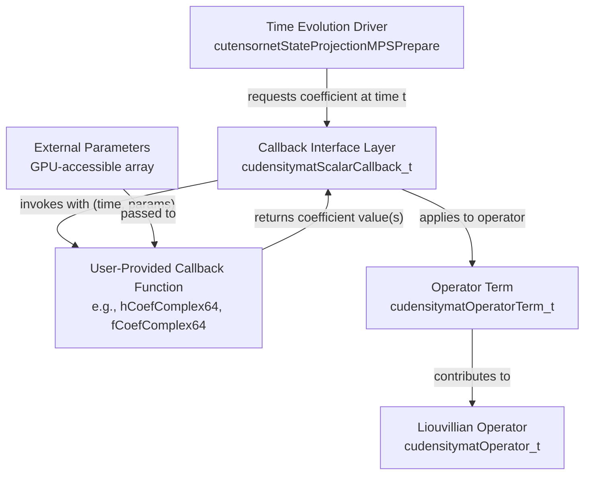
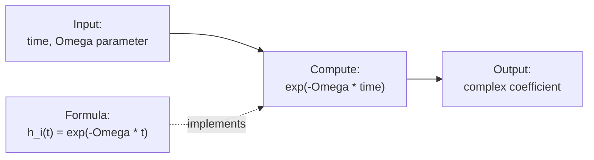
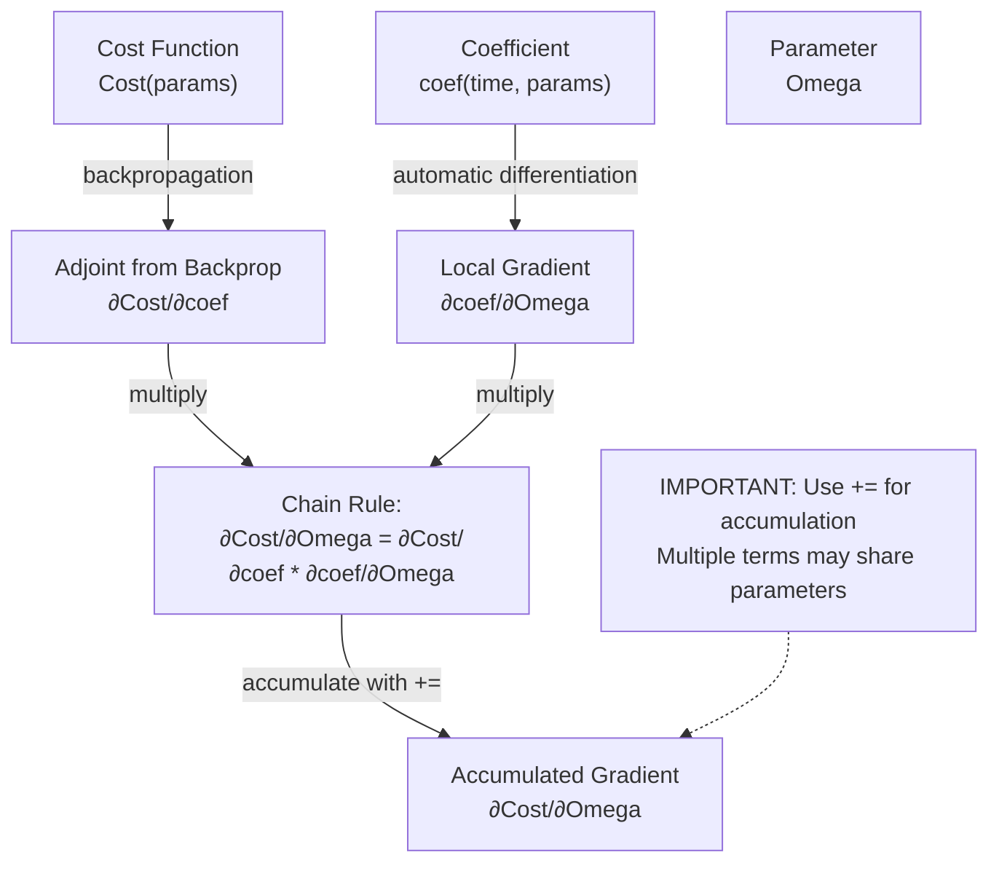
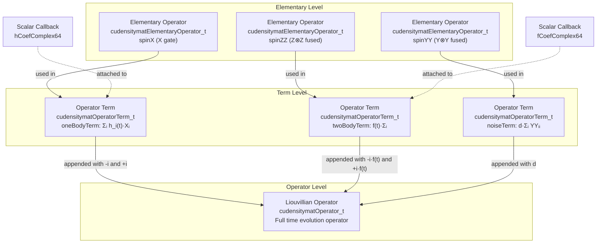
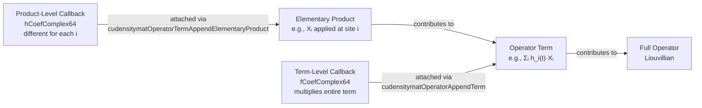
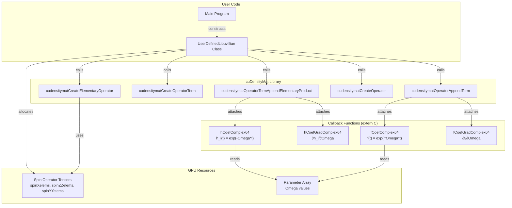

<!-- source: DeepWiki mcp.deepwiki.com · repo NVIDIA/cuQuantum · page 5.2 Time-Dependent Hamiltonians · fetched 2026-10-26 -->

# Time-Dependent Hamiltonians

<details>
<summary>Relevant source files</summary>

The following files were used as context for generating this wiki page:

- [samples/cudensitymat/transverse_ising_full_fused_noisy_grad.h](samples/cudensitymat/transverse_ising_full_fused_noisy_grad.h)
- [samples/cutensornet/high_level/proj_mps_circuit_dmrg_example.cu](samples/cutensornet/high_level/proj_mps_circuit_dmrg_example.cu)

</details>


## Purpose and Scope

This document explains how to define and use time-dependent Hamiltonians in cuDensityMat for simulating quantum systems with time-varying dynamics. The focus is on user-defined callback functions that provide time-dependent coefficients and their gradients for gradient-based optimization algorithms.

For basic density matrix operations and static Hamiltonians, see [Density Matrix Operations](#5.1). For Python-specific bindings and JAX integration for automatic differentiation, see [Python Bindings and JAX](#5.3).

---

## Callback Function Architecture

cuDensityMat supports time-dependent Hamiltonians through a callback mechanism that allows users to define coefficients as functions of time and external parameters. The library supports two callback types:

| Callback Type | Purpose | Attachment Point |
|--------------|---------|------------------|
| **Scalar Callback** | Defines time-dependent complex scalar coefficients | Individual operator products or entire operator terms |
| **Tensor Callback** | Defines time-dependent operator tensor elements | Elementary operators |

This page focuses on scalar callbacks, which are the primary mechanism for time-dependent Hamiltonians.

### Callback Execution Model



**Sources:** [samples/cudensitymat/transverse_ising_full_fused_noisy_grad.h:1-390]()

---

## Defining Time-Dependent Coefficients

### Scalar Callback Function Signature

User-provided scalar callback functions follow the C function signature defined by `cudensitymatScalarCallback_t`:

```c
extern "C"
int32_t callbackFunction(
  double time,              // in: current time point
  int64_t batchSize,        // in: number of coefficients to compute
  int32_t numParams,        // in: number of external parameters
  const double * params,    // in: GPU-accessible parameter array [numParams][batchSize]
  cudaDataType_t dataType,  // in: expected data type (e.g., CUDA_C_64F)
  void * scalarStorage,     // out: coefficient value(s) to return
  cudaStream_t stream)      // in: CUDA stream
```

**Key characteristics:**
- Functions must be marked `extern "C"` for C linkage
- Execute on the **CPU** (not GPU kernels)
- Support batch processing of multiple coefficient instances
- Parameters are stored in Fortran (column-major) order: `params[i * numParams + paramIdx]`
- Return 0 for success, non-zero for error

**Sources:** [samples/cudensitymat/transverse_ising_full_fused_noisy_grad.h:32-56]()

### Example 1: Exponential Decay Coefficient

The following callback implements h_i(t) = exp(-Ω × t):



Implementation reference: [samples/cudensitymat/transverse_ising_full_fused_noisy_grad.h:36-56]()

The function extracts the parameter `omega = params[i * numParams + 0]` for each batch instance and computes the complex coefficient `{exp(-omega * time), 0.0}`.

**Sources:** [samples/cudensitymat/transverse_ising_full_fused_noisy_grad.h:36-56]()

### Example 2: Oscillating Phase Coefficient

The following callback implements f(t) = exp(i × Ω × t) = cos(Ω × t) + i × sin(Ω × t):

Implementation reference: [samples/cudensitymat/transverse_ising_full_fused_noisy_grad.h:97-117]()

The function computes `{cos(omega * time), sin(omega * time)}` for each batch instance.

**Sources:** [samples/cudensitymat/transverse_ising_full_fused_noisy_grad.h:97-117]()

---

## Gradient Callbacks for Optimization

Gradient callbacks enable gradient-based optimization of parameters in variational quantum algorithms by computing derivatives of cost functions with respect to Hamiltonian parameters.

### Gradient Callback Signature

Gradient callbacks extend scalar callbacks with additional outputs:

```c
extern "C"
int32_t gradientCallbackFunction(
  double time,              // in: current time point
  int64_t batchSize,        // in: number of gradient instances
  int32_t numParams,        // in: number of parameters
  const double * params,    // in: GPU-accessible parameter array
  cudaDataType_t dataType,  // in: data type
  void * scalarGrad,        // in: adjoint of coefficient (∂Cost/∂Coef)
  double * paramsGrad,      // inout: accumulated parameter gradients
  cudaStream_t stream)      // in: CUDA stream
```

**Critical requirement:** Gradient values must be **accumulated** (+=), not overwritten, because multiple operator terms may depend on the same parameters.

### Gradient Computation Pattern



**Sources:** [samples/cudensitymat/transverse_ising_full_fused_noisy_grad.h:59-90]()

### Example: Gradient of Exponential Decay

For h_i(t) = exp(-Ω × t), the gradient with respect to Ω is:

∂h_i/∂Ω = -t × exp(-Ω × t)

Implementation reference: [samples/cudensitymat/transverse_ising_full_fused_noisy_grad.h:68-90]()

The callback computes `2 * Re(adjoint * localGradient)` and **accumulates** it into `paramsGrad[i * numParams + 0]` using the `+=` operator.

**Sources:** [samples/cudensitymat/transverse_ising_full_fused_noisy_grad.h:68-90]()

### Example: Gradient of Oscillating Phase

For f(t) = exp(i × Ω × t), the gradient is:

∂f/∂Ω = -i × t × exp(i × Ω × t) = -t × sin(Ω × t) + i × t × cos(Ω × t)

Implementation reference: [samples/cudensitymat/transverse_ising_full_fused_noisy_grad.h:131-153]()

**Sources:** [samples/cudensitymat/transverse_ising_full_fused_noisy_grad.h:131-153]()

---

## Constructing Time-Dependent Liouvillians

### Hierarchical Operator Structure



**Sources:** [samples/cudensitymat/transverse_ising_full_fused_noisy_grad.h:156-390]()

### Attaching Callbacks to Operator Products

When constructing operator terms using `cudensitymatOperatorTermAppendElementaryProduct`, callbacks can be attached at the individual product level:

**API flow:**
1. **Create elementary operators** (e.g., X, Z⊗Z) using `cudensitymatCreateElementaryOperator`
2. **Create empty operator term** using `cudensitymatCreateOperatorTerm`
3. **Append products** using `cudensitymatOperatorTermAppendElementaryProduct` with callback parameters
4. **Create Liouvillian** using `cudensitymatCreateOperator`
5. **Append terms** using `cudensitymatOperatorAppendTerm` with optional term-level callbacks

**Sources:** [samples/cudensitymat/transverse_ising_full_fused_noisy_grad.h:204-347]()

### Callback Attachment Points



**Two attachment mechanisms:**
1. **Product-level callbacks**: Attached when appending elementary products to an operator term. Each product can have its own callback (e.g., h_i(t) for each site i).
2. **Term-level callbacks**: Attached when appending an operator term to the full operator. Multiplies the entire term (e.g., f(t) multiplying all ZZ interactions).

**Sources:** [samples/cudensitymat/transverse_ising_full_fused_noisy_grad.h:249-347]()

---

## Complete Example: Transverse Ising Hamiltonian

### System Description

The example in `transverse_ising_full_fused_noisy_grad.h` implements:

**H = Σᵢ h_i(t)·Xᵢ + f(t)·Σᵢ<j gᵢⱼ·ZZᵢⱼ + d·Σᵢ Yᵢ·{...}·Yᵢ**

Where:
- **h_i(t) = exp(-Ω × t)**: Time-dependent transverse field coefficients
- **f(t) = exp(i × Ω × t)**: Time-dependent modulation of ZZ interactions
- **gᵢⱼ = -1/(i+j+1)**: Static coupling coefficients
- **d = 1.0**: Dissipation strength
- **{...}** indicates the density matrix (Yᵢ operators act from different sides)

### Implementation Structure



**Sources:** [samples/cudensitymat/transverse_ising_full_fused_noisy_grad.h:156-390]()

### Key Implementation Steps

#### 1. Create Elementary Operators

Reference: [samples/cudensitymat/transverse_ising_full_fused_noisy_grad.h:204-240]()

- X operator (2×2 matrix) for transverse field
- ZZ operator (4×4 fused matrix) for two-body interactions
- YY operator (4×4 fused matrix) for dissipation (acts from both sides)

#### 2. Build One-Body Term with Time-Dependent Coefficients

Reference: [samples/cudensitymat/transverse_ising_full_fused_noisy_grad.h:243-260]()

For each site i:
```
cudensitymatOperatorTermAppendElementaryProduct(
  ...,
  {hCoefComplex64, CUDENSITYMAT_CALLBACK_DEVICE_CPU, nullptr},
  {hCoefGradComplex64, CUDENSITYMAT_CALLBACK_DEVICE_CPU, nullptr, 
   CUDENSITYMAT_DIFFERENTIATION_DIR_BACKWARD}
)
```

#### 3. Build Two-Body Term with Static Coefficients

Reference: [samples/cudensitymat/transverse_ising_full_fused_noisy_grad.h:261-280]()

For each pair (i, j) where i < j:
- Coefficient gᵢⱼ = -1/(i+j+1) is **static** (not time-dependent)
- Time-dependent modulation f(t) is applied at the **term level**, not product level

#### 4. Build Dissipation Term

Reference: [samples/cudensitymat/transverse_ising_full_fused_noisy_grad.h:281-297]()

For each site i:
- YY operator acts from both sides: `{0, 1}` duality specification
- Static coefficient d = 1.0

#### 5. Assemble Full Liouvillian

Reference: [samples/cudensitymat/transverse_ising_full_fused_noisy_grad.h:299-347]()

The Liouvillian is constructed as:
- **-i × oneBodyTerm** (acting from left)
- **-i × f(t) × twoBodyTerm** (acting from left)
- **+i × oneBodyTerm** (acting from right)
- **+i × f(t) × twoBodyTerm** (acting from right)
- **d × noiseTerm** (mixed left/right action)

The f(t) callbacks are attached at the term level when calling `cudensitymatOperatorAppendTerm`.

**Sources:** [samples/cudensitymat/transverse_ising_full_fused_noisy_grad.h:299-347]()

---

## Callback Parameter Management

### Parameter Array Layout

Parameters are stored in GPU-accessible memory in **Fortran (column-major) order**:

| Parameter Index | Batch Instance 0 | Batch Instance 1 | ... | Batch Instance N-1 |
|----------------|------------------|------------------|-----|-------------------|
| 0 (Omega)      | params[0]        | params[1]        | ... | params[N-1]       |
| 1 (optional)   | params[N]        | params[N+1]      | ... | params[2N-1]      |

Access pattern in callback: `omega = params[i * numParams + paramIndex]`

### Gradient Array Layout

Gradient arrays use the same layout. The accumulation pattern ensures correct handling when multiple operator products/terms depend on the same parameters:

```c
paramsGrad[i * numParams + 0] += 2.0 * Re(adjoint * localGradient);
```

The factor of 2 accounts for the real part extraction when cost functions are real-valued.

**Sources:** [samples/cudensitymat/transverse_ising_full_fused_noisy_grad.h:81-85]()

---

## API Type Reference

### Key Types

| Type | Purpose | Creation Function |
|------|---------|-------------------|
| `cudensitymatElementaryOperator_t` | Represents a single operator tensor (e.g., X, Z⊗Z) | `cudensitymatCreateElementaryOperator` |
| `cudensitymatOperatorTerm_t` | Sum of elementary operator products with coefficients | `cudensitymatCreateOperatorTerm` |
| `cudensitymatOperator_t` | Full Liouvillian (super-operator) composed of terms | `cudensitymatCreateOperator` |
| `cudensitymatScalarCallback_t` | Callback function descriptor for time-dependent scalars | N/A (struct literal) |
| `cudensitymatScalarGradientCallback_t` | Gradient callback descriptor | N/A (struct literal) |

### Callback Descriptor Structure

```c
// Scalar callback descriptor
{
  callbackFunction,                      // function pointer
  CUDENSITYMAT_CALLBACK_DEVICE_CPU,      // execution device (CPU)
  nullptr                                // user data (unused)
}

// Gradient callback descriptor
{
  gradientCallbackFunction,              // function pointer
  CUDENSITYMAT_CALLBACK_DEVICE_CPU,      // execution device (CPU)
  nullptr,                               // user data (unused)
  CUDENSITYMAT_DIFFERENTIATION_DIR_BACKWARD  // differentiation direction
}
```

**Sources:** [samples/cudensitymat/transverse_ising_full_fused_noisy_grad.h:257-259, 319-321]()

---

## Resource Management

The `UserDefinedLiouvillian` class demonstrates proper resource management:

### Constructor Responsibilities
- Allocate GPU memory for operator tensors
- Create elementary operators, operator terms, and the full operator
- Attach callbacks to appropriate levels

### Destructor Responsibilities
Reference: [samples/cudensitymat/transverse_ising_full_fused_noisy_grad.h:350-370]()

Destruction order (reverse of construction):
1. Destroy operator (`cudensitymatDestroyOperator`)
2. Destroy operator terms (`cudensitymatDestroyOperatorTerm`)
3. Destroy elementary operators (`cudensitymatDestroyElementaryOperator`)
4. Free GPU memory for tensors (`cudaFree`)

**Sources:** [samples/cudensitymat/transverse_ising_full_fused_noisy_grad.h:350-390]()

---

