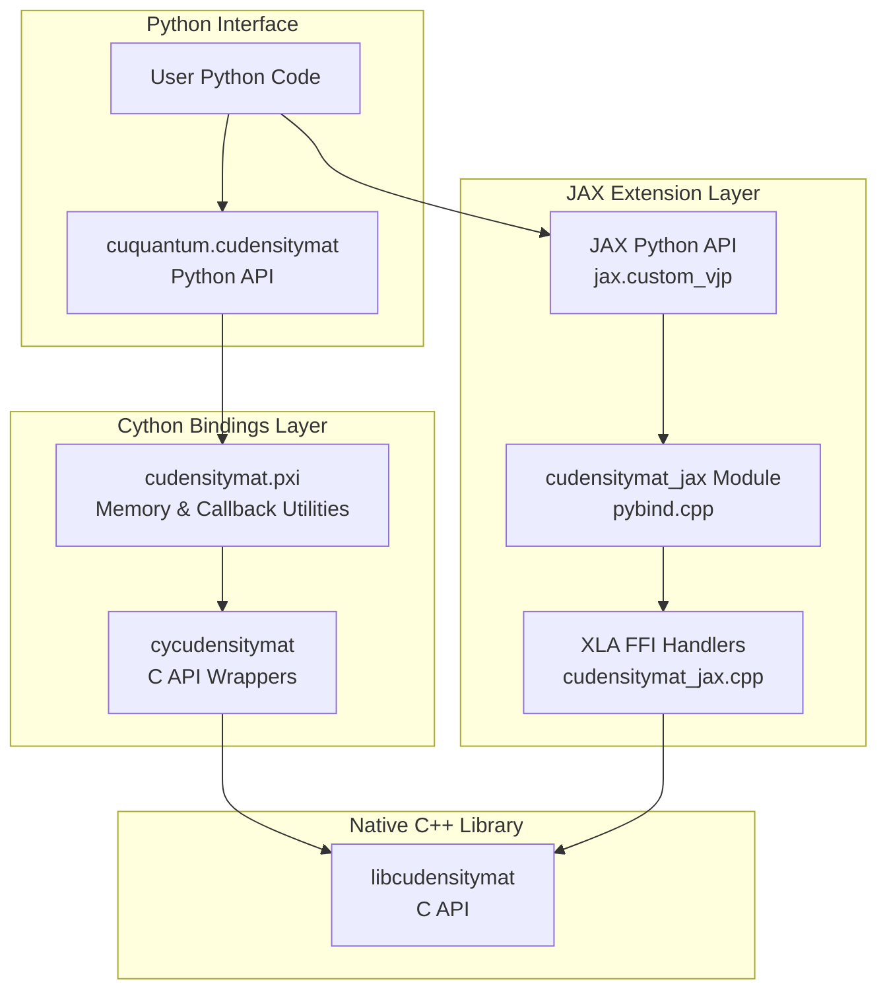
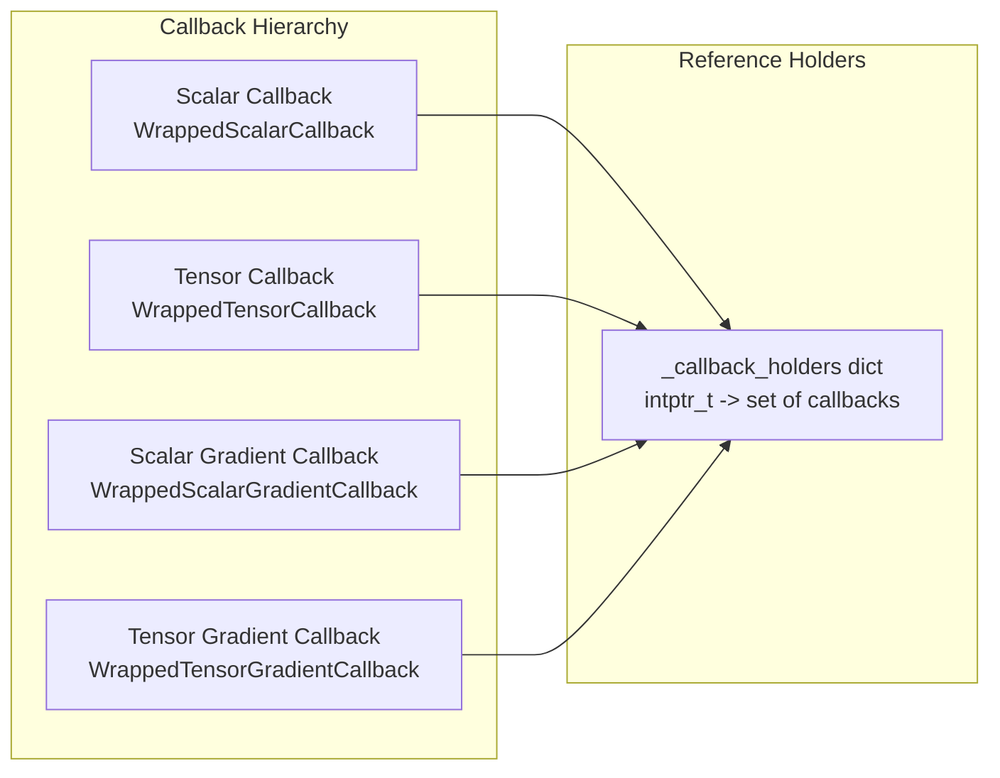
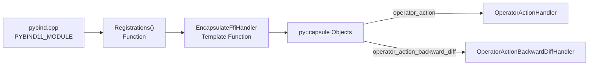
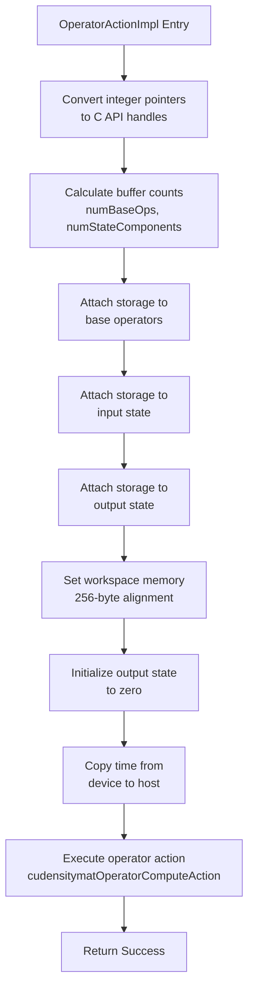
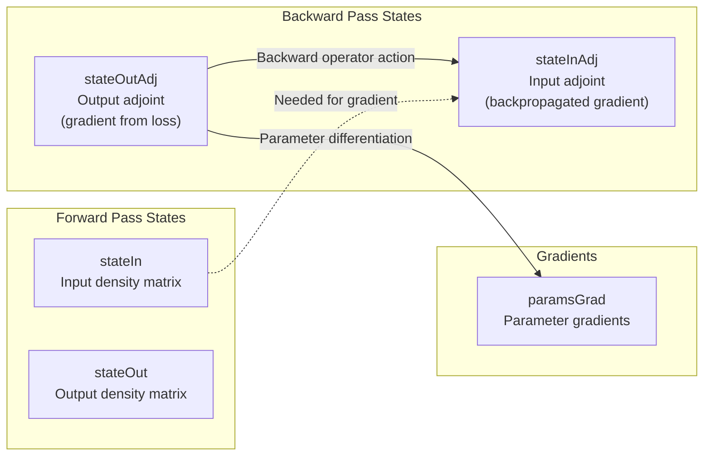
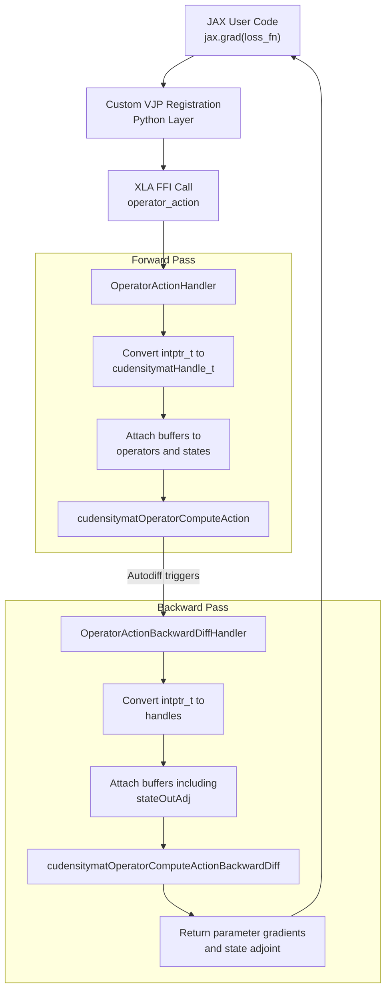

<!-- source: DeepWiki mcp.deepwiki.com · repo NVIDIA/cuQuantum · page 5.3 Python Bindings and JAX · fetched 2026-10-26 -->

# Python Bindings and JAX

<details>
<summary>Relevant source files</summary>

The following files were used as context for generating this wiki page:

- [python/cuquantum/bindings/cudensitymat.pxi](python/cuquantum/bindings/cudensitymat.pxi)
- [python/extensions/cuquantum/densitymat/jax/cppsrc/cudensitymat_jax.cpp](python/extensions/cuquantum/densitymat/jax/cppsrc/cudensitymat_jax.cpp)
- [python/extensions/cuquantum/densitymat/jax/cppsrc/pybind.cpp](python/extensions/cuquantum/densitymat/jax/cppsrc/pybind.cpp)
- [python/samples/bindings/cutensornet/state/proj_mps_circuit_dmrg_example.py](python/samples/bindings/cutensornet/state/proj_mps_circuit_dmrg_example.py)

</details>


## Purpose and Scope

This page documents the Python interface to cuDensityMat, focusing on the binding layer that bridges Python to the native C++ library and the JAX integration for automatic differentiation. The content covers:

- **Cython bindings layer**: Memory reconstruction utilities and callback management for interfacing with the C API
- **JAX/XLA FFI integration**: Custom XLA FFI handlers enabling automatic differentiation for density matrix operations

For general cuDensityMat operations and concepts, see [5.1](#5.1). For time-dependent Hamiltonian callbacks, see [5.2](#5.2). For broader Python package structure, see [2.2](#2.2).

---

## Architecture Overview

The Python bindings for cuDensityMat consist of two primary components: a Cython-based layer for general Python interoperability and a specialized JAX extension using XLA FFI for autodiff support.

### Binding Layer Components



**Sources:** [python/extensions/cuquantum/densitymat/jax/cppsrc/pybind.cpp](), [python/extensions/cuquantum/densitymat/jax/cppsrc/cudensitymat_jax.cpp](), [python/cuquantum/bindings/cudensitymat.pxi]()

---

## Cython Bindings Layer

The Cython bindings layer provides utilities for memory reconstruction and callback management, enabling seamless interoperability between Python (NumPy/CuPy) and the C API.

### Memory Reconstruction Functions

The binding layer includes four key functions for reconstructing NumPy or CuPy arrays from C pointers passed to callback functions:

| Function | Purpose | Return Type | Memory Space |
|----------|---------|-------------|--------------|
| `_reconstruct_cpu_params` | Reconstruct params/params_grad array | NumPy ndarray | CPU |
| `_reconstruct_cpu_storage` | Reconstruct state storage array | NumPy ndarray | CPU |
| `_reconstruct_gpu_params` | Reconstruct params/params_grad array | CuPy ndarray | GPU |
| `_reconstruct_gpu_storage` | Reconstruct state storage array | CuPy ndarray | GPU |

#### CPU Memory Reconstruction

The CPU reconstruction functions use `PyMemoryView_FromMemory` to create memory views from raw pointers:

```
_reconstruct_cpu_params(batch_size, num_params, params_ptr, flag)
  └─> Creates NumPy array with shape (num_params, batch_size)
  └─> Fortran-order (column-major) layout
  └─> Flag: PyBUF_READ or PyBUF_WRITE
```

[python/cuquantum/bindings/cudensitymat.pxi:18-25]()

#### GPU Memory Reconstruction

The GPU reconstruction functions use CuPy's `UnownedMemory` to wrap device pointers:

```
_reconstruct_gpu_params(batch_size, num_params, params_ptr)
  └─> Creates CuPy UnownedMemory object
  └─> Wraps as MemoryPointer
  └─> Returns CuPy ndarray with shape (num_params, batch_size)
```

[python/cuquantum/bindings/cudensitymat.pxi:38-50]()

**Sources:** [python/cuquantum/bindings/cudensitymat.pxi:18-61]()

### Callback Management

The binding layer manages callback lifecycle and reference counting to prevent premature garbage collection of Python callback objects.

#### Callback Types



#### Reference Holding Functions

Each callback type has a corresponding reference holding function that adds the callback to a global `_callback_holders` dictionary:

```python
# Pattern for all callback types:
_hold_[callback_type]_reference(intptr_t obj, callback)
  └─> Extracts Python callback from wrapped object
  └─> Adds to _callback_holders[obj] set
```

These functions prevent Python from garbage collecting callback objects while they are registered with C API handles.

[python/cuquantum/bindings/cudensitymat.pxi:64-102]()

#### Callback Conversion

Conversion functions transform Python callback objects (cdef classes) into C structs for passing to the C API:

| Function | Input | Output Struct | Default Device |
|----------|-------|---------------|----------------|
| `_convert_scalar_callback` | `WrappedScalarCallback` | `_WrappedScalarCallback` | `CALLBACK_DEVICE_CPU` |
| `_convert_tensor_callback` | `WrappedTensorCallback` | `_WrappedTensorCallback` | `CALLBACK_DEVICE_CPU` |
| `_convert_scalar_gradient_callback` | `WrappedScalarGradientCallback` | `_WrappedScalarGradientCallback` | `CALLBACK_DEVICE_CPU` |
| `_convert_tensor_gradient_callback` | `WrappedTensorGradientCallback` | `_WrappedTensorGradientCallback` | `CALLBACK_DEVICE_CPU` |

[python/cuquantum/bindings/cudensitymat.pxi:104-159]()

**Sources:** [python/cuquantum/bindings/cudensitymat.pxi:64-159]()

---

## JAX/XLA FFI Integration

The JAX extension enables automatic differentiation for cuDensityMat operations by implementing custom XLA FFI (Foreign Function Interface) handlers. This allows JAX to differentiate through density matrix evolution operators.

### FFI Handler Registration

The `cudensitymat_jax` Pybind11 module registers XLA FFI handlers with JAX:



The `EncapsulateFfiHandler` template function wraps C++ FFI handlers into Python capsule objects:

```cpp
template<typename T>
py::capsule EncapsulateFfiHandler(T* func) {
    // Validates func is XLA FFI handler signature
    return py::capsule(reinterpret_cast<void*>(func));
}
```

[python/extensions/cuquantum/densitymat/jax/cppsrc/pybind.cpp:14-21]()

The `Registrations()` function returns a dictionary mapping handler names to capsules:

```cpp
py::dict Registrations() {
    dict["operator_action"] = EncapsulateFfiHandler(OperatorActionHandler);
    dict["operator_action_backward_diff"] = EncapsulateFfiHandler(OperatorActionBackwardDiffHandler);
    return dict;
}
```

[python/extensions/cuquantum/densitymat/jax/cppsrc/pybind.cpp:23-29]()

**Sources:** [python/extensions/cuquantum/densitymat/jax/cppsrc/pybind.cpp]()

### Forward Operator Action Handler

The `OperatorActionHandler` implements the forward pass of the operator action computation.

#### Handler Signature

The handler is defined using the `XLA_FFI_DEFINE_HANDLER_SYMBOL` macro:

```cpp
XLA_FFI_DEFINE_HANDLER_SYMBOL(
    OperatorActionHandler,
    OperatorActionImpl,
    xla::ffi::Ffi::Bind()
        .Ctx<xla::ffi::PlatformStream<cudaStream_t>>()
        .Arg<xla::ffi::Buffer<xla::ffi::F64>>() // time
        .Arg<xla::ffi::Buffer<xla::ffi::F64>>() // params
        .RemainingArgs()                         // base operators and input state
        .Ret<xla::ffi::AnyBuffer>()             // workspace
        .RemainingRets()                         // output state
        .Attr<...>()                             // various attributes
);
```

[python/extensions/cuquantum/densitymat/jax/cppsrc/cudensitymat_jax.cpp:143-161]()

#### Implementation Phases



#### Key Implementation Details

**Operator Attachment**: The handler identifies unique base operators from the `baseOpPtrs` attribute and attaches buffers only once per unique operator:

```cpp
std::set<int64_t> uniqueBaseOpPtrs;
for (int i = 0; i < numBaseOps; ++i) {
    if (uniqueBaseOpPtrs.find(baseOpPtrs[i]) == uniqueBaseOpPtrs.end()) {
        uniqueBaseOpPtrs.insert(baseOpPtrs[i]);
        // Attach buffer based on isElemOp[i] flag
    }
}
```

[python/extensions/cuquantum/densitymat/jax/cppsrc/cudensitymat_jax.cpp:49-74]()

**State Storage Attachment**: State components are attached using vectors of pointers and sizes:

```cpp
std::vector<void*> stateInComponentBufs;
std::vector<size_t> stateInComponentSizes;
// Populate vectors from buffers
cudensitymatStateAttachComponentStorage(handle, stateIn, 
    numStateComponents, stateInComponentBufs.data(), stateInComponentSizes.data());
```

[python/extensions/cuquantum/densitymat/jax/cppsrc/cudensitymat_jax.cpp:76-88]()

**Workspace Alignment**: The workspace buffer is manually aligned to 256 bytes by clearing lower bits:

```cpp
uintptr_t workspaceIntPtr = reinterpret_cast<uintptr_t>(workspaceBuf->untyped_data());
void* workspacePtrAligned = reinterpret_cast<void*>((workspaceIntPtr + 255) & ~255);
size_t workspaceSizeAligned = workspaceBuf->size_bytes() - 255;
```

[python/extensions/cuquantum/densitymat/jax/cppsrc/cudensitymat_jax.cpp:107-109]()

**Sources:** [python/extensions/cuquantum/densitymat/jax/cppsrc/cudensitymat_jax.cpp:20-161]()

### Backward Differentiation Handler

The `OperatorActionBackwardDiffHandler` implements the backward pass for automatic differentiation using the adjoint method.

#### Handler Signature

```cpp
XLA_FFI_DEFINE_HANDLER_SYMBOL(
    OperatorActionBackwardDiffHandler,
    OperatorActionBackwardDiffImpl,
    xla::ffi::Ffi::Bind()
        .Ctx<xla::ffi::PlatformStream<cudaStream_t>>()
        .Arg<xla::ffi::Buffer<xla::ffi::F64>>()    // time
        .Arg<xla::ffi::Buffer<xla::ffi::F64>>()    // params
        .RemainingArgs()                            // base operators, input state, output state adjoint
        .Ret<xla::ffi::AnyBuffer>()                // workspace
        .Ret<xla::ffi::Buffer<xla::ffi::F64>>()    // paramsGrad
        .RemainingRets()                            // input state adjoint
        .Attr<...>()                                // various attributes
);
```

[python/extensions/cuquantum/densitymat/jax/cppsrc/cudensitymat_jax.cpp:309-329]()

#### Adjoint State Flow



#### Implementation Details

The backward implementation follows a similar structure to the forward pass but calls `cudensitymatOperatorComputeActionBackwardDiff` instead:

```cpp
cudensitymatOperatorComputeActionBackwardDiff(
    handle,
    superoperator,
    time,
    batchSize,
    paramsBuf.element_count(),
    paramsBuf.typed_data(),    // input parameters
    stateIn,                    // forward pass input state
    stateOutAdj,                // gradient w.r.t. output
    stateInAdj,                 // gradient w.r.t. input (output)
    paramsGradBuf->typed_data(), // gradient w.r.t. parameters (output)
    workspaceDesc,
    stream
);
```

[python/extensions/cuquantum/densitymat/jax/cppsrc/cudensitymat_jax.cpp:289-300]()

**State Component Calculation**: The backward handler processes both input state and output state adjoint:

```cpp
size_t numStateComponents = (numOtherBufs - numBaseOps) / 2;
```

The first half of remaining buffers contains the input state components, the second half contains the output state adjoint components.

[python/extensions/cuquantum/densitymat/jax/cppsrc/cudensitymat_jax.cpp:193]()

**Sources:** [python/extensions/cuquantum/densitymat/jax/cppsrc/cudensitymat_jax.cpp:164-329]()

---

## Data Flow Through Binding Layers

### End-to-End Execution Flow



### Handle and Buffer Passing

Both FFI handlers receive C API handles as integer attributes and convert them to opaque pointers:

| Attribute Name | C Type | Purpose |
|----------------|--------|---------|
| `handle` | `cudensitymatHandle_t` | Library context handle |
| `operator` | `cudensitymatOperator_t` | Superoperator to apply |
| `state_in` | `cudensitymatState_t` | Input density matrix state |
| `state_out` | `cudensitymatState_t` | Output density matrix state (forward) |
| `state_in_adj` | `cudensitymatState_t` | Input state adjoint (backward) |
| `state_out_adj` | `cudensitymatState_t` | Output state adjoint (backward) |
| `workspace_desc` | `cudensitymatWorkspaceDescriptor_t` | Workspace descriptor |

Buffer data is passed through the XLA FFI's argument and result interfaces as `xla::ffi::Buffer` or `xla::ffi::AnyBuffer` objects.

**Sources:** [python/extensions/cuquantum/densitymat/jax/cppsrc/cudensitymat_jax.cpp:36-41](), [python/extensions/cuquantum/densitymat/jax/cppsrc/cudensitymat_jax.cpp:182-188]()

---

## Integration with cuDensityMat C API

### Callback Device Modes

The Cython bindings support both CPU and GPU callback execution:

| Mode | Constant | Description |
|------|----------|-------------|
| CPU | `CUDENSITYMAT_CALLBACK_DEVICE_CPU` | Callback executes on CPU with NumPy arrays |
| GPU | `CUDENSITYMAT_CALLBACK_DEVICE_GPU` | Callback executes on GPU with CuPy arrays |

The device mode determines which reconstruction functions are used:
- CPU mode: `_reconstruct_cpu_params`, `_reconstruct_cpu_storage`
- GPU mode: `_reconstruct_gpu_params`, `_reconstruct_gpu_storage`

**Sources:** [python/cuquantum/bindings/cudensitymat.pxi:15]()

### Error Handling

The JAX FFI handlers use custom macros for error checking:

```cpp
FFI_CUDM_ERROR_CHECK(cudensitymat_function(...));  // cuDensityMat API calls
FFI_CUDA_ERROR_CHECK(cudaMemcpy(...));             // CUDA runtime calls
```

Errors are caught and converted to `xla::ffi::Error` objects with `ErrorCode::kInternal`:

```cpp
try {
    // FFI handler implementation
} catch (const std::exception& e) {
    return xla::ffi::Error(xla::ffi::ErrorCode::kInternal, e.what());
}
return xla::ffi::Error::Success();
```

[python/extensions/cuquantum/densitymat/jax/cppsrc/cudensitymat_jax.cpp:136-140]()

**Sources:** [python/extensions/cuquantum/densitymat/jax/cppsrc/cudensitymat_jax.cpp](), [python/extensions/cuquantum/densitymat/jax/cppsrc/cudensitymat_jax.h]()

---

