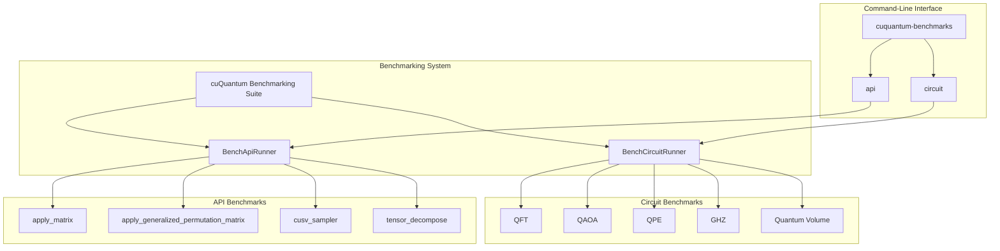
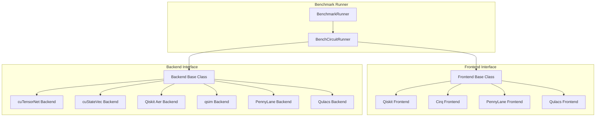

<!-- source: DeepWiki mcp.deepwiki.com · repo NVIDIA/cuQuantum · page 6 Benchmarking Suite · fetched 2026-10-26 -->

# Benchmarking Suite

<details>
<summary>Relevant source files</summary>

The following files were used as context for generating this wiki page:

- [benchmarks/LICENSE](benchmarks/LICENSE)
- [benchmarks/README.md](benchmarks/README.md)
- [benchmarks/setup.py](benchmarks/setup.py)
- [extra/custatevec/README.md](extra/custatevec/README.md)

</details>


The cuQuantum Benchmarking Suite is a comprehensive tool designed to measure the performance of NVIDIA's cuQuantum libraries. It provides structured methods for benchmarking quantum circuit simulations and specific API calls across different quantum computing frameworks, enabling users to evaluate the performance gains from GPU acceleration.

For information about installing the cuQuantum SDK itself, see [Getting Started](#1.1).

## Overview and Architecture

The Benchmarking Suite consists of two main components:

1. **Circuit Benchmarks**: For measuring the performance of quantum circuit simulations
2. **API Benchmarks**: For benchmarking specific cuQuantum API calls

The suite follows a modular design with clearly defined interfaces that allow for extensibility and flexibility in benchmarking different quantum computing frameworks and simulation methods.



Sources: [benchmarks/README.md:27-50](). [benchmarks/cuquantum_benchmarks/run.py:28-41]().

## Installation and Setup

The Benchmarking Suite can be installed using pip:

```bash
pip install .
```

To include all optional dependencies:

```bash
pip install .[all]
```

This installation makes the `cuquantum-benchmarks` command available in your Python environment. Alternatively, you can run the benchmarks using the Python module directly:

```bash
python -m cuquantum_benchmarks
```

Sources: [benchmarks/README.md:3-23]().

## Modular Design: Frontends and Backends

The Benchmarking Suite uses a modular design comprising frontends and backends. This architecture separates circuit generation from circuit execution, enabling benchmarking across different quantum computing frameworks.



Sources: [benchmarks/README.md:76-113]().

### Frontends

Frontends are responsible for generating quantum circuits in a framework-specific format. The Benchmarking Suite supports the following frontends:

- **Qiskit**: Generates circuits using IBM's Qiskit framework
- **Cirq**: Generates circuits using Google's Cirq framework
- **PennyLane**: Generates circuits using PennyLane
- **Qulacs**: Generates circuits using Qulacs

Each frontend implements a common interface that includes methods for initializing the frontend and generating circuits from a sequence of gates.

Sources: [benchmarks/README.md:90-99](), [benchmarks/cuquantum_benchmarks/run.py:42-45]().

### Backends

Backends are responsible for executing quantum circuits and measuring performance. The Benchmarking Suite supports the following backends:

| Backend | Description | GPU Support |
|---------|-------------|-------------|
| `aer` | Qiskit Aer's CPU backend | No |
| `aer-cuda` | Native Qiskit Aer GPU backend | Yes |
| `aer-cusv` | Qiskit Aer with cuStateVec integration | Yes |
| `cusvaer` | Multi-GPU, multi-node custom Qiskit Aer backend | Yes |
| `cirq` | Cirq's native CPU simulator | No |
| `cutn` | cuTensorNet tensor network contraction | Yes |
| `qsim` | qsim's CPU backend | No |
| `qsim-cuda` | Native qsim GPU backend | Yes |
| `qsim-cusv` | qsim with cuStateVec integration | Yes |
| `qsim-mgpu` | Multi-GPU custom qsim backend | Yes |
| `pennylane` | PennyLane's native CPU backend | No |
| `pennylane-lightning-gpu` | PennyLane-Lightning GPU backend | Yes |
| `pennylane-lightning-qubit` | PennyLane-Lightning CPU backend | No |
| `pennylane-lightning-kokkos` | PennyLane-Lightning Kokkos backend | Varies |
| `qulacs-gpu` | Qulacs GPU backend | Yes |
| `qulacs-cpu` | Qulacs CPU backend | No |

Each backend implements a common interface that includes methods for initializing the backend and executing circuits.

Sources: [benchmarks/README.md:100-113](), [benchmarks/cuquantum_benchmarks/run.py:42-67]().

## Benchmark Types

### Circuit Benchmarks

The Circuit Benchmarks component measures the performance of simulating various quantum circuits:

- **QFT (Quantum Fourier Transform)**: A key component in many quantum algorithms
- **QAOA (Quantum Approximate Optimization Algorithm)**: Used for solving combinatorial optimization problems
- **QPE (Quantum Phase Estimation)**: Used to estimate the eigenvalues of a unitary operator
- **GHZ (Greenberger-Horne-Zeilinger)**: Creates entangled states
- **Quantum Volume**: A metric for quantum computer performance

Sources: [benchmarks/cuquantum_benchmarks/run.py:87](), [benchmarks/README.md:81-89]().

### API Benchmarks

The API Benchmarks component measures the performance of specific cuQuantum API calls:

- **apply_matrix**: Applies a gate matrix to a state vector
- **apply_generalized_permutation_matrix**: Applies a generalized permutation matrix to a state vector
- **cusv_sampler**: Performs quantum sampling operations
- **tensor_decompose**: Performs tensor decomposition using methods like QR or SVD

Sources: [benchmarks/cuquantum_benchmarks/run.py:144-145](), [benchmarks/cuquantum_benchmarks/run.py:177-263]().

## Usage

The Benchmarking Suite is accessed through a command-line interface with two main subcommands:

- `circuit`: For benchmarking quantum circuits
- `api`: For benchmarking specific API calls

### Circuit Benchmarking

To benchmark a quantum circuit:

```bash
cuquantum-benchmarks circuit --frontend <frontend> --backend <backend> --benchmark <benchmark> --nqubits <n>
```

Where:
- `<frontend>` is the quantum framework to use (qiskit, cirq, pennylane, qulacs)
- `<backend>` is the simulation backend to use
- `<benchmark>` is the circuit to benchmark (qft, qaoa, qpe, ghz, quantum_volume, or all)
- `<n>` is the number of qubits

Example:
```bash
cuquantum-benchmarks circuit --frontend qiskit --backend cutn --benchmark qft --nqubits 20 --ngpus 1
```

Sources: [benchmarks/README.md:52-55]().

### API Benchmarking

To benchmark a specific API:

```bash
cuquantum-benchmarks api --benchmark <api> [options]
```

Where `<api>` is the API to benchmark, such as `apply_matrix`, `apply_generalized_permutation_matrix`, `cusv_sampler`, or `tensor_decompose`.

Example:
```bash
cuquantum-benchmarks api --benchmark apply_matrix --targets 4,5 --controls 2,3 --nqubits 16
```

Sources: [benchmarks/README.md:52]().

## Advanced Features

### Multi-GPU Support

The Benchmarking Suite supports multi-GPU execution for larger simulations. This is configured using the `--ngpus` option:

```bash
cuquantum-benchmarks circuit --frontend cirq --backend qsim-mgpu --benchmark qaoa --nqubits 16 --ngpus 2
```

On multi-GPU systems, the first N GPUs are used. To control which GPUs are accessible, use the `CUDA_VISIBLE_DEVICES` environment variable.

Sources: [benchmarks/README.md:47-49](), [benchmarks/README.md:54]().

### MPI Integration

The Benchmarking Suite supports MPI parallelism for distributed computing:

```bash
mpiexec -n 4 cuquantum-benchmarks circuit --frontend qiskit --backend cusvaer --benchmark quantum_volume --nqubits 32 --ngpus 1 --cusvaer-global-index-bits 1,1 --cusvaer-p2p-device-bits 1
```

This example runs a 32-qubit Quantum Volume circuit across 2 nodes, with each node running 2 MPI processes, each controlling 1 GPU.

Sources: [benchmarks/README.md:49-50](), [benchmarks/README.md:55]().

## Output and Analysis

All benchmark data is stored as JSON files in the `data` directory, organized by benchmark. Data can be accessed using the structure:

```
json_data[nqubits][sim_config_hash]
```

Where `sim_config_hash` is a hash string representing the benchmark setup (frontend, backend, and run environment).

For analysis, it's recommended to loop over all recorded `sim_config_hash` values to gather performance data.

Sources: [benchmarks/README.md:61-65]().

## Backend-Specific Options

Different backends support various configuration options:

### cuTensorNet Backend Options

- `--nhypersamples`: Number of hypersamples for the pathfinder to explore
- `--compute-mode`: Mode for computation (amplitude, statevector, expectation)

### cusvaer Backend Options

- `--cusvaer-global-index-bits`: Global index bits for inter-node network structure
- `--cusvaer-p2p-device-bits`: Number of p2p device bits
- `--cusvaer-data-transfer-buffer-bits`: Size of data transfer buffer
- `--cusvaer-comm-plugin-type`: Type of comm plugin for multi-process simulation
- `--cusvaer-comm-plugin-soname`: Name of shared library for inter-process communication

Sources: [benchmarks/cuquantum_benchmarks/run.py:110-136]().

## Extending the Benchmarking Suite

The modular design of the Benchmarking Suite makes it extensible in three main areas:

### Adding New Benchmarks

To add a new benchmark:
1. Create a new benchmark class that inherits from `Benchmark`
2. Implement the `generateGatesSequence` method
3. Register the benchmark in `config.py`

### Adding New Frontends

To add a new frontend:
1. Create a new frontend class that inherits from `Frontend`
2. Implement the `__init__` and `generateCircuit` methods
3. Register the frontend in `frontends/__init__.py`

### Adding New Backends

To add a new backend:
1. Create a new backend class that inherits from `Backend`
2. Implement the `__init__` and `run` methods
3. Optionally implement `preprocess_circuit` if needed
4. Register the backend in `backends/__init__.py` and `config.py`

Sources: [benchmarks/README.md:76-113]().

## Further Information

For more details on specific components of the Benchmarking Suite, refer to:
- [Circuit Benchmarks](#5.1) for information on benchmarking quantum circuits
- [API Benchmarks](#5.2) for information on benchmarking specific API calls
- [Backend Implementations](#5.3) for details on the available backends
- [Utilities and Helpers](#5.4) for information on utility functions used in benchmarks

---

