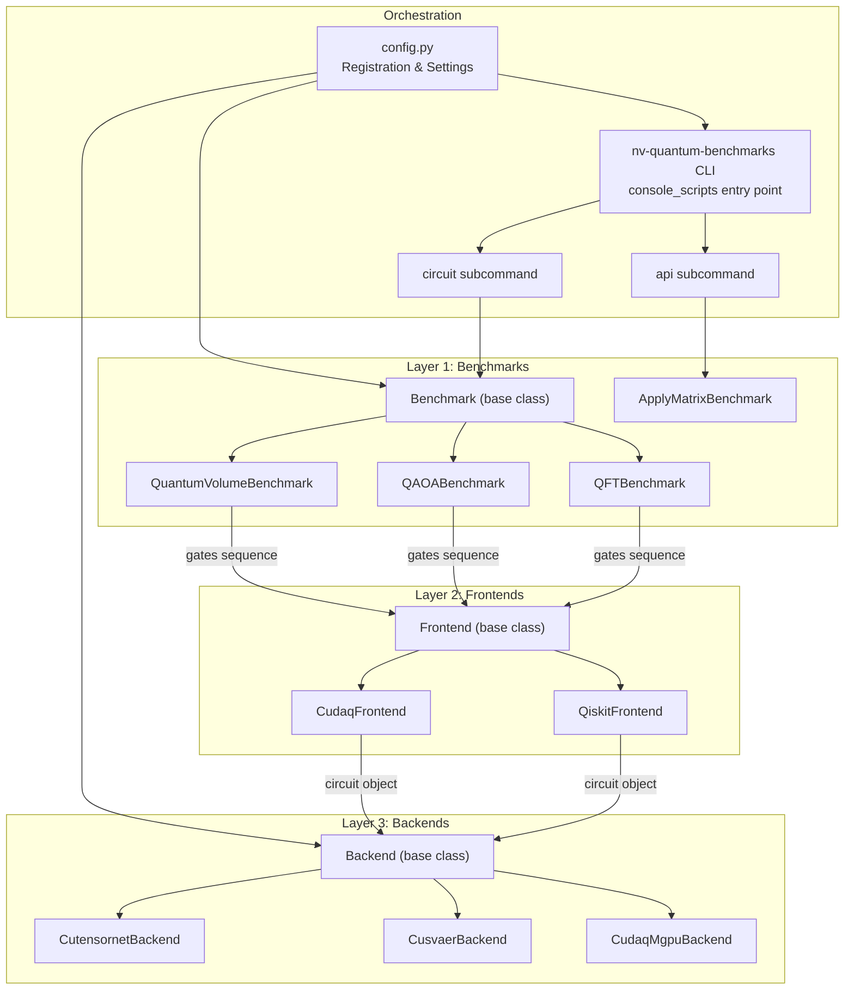
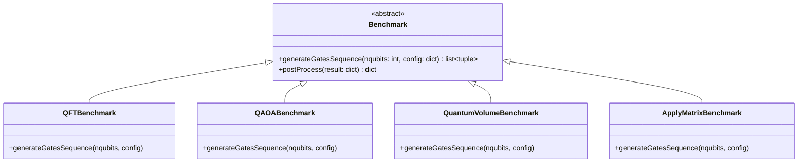
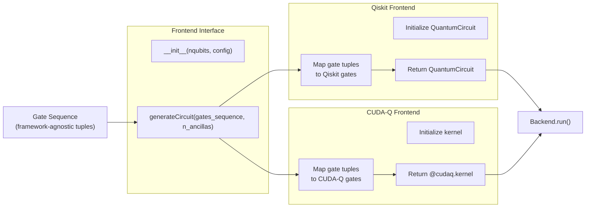
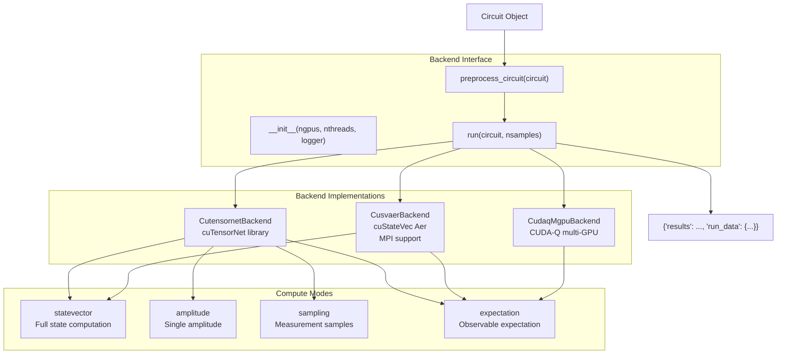
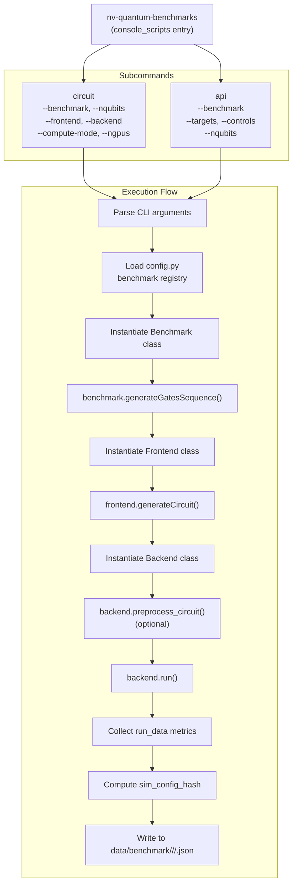
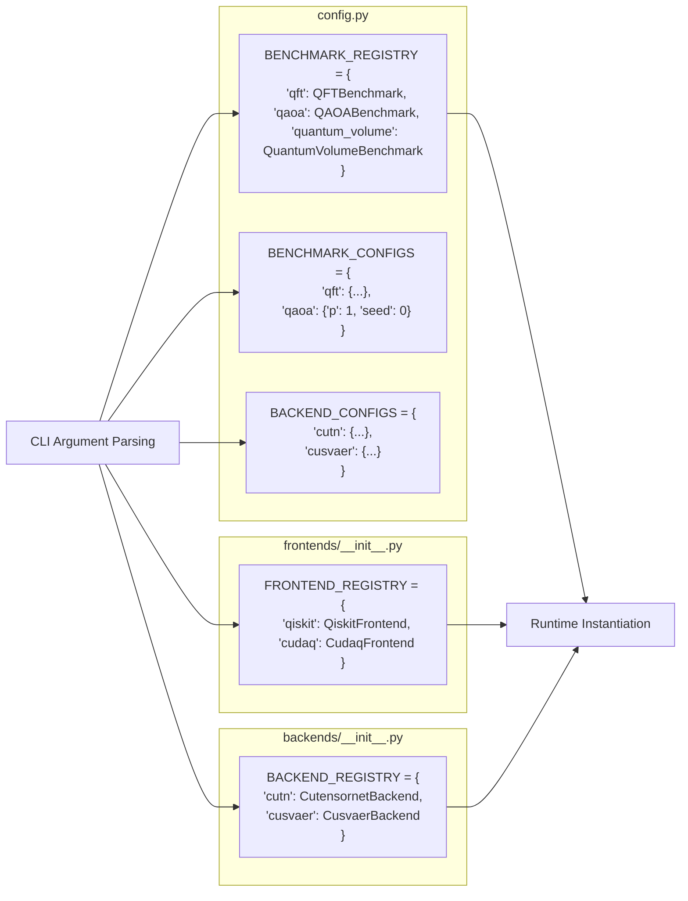
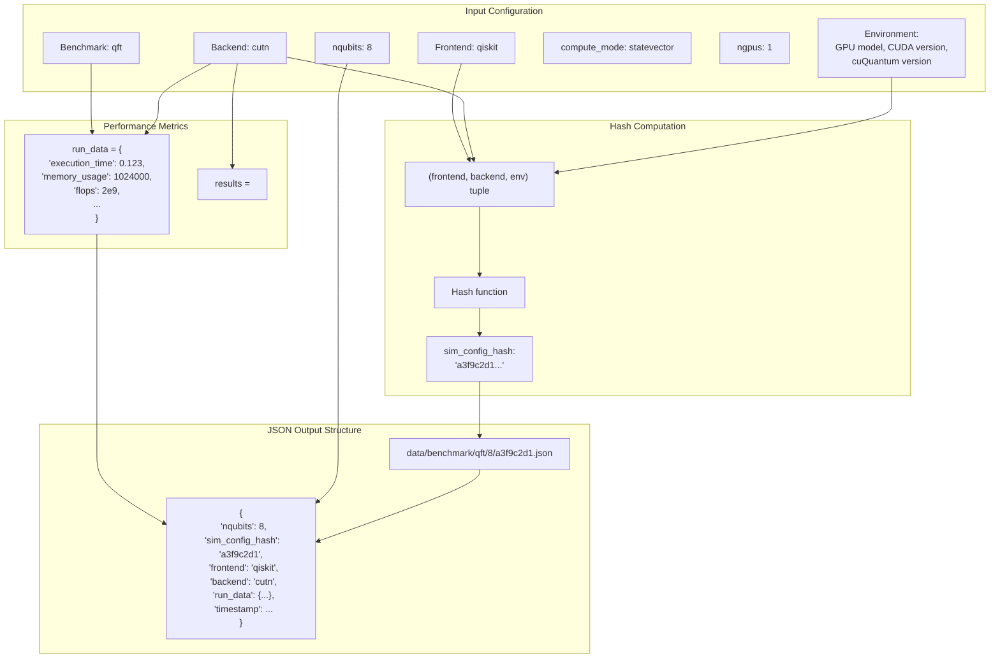
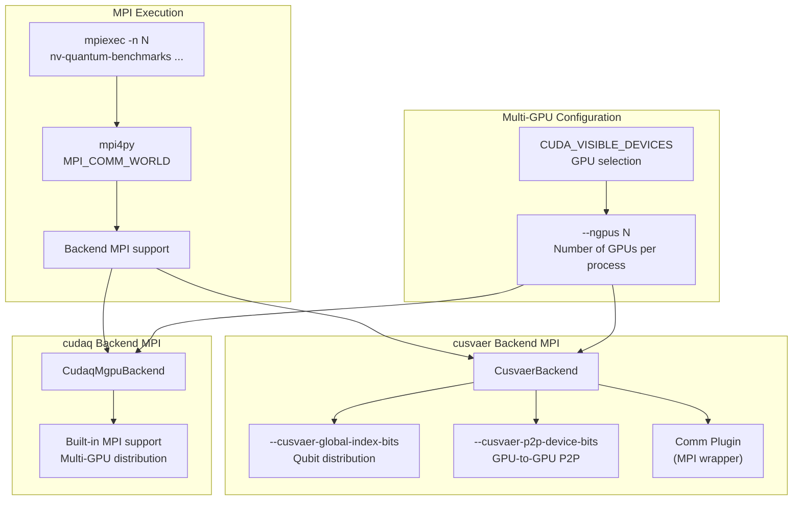

<!-- source: DeepWiki mcp.deepwiki.com · repo NVIDIA/cuQuantum · page 6.1 Architecture and Design · fetched 2026-10-26 -->

# Architecture and Design

<details>
<summary>Relevant source files</summary>

The following files were used as context for generating this wiki page:

- [benchmarks/README.md](benchmarks/README.md)
- [extra/custatevec/README.md](extra/custatevec/README.md)

</details>


## Purpose and Scope

This page documents the architectural design of the `nv-quantum-benchmarks` performance evaluation suite. It explains the three-layer plugin architecture that separates benchmark logic (framework-agnostic gate sequences) from framework-specific circuit representations (frontends) and execution engines (backends). This design enables apples-to-apples performance comparisons across different quantum computing stacks.

For details on specific benchmark types, see [Circuit Benchmarks](#6.2) and [API Benchmarks](#6.3). For practical usage instructions, see [Running and Analyzing Benchmarks](#6.4).

---

## Three-Layer Architecture Overview

The benchmark suite employs a modular, three-layer architecture that decouples benchmark definition from framework selection and execution:



**Key Design Principle**: Benchmarks generate framework-agnostic gate sequences as tuples. Frontends translate these tuples into framework-specific circuit objects (e.g., Qiskit `QuantumCircuit`, CUDA-Q kernel). Backends execute these circuits and return performance metrics.

**Sources**: [benchmarks/README.md:76-79]()

---

## Layer 1: Framework-Agnostic Benchmarks

Benchmarks define quantum algorithms as sequences of gate operations without coupling to any specific quantum computing framework.

### Benchmark Base Class Contract



### Gate Sequence Format

The `generateGatesSequence()` method returns a list of gate tuples. Each tuple encodes:
- Gate type (e.g., `'h'`, `'cx'`, `'rz'`)
- Target qubit indices
- Control qubit indices (if applicable)
- Parameters (e.g., rotation angles)

**Example gate sequence structure**:
```python
[
    ('h', 0),                    # Hadamard on qubit 0
    ('cx', 0, 1),                # CNOT from qubit 0 to 1
    ('rz', 2, {'angle': 0.5}),   # RZ rotation on qubit 2
]
```

### Registration Mechanism

New benchmarks are registered in `config.py`, which maps benchmark names to their corresponding classes. This registry is consulted by the CLI to instantiate the appropriate benchmark class.

**Sources**: [benchmarks/README.md:80-89]()

---

## Layer 2: Frontend Abstraction

Frontends translate framework-agnostic gate sequences into framework-specific circuit representations.



### Frontend Base Class Contract

Each frontend must implement:

| Method | Parameters | Returns | Purpose |
|--------|-----------|---------|---------|
| `__init__` | `nqubits: int, config: dict` | N/A | Initialize frontend with circuit size and configuration |
| `generateCircuit` | `gates_sequence: list, n_ancillas: int` | Circuit object | Convert gate tuples to framework-specific circuit |

### Supported Frontends

| Frontend Name | Circuit Type | Registration Location |
|--------------|-------------|---------------------|
| `qiskit` | `qiskit.QuantumCircuit` | `frontends/__init__.py` |
| `cudaq` | `@cudaq.kernel` decorated function | `frontends/__init__.py` |

### Frontend Registration

Frontends are registered in `frontends/__init__.py`, enabling the CLI to dynamically select and instantiate the requested frontend at runtime.

**Sources**: [benchmarks/README.md:90-98]()

---

## Layer 3: Backend Execution Engines

Backends receive framework-specific circuits and execute them using various simulation or hardware approaches.



### Backend Base Class Contract

| Method | Parameters | Returns | Purpose |
|--------|-----------|---------|---------|
| `__init__` | `ngpus: int, nthreads: int, logger` | N/A | Initialize backend with resource configuration |
| `preprocess_circuit` | `circuit` | `dict` (optional) | Setup configurations before execution, return perf data |
| `run` | `circuit, nsamples: int` | `dict` | Execute circuit and return results + performance metrics |

### Backend Output Format

The `run()` method returns a dictionary:
```python
{
    'results': <computation_result>,  # State vector, amplitude, samples, etc.
    'run_data': {                     # Performance metrics
        'execution_time': float,
        'memory_usage': int,
        'flops': int,
        # ... backend-specific metrics
    }
}
```

### Supported Backends and Compute Modes

| Backend | Library | MPI Support | Compute Modes |
|---------|---------|-------------|---------------|
| `cutn` | cuTensorNet | No | statevector, amplitude, sampling, expectation |
| `cusvaer` | cuStateVec Aer | Yes | statevector, expectation |
| `cudaq-mgpu` | CUDA-Q | Yes | expectation |

### Backend-Specific Options

Backends may accept specialized configuration options via CLI flags:

- **cusvaer backend**: `--cusvaer-global-index-bits`, `--cusvaer-p2p-device-bits` for MPI distribution
- **cutn backend**: Path optimization, slicing strategies (documented in [High-Level API](#3.3))
- **cudaq backend**: Multi-GPU device assignment

**Sources**: [benchmarks/README.md:100-112](), [benchmarks/README.md:52-55]()

---

## CLI Orchestration and Entry Point

The `nv-quantum-benchmarks` command serves as the primary entry point, orchestrating the three layers to execute benchmarks.



### CLI Command Structure

```bash
nv-quantum-benchmarks {circuit|api} [OPTIONS]
```

### Circuit Subcommand Example

```bash
nv-quantum-benchmarks circuit \
    --frontend qiskit \
    --backend cutn \
    --compute-mode statevector \
    --benchmark qft \
    --nqubits 8 \
    --ngpus 1
```

This command:
1. Instantiates `QFTBenchmark` with 8 qubits
2. Generates gate sequence: `[('h', 0), ('cp', 0, 1, ...), ...]`
3. Uses `QiskitFrontend` to create `QuantumCircuit`
4. Uses `CutensornetBackend` to compute state vector
5. Writes performance data to JSON with computed `sim_config_hash`

### API Subcommand Example

```bash
nv-quantum-benchmarks api \
    --benchmark apply_matrix \
    --targets 4,5 \
    --controls 2,3 \
    --nqubits 16
```

This directly benchmarks cuStateVec's `apply_matrix()` function, bypassing frontend/backend abstraction for low-level API testing.

**Sources**: [benchmarks/README.md:26-55]()

---

## Configuration System and Registration

The `config.py` module serves as the central registry for benchmarks, frontends, and backends, enabling dynamic dispatch at runtime.



### Registration Pattern

To add a new component:

1. **Benchmark**: Create class in `benchmarks/` directory, register in `config.py` under `BENCHMARK_REGISTRY`
2. **Frontend**: Create class in `frontends/` directory, register in `frontends/__init__.py`
3. **Backend**: Create class in `backends/` directory, register in both `backends/__init__.py` and `config.py`

### Per-Benchmark Configuration

Benchmark-specific parameters are stored in `BENCHMARK_CONFIGS`:

```python
BENCHMARK_CONFIGS = {
    'qaoa': {
        'p': 1,           # Number of QAOA layers
        'seed': 0,        # Random seed for problem instance
    },
    'quantum_volume': {
        'seed': 0,        # Random seed for circuit generation
    }
}
```

These configurations are passed to `generateGatesSequence()` to customize benchmark behavior.

**Sources**: [benchmarks/README.md:80-112]()

---

## Data Flow and Performance Output

Benchmark results are stored as structured JSON files organized by configuration hash, enabling reproducible performance tracking.



### Directory Structure

```
data/
└── benchmark/
    ├── qft/
    │   ├── 8/
    │   │   ├── a3f9c2d1.json
    │   │   └── b7e4f8a2.json
    │   └── 16/
    │       └── c1d9e5f3.json
    ├── qaoa/
    │   └── 12/
    │       └── d2e8f6a4.json
    └── quantum_volume/
        └── 20/
            └── e3f9a7b5.json
```

### sim_config_hash Purpose

The `sim_config_hash` uniquely identifies a benchmark configuration:
- **Frontend** + **Backend** + **Run Environment** (GPU model, CUDA version, cuQuantum version, etc.)
- Ensures performance data is properly partitioned when any setup component changes
- Enables historical tracking: same hash = comparable results

### Accessing Benchmark Data

```python
import json

with open('data/benchmark/qft/8/a3f9c2d1.json') as f:
    data = json.load(f)

# Access by nqubits and hash
results = data[nqubits][sim_config_hash]
execution_time = results['run_data']['execution_time']
```

**Sources**: [benchmarks/README.md:61-65]()

---

## MPI and Multi-GPU Support

The architecture supports distributed execution through backend-specific MPI implementations.



### MPI Benchmark Execution Example

```bash
# Multi-node cuStateVec Aer with MPI
mpiexec -n 4 nv-quantum-benchmarks circuit \
    --frontend qiskit \
    --backend cusvaer \
    --benchmark quantum_volume \
    --nqubits 32 \
    --ngpus 1 \
    --cusvaer-global-index-bits 1,1 \
    --cusvaer-p2p-device-bits 1
```

This runs on 4 MPI processes (2 nodes × 2 processes/node), each controlling 1 GPU, with:
- 2 qubits distributed globally (`1,1` global index bits)
- 1 qubit for P2P communication (`1` P2P device bit)

### cusvaer Comm Plugin

The `cusvaer` backend supports custom MPI libraries through the Comm Plugin mechanism. For multi-node execution with non-default MPI libraries, users can:

1. Compile external Comm Plugin (see [MPI Integration](#4.3))
2. Set `cusvaer_comm_plugin_type=CommPluginType.EXTERNAL`
3. Specify `cusvaer_comm_plugin_soname` for the shared object

**Sources**: [benchmarks/README.md:49-56](), [extra/custatevec/README.md:1-48]()

---

## Extensibility and Plugin Development

The three-layer architecture is designed for extensibility, allowing developers to add new benchmarks, frontends, and backends without modifying core infrastructure.

### Adding a New Benchmark

**Steps**:
1. Create a new class inheriting from `Benchmark` base class
2. Implement `generateGatesSequence(nqubits, config)` → returns `list[tuple]`
3. Optionally implement `postProcess(result)` for custom result handling
4. Register in `config.py` under `BENCHMARK_REGISTRY`

**Benchmark Interface**:
```python
class MyBenchmark(Benchmark):
    def generateGatesSequence(self, nqubits, config):
        # Return list of gate tuples
        gates = [
            ('h', 0),
            ('cx', 0, 1),
            # ...
        ]
        return gates
    
    def postProcess(self, result):
        # Optional: transform result
        return result
```

### Adding a New Frontend

**Steps**:
1. Create a new class inheriting from `Frontend` base class
2. Implement `__init__(nqubits, config)`
3. Implement `generateCircuit(gates_sequence, n_ancillas)` → returns circuit object
4. Register in `frontends/__init__.py`

**Frontend Interface**:
```python
class MyFrontend(Frontend):
    def __init__(self, nqubits, config):
        self.nqubits = nqubits
        # Initialize framework-specific circuit
    
    def generateCircuit(self, gates_sequence, n_ancillas):
        # Map gate tuples to framework gates
        for gate in gates_sequence:
            # Add gate to circuit
        return circuit
```

### Adding a New Backend

**Steps**:
1. Create a new class inheriting from `Backend` base class
2. Implement `__init__(ngpus, nthreads, logger)`
3. Implement `run(circuit, nsamples)` → returns `{'results': ..., 'run_data': {...}}`
4. Optionally implement `preprocess_circuit(circuit)` for setup
5. Register in both `backends/__init__.py` and `config.py`

**Backend Interface**:
```python
class MyBackend(Backend):
    def __init__(self, ngpus, nthreads, logger):
        self.ngpus = ngpus
        # Initialize execution engine
    
    def preprocess_circuit(self, circuit):
        # Optional: setup configurations
        return {'preprocess_time': 0.01}
    
    def run(self, circuit, nsamples):
        # Execute circuit
        result = execute(circuit)
        return {
            'results': result,
            'run_data': {
                'execution_time': 0.123,
                'memory_usage': 1024000
            }
        }
```

### Extension Points Summary

| Component | Base Class Location | Registry Location | Required Methods |
|-----------|-------------------|------------------|-----------------|
| Benchmark | `benchmarks/` | `config.py` | `generateGatesSequence()` |
| Frontend | `frontends/frontend.py` | `frontends/__init__.py` | `__init__()`, `generateCircuit()` |
| Backend | `backends/backend.py` | `backends/__init__.py`, `config.py` | `__init__()`, `run()` |

**Sources**: [benchmarks/README.md:76-112]()

---

## Architecture Benefits

The three-layer separation provides several key advantages:

1. **Framework Independence**: Benchmark logic is decoupled from quantum frameworks, enabling fair comparisons
2. **Mix-and-Match Flexibility**: Any benchmark can run with any frontend/backend combination (if compatible)
3. **Extensibility**: New components integrate through well-defined interfaces without core modifications
4. **Reproducibility**: `sim_config_hash` ensures results are properly tracked across configuration changes
5. **MPI Scalability**: Backend abstraction enables transparent multi-GPU/multi-node execution
6. **Performance Isolation**: Each layer captures distinct performance metrics (generation time, circuit construction time, execution time)

This design positions `nv-quantum-benchmarks` as a platform for systematic quantum performance evaluation across the rapidly evolving quantum computing ecosystem.

**Sources**: [benchmarks/README.md:76-79]()

---

