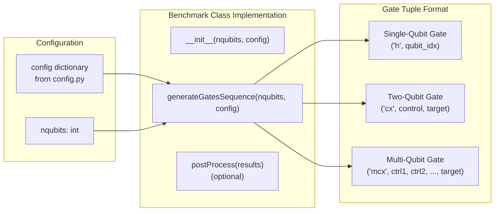
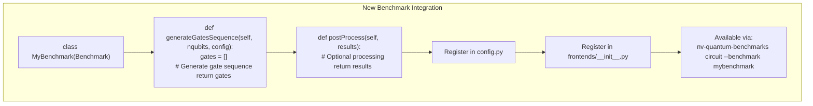
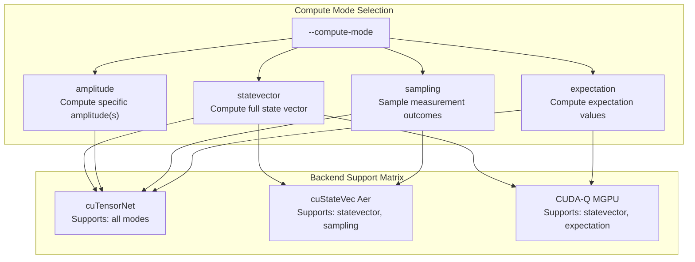
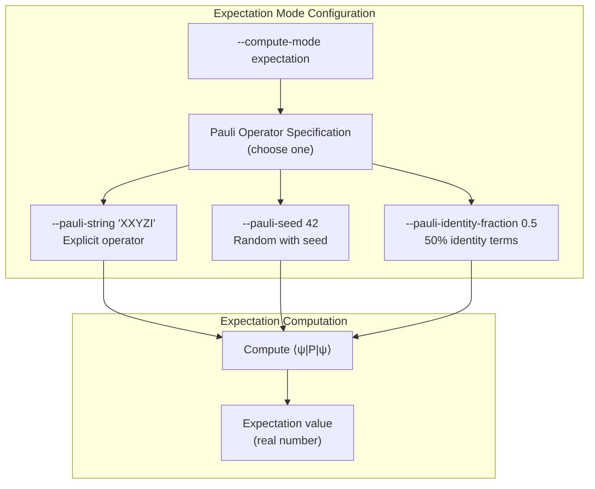
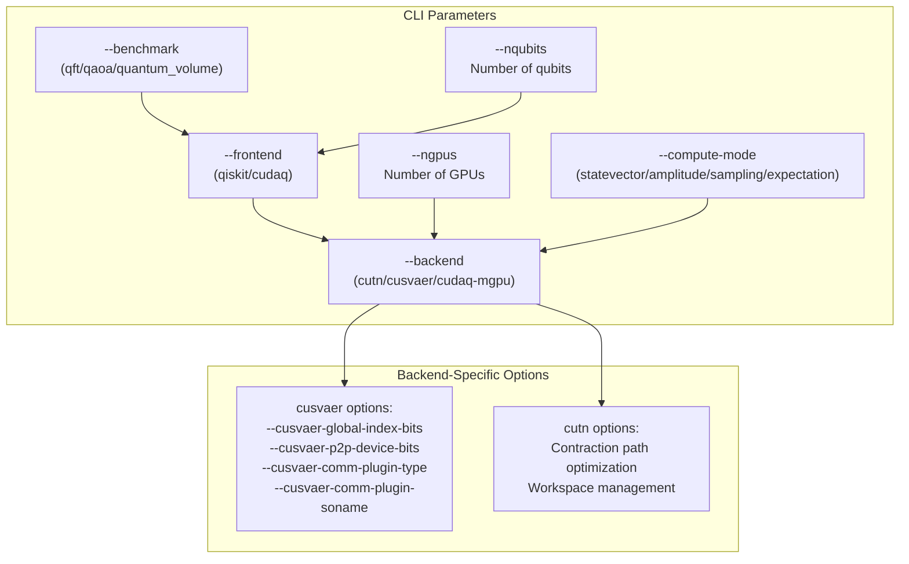
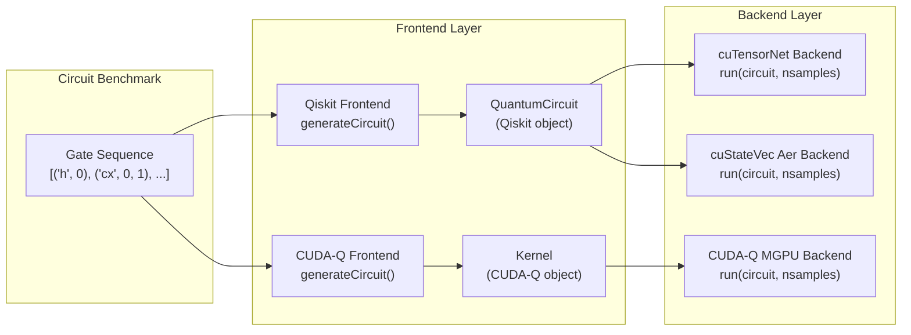
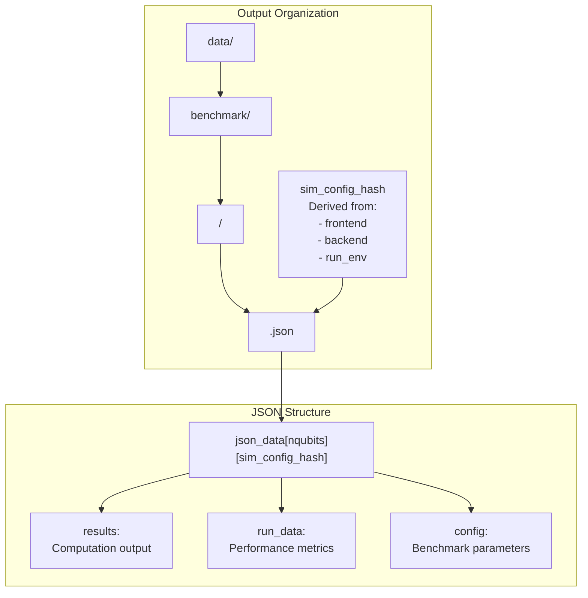

<!-- source: DeepWiki mcp.deepwiki.com · repo NVIDIA/cuQuantum · page 6.2 Circuit Benchmarks · fetched 2026-10-26 -->

# Circuit Benchmarks

<details>
<summary>Relevant source files</summary>

The following files were used as context for generating this wiki page:

- [benchmarks/README.md](benchmarks/README.md)
- [extra/custatevec/README.md](extra/custatevec/README.md)

</details>


## Purpose and Scope

This document describes the circuit-level benchmarks provided by the `nv-quantum-benchmarks` suite. Circuit benchmarks evaluate the performance of quantum circuit simulation by constructing standard quantum algorithms (QFT, QAOA, Quantum Volume) in a framework-agnostic manner and executing them through various backend implementations. These benchmarks measure end-to-end performance including circuit construction, compilation, and execution across different compute modes.

For information about API-level benchmarks that test specific cuQuantum functions, see [API Benchmarks](#6.3). For the overall architecture and how to run benchmarks, see [Architecture and Design](#6.1) and [Running and Analyzing Benchmarks](#6.4).

## Overview

Circuit benchmarks operate on complete quantum algorithms rather than individual API calls. The benchmark suite generates gate sequences in a framework-agnostic format, which are then converted to specific quantum computing frameworks (frontends) and executed on various simulation backends. This design enables fair performance comparisons across different software stacks while eliminating framework-specific biases in circuit construction.

### Circuit Benchmark Flow

```mermaid
graph TB
    subgraph "Circuit Benchmark Execution"
        CMD["nv-quantum-benchmarks circuit<br/>--benchmark qft<br/>--nqubits 8"]
        
        BENCH_CLASS["Benchmark Class<br/>(e.g., QFT, QAOA)"]
        GENERATE["generateGatesSequence()<br/>Returns: List[Tuple]"]
        GATE_SEQ["Framework-Agnostic<br/>Gate Sequence<br/>[('h', 0), ('cx', 0, 1), ...]"]
        
        FRONTEND["Frontend<br/>(Qiskit/CUDA-Q)"]
        CIRCUIT["Framework-Specific<br/>Circuit Object"]
        
        BACKEND["Backend<br/>(cutn/cusvaer/cudaq-mgpu)"]
        COMPUTE["Compute Mode<br/>(statevector/amplitude/sampling/expectation)"]
        
        EXECUTE["Execute Circuit"]
        RESULTS["Results Dictionary<br/>{results, run_data}"]
        JSON["JSON Output<br/>data/benchmark/nqubits/hash.json"]
    end
    
    CMD --> BENCH_CLASS
    BENCH_CLASS --> GENERATE
    GENERATE --> GATE_SEQ
    GATE_SEQ --> FRONTEND
    FRONTEND --> CIRCUIT
    CIRCUIT --> BACKEND
    BACKEND --> COMPUTE
    COMPUTE --> EXECUTE
    EXECUTE --> RESULTS
    RESULTS --> JSON
```



**Sources:** [benchmarks/README.md:76-113]()

## Available Circuit Benchmarks

The suite provides three standard quantum circuit benchmarks representing different algorithmic patterns and resource requirements.

### Benchmark Types

| Benchmark | Description | Typical Use Case | Configurable Parameters |
|-----------|-------------|------------------|------------------------|
| `qft` | Quantum Fourier Transform | Shor's algorithm, quantum phase estimation | `nqubits` |
| `qaoa` | Quantum Approximate Optimization Algorithm | Combinatorial optimization problems | `nqubits`, circuit depth |
| `quantum_volume` | Quantum Volume protocol | Hardware characterization, benchmarking | `nqubits` |

**Sources:** [benchmarks/README.md:52-55]()

### QFT (Quantum Fourier Transform)

The QFT benchmark implements the quantum analog of the discrete Fourier transform, featuring a triangular structure with controlled rotation gates. This benchmark stresses both gate application and numerical precision.

**Example:**
```
nv-quantum-benchmarks circuit --frontend qiskit --backend cutn \
  --compute-mode statevector --benchmark qft --nqubits 8 --ngpus 1
```

### QAOA (Quantum Approximate Optimization Algorithm)

The QAOA benchmark implements variational quantum circuits for solving combinatorial optimization problems. This benchmark features repeating layers of mixer and problem Hamiltonians, making it representative of near-term quantum algorithms.

**Example:**
```
mpirun -np 2 nv-quantum-benchmarks circuit --frontend cudaq --backend cudaq-mgpu \
  --compute-mode expectation --benchmark qaoa --nqubits 16 --ngpus 2
```

### Quantum Volume

The Quantum Volume benchmark creates random unitary circuits to measure overall quantum system performance. It provides a holistic assessment of gate fidelity, connectivity, and measurement capability.

**Example:**
```
mpiexec -n 4 nv-quantum-benchmarks circuit --frontend qiskit --backend cusvaer \
  --benchmark quantum_volume --nqubits 32 --ngpus 1 \
  --cusvaer-global-index-bits 1,1 --cusvaer-p2p-device-bits 1
```

**Sources:** [benchmarks/README.md:52-55]()

## Framework-Agnostic Gate Representation

Circuit benchmarks define quantum circuits as sequences of gate tuples, independent of any specific quantum computing framework. This representation is then translated by frontends into framework-specific circuit objects.

### Gate Sequence Structure

The `generateGatesSequence()` method produces a list of tuples representing quantum gates:



**Typical gate tuple examples:**
- `('h', 0)` - Hadamard gate on qubit 0
- `('cx', 0, 1)` - CNOT gate with control qubit 0, target qubit 1
- `('rz', 2, 1.57)` - RZ rotation on qubit 2 with angle 1.57 radians
- `('mcx', 0, 1, 2, 3)` - Multi-controlled X gate with controls on qubits 0, 1, 2 and target on qubit 3

**Sources:** [benchmarks/README.md:82-89]()

### Adding Custom Benchmarks

To create a new circuit benchmark:

1. **Create benchmark class** inheriting from `Benchmark` base class
2. **Implement `generateGatesSequence(nqubits, config)`** to return gate list
3. **Optionally implement `postProcess(results)`** for custom result handling
4. **Register in `config.py`** to make it available via CLI



**Sources:** [benchmarks/README.md:80-89]()

## Compute Modes

Circuit benchmarks support multiple compute modes that determine the type of quantum computation performed. Not all backends support all compute modes, and each backend has its own default.

### Supported Compute Modes



### Statevector Mode

Computes the complete quantum state vector |ψ⟩ for the circuit. This mode provides full information about the quantum state but requires exponential memory (2^n complex amplitudes for n qubits).

**Example:**
```
nv-quantum-benchmarks circuit --frontend qiskit --backend cutn \
  --compute-mode statevector --benchmark qft --nqubits 16
```

### Amplitude Mode

Computes specific probability amplitudes without computing the full state vector. This mode is efficient when only a small subset of amplitudes is needed.

### Sampling Mode

Generates measurement samples from the circuit output distribution. This mode simulates what would be measured on a physical quantum computer, providing bitstring samples according to the Born rule.

**Example:**
```
nv-quantum-benchmarks circuit --frontend qiskit --backend cusvaer \
  --compute-mode sampling --benchmark qaoa --nqubits 20 --ngpus 2
```

### Expectation Mode

Computes expectation values ⟨ψ|P|ψ⟩ for Pauli operators P. This mode is essential for variational algorithms like VQE and QAOA, where the objective function is typically a sum of Pauli expectation values.

**Sources:** [benchmarks/README.md:53]()

## Pauli Operator Specification

When using `--compute-mode expectation`, the benchmark requires specification of which Pauli operators to measure. Three mutually exclusive options are available:

### Pauli Specification Options

| Option | Description | Use Case |
|--------|-------------|----------|
| `--pauli-string` | Explicit Pauli string (e.g., "XXYZI") | Testing specific observables |
| `--pauli-seed` | Random seed for generating Pauli operators | Reproducible random operators |
| `--pauli-identity-fraction` | Fraction of identity operators in random Pauli | Control operator complexity |



**Example with explicit Pauli string:**
```
nv-quantum-benchmarks circuit --frontend qiskit --backend cutn \
  --compute-mode expectation --benchmark qaoa --nqubits 10 \
  --pauli-string "XXIIYYZZII"
```

**Example with random Pauli operators:**
```
nv-quantum-benchmarks circuit --frontend cudaq --backend cudaq-mgpu \
  --compute-mode expectation --benchmark qft --nqubits 16 \
  --pauli-seed 42 --pauli-identity-fraction 0.3
```

**Sources:** [benchmarks/README.md:53]()

## Circuit Benchmark Configuration

Circuit benchmarks accept multiple configuration parameters that control circuit generation, execution environment, and backend-specific options.

### Common Parameters



### Multi-GPU and MPI Configuration

For distributed execution across multiple GPUs or nodes:

**Multi-GPU (single node):**
```
nv-quantum-benchmarks circuit --frontend qiskit --backend cutn \
  --benchmark qft --nqubits 28 --ngpus 4
```

**Multi-node with MPI:**
```
mpiexec -n 4 nv-quantum-benchmarks circuit \
  --frontend qiskit --backend cusvaer \
  --benchmark quantum_volume --nqubits 32 --ngpus 1 \
  --cusvaer-global-index-bits 1,1 --cusvaer-p2p-device-bits 1
```

The `--ngpus` parameter specifies how many GPUs each MPI process should use. The environment variable `CUDA_VISIBLE_DEVICES` can limit which GPUs are accessible.

**Sources:** [benchmarks/README.md:47-55]()

## Integration with Frontends and Backends

Circuit benchmarks decouple circuit definition from execution through the frontend-backend architecture.

### Frontend-Backend Interaction



### Frontend Implementation

Frontends inherit from the `Frontend` base class and implement:
- `__init__(nqubits, config)` - Initialize with qubit count and configuration
- `generateCircuit(gate_sequence, nancillas)` - Convert gate sequence to framework-specific circuit

**Sources:** [benchmarks/README.md:90-98]()

### Backend Implementation

Backends inherit from the `Backend` base class and implement:
- `__init__(ngpus, ncpu_threads, logger)` - Initialize with resource allocation
- `preprocess_circuit(circuit)` - Optional preprocessing (returns performance data dict)
- `run(circuit, nsamples)` - Execute circuit (returns `{results, run_data}` dict)

The `run()` method returns:
- `results` - Computation output (statevector, amplitudes, samples, or expectation values)
- `run_data` - Performance metrics (execution time, FLOP count, memory usage, etc.)

**Sources:** [benchmarks/README.md:100-112]()

## Output Format and Performance Data

Circuit benchmark results are stored as JSON files organized by benchmark type, qubit count, and configuration hash.

### Output Directory Structure



The `sim_config_hash` ensures that benchmark data is recorded separately when any part of the configuration changes (frontend, backend, or runtime environment). This prevents accidental overwriting of results when comparing different configurations.

**Sources:** [benchmarks/README.md:61-65]()

### Accessing Benchmark Data

To analyze circuit benchmark results programmatically:

```python
import json

# Load benchmark data
with open('data/benchmark/16/abc123def456.json', 'r') as f:
    data = json.load(f)

# Access by nqubits and config hash
nqubits = 16
sim_config_hash = "abc123def456"
results = data[nqubits][sim_config_hash]

# Extract performance metrics
execution_time = results['run_data']['execution_time']
memory_used = results['run_data']['memory_usage']
```

It is recommended to iterate over all recorded `sim_config_hash` values to gather performance data for analysis across different configurations.

**Sources:** [benchmarks/README.md:61-65]()

## Environment Variables

Circuit benchmarks support several environment variables for debugging and advanced configuration. These are reserved for internal use and may change without notice:

| Variable | Purpose | Example Value |
|----------|---------|---------------|
| `CUTENSORNET_DUMP_TN` | Dump tensor network structure | `txt` |
| `CUTENSORNET_APPROX_TN_UTILS_PATH` | Path to approximate TN utilities | `/path/to/utils` |
| `CUQUANTUM_BENCHMARKS_DUMP_GATES` | Dump gate sequences for debugging | `1` |
| `CUQUANTUM_BENCHMARKS_TCS_FULL_TENSOR` | Use full tensors in tensor contraction | `1` |

**Sources:** [benchmarks/README.md:67-74]()

---

