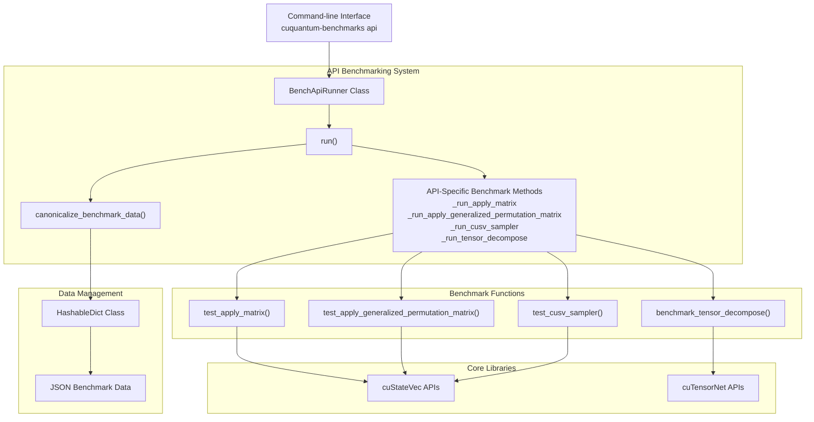
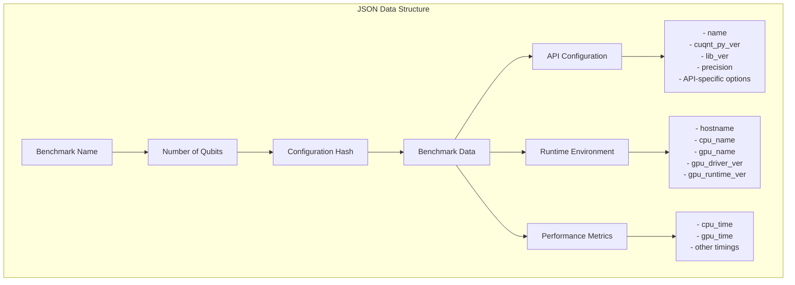
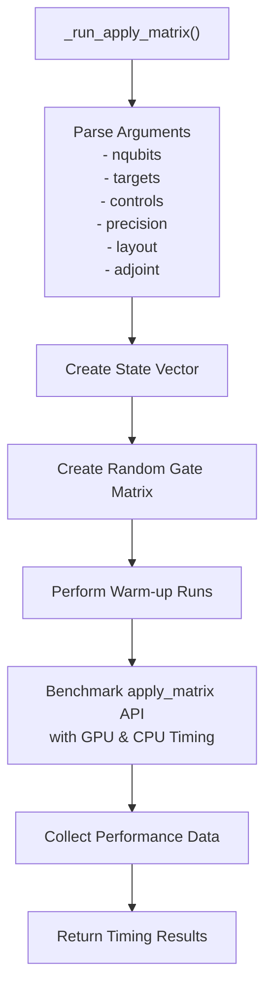
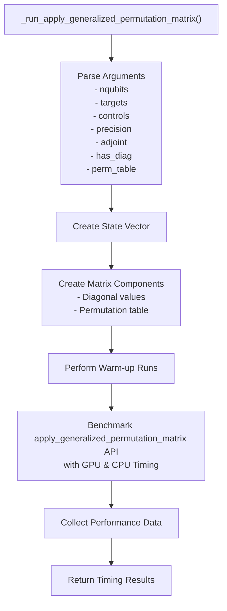
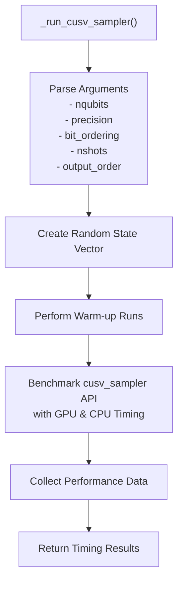
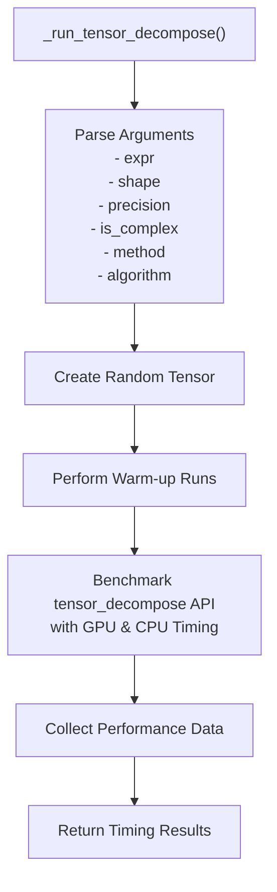
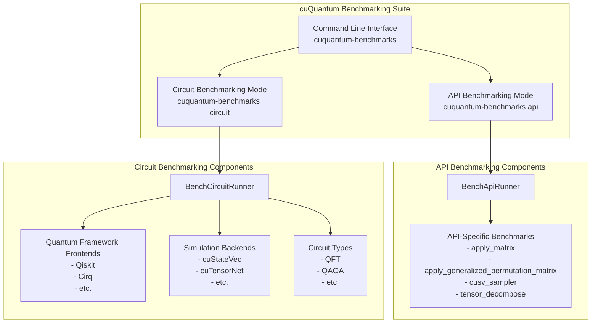

<!-- source: DeepWiki mcp.deepwiki.com · repo NVIDIA/cuQuantum · page 6.3 API Benchmarks · fetched 2026-10-26 -->

# API Benchmarks

<details>
<summary>Relevant source files</summary>

The following files were used as context for generating this wiki page:

- [benchmarks/README.md](benchmarks/README.md)
- [extra/custatevec/README.md](extra/custatevec/README.md)

</details>


This page documents the API benchmarking capabilities in the cuQuantum SDK. It provides details on how to benchmark individual function calls from the cuStateVec and cuTensorNet libraries to measure their performance characteristics. For information about benchmarking full quantum circuits, see [Circuit Benchmarks](#5.1).

## Overview

The API benchmarking system enables users to measure the performance of specific low-level API calls in isolation. This is useful for:

1. Understanding the performance characteristics of individual operations
2. Diagnosing bottlenecks in applications
3. Evaluating optimization techniques
4. Comparing performance across different hardware configurations

Unlike circuit benchmarks that measure end-to-end performance of quantum circuit simulations, API benchmarks focus on granular performance metrics of individual library functions.

Sources: [benchmarks/README.md:30-41](), [benchmarks/cuquantum_benchmarks/run_interface.py:408-413]()

## API Benchmarking Architecture

The API benchmarking system is built around the `BenchApiRunner` class which manages benchmark execution and data collection.

### System Architecture

Here's a high-level overview of the API benchmarking system:



Sources: [benchmarks/cuquantum_benchmarks/run_interface.py:408-646]()

### Data Storage Format

The benchmarking system stores performance data in a structured JSON format:



Sources: [benchmarks/cuquantum_benchmarks/run_interface.py:590-646]()

## Supported APIs

The benchmark suite currently supports the following APIs:

### cuStateVec APIs

| API | Description |
|-----|-------------|
| `apply_matrix` | Apply a gate matrix to target qubits with optional control qubits |
| `apply_generalized_permutation_matrix` | Apply a generalized permutation matrix to target qubits with optional controls |
| `cusv_sampler` | Sample bit strings from a state vector according to quantum measurement probabilities |

### cuTensorNet APIs

| API | Description |
|-----|-------------|
| `tensor_decompose` | Decompose a tensor using methods like SVD or QR decomposition |

Sources: [benchmarks/cuquantum_benchmarks/run_interface.py:410-412]()

## Using the API Benchmarking Tool

### Installation

To install the benchmark suite:

```
pip install .
```

For all optional dependencies:

```
pip install .[all]
```

Sources: [benchmarks/README.md:3-15]()

### Basic Usage

The API benchmarking tool is accessed through the `cuquantum-benchmarks api` command:

```
cuquantum-benchmarks api [options] --benchmark BENCHMARK_NAME
```

Where `BENCHMARK_NAME` is one of the supported APIs.

### Examples

Here's an example that benchmarks the `apply_matrix` API:

```
cuquantum-benchmarks api --benchmark apply_matrix --targets 4,5 --controls 2,3 --nqubits 16
```

This command applies a random gate matrix controlled by qubits 2 and 3 to qubits 4 and 5 of a 16-qubit state vector using cuStateVec's `apply_matrix()` API.

Sources: [benchmarks/README.md:51-53]()

## API-Specific Benchmark Implementation

Each supported API has a dedicated benchmark implementation that handles the specific requirements for that API. Let's look at the workflow for each implementation:

### apply_matrix Benchmark



Sources: [benchmarks/cuquantum_benchmarks/run_interface.py:450-487]()

### apply_generalized_permutation_matrix Benchmark



Sources: [benchmarks/cuquantum_benchmarks/run_interface.py:489-539]()

### cusv_sampler Benchmark



Sources: [benchmarks/cuquantum_benchmarks/run_interface.py:541-562]()

### tensor_decompose Benchmark



Sources: [benchmarks/cuquantum_benchmarks/run_interface.py:564-588]()

## Common Command Line Arguments

Each API benchmark has specific command line arguments tailored to the API being tested, but several common options are available for all benchmarks:

| Argument | Description |
|----------|-------------|
| `--benchmark` | The API to benchmark (required) |
| `--nqubits` | Number of qubits in the state vector (for cuStateVec APIs) |
| `--precision` | Numeric precision (single/double) |
| `--nwarmups` | Number of warm-up runs before timing |
| `--nrepeats` | Number of times to repeat the benchmark for averaging |
| `--cachedir` | Directory to store benchmark data |

Sources: [benchmarks/cuquantum_benchmarks/run_interface.py:417-429](), [benchmarks/README.md:30-41]()

## Advanced Usage

### Performance Analysis and Data Visualization

The benchmark results are stored in JSON files in the `data` directory, which allows for easy post-processing and visualization. You can access benchmark data programmatically by loading the JSON files:

```python
import json

# Load benchmark data
with open('data/apply_matrix.json', 'r') as f:
    data = json.load(f)

# Access results for specific qubit counts and configurations
for nqubits in data:
    for config_hash in data[nqubits]:
        benchmark_data = data[nqubits][config_hash]
        print(f"Configuration: {benchmark_data['api']['name']}")
        print(f"CPU time: {benchmark_data.get('cpu_time', 'N/A')} s")
        print(f"GPU time: {benchmark_data.get('gpu_time', 'N/A')} s")
```

Sources: [benchmarks/cuquantum_benchmarks/run_interface.py:590-646](), [benchmarks/README.md:61-66]()

## Integration with the Benchmarking Suite

The API benchmarking system is integrated with the overall cuQuantum benchmarking suite. The following diagram shows how the API benchmarks fit within the larger benchmarking architecture:



Sources: [benchmarks/README.md:25-41](), [benchmarks/cuquantum_benchmarks/run_interface.py:30-408]()

## Performance Considerations

When running API benchmarks, consider the following factors that can affect performance:

1. **GPU Selection**: Use the `CUDA_VISIBLE_DEVICES` environment variable to control which GPUs are used.
2. **Memory Usage**: Large qubit counts will require substantial GPU memory.
3. **Warm-up Runs**: Always use sufficient warm-up runs to ensure the GPU is properly initialized.
4. **Precision**: Double precision operations are generally slower than single precision.
5. **System Load**: Ensure no other GPU-intensive tasks are running during benchmarking.

Sources: [benchmarks/README.md:47-49](), [benchmarks/README.md:57-59]()

---

