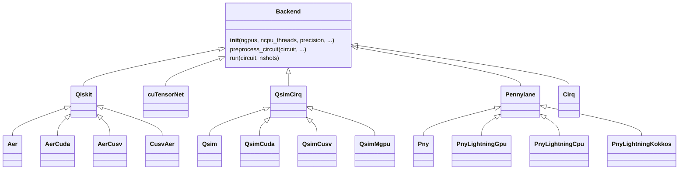
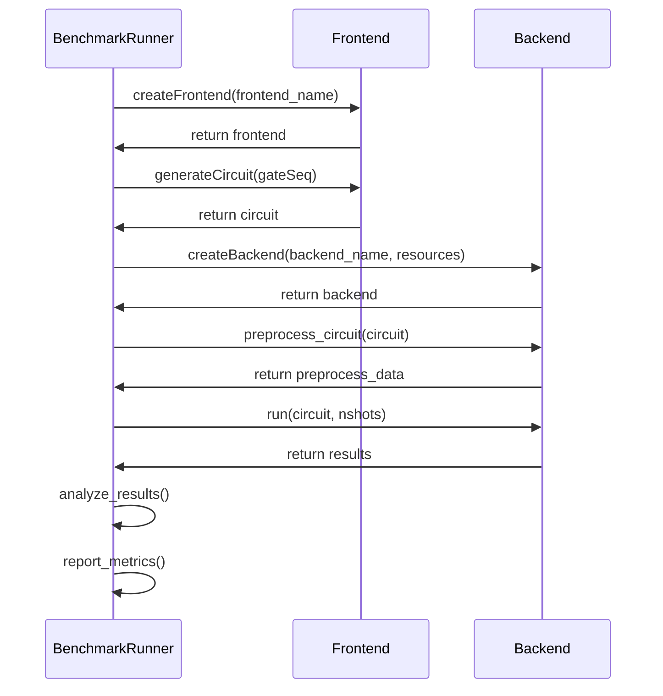

<!-- source: DeepWiki mcp.deepwiki.com · repo NVIDIA/cuQuantum · page 6.4 Running and Analyzing Benchmarks · fetched 2026-10-26 -->

# Backend Implementations

<details>
<summary>Relevant source files</summary>

The following files were used as context for generating this wiki page:

- [benchmarks/LICENSE](benchmarks/LICENSE)
- [benchmarks/README.md](benchmarks/README.md)
- [benchmarks/setup.py](benchmarks/setup.py)
- [extra/custatevec/README.md](extra/custatevec/README.md)

</details>


This page documents the various backend implementations available in the cuQuantum benchmarking suite. These backends implement simulation engines that execute quantum circuits created by frontends for performance benchmarking. For information about the benchmarking framework itself, see [Benchmarking Suite](#5), and for details on circuit benchmarks, see [Circuit Benchmarks](#5.1).

## Overview of Backend Architecture

The benchmarking suite provides a modular architecture that separates circuit generation (frontends) from circuit execution (backends). All backends implement a common interface defined by the `Backend` base class, enabling the benchmarking system to work with different simulation engines in a unified way.



Sources: [benchmarks/cuquantum_benchmarks/backends/__init__.py](), [benchmarks/cuquantum_benchmarks/backends/backend_qiskit.py](), [benchmarks/cuquantum_benchmarks/backends/backend_cutn.py](), [benchmarks/cuquantum_benchmarks/backends/backend_qsim.py](), [benchmarks/cuquantum_benchmarks/backends/backend_pny.py](), [benchmarks/cuquantum_benchmarks/backends/backend_cirq.py]()

## Available Backends

The benchmarking suite supports a wide variety of backends, from NVIDIA's GPU-accelerated simulators to CPU-based simulators from various quantum frameworks.

```mermaid
graph TD
    subgraph "Backend Registry"
        createBackend["createBackend()"]
    end
    
    subgraph "NVIDIA GPU Backends"
        cutn["cuTensorNet<br>Tensor Network Simulator"]
        cusvaer["CusvAer<br>cuStateVec-Accelerated Aer"]
    end
    
    subgraph "Qiskit Backends"
        aer["Aer<br>CPU Simulator"]
        aercuda["AerCuda<br>GPU CUDA Simulator"]
        aercusv["AerCusv<br>cuStateVec Simulator"]
    end
    
    subgraph "Google qsim Backends"
        qsim["Qsim<br>CPU Simulator"]
        qsimcuda["QsimCuda<br>CUDA Simulator"]
        qsimcusv["QsimCusv<br>cuStateVec Simulator"]
        qsimmgpu["QsimMgpu<br>Multi-GPU Simulator"]
    end
    
    subgraph "PennyLane Backends"
        pny["Pny<br>Default Simulator"]
        pnylcpu["PnyLightningCpu"]
        pnylgpu["PnyLightningGpu"]
        pnylkokkos["PnyLightningKokkos"]
    end
    
    subgraph "Other Backends"
        cirq["Cirq<br>CPU Simulator"]
        qulacscpu["QulacsCpu"]
        qulacsgpu["QulacsGpu"]
    end
    
    createBackend --> cutn
    createBackend --> cusvaer
    createBackend --> aer
    createBackend --> aercuda
    createBackend --> aercusv
    createBackend --> qsim
    createBackend --> qsimcuda
    createBackend --> qsimcusv
    createBackend --> qsimmgpu
    createBackend --> pny
    createBackend --> pnylcpu
    createBackend --> pnylgpu
    createBackend --> pnylkokkos
    createBackend --> cirq
    createBackend --> qulacscpu
    createBackend --> qulacsgpu
```



Sources: [benchmarks/cuquantum_benchmarks/backends/__init__.py:12-35]()

The following table provides a comprehensive overview of the available backends, their requirements, and key features:

| Backend | Type | Precision | GPU Support | Multi-GPU | MPI Support | Description |
|---------|------|-----------|------------|-----------|-------------|-------------|
| `aer` | CPU | Both | No | No | Yes | Qiskit Aer CPU simulator |
| `aer-cuda` | GPU | Both | Yes | Yes | Yes | Qiskit Aer with CUDA |
| `aer-cusv` | GPU | Both | Yes | Yes | Yes | Qiskit Aer with cuStateVec |
| `cusvaer` | GPU | Both | Yes | No | Yes | NVIDIA cuStateVec with Aer |
| `cirq` | CPU | Single | No | No | No | Cirq's built-in simulator |
| `cutn` | GPU | Both | Yes | No | Yes | NVIDIA cuTensorNet for tensor networks |
| `qsim` | CPU | Single | No | No | No | Google's qsim CPU simulator |
| `qsim-cuda` | GPU | Single | Yes | No | No | qsim with CUDA |
| `qsim-cusv` | GPU | Single | Yes | No | No | qsim with cuStateVec |
| `qsim-mgpu` | GPU | Single | Yes | Yes | No | qsim with multi-GPU |
| `pennylane` | CPU | Double | No | No | No | Default PennyLane simulator |
| `pennylane-lightning-gpu` | GPU | Both | Yes | No | No | PennyLane Lightning GPU |
| `pennylane-lightning-qubit` | CPU | Both | No | No | No | PennyLane Lightning CPU |
| `pennylane-lightning-kokkos` | Both | Both | Optional | Optional | No | PennyLane Lightning Kokkos |
| `qulacs-cpu` | CPU | Both | No | No | No | Qulacs CPU simulator |
| `qulacs-gpu` | GPU | Both | Yes | No | No | Qulacs GPU simulator |

Sources: [benchmarks/cuquantum_benchmarks/backends/__init__.py:12-35]()

## Backend Interface

All backends implement a common interface defined by the `Backend` base class. The key methods that each backend must implement are:

1. `__init__(ngpus, ncpu_threads, precision, ...)`: Initialize the backend with specified resources and precision
2. `preprocess_circuit(circuit, ...)`: Prepare circuit for execution (e.g., transpilation, optimization)
3. `run(circuit, nshots)`: Execute the circuit and return results

Backends are instantiated using the `createBackend()` function, which takes the backend name, resource parameters, and any backend-specific options.

Sources: [benchmarks/cuquantum_benchmarks/backends/__init__.py:33-34]()

## NVIDIA Backends

### cuTensorNet

The `cutn` backend uses NVIDIA's cuTensorNet library for tensor network contraction. It provides efficient simulation of quantum circuits using tensor network techniques.

Key features:
- Single GPU operation (use MPI for multi-node distribution)
- Support for both single and double precision
- Multiple computation modes: amplitude, statevector, and expectation value
- Path optimization for tensor contraction

```python
def preprocess_circuit(self, circuit, *args, **kwargs):
    # Set computation mode (amplitude, statevector, expectation)
    self.compute_mode = kwargs.pop('compute_mode')
    # Convert circuit to tensor network representation
    circuit_converter = CircuitToEinsum(circuit, dtype='complex64', backend=cp)
    # Generate tensor network expression and operands
    self.expression, self.operands = circuit_converter.state_vector()  # or amplitude() or expectation()
    # Create cuTensorNet network and optimize contraction path
    self.network = cutn.Network(self.expression, *self.operands, options=self.network_opts)
    path, opt_info = self.network.contract_path(optimize={'samples': self.n_hyper_samples})
```

Sources: [benchmarks/cuquantum_benchmarks/backends/backend_cutn.py:30-141]()

### CusvAer

The `cusvaer` backend uses NVIDIA's cusvaer library which integrates cuStateVec with Qiskit's Aer simulator for GPU-accelerated state vector simulation.

Key features:
- Uses 1 GPU per MPI process for distributed simulation
- Support for both single and double precision
- Advanced memory management for large simulations
- Communication plugins for multi-node execution

```python
# CusvAer backend creation
def create_aer_backend(self, identifier, ngpus, ncpu_threads, *args, **kwargs):
    if identifier == 'cusvaer':
        import cusvaer
        # Configure cusvaer options
        cusvaer_global_index_bits = kwargs.pop('cusvaer_global_index_bits')
        cusvaer_p2p_device_bits = kwargs.pop('cusvaer_p2p_device_bits')
        cusvaer_comm_plugin_type = kwargs.pop('cusvaer_comm_plugin_type')
        # Create simulator with cusvaer enabled
        backend = AerSimulator(
            method='statevector', device="GPU", cusvaer_enable=True,
            cusvaer_global_index_bits=cusvaer_global_index_bits,
            cusvaer_p2p_device_bits=cusvaer_p2p_device_bits,
            precision=self.precision,
            cusvaer_comm_plugin_type=cusvaer_comm_plugin_type
        )
```

Sources: [benchmarks/cuquantum_benchmarks/backends/backend_qiskit.py:83-140]()

## Framework-Specific Backends

### Qiskit Backends

Qiskit backends include `aer` (CPU), `aer-cuda` (GPU with CUDA), and `aer-cusv` (GPU with cuStateVec). They provide state vector simulation using Qiskit's Aer simulator with different hardware acceleration options.

Key features:
- Support for both single and double precision
- Multi-GPU support via blocking qubits
- MPI distribution for large-scale simulations
- Circuit transpilation optimization

```python
# Multi-GPU setup for Aer backends
def get_aer_blocking_setup(self, ngpus=None):
    size = get_mpi_size()  # check if running MPI
    if size > 1:
        blocking_enable = True
        if self.identifier == 'aer':
            blocking_qubits = self.nqubits - int(math.log2(size))
        else:
            blocking_qubits = self.nqubits - int(math.log2(ngpus))
    else:
        # use default
        blocking_enable = False
        blocking_qubits = None
    return blocking_enable, blocking_qubits
```

Sources: [benchmarks/cuquantum_benchmarks/backends/backend_qiskit.py:32-226]()

### Google qsim Backends

The qsim backends include `qsim` (CPU), `qsim-cuda` (GPU with CUDA), `qsim-cusv` (GPU with cuStateVec), and `qsim-mgpu` (multi-GPU). They use Google's qsim simulator with different hardware acceleration options.

Key features:
- Single precision only
- Various GPU acceleration options
- Multi-GPU support in `qsim-mgpu`
- Gate fusion optimization

```python
def create_qsim_options(identifier, ngpus, ncpu_threads, **kwargs):
    nfused = kwargs.pop('nfused')
    if identifier == "qsim-mgpu":
        if ngpus >= 1:
            # use multiple GPUs
            ops = qsimcirq.QSimOptions(gpu_mode=tuple(range(ngpus)), max_fused_gate_size=nfused)
        else:
            raise ValueError(f"need to specify --ngpus for the backend {identifier}")
    elif identifier == "qsim-cuda":
        # use single GPU with CUDA
        ops = qsimcirq.QSimOptions(gpu_mode=0, use_gpu=True, max_fused_gate_size=nfused)
```

Sources: [benchmarks/cuquantum_benchmarks/backends/backend_qsim.py:16-93]()

### PennyLane Backends

PennyLane backends include `pennylane` (CPU), `pennylane-lightning-gpu` (GPU), `pennylane-lightning-qubit` (CPU optimized), and `pennylane-lightning-kokkos` (supports both CPU and GPU). They use PennyLane's simulation plugins with different acceleration options.

Key features:
- Support for both single and double precision (except default simulator)
- GPU acceleration in Lightning-GPU
- CPU optimization in Lightning-Qubit
- Flexible hardware targeting in Lightning-Kokkos

```python
def _make_qnode(self, circuit, nshots=1024, **kwargs):
    if self.identifier == "pennylane-lightning-gpu":
        dev = pennylane.device("lightning.gpu", wires=self.nqubits, shots=nshots, c_dtype=self.dtype)
    elif self.identifier == "pennylane-lightning-kokkos":
        dev = pennylane.device("lightning.kokkos", wires=self.nqubits, shots=nshots, c_dtype=self.dtype, sync=False)
    elif self.identifier == "pennylane-lightning-qubit":
        dev = pennylane.device("lightning.qubit", wires=self.nqubits, shots=nshots, c_dtype=self.dtype)
    elif self.identifier == "pennylane":
        dev = pennylane.device("default.qubit", wires=self.nqubits, shots=nshots)
    
    qnode = pennylane.QNode(circuit, device=dev)
    return qnode
```

Sources: [benchmarks/cuquantum_benchmarks/backends/backend_pny.py:29-148]()

### Other Backends

The benchmarking suite also includes backends for Cirq (`cirq`) and Qulacs (`qulacs-cpu`, `qulacs-gpu`). These provide additional simulation options from other quantum computing frameworks.

```python
class _Cirq(Backend):
    def __init__(self, ngpus, ncpu_threads, precision, *args, identifier=None, **kwargs):
        if cirq is None:
            raise RuntimeError("cirq is not installed")
        if ngpus > 0:
            raise ValueError("the cirq backend only runs on CPU")
        if precision != 'single':
            raise ValueError("the cirq backend only supports single precision")

        self.backend = cirq.Simulator()
        self.identifier = identifier
        self.version = cirq.__version__
```

Sources: [benchmarks/cuquantum_benchmarks/backends/backend_cirq.py:20-52]()

## Benchmark Integration

The following diagram illustrates how backends are integrated into the benchmarking workflow:



Sources: [benchmarks/cuquantum_benchmarks/backends/__init__.py:33-34](), [benchmarks/cuquantum_benchmarks/frontends/__init__.py:19-20]()

## Backend Selection and Configuration

Backends are selected and configured using command-line arguments in the benchmarking tool. The following parameters are commonly used:

- `--backend`: Name of the backend to use (e.g., `cutn`, `aer-cuda`, `qsim`)
- `--ngpus`: Number of GPUs to use for simulation
- `--ncputhreads`: Number of CPU threads for CPU-based backends
- `--precision`: Numerical precision (`single` or `double`)
- `--nshots`: Number of measurement shots for sampling

Backend-specific options can also be provided for fine-tuning performance:

- `--nfused`: Maximum number of gates to fuse (for Qiskit and qsim)
- `--nhypersamples`: Number of hypersamples for path optimization (for cuTensorNet)
- `--cusvaer-*`: Various options for cusvaer configuration

Sources: [benchmarks/cuquantum_benchmarks/backends/backend_qiskit.py:34-42](), [benchmarks/cuquantum_benchmarks/backends/backend_cutn.py:31-67](), [benchmarks/cuquantum_benchmarks/backends/backend_pny.py:31-40](), [benchmarks/cuquantum_benchmarks/backends/backend_qsim.py:18-26]()

## Special Features

### Circuit Format Dumping

The benchmarking suite includes a special "Dumper" frontend that can output circuit gate sequences in a standardized text format, which can be useful for debugging or offline analysis.

```
# Format example for a CCX gate:
5
2 2 2 2 2

1 2
0 2 4
C 0.0 0.0 1.0 0.0 1.0 0.0 0.0 0.0
```

This format specifies:
1. Number of qubits
2. Qubit dimensions
3. Number of targets and controls
4. Target and control qubits
5. Matrix data representation

Sources: [benchmarks/cuquantum_benchmarks/frontends/frontend_dumper.py:21-318]()

### MPI Support

Many backends support MPI for distributed computing across multiple nodes. This allows simulation of larger quantum circuits than would be possible on a single node.

CusvAer in particular has comprehensive MPI support with different communication plugin options:
- `mpi_auto`: Automatic MPI detection and configuration
- `mpi_openmpi`: Explicit OpenMPI support
- `mpi_mpich`: Explicit MPICH support
- `external`: External communication plugin

cuTensorNet also supports distributed execution through MPI, enabling tensor network contractions to be distributed across multiple nodes.

Sources: [benchmarks/cuquantum_benchmarks/backends/backend_qiskit.py:95-121](), [benchmarks/cuquantum_benchmarks/backends/backend_cutn.py:43-61]()

---

