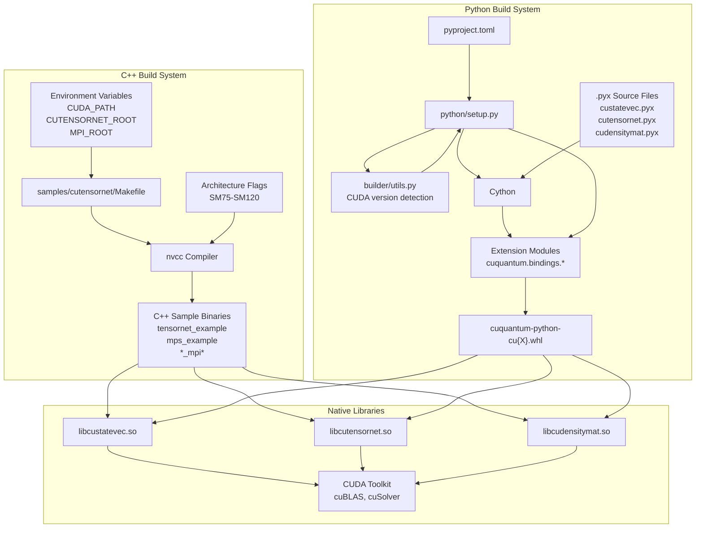
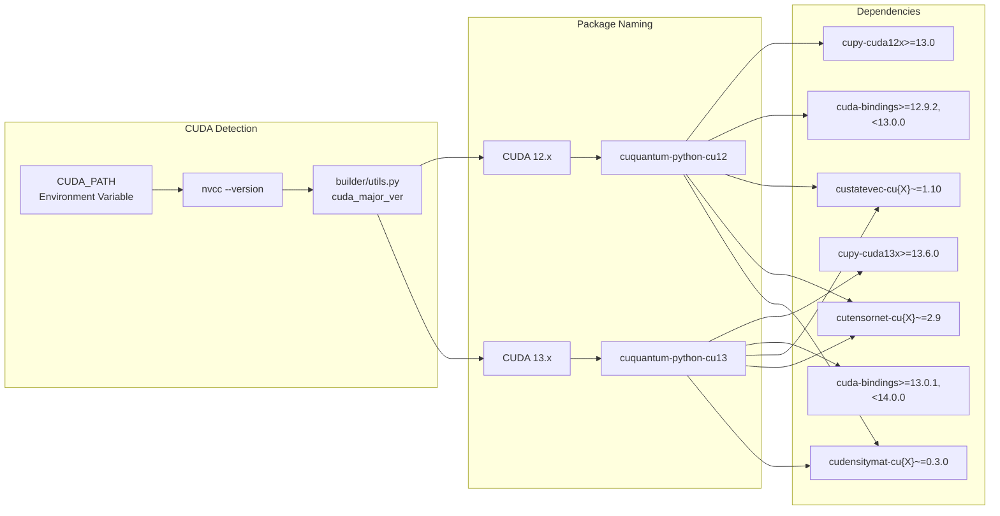
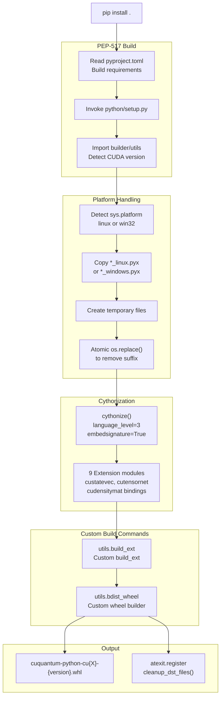
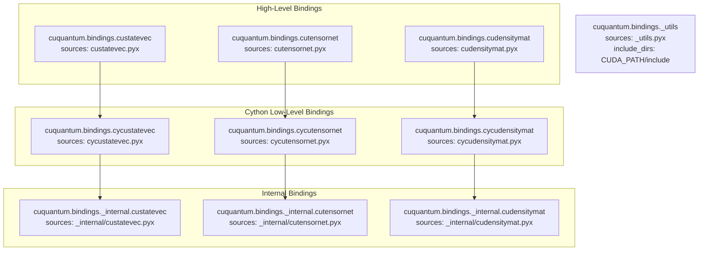
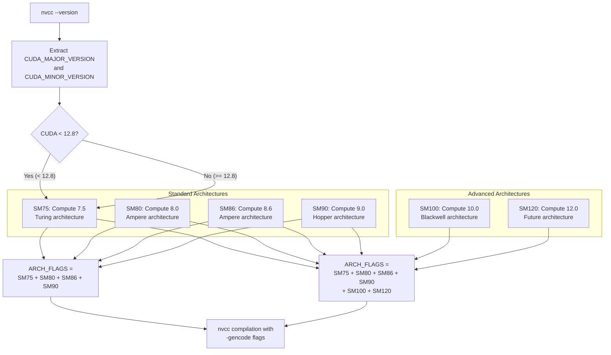
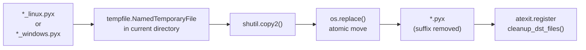
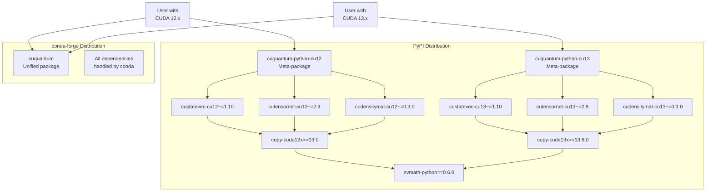
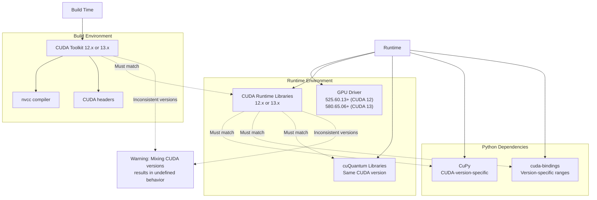

<!-- source: DeepWiki mcp.deepwiki.com · repo NVIDIA/cuQuantum · page 7 Building and Packaging · fetched 2026-10-26 -->

# Building and Packaging

<details>
<summary>Relevant source files</summary>

The following files were used as context for generating this wiki page:

- [python/README.md](python/README.md)
- [python/setup.py](python/setup.py)
- [samples/cutensornet/Makefile](samples/cutensornet/Makefile)

</details>


This document provides a comprehensive guide to building cuQuantum components from source and understanding the packaging infrastructure. It covers both the C++ sample build system (using Makefiles) and the Python package build system (using PEP-517 with Cython bindings). The packaging strategy includes CUDA-version-specific wheels distributed via PyPI and unified packages via conda-forge.

For detailed instructions on specific build scenarios:
- [7.1](#7.1) for C++ sample compilation
- [7.2](#7.2) for Python development builds
- [7.3](#7.3) for wheel distribution details
- [7.4](#7.4) for advanced dynamic linking techniques
- [7.5](#7.5) for CUDA compatibility requirements

For testing built packages, see [Testing and Development](#8).

---

## Build System Architecture

The cuQuantum repository employs two parallel build systems: a traditional Makefile-based system for C++ samples and a modern PEP-517 Python build system with Cython bindings.



**Build System Architecture**

The C++ build flow uses Makefiles that detect CUDA version and architecture capabilities, while the Python build uses setuptools with custom `build_ext` and `bdist_wheel` commands defined in `builder.utils`. Both systems ultimately link against the same native cuQuantum libraries.

Sources: [python/setup.py:1-196](), [samples/cutensornet/Makefile:1-107](), [python/README.md:10-45]()

---

## CUDA Version Detection and Package Variants

The build system automatically detects the CUDA version and creates version-specific packages to ensure binary compatibility. This is critical because CUDA libraries have minor version compatibility guarantees starting from CUDA 11.



**CUDA Version Detection and Package Variants**

The `builder.utils.cuda_major_ver` variable is computed at build time and used throughout [python/setup.py:39-48]() to construct version-specific package names and dependencies. Different CUDA versions require different CuPy variants and cuda-bindings version ranges.

Sources: [python/setup.py:39-48](), [python/setup.py:144-148](), [python/setup.py:152]()

---

## Python Build Dependencies

The Python package has distinct build-time and runtime dependencies, managed through the PEP-517 build system.

### Build-Time Dependencies

| Dependency | Version Requirement | Purpose |
|------------|-------------------|---------|
| CUDA Toolkit | 12.x or 13.x | Native library headers and nvcc |
| Python | >=3.11, <3.14 | Interpreter for build scripts |
| Cython | >=3.0.4, !=3.1.0, !=3.1.1 | Compile .pyx bindings to C++ |
| pip | 21.3.1+ | PEP-517 build orchestration |
| packaging | latest | Version parsing utilities |
| setuptools | 77.0.3+ | Build system backend |
| wheel | 0.34.0+ | Wheel format support |

Starting with cuQuantum Python v25.06, the cuQuantum C libraries (cuDensityMat, cuStateVec, cuTensorNet) are **no longer** build-time dependencies but remain required at runtime. This change simplifies the build process by removing the need for pre-installed native libraries during wheel creation.

Sources: [python/README.md:12-26]()

### Runtime Dependencies

| Dependency | Version Requirement | Notes |
|------------|-------------------|-------|
| GPU | Compute capability 7.5+ | Hardware requirement |
| Driver | 525.60.13+ (CUDA 12), 580.65.06+ (CUDA 13) | Minimum driver versions |
| cuStateVec | 1.10.0+ | State vector simulation library |
| cuTensorNet | 2.9.0+ | Tensor network operations |
| cuDensityMat | >=0.3.0, <0.4.0 | Density matrix simulation |
| NumPy | >=1.21, <3.0 | Array operations |
| nvmath-python | ==0.6.0 | Strictly pinned version |
| CuPy | >=13.0 (cu12), >=13.6.0 (cu13) | CUDA-aware NumPy-like API |
| cuda-bindings | Version-specific ranges | CUDA driver API bindings |

Optional dependencies include PyTorch (>=1.10), Qiskit (>=1.4.2, <3), Cirq (>=0.6.0), and mpi4py (>=3.1.0) for distributed computing.

Sources: [python/README.md:50-66](), [python/setup.py:35-48]()

---

## Python Build Process Flow

The Python build system uses a custom build flow that handles platform-specific code, Cythonization, and CUDA version detection.



**Python Build Process Flow**

The build system performs several critical steps: (1) Platform detection to select correct `.pyx` files [python/setup.py:52-68](), (2) Cythonization of 9 extension modules [python/setup.py:84-136](), (3) Custom build commands from `builder.utils` [python/setup.py:139-142](), and (4) Wheel generation with cleanup handlers [python/setup.py:71-77]().

Sources: [python/setup.py:1-196](), [python/README.md:28-44]()

---

## Extension Modules and Bindings

The Python package compiles 9 Cython extension modules that provide bindings to the native cuQuantum libraries at multiple API levels.



**Extension Module Hierarchy**

Three API layers are exposed: (1) High-level Python bindings for end users, (2) Cython-level bindings prefixed with `cy*` for typed access, and (3) Internal bindings in `_internal/` for low-level operations. The `_utils` module provides CUDA-specific utilities.

Sources: [python/setup.py:84-136]()

---

## C++ Sample Build System

The C++ samples use a Makefile-based build system that detects CUDA capabilities and compiles examples for multiple GPU architectures.

### Environment Variables

| Variable | Default | Required | Purpose |
|----------|---------|----------|---------|
| `CUDA_PATH` | - | Yes | Path to CUDA Toolkit installation |
| `CUTENSORNET_ROOT` | `CUQUANTUM_ROOT` | Yes | Path to cuTensorNet library |
| `CUQUANTUM_ROOT` | - | Alternative | Fallback if CUTENSORNET_ROOT not set |
| `MPI_ROOT` | - | Optional | Path to MPI installation for distributed examples |

The Makefile validates these at build time using the `check-env` target [samples/cutensornet/Makefile:61-78]().

Sources: [samples/cutensornet/Makefile:5-8](), [samples/cutensornet/Makefile:61-78]()

### Architecture Support

The build system generates CUDA code for multiple GPU architectures based on the detected CUDA version:



**GPU Architecture Detection**

The Makefile conditionally includes SM100 and SM120 architectures only when CUDA version is 12.8 or higher [samples/cutensornet/Makefile:22-27](). Each architecture uses `-gencode arch=compute_XX,code=sm_XX` flags to generate optimized PTX and SASS code.

Sources: [samples/cutensornet/Makefile:9-27]()

### Build Targets

The Makefile defines multiple targets organized by functionality:

**Basic Examples:**
- `tensornet_example` - Basic tensor network contraction
- `tensornet_example_reuse` - Reusing contraction plans
- `tensornet_example_gradients` - Gradient computation

**High-Level API Examples:**
- `amplitudes_example` - Amplitude computation
- `expectation_example` - Expectation value calculation
- `marginal_example` - Marginal distributions
- `sampling_example` - Circuit sampling

**MPS/DMRG Examples:**
- `mps_example` - Matrix Product State operations
- `proj_mps_circuit_dmrg_example` - Projected MPS with DMRG (requires `-lcublas`)

**MPI Examples** (conditional on `MPI_ROOT`):
- `tensornet_example_mpi` - Manual MPI parallelization
- `tensornet_example_mpi_auto` - Automatic MPI parallelization
- `sampling_mpi_example` - Distributed sampling

MPI examples use additional linker flags: `-Xlinker -rpath,${MPI_ROOT}/lib -L${MPI_ROOT}/lib -lmpi` [samples/cutensornet/Makefile:54-58]().

Sources: [samples/cutensornet/Makefile:31-59]()

---

## Development Build Workflow

For developers working on cuQuantum Python, the recommended build workflow uses editable installs and controlled dependency management.

### Development Mode Installation

```bash
# Step 1: Clone repository
git clone https://github.com/NVIDIA/cuQuantum
cd cuQuantum/python

# Step 2: Set CUDA_PATH
export CUDA_PATH=/usr/local/cuda

# Step 3: Editable install with verbose output
pip install -e -v --no-deps --no-build-isolation .
```

**Command-Line Flag Explanation:**

| Flag | Effect | Rationale |
|------|--------|-----------|
| `-e` | Editable mode | Changes to Python code take effect immediately without reinstall |
| `-v` | Verbose output | Shows compilation progress and errors |
| `--no-deps` | Skip runtime dependencies | Assumes dependencies already installed |
| `--no-build-isolation` | Use current environment | Avoids creating isolated build environment |

The `--no-build-isolation` flag is particularly important for development because it reuses the current Python environment instead of creating a new one, avoiding unnecessary reinstallation of build-time dependencies like Cython.

Sources: [python/README.md:38-43]()

### Platform-Specific Code Handling

The build system handles platform-specific `.pyx` files by creating temporary copies and atomically moving them:



**Platform-Specific File Handling**

This approach at [python/setup.py:52-77]() ensures atomic file operations within the same filesystem and registers cleanup handlers to remove temporary files on exit.

Sources: [python/setup.py:52-77]()

---

## Wheel Distribution Strategy

cuQuantum Python packages are distributed as CUDA-version-specific wheels on PyPI, with a different strategy on conda-forge.



**Wheel Distribution Strategy**

The PyPI strategy uses granular, CUDA-versioned packages with version constraints (`~=` operator for compatible releases), while conda-forge provides a unified package that handles all dependencies automatically. The nvmath-python version is strictly pinned to `==0.6.0` because the internal API is not yet stable.

Sources: [python/setup.py:35-48](), [python/README.md:68-71]()

### Package Naming Convention

The package names follow a consistent pattern:

- **Meta-package**: `cuquantum-python-cu{CUDA_MAJOR}`
- **Library packages**: `{library}-cu{CUDA_MAJOR}`
- **CuPy variant**: `cupy-cuda{CUDA_MAJOR}x`

This naming ensures users cannot accidentally mix CUDA versions, as pip's dependency resolver will fail if incompatible versions are specified.

Sources: [python/setup.py:152]()

---

## Build Customization Points

The Python build system provides several extension points through `builder/utils.py`:

### Custom Build Commands

The `cmdclass` dictionary in [python/setup.py:139-142]() overrides two setuptools commands:

1. **`utils.build_ext`**: Custom build_ext command that:
   - Detects CUDA version from environment
   - Sets appropriate compiler flags
   - Configures include directories
   - Handles platform-specific compilation

2. **`utils.bdist_wheel`**: Custom wheel builder that:
   - Injects CUDA version into wheel metadata
   - Sets appropriate wheel tags (e.g., `cp311-cp311-linux_x86_64`)
   - Ensures correct platform identification

### Cythonize Configuration

The `cythonize()` call at [python/setup.py:180-182]() configures Cython compilation:

```python
cythonize(ext_modules,
    verbose=True,
    language_level=3,
    compiler_directives={'embedsignature': True})
```

- `verbose=True`: Outputs detailed compilation information
- `language_level=3`: Uses Python 3 semantics (required for Python 3.11+)
- `embedsignature=True`: Embeds function signatures in docstrings for IDE support

Sources: [python/setup.py:139-142](), [python/setup.py:180-182]()

---

## Library Path Configuration

Runtime library loading requires proper `LD_LIBRARY_PATH` configuration on Linux systems.

### Required Paths

When building from source, the following paths must be visible:

```bash
export LD_LIBRARY_PATH="${CUDA_PATH}/lib64:${LD_LIBRARY_PATH}"
export LD_LIBRARY_PATH="${CUTENSORNET_ROOT}/lib64:${LD_LIBRARY_PATH}"
export LD_LIBRARY_PATH="${CUSTATEVEC_ROOT}/lib64:${LD_LIBRARY_PATH}"
export LD_LIBRARY_PATH="${CUDENSITYMAT_ROOT}/lib64:${LD_LIBRARY_PATH}"
```

### Conda vs Pip Behavior

| Installation Method | Library Path Handling |
|--------------------|-----------------------|
| conda-forge | Automatic - conda manages `LD_LIBRARY_PATH` through environment activation |
| PyPI wheels | Automatic - libraries bundled in wheel or provided by CuPy |
| Source build | Manual - user must set `LD_LIBRARY_PATH` |

**Important**: When multiple copies of cuTENSOR exist on a system, the Python runtime may pick up the wrong version despite correct linking. The proper fix is to remove cuTENSOR from system paths. **Never use `LD_PRELOAD`** to override library loading, as this can cause hard-to-debug runtime errors [python/README.md:76-78]().

Sources: [python/README.md:32-33](), [python/README.md:70-78]()

---

## CUDA Version Consistency

The build and runtime systems require strict CUDA version consistency to avoid undefined behavior.



**CUDA Version Consistency Requirements**

The system enforces version consistency at multiple levels: (1) Build-time CUDA Toolkit version, (2) Runtime CUDA libraries, (3) GPU driver version, (4) CuPy variant, (5) cuda-bindings version, and (6) cuQuantum library builds. Mixing CUDA 12 and CUDA 13 components will result in undefined behavior [python/README.md:44](), [python/README.md:78]().

Sources: [python/README.md:44](), [python/README.md:53](), [python/README.md:78]()

---

## Build Output and Artifacts

### Python Package Outputs

After a successful build, the following artifacts are created:

```
cuQuantum/python/
├── build/                    # Temporary build files
│   ├── lib.linux-x86_64-3.11/  # Compiled extension modules
│   └── temp.linux-x86_64-3.11/ # Object files
├── dist/                     # Distribution files
│   └── cuquantum_python_cu{X}-{version}-cp311-cp311-linux_x86_64.whl
└── cuquantum.egg-info/       # Package metadata (editable install)
```

### C++ Sample Outputs

The Makefile produces executable binaries:

```
samples/cutensornet/
├── tensornet_example              # Basic contraction
├── amplitudes_example             # High-level API
├── mps_example                    # MPS operations
├── tensornet_example_mpi          # MPI example (if MPI_ROOT set)
└── ... (20+ other executables)
```

Clean targets are provided to remove all build artifacts [samples/cutensornet/Makefile:80-107]().

Sources: [samples/cutensornet/Makefile:31-59](), [samples/cutensornet/Makefile:80-107]()

---

## Common Build Issues and Solutions

### Issue: Cython Version Conflicts

**Problem**: Cython 3.1.0 and 3.1.1 have known issues with the cuQuantum build.

**Solution**: The build requirements explicitly exclude these versions: `Cython >=3.0.4,!=3.1.0,!=3.1.1` [python/README.md:18]()

### Issue: Missing CUTENSORNET_ROOT

**Problem**: Makefile fails with "CUTENSORNET_ROOT is not set"

**Solution**: Set either `CUTENSORNET_ROOT` or `CUQUANTUM_ROOT`:
```bash
export CUTENSORNET_ROOT=/path/to/cuquantum
# or
export CUQUANTUM_ROOT=/path/to/cuquantum
```

The Makefile checks both variables [samples/cutensornet/Makefile:7](), [samples/cutensornet/Makefile:67-71]().

### Issue: Wrong cuTENSOR Version

**Problem**: Runtime error about cuTENSOR version mismatch

**Solution**: Remove cuTENSOR from system paths (e.g., `/usr/lib`, `/usr/local/lib`) to ensure the correct version is loaded. Do not use `LD_PRELOAD` [python/README.md:76-78]().

### Issue: MPI Examples Not Building

**Problem**: MPI examples are skipped during build

**Solution**: Set `MPI_ROOT` to enable MPI example compilation:
```bash
export MPI_ROOT=/path/to/mpi
make all
```

The Makefile conditionally builds MPI targets [samples/cutensornet/Makefile:53-59]().

Sources: [python/README.md:18](), [python/README.md:76-78](), [samples/cutensornet/Makefile:7](), [samples/cutensornet/Makefile:53-59](), [samples/cutensornet/Makefile:67-78]()

---

