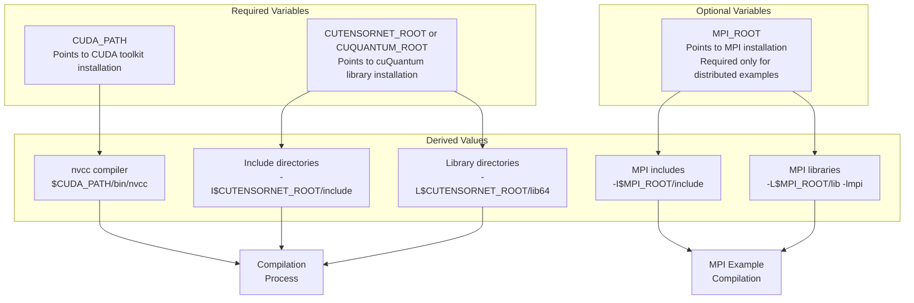
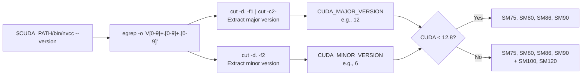
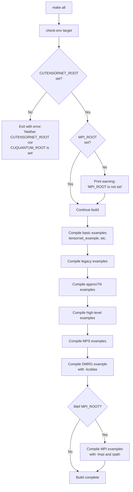
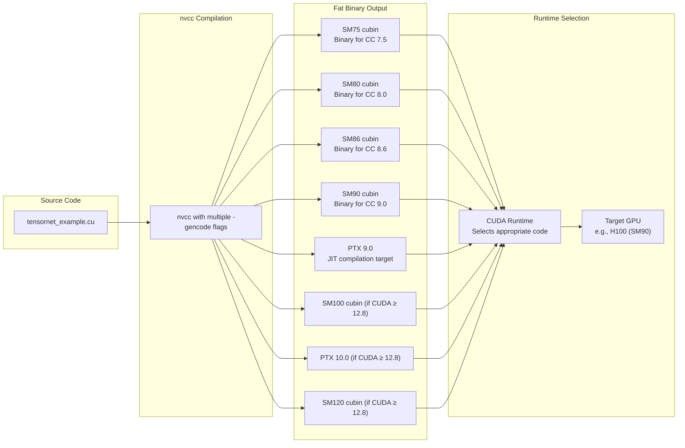
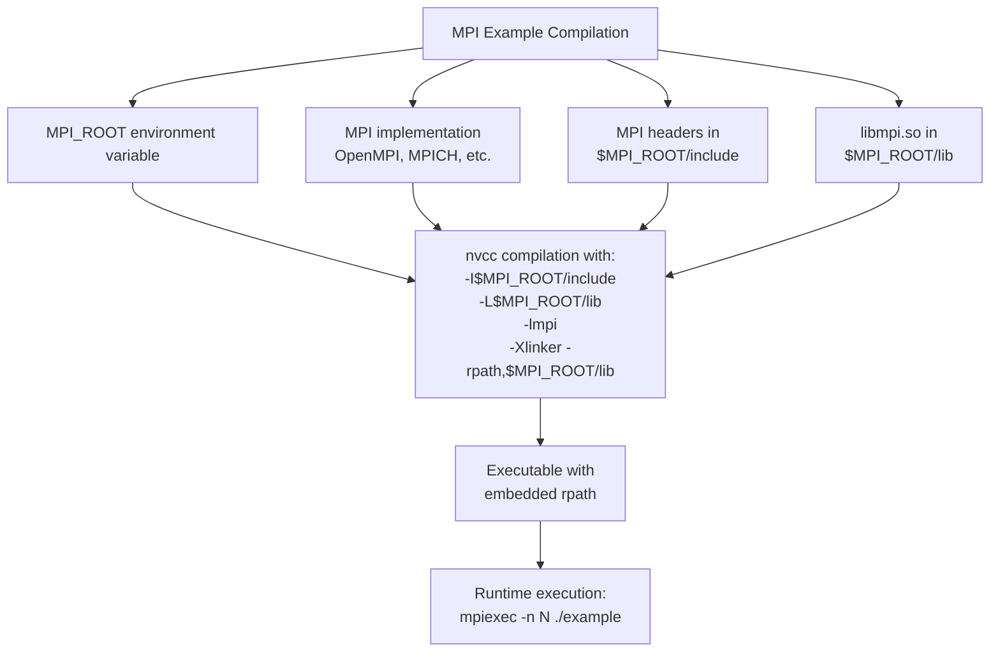

<!-- source: DeepWiki mcp.deepwiki.com · repo NVIDIA/cuQuantum · page 7.1 Building C++ Samples · fetched 2026-10-26 -->

# Building C++ Samples

<details>
<summary>Relevant source files</summary>

The following files were used as context for generating this wiki page:

- [samples/cutensornet/Makefile](samples/cutensornet/Makefile)

</details>


## Purpose and Scope

This document explains the build system for C++ sample programs in the cuQuantum SDK. The samples demonstrate usage of the cuTensorNet, cuStateVec, and cuDensityMat libraries through standalone C++ applications that can be compiled and run independently.

For information about building the Python interface from source, see [Building Python from Source](#7.2). For details on Python wheel creation and distribution, see [Creating and Using Python Wheels](#7.3).

The build system uses GNU Make with the NVIDIA CUDA Compiler (nvcc) to compile sample applications that link against the cuQuantum native libraries. This page covers the complete build workflow, including environment setup, architecture-specific compilation, and optional MPI support.

---

## Prerequisites

Before building C++ samples, you must have:

| Requirement | Description |
|------------|-------------|
| **CUDA Toolkit** | CUDA 11.x, 12.x, or 13.x with nvcc compiler |
| **cuQuantum Libraries** | Native libraries (libcutensornet, libcustatevec, libcudensitymat) installed |
| **C++ Compiler** | C++11 compatible compiler (provided by CUDA toolkit) |
| **GPU Hardware** | NVIDIA GPU with compute capability ≥ 7.5 (Turing architecture or newer) |
| **MPI Library** (optional) | Required only for distributed/multi-node examples |

The cuQuantum native libraries can be obtained through:
- **Conda installation**: `conda install -c conda-forge cuquantum-python`
- **NVIDIA NGC containers**: Pre-configured environments with all dependencies
- **Manual download**: From NVIDIA Developer Portal

---

## Environment Variables

The Makefile relies on three critical environment variables to locate dependencies:

### Build Environment Configuration



**Sources:** [samples/cutensornet/Makefile:5-8]()

### Variable Definitions

The Makefile defines these variables as follows:

```makefile
CUDA_PATH        := ${CUDA_PATH}
CUTENSORNET_ROOT ?= ${CUQUANTUM_ROOT}
MPI_ROOT         := ${MPI_ROOT}
```

**Key behaviors:**
- `CUDA_PATH`: Must be set externally, typically to `/usr/local/cuda` or `/usr/local/cuda-12.x`
- `CUTENSORNET_ROOT`: Defaults to `CUQUANTUM_ROOT` if not set ([samples/cutensornet/Makefile:7]())
- `MPI_ROOT`: Optional; when unset, MPI examples are skipped with a warning ([samples/cutensornet/Makefile:73-77]())

### Setting Variables

**Bash/Zsh:**
```bash
export CUDA_PATH=/usr/local/cuda-12.6
export CUTENSORNET_ROOT=/opt/nvidia/cuquantum
export MPI_ROOT=/usr/lib/x86_64-linux-gnu/openmpi  # optional
```

**Makefile invocation:**
```bash
make CUDA_PATH=/usr/local/cuda CUTENSORNET_ROOT=/opt/cuquantum
```

**Sources:** [samples/cutensornet/Makefile:5-8](), [samples/cutensornet/Makefile:61-78]()

---

## CUDA Version Detection

The build system automatically detects the CUDA version to enable architecture-specific features:

### Version Extraction Logic



**Sources:** [samples/cutensornet/Makefile:9-10](), [samples/cutensornet/Makefile:22-27]()

### Architecture Flag Selection

The Makefile conditionally includes newer GPU architectures based on CUDA version:

| CUDA Version | Supported Architectures | Compute Capabilities |
|--------------|------------------------|---------------------|
| CUDA < 12.8 | SM75, SM80, SM86, SM90 | 7.5, 8.0, 8.6, 9.0 |
| CUDA ≥ 12.8 | SM75, SM80, SM86, SM90, SM100, SM120 | 7.5, 8.0, 8.6, 9.0, 10.0, 12.0 |

**Code implementation:**
```makefile
ifeq ($(shell [ $(CUDA_MAJOR_VERSION) -lt 12 ] || ( [ $(CUDA_MAJOR_VERSION) -eq 12 ] && [ $(CUDA_MINOR_VERSION) -lt 8 ] ); echo $$?),0)
    ARCH_FLAGS = $(ARCH_FLAGS_SM75) $(ARCH_FLAGS_SM80) $(ARCH_FLAGS_SM86) $(ARCH_FLAGS_SM90) 
else
    ARCH_FLAGS = $(ARCH_FLAGS_SM75) $(ARCH_FLAGS_SM80) $(ARCH_FLAGS_SM86) $(ARCH_FLAGS_SM90) \
                 $(ARCH_FLAGS_SM100) $(ARCH_FLAGS_SM120)
endif
```

**SM90 special handling:**
The SM90 target includes both `code=sm_90` and `code=compute_90` to enable JIT compilation ([samples/cutensornet/Makefile:18]()):
```makefile
ARCH_FLAGS_SM90 = -gencode arch=compute_90,code=sm_90 -gencode arch=compute_90,code=compute_90
```

**Sources:** [samples/cutensornet/Makefile:15-27]()

---

## Makefile Structure

The build system compiles multiple categories of sample programs from source files located in the `samples/cutensornet/` directory tree.

### Sample Categories and Build Targets

```mermaid
graph TB
    subgraph "Basic Examples"
        TN_EXAMPLE["tensornet_example.cu → tensornet_example"]
        TN_REUSE["tensornet_example_reuse.cu → tensornet_example_reuse"]
        TN_GRADIENTS["tensornet_example_gradients.cu → tensornet_example_gradients"]
    end
    
    subgraph "Legacy API Examples"
        LEGACY_BASIC["legacy/tensornet_example_legacy.cu"]
        LEGACY_REUSE["legacy/tensornet_example_reuse_legacy.cu"]
    end
    
    subgraph "ApproxTN Examples"
        TENSOR_SVD["approxTN/tensor_svd_example.cu"]
        TENSOR_QR["approxTN/tensor_qr_example.cu"]
        GATE_SPLIT["approxTN/gate_split_example.cu"]
        MPS["approxTN/mps_example.cu"]
    end
    
    subgraph "High-Level API Examples"
        AMPLITUDES["high_level/amplitudes_example.cu"]
        AMPLITUDES_MCG["high_level/amplitudes_mcg_example.cu"]
        EXPECTATION["high_level/expectation_example.cu"]
        MARGINAL["high_level/marginal_example.cu"]
        SAMPLING["high_level/sampling_example.cu"]
    end
    
    subgraph "MPS High-Level Examples"
        MPS_AMP["high_level/mps_amplitudes_example.cu"]
        MPS_EXP["high_level/mps_expectation_example.cu"]
        MPS_MARG["high_level/mps_marginal_example.cu"]
        MPS_SAMP["high_level/mps_sampling_example.cu"]
        MPO_MPS_SAMP["high_level/mpo_mps_sampling_example.cu"]
        QFT_MPS["high_level/qft_mps_sampling_example.cu"]
    end
    
    subgraph "DMRG Example"
        PROJ_MPS["high_level/proj_mps_circuit_dmrg_example.cu<br/>Requires: -lcublas"]
    end
    
    subgraph "MPI Examples (Conditional)"
        TN_MPI["tensornet_example_mpi.cu<br/>Requires: MPI_ROOT"]
        TN_MPI_AUTO["tensornet_example_mpi_auto.cu"]
        LEGACY_MPI["legacy/tensornet_example_mpi_legacy.cu"]
        LEGACY_MPI_AUTO["legacy/tensornet_example_mpi_auto_legacy.cu"]
        SAMPLING_MPI["high_level/sampling_mpi_example.cu"]
    end
    
    MAKE_ALL["make all"] --> TN_EXAMPLE
    MAKE_ALL --> TN_REUSE
    MAKE_ALL --> TN_GRADIENTS
    MAKE_ALL --> LEGACY_BASIC
    MAKE_ALL --> LEGACY_REUSE
    MAKE_ALL --> TENSOR_SVD
    MAKE_ALL --> TENSOR_QR
    MAKE_ALL --> GATE_SPLIT
    MAKE_ALL --> MPS
    MAKE_ALL --> AMPLITUDES
    MAKE_ALL --> AMPLITUDES_MCG
    MAKE_ALL --> EXPECTATION
    MAKE_ALL --> MARGINAL
    MAKE_ALL --> SAMPLING
    MAKE_ALL --> MPS_AMP
    MAKE_ALL --> MPS_EXP
    MAKE_ALL --> MPS_MARG
    MAKE_ALL --> MPS_SAMP
    MAKE_ALL --> MPO_MPS_SAMP
    MAKE_ALL --> QFT_MPS
    MAKE_ALL --> PROJ_MPS
    
    MPI_ROOT_SET{"ifdef MPI_ROOT"} --> TN_MPI
    MPI_ROOT_SET --> TN_MPI_AUTO
    MPI_ROOT_SET --> LEGACY_MPI
    MPI_ROOT_SET --> LEGACY_MPI_AUTO
    MPI_ROOT_SET --> SAMPLING_MPI
```



**Sources:** [samples/cutensornet/Makefile:32-59]()

### Compilation Flags

The unified compilation command for non-MPI examples:

```makefile
CXX_FLAGS = -std=c++11 $(INCLUDE_DIRS) $(LIBRARY_DIRS) $(LINKER_FLAGS) $(ARCH_FLAGS)
```

Where:
- `INCLUDE_DIRS`: `-I${CUTENSORNET_ROOT}/include -I${MPI_ROOT}/include` ([samples/cutensornet/Makefile:11]())
- `LIBRARY_DIRS`: `-L${CUTENSORNET_ROOT}/lib -L${CUTENSORNET_ROOT}/lib64` ([samples/cutensornet/Makefile:12]())
- `LINKER_FLAGS`: `-lcutensornet` ([samples/cutensornet/Makefile:13]())
- `ARCH_FLAGS`: Architecture-specific gencode flags (see Architecture Support section)

**Special cases:**
- `proj_mps_circuit_dmrg_example`: Requires additional `-lcublas` linker flag ([samples/cutensornet/Makefile:52]())
- MPI examples: Require `-lmpi` and rpath configuration (see MPI Compilation section)

**Sources:** [samples/cutensornet/Makefile:11-29]()

---

## Build Process

### Building All Samples

To compile all sample programs:

```bash
cd samples/cutensornet
make all
```

The `make all` target:
1. **Checks environment** via `check-env` prerequisite ([samples/cutensornet/Makefile:31]())
2. **Validates required variables** are set
3. **Warns if MPI_ROOT is unset** but continues
4. **Compiles all non-MPI examples**
5. **Conditionally compiles MPI examples** if `MPI_ROOT` is set

**Sources:** [samples/cutensornet/Makefile:31-59]()

### Build Sequence Flow



**Sources:** [samples/cutensornet/Makefile:31-78]()

### Environment Validation

The `check-env` target ([samples/cutensornet/Makefile:61-78]()) displays configuration and validates prerequisites:

**Console output:**
```
CUDA_PATH=/usr/local/cuda-12.6
CUTENSORNET_ROOT=/opt/nvidia/cuquantum
MPI_ROOT=/usr/lib/x86_64-linux-gnu/openmpi
```

**Error conditions:**
- If neither `CUTENSORNET_ROOT` nor `CUQUANTUM_ROOT` is set, the build exits with error code 1
- If `MPI_ROOT` is unset, a warning is printed but the build continues without MPI examples

**Sources:** [samples/cutensornet/Makefile:61-78]()

### Cleaning Build Artifacts

To remove all compiled binaries and object files:

```bash
make clean
```

This removes:
- All executable files (e.g., `tensornet_example`, `amplitudes_example`)
- All object files (e.g., `tensornet_example.o`)

The clean target explicitly lists all 27 build products ([samples/cutensornet/Makefile:80-106]()).

**Sources:** [samples/cutensornet/Makefile:80-107]()

---

## Architecture Support

The Makefile generates GPU code for multiple compute capabilities to support a wide range of NVIDIA GPUs.

### Supported GPU Architectures

| Flag | Architecture | Compute Capability | GPU Examples |
|------|-------------|-------------------|--------------|
| `ARCH_FLAGS_SM75` | Turing | 7.5 | RTX 20 Series, T4 |
| `ARCH_FLAGS_SM80` | Ampere | 8.0 | A100, A30 |
| `ARCH_FLAGS_SM86` | Ampere | 8.6 | RTX 30 Series, A40 |
| `ARCH_FLAGS_SM90` | Hopper | 9.0 | H100, H200 |
| `ARCH_FLAGS_SM100` | Blackwell | 10.0 | B100, B200 (CUDA ≥ 12.8) |
| `ARCH_FLAGS_SM120` | Grace-Blackwell | 12.0 | GB200 (CUDA ≥ 12.8) |

**Sources:** [samples/cutensornet/Makefile:15-27]()

### Architecture Flag Definitions

Each architecture flag generates device code for a specific compute capability:

```makefile
ARCH_FLAGS_SM75  = -gencode arch=compute_75,code=sm_75
ARCH_FLAGS_SM80  = -gencode arch=compute_80,code=sm_80
ARCH_FLAGS_SM86  = -gencode arch=compute_86,code=sm_86
ARCH_FLAGS_SM90  = -gencode arch=compute_90,code=sm_90 -gencode arch=compute_90,code=compute_90
ARCH_FLAGS_SM100 = -gencode arch=compute_100,code=sm_100 -gencode arch=compute_100,code=compute_100
ARCH_FLAGS_SM120 = -gencode arch=compute_120,code=sm_120
```

**PTX embedding:**
- SM90 and SM100 include both `code=sm_XX` (binary) and `code=compute_XX` (PTX) to enable forward compatibility via JIT compilation
- Other architectures use only binary code for smaller executable size

**Sources:** [samples/cutensornet/Makefile:15-20]()

### Fat Binary Strategy

The compilation produces "fat binaries" containing multiple architecture-specific code sections:



At runtime, the CUDA driver selects the most appropriate code section for the detected GPU, using PTX for JIT compilation if an exact binary match is unavailable.

**Sources:** [samples/cutensornet/Makefile:15-29]()

---

## MPI Compilation

Distributed tensor network examples use MPI for multi-node parallelization. These examples are compiled conditionally when `MPI_ROOT` is set.

### MPI Build Requirements



**Sources:** [samples/cutensornet/Makefile:53-59]()

### MPI Example Compilation

When `MPI_ROOT` is defined, five MPI-enabled examples are compiled:

```makefile
ifdef MPI_ROOT
    ${CUDA_PATH}/bin/nvcc tensornet_example_mpi.cu \
        -Xlinker -rpath,${MPI_ROOT}/lib -L${MPI_ROOT}/lib \
        -o tensornet_example_mpi ${CXX_FLAGS} -lmpi
    
    ${CUDA_PATH}/bin/nvcc tensornet_example_mpi_auto.cu \
        -Xlinker -rpath,${MPI_ROOT}/lib -L${MPI_ROOT}/lib \
        -o tensornet_example_mpi_auto ${CXX_FLAGS} -lmpi
    
    # ... similar for other MPI examples
endif
```

**MPI-specific flags:**
- `-I${MPI_ROOT}/include`: Already included in `INCLUDE_DIRS` ([samples/cutensornet/Makefile:11]())
- `-L${MPI_ROOT}/lib`: Adds MPI library search path
- `-lmpi`: Links against the MPI library
- `-Xlinker -rpath,${MPI_ROOT}/lib`: Embeds runtime library search path to avoid `LD_LIBRARY_PATH` requirements

**Sources:** [samples/cutensornet/Makefile:53-59]()

### MPI Examples List

| Source File | Executable | Description |
|------------|------------|-------------|
| `tensornet_example_mpi.cu` | `tensornet_example_mpi` | Manual MPI slicing example |
| `tensornet_example_mpi_auto.cu` | `tensornet_example_mpi_auto` | Automatic MPI parallelization |
| `legacy/tensornet_example_mpi_legacy.cu` | `tensornet_example_mpi_legacy` | Legacy API with MPI |
| `legacy/tensornet_example_mpi_auto_legacy.cu` | `tensornet_example_mpi_auto_legacy` | Legacy API with auto MPI |
| `high_level/sampling_mpi_example.cu` | `sampling_mpi_example` | High-level sampling with MPI |

For more information on distributed tensor network execution, see [Distributed Computing with MPI](#3.5).

**Sources:** [samples/cutensornet/Makefile:54-58]()

### Running MPI Examples

After successful compilation, run MPI examples using your MPI launcher:

```bash
# Run on 4 processes (can be on single or multiple nodes)
mpiexec -n 4 ./tensornet_example_mpi

# OpenMPI with specific host mapping
mpirun -n 8 --map-by node ./tensornet_example_mpi_auto

# SLURM integration
srun -n 16 ./sampling_mpi_example
```

**Prerequisites:**
- MPI runtime must be the same as or compatible with the version used for compilation
- For multi-node execution, ensure network fabric is properly configured (InfiniBand, RoCE, etc.)
- CUDA-aware MPI recommended for optimal GPU-to-GPU communication

**Sources:** [samples/cutensornet/Makefile:53-59]()

---

## Troubleshooting

### Common Build Errors

| Error | Cause | Solution |
|-------|-------|----------|
| `Neither CUTENSORNET_ROOT nor CUQUANTUM_ROOT is set` | Required environment variable missing | Set `CUTENSORNET_ROOT` to cuQuantum installation path |
| `nvcc: command not found` | CUDA_PATH incorrect or CUDA not installed | Verify CUDA installation and set `CUDA_PATH` |
| `cannot find -lcutensornet` | Library path incorrect | Check `CUTENSORNET_ROOT` points to correct location with `lib/` or `lib64/` subdirectory |
| `undefined reference to MPI_*` | MPI library not found | Verify `MPI_ROOT` points to MPI installation with `lib/libmpi.so` |
| `sm_100: No such architecture` | CUDA version < 12.8 attempting to use Blackwell | Update CUDA to 12.8+ or build without newer architectures |

**Sources:** [samples/cutensornet/Makefile:61-78]()

### Verifying Environment Setup

Before building, verify your environment:

```bash
# Check CUDA installation
${CUDA_PATH}/bin/nvcc --version

# Check cuQuantum libraries exist
ls ${CUTENSORNET_ROOT}/lib64/libcutensornet.so

# Check MPI (if using distributed examples)
${MPI_ROOT}/bin/mpicc --version

# Test GPU availability
nvidia-smi
```

**Sources:** [samples/cutensornet/Makefile:5-11]()

### Debugging Makefile Execution

To see detailed compilation commands, use verbose mode:

```bash
make all V=1
```

To build a single example for testing:

```bash
${CUDA_PATH}/bin/nvcc tensornet_example.cu \
    -std=c++11 \
    -I${CUTENSORNET_ROOT}/include \
    -L${CUTENSORNET_ROOT}/lib64 \
    -lcutensornet \
    -gencode arch=compute_90,code=sm_90 \
    -o tensornet_example
```

**Sources:** [samples/cutensornet/Makefile:29-32]()

### Architecture Selection Issues

If experiencing runtime errors on specific GPUs, verify architecture compatibility:

```bash
# Check GPU compute capability
nvidia-smi --query-gpu=compute_cap --format=csv

# Example output: 9.0 (for H100)
```

Ensure the corresponding `ARCH_FLAGS_SMXX` is included in your CUDA version's build. If your GPU compute capability is not in the list (e.g., CC 8.9), the CUDA runtime will use PTX JIT compilation from the nearest higher PTX version (e.g., compute_90).

**Sources:** [samples/cutensornet/Makefile:15-27]()

---

## Summary

The cuQuantum C++ sample build system provides:

1. **Automatic CUDA version detection** to enable appropriate GPU architectures
2. **Conditional MPI compilation** for distributed examples when MPI_ROOT is set
3. **Environment validation** to catch missing dependencies early
4. **Multi-architecture fat binaries** for broad GPU compatibility
5. **Standardized compilation flags** across all examples for consistency

For next steps:
- **Running samples**: Execute compiled binaries directly or with `mpiexec` for MPI examples
- **Python integration**: See [Building Python from Source](#7.2) for Python wrapper compilation
- **Distribution**: See [Dynamic Linking with Wheels](#7.4) for advanced linking scenarios

**Sources:** [samples/cutensornet/Makefile:1-107]()

---

