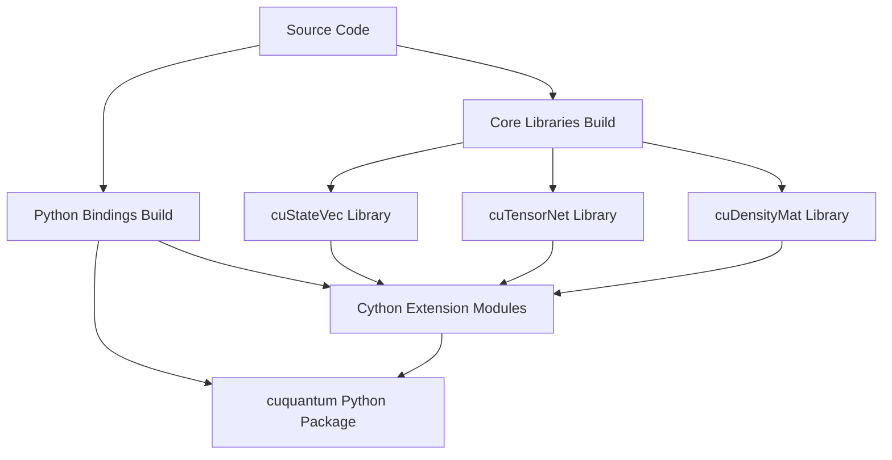
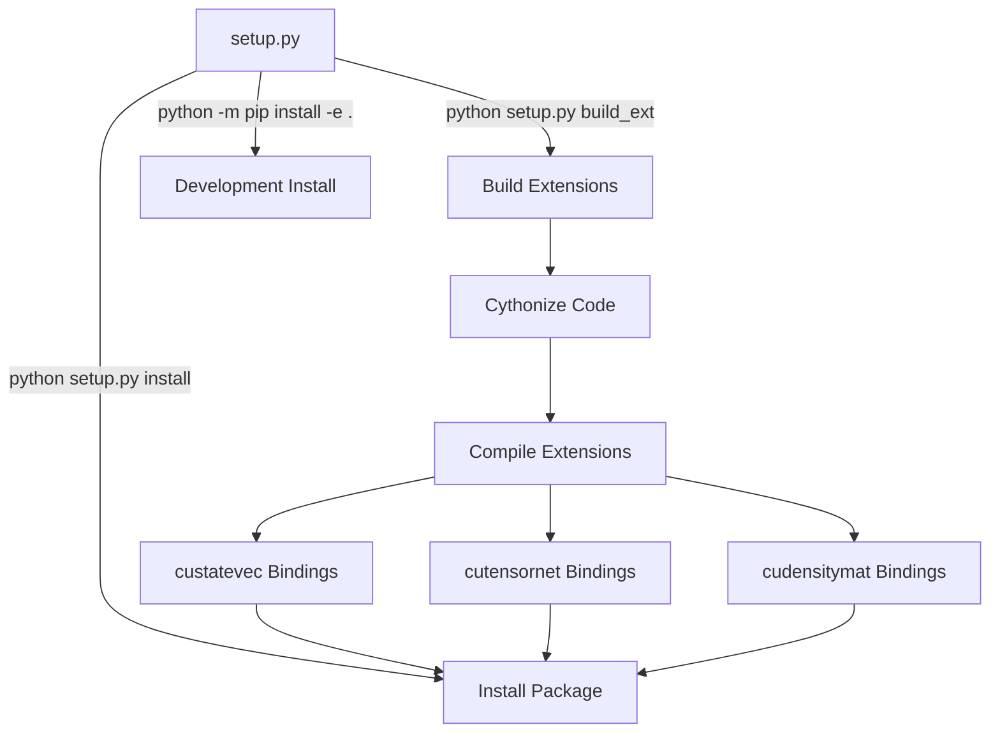
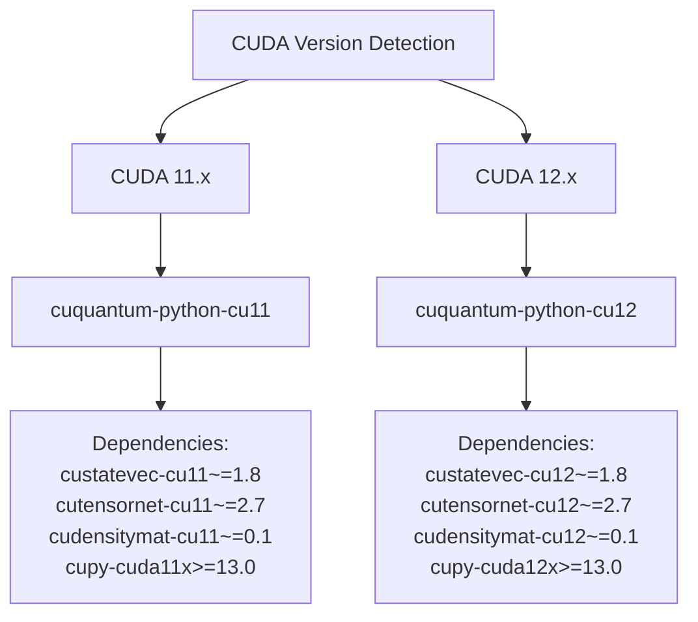
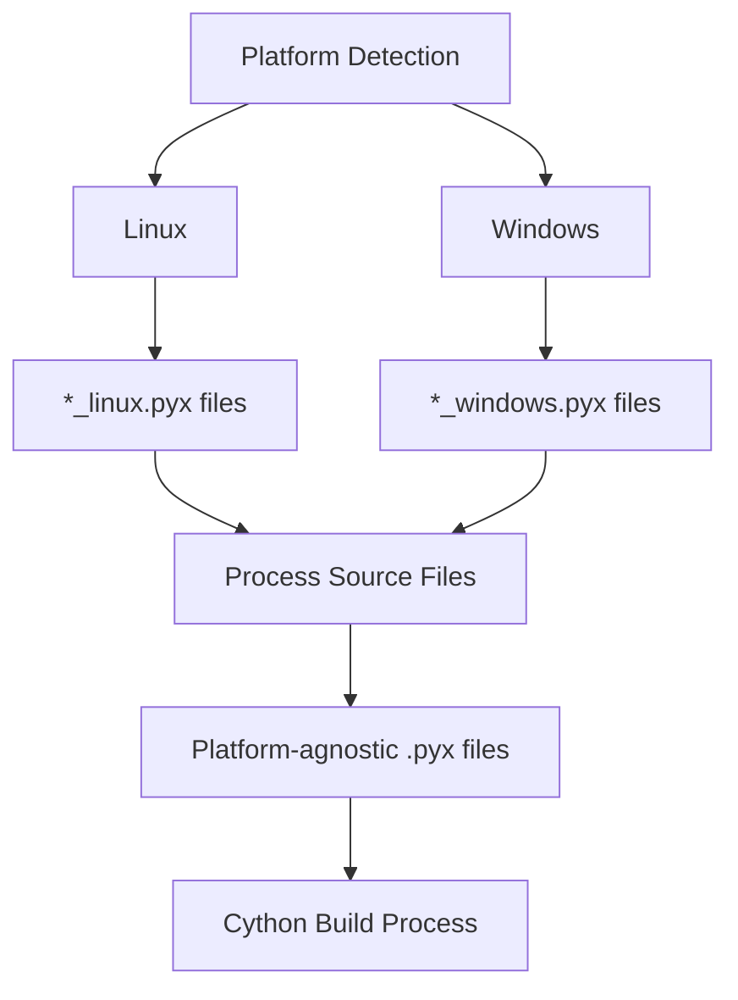
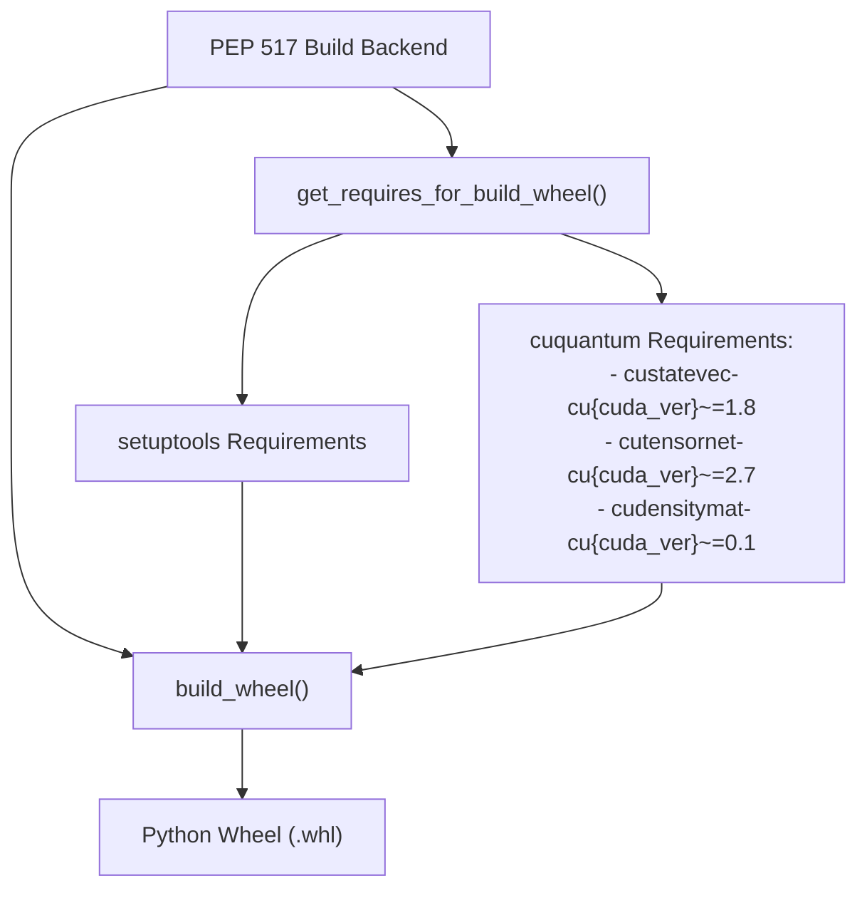

<!-- source: DeepWiki mcp.deepwiki.com · repo NVIDIA/cuQuantum · page 7.2 Building Python from Source · fetched 2026-10-26 -->

# Building from Source

<details>
<summary>Relevant source files</summary>

The following files were used as context for generating this wiki page:

- [python/README.md](python/README.md)
- [python/cuquantum/_version.py](python/cuquantum/_version.py)
- [python/setup.py](python/setup.py)

</details>


This document details the process of building NVIDIA cuQuantum from source code. It covers building both the core libraries and the Python bindings. For information about creating distributable Python wheels, see [Creating Python Wheels](#6.2). For CUDA compatibility considerations, see [CUDA Version Compatibility](#6.3).

## Prerequisites

Before building cuQuantum from source, ensure you have the following prerequisites installed:

| Requirement | Description |
|-------------|-------------|
| CUDA Toolkit | CUDA 11.x or 12.x |
| Python       | Python 3.10 or later |
| Cython       | For building Python bindings |
| C++ Compiler | Compatible with your CUDA version |

Sources: [python/setup.py:35-45]()

## Build System Overview

The cuQuantum build system has two main components:

1. **Core libraries**: cuStateVec, cuTensorNet, and cuDensityMat
2. **Python bindings**: Cython-based Python interface to the core libraries



Sources: [python/setup.py:78-131]()

## Building the Python Package

The Python package can be built directly from the source tree using setuptools:



Sources: [python/setup.py:146-189]()

### Extension Modules

The Python package contains several Cython extension modules that provide bindings to the core libraries:

| Extension Module | Description | Source File |
|------------------|-------------|-------------|
| cuquantum.bindings.custatevec | cuStateVec bindings | cuquantum/bindings/custatevec.pyx |
| cuquantum.bindings.cutensornet | cuTensorNet bindings | cuquantum/bindings/cutensornet.pyx |
| cuquantum.bindings.cudensitymat | cuDensityMat bindings | cuquantum/bindings/cudensitymat.pyx |
| cuquantum.bindings._internal.* | Internal implementation | cuquantum/bindings/_internal/*.pyx |

Sources: [python/setup.py:79-131]()

### Building with Different CUDA Versions

The build system automatically detects the CUDA version and configures the build accordingly. The package name includes the CUDA major version (e.g., `cuquantum-python-cu11` for CUDA 11):



Sources: [python/setup.py:35-45](), [python/setup.py:147]()

## Build Process Steps

### 1. Clone the Repository

```bash
git clone https://github.com/NVIDIA/cuQuantum.git
cd cuQuantum
```

### 2. Building the Python Package

```bash
cd python
python -m pip install -e .
```

This will:
1. Build the Cython extensions (custatevec, cutensornet, cudensitymat bindings)
2. Install the package in development mode

Sources: [python/setup.py:146-189]()

### 3. Platform-Specific Considerations

The build system handles platform-specific files differently for Linux and Windows:



Sources: [python/setup.py:48-67]()

## PEP 517 Build Support

The Python package includes PEP 517 build backend support, which enables building with modern Python packaging tools like `pip` and `build`:

```bash
python -m pip install build
python -m build
```

The build backend defines the necessary dependencies for building wheels and source distributions:



Sources: [python/builder/pep517.py:18-45]()

## Build Configuration

The Python package build can be configured through the `setup.py` script. Key configurations include:

1. Version requirements for dependencies
2. CUDA version compatibility
3. Supported Python versions (3.10 and later)
4. Extension module compilation directives

Sources: [python/setup.py:35-45](), [python/setup.py:172-176]()

## Troubleshooting Common Build Issues

| Issue | Solution |
|-------|----------|
| CUDA not found | Ensure CUDA is installed and CUDA_PATH environment variable is set |
| Missing dependencies | Install required dependencies (numpy, Cython) with `pip install` |
| Compilation errors | Verify compiler compatibility with your CUDA version |
| Python version mismatch | Use Python 3.10 or later as specified in requirements |

Sources: [python/setup.py:185]()

---

