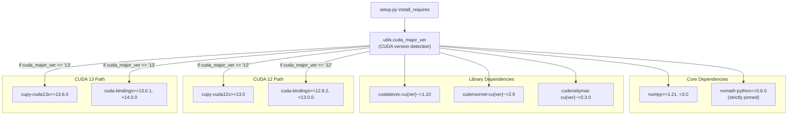
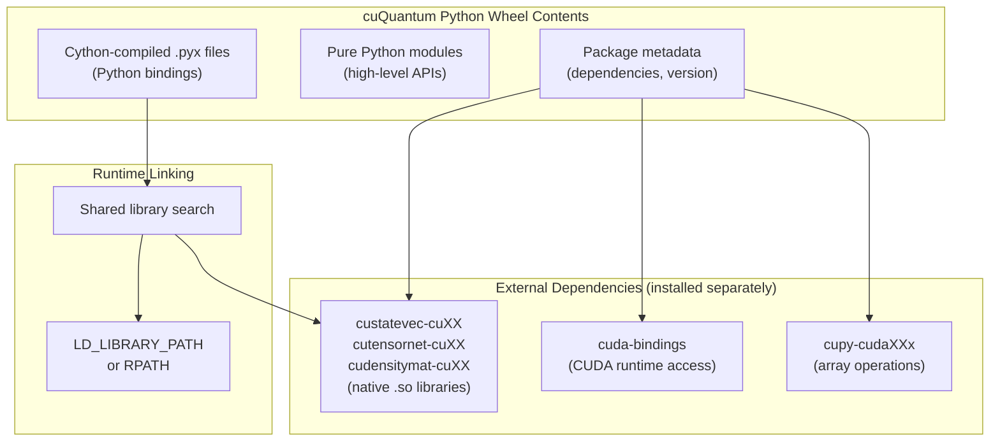
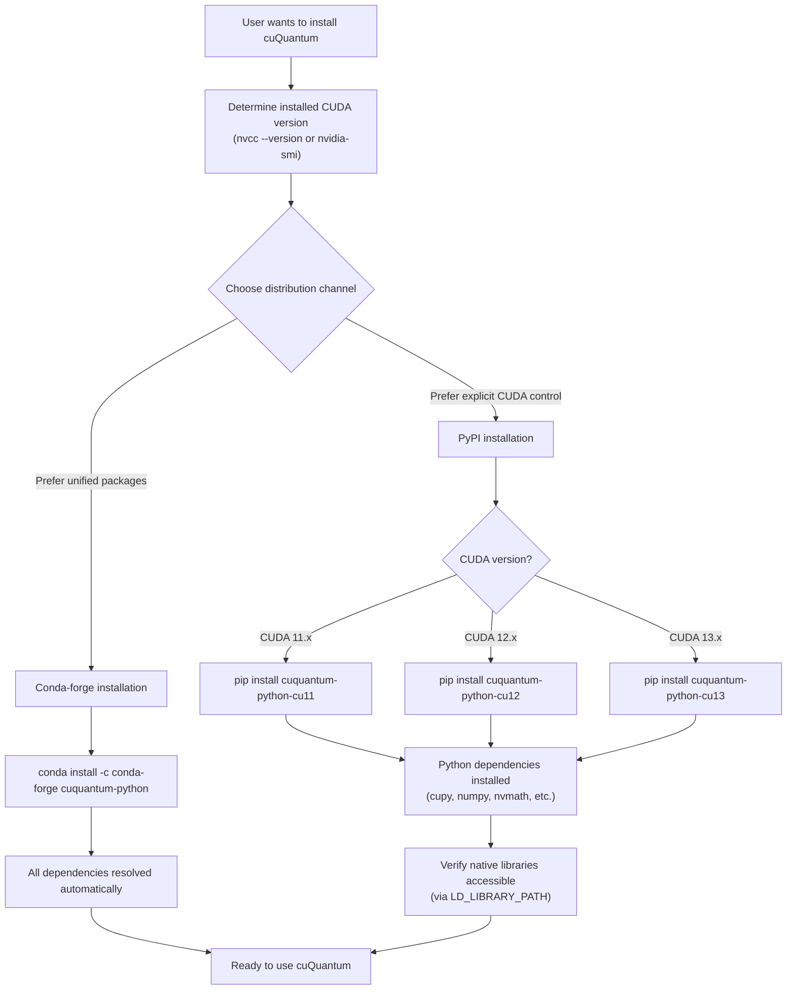

<!-- source: DeepWiki mcp.deepwiki.com · repo NVIDIA/cuQuantum · page 7.3 Creating and Using Python Wheels · fetched 2026-10-26 -->

# Creating and Using Python Wheels

<details>
<summary>Relevant source files</summary>

The following files were used as context for generating this wiki page:

- [LICENSE](LICENSE)
- [README.md](README.md)
- [python/LICENSE](python/LICENSE)
- [python/README.md](python/README.md)
- [python/setup.py](python/setup.py)

</details>


## Purpose and Scope

This document explains the Python wheel distribution strategy for cuQuantum SDK, covering the CUDA-versioned package structure on PyPI, dependency management, installation methods, and the differences between conda-forge and PyPI distributions. For information about building Python packages from source, see page 7.2. For dynamic linking against installed wheels, see page 7.4. For CUDA compatibility requirements, see page 7.5.

## Distribution Channels

cuQuantum Python is distributed through two primary channels:

### conda-forge Distribution

Conda-forge provides unified packages without CUDA version suffixes. This simplifies installation by automatically handling CUDA dependencies through conda's dependency solver.

| Package Name | Description |
|--------------|-------------|
| `cuquantum` | Meta-package containing all libraries |
| `cuquantum-python` | Python bindings package |
| `custatevec` | State vector simulation library |
| `cutensornet` | Tensor network operations library |
| `cudensitymat` | Density matrix simulation library |

Installation via conda-forge:
```bash
conda install -c conda-forge cuquantum-python
```

Sources: [README.md:13-18]()

### PyPI Distribution

PyPI provides CUDA-version-specific packages with `-cu11`, `-cu12`, and potentially `-cu13` suffixes. This explicit versioning allows users to select packages compatible with their installed CUDA version.

The PyPI distribution follows a hierarchical structure:

**Diagram: PyPI Package Hierarchy**

```mermaid
graph TB
    subgraph "Meta Packages"
        cuquantum["cuquantum<br/>(version selector)"]
        cuquantum_python["cuquantum-python<br/>(version selector)"]
    end
    
    subgraph "CUDA 11 Packages"
        cu11_python["cuquantum-python-cu11"]
        cu11_sv["custatevec-cu11"]
        cu11_tn["cutensornet-cu11"]
        cu11_dm["cudensitymat-cu11"]
    end
    
    subgraph "CUDA 12 Packages"
        cu12_python["cuquantum-python-cu12"]
        cu12_sv["custatevec-cu12"]
        cu12_tn["cutensornet-cu12"]
        cu12_dm["cudensitymat-cu12"]
    end
    
    subgraph "Python Dependencies"
        numpy["numpy>=1.21, <3.0"]
        nvmath["nvmath-python==0.6.0"]
        cupy12["cupy-cuda12x>=13.0"]
        cupy13["cupy-cuda13x>=13.6.0"]
        cuda_bindings12["cuda-bindings>=12.9.2, <13.0.0"]
        cuda_bindings13["cuda-bindings>=13.0.1, <14.0.0"]
    end
    
    cuquantum --> cu11_python
    cuquantum --> cu12_python
    cuquantum_python --> cu11_python
    cuquantum_python --> cu12_python
    
    cu11_python --> cu11_sv
    cu11_python --> cu11_tn
    cu11_python --> cu11_dm
    
    cu12_python --> cu12_sv
    cu12_python --> cu12_tn
    cu12_python --> cu12_dm
    
    cu11_python --> numpy
    cu11_python --> nvmath
    cu11_python --> cupy12
    cu11_python --> cuda_bindings12
    
    cu12_python --> numpy
    cu12_python --> nvmath
    cu12_python --> cupy13
    cu12_python --> cuda_bindings13
```



Sources: [README.md:19-31](), [python/setup.py:35-48]()

## Package Naming Convention and Selection

### CUDA-Versioned Package Names

The `setup.py` script generates package names with CUDA version suffixes:

```python
# From setup.py
name=f"cuquantum-python-cu{utils.cuda_major_ver}"
```

The CUDA major version is detected at build time and embedded in the package name. This produces packages like:
- `cuquantum-python-cu11` for CUDA 11.x
- `cuquantum-python-cu12` for CUDA 12.x
- `cuquantum-python-cu13` for CUDA 13.x (future)

Sources: [python/setup.py:152]()

### Complete Package List by CUDA Version

| CUDA 11 Packages | CUDA 12 Packages | Description |
|------------------|------------------|-------------|
| `cuquantum-python-cu11` | `cuquantum-python-cu12` | Main Python bindings |
| `custatevec-cu11` | `custatevec-cu12` | State vector simulation (libcustatevec) |
| `cutensornet-cu11` | `cutensornet-cu12` | Tensor network operations (libcutensornet) |
| `cudensitymat-cu11` | `cudensitymat-cu12` | Density matrix simulation (libcudensitymat) |

Sources: [README.md:20-28]()

### Installation Examples

**Installing CUDA 11 variant:**
```bash
pip install cuquantum-python-cu11
```

**Installing CUDA 12 variant:**
```bash
pip install cuquantum-python-cu12
```

**Using version selectors (automatically picks based on environment):**
```bash
pip install cuquantum-python
```

The version selector packages detect the installed CUDA version and install the appropriate `-cu11` or `-cu12` variant.

Sources: [README.md:19-31]()

## Dependency Management

### Runtime Dependencies

The `setup.py` script defines runtime dependencies that are automatically installed with the package:

**Diagram: Runtime Dependency Resolution in setup.py**



Sources: [python/setup.py:35-48]()

### Key Dependency Characteristics

| Dependency | Version Constraint | Notes |
|------------|-------------------|-------|
| `numpy` | `>=1.21, <3.0` | Broad compatibility range |
| `nvmath-python` | `==0.6.0` | Strictly pinned until internal APIs stabilize |
| `custatevec-cu{ver}` | `~=1.10` | Compatible release (>=1.10.0, <2.0) |
| `cutensornet-cu{ver}` | `~=2.9` | Compatible release (>=2.9.0, <3.0) |
| `cudensitymat-cu{ver}` | `~=0.3.0` | Pre-1.0 pinning (>=0.3.0, <0.4.0) |
| `cupy-cuda12x` | `>=13.0` | CUDA 12 variant |
| `cupy-cuda13x` | `>=13.6.0` | CUDA 13 variant |
| `cuda-bindings` | CUDA version-specific ranges | Provides CUDA runtime Python bindings |

The `~=` operator specifies compatible release versions, allowing minor updates but preventing incompatible major version changes.

Sources: [python/setup.py:36-48]()

### Optional Dependencies

Additional dependencies for specific functionality:

```python
# From setup.py extras_require
extras_require={
    "test": tests_require,  # pytest, cirq, qiskit, etc.
    "jax": ["cuquantum-python-jax"]  # JAX integration
}
```

Install with extras:
```bash
pip install cuquantum-python-cu12[test]
pip install cuquantum-python-cu12[jax]
```

Sources: [python/setup.py:191-194]()

## Wheel Size and Distribution Strategy

### Dynamic Linking Approach

cuQuantum Python wheels use dynamic linking rather than embedding native libraries to keep package sizes manageable for PyPI distribution. PyPI has size limits (typically 100MB default), and embedding CUDA libraries would exceed these limits.

**Diagram: Wheel Distribution Strategy**



This design:
- Keeps wheel size small (< 100MB)
- Enables sharing of CUDA libraries between multiple packages
- Allows independent updates of native libraries
- Requires proper `LD_LIBRARY_PATH` or RPATH configuration

Sources: [python/README.md:70-74]()

### Library Packages

The native library packages (`custatevec-cuXX`, `cutensornet-cuXX`, `cudensitymat-cuXX`) are separate wheels that contain the compiled `.so` files. These are automatically installed as dependencies when you install `cuquantum-python-cuXX`.

Sources: [README.md:22-28]()

## Using cuQuantum Python Wheels

### Installation Workflow

**Diagram: User Installation Process**



Sources: [python/README.md:68-74]()

### Runtime Requirements

After installation, ensure the following are available:

| Requirement | Details |
|-------------|---------|
| GPU | NVIDIA GPU with compute capability 7.5+ |
| Driver | Linux 525.60.13+ (CUDA 12) or 580.65.06+ (CUDA 13) |
| CUDA Toolkit | 12.x or 13.x |
| Library visibility | CUDA and cuQuantum libraries in `LD_LIBRARY_PATH` |

When using conda-forge, library paths are automatically configured. When using PyPI wheels, you may need to set `LD_LIBRARY_PATH`:

```bash
export LD_LIBRARY_PATH=/path/to/cuda/lib64:$LD_LIBRARY_PATH
```

Sources: [python/README.md:50-74]()

## Conda-forge vs PyPI: Key Differences

The two distribution channels have distinct characteristics:

| Aspect | conda-forge | PyPI |
|--------|-------------|------|
| **Package naming** | Unified names (no `-cu11`/`-cu12` suffix) | Explicit CUDA version suffixes |
| **Dependency resolution** | Conda solver handles CUDA compatibility | User must select correct `-cuXX` variant |
| **CUDA libraries** | Managed by conda environment | Must be in `LD_LIBRARY_PATH` or system paths |
| **Installation complexity** | Single command | Requires CUDA version awareness |
| **Update mechanism** | `conda update cuquantum-python` | `pip install --upgrade cuquantum-python-cu12` |
| **Use case** | Simpler for end users | More control for advanced users |

Sources: [README.md:13-31]()

### Conda-forge Advantages

- Automatically resolves CUDA version compatibility
- Manages all native library dependencies
- Single namespace reduces confusion

### PyPI Advantages

- Explicit version selection prevents accidental incompatibilities
- Finer-grained control over CUDA versions
- Standard Python packaging ecosystem tools
- Easier CI/CD integration with pip

Sources: [README.md:13-31](), [python/README.md:68-71]()

## Package Metadata and Classifiers

The `setup.py` script generates appropriate package metadata, including CUDA-specific classifiers:

```python
# From setup.py
cuda_classifier = []
if utils.cuda_major_ver == '12':
    cuda_classifier.append("Environment :: GPU :: NVIDIA CUDA :: 12")
elif utils.cuda_major_ver == '13':
    cuda_classifier.append("Environment :: GPU :: NVIDIA CUDA :: 13")
```

This allows tools like `pip` to display correct metadata and enables PyPI's search functionality to filter by CUDA version.

**Complete Classifiers List:**
- Development Status: Production/Stable
- Operating System: POSIX :: Linux
- Python versions: 3.11, 3.12, 3.13
- Environment: GPU :: NVIDIA CUDA (version-specific)

Sources: [python/setup.py:144-179]()

## Verifying Installation

After installation, verify that cuQuantum is properly configured:

```python
import cuquantum
import numpy as np

# Check version
print(f"cuQuantum version: {cuquantum.__version__}")

# Import specific libraries
from cuquantum import custatevec, cutensornet, cudensitymat

# Verify CUDA is accessible (will raise error if not)
import cupy as cp
test_array = cp.array([1.0, 2.0, 3.0])
```

If you encounter errors about missing libraries, check:
1. `LD_LIBRARY_PATH` includes CUDA library paths
2. Correct CUDA version is installed
3. GPU driver version is compatible with CUDA version

Sources: [python/README.md:70-78]()

## Running Tests

After building the wheels, it's recommended to run tests to ensure the package is working correctly:

```bash
# Install the package with test extras
pip install cuquantum-python-cuXX[test]

# Run tests
python -m pytest
```

The test requirements are defined in `tests/requirements.txt` and included in the package metadata.

Sources: [python/setup.py:28-29](), [python/setup.py:187]()

---

