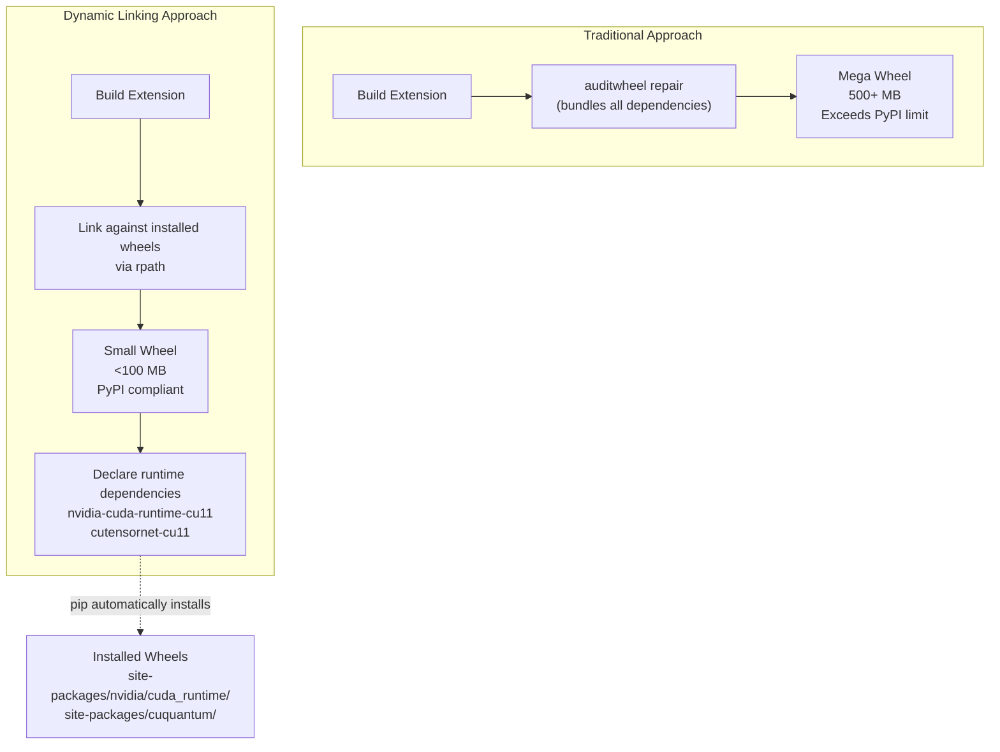
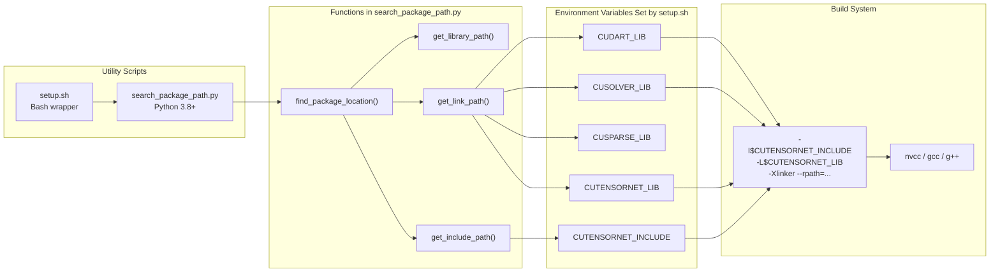
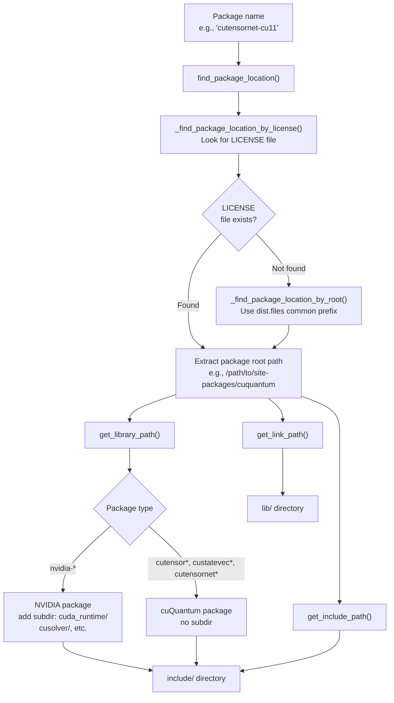
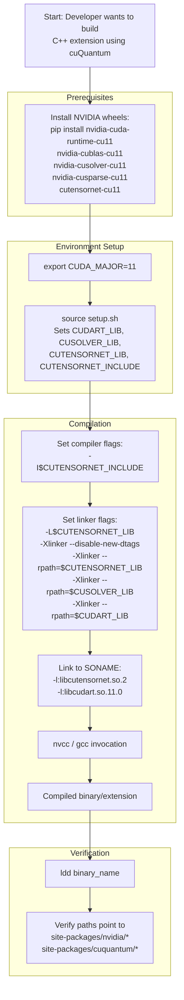
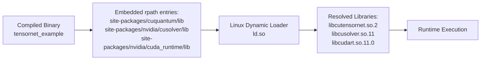

<!-- source: DeepWiki mcp.deepwiki.com · repo NVIDIA/cuQuantum · page 7.4 Dynamic Linking with Wheels · fetched 2026-10-26 -->

# Dynamic Linking with Wheels

<details>
<summary>Relevant source files</summary>

The following files were used as context for generating this wiki page:

- [extra/demo_build_with_wheels/README.md](extra/demo_build_with_wheels/README.md)
- [extra/demo_build_with_wheels/search_package_path.py](extra/demo_build_with_wheels/search_package_path.py)
- [extra/demo_build_with_wheels/setup.sh](extra/demo_build_with_wheels/setup.sh)

</details>


## Purpose and Scope

This page documents the utilities in `extra/demo_build_with_wheels/` that enable dynamic linking against installed CUDA and cuQuantum Python wheels. These utilities solve the "mega wheel" problem by allowing downstream developers to build extensions that link to libraries distributed via PyPI wheels without bundling them, dramatically reducing wheel size and build time.

This is an advanced topic for developers creating C/C++ extensions that depend on cuQuantum or CUDA libraries. For standard Python package installation, see [Installation and Setup](#2.1). For building the cuQuantum Python packages themselves, see [Building Python from Source](#7.2). For understanding CUDA wheel variants, see [Creating and Using Python Wheels](#7.3).

**Sources:** [extra/demo_build_with_wheels/README.md:1-239]()

---

## The Wheel Distribution Problem

### Conflicting Constraints

Python wheel distribution for GPU libraries faces three conflicting requirements:

| Constraint | Requirement | Impact |
|------------|-------------|---------|
| PyPI Size Limits | 100 MB default, 1 GB hard limit | Forces exclusion of dependencies |
| auditwheel Compliance | Wheels must be "self-contained" | Forces bundling of shared libraries |
| CUDA ABI Compatibility | No ABI compatibility before CUDA 11 | Required separate wheels per CUDA version |

Traditional solutions created "mega wheels" (e.g., `cupy-cuda112`, `torch-1.13.0+cu117`) that bundle all CUDA dependencies, uploaded to self-hosted repositories. This approach wastes CI resources, exceeds size limits, and requires multiple wheels per CUDA minor version.

### Enabling Technologies

Two developments enable dynamic linking as a solution:

1. **CUDA Minor Version Compatibility** (since CUDA 11): ABI compatibility across CUDA minor versions (11.0, 11.1, 11.2, etc.)
2. **auditwheel --exclude**: Allows allowlisting libraries for dynamic linking instead of bundling ([pypa/auditwheel#368](https://github.com/pypa/auditwheel/pull/368))

**Diagram: Wheel Distribution Problem and Solution**



**Sources:** [extra/demo_build_with_wheels/README.md:5-35]()

---

## Utility Scripts Architecture

The `extra/demo_build_with_wheels/` directory provides two key utilities:

### Component Overview



**Sources:** [extra/demo_build_with_wheels/setup.sh:1-12](), [extra/demo_build_with_wheels/search_package_path.py:1-95]()

---

## Package Location Detection

### search_package_path.py Implementation

The `search_package_path.py` script uses Python's `importlib.metadata` to locate installed wheel packages and extract their file system paths.

**Diagram: Package Discovery Workflow**



### Key Functions

**`find_package_location(package_name)`** [extra/demo_build_with_wheels/search_package_path.py:10-18]()

Locates the installation directory of a package. Tries two strategies:
1. Find LICENSE file location via `_find_package_location_by_license()`
2. Compute common prefix of all package files via `_find_package_location_by_root()`

**`_find_package_location_by_license(package_name)`** [extra/demo_build_with_wheels/search_package_path.py:33-43]()

Searches for a LICENSE file in the distribution and returns its directory. This assumes packages follow the convention of placing LICENSE at the root.

**`_find_package_location_by_root(package_name)`** [extra/demo_build_with_wheels/search_package_path.py:21-30]()

Computes the common prefix of all file paths in the distribution, excluding `dist-info` and `__pycache__` directories. This is a fallback that always succeeds if the package is installed.

**`get_library_path(library, cuda_major=11)`** [extra/demo_build_with_wheels/search_package_path.py:46-58]()

Maps library names to package names and handles subdirectory structure:

| Library Name | Package Name Pattern | Subdirectory |
|--------------|---------------------|--------------|
| `cuda-runtime` | `nvidia-cuda-runtime-cu{major}` | `cuda_runtime/` |
| `cublas` | `nvidia-cublas-cu{major}` | `cublas/` |
| `cusolver` | `nvidia-cusolver-cu{major}` | `cusolver/` |
| `cusparse` | `nvidia-cusparse-cu{major}` | `cusparse/` |
| `cutensor` | `cutensor-cu{major}` | (none) |
| `custatevec` | `custatevec-cu{major}` | (none) |
| `cutensornet` | `cutensornet-cu{major}` | (none) |

**`get_include_path(library, cuda_major=11)`** [extra/demo_build_with_wheels/search_package_path.py:61-64]()

Returns `{library_path}/include` directory containing header files.

**`get_link_path(library, cuda_major=11)`** [extra/demo_build_with_wheels/search_package_path.py:67-70]()

Returns `{library_path}/lib` directory containing shared libraries (.so files).

**Sources:** [extra/demo_build_with_wheels/search_package_path.py:10-95]()

---

## Environment Setup Script

### setup.sh Implementation

The `setup.sh` script exports environment variables by invoking `search_package_path.py` functions:

```bash
export CUDART_LIB=$(     python -c "from search_package_path import get_link_path; print(get_link_path('cuda-runtime', $CUDA_MAJOR))")
export CUSOLVER_LIB=$(   python -c "from search_package_path import get_link_path; print(get_link_path('cusolver',     $CUDA_MAJOR))")
export CUSPARSE_LIB=$(   python -c "from search_package_path import get_link_path; print(get_link_path('cusparse',     $CUDA_MAJOR))")
export CUTENSORNET_LIB=$(python -c "from search_package_path import get_link_path; print(get_link_path('cutensornet',  $CUDA_MAJOR))")

export CUTENSORNET_INCLUDE=$(python -c "from search_package_path import get_include_path; print(get_include_path('cutensornet',  $CUDA_MAJOR))")
```

These variables point to the `lib/` and `include/` directories within installed wheel packages in `site-packages/`.

**Usage:**

```bash
$ export CUDA_MAJOR=11
$ source setup.sh
```

After sourcing, variables like `$CUTENSORNET_LIB` contain paths such as:
```
/path/to/site-packages/cuquantum/lib
```

**Sources:** [extra/demo_build_with_wheels/setup.sh:5-12]()

---

## Build Workflow

### Complete Build Process

**Diagram: Dynamic Linking Build Workflow**



### Example: Building tensornet_example

Concrete example from the demo [extra/demo_build_with_wheels/README.md:98-113]():

```bash
$ cd ../../samples/cutensornet
$ nvcc -I$CUTENSORNET_INCLUDE \
       -Xlinker "--disable-new-dtags" \
       -Xlinker "--rpath=$CUSOLVER_LIB" \
       -Xlinker "--rpath=$CUSPARSE_LIB" \
       -Xlinker "--rpath=$CUTENSORNET_LIB" \
       -Xlinker "--rpath=$CUDART_LIB" \
       -Xlinker "--no-as-needed,-l:libcusolver.so.$CUDA_MAJOR,-l:libcusparse.so.$CUDA_MAJOR,--as-needed" \
       -L$CUTENSORNET_LIB -l:libcutensornet.so.2 \
       -L$CUDART_LIB -l:libcudart.so.$CUDA_MAJOR.0 \
       ./tensornet_example.cu \
       -o tensornet_example
```

For host compilers (gcc/g++), replace `-Xlinker` with `-Wl,` for passing linker flags.

**Sources:** [extra/demo_build_with_wheels/README.md:68-117]()

---

## Implementation Details

### Rpath Configuration

**Why rpath is necessary:** Linux dynamic loader needs to know where to find shared libraries at runtime. The rpath (runtime path) embedded in the binary tells the loader which directories to search.

**Key linker flags:**

| Flag | Purpose |
|------|---------|
| `--disable-new-dtags` | Use rpath instead of runpath (rpath takes precedence in search order) |
| `--rpath=$CUTENSORNET_LIB` | Add directory to runtime library search path |
| `--no-as-needed` | Force linking even if symbols aren't directly used (for transitive dependencies) |
| `--as-needed` | Resume normal linking behavior |

**Runtime Library Resolution:**



### SONAME Specification

**Problem:** Wheel packages don't include symlinks (e.g., `libcutensornet.so` → `libcutensornet.so.2.0.0`), only versioned files.

**Solution:** Link directly to SONAME using `-l:lib{name}.so.{major}` syntax:

```bash
-l:libcutensornet.so.2       # Correct: links to exact SONAME
-lcutensornet                # Incorrect: looks for libcutensornet.so symlink
```

For CUDA runtime with minor version in SONAME:
```bash
-l:libcudart.so.11.0         # CUDA 11 SONAME
-l:libcudart.so.12.0         # CUDA 12 SONAME
```

**Verification with ldd:**

Running `ldd tensornet_example` shows resolved paths [extra/demo_build_with_wheels/README.md:119-137]():

```
libcusolver.so.11 => /home/user/.../site-packages/nvidia/cusolver/lib/libcusolver.so.11
libcutensornet.so.2 => /home/user/.../site-packages/cuquantum/lib/libcutensornet.so.2
libcudart.so.11.0 => /home/user/.../site-packages/nvidia/cuda_runtime/lib/libcudart.so.11.0
```

All paths correctly point to `site-packages/` wheels.

**Sources:** [extra/demo_build_with_wheels/README.md:144-198]()

---

## Wheel Structure

### Package Layout Convention

NVIDIA wheels follow standard Unix directory structure:

```
package_root/
├── include/
│   ├── cutensornet.h
│   └── ...
├── lib/
│   ├── libcutensornet.so.2
│   └── ...
└── (no symlinks)
```

Notable absence: Symlinks like `libcutensornet.so` or `libcutensornet.so.2.1.0` are not included due to wheel format limitations.

### Supported Libraries

| Library | Package Name (CUDA 11) | Has Subdirectory |
|---------|------------------------|------------------|
| CUDA Runtime | `nvidia-cuda-runtime-cu11` | Yes: `cuda_runtime/` |
| cuBLAS | `nvidia-cublas-cu11` | Yes: `cublas/` |
| cuSOLVER | `nvidia-cusolver-cu11` | Yes: `cusolver/` |
| cuSPARSE | `nvidia-cusparse-cu11` | Yes: `cusparse/` |
| cuTensor | `cutensor-cu11` | No |
| cuStateVec | `custatevec-cu11` | No |
| cuTensorNet | `cutensornet-cu11` | No |
| cuDensityMat | `cudensitymat-cu11` | No |

The subdirectory difference is handled by `get_library_path()` [extra/demo_build_with_wheels/search_package_path.py:46-58]().

**Sources:** [extra/demo_build_with_wheels/README.md:144-163](), [extra/demo_build_with_wheels/search_package_path.py:46-58]()

---

## Integration with Build Systems

### Declaring Runtime Dependencies

After building with dynamic linking, declare the wheel dependencies so pip automatically installs them:

**setup.py:**
```python
setup(
    name="my_extension",
    install_requires=[
        f"nvidia-cuda-runtime-cu{cuda_major}",
        f"nvidia-cusolver-cu{cuda_major}",
        f"cutensornet-cu{cuda_major}",
    ],
)
```

**pyproject.toml (PEP 621):**
```toml
[project]
dependencies = [
    "nvidia-cuda-runtime-cu11",
    "nvidia-cusolver-cu11", 
    "cutensornet-cu11",
]
```

### Using auditwheel

When generating wheels with dynamic linking, use `auditwheel --exclude`:

```bash
$ auditwheel repair --exclude libcutensornet.so.2 \
                     --exclude libcusolver.so.11 \
                     --exclude libcudart.so.11.0 \
                     dist/my_extension.whl
```

This prevents auditwheel from bundling these libraries into the wheel.

### Alternative: patchelf

Rpaths can also be modified post-build using `patchelf`:

```bash
$ patchelf --set-rpath '$ORIGIN/../cuquantum/lib:$ORIGIN/../nvidia/cusolver/lib' my_extension.so
```

Using `$ORIGIN` makes the path relative to the binary, enabling relocatable packages.

**Sources:** [extra/demo_build_with_wheels/README.md:200-232]()

---

## Practical Considerations

### Environment Variables to Avoid

**Do not use `LD_LIBRARY_PATH`:** Setting this environment variable can confuse the dynamic linker because it takes precedence in the search order over embedded rpaths. Always use rpath configuration instead.

### CUDA Version Selection

Specify `CUDA_MAJOR` environment variable before running `setup.sh`:

```bash
$ export CUDA_MAJOR=11  # For CUDA 11.x
$ export CUDA_MAJOR=12  # For CUDA 12.x
```

This determines which wheel variants are located (e.g., `cutensornet-cu11` vs `cutensornet-cu12`).

### Supporting User-Supplied CUDA

The rpath can be extended to support CUDA installations from sources other than PyPI (e.g., system packages, runfiles, cluster installations). However, this creates ambiguity about the "source of truth" for CUDA versions. Document expectations clearly for users.

### Build Containers

Use [manylinux containers](https://github.com/pypa/manylinux) for wheel builds to ensure controlled linking without accidental system library pollution.

### Granular Dependencies

For projects needing only specific cuQuantum libraries, depend on individual wheels:

```python
install_requires=[
    "cutensornet-cu11",  # Only cuTensorNet, not entire cuquantum-cu11
]
```

This provides cleaner dependency declarations and smaller installation footprints.

**Sources:** [extra/demo_build_with_wheels/README.md:218-239]()

---

## Benefits and Results

### For Developers

| Benefit | Impact |
|---------|--------|
| **Reduced wheel size** | Keeps wheels well below 100 MB PyPI limit |
| **Reduced build time** | No need to bundle or copy large CUDA/cuQuantum libraries |
| **Single wheel per CUDA major version** | Leverage CUDA minor version compatibility (11.x → cu11, 12.x → cu12) |

### For Users

| Benefit | Impact |
|---------|--------|
| **Pure pip workflow** | Install CUDA environment without pre-installed toolkit |
| **Faster installation** | Smaller wheels download quicker |
| **Shared dependencies** | Multiple packages can share CUDA wheels, reducing disk usage |

### cuQuantum Python Example

The cuQuantum Python package uses this approach to maintain wheel size below 100 MB. Without dynamic linking (using `auditwheel repair` without `--exclude` or static linking), the wheel would absorb substantial portions of CUDA Toolkit and cuQuantum SDK, exceeding limits.

Reference implementation: [python/builder/utils.py:162-179]() (not included in provided files, but mentioned in README).

**Sources:** [extra/demo_build_with_wheels/README.md:195-198]()

---

## Related Resources

- For conda-based installation (which handles these linking issues automatically), see [Installation and Setup](#2.1)
- For understanding the cuQuantum Python package build process, see [Building Python from Source](#7.2)
- For CUDA version compatibility details, see [CUDA Version Compatibility](#7.5)
- For wheel distribution strategy, see [Creating and Using Python Wheels](#7.3)

---

