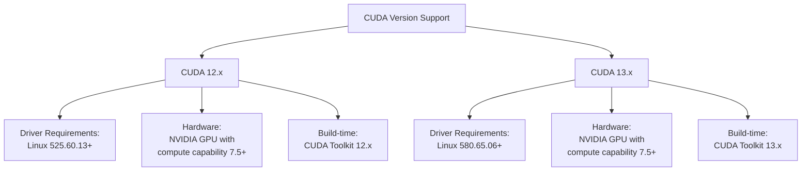
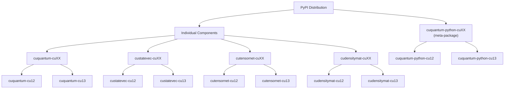
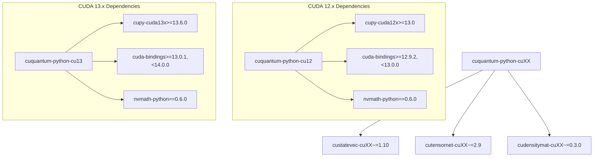
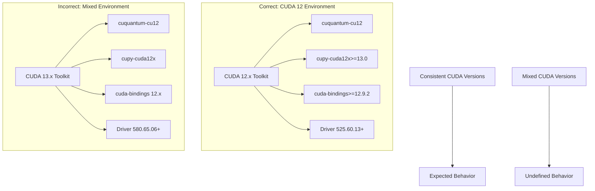
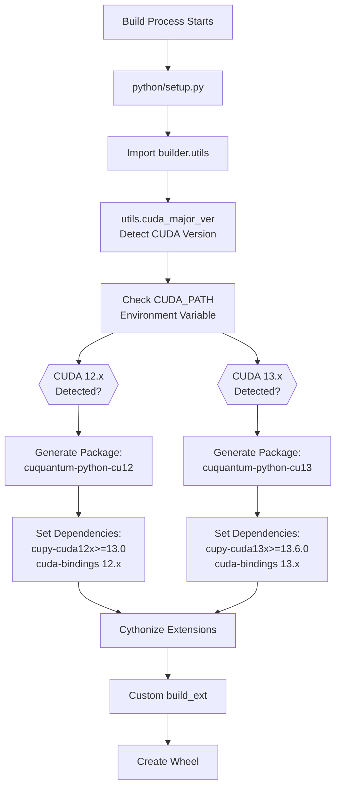

<!-- source: DeepWiki mcp.deepwiki.com · repo NVIDIA/cuQuantum · page 7.5 CUDA Version Compatibility · fetched 2026-10-26 -->

# CUDA Version Compatibility

<details>
<summary>Relevant source files</summary>

The following files were used as context for generating this wiki page:

- [LICENSE](LICENSE)
- [README.md](README.md)
- [python/LICENSE](python/LICENSE)
- [python/README.md](python/README.md)
- [python/setup.py](python/setup.py)

</details>


This document explains CUDA version compatibility for the cuQuantum SDK. It covers supported CUDA versions, minor version compatibility guarantees, package naming conventions, and guidelines for maintaining CUDA version consistency in your environment.

## Supported CUDA Versions

cuQuantum SDK currently supports CUDA 12.x and 13.x:

**Diagram: CUDA Version Requirements**


Sources: [python/README.md:16](), [python/README.md:52-54]()

### Hardware and Driver Requirements

For proper operation of cuQuantum with CUDA, your system must meet these requirements:

| Component | CUDA 12.x | CUDA 13.x |
|-----------|-----------|-----------|
| **GPU Compute Capability** | 7.5 or higher | 7.5 or higher |
| **Minimum Driver (Linux)** | 525.60.13 or later | 580.65.06 or later |
| **Build-time Toolkit** | CUDA Toolkit 12.x | CUDA Toolkit 13.x |
| **Runtime Toolkit** | CUDA Toolkit 12.x | CUDA Toolkit 13.x |

Sources: [python/README.md:52-54]()

## CUDA Minor Version Compatibility

Starting with CUDA 11, NVIDIA guarantees minor version compatibility within the same major version. This means:

- **CUDA 12.x compatibility**: cuQuantum packages built for CUDA 12 (e.g., `cuquantum-cu12`) are compatible with all CUDA 12.x installations (12.0, 12.1, 12.2, etc.)
- **CUDA 13.x compatibility**: cuQuantum packages built for CUDA 13 (e.g., `cuquantum-cu13`) are compatible with all CUDA 13.x installations (13.0, 13.1, etc.)

This compatibility guarantee allows cuQuantum to provide a single package for each CUDA major version rather than requiring separate packages for each minor version.

## Package Naming Convention

cuQuantum packages use a naming convention that explicitly indicates CUDA version compatibility using the `-cuXX` suffix, where `XX` is the CUDA major version number.

**Diagram: PyPI Package Structure**


Sources: [README.md:19-31](), [python/setup.py:152]()

### Build System CUDA Detection

The [python/setup.py]() build script automatically detects the CUDA major version and generates the appropriate package name:

```python
# Package name generation in setup.py
name=f"cuquantum-python-cu{utils.cuda_major_ver}"
```

The `utils.cuda_major_ver` variable is determined by the `builder.utils` module, which examines the `CUDA_PATH` environment variable and available CUDA installations.

Sources: [python/setup.py:152](), [python/setup.py:17-19]()

### Core Component Dependency Chain

When installing or building cuQuantum Python, the package automatically selects the appropriate CUDA version-specific dependencies:

**Diagram: Dependency Resolution by CUDA Version**


Sources: [python/setup.py:35-48]()

### CUDA Classifiers

The build system adds appropriate Python package classifiers based on the detected CUDA version:

```python
# CUDA classifier selection in setup.py
cuda_classifier = []
if utils.cuda_major_ver == '12':
    cuda_classifier.append("Environment :: GPU :: NVIDIA CUDA :: 12")
elif utils.cuda_major_ver == '13':
    cuda_classifier.append("Environment :: GPU :: NVIDIA CUDA :: 13")
```

Sources: [python/setup.py:144-148]()

## Maintaining Version Consistency

### Critical: Avoid Mixing CUDA Versions

**It is critical to maintain consistency in CUDA versions across all components of your environment.** The [python/README.md:44]() and [python/README.md:78]() explicitly warn that mixing packages built for different CUDA major versions (e.g., mixing CUDA 12 and CUDA 13 components) will result in undefined behavior and runtime errors.

**Diagram: Correct vs Incorrect CUDA Version Configuration**


Sources: [python/README.md:44](), [python/README.md:78]()

### Verification Checklist

To ensure CUDA version consistency:

1. **Check CUDA Toolkit version**: Verify your `CUDA_PATH` points to the correct CUDA major version
2. **Verify installed packages**: All cuQuantum packages should have the same `-cuXX` suffix
3. **Confirm CuPy version**: Install `cupy-cuda12x` for CUDA 12 or `cupy-cuda13x` for CUDA 13
4. **Check cuda-bindings**: Version must match your CUDA major version
5. **Validate driver**: Ensure driver meets the minimum version for your CUDA toolkit

Sources: [python/README.md:32-33](), [python/README.md:52-62]()


## Building cuQuantum Python from Source

When building cuQuantum Python from source, the build system automatically detects the CUDA version and creates the appropriate package variant.

### Build-Time CUDA Requirements

The [python/README.md:14-26]() specifies these build-time requirements:

| Requirement | Version |
|-------------|---------|
| **CUDA Toolkit** | 12.x or 13.x |
| **Python** | >=3.11, <3.14 |
| **Cython** | >=3.0.4, !=3.1.0, !=3.1.1 |
| **pip** | 21.3.1+ |
| **setuptools** | 77.0.3+ |
| **wheel** | 0.34.0+ |

**Note**: Starting with cuQuantum Python v25.06, the cuQuantum C libraries (cuDensityMat, cuStateVec, cuTensorNet) are no longer build-time dependencies but are still required at runtime.

Sources: [python/README.md:14-26]()

### CUDA Version Detection Process

**Diagram: CUDA Detection and Package Generation**


Sources: [python/setup.py:17-19](), [python/setup.py:43-48](), [python/setup.py:152]()

### Build Command Examples

To build cuQuantum Python from source with CUDA version detection:

```bash
# Set CUDA_PATH to your CUDA installation
export CUDA_PATH=/usr/local/cuda-12.0  # or cuda-13.0

# Clone repository
git clone https://github.com/NVIDIA/cuQuantum
cd cuQuantum/python

# Build and install
pip install .

# For development (editable mode)
pip install -v -e .

# Advanced: Skip dependency resolution and isolation
pip install -v --no-deps --no-build-isolation .
```

Sources: [python/README.md:30-44]()

### Cython Extension Compilation

The [python/setup.py:84-136]() defines multiple Cython extensions that are compiled with CUDA version awareness:

| Extension Module | Source File | Language |
|------------------|-------------|----------|
| `cuquantum.bindings.custatevec` | `cuquantum/bindings/custatevec.pyx` | C++ |
| `cuquantum.bindings.cycustatevec` | `cuquantum/bindings/cycustatevec.pyx` | C++ |
| `cuquantum.bindings.cutensornet` | `cuquantum/bindings/cutensornet.pyx` | C++ |
| `cuquantum.bindings.cycutensornet` | `cuquantum/bindings/cycutensornet.pyx` | C++ |
| `cuquantum.bindings.cudensitymat` | `cuquantum/bindings/cudensitymat.pyx` | C++ |
| `cuquantum.bindings.cycudensitymat` | `cuquantum/bindings/cycudensitymat.pyx` | C++ |

Sources: [python/setup.py:84-136]()

### Custom Build Extension

The [python/setup.py:139-142]() specifies custom command classes:

```python
cmdclass = {
    'build_ext': utils.build_ext,
    'bdist_wheel': utils.bdist_wheel,
}
```

The `utils.build_ext` class overrides the standard build extension process to:
- Detect CUDA version and set appropriate compiler flags
- Configure include directories and library paths
- Set runtime paths (rpath) for dynamic library loading

Sources: [python/setup.py:139-142]()

## Common Issues and Troubleshooting

### Missing or Incompatible CUDA Libraries

If you encounter errors about missing CUDA libraries or incompatible CUDA versions, check:

1. That you have installed the correct CUDA version-specific packages
2. That all packages in your environment are for the same CUDA major version
3. That your NVIDIA driver version meets the minimum requirements for your CUDA version

### Library Search Path Issues

On Linux, if the dynamic loader cannot find the required libraries at runtime:

1. Ensure the rpath is correctly set in your executable or extension module
2. Avoid using `LD_LIBRARY_PATH` which can lead to confusion about which libraries are being loaded

Sources: [python/README.md:79-81](), [extra/demo_build_with_wheels/README.md:219-226]()

## Conclusion

Maintaining CUDA version compatibility is essential for successful use of the cuQuantum SDK. By following the guidelines in this document, you can ensure that your environment is correctly configured with compatible components, avoiding undefined behavior that can result from mixing CUDA versions.

---

