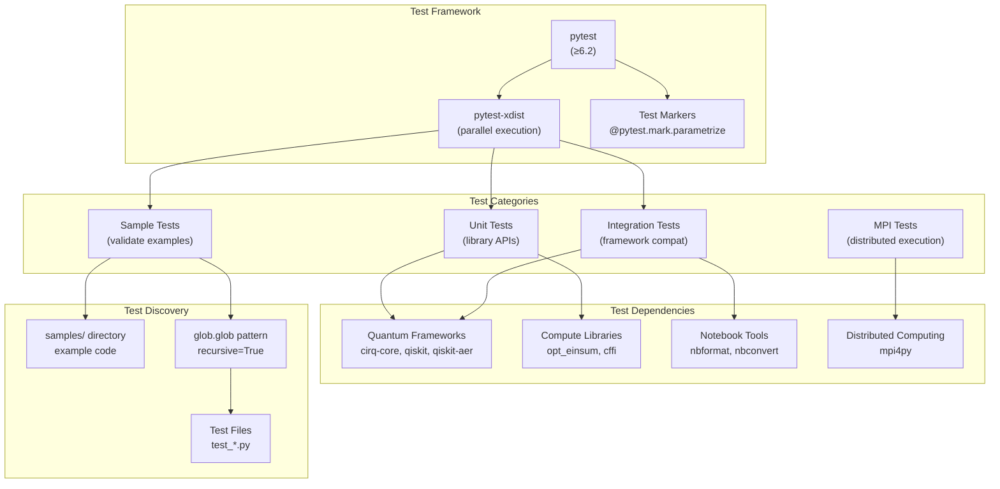
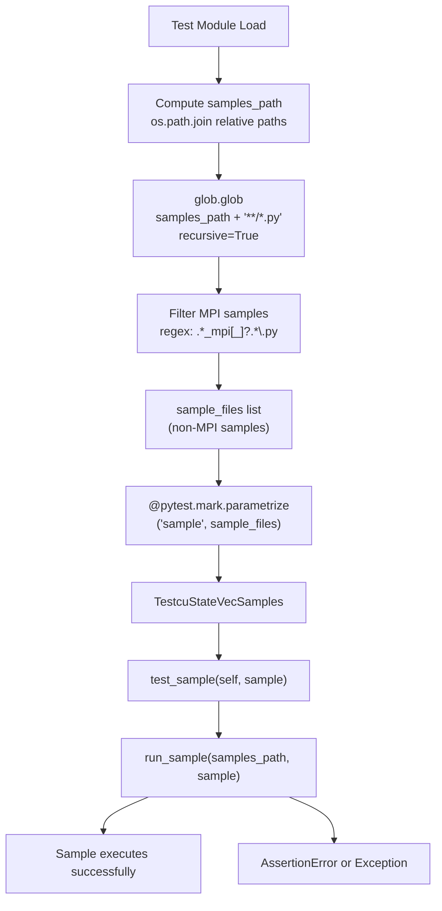
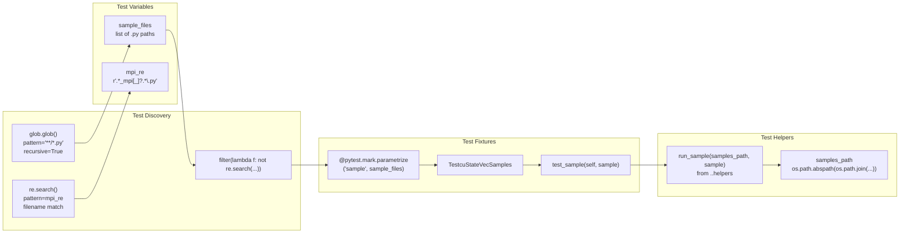
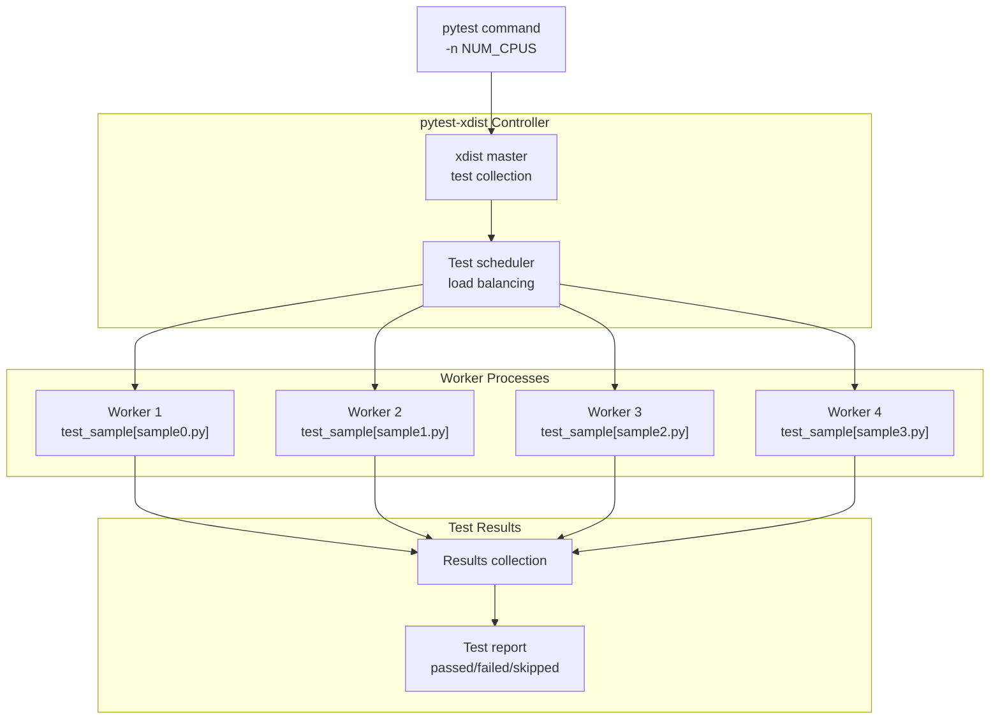
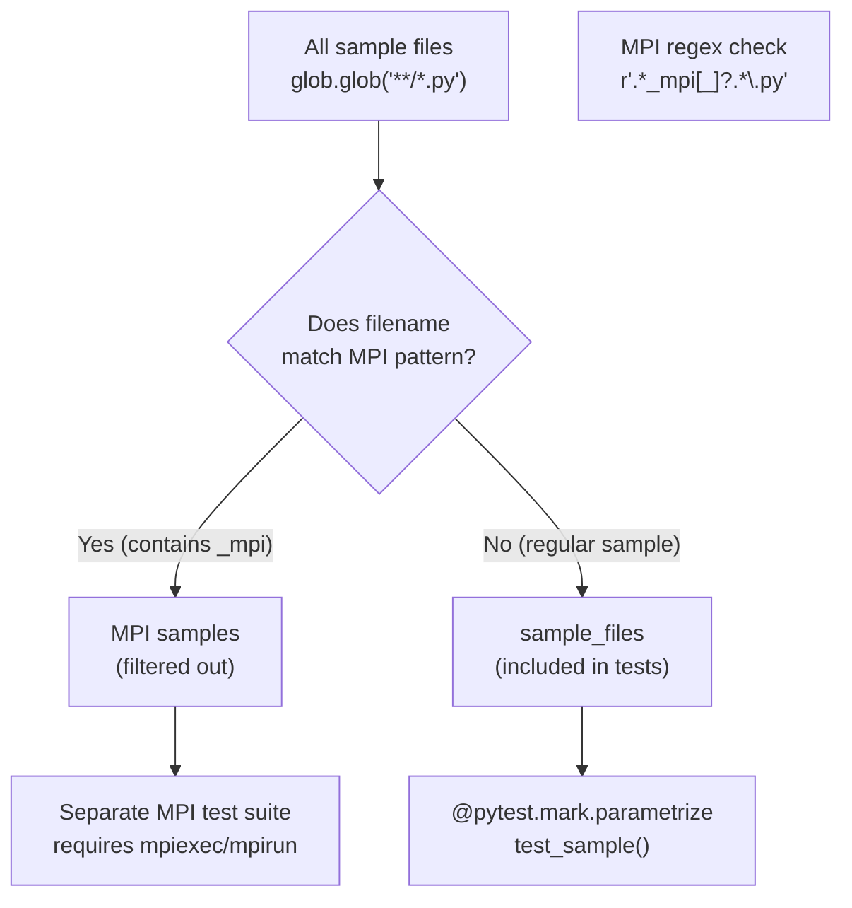
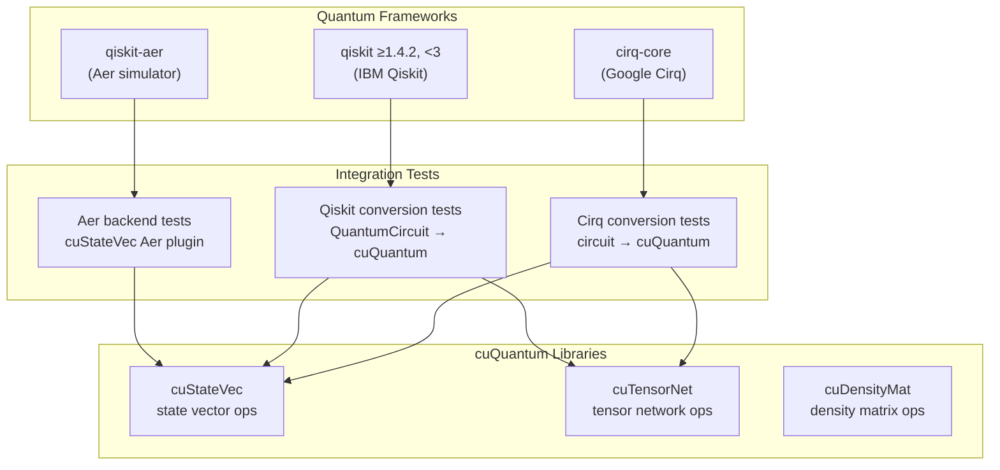

<!-- source: DeepWiki mcp.deepwiki.com · repo NVIDIA/cuQuantum · page 8 Testing and Development · fetched 2026-10-26 -->

# Testing and Development

<details>
<summary>Relevant source files</summary>

The following files were used as context for generating this wiki page:

- [python/tests/requirements.txt](python/tests/requirements.txt)
- [python/tests/samples_tests/custatevec_tests/test_custatevec_samples.py](python/tests/samples_tests/custatevec_tests/test_custatevec_samples.py)

</details>


## Purpose and Scope

This document covers the test infrastructure and development workflows for contributors to the cuQuantum repository. It explains the pytest-based test suite, test dependencies, test organization, and practical commands for running tests. For information about building from source, see [Building and Packaging](#7). For benchmarking performance, see [Benchmarking Suite](#6).

---

## Test Infrastructure Overview

The cuQuantum test infrastructure is built on `pytest` with distributed execution capabilities and integration testing across multiple quantum computing frameworks. The test suite validates both the core Python bindings and the extensive sample code.

### Test Dependencies

The test environment requires several categories of dependencies, all specified in [python/tests/requirements.txt:1-13]():

| Dependency | Version Constraint | Purpose |
|------------|-------------------|---------|
| `pytest` | ≥6.2 | Core testing framework |
| `pytest-xdist` | (latest) | Parallel test execution across CPUs |
| `opt_einsum` | (latest) | Tensor contraction path optimization |
| `cffi` | ≥1.0.0 | Foreign function interface for C libraries |
| `nbformat` | (latest) | Jupyter notebook format support |
| `nbconvert` | (latest) | Notebook conversion utilities |
| `cirq-core` | (latest) | Google Cirq quantum framework |
| `qiskit` | ≥1.4.2, <3 | IBM Qiskit quantum framework |
| `qiskit-aer` | (latest) | Qiskit Aer simulator |
| `pylatexenc` | (latest) | LaTeX encoding for circuit visualization |
| `jsonschema` | ==4.17.3 | JSON schema validation (pinned) |
| `networkx` | (latest) | Graph algorithms |
| `mpi4py` | (latest) | MPI for distributed testing |

**Sources:** [python/tests/requirements.txt:1-13]()

### Test Architecture

The following diagram shows the test infrastructure architecture and how different test types relate to the testing framework:

**Test Infrastructure Architecture**



**Sources:** [python/tests/requirements.txt:1-13](), high-level architecture diagrams

---

## Test Organization

### Directory Structure

Tests are organized under the `python/tests/` directory with the following typical structure:

```
python/tests/
├── requirements.txt                    # Test dependencies
├── samples_tests/                      # Sample validation tests
│   └── custatevec_tests/
│       └── test_custatevec_samples.py  # cuStateVec sample tests
│   └── cutensornet_tests/              # cuTensorNet sample tests
│   └── cudensitymat_tests/             # cuDensityMat sample tests
├── unit_tests/                         # Unit tests for library APIs
│   ├── test_contract.py                # Tensor contraction tests
│   └── test_network.py                 # Network operations tests
└── helpers.py                          # Shared test utilities
```

### Sample Test Pattern

The sample tests follow a parametrized pattern that automatically discovers and validates example code. The `test_custatevec_samples.py` demonstrates this approach:

**Sample Test Discovery Flow**



**Sources:** [python/tests/samples_tests/custatevec_tests/test_custatevec_samples.py:1-30]()

### Sample Test Implementation

The `TestcuStateVecSamples` class in [python/tests/samples_tests/custatevec_tests/test_custatevec_samples.py:23-29]() shows the pattern:

**Key Components:**

1. **Path Construction** [python/tests/samples_tests/custatevec_tests/test_custatevec_samples.py:14-15]():
   - Computes absolute path to samples directory
   - Navigates up three levels from test file: `..`, `..`, `..`, `samples`, `bindings`, `custatevec`

2. **Sample Discovery** [python/tests/samples_tests/custatevec_tests/test_custatevec_samples.py:16]():
   - Uses `glob.glob()` with `recursive=True` to find all `.py` files
   - Pattern: `samples_path + '**/*.py'`

3. **MPI Filtering** [python/tests/samples_tests/custatevec_tests/test_custatevec_samples.py:19-20]():
   - Excludes MPI samples: regex pattern `r".*_mpi[_]?.*\.py"`
   - MPI tests are handled separately (require `mpi4py` and multi-process execution)

4. **Parametrization** [python/tests/samples_tests/custatevec_tests/test_custatevec_samples.py:23-25]():
   - `@pytest.mark.parametrize('sample', sample_files)` creates one test per sample file
   - Enables parallel execution via `pytest-xdist`

5. **Test Execution** [python/tests/samples_tests/custatevec_tests/test_custatevec_samples.py:28-29]():
   - Calls `run_sample(samples_path, sample)` helper from `..helpers`
   - Helper presumably imports and executes the sample, capturing output/errors

**Sources:** [python/tests/samples_tests/custatevec_tests/test_custatevec_samples.py:14-29]()

---

## Test Execution

### Code Entity Mapping: Test Components

The following diagram maps test execution concepts to specific code entities:

**Test Execution Code Entities**



**Sources:** [python/tests/samples_tests/custatevec_tests/test_custatevec_samples.py:5-29]()

### Running Tests with pytest

Basic test execution commands:

```bash
# Run all tests
pytest python/tests/

# Run tests in parallel (4 CPUs)
pytest -n 4 python/tests/

# Run specific test module
pytest python/tests/samples_tests/custatevec_tests/test_custatevec_samples.py

# Run with verbose output
pytest -v python/tests/

# Run tests matching pattern
pytest -k "custatevec" python/tests/

# Run tests with specific marker
pytest -m "not slow" python/tests/
```

**Sources:** Based on pytest standard usage and [python/tests/requirements.txt:1-2]()

### Parallel Test Execution

The `pytest-xdist` plugin enables parallel test execution, which is particularly important for the parametrized sample tests where each sample file becomes an independent test case:

**Parallel Execution with pytest-xdist**



**Sources:** [python/tests/requirements.txt:2](), high-level architecture diagrams

### Conditional Test Skipping

Tests may be conditionally skipped based on environment conditions:

| Condition | Skip Reason | Typical Pattern |
|-----------|-------------|-----------------|
| Missing `CUDA_PATH` | CUDA toolkit not available | `@pytest.mark.skipif(not os.getenv('CUDA_PATH'))` |
| Missing `cffi` | CFFI not installed | `@pytest.mark.skipif(not HAS_CFFI)` |
| Missing MPI | MPI not available | `@pytest.mark.skipif(not HAS_MPI4PY)` |
| GPU not available | No CUDA device | `@pytest.mark.skipif(not cuda_available())` |
| Framework not installed | Qiskit/Cirq missing | `@pytest.mark.skipif(not HAS_QISKIT)` |

**Sources:** High-level architecture diagrams, standard pytest patterns

---

## MPI Test Handling

### MPI Sample Separation

The test infrastructure explicitly separates MPI-based samples from regular samples [python/tests/samples_tests/custatevec_tests/test_custatevec_samples.py:19-20]():

**MPI Test Pattern**



The regex pattern `r".*_mpi[_]?.*\.py"` matches filenames like:
- `example_mpi.py`
- `example_mpi_advanced.py`
- `example_mpi123.py`
- Any file with `_mpi` followed by optional `_` and more characters

**Sources:** [python/tests/samples_tests/custatevec_tests/test_custatevec_samples.py:19-20]()

### Running MPI Tests

MPI tests require special execution via `mpiexec` or `mpirun`:

```bash
# Run MPI sample with 4 processes
mpiexec -n 4 python samples/bindings/custatevec/example_mpi.py

# With CUDA-aware MPI
mpiexec -n 4 --bind-to none python samples/bindings/custatevec/example_mpi.py

# Test MPI samples separately
pytest python/tests/samples_tests/custatevec_tests/test_custatevec_mpi_samples.py
```

**Sources:** [python/tests/requirements.txt:13](), high-level architecture diagrams

---

## Development Workflow

### Setting Up Development Environment

For contributors developing tests or modifying the codebase:

```bash
# Clone repository
git clone https://github.com/NVIDIA/cuQuantum.git
cd cuQuantum

# Install cuQuantum in development mode
pip install -e python/

# Install test dependencies
pip install -r python/tests/requirements.txt

# Verify installation
python -c "import cuquantum; print(cuquantum.__version__)"

# Run tests to verify setup
pytest python/tests/ -v
```

### Test-Driven Development Pattern

When contributing new features:

1. **Write test first**: Create test in appropriate `test_*.py` file
2. **Run test (expect failure)**: `pytest python/tests/test_new_feature.py`
3. **Implement feature**: Modify library code
4. **Run test (expect success)**: Repeat pytest command
5. **Run full suite**: `pytest python/tests/` to check for regressions
6. **Update samples**: Add example usage to `samples/` directory
7. **Verify samples**: Sample tests will automatically discover new examples

### Integration Test Dependencies

The test suite validates integration with multiple quantum frameworks:

**Framework Integration Test Matrix**



**Sources:** [python/tests/requirements.txt:7-9](), high-level architecture diagrams

---

## Test Dependencies Rationale

### Core Testing Framework

- **pytest ≥6.2**: Provides fixtures, parametrization, markers, and plugin architecture
- **pytest-xdist**: Enables parallel test execution, critical for large sample test suites

### Quantum Computing Frameworks

- **cirq-core**: Tests Cirq circuit conversion and compatibility
- **qiskit ≥1.4.2, <3**: Tests Qiskit integration (version 1.x/2.x API)
- **qiskit-aer**: Validates cuStateVec Aer backend plugin

### Computational Libraries

- **opt_einsum**: Tensor contraction path optimization verification
- **cffi ≥1.0.0**: Tests C FFI bindings for low-level library access
- **networkx**: Graph algorithms for tensor network analysis

### Utility Libraries

- **nbformat**: Jupyter notebook format support for notebook examples
- **nbconvert**: Notebook conversion and validation
- **pylatexenc**: LaTeX rendering for circuit diagrams
- **jsonschema ==4.17.3**: JSON schema validation (pinned for reproducibility)

### Distributed Computing

- **mpi4py**: MPI bindings for testing multi-node/multi-GPU examples

**Sources:** [python/tests/requirements.txt:1-13]()

---

## Summary

The cuQuantum test infrastructure provides comprehensive validation through:

1. **Pytest-based framework** with parallel execution via `pytest-xdist`
2. **Parametrized sample tests** that automatically discover and validate example code
3. **MPI-aware test separation** for distributed computing scenarios
4. **Multi-framework integration tests** covering Cirq, Qiskit, and Aer
5. **Conditional skipping** based on environment availability (CUDA, CFFI, MPI)
6. **Development-friendly workflows** supporting test-driven development

For related information:
- Building from source: [Building and Packaging](#7)
- Performance validation: [Benchmarking Suite](#6)
- Sample code organization: [Repository Structure](#1.2)

---

