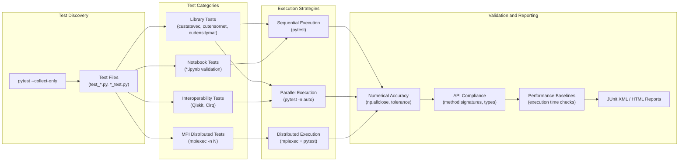

<!-- source: DeepWiki mcp.deepwiki.com · repo NVIDIA/cuQuantum · page 8.1 Test Infrastructure · fetched 2026-10-26 -->

# Test Infrastructure

<details>
<summary>Relevant source files</summary>

The following files were used as context for generating this wiki page:

- [python/tests/requirements.txt](python/tests/requirements.txt)

</details>


## Purpose and Scope

This document describes the test infrastructure for the cuQuantum Python packages, including the pytest framework configuration, test dependencies, and testing architecture. The infrastructure supports unit tests for core functionality, integration tests with quantum computing frameworks, and distributed testing capabilities for MPI-enabled features.

For information about actually running tests and interpreting results, see [Running Tests](#8.2). For information about the benchmark performance suite (which has a separate testing methodology), see [Benchmarking Suite](#6).

**Sources:** High-level system architecture diagrams

---

## Test Framework Architecture

The test infrastructure is built on pytest with extensions for parallel execution and integration testing across multiple quantum frameworks.

```mermaid
graph TB
    subgraph "Test Execution Layer"
        PYTEST["pytest>=6.2<br/>(Test Runner)"]
        XDIST["pytest-xdist<br/>(Parallel Execution)"]
    end
    
    subgraph "Test Dependencies by Category"
        subgraph "Core Python Testing"
            CFFI["cffi>=1.0.0<br/>(C Extension Testing)"]
            NBFORMAT["nbformat<br/>(Notebook Validation)"]
            NBCONVERT["nbconvert<br/>(Notebook Execution)"]
        end
        
        subgraph "Quantum Framework Integration"
            CIRQ["cirq-core<br/>(Cirq Circuit Testing)"]
            QISKIT["qiskit>=1.4.2,<3<br/>(Qiskit Circuit Testing)"]
            QISKIT_AER["qiskit-aer<br/>(Backend Comparison)"]
            PYLATEXENC["pylatexenc<br/>(Qiskit Dependency)"]
        end
        
        subgraph "Computational Dependencies"
            OPT_EINSUM["opt_einsum<br/>(Tensor Contraction)"]
            NETWORKX["networkx<br/>(Graph Operations)"]
        end
        
        subgraph "Distributed Testing"
            MPI4PY["mpi4py<br/>(MPI Test Execution)"]
        end
        
        subgraph "Data Validation"
            JSONSCHEMA["jsonschema==4.17.3<br/>(Schema Validation)"]
        end
    end
    
    subgraph "Test Suites"
        UNIT_TESTS["Unit Tests<br/>(custatevec, cutensornet, cudensitymat)"]
        INTEGRATION_TESTS["Integration Tests<br/>(Qiskit, Cirq interop)"]
        SAMPLE_TESTS["Sample Validation Tests<br/>(C++ and Python samples)"]
        MPI_TESTS["MPI Tests<br/>(Multi-GPU, Multi-node)"]
    end
    
    PYTEST --> XDIST
    PYTEST --> UNIT_TESTS
    PYTEST --> INTEGRATION_TESTS
    PYTEST --> SAMPLE_TESTS
    PYTEST --> MPI_TESTS
    
    UNIT_TESTS --> CFFI
    UNIT_TESTS --> OPT_EINSUM
    
    INTEGRATION_TESTS --> CIRQ
    INTEGRATION_TESTS --> QISKIT
    INTEGRATION_TESTS --> QISKIT_AER
    INTEGRATION_TESTS --> PYLATEXENC
    
    SAMPLE_TESTS --> NBFORMAT
    SAMPLE_TESTS --> NBCONVERT
    
    MPI_TESTS --> MPI4PY
    
    INTEGRATION_TESTS --> JSONSCHEMA
    INTEGRATION_TESTS --> NETWORKX
```



**Diagram: Test Infrastructure Component Dependencies**

This architecture enables comprehensive testing across multiple dimensions: unit testing of core library bindings, integration testing with popular quantum frameworks, validation of example code (including Jupyter notebooks), and distributed testing for MPI-enabled features.

**Sources:** [python/tests/requirements.txt:1-13]()

---

## Core Testing Dependencies

### pytest Framework (≥6.2)

The primary test runner and assertion framework. Version 6.2+ is required for modern pytest features including improved test collection, fixture scoping, and reporting capabilities.

**Location:** [python/tests/requirements.txt:1]()

### pytest-xdist

Enables parallel test execution by distributing tests across multiple CPUs or processes. This significantly reduces test suite execution time for large test suites by running independent tests concurrently.

Key capabilities:
- `-n auto`: Automatically detects available CPUs
- `-n NUM`: Runs tests across NUM worker processes
- `--dist loadscope`: Distributes tests by module/class scope

**Location:** [python/tests/requirements.txt:2]()

---

## C Extension and Notebook Testing

### cffi (≥1.0.0)

Foreign Function Interface for Python, required for testing Cython bindings and low-level C/C++ extension modules. The cuQuantum Python packages use Cython extensively to wrap native CUDA libraries, and `cffi` is used to validate these bindings work correctly.

**Location:** [python/tests/requirements.txt:4]()

### nbformat and nbconvert

Support for validating and executing Jupyter notebooks programmatically:
- `nbformat`: Reads and writes notebook files (`.ipynb` format)
- `nbconvert`: Executes notebook cells and converts notebooks to other formats

These dependencies enable automated testing of example notebooks in `python/samples/` to ensure code examples remain functional across releases.

**Location:** [python/tests/requirements.txt:5-6]()

---

## Quantum Framework Integration Dependencies

The test suite validates interoperability with major quantum computing frameworks, ensuring that circuits defined in these frameworks can be correctly executed using cuQuantum backends.

### cirq-core

Google's quantum computing framework. Tests validate:
- Circuit conversion from Cirq to cuQuantum internal representations
- Gate operation compatibility
- Measurement and sampling results consistency

**Location:** [python/tests/requirements.txt:7]()

### qiskit (≥1.4.2, <3)

IBM's quantum computing framework, constrained to version 1.4.2+ but below version 3.0. This version constraint indicates:
- Minimum version 1.4.2 likely introduces APIs or fixes that cuQuantum depends on
- Maximum version <3 prevents breaking changes from a major version upgrade

Tests validate:
- QuantumCircuit conversion and execution
- Compatibility with Qiskit's transpiler
- Backend provider interface compliance

**Location:** [python/tests/requirements.txt:8]()

### qiskit-aer

Qiskit's high-performance simulator backends. Used for:
- Comparative testing: validating cuQuantum results against qiskit-aer results
- Backend interface testing: ensuring cuQuantum backends implement the expected APIs
- Baseline performance comparisons

**Location:** [python/tests/requirements.txt:9]()

### pylatexenc

LaTeX encoding utilities for quantum circuits. Required by Qiskit for circuit visualization and string representations. While not directly used by cuQuantum, it's a transitive dependency for Qiskit testing.

**Location:** [python/tests/requirements.txt:10]()

---

## Computational and Validation Dependencies

### opt_einsum

Optimized Einstein summation library for tensor operations. Used in tests to:
- Generate reference implementations for tensor contractions
- Validate numerical accuracy of cuQuantum's tensor network operations
- Compare contraction path strategies

**Location:** [python/tests/requirements.txt:3]()

### jsonschema (==4.17.3)

JSON Schema validator, pinned to exact version 4.17.3. This strict pinning suggests:
- Tests rely on specific schema validation behaviors
- Version 4.17.3 may be the last version before breaking changes
- Likely used to validate benchmark output JSON files or API response schemas

The pinned version ensures reproducible test behavior across environments.

**Location:** [python/tests/requirements.txt:11]()

### networkx

Graph theory library for:
- Validating tensor network graph structures
- Testing contraction path algorithms
- Graph-based circuit representations

**Location:** [python/tests/requirements.txt:12]()

---

## Distributed Testing Support

### mpi4py

Python bindings for MPI (Message Passing Interface), enabling:
- Multi-process distributed tests for MPI-enabled features
- Validation of multi-GPU and multi-node cuStateVec operations
- Testing of MPI communication patterns in cuTensorNet slicing strategies

Tests using `mpi4py` typically require special invocation:
```bash
mpiexec -n 4 pytest test_mpi_features.py
```

**Location:** [python/tests/requirements.txt:13]()

---

## Dependency Installation

All test dependencies are specified in a single requirements file for consistent test environment setup:

```bash
pip install -r python/tests/requirements.txt
```

For development workflows, these dependencies can be installed alongside the main package using optional extras:

```bash
pip install -e "python[test]"
```

**Sources:** [python/tests/requirements.txt:1-13]()

---

## Test Organization and Execution Flow



**Diagram: Test Execution Flow and Validation Strategy**

Tests are organized by library component and execution requirements. Standard unit and integration tests can run in parallel via `pytest-xdist`, while MPI tests require special launcher invocation. Each test category validates different aspects: numerical correctness against reference implementations, API compliance with framework interfaces, and performance against established baselines.

**Sources:** [python/tests/requirements.txt:1-13]()

---

## Test Dependency Matrix

The following table summarizes which dependencies are required for different test categories:

| Test Category | Required Dependencies | Optional Dependencies | Execution Mode |
|--------------|----------------------|----------------------|----------------|
| Unit Tests (Core) | `pytest`, `cffi`, `opt_einsum` | `pytest-xdist` | Parallel-safe |
| Integration (Qiskit) | `pytest`, `qiskit>=1.4.2`, `qiskit-aer`, `pylatexenc`, `jsonschema` | `pytest-xdist` | Parallel-safe |
| Integration (Cirq) | `pytest`, `cirq-core`, `opt_einsum` | `pytest-xdist` | Parallel-safe |
| Notebook Validation | `pytest`, `nbformat`, `nbconvert` | - | Sequential |
| MPI Tests | `pytest`, `mpi4py` | - | MPI-distributed |
| Graph/Network Tests | `pytest`, `networkx` | `pytest-xdist` | Parallel-safe |

**Sources:** [python/tests/requirements.txt:1-13]()

---

## Conditional Testing and Environment Detection

The test infrastructure supports conditional test execution based on environment availability:

**CUDA Environment Detection:**
- Tests requiring CUDA runtime check for `CUDA_PATH` environment variable
- GPU-accelerated tests marked with `@pytest.mark.skipif` for CPU-only environments

**MPI Availability:**
- MPI tests check for `mpi4py` import success
- Tests requiring multiple GPUs validate device count before execution

**Framework Availability:**
- Qiskit and Cirq tests skip gracefully if respective packages are not installed
- Allows running partial test suite in minimal environments

This conditional logic ensures the test suite remains executable across diverse development and CI/CD environments.

**Sources:** [python/tests/requirements.txt:1-13](), High-level system architecture

---

## Integration with Build and CI Systems

The test infrastructure integrates with continuous integration pipelines through:

1. **Reproducible Environments:** Pinned dependency versions (e.g., `jsonschema==4.17.3`) ensure consistent test behavior
2. **Parallel Execution:** `pytest-xdist` reduces CI pipeline execution time
3. **Structured Output:** JUnit XML output compatible with CI reporting tools
4. **Conditional Execution:** Environment-based test skipping prevents false failures in limited environments

For practical information about running these tests locally or in CI, see [Running Tests](#8.2).

**Sources:** [python/tests/requirements.txt:1-13]()

---

