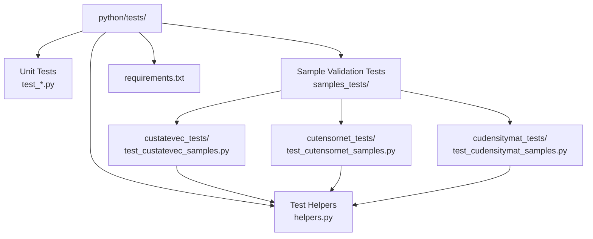
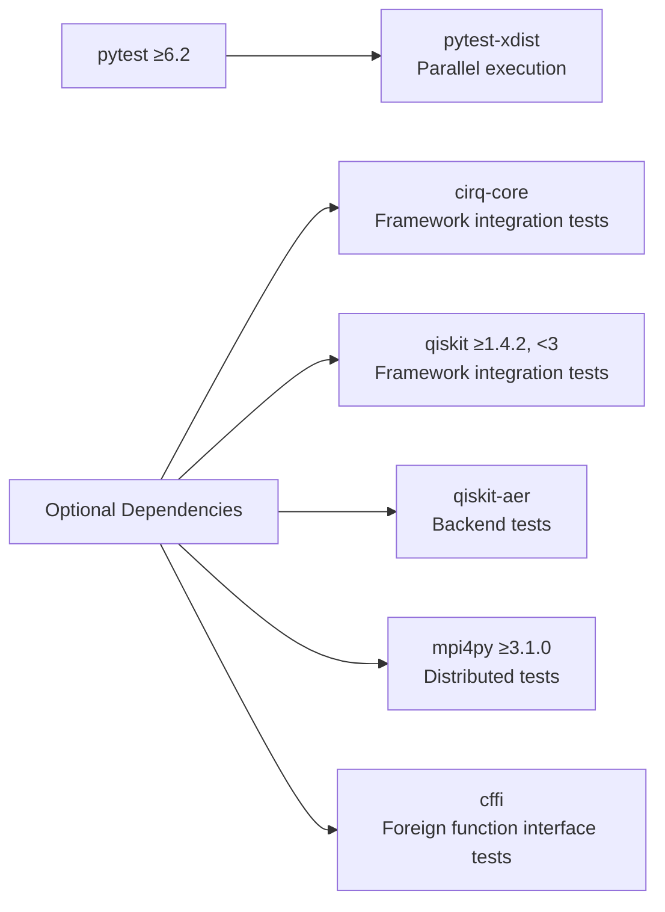
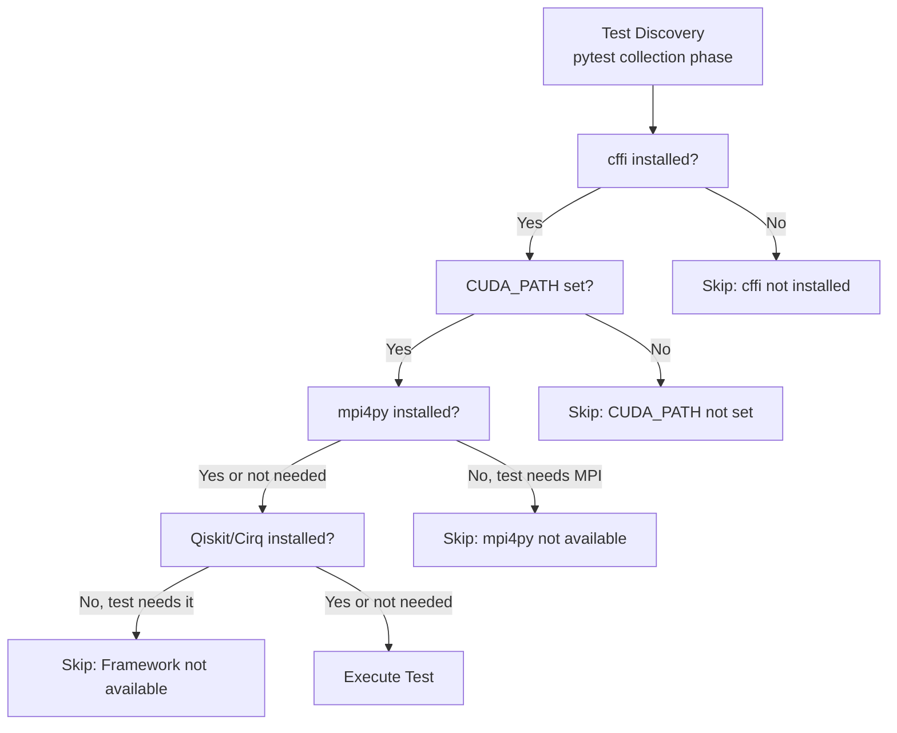
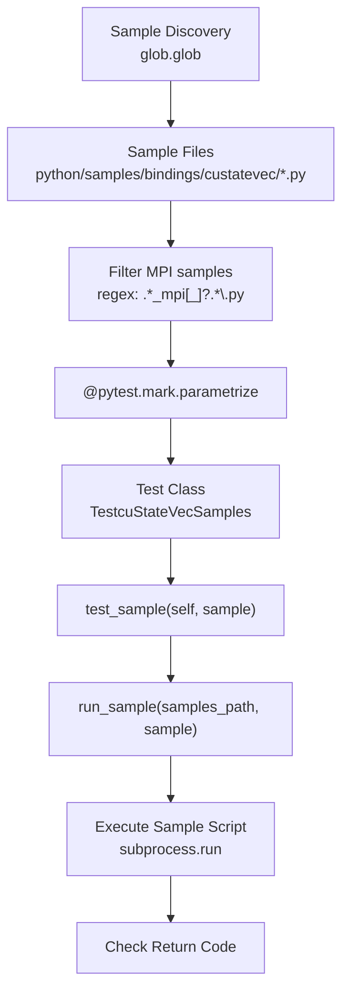
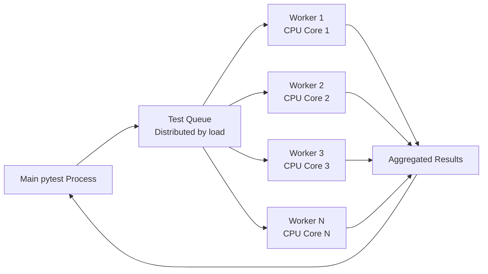
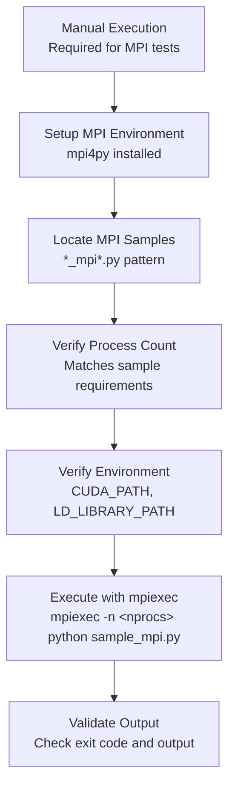
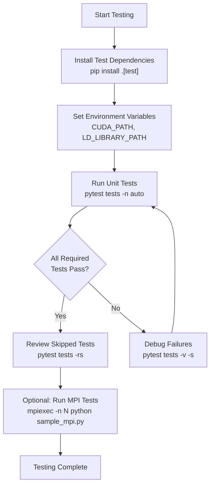

<!-- source: DeepWiki mcp.deepwiki.com · repo NVIDIA/cuQuantum · page 8.2 Running Tests · fetched 2026-10-26 -->

# Running Tests

<details>
<summary>Relevant source files</summary>

The following files were used as context for generating this wiki page:

- [python/README.md](python/README.md)
- [python/setup.py](python/setup.py)
- [python/tests/samples_tests/custatevec_tests/test_custatevec_samples.py](python/tests/samples_tests/custatevec_tests/test_custatevec_samples.py)

</details>


This page provides practical instructions for executing the cuQuantum Python test suite. It covers test execution commands, conditional test requirements, and strategies for validating both library functionality and sample code. For information about the test infrastructure and organization, see [Test Infrastructure](#8.1). For building Python packages from source before testing, see [Building Python from Source](#7.2).

## Test Organization and Structure

The cuQuantum Python test suite is organized into multiple test categories located in the `python/tests/` directory:



**Test Categories:**

| Test Type | Purpose | Location Pattern |
|-----------|---------|-----------------|
| Unit Tests | Validate library API functionality | `python/tests/test_*.py` |
| Sample Tests | Verify example code executes correctly | `python/tests/samples_tests/*/test_*_samples.py` |
| MPI Tests | Test distributed computing features | Sample files matching `*_mpi*.py` pattern |

Sources: [python/README.md:87-91](), [python/tests/samples_tests/custatevec_tests/test_custatevec_samples.py:1-30]()

## Basic Test Execution

The test suite uses pytest as the test runner. Tests are executed from the Python source root directory (`python/`).

**Running All Tests:**

```bash
cd python/
pytest tests
```

This command discovers and runs all test files matching the pytest naming convention (`test_*.py` or `*_test.py`).

**Running Specific Test Modules:**

```bash
# Run only sample validation tests
pytest tests/samples_tests/

# Run tests for a specific library
pytest tests/samples_tests/custatevec_tests/

# Run a specific test file
pytest tests/samples_tests/custatevec_tests/test_custatevec_samples.py
```

**Controlling Test Verbosity:**

```bash
# Increase verbosity to see individual test names
pytest tests -v

# Show captured output even for passing tests
pytest tests -s

# Combination: verbose with output
pytest tests -v -s
```

Sources: [python/README.md:89-91]()

## Test Dependencies

The test suite requires additional packages beyond the runtime dependencies of cuQuantum Python. These are specified in `tests/requirements.txt` and can be installed automatically.

**Installing Test Dependencies:**

```bash
# Option 1: Install with test extras
pip install .[test]

# Option 2: Install from requirements file directly
pip install -r tests/requirements.txt
```

**Core Test Dependencies:**



**Dependency Categories:**

| Package | Purpose | Skip Behavior |
|---------|---------|---------------|
| pytest | Test framework (required) | Cannot run tests |
| pytest-xdist | Parallel test execution | Falls back to sequential |
| cffi | C foreign function interface | Skips cffi-dependent tests |
| cirq-core | Cirq integration tests | Skips Cirq tests |
| qiskit, qiskit-aer | Qiskit integration tests | Skips Qiskit tests |
| mpi4py | MPI distributed tests | Skips MPI tests |

Sources: [python/setup.py:27-29](), [python/setup.py:192](), [python/README.md:89-91]()

## Conditional Test Skipping

Many tests have conditional requirements that cause them to be automatically skipped if preconditions are not met. This allows the core test suite to run in minimal environments while enabling extended testing when optional components are available.

**Environment-Based Skipping:**



**Common Skip Conditions:**

| Condition | Environment Check | Affected Tests |
|-----------|------------------|----------------|
| `cffi` not installed | `import cffi` fails | Low-level binding tests |
| `CUDA_PATH` not set | `os.getenv('CUDA_PATH')` is None | Tests requiring CUDA headers |
| `mpi4py` not installed | `import mpi4py` fails | Distributed computing tests |
| Qiskit not installed | `import qiskit` fails | Qiskit integration tests |
| Cirq not installed | `import cirq` fails | Cirq integration tests |

**Viewing Skipped Tests:**

```bash
# Show reason for each skipped test
pytest tests -v -rs

# Show only skipped tests (no passed tests)
pytest tests --tb=no -q --show-capture=no -k "not test_" || pytest tests -v -rs
```

Sources: [python/README.md:89-91]()

## Sample Validation Tests

Sample validation tests ensure that example code in the `python/samples/` directory executes correctly. These tests use pytest parametrization to run each sample file as an individual test case.

**Sample Test Architecture:**



**Example: cuStateVec Sample Test Structure**

The sample test implementation demonstrates the pattern used across all library sample tests:

```python
# File: python/tests/samples_tests/custatevec_tests/test_custatevec_samples.py

# 1. Locate samples directory relative to test file
samples_path = os.path.abspath(os.path.join(
    os.path.dirname(__file__), '..', '..', '..', 'samples', 'bindings', 'custatevec'))

# 2. Discover all Python sample files recursively
sample_files = glob.glob(samples_path+'**/*.py', recursive=True)

# 3. Filter out MPI samples (tested separately)
mpi_re = r".*_mpi[_]?.*\.py"
sample_files = list(filter(lambda f: not re.search(mpi_re, f), sample_files))

# 4. Parametrize test class with discovered samples
@pytest.mark.parametrize('sample', sample_files)
class TestcuStateVecSamples:
    def test_sample(self, sample):
        run_sample(samples_path, sample)
```

**MPI Sample Filtering:**

MPI samples are identified by the filename pattern `*_mpi*.py` and excluded from standard test runs. The regex pattern `.*_mpi[_]?.*\.py` matches:
- `example_mpi.py`
- `example_mpi_advanced.py`
- Files with `_mpi_` anywhere in the name

These samples require special handling due to their need for `mpiexec` and multiple processes.

Sources: [python/tests/samples_tests/custatevec_tests/test_custatevec_samples.py:1-30]()

## Parallel Test Execution

The test suite supports parallel execution using pytest-xdist, significantly reducing test runtime on multi-core systems.

**Basic Parallel Execution:**

```bash
# Auto-detect CPU count and distribute tests
pytest tests -n auto

# Specify number of parallel workers explicitly
pytest tests -n 4

# Combine with other options
pytest tests -n auto -v
```

**Load Balancing Strategies:**

| Strategy | Flag | Description |
|----------|------|-------------|
| Load-based | `-n auto --dist=load` | Distribute by test runtime (default) |
| Each | `-n auto --dist=each` | Each worker runs all tests |
| Group-based | `--dist=loadgroup` | Respect `@pytest.mark.xdist_group` |

**Parallel Execution Considerations:**



**Limitations:**

- GPU tests may need serialization if GPU memory conflicts occur
- Some tests with global state may require isolation markers
- MPI tests cannot be parallelized with pytest-xdist (different parallelism model)

Sources: Based on pytest-xdist standard usage patterns mentioned in architecture diagrams

## Running MPI Tests

MPI-based tests require special execution procedures as they use `mpiexec` for multi-process parallelism rather than pytest's parallelization.

**MPI Test Execution Flow:**



**Example MPI Sample Execution:**

```bash
# Ensure mpi4py is installed
pip install mpi4py

# Set required environment variables
export CUDA_PATH=/usr/local/cuda
export LD_LIBRARY_PATH=$CUDA_PATH/lib64:$LD_LIBRARY_PATH

# Locate MPI samples
cd python/samples/bindings/custatevec
ls *_mpi*.py

# Run with mpiexec (example with 4 processes)
mpiexec -n 4 python mgmn_swap_product_statevec_example_mpi.py

# Or for cuTensorNet MPI samples
cd ../cutensornet
mpiexec -n 4 python tensornet_example_mpi.py
```

**MPI Test Requirements:**

| Requirement | Description |
|-------------|-------------|
| mpi4py ≥3.1.0 | Python MPI bindings |
| MPI Implementation | OpenMPI, MPICH, or vendor MPI (e.g., NVIDIA HPC-X) |
| Multiple GPUs | Some tests require multiple CUDA-capable GPUs |
| CUDA_PATH | Must point to CUDA installation |
| Process Count | Must match sample's expected process count |

**Why MPI Samples Are Excluded from pytest:**

1. **Different Parallelism Model**: MPI tests create multiple Python interpreter processes via `mpiexec`, incompatible with pytest's thread-based parallelism
2. **Resource Requirements**: MPI tests may require specific GPU counts and inter-process communication setup
3. **Execution Complexity**: Each MPI test needs custom process count configuration
4. **Manual Validation**: MPI tests are better validated manually with specific hardware configurations

Sources: [python/tests/samples_tests/custatevec_tests/test_custatevec_samples.py:18-20](), architecture diagram on distributed testing

## Test Execution Summary

**Quick Reference Table:**

| Command | Purpose | Prerequisites |
|---------|---------|---------------|
| `pytest tests` | Run all tests sequentially | pytest installed |
| `pytest tests -n auto` | Run tests in parallel | pytest-xdist installed |
| `pytest tests -v` | Verbose output with test names | pytest installed |
| `pytest tests -rs` | Show skip reasons | pytest installed |
| `pytest tests/samples_tests/` | Run only sample validation | Samples exist |
| `mpiexec -n 4 python sample_mpi.py` | Run MPI sample manually | mpi4py, MPI implementation |

**Complete Test Workflow:**



Sources: [python/README.md:87-91](), [python/tests/samples_tests/custatevec_tests/test_custatevec_samples.py:1-30]()