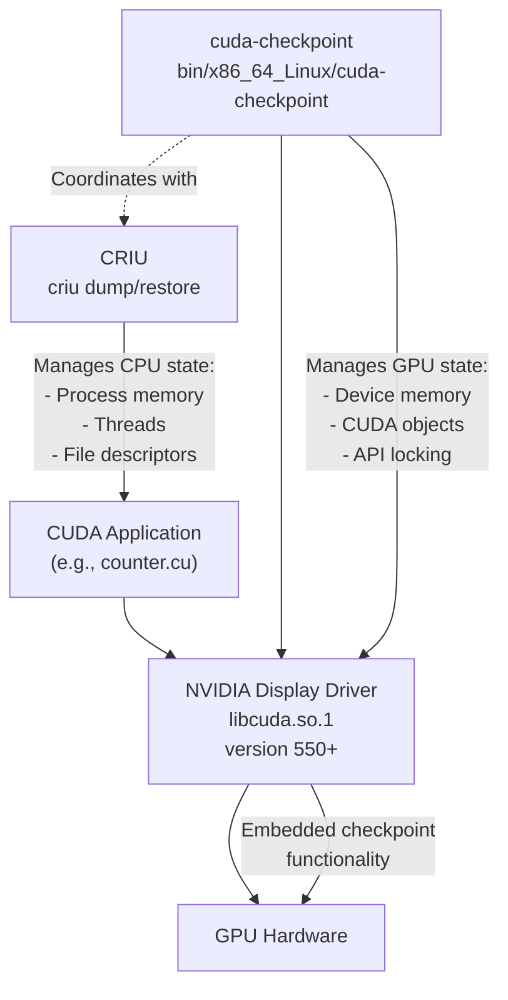
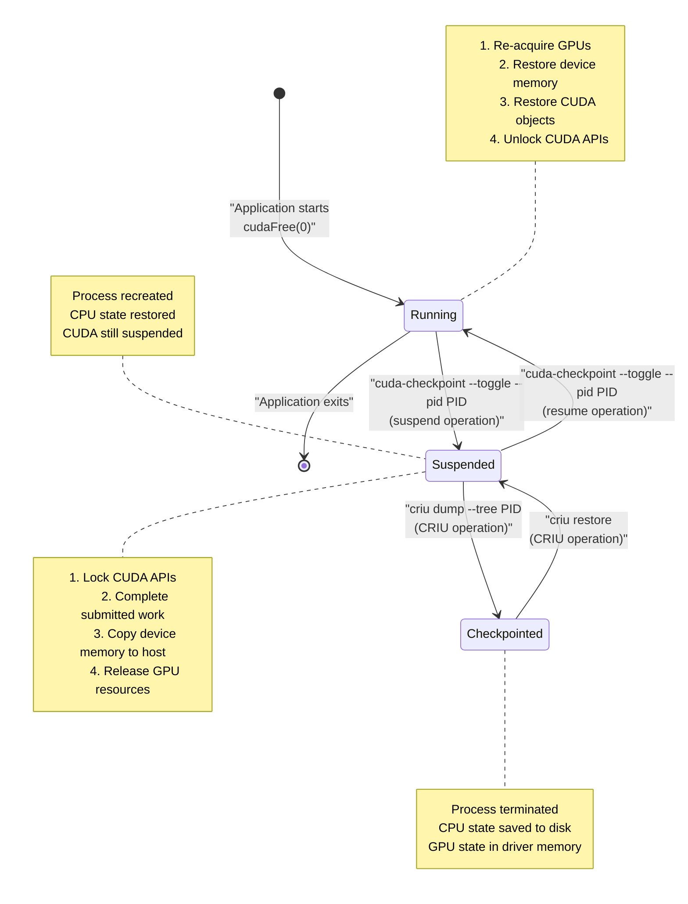
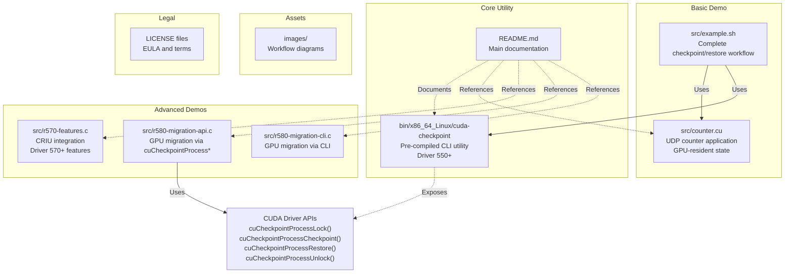

<!-- source: DeepWiki mcp.deepwiki.com · repo NVIDIA/cuda-checkpoint · page 1 Overview · fetched 2026-10-26 -->

# Overview

<details>
<summary>Relevant source files</summary>

The following files were used as context for generating this wiki page:

- [README.md](README.md)

</details>


This document provides an overview of the cuda-checkpoint repository and utility. It introduces the core concepts, explains the problem cuda-checkpoint solves, describes how it integrates with CRIU for complete application checkpointing, and outlines the key use cases and capabilities. For detailed architecture information, see [Architecture and Design](#2). For command-line usage, see [Command-Line Reference](#4). For demonstration programs, see [Examples and Demos](#5).

**Sources:** [README.md:1-6]()

---

## What is cuda-checkpoint?

The `cuda-checkpoint` utility is a command-line tool that enables transparent checkpointing and restoration of CUDA state within running Linux processes. The utility is provided as a pre-compiled binary at [bin/x86_64_Linux/cuda-checkpoint]() and works by coordinating with the NVIDIA display driver (version 550 or higher) to suspend and resume GPU resources, device memory, and CUDA API calls.

When combined with [CRIU](https://criu.org/Main_Page) (Checkpoint/Restore in Userspace), `cuda-checkpoint` enables complete application checkpointing that includes both CPU state (managed by CRIU) and GPU state (managed by cuda-checkpoint). This two-tool approach provides transparent, per-process checkpointing for CUDA applications without requiring application code modifications.

**Sources:** [README.md:1-6](), [README.md:37-54]()

---

## The GPU Checkpoint Problem

CRIU is a widely-used Linux utility that can checkpoint and restore process trees by capturing kernel-mode resources such as memory, threads, file descriptors, sockets, and pipes. However, NVIDIA GPUs provide functionality beyond the standard Linux kernel, exposing GPU-specific resources that CRIU cannot directly manage:

- Device memory allocations
- CUDA contexts and streams
- GPU execution state
- CUDA driver API state

Without GPU-aware checkpointing, attempting to checkpoint a CUDA application with CRIU alone would fail because GPU resources cannot be properly saved and restored. The `cuda-checkpoint` utility addresses this limitation by managing the GPU-specific state, enabling CRIU to handle the rest of the process.

**Sources:** [README.md:37-54]()

---

## System Integration

The following diagram shows how `cuda-checkpoint` integrates with CRIU and CUDA applications to provide complete checkpointing:

**Diagram: cuda-checkpoint System Integration**



**Sources:** [README.md:1-6](), [README.md:37-54](), [README.md:263-264]()

---

## Checkpoint and Restore Workflow

The cuda-checkpoint utility manages CUDA state through a suspend-resume cycle. A process's CUDA state begins in the running state and can be toggled to suspended and back.

**Diagram: CUDA State Transitions**



During the suspend operation, `cuda-checkpoint` ensures that:
- All CUDA driver APIs that launch work or manage resources are locked [README.md:97]()
- Already-submitted work completes, including stream callbacks [README.md:98]()
- Device memory is copied to host memory managed by the driver [README.md:99]()
- All GPU resources are released at the OS level [README.md:100]()

After suspension, CPU threads continue running and can safely call CUDA APIs (which block) or access host memory allocated by `cudaMallocHost()` and similar functions [README.md:102-104]().

**Sources:** [README.md:91-116]()

---

## Use Cases

The `cuda-checkpoint` utility enables three primary use cases, progressing from basic to advanced capabilities:

| Use Case | Description | Driver Version | Example |
|----------|-------------|----------------|---------|
| **Fault Tolerance** | Periodic checkpoints protect against hardware failures or crashes. If a failure occurs, the application can be restored to the last checkpoint. | 550+ | Checkpoint every 5 minutes during a long-running simulation |
| **Workload Preemption** | Lower-priority tasks can be checkpointed and suspended to free GPU resources for higher-priority work, then restored later. | 570+ | Preempt batch jobs for interactive sessions |
| **Cluster Migration** | Workloads can be checkpointed, migrated to different nodes (potentially with different GPUs), and restored with GPU remapping. | 580+ | Move training jobs between cluster nodes for load balancing |

**Sources:** [README.md:24-31]()

---

## Repository Structure and Components

The repository contains the core utility, demonstration programs, and documentation:

**Diagram: Repository Components**



**Sources:** [README.md:4](), [README.md:13](), [README.md:22](), [README.md:119-121]()

---

## Feature Evolution Across Driver Versions

The `cuda-checkpoint` utility exposes functionality embedded in the NVIDIA display driver. As driver versions evolve, new capabilities become available without requiring updates to the utility itself:

### Driver 550 (Baseline)
- Basic checkpoint and restore functionality
- x64 architecture only
- Command-line interface via [bin/x86_64_Linux/cuda-checkpoint]()
- `--toggle` operation for suspend/resume
- `--get-state` query operation

**Sources:** [README.md:59](), [README.md:252-264]()

### Driver 570 (Enhanced)
- NVML support for device management
- CRIU 4.0+ integration with process tree support
- CUDA Driver API parity: `cuCheckpointProcessLock()`, `cuCheckpointProcessCheckpoint()`, `cuCheckpointProcessRestore()`, `cuCheckpointProcessUnlock()`
- Separate `--action lock` command with `--timeout` parameter to prevent deadlocks
- Demonstrated by [src/r570-features.c]()

**Sources:** [README.md:15-22]()

### Driver 580 (GPU Migration)
- GPU migration capability with UUID-based device remapping
- `--device-map` parameter for restore operations
- Container partial passthrough support
- Demonstrated by [src/r580-migration-api.c]() and [src/r580-migration-cli.c]()

**Sources:** [README.md:8-13]()

---

## Basic Example: Counter Application

The repository includes a simple demonstration using [src/counter.cu](), a UDP server that maintains a counter in GPU device memory. Each packet received increments the counter and returns the current value. The complete workflow is shown in [src/example.sh]().

**Example Workflow:**
```bash
# Start the counter application
./counter &
PID=$!

# Verify it's running on GPU
nvidia-smi --query --display=PIDS | grep $PID

# Suspend CUDA state
cuda-checkpoint --toggle --pid $PID

# Checkpoint CPU state with CRIU
criu dump --shell-job --images-dir demo --tree $PID

# Restore CPU state with CRIU
criu restore --shell-job --restore-detached --images-dir demo

# Resume CUDA state
cuda-checkpoint --toggle --pid $PID

# Application continues with preserved GPU state
```

This example demonstrates that the GPU-resident counter value persists across the checkpoint/restore cycle, proving that device memory is correctly saved and restored [README.md:244-249]().

**Sources:** [README.md:118-250](), [src/counter.cu:132-136](), [src/example.sh:14-40]()

---

## API vs CLI Access

Users can interact with checkpoint functionality in two ways:

**Command-Line Interface:**
- Use [bin/x86_64_Linux/cuda-checkpoint]() utility
- Available since driver 550
- Operations: `--toggle`, `--action lock|checkpoint|restore|unlock`, `--get-state`
- Suitable for shell scripts and manual operations

**Programmatic Interface (Driver 570+):**
- Use CUDA Driver APIs: `cuCheckpointProcessLock()`, `cuCheckpointProcessCheckpoint()`, `cuCheckpointProcessRestore()`, `cuCheckpointProcessUnlock()`
- Provides same functionality as CLI
- Suitable for integration into larger applications or orchestration systems
- Documented at [CUDA Driver Checkpoint API](https://docs.nvidia.com/cuda/cuda-driver-api/group__CUDA__CHECKPOINT.html)

The [src/r580-migration-api.c]() demonstration shows programmatic usage, while [src/r580-migration-cli.c]() shows equivalent functionality via the command-line utility.

**Sources:** [README.md:15-20](), [README.md:57-89]()

---

## Limitations and Active Development

As of driver version 570, the checkpoint functionality has the following limitations [README.md:252-264]():

- **Architecture:** x64 only
- **Memory Types:** UVM and IPC memory are not supported
- **Work Completion:** Waits for all submitted CUDA work to complete before checkpointing
- **Error Handling:** Does not attempt recovery if unsupported features (e.g., UVM allocations) are encountered

These limitations are being addressed in future driver releases. The utility itself does not need updates because the checkpoint/restore logic is embedded in the driver [README.md:261-264]().

**Sources:** [README.md:252-264]()

---

## Next Steps

- To understand the internal architecture and suspend/resume mechanisms, see [Architecture and Design](#2)
- For installation and setup instructions, see [Getting Started](#3)
- For a step-by-step tutorial, see [Quick Start Guide](#3.1)
- For complete command-line documentation, see [Command-Line Reference](#4)
- For demonstration programs, see [Examples and Demos](#5)
- For GPU migration capabilities, see [Advanced Features](#6)

---

