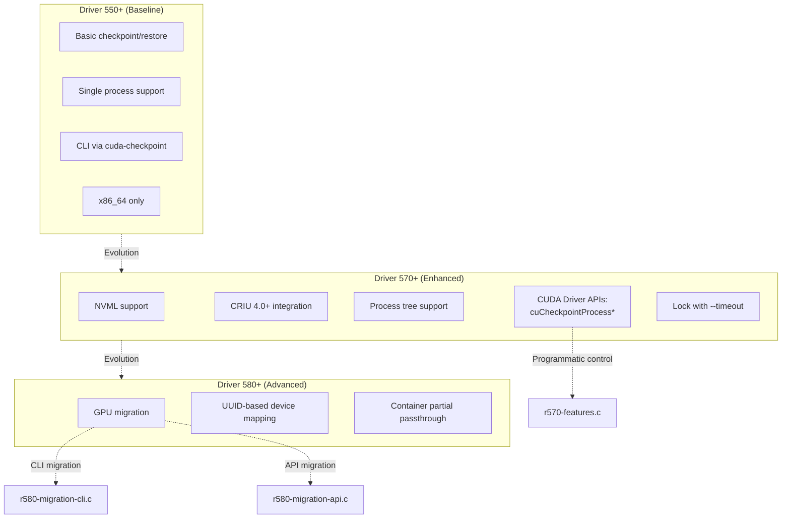
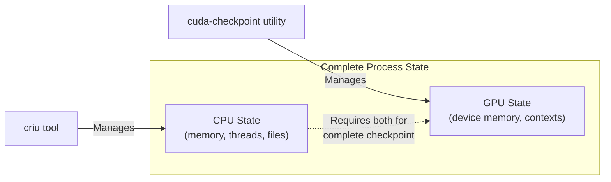
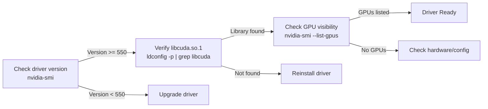
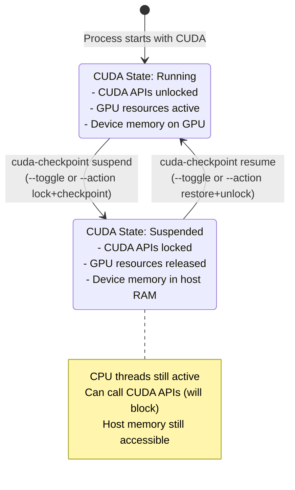
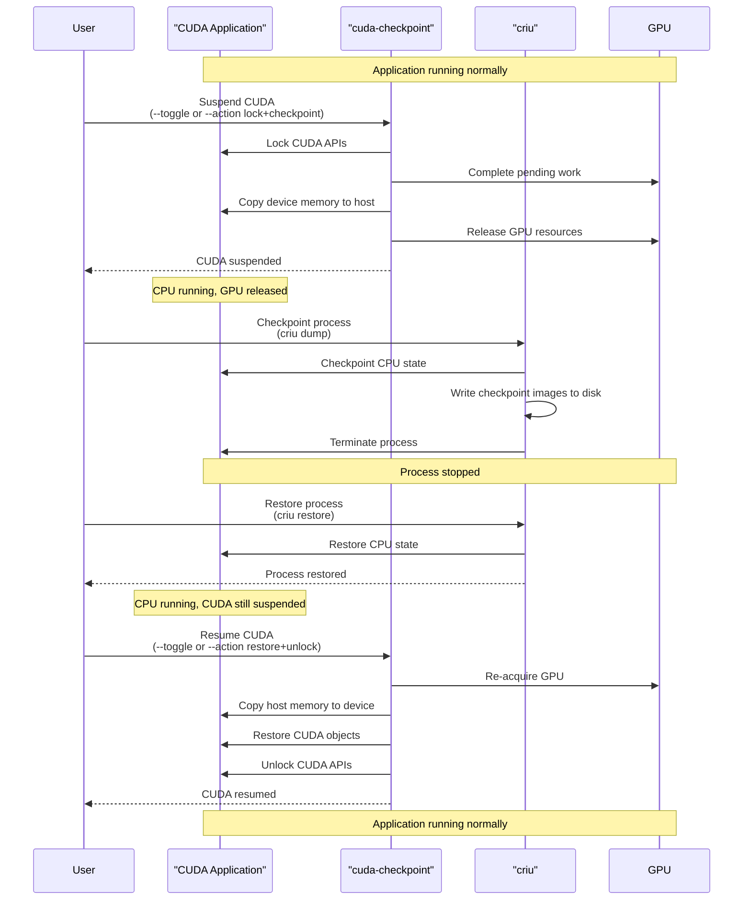
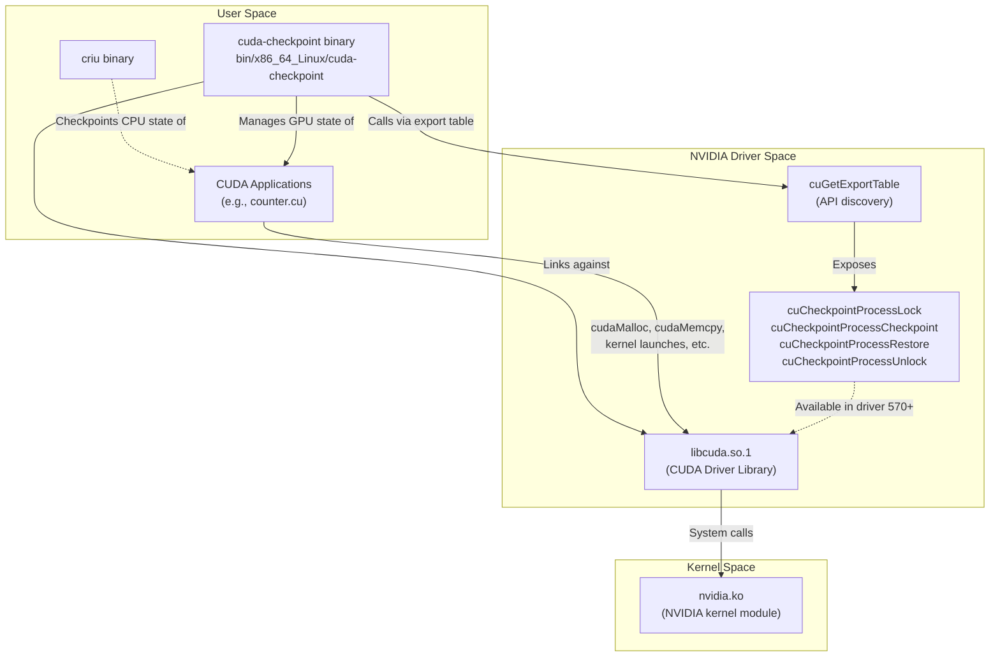

<!-- source: DeepWiki mcp.deepwiki.com · repo NVIDIA/cuda-checkpoint · page 3 Getting Started · fetched 2026-10-26 -->

# Getting Started

<details>
<summary>Relevant source files</summary>

The following files were used as context for generating this wiki page:

- [README.md](README.md)
- [bin/x86_64_Linux/cuda-checkpoint](bin/x86_64_Linux/cuda-checkpoint)

</details>


This page covers the prerequisites, system requirements, and initial setup needed to use cuda-checkpoint for checkpointing and restoring CUDA applications. For a hands-on walkthrough demonstrating checkpoint and restore operations with the counter demo application, see [Quick Start Guide](#3.1).

## Purpose and Scope

The `cuda-checkpoint` utility enables transparent checkpointing and restoration of CUDA state within running Linux processes. This page documents the system requirements across different NVIDIA driver versions, installation procedures for required components, and verification steps to ensure your environment is properly configured. For detailed command-line usage, see [Command-Line Reference](#4). For information about the demonstration programs, see [Examples and Demos](#5).

**Sources:** [README.md:1-6]()

---

## System Requirements

### Hardware Requirements

The cuda-checkpoint utility requires:
- **Architecture:** x86_64 Linux systems only
- **GPU:** NVIDIA CUDA-capable GPU

**Current Limitations:** As documented in [README.md:252-263](), the utility does not support:
- Non-x86_64 architectures
- Applications using Unified Virtual Memory (UVM)
- Applications using Inter-Process Communication (IPC) memory

**Sources:** [README.md:252-263]()

### Software Prerequisites

| Component | Minimum Version | Recommended Version | Notes |
|-----------|----------------|---------------------|-------|
| **NVIDIA Display Driver** | 550+ | 580+ | Feature set depends on driver version (see below) |
| **CRIU** | 3.x | 4.0+ | Version 4.0+ required for process tree support with driver 570+ |
| **Linux Kernel** | Compatible with CRIU | Latest stable | Must support CRIU checkpointing features |
| **CUDA Runtime** | Matches driver | Latest | Application dependency |
| **libcuda.so.1** | Bundled with driver | - | Required by `cuda-checkpoint` utility |

**Sources:** [README.md:16-21](), [README.md:37-54]()

### Driver Version Feature Matrix

The cuda-checkpoint functionality has evolved across driver versions. Understanding which features are available in your driver version is essential for planning your checkpointing strategy.



**Driver Version Feature Details**

| Driver Version | Key Features | Demonstration Programs |
|----------------|--------------|------------------------|
| **550+** | Basic checkpoint/restore via CLI, x64 only, no UVM/IPC support | [counter.cu]()/[example.sh]() |
| **570+** | NVML integration, CRIU 4.0+ process tree support, programmatic CUDA Driver APIs (`cuCheckpointProcessLock`, `cuCheckpointProcessCheckpoint`, `cuCheckpointProcessRestore`, `cuCheckpointProcessUnlock`), lock timeout parameter | [r570-features.c]() |
| **580+** | GPU migration with `--device-map`, container partial passthrough (some 575 builds) | [r580-migration-api.c](), [r580-migration-cli.c]() |

**Sources:** [README.md:8-22](), [README.md:59-64]()

---

## CRIU Background and Integration

### What is CRIU?

CRIU (Checkpoint/Restore in Userspace) is an open-source Linux utility that checkpoints and restores process trees by managing kernel-level resources:

- Anonymous memory
- Thread states
- File descriptors (regular files, sockets, pipes)
- Signal handlers
- Process relationships

### Why CRIU Cannot Handle CUDA Alone

CRIU operates by checkpointing resources defined by the Linux kernel specification. Since NVIDIA GPUs provide functionality beyond standard Linux kernel resources, CRIU cannot directly manage:

- GPU device memory allocations
- CUDA contexts and streams
- GPU-resident data structures
- Driver-managed state

The cuda-checkpoint utility bridges this gap by managing CUDA-specific state while CRIU handles traditional process resources.



**Sources:** [README.md:37-54]()

---

## Installation

### Installing NVIDIA Display Drivers

The cuda-checkpoint utility requires NVIDIA Display Driver version 550 or higher. The checkpoint/restore functionality is embedded within the driver itself—the `cuda-checkpoint` binary merely exposes this functionality.

**Verification Command:**
```bash
nvidia-smi --query-gpu=driver_version --format=csv,noheader
```

Expected output format: `550.XX.XX` or higher

**Driver Installation Resources:**
- NVIDIA Driver Downloads: [https://www.nvidia.com/Download/index.aspx](https://www.nvidia.com/Download/index.aspx)
- Installation typically requires root/sudo privileges
- Reboot may be required after installation

**Sources:** [README.md:59-64](), [README.md:252-263]()

### Installing CRIU

CRIU must be installed separately from the cuda-checkpoint utility. For driver 570+ features (process tree support), CRIU 4.0 or higher is required.

**Installation Methods:**

**Via Package Manager (Ubuntu/Debian):**
```bash
sudo apt-get update
sudo apt-get install criu
```

**Via Package Manager (RHEL/CentOS):**
```bash
sudo yum install criu
```

**From Source:**
```bash
git clone https://github.com/checkpoint-restore/criu
cd criu
make
sudo make install
```

**Verification Command:**
```bash
criu --version
```

**Sources:** [README.md:37-54]()

### Obtaining cuda-checkpoint Binary

The `cuda-checkpoint` utility is distributed as a pre-compiled binary in this repository.

**Binary Location:**
[bin/x86_64_Linux/cuda-checkpoint]()

**Binary Dependencies:**
The utility links against:
- `libcuda.so.1` - CUDA Driver library (bundled with NVIDIA drivers)
- `libc.so.6` - Standard C library

These dependencies can be verified by examining the ELF binary headers in [bin/x86_64_Linux/cuda-checkpoint:1-13]().

**Installation Steps:**

1. **Clone the repository:**
   ```bash
   git clone https://github.com/NVIDIA/cuda-checkpoint
   cd cuda-checkpoint
   ```

2. **Verify binary exists:**
   ```bash
   ls -lh bin/x86_64_Linux/cuda-checkpoint
   ```

3. **Make executable (if needed):**
   ```bash
   chmod +x bin/x86_64_Linux/cuda-checkpoint
   ```

4. **Add to PATH (optional):**
   ```bash
   export PATH="$PWD/bin/x86_64_Linux:$PATH"
   ```
   
   Or copy to system location:
   ```bash
   sudo cp bin/x86_64_Linux/cuda-checkpoint /usr/local/bin/
   ```

**Sources:** [README.md:3-6](), [bin/x86_64_Linux/cuda-checkpoint:1-13]()

---

## Initial Setup and Verification

### Verify NVIDIA Driver Installation

Before using cuda-checkpoint, ensure the NVIDIA driver is properly installed and the required version is present.



**Verification Commands:**

1. **Check driver version:**
   ```bash
   nvidia-smi --query-gpu=driver_version --format=csv,noheader
   ```
   Expected: Version 550 or higher

2. **Verify CUDA Driver library:**
   ```bash
   ldconfig -p | grep libcuda.so.1
   ```
   Expected: Path to libcuda.so.1 displayed

3. **List available GPUs:**
   ```bash
   nvidia-smi --list-gpus
   ```
   Expected: One or more GPUs listed

**Sources:** [README.md:193-198]()

### Verify CRIU Installation

Confirm CRIU is installed and operational.

**Verification Commands:**

1. **Check CRIU version:**
   ```bash
   criu --version
   ```
   Expected output format: `Version: 3.X` or `Version: 4.X`

2. **Test CRIU basic functionality:**
   ```bash
   criu check
   ```
   Expected: All checks should pass

3. **Verify CRIU can access process information:**
   ```bash
   criu check --all
   ```
   Expected: Comprehensive capability check results

**Common Issues:**
- If `criu check` fails, kernel may not have required features enabled
- Some distributions require additional kernel modules or configuration
- Root/sudo privileges may be required for full CRIU functionality

**Sources:** [README.md:37-54]()

### Verify cuda-checkpoint Utility

Test that the cuda-checkpoint binary is functional and can communicate with the driver.

**Verification Commands:**

1. **Display help message:**
   ```bash
   ./bin/x86_64_Linux/cuda-checkpoint --help
   ```
   
   Expected output structure (as shown in [README.md:62-89]()):
   ```
   CUDA checkpoint and restore utility.
   Version XXX.XX.XX. Copyright (C) 2025 NVIDIA Corporation. All rights reserved.
   
   Operations:
   --get-state --pid <pid>
   --action lock | checkpoint | restore | unlock --pid <pid> [--timeout <ms>]
   --toggle --pid <pid>
   --get-restore-tid --pid <pid>
   
   Options:
   --pid|-p <pid>
   --timeout|-t <timeout>
   --help|-h
   ```

2. **Verify driver integration:**
   
   The utility performs a driver version check when executed. If you see an error message like `Insufficient driver`, the driver version is below the minimum requirement (550).

**Troubleshooting:**

| Error | Cause | Solution |
|-------|-------|----------|
| `Insufficient driver` | Driver version < 550 | Upgrade NVIDIA driver |
| `libcuda.so.1: cannot open shared object` | CUDA driver library not found | Add driver library path to `LD_LIBRARY_PATH` or reinstall driver |
| `Permission denied` | Binary not executable | Run `chmod +x bin/x86_64_Linux/cuda-checkpoint` |

**Sources:** [README.md:57-89](), [bin/x86_64_Linux/cuda-checkpoint:10-10]()

---

## Understanding the Basic Workflow

Before proceeding to use cuda-checkpoint, it's important to understand the state model and workflow.

### CUDA Process State Model

A CUDA process exists in one of two states managed by cuda-checkpoint:



**State Characteristics:**

| State | CUDA APIs | GPU Resources | Device Memory Location | CPU Threads | CRIU Compatible |
|-------|-----------|---------------|------------------------|-------------|-----------------|
| **Running** | Unlocked, operational | Active on GPU | GPU device memory | Active | ❌ No |
| **Suspended** | Locked, blocking | Released | Host memory (driver-managed) | Active | ✅ Yes |

**Sources:** [README.md:90-117]()

### Checkpoint and Restore Workflow

The complete checkpoint and restore process involves coordinating cuda-checkpoint with CRIU:



**Key Points:**

1. **Two-Phase Suspension:** CUDA must be suspended (via cuda-checkpoint) before CPU checkpointing (via CRIU)
2. **Two-Phase Restoration:** CPU must be restored (via CRIU) before CUDA resumption (via cuda-checkpoint)
3. **Independent Tools:** cuda-checkpoint and CRIU operate independently but must be coordinated
4. **GPU Resource Management:** GPU resources are completely released during suspension, enabling migration in driver 580+

**Sources:** [README.md:88-117](), [README.md:118-250]()

---

## Component Architecture

The following diagram maps the concrete code entities involved in the checkpoint/restore system:



**Code Entity References:**

- **Binary:** [bin/x86_64_Linux/cuda-checkpoint]() - Pre-compiled utility
- **Library Dependencies:** `libcuda.so.1`, `libc.so.6` as shown in [bin/x86_64_Linux/cuda-checkpoint:3-3]()
- **Driver API Functions:** `cuDriverGetVersion`, `cuGetExportTable` as shown in [bin/x86_64_Linux/cuda-checkpoint:3-3]()
- **Checkpoint API Functions:** Referenced in [README.md:19-20]() - `cuCheckpointProcess*` family

**Sources:** [README.md:252-263](), [bin/x86_64_Linux/cuda-checkpoint:1-13]()

---

## Next Steps

Once your environment is configured and verified:

1. **Try the Quick Start Guide:** Follow the step-by-step tutorial at [Quick Start Guide](#3.1) using the counter demo application
2. **Explore Command-Line Options:** See [Command-Line Reference](#4) for detailed documentation of all flags and parameters
3. **Review Example Programs:** Examine the demonstration programs at [Examples and Demos](#5) to understand different use cases
4. **Learn About Advanced Features:** For GPU migration and other advanced topics, see [Advanced Features](#6)

**Sources:** [README.md:118-250]()

---

