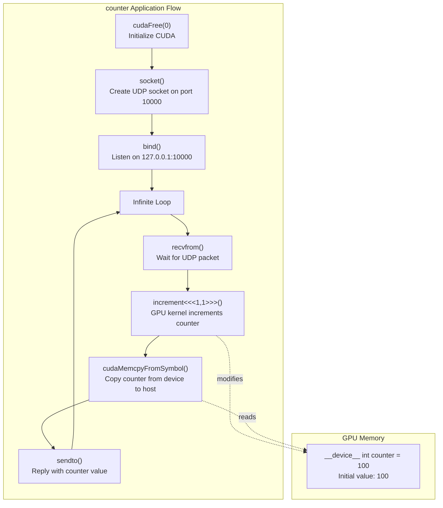
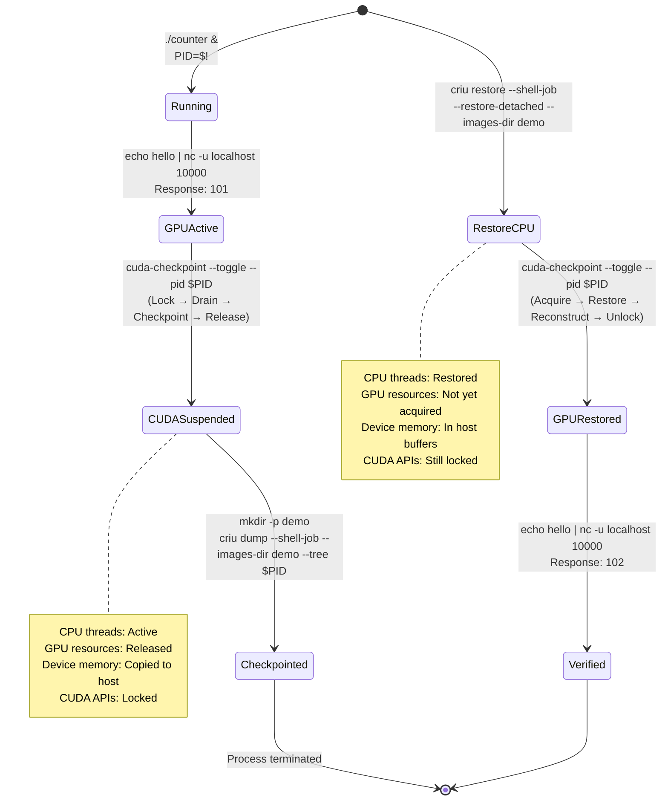
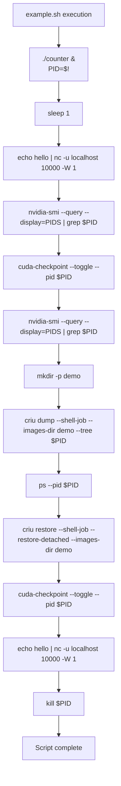

<!-- source: DeepWiki mcp.deepwiki.com · repo NVIDIA/cuda-checkpoint · page 3.1 Quick Start Guide · fetched 2026-10-26 -->

# Quick Start Guide

<details>
<summary>Relevant source files</summary>

The following files were used as context for generating this wiki page:

- [README.md](README.md)
- [src/counter.cu](src/counter.cu)
- [src/example.sh](src/example.sh)

</details>


## Purpose and Scope

This guide provides a step-by-step walkthrough of using the `cuda-checkpoint` utility to checkpoint and restore a CUDA application. It demonstrates the complete workflow using the `counter` demo application, showing how to suspend CUDA state, checkpoint the process with CRIU, restore it, and resume CUDA operations.

For detailed information about individual command-line options and parameters, see [Command-Line Reference](#4). For more advanced demonstrations including GPU migration and CRIU integration features, see [Examples and Demos](#5).

**Sources:** [README.md:118-250]()

---

## Prerequisites

Before beginning this walkthrough, ensure the following requirements are met:

| Requirement | Details |
|-------------|---------|
| **NVIDIA Display Driver** | Version 550 or higher |
| **CRIU** | Installed and accessible in PATH |
| **CUDA Toolkit** | For building the counter application with `nvcc` |
| **Root/sudo privileges** | Required for `criu` operations |
| **Network tools** | `nc` (netcat) for UDP communication |

**Sources:** [README.md:59](), [README.md:6]()

---

## The Counter Demo Application

The counter application is a UDP server that maintains a GPU-resident counter. Each time it receives a network packet, it increments the counter using a CUDA kernel and replies with the updated value. This demonstrates that GPU memory state persists correctly across checkpoint and restore operations.

### Application Structure



**Sources:** [src/counter.cu:1-51]()

### Building the Application

Build the counter application using `nvcc`:

```bash
nvcc counter.cu -o counter
```

The resulting binary is referenced throughout this guide as `./counter`.

**Sources:** [README.md:164-168]()

---

## Step-by-Step Checkpoint and Restore Workflow

The following sections walk through the complete checkpoint and restore process, showing each command and its expected output.

### Step 1: Launch the Application

Start the counter application in the background and wait for it to bind to its UDP socket:

```bash
./counter &
PID=$!
sleep 1
```

The `$!` shell variable captures the PID of the backgrounded process, which is needed for subsequent `cuda-checkpoint` and `criu` commands.

**Sources:** [README.md:173-183](), [src/example.sh:15-22]()

### Step 2: Test Initial Functionality

Send a UDP packet to the counter application and observe the response:

```bash
echo hello | nc -u localhost 10000 -W 1
```

**Expected output:**
```
101
```

The counter's initial device value is 100 ([src/counter.cu:21]()), but the response is 101 because the kernel increments it before replying. This confirms the application is functioning correctly.

**Sources:** [README.md:185-191](), [src/example.sh:24-25]()

### Step 3: Verify GPU Usage

Use `nvidia-smi` to confirm the counter process is actively using a GPU:

```bash
nvidia-smi --query --display=PIDS | grep $PID
```

**Expected output (example):**
```
        Process ID                        : 298027
```

**Sources:** [README.md:193-198](), [src/example.sh:27-28]()

### Step 4: Suspend CUDA State

Use `cuda-checkpoint` to suspend the application's CUDA state:

```bash
cuda-checkpoint --toggle --pid $PID
```

This command performs the following operations:

| Phase | Operation | Description |
|-------|-----------|-------------|
| 1. Lock | API locking | Blocks new CUDA driver API calls |
| 2. Drain | Work completion | Waits for submitted GPU work to finish |
| 3. Checkpoint | Memory copy-out | Copies device memory to host buffers |
| 4. Release | Resource cleanup | Releases all GPU resources |

After suspension, CPU threads remain active but CUDA API calls will block until resumed.

**Sources:** [README.md:200-204](), [src/example.sh:30-31](), [README.md:95-107]()

### Step 5: Verify GPU Release

Confirm the process no longer appears in the GPU process list:

```bash
nvidia-smi --query --display=PIDS | grep $PID
```

**Expected output:** (empty - no match found)

**Sources:** [README.md:206-210](), [src/example.sh:33-34]()

### Step 6: Checkpoint with CRIU

Create a directory for the checkpoint image and use CRIU to checkpoint the entire process:

```bash
mkdir -p demo
criu dump --shell-job --images-dir demo --tree $PID
```

**Expected output:**
```
[1]+  Killed                  ./counter
```

The `--shell-job` flag handles job control signals, `--images-dir` specifies where checkpoint data is stored, and `--tree` checkpoints the entire process tree rooted at the given PID.

**Sources:** [README.md:212-223](), [src/example.sh:36-40]()

### Step 7: Verify Process Termination

Confirm the counter process is no longer running:

```bash
ps --pid $PID
```

**Expected output (example):**
```
    PID TTY          TIME CMD
```

The header line appears but no process entry exists.

**Sources:** [README.md:225-230](), [src/example.sh:42-43]()

### Step 8: Restore with CRIU

Restore the checkpointed process using CRIU:

```bash
criu restore --shell-job --restore-detached --images-dir demo
```

The `--restore-detached` flag causes the restored process to run in the background. After this command, the process is restored but CUDA state remains suspended.

**Sources:** [README.md:232-236](), [src/example.sh:45-46]()

### Step 9: Resume CUDA State

Use `cuda-checkpoint` to resume the application's CUDA state:

```bash
cuda-checkpoint --toggle --pid $PID
```

This command performs the following operations:

| Phase | Operation | Description |
|-------|-----------|-------------|
| 1. Acquire | GPU allocation | Re-acquires GPU resources |
| 2. Restore | Memory copy-in | Copies host buffers back to device memory |
| 3. Reconstruct | Object restoration | Restores CUDA streams, contexts, and events |
| 4. Unlock | API unlocking | Unblocks CUDA driver API calls |

**Sources:** [README.md:238-242](), [src/example.sh:48-49](), [README.md:109-116]()

### Step 10: Verify Restored Functionality

Send another UDP packet to verify the counter's state was preserved:

```bash
echo hello | nc -u localhost 10000 -W 1
```

**Expected output:**
```
102
```

The counter value increased from 101 to 102, confirming that the GPU memory state (the device variable `counter`) persisted correctly through the checkpoint and restore cycle.

**Sources:** [README.md:244-250](), [src/example.sh:51-52]()

---

## Complete Workflow Diagram

The following diagram shows the complete checkpoint and restore workflow with actual commands and state transitions:



**Sources:** [README.md:118-250](), [src/example.sh:1-55]()

---

## Automated Script Option

For convenience, the complete workflow is automated in the `example.sh` script, which executes all the steps described above sequentially. To run the automated demo:

```bash
bash example.sh
```

The script uses `set -v` to display each command before execution, making it useful for understanding the workflow or as a template for custom checkpoint/restore scripts.

### Script Structure



**Sources:** [src/example.sh:1-55]()

---

## Key Observations

### CUDA State Independence

The counter application demonstrates a critical property of the checkpoint/restore system: CPU threads and CUDA GPU operations are managed independently. During the suspended state:

- **CPU threads remain active** and can safely call CUDA APIs (calls will block until resumed)
- **Host memory allocated via `cudaMallocHost` remains accessible** to CPU threads
- **GPU resources are completely released** at the OS level, allowing CRIU to checkpoint the process

This separation enables CRIU (which understands CPU resources) and `cuda-checkpoint` (which understands GPU resources) to work together.

**Sources:** [README.md:102-107]()

### Memory Persistence

The counter value incrementing from 101 to 102 across the checkpoint/restore boundary proves that:

1. The `__device__ int counter` variable at [src/counter.cu:21]() is correctly saved during checkpoint
2. Device memory is restored to the exact same values during resume
3. GPU memory mappings are restored at their original addresses

**Sources:** [README.md:244-250](), [README.md:112]()

### Command Sequencing

The order of operations is critical:

**Checkpoint sequence:**
1. Suspend CUDA (`cuda-checkpoint`)
2. Checkpoint CPU state (`criu dump`)

**Restore sequence:**
1. Restore CPU state (`criu restore`)
2. Resume CUDA (`cuda-checkpoint`)

Reversing this order will fail because CRIU cannot checkpoint active GPU resources, and resumed CUDA state requires the process to already exist.

**Sources:** [README.md:95-116]()

---

## Next Steps

After completing this quick start guide:

- For detailed command-line options and advanced usage patterns, see [Command-Line Reference](#4)
- For advanced CRIU integration features (process trees, NVML support), see [Advanced Integration Demo](#5.2)
- For GPU migration capabilities (moving contexts between physical GPUs), see [GPU Migration Demos](#5.3)
- For driver version feature differences and limitations, see [Advanced Features](#6)

**Sources:** [README.md:1-267]()

---

