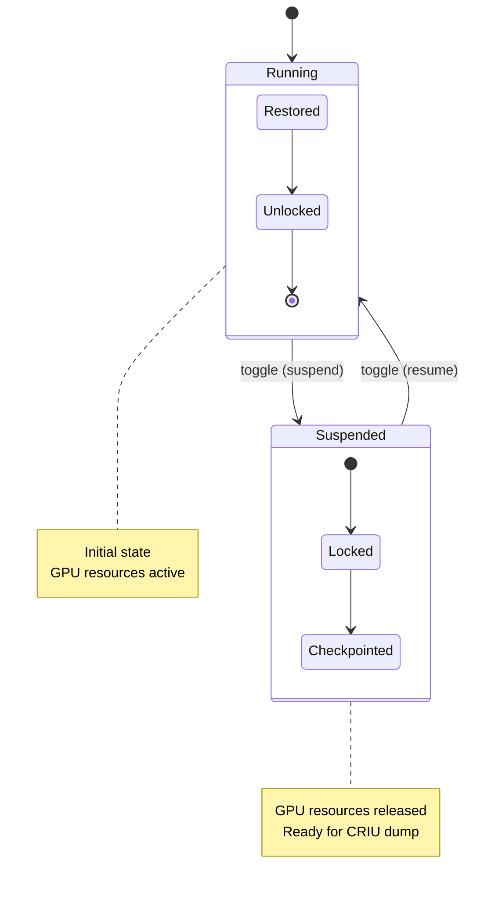
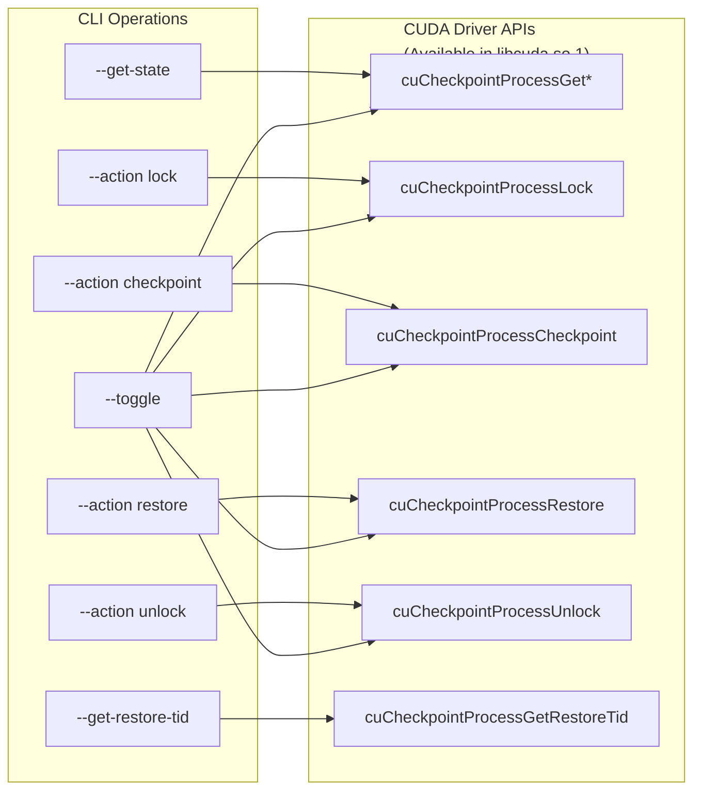

<!-- source: DeepWiki mcp.deepwiki.com · repo NVIDIA/cuda-checkpoint · page 4 Command-Line Reference · fetched 2026-10-26 -->

# Command-Line Reference

<details>
<summary>Relevant source files</summary>

The following files were used as context for generating this wiki page:

- [README.md](README.md)
- [bin/x86_64_Linux/cuda-checkpoint](bin/x86_64_Linux/cuda-checkpoint)

</details>


This document provides comprehensive reference documentation for the `cuda-checkpoint` command-line utility. The utility exposes CUDA driver checkpoint/restore functionality through a command-line interface that can be invoked directly or integrated into scripts and automation workflows.

For conceptual understanding of checkpoint/restore workflows and architecture, see [Architecture and Design](#2). For step-by-step usage instructions with the demo application, see [Quick Start Guide](#3.1). For examples of programmatic API usage instead of CLI, see [API-Based Migration](#5.3.1).

**Sources**: [README.md:57-89]()

---

## Binary Location and Basic Invocation

The `cuda-checkpoint` utility is a precompiled ELF binary located at:

```
bin/x86_64_Linux/cuda-checkpoint
```

The utility is invoked with operation flags and required parameters. All operations require root privileges as they manipulate process state at the driver level.

Basic invocation syntax:

```bash
cuda-checkpoint <operation> --pid <pid> [options]
```

**Sources**: [README.md:3-4](), [README.md:58-59](), [bin/x86_64_Linux/cuda-checkpoint:1-13]()

---

## Command Structure Overview

```mermaid
graph TD
    CLI["cuda-checkpoint binary"]
    
    CLI --> GetState["--get-state<br/>Query operation"]
    CLI --> Action["--action<br/>Granular control"]
    CLI --> Toggle["--toggle<br/>Convenience operation"]
    CLI --> GetTID["--get-restore-tid<br/>Query operation"]
    CLI --> Help["--help<br/>Documentation"]
    
    Action --> Lock["lock"]
    Action --> Checkpoint["checkpoint"]
    Action --> Restore["restore"]
    Action --> Unlock["unlock"]
    
    GetState --> PidReq1["Requires: --pid"]
    Toggle --> PidReq2["Requires: --pid"]
    GetTID --> PidReq3["Requires: --pid"]
    Lock --> PidReq4["Requires: --pid"]
    Checkpoint --> PidReq5["Requires: --pid"]
    Restore --> PidReq6["Requires: --pid"]
    Unlock --> PidReq7["Requires: --pid"]
    
    Lock --> OptTimeout["Optional: --timeout <ms>"]
    Restore --> OptDevMap["Optional: --device-map <mapping>"]
    
    GetState --> DriverAPI1["cuCheckpointProcessGet*"]
    Lock --> DriverAPI2["cuCheckpointProcessLock"]
    Checkpoint --> DriverAPI3["cuCheckpointProcessCheckpoint"]
    Restore --> DriverAPI4["cuCheckpointProcessRestore"]
    Unlock --> DriverAPI5["cuCheckpointProcessUnlock"]
    Toggle --> DriverAPI6["cuCheckpointProcessGet* +<br/>cuCheckpointProcess*"]
    GetTID --> DriverAPI7["cuCheckpointProcessGetRestoreTid"]
```



The command structure divides into five main operation types. Query operations (`--get-state`, `--get-restore-tid`) retrieve information without modifying state. Control operations (`--action`, `--toggle`) modify CUDA state. The `--action` operation provides granular control over individual state transitions, while `--toggle` provides a higher-level convenience interface.

**Sources**: [README.md:66-78]()

---

## Operations Reference

### --get-state

Queries the current checkpoint state of the target process.

**Syntax**:
```bash
cuda-checkpoint --get-state --pid <pid>
```

**Parameters**:
| Parameter | Required | Description |
|-----------|----------|-------------|
| `--pid <pid>` | Yes | Process ID of the target CUDA application |

**Return Values**:
- Exit code 0 on success
- Prints current state to stdout (states: `running`, `locked`, `checkpointed`, `restoring`)

**Example**:
```bash
cuda-checkpoint --get-state --pid 298027
```

**Driver Mapping**: Invokes driver query functions to determine current checkpoint state.

**Sources**: [README.md:67-68]()

---

### --action

Performs a specific checkpoint/restore action on the target process. This operation provides fine-grained control over the four distinct phases of checkpoint/restore.

**Syntax**:
```bash
cuda-checkpoint --action <action-type> --pid <pid> [options]
```

**Parameters**:
| Parameter | Required | Description |
|-----------|----------|-------------|
| `--pid <pid>` | Yes | Process ID of the target CUDA application |
| `<action-type>` | Yes | One of: `lock`, `checkpoint`, `restore`, `unlock` |
| `--timeout <ms>` | No | Timeout in milliseconds (lock action only, driver 570+) |
| `--device-map <mapping>` | No | GPU UUID mapping (restore action only, driver 580+) |

**Action Types**:

#### lock
Locks CUDA driver APIs in the target process, preventing new GPU operations.

```bash
cuda-checkpoint --action lock --pid <pid> [--timeout <ms>]
```

The optional `--timeout` parameter (driver 570+) causes the lock operation to wait up to the specified number of milliseconds before timing out. This prevents deadlocks in scenarios where the application is blocked waiting for a CUDA operation that cannot complete.

**Driver Mapping**: `cuCheckpointProcessLock`

#### checkpoint
Completes pending GPU work, copies device memory to host, and releases GPU resources.

```bash
cuda-checkpoint --action checkpoint --pid <pid>
```

This action must be preceded by a `lock` action. After checkpointing, the process no longer holds any GPU resources at the OS level.

**Driver Mapping**: `cuCheckpointProcessCheckpoint`

#### restore
Re-acquires GPU resources, copies memory to device, and restores CUDA objects.

```bash
cuda-checkpoint --action restore --pid <pid> [--device-map <mapping>]
```

The optional `--device-map` parameter (driver 580+) specifies GPU UUID mapping for migration scenarios. Format: `<old-uuid>:<new-uuid>[,<old-uuid>:<new-uuid>...]`

Example with device mapping:
```bash
cuda-checkpoint --action restore --pid 12345 \
  --device-map GPU-a1b2c3d4:GPU-e5f6g7h8
```

**Driver Mapping**: `cuCheckpointProcessRestore`

#### unlock
Unlocks CUDA driver APIs, allowing the application to resume GPU operations.

```bash
cuda-checkpoint --action unlock --pid <pid>
```

This action must be preceded by a `restore` action. After unlocking, blocked CUDA API calls will unblock and the application can submit new work.

**Driver Mapping**: `cuCheckpointProcessUnlock`

**Sources**: [README.md:70-72](), [README.md:20](), [README.md:80-81]()

---

### --toggle

Convenience operation that automatically determines current state and performs the appropriate transition.

**Syntax**:
```bash
cuda-checkpoint --toggle --pid <pid>
```

**Parameters**:
| Parameter | Required | Description |
|-----------|----------|-------------|
| `--pid <pid>` | Yes | Process ID of the target CUDA application |

**Behavior**:



When the target process is in `running` state, `--toggle` performs a **suspend** sequence:
1. Lock CUDA APIs
2. Checkpoint GPU state

When the target process is in `checkpointed` state, `--toggle` performs a **resume** sequence:
1. Restore GPU state
2. Unlock CUDA APIs

This operation is the most commonly used command as it handles the complete state transition with a single invocation.

**Example Usage Pattern**:
```bash
# Launch application
./counter &
PID=$!

# Suspend CUDA (prepare for CRIU)
cuda-checkpoint --toggle --pid $PID

# Use CRIU to checkpoint CPU state
criu dump --tree $PID --images-dir checkpoint

# Restore CPU state
criu restore --images-dir checkpoint

# Resume CUDA
cuda-checkpoint --toggle --pid $PID
```

**Driver Mapping**: Queries current state via driver APIs, then invokes appropriate sequence of `cuCheckpointProcessLock` + `cuCheckpointProcessCheckpoint` or `cuCheckpointProcessRestore` + `cuCheckpointProcessUnlock`.

**Sources**: [README.md:74-75](), [README.md:91-116](), [README.md:200-242]()

---

### --get-restore-tid

Retrieves the thread ID of the CUDA restore thread for the target process. This thread is created by the driver to manage restoration of GPU state.

**Syntax**:
```bash
cuda-checkpoint --get-restore-tid --pid <pid>
```

**Parameters**:
| Parameter | Required | Description |
|-----------|----------|-------------|
| `--pid <pid>` | Yes | Process ID of the target CUDA application |

**Return Values**:
- Exit code 0 on success
- Prints thread ID to stdout

This operation is useful for debugging and monitoring restore operations, particularly in complex process tree scenarios.

**Driver Mapping**: `cuCheckpointProcessGetRestoreTid`

**Sources**: [README.md:77-78]()

---

### --help

Displays help message with usage information.

**Syntax**:
```bash
cuda-checkpoint --help
```

Outputs version information, available operations, and parameter descriptions.

**Example Output**:
```
CUDA checkpoint and restore utility.
Version 570.86.10. Copyright (C) 2025 NVIDIA Corporation. All rights reserved.

Operations:
--get-state --pid <pid>
        Prints the current checkpoint state of the process specified by <pid>

--action lock | checkpoint | restore | unlock --pid <pid> [--timeout <ms>]
        Performs the specified action on <pid>.
        For the lock action a timeout can be provided...
```

**Sources**: [README.md:62-89]()

---

## Options Reference

### --pid / -p

Specifies the process ID of the target CUDA application.

**Syntax**:
```bash
--pid <pid>
-p <pid>
```

**Required for**: All operations except `--help`

**Validation**: The target process must:
- Be a running Linux process
- Have initialized CUDA (called at least one CUDA API)
- Be accessible to the invoking user (typically requires root)

**Example**:
```bash
cuda-checkpoint --toggle --pid 298027
cuda-checkpoint --get-state -p 298027
```

**Sources**: [README.md:81-82]()

---

### --timeout / -t

Specifies a timeout in milliseconds for the lock operation.

**Syntax**:
```bash
--timeout <milliseconds>
-t <milliseconds>
```

**Applicable to**: `--action lock` only

**Driver Version**: Requires driver 570 or higher

**Behavior**: The lock operation will attempt to lock CUDA APIs, waiting up to the specified timeout period. If APIs cannot be locked within the timeout, the operation fails with a non-zero exit code.

**Use Case**: Prevents deadlocks when locking applications that may be blocked on CUDA operations that cannot complete (e.g., waiting for GPU work that depends on external events).

**Example**:
```bash
# Wait up to 5 seconds for lock to succeed
cuda-checkpoint --action lock --pid 12345 --timeout 5000
```

**Sources**: [README.md:70-72](), [README.md:84-85](), [README.md:20]()

---

### --device-map

Specifies GPU UUID mapping for migration scenarios where GPU contexts are restored to different physical GPUs.

**Syntax**:
```bash
--device-map <old-uuid>:<new-uuid>[,<old-uuid>:<new-uuid>...]
```

**Applicable to**: `--action restore` only

**Driver Version**: Requires driver 580 or higher

**Format**: Comma-separated list of UUID pairs, where each pair maps an original GPU UUID to a target GPU UUID. UUIDs are the device UUIDs reported by `nvidia-smi` or NVML.

**Behavior**: During restore, CUDA contexts originally created on GPUs identified by `<old-uuid>` will be restored to GPUs identified by `<new-uuid>`. Device memory and all CUDA objects are migrated accordingly.

**Example**:
```bash
# Single GPU migration
cuda-checkpoint --action restore --pid 12345 \
  --device-map GPU-12345678-1234-1234-1234-123456789abc:GPU-87654321-4321-4321-4321-cba987654321

# Multi-GPU migration
cuda-checkpoint --action restore --pid 12345 \
  --device-map GPU-aaa:GPU-bbb,GPU-ccc:GPU-ddd
```

**Use Case**: Enables workload migration between:
- Different physical GPUs on the same system
- Different nodes in a cluster
- Different GPU generations or models

**Sources**: [README.md:10](), [README.md:80-81]()

---

## Action Workflow Diagram

The following diagram shows the complete workflow for granular checkpoint/restore control using the `--action` operation:

```mermaid
sequenceDiagram
    participant User
    participant CLI["cuda-checkpoint CLI"]
    participant Driver["CUDA Driver<br/>(libcuda.so.1)"]
    participant GPU
    
    Note over User,GPU: Phase 1: Lock CUDA APIs
    User->>CLI: --action lock --pid PID [--timeout MS]
    CLI->>Driver: cuCheckpointProcessLock()
    Driver->>Driver: Lock driver API entry points
    Driver-->>CLI: CUDA_SUCCESS
    CLI-->>User: Exit code 0
    Note over Driver,GPU: New CUDA calls block<br/>Existing work continues
    
    Note over User,GPU: Phase 2: Checkpoint GPU State
    User->>CLI: --action checkpoint --pid PID
    CLI->>Driver: cuCheckpointProcessCheckpoint()
    Driver->>GPU: Complete pending work
    GPU-->>Driver: Work complete
    Driver->>Driver: Copy device memory to host
    Driver->>GPU: Release GPU resources
    Driver-->>CLI: CUDA_SUCCESS
    CLI-->>User: Exit code 0
    Note over Driver,GPU: No GPU resources held<br/>CPU threads continue
    
    Note over User,GPU: [CRIU checkpoint/restore occurs here]
    
    Note over User,GPU: Phase 3: Restore GPU State
    User->>CLI: --action restore --pid PID [--device-map MAP]
    CLI->>Driver: cuCheckpointProcessRestore()
    Driver->>GPU: Re-acquire GPU resources
    Driver->>Driver: Copy host memory to device
    Driver->>Driver: Restore CUDA objects
    Driver-->>CLI: CUDA_SUCCESS
    CLI-->>User: Exit code 0
    Note over Driver,GPU: GPU resources restored<br/>APIs still locked
    
    Note over User,GPU: Phase 4: Unlock CUDA APIs
    User->>CLI: --action unlock --pid PID
    CLI->>Driver: cuCheckpointProcessUnlock()
    Driver->>Driver: Unlock driver API entry points
    Driver-->>CLI: CUDA_SUCCESS
    CLI-->>User: Exit code 0
    Note over Driver,GPU: Application fully operational<br/>Blocked calls unblock
```

This four-phase workflow provides maximum control and observability. Each phase can be monitored independently, and the application state can be inspected between phases.

**Sources**: [README.md:70-72](), [README.md:95-116]()

---

## Exit Codes and Error Handling

The `cuda-checkpoint` utility uses standard Unix exit codes to indicate operation status.

| Exit Code | Meaning | Common Causes |
|-----------|---------|---------------|
| 0 | Success | Operation completed successfully |
| Non-zero | Error | - Invalid PID<br/>- Process not using CUDA<br/>- Insufficient permissions<br/>- Driver error<br/>- Timeout (lock operation)<br/>- Invalid parameters<br/>- Unsupported features (UVM, IPC) |

**Error Detection**: Scripts should check exit codes after each `cuda-checkpoint` invocation:

```bash
if ! cuda-checkpoint --toggle --pid $PID; then
    echo "Failed to toggle CUDA state" >&2
    exit 1
fi
```

**Driver Version Check**: The utility will fail with an error message if the installed driver version is insufficient:

```
Insufficient driver
```

This occurs when attempting to use features not available in the current driver version (e.g., `--timeout` on driver 550, or `--device-map` on driver 570).

**Sources**: [README.md:61-89](), [bin/x86_64_Linux/cuda-checkpoint:1-13]()

---

## Driver API Mapping

The following table maps CLI operations to their corresponding CUDA Driver API functions:



For programmatic access to these operations without using the CLI, applications can link against `libcuda.so.1` and call these driver functions directly. See [API-Based Migration](#5.3.1) for examples.

The CLI utility itself is a thin wrapper that:
1. Parses command-line arguments
2. Loads `libcuda.so.1` via `dlopen`
3. Retrieves function pointers via `cuGetExportTable`
4. Invokes the appropriate driver API functions
5. Returns exit codes based on driver return values

**Sources**: [README.md:19](), [bin/x86_64_Linux/cuda-checkpoint:1-13]()

---

## Driver Version Feature Matrix

Different driver versions support different CLI features:

| Feature | Driver 550 | Driver 570 | Driver 580+ |
|---------|------------|------------|-------------|
| Basic operations (`--get-state`, `--toggle`) | ✓ | ✓ | ✓ |
| Granular actions (`--action lock/checkpoint/restore/unlock`) | ✓ | ✓ | ✓ |
| `--timeout` parameter | ✗ | ✓ | ✓ |
| `--get-restore-tid` | ✗ | ✓ | ✓ |
| `--device-map` parameter | ✗ | ✗ | ✓ |
| CRIU integration | Basic | Process tree | Process tree |
| NVML support | ✗ | ✓ | ✓ |

**Backward Compatibility**: The `cuda-checkpoint` binary remains unchanged across driver versions. Feature availability depends solely on the installed driver version. The utility queries the driver version at runtime and fails with an appropriate error message if an unsupported feature is requested.

**Version Detection**: The utility displays the driver version in its help output:
```
Version 570.86.10. Copyright (C) 2025 NVIDIA Corporation. All rights reserved.
```

**Sources**: [README.md:8-21](), [README.md:253-263]()

---

## Common Usage Patterns

### Pattern 1: Simple Checkpoint/Restore with CRIU

Most common pattern using `--toggle` for convenience:

```bash
# Suspend CUDA
cuda-checkpoint --toggle --pid $PID

# Checkpoint with CRIU
criu dump --shell-job --images-dir checkpoint --tree $PID

# Restore with CRIU
criu restore --shell-job --restore-detached --images-dir checkpoint

# Resume CUDA
cuda-checkpoint --toggle --pid $PID
```

**Sources**: [README.md:118-250]()

### Pattern 2: Granular Control with State Inspection

Pattern using `--action` for detailed control and observability:

```bash
# Lock CUDA
cuda-checkpoint --action lock --pid $PID

# Verify locked state
cuda-checkpoint --get-state --pid $PID

# Checkpoint GPU state
cuda-checkpoint --action checkpoint --pid $PID

# [Perform CRIU operations here]

# Restore GPU state
cuda-checkpoint --action restore --pid $PID

# Verify restored state
cuda-checkpoint --get-state --pid $PID

# Unlock CUDA
cuda-checkpoint --action unlock --pid $PID
```

**Sources**: [README.md:70-78]()

### Pattern 3: GPU Migration (Driver 580+)

Pattern for migrating GPU contexts between different physical GPUs:

```bash
# Get source GPU UUID
SRC_UUID=$(nvidia-smi --query-gpu=gpu_uuid --format=csv,noheader -i 0)

# Get target GPU UUID  
DST_UUID=$(nvidia-smi --query-gpu=gpu_uuid --format=csv,noheader -i 1)

# Lock and checkpoint
cuda-checkpoint --action lock --pid $PID
cuda-checkpoint --action checkpoint --pid $PID

# [Optional: CRIU checkpoint/restore if migrating between nodes]

# Restore with device mapping
cuda-checkpoint --action restore --pid $PID --device-map $SRC_UUID:$DST_UUID

# Unlock
cuda-checkpoint --action unlock --pid $PID
```

**Sources**: [README.md:10-13](), [src/r580-migration-cli.c:17]()

### Pattern 4: Timeout for Deadlock Avoidance (Driver 570+)

Pattern using timeout to prevent hanging on unresponsive applications:

```bash
# Attempt lock with 10 second timeout
if cuda-checkpoint --action lock --pid $PID --timeout 10000; then
    echo "Lock successful"
    cuda-checkpoint --action checkpoint --pid $PID
else
    echo "Lock timeout - application may be deadlocked" >&2
    exit 1
fi
```

**Sources**: [README.md:70-72](), [README.md:20]()

---

## Integration with Scripts

The `cuda-checkpoint` utility is designed for shell script integration. The [example.sh](src/example.sh:1-40)() script demonstrates a complete checkpoint/restore workflow:

```bash
#!/bin/bash

# Launch CUDA application
./counter &
PID=$!
sleep 1  # Wait for application to initialize

# Test application
echo hello | nc -u localhost 10000 -W 1

# Checkpoint workflow
cuda-checkpoint --toggle --pid $PID
mkdir -p checkpoint
criu dump --shell-job --images-dir checkpoint --tree $PID

# Restore workflow  
criu restore --shell-job --restore-detached --images-dir checkpoint
cuda-checkpoint --toggle --pid $PID

# Verify application state preserved
echo hello | nc -u localhost 10000 -W 1
```

**Error Handling in Scripts**: Always check exit codes:

```bash
checkpoint_cuda() {
    local pid=$1
    if ! cuda-checkpoint --toggle --pid "$pid"; then
        echo "ERROR: Failed to suspend CUDA for PID $pid" >&2
        return 1
    fi
    return 0
}
```

**Sources**: [src/example.sh:14-40]()

---

