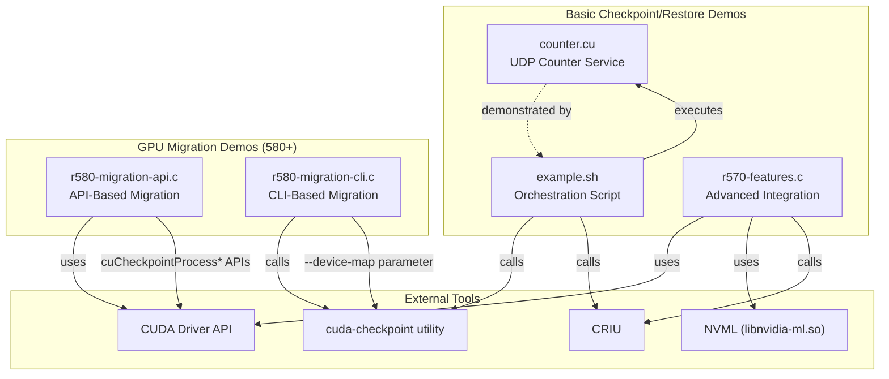

<!-- source: DeepWiki mcp.deepwiki.com · repo NVIDIA/cuda-checkpoint · page 5 Examples and Demos · fetched 2026-10-26 -->

# Examples and Demos

Relevant source files

The following files were used as context for generating this wiki page:

- [README.md](README.md)

The cuda-checkpoint repository includes five demonstration programs that showcase different aspects of GPU checkpointing functionality. These demos range from basic checkpoint/restore operations to advanced GPU migration scenarios, with each targeting specific driver versions and use cases.

For step-by-step usage instructions, see [Quick Start Guide](#3.1). For driver-specific feature documentation, see [Advanced Features](#6).

## Demo Programs Overview

The repository contains demonstrations organized into two categories: basic checkpoint/restore demos and GPU migration demos.

| Demo | File | Driver | Key Features | Use Case |
|------|------|--------|--------------|----------|
| UDP Counter | [src/counter.cu]() | 550+ | Basic checkpoint/restore, CUDA Runtime API | Learning cuda-checkpoint fundamentals |
| Orchestration Script | [src/example.sh]() | 550+ | Shell-based workflow automation | Complete checkpoint/restore workflow example |
| Advanced Integration | [src/r570-features.c]() | 570+ | NVML, CRIU plugin, parent-child processes, Driver API | Production integration patterns |
| API-Based Migration | [src/r580-migration-api.c]() | 580+ | Programmatic GPU migration via Driver API | Application-integrated migration control |
| CLI-Based Migration | [src/r580-migration-cli.c]() | 580+ | GPU migration via cuda-checkpoint CLI | Script-based migration workflows |

Sources: [README.md:1-22](), [src/counter.cu:1-1](), [src/example.sh:1-1](), [src/r570-features.c:1-1](), [src/r580-migration-api.c:1-1](), [src/r580-migration-cli.c:1-1]()

## Demo Program Relationships

#### Diagram: Demo Program Architecture and Dependencies

Sources: [src/example.sh:1-55](), [src/counter.cu:1-161](), [src/r570-features.c:1-177](), [src/r580-migration-api.c:1-111](), [src/r580-migration-cli.c:1-104]()

## Basic Checkpoint/Restore Demonstrations

### UDP Counter Demo

The `counter.cu` application provides a minimal CUDA program that demonstrates fundamental checkpoint/restore functionality. The application maintains a GPU-resident counter variable (`__device__ int counter`) and increments it via a CUDA kernel (`increment<<<1,1>>>()`) each time it receives a UDP packet on port 10000. After checkpoint/restore, the GPU memory content is preserved and operations continue from the checkpointed state.

**Key Code Elements:**
- Device variable: `__device__ int counter = 100` [src/counter.cu:132]()
- Kernel: `__global__ void increment()` [src/counter.cu:133-136]()
- Main loop: packet reception, kernel launch, response [src/counter.cu:146-159]()

The counter demo is documented in detail in [UDP Counter Demo](#5.1).

Sources: [README.md:118-250](), [src/counter.cu:132-161]()

### Orchestration Script

The `example.sh` script demonstrates a complete checkpoint/restore workflow by automating the counter demo. The script launches the counter application, verifies GPU usage with `nvidia-smi`, suspends CUDA state with `cuda-checkpoint --toggle`, checkpoints the process with `criu dump`, restores with `criu restore`, and resumes CUDA state with another `cuda-checkpoint --toggle`.

**Key Operations:**
- Launch and PID capture: [src/example.sh:14-20]()
- CUDA suspend: `cuda-checkpoint --toggle --pid $PID` [src/example.sh:31]()
- CRIU checkpoint: `criu dump --shell-job --images-dir demo --tree $PID` [src/example.sh:38]()
- CRIU restore: `criu restore --shell-job --restore-detached --images-dir demo` [src/example.sh:45]()
- CUDA resume: `cuda-checkpoint --toggle --pid $PID` [src/example.sh:48]()

The orchestration script workflow is documented in detail in [UDP Counter Demo](#5.1).

Sources: [README.md:169-250](), [src/example.sh:14-51]()

### Advanced Integration Demo

The `r570-features.c` program demonstrates driver 570+ capabilities including NVML integration, CRIU plugin usage, and parent-child process checkpointing. The program creates a parent process (`runParent()`) that manages CRIU operations and a child process (`runChild()`) that performs CUDA and NVML operations. The demo validates that GPU memory contents and NVML state persist correctly across checkpoint/restore operations.

**Key Code Elements:**
- Process state query: `cuCheckpointProcessGetState()` [src/r570-features.c:82-84]()
- NVML memory tracking: `nvmlDeviceGetMemoryInfo()` [src/r570-features.c:137](), [src/r570-features.c:157]()
- Parent-child IPC: `socketpair(AF_UNIX, SOCK_STREAM, 0)` [src/r570-features.c:49]()
- CRIU integration: `criu dump --shell-job --libdir --ext-unix-sk` [src/r570-features.c:95]()
- Magic value validation: [src/r570-features.c:145-155]()

The advanced integration demo is documented in detail in [Advanced Integration Demo](#5.2).

Sources: [README.md:15-22](), [src/r570-features.c:42-177]()

## GPU Migration Demonstrations

Driver 580+ introduced GPU migration capabilities, allowing CUDA contexts to be moved between physical GPUs during the restore phase. This enables use cases such as cluster scheduling with workload migration and dynamic GPU resource management.

### Migration Concept

GPU migration uses UUID-based device mapping to redirect CUDA contexts from source GPUs to destination GPUs during restore. The key mechanism is specifying a mapping (called `device-map` in the CLI or `gpuPairs` in the API) that associates old GPU UUIDs with new GPU UUIDs.

**Migration Phases:**
1. Lock CUDA APIs on the source system
2. Checkpoint GPU state (device memory copied to host)
3. Release GPU resources
4. Restore with device mapping to new GPU(s)
5. Unlock CUDA APIs on the destination system

Sources: [README.md:8-13](), [README.md:20-31]()

### API-Based Migration Demo

The `r580-migration-api.c` program demonstrates GPU migration using the CUDA Driver API functions (`cuCheckpointProcessLock`, `cuCheckpointProcessCheckpoint`, `cuCheckpointProcessRestore`, `cuCheckpointProcessUnlock`). The program performs migration between two GPUs on the same system using programmatic control.

**Key Code Elements:**
- Lock operation: `cuCheckpointProcessLock()` [src/r580-migration-api.c:50]()
- Checkpoint operation: `cuCheckpointProcessCheckpoint()` [src/r580-migration-api.c:53]()
- GPU pair mapping: `CUprocessResourcePropertiesGpuPair gpuPairs[]` [src/r580-migration-api.c:63-69]()
- Restore with mapping: `cuCheckpointProcessRestore()` [src/r580-migration-api.c:59-79]()
- Unlock operation: `cuCheckpointProcessUnlock()` [src/r580-migration-api.c:82]()

The API-based migration demo is documented in detail in [API-Based Migration](#5.3.1).

Sources: [README.md:13](), [src/r580-migration-api.c:40-85]()

### CLI-Based Migration Demo

The `r580-migration-cli.c` program demonstrates GPU migration using the `cuda-checkpoint` command-line utility with the `--device-map` parameter. The program builds a device mapping string and invokes the utility via shell commands to perform migration.

**Key Code Elements:**
- Device map construction: [src/r580-migration-cli.c:72-80]()
- Lock command: `cuda-checkpoint --action lock --pid` [src/r580-migration-cli.c:49]()
- Checkpoint command: `cuda-checkpoint --action checkpoint --pid` [src/r580-migration-cli.c:52]()
- Restore with device map: `cuda-checkpoint --action restore --pid --device-map` [src/r580-migration-cli.c:55-58]()
- Unlock command: `cuda-checkpoint --action unlock --pid` [src/r580-migration-cli.c:61]()

The CLI-based migration demo is documented in detail in [CLI-Based Migration](#5.3.2).

Sources: [README.md:13](), [src/r580-migration-cli.c:43-64]()

## Demo Feature Comparison

| Feature | Counter Demo | Advanced Demo |
|---------|-------------|---------------|
| CUDA Runtime | Basic (`cudaFree`, `cudaMemcpyFromSymbol`) | Driver API (`cuInit`, `cuMemAlloc`) |
| NVML Integration | None | Full (`nvmlInit`, `nvmlDeviceGetMemoryInfo`) |
| Process Pattern | Single process | Parent-child with IPC |
| Network I/O | UDP server | Unix domain sockets |
| CRIU Integration | External script | Direct API calls |
| Driver Requirements | 550+ | 570+ |
| Validation | Manual testing | Automated assertions |

Sources: [src/counter.cu:27-50](), [src/r570-features.c:118-164](), [src/example.sh:1-55]()

---

