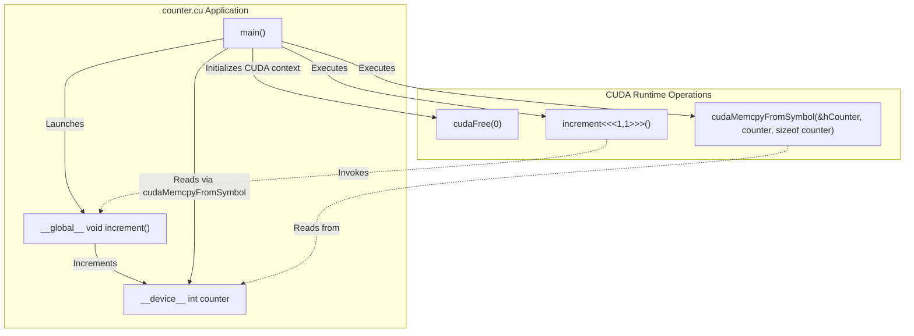
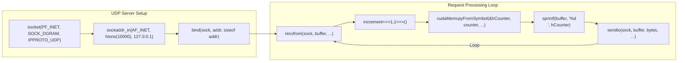
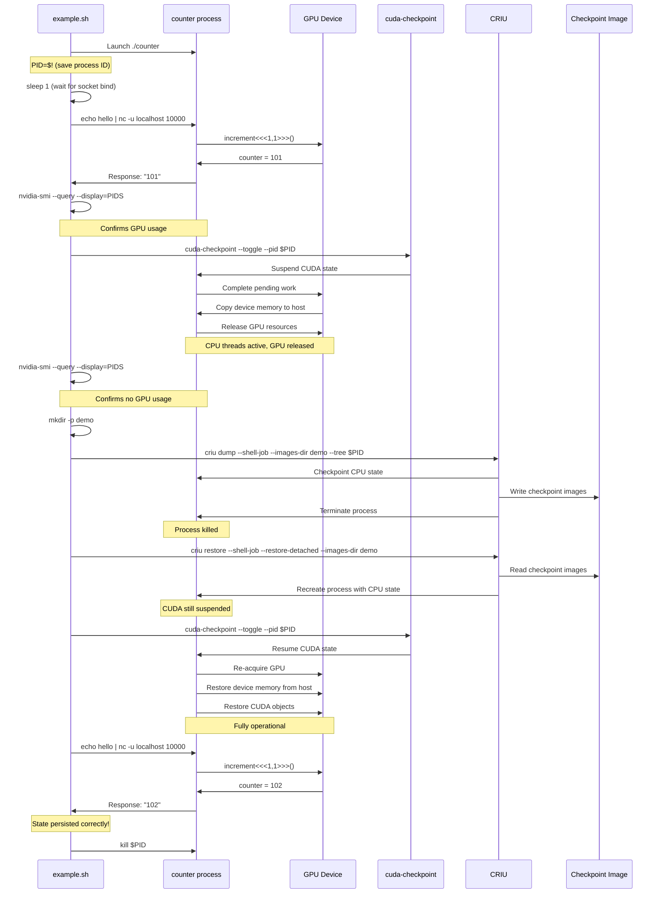
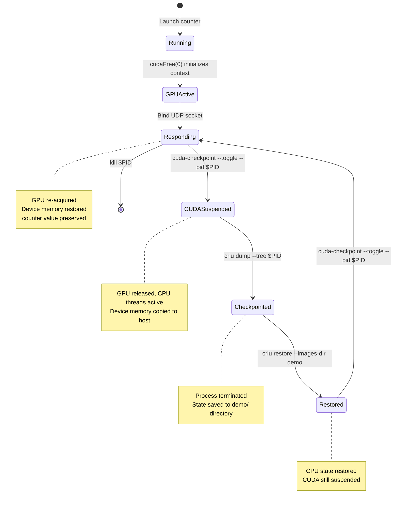
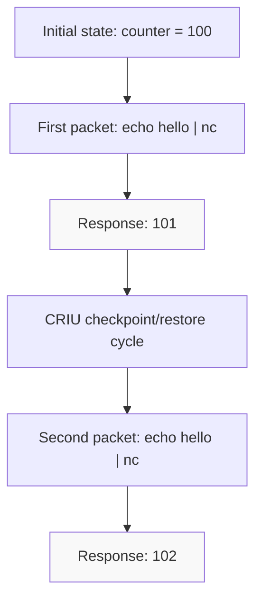

<!-- source: DeepWiki mcp.deepwiki.com · repo NVIDIA/cuda-checkpoint · page 5.1 UDP Counter Demo · fetched 2026-10-26 -->

# UDP Counter Demo

<details>
<summary>Relevant source files</summary>

The following files were used as context for generating this wiki page:

- [README.md](README.md)
- [src/counter.cu](src/counter.cu)
- [src/example.sh](src/example.sh)

</details>


This document describes the basic demonstration application that showcases fundamental checkpoint/restore functionality using `cuda-checkpoint` and CRIU. The demo consists of two components: [src/counter.cu](), a simple CUDA-accelerated UDP server, and [src/example.sh](), a shell script that orchestrates the complete checkpoint and restore workflow. This demo is referenced as the primary example in [README.md:118-250]().

For advanced integration features including CRIU plugin usage and process tree checkpointing, see [Advanced Integration Demo](#5.2). For GPU migration demonstrations, see [GPU Migration Demos](#5.3).

## Application Overview

The `counter` application is a UDP server that maintains an integer counter in GPU device memory. Each time it receives a UDP packet, it increments the counter on the GPU and responds with the updated value. This simple design demonstrates that GPU-resident state persists correctly across checkpoint/restore operations.

**Sources:** [README.md:119-121](), [src/counter.cu:1-51]()

### CUDA Components



The application uses three key CUDA constructs:

| Code Entity | Type | Purpose | Location |
|-------------|------|---------|----------|
| `counter` | Device variable | GPU-resident integer initialized to 100 | [src/counter.cu:21]() |
| `increment()` | CUDA kernel | Atomically increments `counter` on GPU | [src/counter.cu:22-25]() |
| `cudaMemcpyFromSymbol()` | CUDA API | Copies device variable value to host | [src/counter.cu:44]() |

The call to `cudaFree(0)` at [src/counter.cu:29]() is used to initialize the CUDA context before setting up the UDP socket. This ensures that GPU resources are allocated before the server begins accepting requests.

**Sources:** [src/counter.cu:21-51](), [README.md:123-162]()

### Network Components



The server binds to UDP port 10000 on localhost. The main loop at [src/counter.cu:35-48]() processes incoming packets by:

1. Receiving a packet with `recvfrom()`
2. Launching the `increment` kernel to update GPU memory
3. Copying the updated counter value to the host
4. Formatting and sending the response with `sendto()`

**Sources:** [src/counter.cu:31-48](), [README.md:130]()

## Checkpoint/Restore Workflow

The [src/example.sh]() script demonstrates the complete checkpoint and restore process. This workflow shows how `cuda-checkpoint` and `criu` work together to preserve both CPU and GPU state.

**Sources:** [src/example.sh:1-55](), [README.md:118-250]()

### Workflow Sequence



This sequence demonstrates the key principle: the counter increments from 100 to 101 before checkpoint, then from 101 to 102 after restore, proving that GPU-resident state (the `counter` device variable) was successfully preserved across the checkpoint/restore cycle.

**Sources:** [src/example.sh:15-52](), [README.md:170-250]()

### State Transitions



The state diagram shows that the process goes through two distinct suspend states:
- **CUDASuspended**: CPU active, GPU released (managed by `cuda-checkpoint`)
- **Checkpointed**: Neither CPU nor GPU active, state saved to disk (managed by `criu`)

**Sources:** [README.md:91-116](), [src/example.sh:30-49]()

## Script Implementation

The [src/example.sh]() script implements the workflow in 55 lines of bash. Key implementation details:

### Process Lifecycle Management

```bash
# Launch counter in background
./counter &
PID=$!

# Wait for socket binding
sleep 1
```

The script uses `$!` at [src/example.sh:19]() to capture the PID of the backgrounded `counter` process. The `sleep 1` at [src/example.sh:22]() ensures the UDP socket is fully bound before sending test packets, which is critical when running as a single automated script (mentioned in [README.md:171]()).

**Sources:** [src/example.sh:15-22]()

### Verification Steps

The script includes verification at each stage:

| Step | Command | Purpose | Location |
|------|---------|---------|----------|
| GPU Usage Check | `nvidia-smi --query --display=PIDS \| grep $PID` | Confirms counter is using GPU | [src/example.sh:28]() |
| GPU Release Check | `nvidia-smi --query --display=PIDS \| grep $PID` | Confirms GPU released after suspend | [src/example.sh:34]() |
| Process Termination | `ps --pid $PID` | Confirms process killed by CRIU | [src/example.sh:43]() |

These verification steps mirror the example walkthrough in [README.md:193-230]().

**Sources:** [src/example.sh:28-43](), [README.md:193-230]()

### CRIU Commands

```bash
# Checkpoint
criu dump --shell-job --images-dir demo --tree $PID

# Restore
criu restore --shell-job --restore-detached --images-dir demo
```

The `--shell-job` flag at [src/example.sh:40,46]() indicates the process was launched from a shell, allowing CRIU to properly handle the background job. The `--tree` flag dumps the entire process tree rooted at the specified PID. The `--restore-detached` flag ensures the restored process detaches from the CRIU command, allowing the script to continue.

**Sources:** [src/example.sh:40-46](), [README.md:218-236]()

### Counter Value Verification



The critical validation occurs at [src/example.sh:25]() (first packet) and [src/example.sh:52]() (second packet). The counter's response progression (101, then 102) proves the device variable `counter` at [src/counter.cu:21]() maintained its state through the checkpoint/restore cycle.

As noted in [README.md:244-246](): "The response is 102, showing that earlier GPU operations were persisted correctly!"

**Sources:** [src/example.sh:25-52](), [README.md:185-250](), [src/counter.cu:21]()

## Building and Running

The counter application can be built with `nvcc`:

```bash
nvcc counter.cu -o counter
```

This is documented in [README.md:164-168](). The compiled binary `counter` is then executable by the [src/example.sh]() script.

To run the complete demonstration:

```bash
# Execute as root (required for CRIU)
sudo ./example.sh
```

The script must run as root because CRIU requires elevated privileges to checkpoint and restore process state. The `set -v` flag at [src/example.sh:13]() enables verbose output, showing each command as it executes.

**Sources:** [README.md:164-177](), [src/example.sh:13-15]()

## Design Rationale

The counter demo was designed with specific characteristics to effectively demonstrate checkpoint/restore:

1. **GPU-resident state**: The `__device__` variable at [src/counter.cu:21]() ensures data lives on the GPU, not just in CPU memory
2. **Observable changes**: Each packet increments the counter, creating visible state changes
3. **External interaction**: UDP communication allows external verification without modifying the process
4. **Minimal complexity**: Single kernel, single device variable, simple network protocol

This design allows clear demonstration that GPU state (not just CPU state) is preserved across the checkpoint/restore boundary.

**Sources:** [README.md:119-121](), [src/counter.cu:1-51]()

---

