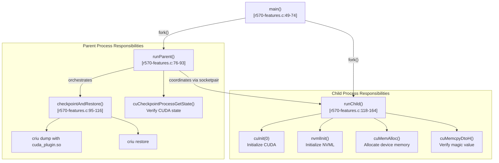
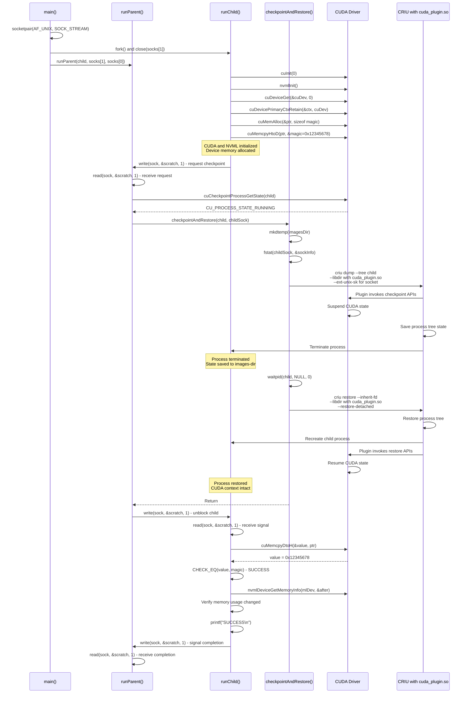
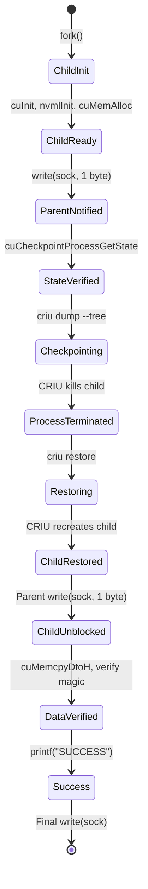

<!-- source: DeepWiki mcp.deepwiki.com · repo NVIDIA/cuda-checkpoint · page 5.2 Advanced Integration Demo · fetched 2026-10-26 -->

# Advanced Integration Demo

<details>
<summary>Relevant source files</summary>

The following files were used as context for generating this wiki page:

- [README.md](README.md)
- [src/r570-features.c](src/r570-features.c)

</details>


This document describes the `r570-features.c` demonstration program, which showcases advanced CRIU integration capabilities introduced in display driver 570. The demo illustrates parent-child process management, NVML support, process tree checkpointing with CRIU's plugin system, and verification that CUDA contexts persist correctly across checkpoint/restore operations.

For basic checkpoint/restore functionality using the standalone `counter` application, see [UDP Counter Demo](#5.1). For GPU migration capabilities introduced in driver 580, see [GPU Migration Demos](#5.3).

**Sources:** [README.md:15-22](), [src/r570-features.c:1-23]()

## Overview

The `r570-features.c` demo demonstrates a multi-process CUDA application where a parent process orchestrates the checkpoint and restore of a child process that uses both CUDA and NVML. This scenario validates that:

1. CRIU can checkpoint process trees containing CUDA applications
2. The `cuda_plugin.so` CRIU plugin integrates correctly with CRIU 4.0+
3. CUDA contexts and device memory persist across checkpoint/restore
4. NVML functionality remains operational after restore
5. Unix domain sockets between parent and child processes are preserved

The demo requires display driver 570 or higher and CRIU 4.0 or higher.

**Sources:** [src/r570-features.c:13-22]()

## Architecture

### Process Structure



**Sources:** [src/r570-features.c:49-74](), [src/r570-features.c:76-93](), [src/r570-features.c:118-164]()

### Key Components

| Component | Location | Purpose |
|-----------|----------|---------|
| `main()` | [r570-features.c:49-74]() | Creates socketpair, forks child, invokes parent logic |
| `runParent()` | [r570-features.c:76-93]() | Verifies CUDA state, orchestrates checkpoint/restore, synchronizes with child |
| `runChild()` | [r570-features.c:118-164]() | Initializes CUDA/NVML, allocates device memory, verifies persistence after restore |
| `checkpointAndRestore()` | [r570-features.c:95-116]() | Invokes CRIU commands with plugin support |
| `systemf()` | [r570-features.c:166-176]() | Helper function for executing shell commands with formatted arguments |

**Sources:** [src/r570-features.c:42-46]()

## Execution Flow

### Complete Sequence Diagram



**Sources:** [src/r570-features.c:49-164]()

## CUDA and NVML Integration

### Child Process Initialization

The child process performs comprehensive initialization of both CUDA and NVML to validate that both subsystems work correctly after checkpoint/restore:

```
cuInit(0)                                              // [r570-features.c:120]
nvmlInit()                                             // [r570-features.c:121]
```

The child retrieves device information using CUDA Driver APIs:

```
cuDeviceGet(&cuDev, 0)                                 // [r570-features.c:124]
cuDeviceGetAttribute() × 3                             // [r570-features.c:127-129]
```

The PCI bus ID is formatted and used to establish the connection between CUDA and NVML device handles:

| Step | Code Location | Purpose |
|------|---------------|---------|
| Get PCI domain/bus/device IDs | [r570-features.c:127-129]() | Extract hardware addressing info |
| Format bus ID string | [r570-features.c:131-132]() | Create "domain:bus:device.0" format |
| Get NVML handle | [r570-features.c:134-135]() | Map CUDA device to NVML device |
| Query memory before checkpoint | [r570-features.c:137-138]() | Establish baseline memory usage |

**Sources:** [src/r570-features.c:120-138]()

### Device Memory Verification

The demo allocates device memory and writes a magic value to verify data persistence:

```
cuDevicePrimaryCtxRetain(&ctx, cuDev)                  // [r570-features.c:142]
cuCtxSetCurrent(ctx)                                   // [r570-features.c:143]
cuMemAlloc(&ptr, sizeof magic)                         // [r570-features.c:146]
cuMemcpyHtoD(ptr, &magic, sizeof magic)                // [r570-features.c:147]
```

The magic value `0x12345678` is defined at [r570-features.c:145](). After restore, the child reads back the value and verifies it matches:

```
cuMemcpyDtoH(&value, ptr, sizeof value)                // [r570-features.c:154]
CHECK_EQ(value, magic)                                 // [r570-features.c:155]
```

This validates that device memory contents are correctly preserved across the checkpoint/restore cycle.

**Sources:** [src/r570-features.c:140-155]()

### NVML Verification

The demo also verifies that NVML continues to function after restore by querying memory information both before and after the checkpoint/restore cycle:

```
nvmlDeviceGetMemoryInfo(mlDev, &before)                // [r570-features.c:138]
// ... checkpoint/restore occurs ...
nvmlDeviceGetMemoryInfo(mlDev, &after)                 // [r570-features.c:158]
CHECK(before.free > after.free)                        // [r570-features.c:159]
```

The assertion at [r570-features.c:159]() verifies that memory usage has changed (free memory decreased) because the device allocation created at [r570-features.c:146]() persists after restore.

**Sources:** [src/r570-features.c:137-159]()

## CRIU Integration

### Plugin System

The demo demonstrates CRIU 4.0+'s plugin architecture, which is a key feature added in driver 570. The plugin (`cuda_plugin.so`) is specified via the `--libdir` parameter:

```bash
criu dump --shell-job --images-dir <dir> --libdir <libDir> ...
criu restore --shell-job --images-dir <dir> --libdir <libDir> ...
```

The plugin directory is passed as a command-line argument to the demo at [r570-features.c:51-54](). The demo performs sanity checks at startup:

```
systemf("ls %s/cuda_plugin.so", libDir)                // [r570-features.c:58]
systemf("which cuda-checkpoint")                       // [r570-features.c:59]
systemf("which criu")                                  // [r570-features.c:60]
```

**Sources:** [src/r570-features.c:49-60](), [src/r570-features.c:103-115](), [README.md:18]()

### Process Tree Checkpointing

The `checkpointAndRestore()` function demonstrates CRIU's process tree support using the `--tree` parameter:

```
criu dump --shell-job --images-dir %s --libdir %s --ext-unix-sk=%ld --tree %d
```

This command at [r570-features.c:103-107]() checkpoints the entire process tree rooted at the child PID. The key parameters are:

| Parameter | Value | Purpose |
|-----------|-------|---------|
| `--shell-job` | N/A | Allows CRIU to checkpoint processes launched from shell |
| `--images-dir` | `images-dir-XXXXXX` | Temporary directory created by `mkdtemp()` at [r570-features.c:97-98]() |
| `--libdir` | User-provided path | Directory containing `cuda_plugin.so` |
| `--ext-unix-sk` | Socket inode number | External unix socket to be preserved |
| `--tree` | Child PID | Root of process tree to checkpoint |

**Sources:** [src/r570-features.c:95-116]()

### Socket Preservation

The demo uses a Unix domain socket pair created by `socketpair(AF_UNIX, SOCK_STREAM, 0, socks)` at [r570-features.c:62-63]() for inter-process communication. CRIU must preserve this socket across checkpoint/restore.

Socket information is retrieved using `fstat()`:

```c
struct stat sockInfo;
fstat(childSock, &sockInfo)                            // [r570-features.c:100-101]
```

The socket inode is passed to CRIU dump via `--ext-unix-sk`:

```
--ext-unix-sk=%ld                                      // [r570-features.c:106]
```

During restore, the socket is re-established using `--inherit-fd`:

```
--inherit-fd fd[%d]:socket:[%ld]                       // [r570-features.c:114]
```

This ensures the parent-child communication channel remains functional after restore.

**Sources:** [src/r570-features.c:62-63](), [src/r570-features.c:100-115]()

## Synchronization Protocol

### Communication Pattern



**Sources:** [src/r570-features.c:76-164]()

### Synchronization Points

The demo uses simple one-byte read/write operations on the socket pair for synchronization:

| Line | Operation | Purpose |
|------|-----------|---------|
| [r570-features.c:150]() | Child: `write(sock, &scratch, 1)` | Request checkpoint |
| [r570-features.c:79]() | Parent: `read(sock, &scratch, 1)` | Receive checkpoint request |
| [r570-features.c:89]() | Parent: `write(sock, &scratch, 1)` | Unblock child after restore |
| [r570-features.c:151]() | Child: `read(sock, &scratch, 1)` | Wait for restore completion |
| [r570-features.c:163]() | Child: `write(sock, &scratch, 1)` | Signal verification complete |
| [r570-features.c:92]() | Parent: `read(sock, &scratch, 1)` | Wait for child completion |

The `scratch` variable is a global char defined at [r570-features.c:47]() used as a single-byte buffer.

**Sources:** [src/r570-features.c:47](), [src/r570-features.c:79-92](), [src/r570-features.c:150-163]()

## Build Instructions

The demo is built with GCC and links against CUDA Driver and NVML libraries:

```bash
gcc -I /usr/local/cuda-12.8/include r570-features.c -o r570-features -lcuda -lnvidia-ml
```

Build requirements:

| Component | Purpose |
|-----------|---------|
| `gcc` | C compiler |
| `-I /usr/local/cuda-12.8/include` | CUDA header files (`cuda.h`, `nvml.h`) |
| `-lcuda` | CUDA Driver library (`libcuda.so`) |
| `-lnvidia-ml` | NVML library (`libnvidia-ml.so`) |

The demo includes CUDA and NVML headers at [r570-features.c:35-36]().

**Sources:** [src/r570-features.c:20-21](), [src/r570-features.c:35-36]()

## Usage

Execute the demo by providing the directory containing `cuda_plugin.so`:

```bash
./r570-features /path/to/cuda_plugin
```

The demo performs the following sequence:

1. Validates that `cuda_plugin.so`, `cuda-checkpoint`, and `criu` are available
2. Creates a socketpair for parent-child communication
3. Forks a child process
4. Child initializes CUDA and NVML, allocates device memory with magic value
5. Parent verifies CUDA state is running using `cuCheckpointProcessGetState()`
6. Parent invokes CRIU to checkpoint the child process tree
7. CRIU terminates the child and saves state to temporary directory
8. Parent invokes CRIU to restore the child process
9. Child verifies device memory magic value matches original
10. Child verifies NVML reports changed memory usage
11. Child prints "SUCCESS" and exits

**Sources:** [src/r570-features.c:49-74]()

## Error Handling

The demo uses assertion macros for error checking:

| Macro | Definition | Usage |
|-------|------------|-------|
| `CHECK(x)` | `assert(x)` | [r570-features.c:38]() |
| `CHECK_EQ(x, y)` | `CHECK((x) == (y))` | [r570-features.c:39]() |
| `CHECK_OK(x)` | `CHECK_EQ(x, 0)` | [r570-features.c:40]() |

These macros are used throughout to validate:
- All CUDA API calls return success (0)
- All system calls return expected values
- Socket operations transfer expected number of bytes
- Device memory contains expected magic value after restore

The `systemf()` helper function also validates that shell commands complete successfully at [r570-features.c:175]().

**Sources:** [src/r570-features.c:38-40](), [src/r570-features.c:166-176]()

## Key Differences from Counter Demo

Compared to the basic counter demo (see [UDP Counter Demo](#5.1)), the r570-features demo demonstrates:

1. **Multi-process architecture**: Parent orchestrates checkpoint/restore of child process
2. **CRIU plugin integration**: Uses `--libdir` to load `cuda_plugin.so` instead of separate `cuda-checkpoint` invocations
3. **Process tree support**: Uses `--tree` parameter to checkpoint entire process tree
4. **NVML usage**: Validates that NVML APIs work before and after restore
5. **Socket preservation**: Demonstrates Unix domain socket preservation across checkpoint/restore
6. **Programmatic state verification**: Uses `cuCheckpointProcessGetState()` API to verify CUDA state

**Sources:** [src/r570-features.c:1-177](), [README.md:15-22]()

---

