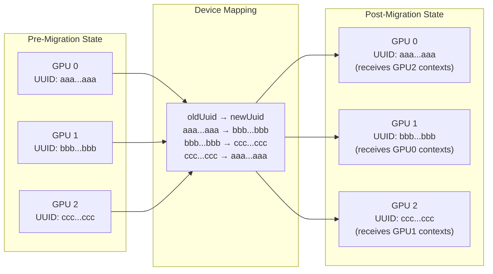
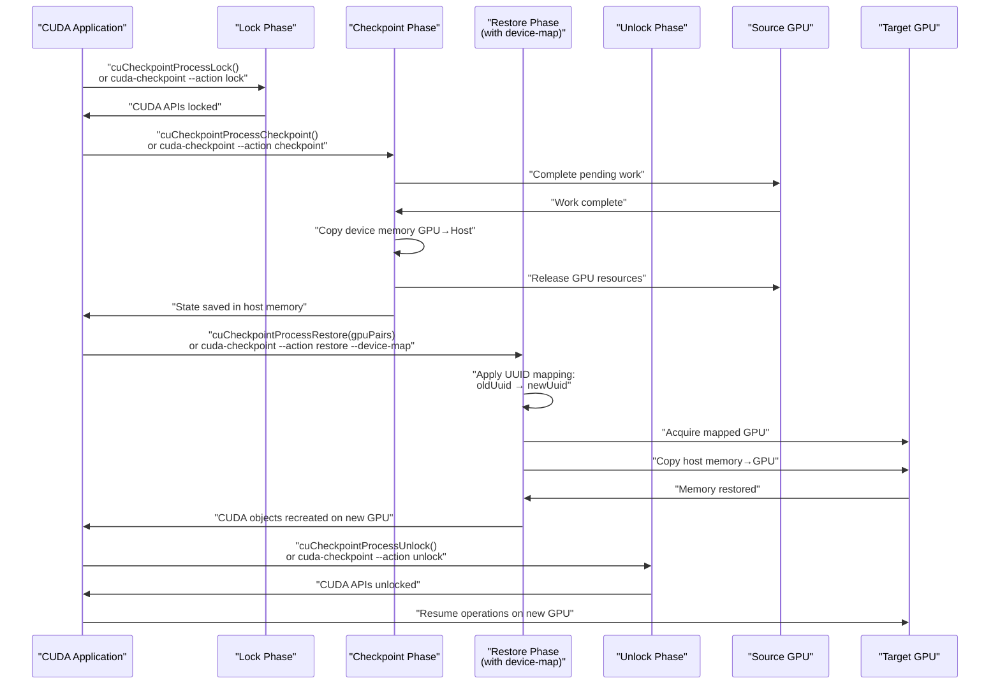

<!-- source: DeepWiki mcp.deepwiki.com · repo NVIDIA/cuda-checkpoint · page 5.3 GPU Migration Demos · fetched 2026-10-26 -->

# GPU Migration Demos

<details>
<summary>Relevant source files</summary>

The following files were used as context for generating this wiki page:

- [README.md](README.md)
- [src/r580-migration-api.c](src/r580-migration-api.c)
- [src/r580-migration-cli.c](src/r580-migration-cli.c)

</details>


## Purpose and Scope

This page documents the GPU migration demonstrations introduced in display driver version 580 and higher. GPU migration enables CUDA contexts to be checkpointed on one physical GPU and restored on a different physical GPU using UUID-based device mapping. Two demonstration programs showcase migration capabilities: one using programmatic CUDA Driver APIs ([5.3.1](#5.3.1)) and one using the `cuda-checkpoint` command-line utility ([5.3.2](#5.3.2)). 

For basic checkpoint/restore without migration, see the [UDP Counter Demo](#5.1). For advanced CRIU integration without migration, see the [Advanced Integration Demo](#5.2).

**Sources:** [README.md:8-13]()

---

## GPU Migration Feature Overview

GPU migration extends basic checkpoint/restore functionality to enable workload movement between physical GPUs. This capability supports cluster scheduling use cases where CUDA applications must be migrated between nodes with different GPU configurations. The migration process preserves all CUDA state (device memory, contexts, streams, events) while remapping GPU device associations.

### Key Capabilities

| Feature | Description | Availability |
|---------|-------------|--------------|
| **Device Remapping** | Map contexts from source GPU UUIDs to target GPU UUIDs | Driver 580+ |
| **State Preservation** | Maintain device memory contents and CUDA objects across migration | Driver 580+ |
| **Multi-GPU Support** | Specify mappings for all GPUs accessible to CUDA | Driver 580+ |
| **Container Support** | Migrate containerized CUDA applications (partial passthrough) | Driver 580+ (some 575) |

The migration feature builds upon the lock-checkpoint-restore-unlock workflow established in earlier driver versions, adding UUID-based device mapping during the restore phase.

**Sources:** [README.md:8-13](), [README.md:20-31]()

---

## UUID-Based Device Mapping

GPU migration uses UUID-based device mapping to specify how GPU contexts should be remapped during restore. Each physical GPU has a unique UUID that persists across reboots and can be queried via CUDA Driver APIs or NVML.

### UUID Format

UUIDs are 16-byte identifiers that appear in different formats depending on the interface:

**Binary Format (CUDA Driver API):**
```
CUuuid uuid;
cuDeviceGetUuid(&uuid, deviceIndex);
// uuid.bytes[0..15] contains raw bytes
```

**ASCII Format (CLI):**
```
GPU-01234567-89ab-cdef-0123-456789abcdef
```

### Device Pair Specification

Migration requires specifying a mapping for **every GPU accessible to CUDA**, even if the application doesn't actively use them. This ensures the driver can correctly remap all device references.



**Diagram: UUID Device Mapping for GPU Migration**

Both demonstration programs implement circular rotation: contexts on GPU *i* migrate to GPU *(i+1) % device_count*. This pattern simplifies verification by ensuring each migration produces an observable change.

**Sources:** [src/r580-migration-api.c:77-88](), [src/r580-migration-cli.c:100-117]()

---

## Migration Workflow

GPU migration follows a four-phase workflow that extends the basic checkpoint/restore pattern with device remapping:



**Diagram: GPU Migration Workflow with API/CLI Operations**

The restore phase is where device mapping occurs. Without a device map specified, contexts restore to their original GPUs. With a device map, contexts remap according to the UUID pairs provided.

**Sources:** [src/r580-migration-api.c:90-97](), [src/r580-migration-cli.c:122-128]()

---

## Demonstration Program Comparison

The repository includes two programs that demonstrate identical migration functionality using different interfaces:

### Program Structure Comparison

```mermaid
graph TB
    subgraph "r580-migration-api.c"
        API_Init["cuInit(0)<br/>cuDevicePrimaryCtxRetain()"]
        API_Pairs["CUcheckpointGpuPair array<br/>Binary UUID format"]
        API_Lock["cuCheckpointProcessLock()"]
        API_Checkpoint["cuCheckpointProcessCheckpoint()"]
        API_Restore["cuCheckpointProcessRestore()<br/>gpuPairs parameter"]
        API_Unlock["cuCheckpointProcessUnlock()"]
        API_Verify["print_current_ctx_uuid()<br/>cuCtxGetDevice()+cuDeviceGetUuid()"]
    end
    
    subgraph "r580-migration-cli.c"
        CLI_Init["cuInit(0)<br/>cuDevicePrimaryCtxRetain()"]
        CLI_Map["ascii_uuid_key_value_t array<br/>ASCII string format"]
        CLI_Lock["spawn cuda-checkpoint<br/>--action lock"]
        CLI_Checkpoint["spawn cuda-checkpoint<br/>--action checkpoint"]
        CLI_Restore["spawn cuda-checkpoint<br/>--action restore --device-map"]
        CLI_Unlock["spawn cuda-checkpoint<br/>--action unlock"]
        CLI_Verify["print_current_ctx_uuid()<br/>cuCtxGetDevice()+cuDeviceGetUuid()"]
    end
    
    API_Init --> API_Pairs
    API_Pairs --> API_Lock
    API_Lock --> API_Checkpoint
    API_Checkpoint --> API_Restore
    API_Restore --> API_Unlock
    API_Unlock --> API_Verify
    
    CLI_Init --> CLI_Map
    CLI_Map --> CLI_Lock
    CLI_Lock --> CLI_Checkpoint
    CLI_Checkpoint --> CLI_Restore
    CLI_Restore --> CLI_Unlock
    CLI_Unlock --> CLI_Verify
```



**Diagram: Side-by-Side Program Structure Comparison**

| Aspect | r580-migration-api.c | r580-migration-cli.c |
|--------|---------------------|---------------------|
| **Interface** | CUDA Driver API functions | `cuda-checkpoint` CLI spawned via `fork()`+`execvp()` |
| **UUID Format** | Binary `CUuuid` structs | ASCII string `"GPU-xx...xx=GPU-yy...yy,..."` |
| **Device Pairs** | `CUcheckpointGpuPair` array passed to `cuCheckpointProcessRestore()` | Concatenated string passed as `--device-map` argument |
| **Dependencies** | `-lcuda -lnvidia-ml` | `cuda-checkpoint` binary in PATH |
| **Error Handling** | Return codes from `cuCheckpointProcess*()` functions | Child process exit status via `WEXITSTATUS()` |
| **Verification** | Direct CUDA API calls | Direct CUDA API calls (same as API demo) |

Both programs:
- Clear `CUDA_VISIBLE_DEVICES` and `CUDA_DEVICE_ORDER` environment variables
- Initialize a CUDA context on GPU 0
- Iterate `device_count` times, migrating contexts in a circular pattern
- Print the current context's GPU UUID before and after all migrations
- Verify that contexts return to original GPU after full rotation

**Sources:** [src/r580-migration-api.c:57-101](), [src/r580-migration-cli.c:87-132]()

---

## Common Patterns and Requirements

### Environment Configuration

Both demonstration programs explicitly clear CUDA device environment variables to ensure all GPUs are visible:

```c
unsetenv("CUDA_VISIBLE_DEVICES");
unsetenv("CUDA_DEVICE_ORDER");
```

This is critical for migration because device mapping must specify **all accessible GPUs**, not just the subset filtered by environment variables.

**Sources:** [src/r580-migration-api.c:59-60](), [src/r580-migration-cli.c:89-90]()

### Persistence Mode (API Demo Only)

The API-based demo requires GPU persistence mode enabled, verified via NVML:

```c
void check_persistence_mode(void)
{
    nvmlDevice_t dev;
    nvmlEnableState_t persistence_mode;
    
    nvmlInit();
    nvmlDeviceGetHandleByIndex(0, &dev);
    nvmlDeviceGetPersistenceMode(dev, &persistence_mode);
    assert(persistence_mode == NVML_FEATURE_ENABLED);
}
```

Persistence mode keeps the NVIDIA kernel driver loaded between process invocations, preventing GPU resets that would invalidate checkpointed state.

**Sources:** [src/r580-migration-api.c:32-41]()

### UUID Retrieval and Formatting

#### Binary UUID (API Demo)

The API demo uses `cuDeviceGetUuid()` to populate `CUcheckpointGpuPair` structures:

```c
CUcheckpointGpuPair *pairs = calloc(dev_count, sizeof pairs[0]);

for (int i = 0; i < dev_count; i++) {
    cuDeviceGetUuid(&pairs[i].oldUuid, i);
    cuDeviceGetUuid(&pairs[i].newUuid, (i + 1) % dev_count);
}

restore_args.gpuPairsCount = dev_count;
restore_args.gpuPairs = pairs;
```

**Sources:** [src/r580-migration-api.c:77-88]()

#### ASCII UUID (CLI Demo)

The CLI demo builds an ASCII string in the format required by `--device-map`:

```c
void ascii_uuid(char *str, int dev_idx)
{
    CUuuid uuid = {0};
    uint8_t *b = (uint8_t *)uuid.bytes;
    cuDeviceGetUuid(&uuid, dev_idx);
    sprintf(str, "GPU-%02x%02x%02x%02x-%02x%02x-%02x%02x-%02x%02x-%02x%02x%02x%02x%02x%02x",
            b[0x0], b[0x1], b[0x2], b[0x3], b[0x4], b[0x5], b[0x6], b[0x7],
            b[0x8], b[0x9], b[0xA], b[0xB], b[0xC], b[0xD], b[0xE], b[0xF]);
}
```

The resulting string has pairs concatenated with commas: `"UUID1=UUID2,UUID3=UUID4,UUID5=UUID6"`

**Sources:** [src/r580-migration-cli.c:44-54](), [src/r580-migration-cli.c:100-117]()

### Verification Pattern

Both programs verify migration success by printing the current context's GPU UUID before each migration and after all migrations complete. After `device_count` migrations with circular rotation, contexts return to their original GPU:

```c
void print_current_ctx_uuid(void)
{
    CUdevice dev;
    CUuuid uuid;
    
    cuCtxGetDevice(&dev);
    cuDeviceGetUuid(&uuid, dev);
    
    for (int i = 0; i < sizeof uuid; i++) {
        printf("%02x", uuid.bytes[i] & 0xFF);
    }
    printf("\n");
}
```

Expected output for a system with 3 GPUs shows the context rotating through all GPUs and returning to the original:

```
<GPU0_UUID>
<GPU1_UUID>
<GPU2_UUID>
<GPU0_UUID>
```

**Sources:** [src/r580-migration-api.c:43-55](), [src/r580-migration-cli.c:56-68]()

---

## Build Requirements

Both demonstrations require CUDA Toolkit 13.0 or later for checkpoint API definitions.

### API Demo Build

```bash
gcc -I /usr/local/cuda-13.0/include r580-migration-api.c -o r580-migration-api -lcuda -lnvidia-ml
```

Links against:
- `libcuda.so`: CUDA Driver library providing `cuCheckpointProcess*()` functions
- `libnvidia-ml.so`: NVML library for persistence mode verification

**Sources:** [src/r580-migration-api.c:18]()

### CLI Demo Build

```bash
gcc -I /usr/local/cuda-13.0/include r580-migration-cli.c -o r580-migration-cli -lcuda
```

Links against:
- `libcuda.so`: CUDA Driver library for context creation and UUID queries only

Requires `cuda-checkpoint` binary in PATH at runtime.

**Sources:** [src/r580-migration-cli.c:17]()

---

## Next Steps

For detailed walkthroughs of each demonstration program:

- **API-Based Migration:** See [API-Based Migration](#5.3.1) for detailed coverage of `r580-migration-api.c`, including the `CUcheckpointGpuPair` structure and programmatic checkpoint API usage
- **CLI-Based Migration:** See [CLI-Based Migration](#5.3.2) for detailed coverage of `r580-migration-cli.c`, including ASCII UUID formatting and process spawning patterns

**Sources:** [README.md:13](), [src/r580-migration-api.c:1-101](), [src/r580-migration-cli.c:1-132]()

---

