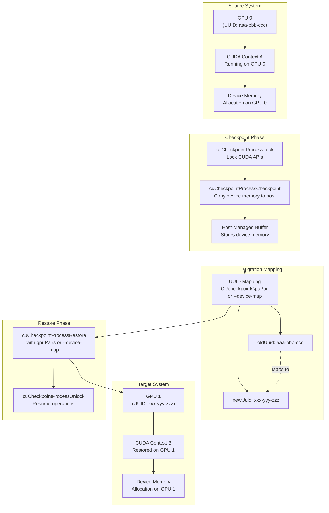
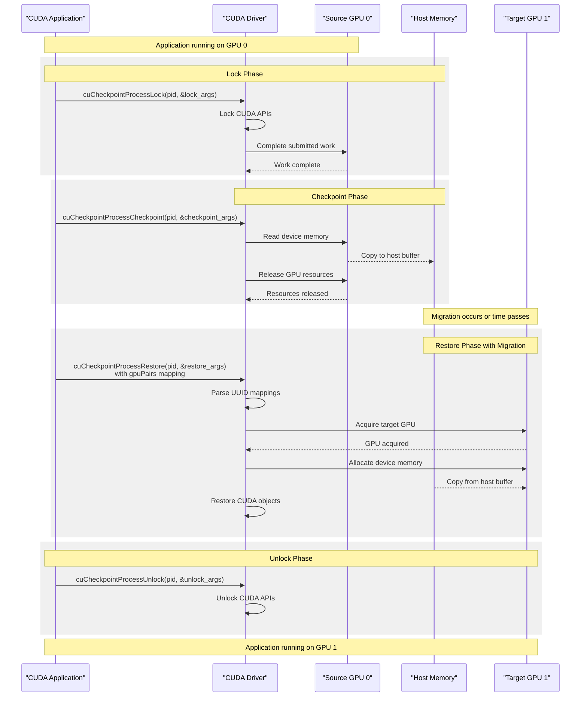
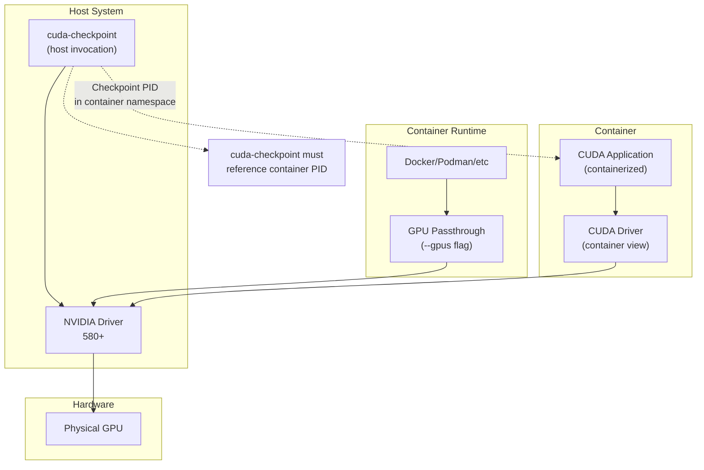
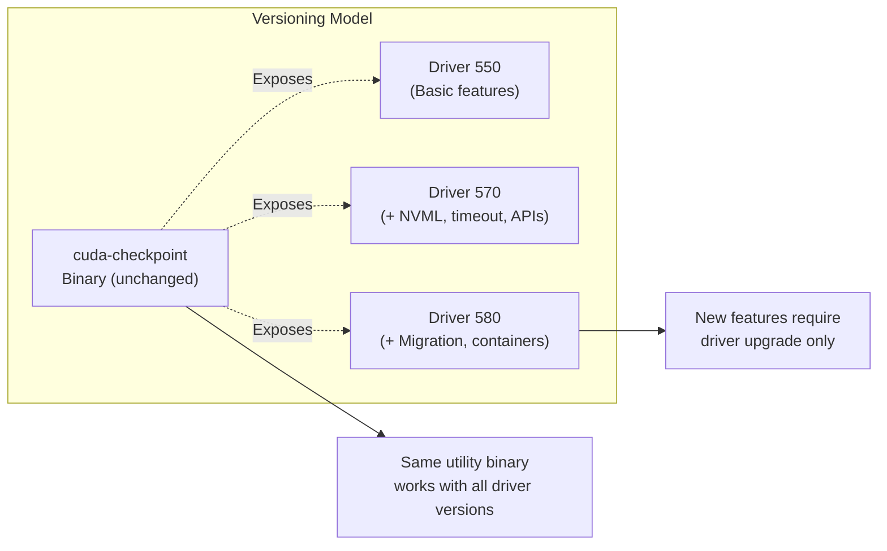

<!-- source: DeepWiki mcp.deepwiki.com · repo NVIDIA/cuda-checkpoint · page 6 Advanced Features · fetched 2026-10-26 -->

# Advanced Features

<details>
<summary>Relevant source files</summary>

The following files were used as context for generating this wiki page:

- [README.md](README.md)
- [src/r580-migration-api.c](src/r580-migration-api.c)
- [src/r580-migration-cli.c](src/r580-migration-cli.c)

</details>


## Purpose and Scope

This document covers advanced features of the cuda-checkpoint system, including GPU migration capabilities, driver version evolution, timeout handling, and container support. It also documents current limitations and known issues that users should be aware of when deploying cuda-checkpoint in production environments.

For basic checkpoint/restore operations, see [Getting Started](#3). For examples of using these advanced features, see [GPU Migration Demos](#5.3).

**Sources:** [README.md:1-267]()

## Driver Version Feature Evolution

The cuda-checkpoint utility exposes functionality embedded in the NVIDIA Display Driver, which has evolved across driver versions. The utility itself remains unchanged while driver capabilities expand.

### Feature Comparison by Driver Version

| Driver Version | Key Features | API Support | Migration | Demo Programs |
|---|---|---|---|---|
| **550** | - Basic checkpoint/restore<br/>- x64 architecture only<br/>- CLI utility (`cuda-checkpoint`) | None | No | [counter.cu](#5.1) with [example.sh](#5.1) |
| **570** | - NVML support<br/>- CRIU 4.0+ integration<br/>- Process tree support<br/>- Lock with `--timeout` parameter<br/>- CUDA Driver APIs (`cuCheckpointProcess*`) | [cuCheckpointProcessLock]()<br/>[cuCheckpointProcessCheckpoint]()<br/>[cuCheckpointProcessRestore]()<br/>[cuCheckpointProcessUnlock]() | No | [r570-features.c](#5.2) |
| **580** | - GPU migration (UUID-based device mapping)<br/>- Container partial passthrough<br/>- `--device-map` CLI parameter | Same as 570 with `gpuPairs` parameter | Yes | [r580-migration-api.c](#5.3.1)<br/>[r580-migration-cli.c](#5.3.2) |
| **575** (selected builds) | - Container partial passthrough | Varies | Varies | N/A |

**Sources:** [README.md:8-22]()

### Feature Details

#### Driver 550 Foundation

Driver 550 introduced the core checkpoint/restore mechanism with these operations:
- Locking CUDA APIs to prevent new GPU operations
- Waiting for submitted work to complete
- Copying device memory to host-managed allocations
- Releasing GPU resources
- Reversing the process during restore

**Sources:** [README.md:95-116]()

#### Driver 570 Enhancements

Driver 570 added production-ready features:

- **NVML Support**: Integration with NVIDIA Management Library for device queries and management
- **CRIU Integration**: Process tree support through CRIU 4.0+ with `cuda_plugin.so`
- **Programmatic APIs**: CUDA Driver interfaces at feature parity with the CLI
- **Timeout Support**: The `--timeout` parameter prevents deadlocks during lock operations

**Sources:** [README.md:15-22]()

#### Driver 580 Advanced Capabilities

Driver 580 introduced GPU migration and container support:

- **GPU Migration**: Ability to restore CUDA contexts on different physical GPUs using UUID mapping
- **Container Support**: Partial passthrough for containerized applications
- **CLI Enhancement**: `--device-map` parameter for specifying GPU mappings

**Sources:** [README.md:8-13]()

## GPU Migration

GPU migration is the capability to checkpoint CUDA state on one GPU and restore it on a different physical GPU. This feature enables cluster scheduling with workload migration between nodes with different GPU configurations.

### Migration Architecture



**Sources:** [README.md:8-13](), [src/r580-migration-api.c:57-101](), [src/r580-migration-cli.c:87-132]()

### UUID-Based Device Mapping

GPU migration uses UUID-based device mapping to specify which source GPU should map to which target GPU. Every GPU accessible to CUDA must be specified in the mapping, even if the application doesn't actively use them.

#### API-Based Mapping

When using CUDA Driver APIs, device mapping is specified using `CUcheckpointGpuPair` structures:

```c
CUcheckpointGpuPair {
    CUuuid oldUuid;  // Source GPU UUID
    CUuuid newUuid;  // Target GPU UUID
};
```

The mapping is passed to `cuCheckpointProcessRestore` via the `CUcheckpointRestoreArgs` structure:

```c
CUcheckpointRestoreArgs restore_args = {0};
restore_args.gpuPairsCount = dev_count;
restore_args.gpuPairs = pairs;  // Array of CUcheckpointGpuPair
```

**Sources:** [src/r580-migration-api.c:72-88]()

#### CLI-Based Mapping

When using the `cuda-checkpoint` CLI utility, device mapping is specified using the `--device-map` parameter with an ASCII string format:

```
--device-map "GPU-<UUID1>=GPU-<UUID2>,GPU-<UUID3>=GPU-<UUID4>,..."
```

UUID format follows the pattern:
```
GPU-XXXXXXXX-XXXX-XXXX-XXXX-XXXXXXXXXXXX
```

Where `X` represents hexadecimal digits of the GPU's UUID.

**Sources:** [src/r580-migration-cli.c:32-54](), [src/r580-migration-cli.c:100-117]()

### Migration Workflow

#### Complete Migration Sequence



**Sources:** [README.md:95-116](), [src/r580-migration-api.c:90-97]()

### Migration Requirements

#### Persistence Mode

GPU migration requires persistence mode to be enabled on all participating GPUs. Persistence mode keeps the NVIDIA driver loaded even when no applications are using the GPU, ensuring faster context initialization.

Enable persistence mode using:
```bash
nvidia-smi -pm 1
```

Verify persistence mode:
```bash
nvidia-smi --query-gpu=persistence_mode --format=csv
```

**Sources:** [src/r580-migration-api.c:32-41]()

#### Complete GPU Specification

When creating GPU mappings, every GPU accessible to CUDA must be included, even if the application doesn't use them. This is enforced by the driver to ensure consistent state management.

**Sources:** [src/r580-migration-api.c:79-84](), [src/r580-migration-cli.c:102-104]()

#### Environment Variables

GPU migration requires clearing `CUDA_VISIBLE_DEVICES` and `CUDA_DEVICE_ORDER` environment variables to ensure the driver sees all physical GPUs:

```c
unsetenv("CUDA_VISIBLE_DEVICES");
unsetenv("CUDA_DEVICE_ORDER");
```

**Sources:** [src/r580-migration-api.c:59-60](), [src/r580-migration-cli.c:89-90]()

## Timeout Handling for Lock Operations

Driver 570 introduced timeout support for the lock operation to prevent deadlocks when applications have long-running or infinite CUDA operations.

### Timeout Parameter

The timeout can be specified in milliseconds using:

**CLI:**
```bash
cuda-checkpoint --action lock --pid <pid> --timeout <milliseconds>
```

**API:**
```c
CUcheckpointLockArgs lock_args = {0};
lock_args.timeoutMs = 5000;  // 5 second timeout
cuCheckpointProcessLock(pid, &lock_args);
```

### Timeout Behavior

| Scenario | Behavior | Return Value |
|---|---|---|
| Lock succeeds before timeout | Lock acquired, CUDA APIs blocked | Success (0) |
| Timeout expires | Lock not acquired, operation aborted | Error (non-zero) |
| Timeout = 0 | Wait indefinitely (default behavior) | Success when lock acquired |

### Timeout Use Cases

Timeouts are useful when:
- Applications may have infinite GPU kernels or callbacks
- Implementing time-bounded checkpoint attempts in scheduling systems
- Preventing checkpoint operations from blocking indefinitely
- Testing checkpoint feasibility without risking deadlock

**Sources:** [README.md:70-72](), [README.md:84-85]()

## Container Support

Driver 580 (and selected 575 builds) include partial passthrough support for containerized CUDA applications. This enables checkpoint/restore operations on CUDA applications running inside containers with GPU passthrough.

### Container Checkpoint Workflow



### Container Requirements

- Driver 580 or selected 575 builds
- GPU passthrough enabled (`--gpus` flag or similar)
- Access to container process PID from host namespace
- Same driver version inside and outside container

### Known Container Limitations

Container support is described as "partial passthrough" due to ongoing development. Full container orchestration integration (e.g., Kubernetes operators) is not yet available.

**Sources:** [README.md:8-13]()

## Current Limitations and Known Issues

As of driver 570, checkpoint and restore functionality remains under active development. The following limitations apply:

### Architecture Limitations

| Component | Limitation | Status |
|---|---|---|
| CPU Architecture | x64 only | Active limitation |
| GPU Architecture | All CUDA-capable GPUs supported | No limitation |

**Sources:** [README.md:256]()

### Memory Type Support

| Memory Type | Supported | Notes |
|---|---|---|
| Standard device memory (`cudaMalloc`) | ✓ | Fully supported |
| Pinned host memory (`cudaMallocHost`) | ✓ | Remains valid during checkpoint |
| Unified Virtual Memory (UVM) | ✗ | Not supported, causes errors |
| IPC memory | ✗ | Not supported, causes errors |

Applications using UVM or IPC memory will encounter errors during checkpoint operations. The driver does not attempt to maintain a valid state when these memory types are detected.

**Sources:** [README.md:257]()

### Work Completion Behavior

The checkpoint operation waits for all already-submitted CUDA work to complete before capturing GPU state. This includes:
- Pending kernel launches
- Memory copies
- Stream callbacks
- Other asynchronous operations

**Implications:**
- Long-running kernels will delay checkpoint completion
- Infinite loops in kernels will prevent checkpoint from completing
- Use timeout parameter with lock operation to bound checkpoint duration

**Sources:** [README.md:258]()

### Error Handling

Current error handling has these characteristics:

| Error Scenario | Behavior |
|---|---|
| UVM allocation detected | Error returned, process state may be invalid |
| IPC memory detected | Error returned, process state may be invalid |
| Checkpoint operation failure | Process may be left in inconsistent state |
| Restore operation failure | Process may be left in inconsistent state |

**Best Practice:** Applications should implement their own error recovery or be prepared to terminate and restart after checkpoint/restore errors.

**Sources:** [README.md:259]()

### Driver-Embedded Functionality

The checkpoint/restore logic is embedded in the NVIDIA driver itself, not in the `cuda-checkpoint` utility. This has several implications:



**Implications:**
- New features require only driver updates, not utility updates
- The utility version does not indicate capability level
- Query driver version to determine available features
- Future limitations will be addressed in driver releases

**Sources:** [README.md:252-264]()

### Feature Availability Summary

To determine available features for your system:

```bash
# Check driver version
nvidia-smi --query-gpu=driver_version --format=csv,noheader

# Check CUDA checkpoint state support (570+)
cuda-checkpoint --get-state --pid <pid>

# Check for migration support (580+)
cuda-checkpoint --action restore --help 2>&1 | grep device-map
```

**Sources:** [README.md:58-89]()

---

