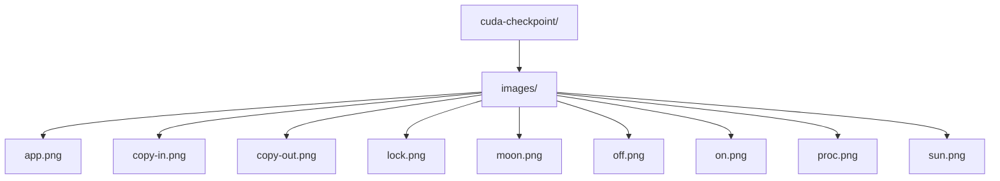
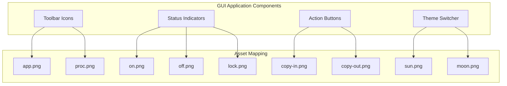

<!-- source: DeepWiki mcp.deepwiki.com · repo NVIDIA/cuda-checkpoint · page 7 Assets and Resources · fetched 2026-10-26 -->

# Assets and Resources

<details>
<summary>Relevant source files</summary>

The following files were used as context for generating this wiki page:

- [images/app.png](images/app.png)
- [images/copy-in.png](images/copy-in.png)
- [images/copy-out.png](images/copy-out.png)
- [images/lock.png](images/lock.png)
- [images/moon.png](images/moon.png)
- [images/off.png](images/off.png)
- [images/on.png](images/on.png)
- [images/proc.png](images/proc.png)
- [images/sun.png](images/sun.png)
- [images/unlock.png](images/unlock.png)
- [images/vm.png](images/vm.png)

</details>


This document catalogs the visual assets and image resources included in the cuda-checkpoint repository. These assets provide graphical representations of system states, operations, and components that can be used in documentation, presentations, and user interfaces.

For information about the core checkpoint/restore functionality, see [Architecture and Design](#2). For details about the command-line interface, see [Command-Line Reference](#4).

## Overview

The cuda-checkpoint repository contains nine PNG image assets in the [images/]() directory. These visual resources represent different aspects of the checkpoint/restore system:

- **Status Indicators**: Icons representing CUDA operational states (active, suspended, locked)
- **Data Flow Operations**: Visual representations of memory transfer operations
- **Process Representations**: Icons for applications and system processes
- **Theme Support**: Light and dark mode indicators

All assets are stored as PNG files with full color support and alpha transparency.

## Asset Categories

### State Indicator Icons

The project includes several icons that represent different operational states of the cuda-checkpoint system:

| Icon | Purpose | Description |
|------|---------|-------------|
| `on.png` | Active State | Indicates when CUDA operations are active |
| `off.png` | Inactive State | Indicates when CUDA operations are suspended |
| `lock.png` | Locked State | Represents when CUDA APIs are locked during checkpoint |

```mermaid
graph TD
    subgraph "CUDA State Management"
        ON[on.png<br/>"Active State"]
        OFF[off.png<br/>"Suspended State"] 
        LOCK[lock.png<br/>"Locked APIs"]
    end
    
    subgraph "Checkpoint Process"
        SUSPEND["cuda-checkpoint --toggle"]
        CRIU["CRIU dump/restore"]
        RESUME["cuda-checkpoint --toggle"]
    end
    
    ON --> SUSPEND
    SUSPEND --> LOCK
    LOCK --> OFF
    OFF --> CRIU
    CRIU --> RESUME
    RESUME --> ON
```

### Data Flow Icons

Icons representing data movement and transfer operations during checkpoint/restore cycles:

| Icon | Purpose | Description |
|------|---------|-------------|
| `copy-in.png` | Data Input | GPU memory being copied to host during checkpoint |
| `copy-out.png` | Data Output | Host memory being restored to GPU during resume |

```mermaid
graph LR
    subgraph "Checkpoint Flow"
        GPU1["GPU Memory"]
        HOST1["Host Memory"]
        GPU1 --> COPYIN[copy-in.png<br/>"GPU → Host"]
        COPYIN --> HOST1
    end
    
    subgraph "Restore Flow"  
        HOST2["Host Memory"]
        GPU2["GPU Memory"]
        HOST2 --> COPYOUT[copy-out.png<br/>"Host → GPU"]
        COPYOUT --> GPU2
    end
```

### Application and Process Icons

Icons representing applications and processes within the cuda-checkpoint ecosystem:

| Icon | Purpose | Description |
|------|---------|-------------|
| `app.png` | Application | Represents CUDA applications being checkpointed |
| `proc.png` | Process | Represents system processes and process management |

### Theme Icons

Icons supporting different visual themes or modes:

| Icon | Purpose | Description |
|------|---------|-------------|
| `sun.png` | Light Theme | Light mode visual theme indicator |
| `moon.png` | Dark Theme | Dark mode visual theme indicator |

## File Organization

All visual assets are organized within the project structure as follows:



## Technical Specifications

### Image Format Standards

All visual assets conform to the following technical specifications:

- **Format**: PNG (Portable Network Graphics)
- **Color Support**: Full color with alpha transparency
- **Compression**: Lossless PNG compression
- **Metadata**: Includes creation/modification timestamps

### File Properties

Each PNG file includes standard metadata fields:

```
- Creation Date: 2024-01-04T15:29:33+00:00 (varies by file)
- Modification Date: 2024-01-04T15:29:33+00:00 (varies by file)  
- Color Type: RGB with alpha channel
- Compression: PNG standard deflate compression
```

## Integration Context

### Potential GUI Applications

These assets are designed to support graphical user interfaces that might be built around the cuda-checkpoint functionality:



### Demonstration Materials

The icons serve as visual aids for documentation and demonstration purposes, helping to illustrate the checkpoint/restore workflow in presentations and educational materials.

### Status Monitoring

In monitoring applications, these icons could provide immediate visual feedback about the state of CUDA applications and checkpoint operations:

- Process state visualization
- Operation progress indication  
- Error and success state representation
- Real-time status updates

**Sources:** [images/app.png:1-174](), [images/copy-in.png:1-51](), [images/copy-out.png:1-48](), [images/lock.png:1-111](), [images/moon.png:1-128](), [images/off.png:1-194](), [images/on.png:1-243](), [images/proc.png:1-8](), [images/sun.png:1-36]()

---

