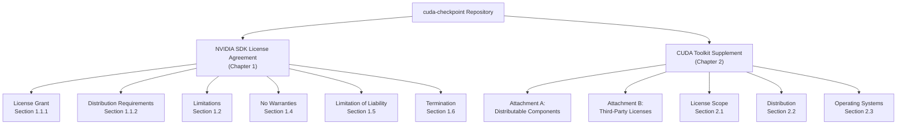
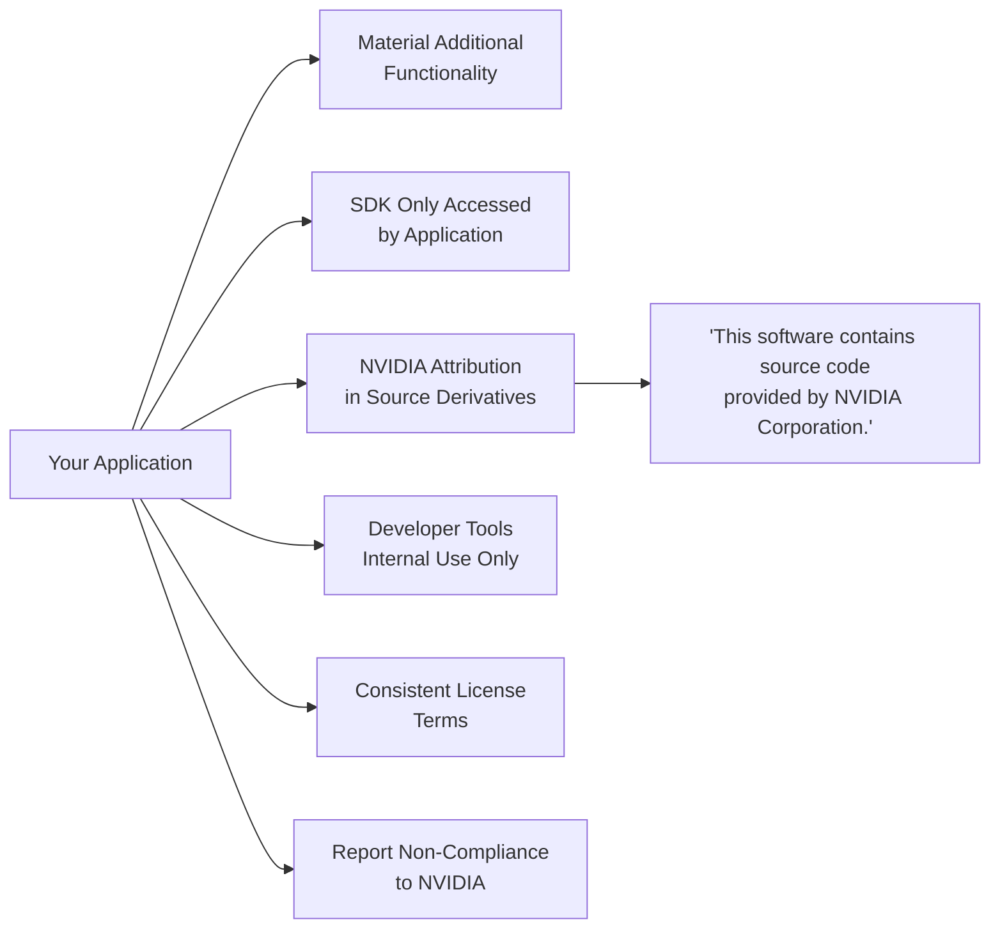
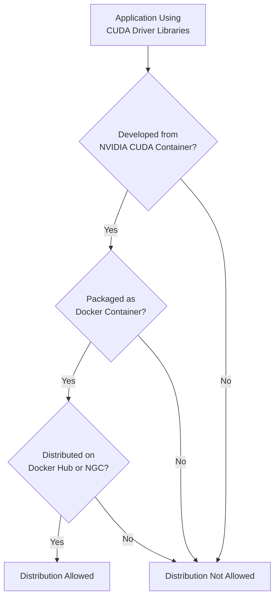
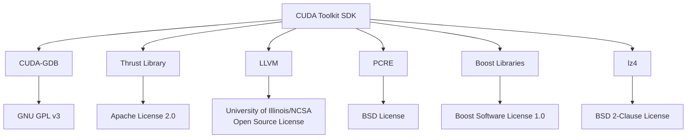
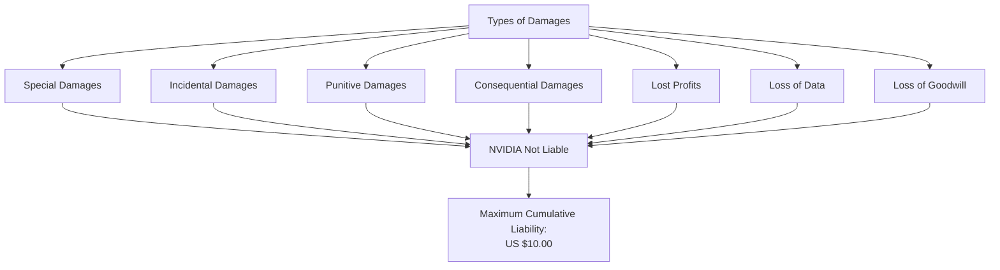
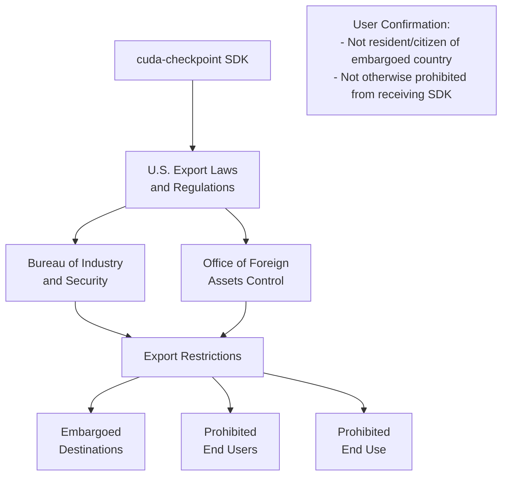
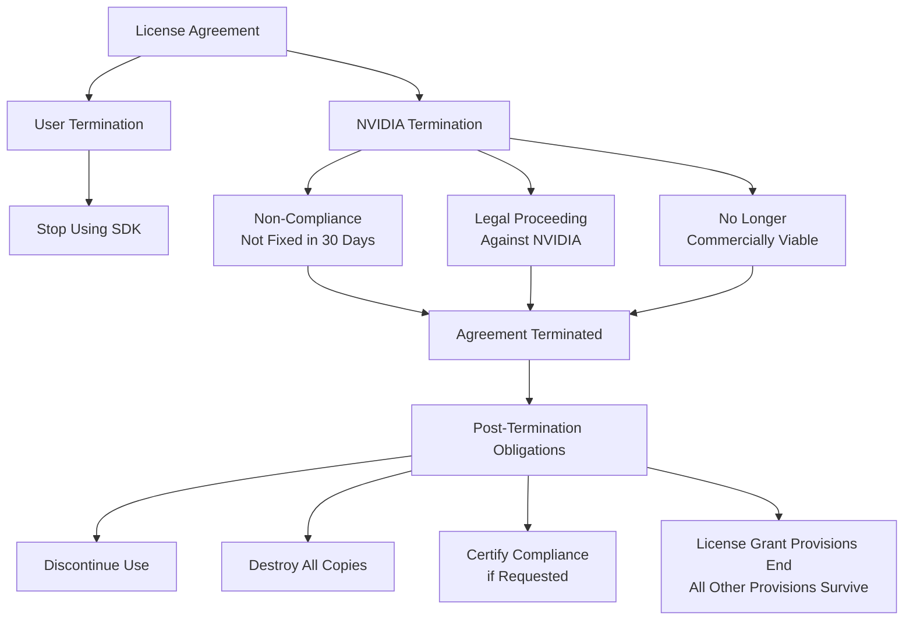

<!-- source: DeepWiki mcp.deepwiki.com · repo NVIDIA/cuda-checkpoint · page 8 Legal and Licensing · fetched 2026-10-26 -->

# Legal and Licensing

Relevant source files

The following files were used as context for generating this wiki page:

- [LICENSE](LICENSE)
- [bin/x86_64_Linux/LICENSE](bin/x86_64_Linux/LICENSE)

This page documents the licensing terms and legal restrictions that govern the use of the cuda-checkpoint utility and its associated components. The cuda-checkpoint utility is distributed as part of the NVIDIA CUDA Toolkit ecosystem and is subject to NVIDIA's Software License Agreement with a CUDA-specific supplement.

## License Structure

The licensing framework consists of two primary documents that govern all use of the cuda-checkpoint utility:

**Sources:** [LICENSE:1-1599](), [bin/x86_64_Linux/LICENSE:1-1599]()

## Primary License Terms

The NVIDIA Software License Agreement grants a **non-exclusive, non-transferable license** to use the SDK with the following core permissions and restrictions:

| Permission | Description | Reference |
|------------|-------------|-----------|
| **Install and Use** | Install and use the SDK on authorized systems | [LICENSE:143]() |
| **Modify Sample Code** | Create derivative works of sample source code | [LICENSE:145-146]() |
| **Distribute** | Distribute identified portions in object code format | [LICENSE:148-151]() |
| **Authorized Users** | Allow employees and contractors to use from secure network | [LICENSE:189-203]() |

### Key Restrictions

The following restrictions apply to all use of the cuda-checkpoint utility:

| Restriction | Description | Reference |
|-------------|-------------|-----------|
| **No Reverse Engineering** | Cannot reverse engineer, decompile, or disassemble SDK | [LICENSE:268-270]() |
| **No Stand-Alone Distribution** | Cannot distribute SDK as a stand-alone product | [LICENSE:272-276]() |
| **No Open Source Contamination** | Cannot use in manner that subjects SDK to open source licenses | [LICENSE:286-296]() |
| **Critical Applications** | Not certified for life-critical or safety-critical applications | [LICENSE:298-314]() |
| **NVIDIA GPU Only** | Licensed only for systems with NVIDIA GPUs | [LICENSE:544-545]() |
| **No Platform Translation** | Cannot reverse engineer output to target non-NVIDIA platforms | [LICENSE:328-331]() |

**Sources:** [LICENSE:93-332]()

## Distribution Requirements

To exercise distribution rights, applications incorporating cuda-checkpoint components must meet specific requirements:

### Distribution Checklist

Applications must satisfy all of the following conditions:

1. **Material Functionality** - Application must have substantial additional functionality beyond the SDK components ([LICENSE:159-160]())
2. **Encapsulation** - Distributable SDK portions shall only be accessed by your application ([LICENSE:162-163]())
3. **Attribution** - Include required notice in derivative works: `"This software contains source code provided by NVIDIA Corporation."` ([LICENSE:165-168]())
4. **Internal Tools** - Developer tools (like `cuda-checkpoint` binary) are for internal use unless explicitly identified as distributable ([LICENSE:170-172]())
5. **Consistent Terms** - Distribution terms must be consistent with this Agreement and protect NVIDIA intellectual property ([LICENSE:174-180]())
6. **Compliance Enforcement** - Must notify NVIDIA of known non-compliance ([LICENSE:182-186]())

**Sources:** [LICENSE:154-187]()

## CUDA Toolkit Distributable Components

The `cuda-checkpoint` utility itself is **NOT listed as a distributable component** in Attachment A. The distributable CUDA Toolkit components are limited to specific runtime libraries and headers:

### Relevant Distributable Components

| Component Category | Files | Platform | Reference |
|-------------------|-------|----------|-----------|
| **CUDA Runtime** | `libcudart.so`, `libcudart_static.a`, `libcudadevrt.a` | Linux | [LICENSE:610]() |
| **CUDA Driver Libraries** | `libcuda.so`, `libnvidia-ptxjitcompiler.so` | Linux (Docker only) | [LICENSE:913]() |
| **NVML** | Not listed as separately distributable | - | - |

### Special Distribution Rules for CUDA Driver Libraries

The CUDA Driver Libraries have restricted distribution conditions:

The CUDA Driver Libraries (`libcuda.so`, `libnvidia-ptxjitcompiler.so`) are only distributable in applications that:
1. Were developed starting from a NVIDIA CUDA container from Docker Hub or NVIDIA GPU Cloud
2. Are packaged as Docker containers
3. Are distributed only on Docker Hub or NVIDIA GPU Cloud

**Sources:** [LICENSE:587-949](), [LICENSE:928-937]()

## cuda-checkpoint Binary Distribution

The `cuda-checkpoint` utility binary ([bin/x86_64_Linux/cuda-checkpoint]()) is classified as a **developer tool** and falls under the "internal use only" restriction unless explicitly identified as distributable.

### Binary Location and License

| File Path | License File Location | Distribution Status |
|-----------|----------------------|---------------------|
| `bin/x86_64_Linux/cuda-checkpoint` | `bin/x86_64_Linux/LICENSE` | Internal Use Only |

The presence of the LICENSE file in the binary directory indicates that the utility is subject to the full SDK license agreement. Since it is not listed in Attachment A's distributable components, it is **delivered for internal use only** per [LICENSE:170-172]().

**Sources:** [bin/x86_64_Linux/LICENSE:1-1599]()

## Third-Party Components and Licenses

The SDK includes components from third parties, each with their own license terms. When there is a conflict between the SDK license and a component license, the component license controls to the extent necessary to resolve the conflict ([LICENSE:240-249]()).

### Third-Party License Summary

### Complete Third-Party License Table

| Component | License Type | Copyright Holder | Reference |
|-----------|--------------|------------------|-----------|
| **CUDA-GDB** | GNU GPL v3 | Various authors | [LICENSE:960-981]() |
| **Thrust Library** | Apache License 2.0 | Boost contributors | [LICENSE:987-1024]() |
| **LLVM** | University of Illinois/NCSA Open Source | University of Illinois | [LICENSE:1026-1071]() |
| **PCRE** | BSD License | University of Cambridge, Google Inc. | [LICENSE:1073-1148]() |
| **cuBLAS (Volkov)** | Modified BSD License | Regents of University of California | [LICENSE:1150-1183]() |
| **cuBLAS (Barbieri)** | Modified BSD License | Davide Barbieri, University of Rome | [LICENSE:1185-1217]() |
| **cuBLAS (Tennessee)** | Modified BSD License | University of Tennessee | [LICENSE:1219-1251]() |
| **cuBLAS (Hogg)** | Modified BSD License | STFC | [LICENSE:1253-1285]() |
| **cuBLAS (KAUST)** | Apache License 2.0 | King Abdullah University | [LICENSE:1287-1322]() |
| **cuSPARSE (Chang)** | NCSA Open Source License | University of Illinois | [LICENSE:1324-1359]() |
| **cuRAND (Saito/Matsumoto)** | BSD-style License | Hiroshima University | [LICENSE:1361-1395]() |
| **cuRAND (D.E. Shaw)** | BSD-style License | D. E. Shaw Research | [LICENSE:1397-1428]() |
| **Math Library (Juffa)** | BSD 2-Clause License | Norbert Juffa | [LICENSE:1430-1458]() |
| **lz4** | BSD 2-Clause License | Yann Collet | [LICENSE:1460-1487]() |
| **NPP (Boost Math)** | Boost Software License 1.0 | Boost contributors | [LICENSE:1489-1517]() |
| **Nsight Eclipse** | Eclipse Public License 1.0 | Eclipse Foundation | [LICENSE:1519-1536]() |
| **cuBLAS (OpenAI)** | MIT License | OpenAI, Google Inc. | [LICENSE:1538-1565]() |
| **Visual Studio Setup** | MIT License | Microsoft Corporation | [LICENSE:1567-1589]() |
| **linmath.h** | Apache License 2.0 | lunarG | [LICENSE:1591-1593]() |
| **d3dx12.h** | MIT License | Microsoft | [LICENSE:1595-1596]() |

**Sources:** [LICENSE:951-1598]()

### GPL Component: CUDA-GDB

The CUDA-GDB component is licensed under **GNU GPL v3**, which has specific requirements for source code access:

> "To obtain source code for software provided under licenses that require redistribution of source code, including the GNU General Public License (GPL) and GNU Lesser General Public License (LGPL), contact oss-requests@nvidia.com. This offer is valid for a period of three (3) years from the date of the distribution of this product by NVIDIA CORPORATION."

**Sources:** [LICENSE:960-981]()

## Warranty Disclaimers

The SDK is provided with explicit warranty disclaimers:

### No Warranties

The SDK is provided **"AS IS"** and **"WITH ALL FAULTS"** with no warranties of any kind:

| Warranty Type | Status | Reference |
|---------------|--------|-----------|
| MERCHANTABILITY | Expressly Disclaimed | [LICENSE:368-376]() |
| FITNESS FOR PARTICULAR PURPOSE | Expressly Disclaimed | [LICENSE:368-376]() |
| TITLE | Expressly Disclaimed | [LICENSE:368-376]() |
| NON-INFRINGEMENT | Expressly Disclaimed | [LICENSE:368-376]() |
| ABSENCE OF DEFECTS | Expressly Disclaimed | [LICENSE:368-376]() |

> "THE SDK IS PROVIDED BY NVIDIA 'AS IS' AND 'WITH ALL FAULTS.' TO THE MAXIMUM EXTENT PERMITTED BY LAW, NVIDIA AND ITS AFFILIATES EXPRESSLY DISCLAIM ALL WARRANTIES OF ANY KIND OR NATURE, WHETHER EXPRESS, IMPLIED OR STATUTORY..."

**Sources:** [LICENSE:366-376]()

## Limitation of Liability

NVIDIA's liability is strictly limited:

### Liability Cap

Key limitation terms:
- **No liability** for special, incidental, punitive, or consequential damages
- **No liability** for lost profits, loss of use, loss of data, or loss of goodwill
- **Maximum cumulative liability**: US$10.00 ([LICENSE:390-394]())
- These limitations apply **regardless of** whether NVIDIA was advised of possibility of damages ([LICENSE:396-398]())
- These limitations are an **essential basis of the bargain** ([LICENSE:399-404]())

**Sources:** [LICENSE:379-404]()

## Critical Applications Prohibition

The SDK is **explicitly prohibited** from use in Critical Applications:

### Critical Application Definition

A "Critical Application" is any system where use or failure could:
- Threaten the safety of human life, OR
- Result in catastrophic damages

Examples include ([LICENSE:304-307]()):
- Avionics
- Navigation systems
- Autonomous vehicle applications
- AI solutions for automotive products
- Military applications
- Medical devices
- Life support systems
- Other life-critical applications

### Indemnification Requirement

Users must **defend, indemnify and hold harmless** NVIDIA from any claims arising from:
1. Products or services using the SDK in Critical Applications
2. Use of the SDK outside the scope of this Agreement
3. Use of the SDK not in compliance with its terms

**Sources:** [LICENSE:298-326]()

## Export Control and U.S. Government Rights

### Export Restrictions

The SDK is subject to United States export laws and regulations ([LICENSE:494-505]()):

1. **Prohibited Actions**:
   - Cannot ship, transfer, or export SDK into prohibited countries
   - Cannot use SDK in any manner prohibited by U.S. Bureau of Industry and Security
   - Cannot use SDK in violation of OFAC economic sanctions regulations

2. **User Confirmation**:
   - Must not be resident or citizen of embargoed country
   - Must not be otherwise prohibited from receiving the SDK

3. **Restrictions Apply To**:
   - Destinations (embargoed countries)
   - End users (prohibited persons/entities)
   - End use (prohibited purposes)

### U.S. Government Rights

The SDK is classified as **"commercial items"** consisting of "commercial computer software" with **RESTRICTED RIGHTS** ([LICENSE:482-492]()):

- Subject to DFARS 227.7202-3(a)
- Subject to FAR 52.227-19 Commercial Computer Software - Restricted Rights clause
- Contractor/manufacturer: NVIDIA, 2788 San Tomas Expressway, Santa Clara, CA 95051

**Sources:** [LICENSE:482-505]()

## Termination

### Termination Conditions

### Termination by User
User may terminate at any time by stopping use of the SDK ([LICENSE:412-413]()).

### Termination by NVIDIA
NVIDIA may terminate if ([LICENSE:415-428]()):
1. **Non-compliance** not fixed within 30 days (or immediately for IP violations)
2. **Legal proceeding** commenced against NVIDIA regarding SDK
3. **Commercial viability** - NVIDIA decides to no longer provide SDK in a country

### Post-Termination Obligations
Upon termination ([LICENSE:430-438]()):
1. Promptly discontinue use of SDK
2. Destroy all copies in possession or control
3. Prior distributions remain valid
4. Must certify compliance in writing if requested
5. All provisions survive **except license grant provisions**

**Sources:** [LICENSE:407-438]()

## Governing Law and Jurisdiction

### Legal Framework

| Aspect | Provision | Reference |
|--------|-----------|-----------|
| **Governing Law** | Laws of United States and State of Delaware | [LICENSE:455-457]() |
| **Language** | English language governs all interpretations | [LICENSE:461-462]() |
| **Jurisdiction** | State or federal courts in Santa Clara County, California | [LICENSE:464-466]() |
| **Injunctive Relief** | NVIDIA may seek in any jurisdiction | [LICENSE:467-469]() |
| **UN Convention** | CISG specifically disclaimed | [LICENSE:459-460]() |

### Assignment and Notices

- **Assignment**: Requires NVIDIA written approval; attempted assignment without approval is void ([LICENSE:443-449]())
- **Notices**: NVIDIA may deliver via mail, email, or fax to users ([LICENSE:507-513]())
- **NVIDIA Address**: 2788 San Tomas Expressway, Santa Clara, California 95051, United States of America, Attention: Legal Department ([LICENSE:511-513]())

**Sources:** [LICENSE:441-523]()

## Pre-Release Software

If using pre-release versions (alpha, beta, preview) of cuda-checkpoint:

### Pre-Release Warnings

| Risk | Description | Reference |
|------|-------------|-----------|
| **Functionality** | May not be fully functional | [LICENSE:208-213]() |
| **Reliability** | May contain errors or design flaws | [LICENSE:208-213]() |
| **Standards** | Reduced security, privacy, accessibility standards | [LICENSE:210-213]() |
| **Data Loss** | May result in unexpected results or loss of data | [LICENSE:213-215]() |
| **Production Use** | Not intended for production or business-critical systems | [LICENSE:217-219]() |

### No Guarantee of Commercial Release

- NVIDIA may choose not to make commercial version available ([LICENSE:221-222]())
- NVIDIA may abandon development and terminate availability at any time without liability ([LICENSE:223-224]())

**Sources:** [LICENSE:206-224]()

## Compliance and Verification

Users must cooperate with NVIDIA compliance verification:

1. **Information Requests**: Provide reasonably requested information to verify compliance ([LICENSE:451-452]())
2. **Non-Compliance Response**: If authorized users don't follow terms, must take reasonable steps to resolve and prevent recurrence ([LICENSE:199-203]())
3. **Report Violations**: Must notify NVIDIA in writing of any known or suspected non-compliant distribution ([LICENSE:182-186]())

**Sources:** [LICENSE:182-186](), [LICENSE:199-203](), [LICENSE:451-452]()

## Contact Information

### Licensing Questions

For questions regarding the license agreement or if distribution terms are not suitable:
- **Email**: nvidia-compute-license-questions@nvidia.com

**Sources:** [LICENSE:581-584]()

### Open Source Code Requests

For GPL/LGPL components requiring source code redistribution:
- **Email**: oss-requests@nvidia.com
- **Validity**: 3 years from distribution date

**Sources:** [LICENSE:969-977]()

### Legal Correspondence

For legal notices:
- **Address**: NVIDIA Corporation, 2788 San Tomas Expressway, Santa Clara, California 95051, United States of America
- **Attention**: Legal Department

**Sources:** [LICENSE:510-513]()